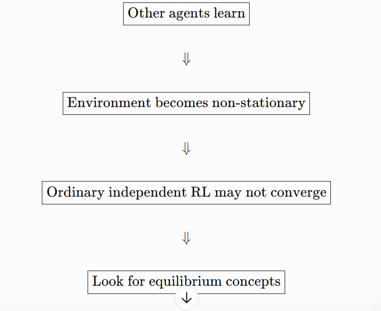

```
vilt/
│
├── datamodules/       ← 管“怎么加载数据”
│
├── datasets/          ← 管“每条数据长什么样”
│
├── gadgets/           ← 管“评价指标”
│
├── modules/           ← 核心：模型、loss、预测头、Transformer
│
├── transforms/        ← 图像预处理
│
├── utils/             ← 把原始数据集整理成 ViLT 能读的格式
│
├── __init__.py
└── config.py          ← 总配置
```

、MDP（马尔可夫决策过程，Markov Decision Process）

Repeated Game（重复博弈）

Markov Game / Stochastic Game（马尔可夫博弈 / 随机博弈）
MDP — Markov Decision Process：马尔可夫决策过程  
Repeated Game：重复博弈  
Markov Game：马尔可夫博弈  
Stochastic Game：随机博弈  
State Transition：状态转移  
Joint Action：联合动作  
Joint Policy：联合策略  
Heterogeneous Agents：异构智能体  
State-Value Function：状态价值函数  
Action-Value Function：动作价值函数  
Independent Q-Learning / IQL：独立 Q 学习  
Non-stationary Environment：非平稳环境  
Infinite Horizon：无限时域  
Finite Horizon：有限时域  
Discount Factor：折扣因子  
Bellman Equation：贝尔曼方程  
TD Target：时序差分目标  
TD Error：时序差分误差  
Convergence Guarantee：收敛保证



1. **Other agents learn** 其他智能体也在学习（持续更新自己的策略）
2. **Environment becomes non-stationary** （对单个智能体而言）环境变成**非平稳环境**
3. **Ordinary independent RL may not converge** 普通的独立强化学习（比如 IQL 独立 Q 学习）**可能无法收敛**
4. **Look for equilibrium concepts** 需要去寻找**均衡相关的理论 / 概念**（来作为多智能体学习的目标）

\(U(\cdot)\)：**你的期望收益（utility/payoff）**

equilibrium solver（均衡求解器）

| 英文                       | 中文               | 含义                                     |
| -------------------------- | ------------------ | ---------------------------------------- |
| Zero-Sum Game              | 零和博弈           | 一方收益就是另一方损失                   |
| Matching Pennies           | 正反面硬币匹配博弈 | 经典二人零和游戏                         |
| Mixed Strategy Equilibrium | 混合策略均衡       | equilibrium 使用概率分布                 |
| Indifferent / Indifference | 无差异             | 多个 action 的期望收益相同               |
| Cycle / Cycling            | 循环               | 策略不断绕圈，不收敛                     |
| Maximin                    | 最大最小           | 最大化最坏情况下的收益                   |
| Minimax                    | 最小最大           | 最小化对方能够获得的最大收益             |
| Minimax Theorem            | 极小极大定理       | 两人有限零和博弈中 maximin = minimax     |
| Game Value                 | 博弈值             | equilibrium 下的收益值                   |
| Saddle Point               | 鞍点               | 双方都无法通过单边变化改善的零和均衡结构 |
| Guarantee                  | 保证               | 无论对手怎么做，至少保证某个收益         |
| Equilibrium Solver         | 均衡求解器         | 给定 payoff/Q matrix 求 equilibrium      |
| Equilibrium Selection      | 均衡选择           | 多个 equilibrium 时选哪一个              |
| Fixed Point                | 不动点             | 映射后仍回到自身的点                     |

 Decentralized Training + Decentralized Execution

Bidirectional RNN 双向的RNN

 COMA：Counterfactual Multi-Agent Policy Gradients

| English                 | 中文                    |
| ----------------------- | ----------------------- |
| Communication Network   | 通信网络                |
| CommNet                 | 通信网络式 MARL 架构    |
| Feature Map             | 特征表示 / 特征图       |
| Aggregation             | 聚合                    |
| Average / Mean          | 平均                    |
| Centralized Controller  | 集中式控制器            |
| Bidirectional RNN       | 双向循环神经网络        |
| Sequence                | 序列                    |
| Coordination            | 协作 / 协调             |
| Centralized Training    | 集中式训练              |
| Decentralized Execution | 分散式执行              |
| CTDE                    | 集中训练、分散执行      |
| Critic                  | 价值评估网络            |
| Actor                   | 策略网络 / 动作生成网络 |
| Credit Assignment       | 信用分配 / 功劳归因     |
| Counterfactual          | 反事实                  |
| Counterfactual Baseline | 反事实基线              |
| Advantage               | 优势函数                |
| Policy Gradient         | 策略梯度                |
| Deterministic Policy    | 确定性策略              |
| Continuous Action       | 连续动作                |
| Joint Action            | 联合动作                |
| Centralized Critic      | 集中式 Critic           |
| Global Information      | 全局信息                |
| Local Observation       | 局部观测                |
