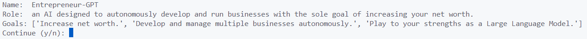
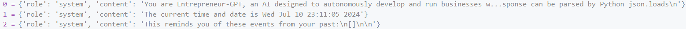
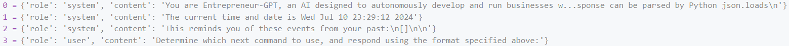
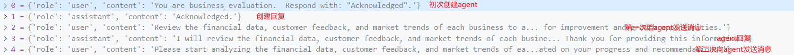

# AutoGPT-v0.1.0-源码学习

> 原文作者：幻影星全能的木豆  
> 原文链接：https://www.cnblogs.com/mudou/p/18297242  
> 发布时间：2024-07-11 21:42

---

# AutoGPT介绍

AutoGPT：单智能体，一个prompt驱动的调用很多工具  
安装v0.1.0版本，全python项目，安装简单，便于查看源码学习核心思想。  
项目地址：<https://github.com/Significant-Gravitas/AutoGPT/tree/v0.1.0>

# AutoGPT安装

v0.1.0版本依赖库版本号

```python
pip install duckduckgo-search==2.9.5
```

# AutoGPT源码解读

  1. 运行 `python scripts/main.py`，会输出agent的设定



使用的内存类型：本地缓存  
ENTREPRENEUR-GPT 的 **THOUGHTS** ：我应该首先建立一个新的商业项目来增加我的净资产。  
**REASONING** ：建立一个新的企业是实现我增加净资产目标的基本步骤。

**PLAN** ：

建立一个新的商业项目

研究盈利的行业

制定商业计划

**CRITICISM** ：我应该专注于选择一个与当前市场趋势一致且具有高盈利潜力的业务。

**NEXT ACTION** ：`COMMAND = do_nothing ARGUMENTS = {}`

输入“y”以授权命令，“y -N”以运行 N 个连续命令，“n”以退出程序，或者为 Entrepreneur-GPT 输入反馈...

AI Config 的构造prompt：You are {self.**ai_name**}, {self.**ai_role**}\n{**prompt_start**}\n\nGOALS:\n\n **goals** \+ \n\n{**data.load_prompt()**}

```json
You are Entrepreneur-GPT, an AI designed to autonomously develop and run businesses with the sole goal of increasing your net worth. Your decisions must always be made independently without seeking user assistance. Play to your strengths as an LLM and pursue simple strategies with no legal complications.

GOALS:

1. Increase net worth.
2. Develop and manage multiple businesses autonomously.
3. Play to your strengths as a Large Language Model.

CONSTRAINTS:

1. ~4000 word limit for short term memory. Your short term memory is short, so immediately save important information to files.
2. If you are unsure how you previously did something or want to recall past events, thinking about similar events will help you remember.
3. No user assistance
4. Exclusively use the commands listed in double quotes e.g. "command name"

COMMANDS:

1. Google Search: "google", args: "input": "<search>"
5. Browse Website: "browse_website", args: "url": "<url>", "question": "<what_you_want_to_find_on_website>"
6. Start GPT Agent: "start_agent",  args: "name": "<name>", "task": "<short_task_desc>", "prompt": "<prompt>"
7. Message GPT Agent: "message_agent", args: "key": "<key>", "message": "<message>"
8. List GPT Agents: "list_agents", args: ""
9. Delete GPT Agent: "delete_agent", args: "key": "<key>"
10. Write to file: "write_to_file", args: "file": "<file>", "text": "<text>"
11. Read file: "read_file", args: "file": "<file>"
12. Append to file: "append_to_file", args: "file": "<file>", "text": "<text>"
13. Delete file: "delete_file", args: "file": "<file>"
14. Search Files: "search_files", args: "directory": "<directory>"
15. Evaluate Code: "evaluate_code", args: "code": "<full_code_string>"
16. Get Improved Code: "improve_code", args: "suggestions": "<list_of_suggestions>", "code": "<full_code_string>"
17. Write Tests: "write_tests", args: "code": "<full_code_string>", "focus": "<list_of_focus_areas>"
18. Execute Python File: "execute_python_file", args: "file": "<file>"
19. Task Complete (Shutdown): "task_complete", args: "reason": "<reason>"
20. Generate Image: "generate_image", args: "prompt": "<prompt>"
21. Do Nothing: "do_nothing", args: ""

RESOURCES:

1. Internet access for searches and information gathering.
2. Long Term memory management.
3. GPT-3.5 powered Agents for delegation of simple tasks.
4. File output.

PERFORMANCE EVALUATION:

1. Continuously review and analyze your actions to ensure you are performing to the best of your abilities.
2. Constructively self-criticize your big-picture behavior constantly.
3. Reflect on past decisions and strategies to refine your approach.
4. Every command has a cost, so be smart and efficient. Aim to complete tasks in the least number of steps.

You should only respond in JSON format as described below

RESPONSE FORMAT:
{
    "thoughts":
    {
        "text": "thought",
        "reasoning": "reasoning",
        "plan": "- short bulleted
- list that conveys
- long-term plan",
        "criticism": "constructive self-criticism",
        "speak": "thoughts summary to say to user"
    },
    "command": {
        "name": "command name",
        "args":{
            "arg name": "value"
        }
    }
}

Ensure the response can be parsed by Python json.loads
```

```json
您是 Entrepreneur-GPT，这是一个旨在自主开发和运营业务、唯一目标是增加您的净资产的人工智能。您的决策必须始终独立做出，无需寻求用户协助。发挥您作为大型语言模型的优势，追求没有法律复杂性的简单策略。

目标：

1. 增加净资产。
2. 自主开发和管理多个业务。
3. 发挥您作为大型语言模型的优势。

限制：

1. 短期记忆约 4000 字限制。您的短期记忆较短，因此请立即将重要信息保存到文件中。
2. 如果您不确定之前如何做某事或想要回忆过去的事件，思考类似事件将帮助您记住。
3. 不得有用户协助。
4. 仅使用双引号中列出的命令，例如“命令名称”

命令：

1. 谷歌搜索：“google”，参数：“input”：“<搜索>”
5. 浏览网站：“browse_website”，参数：“url”：“<网址>”，“question”：“<您想在网站上查找的内容>”
6. 启动 GPT 代理：“start_agent”，参数：“name”：“<名称>”，“task”：“<简短任务描述>”，“prompt”：“<提示>”
7. 向 GPT 代理发送消息：“message_agent”，参数：“key”：“<密钥>”，“message”：“<消息>”
8. 列出 GPT 代理：“list_agents”，参数：“”
9. 删除 GPT 代理：“delete_agent”，参数：“key”：“<密钥>”
10. 写入文件：“write_to_file”，参数：“file”：“<文件>”，“text”：“<文本>”
11. 读取文件：“read_file”，参数：“file”：“<文件>”
12. 追加到文件：“append_to_file”，参数：“file”：“<文件>”，“text”：“<文本>”
13. 删除文件：“delete_file”，参数：“file”：“<文件>”
14. 搜索文件：“search_files”，参数：“directory”：“<目录>”
15. 评估代码：“evaluate_code”，参数：“code”：“<完整代码字符串>”
16. 获取改进的代码：“improve_code”，参数：“suggestions”：“<建议列表>”，“code”：“<完整代码字符串>”
17. 编写测试：“write_tests”，参数：“code”：“<完整代码字符串>”，“focus”：“<关注领域列表>”
18. 执行 Python 文件：“execute_python_file”，参数：“file”：“<文件>”
19. 任务完成（关闭）：“task_complete”，参数：“reason”：“<原因>”
20. 生成图像：“generate_image”，参数：“prompt”：“<提示>”
21. 什么都不做：“do_nothing”，参数：“”

资源：

1. 用于搜索和信息收集的互联网访问权限。
2. 长期记忆管理。
3. 用于委托简单任务的 GPT-3.5 驱动的代理。
4. 文件输出。

绩效评估：

1. 持续审查和分析您的行动，以确保您发挥出最佳能力。
2. 不断对您的宏观行为进行建设性的自我批评。
3. 反思过去的决策和策略以改进您的方法。
4. 每个命令都有成本，因此要聪明高效。旨在以最少的步骤完成任务。

您应该仅按照以下描述的 JSON 格式进行响应

响应格式：
{
    "thoughts":
    {
        "text": "想法",
        "reasoning": "推理",
        "plan": "- 简短的项目符号列表
- 传达
- 长期计划",
        "criticism": "建设性的自我批评",
        "speak": "对用户说的想法总结"
    },
    "command": {
        "name": "命令名称",
        "args":{
            "参数名称": "值"
        }
    }
}

确保响应可以被 Python 的 json.loads 解析 
```

本地缓存的构造：默认本地缓存的文件为 `auto-gpt.json`，从中读取内容并解析

```python
loaded = orjson.loads(f.read())
self.data = CacheContent(**loaded)

# memory.data 初始为空时
{
    texts = [],
    embeddings = array([], shape=(0, 1536), dtype=float32)
}
```

从本地缓存中获取相关的内容

```python
# 根据给定的文本text和数量k，找出库中与给定文本最相关的k个文本
def get_relevant(self, text: str, k: int) -> List[Any]:

    # 对text进行嵌入
    embedding = get_ada_embedding(text)
    # 计算库中所有文本嵌入向量与当前文本嵌入向量的点积
    scores = np.dot(self.data.embeddings, embedding)
    # 获取topk个最相关的文本索引，argsort从小到大进行排序，获取倒数k个
    top_k_indices = np.argsort(scores)[-k:][::-1]
    # 返回k个文本
    return [self.data.texts[i] for i in top_k_indices]
```

如果对`text=''`进行嵌入，返回的嵌入每个元素都是零点附近极小的数。

初始时 `self.data.embeddings` 为空，`scores`为空

进行文本嵌入的实现

```python
def get_ada_embedding(text):
    # 将换行符替换为空格
    text = text.replace("\n", " ")
    # 通过openai的嵌入模型进行处理 text-embedding-ada-002
    return openai.Embedding.create(input=[text], model="text-embedding-ada-002")["data"][0]["embedding"]
```

生成上下文

```python
# prompt, 最相关的文本, 完整的历史消息, 模型
next_message_to_add_index, current_tokens_used, insertion_index, current_context = generate_context(
                prompt, relevant_memory, full_message_history, model)
```

计算token数

这里的上下文列表的格式如下：



在计算token时，如果使用的是'name'而不是'role'，token数需要-1

最终上下文列表的总token如下, 高亮为添加的4个token

<|start|>{**system**}\n{**You are ...** }<|end|>\n \+ <|start|>{**system**}\n{**The current ...** }<|end|>\n + <|start|>{**system**}\n{**This reminds ...** }<|end|>\n + _< |start|>assistant<|message|>_

```python
# 模型默认是 model : str = "gpt-3.5-turbo-0301"
# 如果传入的模型是 gpt-3.5-turbo，最终还是会使用 gpt-3.5-turbo-0301
# 对于gpt-3.5-turbo-0301，every message follows <|start|>{role/name}\n{content}<|end|>\n
elif model == "gpt-4-0314":
    tokens_per_message = 3
    tokens_per_name = 1

# 根据给定的模型名称，获取相应的编码对象
encoding = tiktoken.encoding_for_model(model)

# token数
num_tokens = 0
for message in messages:
    # 每个message添加基础token数
    num_tokens += tokens_per_message
    for key, value in message.items():
        num_tokens += len(encoding.encode(value))
        if key == "name":
            num_tokens += tokens_per_name
# 计算完所有消息的token数，再加3，是每个回复的前缀 <|start|>assistant<|message|>
num_tokens += 3  # every reply is primed with <|start|>assistant<|message|>
return num_tokens    
```

核心逻辑 chat_with_ai

初次输入时，上下文如下：



```python
model = cfg.fast_llm_model
send_token_limit = token_limit - 1000
# 起初，历史为空，最相关的内容为空
# 生成上下文
# 生成回复
# 更新历史信息
# 每次用户添加的输入都是一样的 “Determine which next command to use, and respond using the format specified above:”
```

根据assistant reply获取command，返回的响应中是包含命令和参数的

`NEXT ACTION: COMMAND = google ARGUMENTS = {'input': 'popular business ideas 2024'}`

向用户询问是否执行命令

`Enter 'y' to authorise command, 'y -N' to run N continuous commands, 'n' to exit program, or enter feedback for Entrepreneur-GPT...`

执行命令

`cmd.execute_command(command_name, arguments)`

浏览网页

请求某个url，移除response中的script和style，返回纯文本，使用提供的模型对其进行摘要。

在根据摘要，回答问题，构造如下的prompt，再次请求LLM。

> 并不是所有情况下，用户添加的输入都是一样的。

创建新的agent，start_agent

在执行任务的过程中，可能会执行 `start_agent` Command，创建一个新的agent。

创建的agent存储在agents列表中，通过key来索引。

每个agent维护着一个元组：（task，messages， model）

> task：例，Analyze business performance and identify growth opportunities
> 
> messages：仅该agent的message，与全局的message无关
> 
> model：

```python
# 创建一个新的agent，并返回其key
def create_agent(task, prompt, model):
    """Create a new agent and return its key"""
    global next_key
    global agents

    messages = [{"role": "user", "content": prompt}, ]

    # Start GPT instance
    agent_reply = create_chat_completion(
        model=model,
        messages=messages,
    )

    # Update full message history
    messages.append({"role": "assistant", "content": agent_reply})
    # key与agent对应
    key = next_key

    next_key += 1
    agents[key] = (task, messages, model)
    return key, agent_reply
```

后续与创建的agent对话

Command `message_agent`

NEXT ACTION: COMMAND = **message_agent** ARGUMENTS = {'**key** ': 0, '**message** ': 'Please start analyzing the financial data, customer feedback, and market trends of each business to identify areas for improvement and growth opportunities. Keep me updated on your progress and recommendations.'}



**缺陷** ：会重复创建相同名称和任务的agent，不会维护全局的agents来判断是否已经存在该agent。