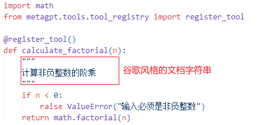

# MetaGPT-main-源码学习

> 原文作者：幻影星全能的木豆  
> 原文链接：https://www.cnblogs.com/mudou/p/18297250  
> 发布时间：2024-07-11 21:52

---

学习最新版本的MetaGPT官方教程(v0.8.1 maybe)

学习教程：<https://docs.deepwisdom.ai/main/zh/guide/tutorials/concepts.html>

# v0.8.1 改动(相比v0.4)

## 智能体入门

1.）在《智能体入门》章节，`v0.8.1`版本在创建`Role`时显式地创建了`Context`对象，与`v0.4`版本相比，相关的类代码并没有改动。

```python
# v0.8.1
from metagpt.context import Context

context = Context()
role = ProductManager(context=context)

# Role类定义
class Role(SerializationMixin, ContextMixin, BaseModel):
     rc: RoleContext = Field(default_factory=RoleContext)
# RoleContext
class RoleContext(BaseModel):
    memory: Memory = Field(default_factory=Memory)
# Memory定义
class Memory(BaseModel):
    storage: list[SerializeAsAny[Message]] = []
```

`WARNING | metagpt.utils.common:wrapper:649 - There is a exception in role's execution, in order to resume, we delete the newest role communication message in the role's memory.`

如果不显式地指定context，会报错`ValueError: Invalid root`

```python
# v0.4
role = ProductManager()

# Role 对象中维护着 RoleContext 对象
class Role:
    def __init__(self, name="", profile="", goal="", constraints="", desc="", is_human=False):
        self._rc = RoleContext()
        
# RoleContext 对象中维护着 Memory 对象
class RoleContext(BaseModel):
    memory: Memory = Field(default_factory=Memory)
    
# Memory 对象中存储Message结构体
class Memory:
    def __init__(self):
        self.storage: list[Message] = []
```

2.）定义动作 & 定义角色 & 运行角色代码没有变化，~~在创建角色时都需要显式地指定context~~ ，在运行自定义角色时没有显式传递context也可以正常运行。

更多细节需要阅读`Role`以及`ProductManager`源码查找原因。

## 多智能体入门

在创建`Team`运行时，由`team.start_project(idea)`改为了`team.run_project(idea)`.

## 新增-创建和使用工具

在MetaGPT中，可以直接创建自己的函数或类作为工具，放在`metagpt/tools/libs` 目录下。

### 创建工具的步骤

  1. 编写**专门用于与外部环境进行特定交互** 的函数或类，并将它们放置在`metagpt/tools/libs`目录中。
  2. 为每个函数或类**配备谷歌风格的文档字符串** 。这作为一个简洁而全面的参考资料，详细说明其用途、输入参数和预期输出。
  3. 使用`@register_tool`装饰器以确保在工具注册表中准确注册。这个装饰器简化了函数或类与`DataInterpreter`的集成。

### 自定义工具案例

1.）自定义计算阶乘的工具

在 `metagpt/tools/libs` 中创建一个自己的函数，假设它是 `calculate_factorial.py`，并添加装饰器 `@register_tool` 以将其注册为工具



2.）`register_tool`装饰器函数详解

```python
# 将一个工具类或函数注册到一个工具注册表中
def register_tool(tags: list[str] = None, schema_path: str = "", **kwargs):
    """
    register a tool to registry
    tags：字符串列表，用于标记工具
    schema_path：表示工具的模式文件路径
    """
    # 装饰器函数，cls 表示被装饰器装饰的类
    def decorator(cls):
        # 获取被装饰的类或函数的文件路径
        file_path = inspect.getfile(cls)
        if "metagpt" in file_path:
            # split to handle ../metagpt/metagpt/tools/... where only metapgt/tools/... is needed
            file_path = "metagpt" + file_path.split("metagpt")[-1]
        # 获取被装饰类的源代码
        source_code = inspect.getsource(cls)
        # 将工具的信息注册到注册表中
        TOOL_REGISTRY.register_tool(
            tool_name=cls.__name__,	# 工具名称 = 类名
            tool_path=file_path,
            schema_path=schema_path,
            tool_code=source_code,
            tags=tags,
            tool_source_object=cls,
            **kwargs,
        )
        return cls

    return decorator
```

当导入包含 `@register_tool` 装饰器的模块时，装饰器会自动运行，将类注册到 `TOOL_REGISTRY` 中。

3.）将自定义工具集成到数据解释器`DataInterpreter`中，并在计算过程中使用工具

````python
import asyncio
from metagpt.roles.di.data_interpreter import DataInterpreter
from metagpt.tools.libs import calculate_factorial

async def main(requirement: str):
    role = DataInterpreter(tools=["calculate_factorial"]) # 集成工具
    await role.run(requirement)

if __name__ == "__main__":
    requirement = "请计算 5 的阶乘"
    await main(requirement)

"""
运行过程：

metagpt.tools.tool_recommend:recall_tools:194 - Recalled tools: ['calculate_factorial']; Scores: [0.0]
metagpt.tools.tool_recommend:recommend_tools:100 - Recommended tools: ['calculate_factorial']
metagpt.roles.di.data_interpreter:_write_code:153 - ready to WriteAnalysisCode

```python
# Importing the pre-defined tool for calculating factorial
from metagpt.tools.libs.calculate_factorial import calculate_factorial

# Calculate the factorial of 5
result = calculate_factorial(5)

# Print the result
print("The factorial of 5 is:", result
```
"""
````

> 注意：
> 
>   1. 编写谷歌风格的文档字符串（docstring），有助于 `DataInterpreter` 选择合适的工具并理解其工作方式。
>   2. 在注册工具时，工具的名称就是函数的名称。
>   3. 在运行 DataInterpreter 之前，记得从 `metagpt.tools.libs` 导入自定义的 `calculate_factorial` 模块，以确保该工具已被注册。
> 

通过上述步骤，可以无缝地创建并整合MetaGPT中`Tools`框架内的工具，使`DataInterpreter`能够有效地与外部环境交互。

## 人类介入

## 环境的创建

## 新增-集成开源LLM

目前，如果要得到比较稳定的代码生成结果，需要使用OpenAI的GPT-3.5或GPT-4。但目前也有很多其他优秀的开源模型可以供实验，也能够得到令人相对满意的结果。

**下面将展开如何接入开源LLM并根据你的输入需求得到项目输出** 。

待补充

## 新增-为角色或动作配置不同的LLM

每个Role可以根据其特定的需求和背景，以及每个Action的特点，选择最合适的LLM，增强了团队互动的灵活性和现实性。

通过这种方式，你可以更精细地控制对话的质量和方向，从而创造出更加丰富和真实的交互体验。

设置步骤如下：

  1. 定义不同的LLM配置文件

```python
from metagpt.config2 import Config

# 1. 创建新的gpt-4配置文件并加载
gpt4 = Config.from_home("gpt-4.yaml")  # 从`~/.metagpt`目录加载自定义配置`gpt-4.yaml`
# 2. 使用默认的配置文件
gpt4t = Config.default()  # 使用默认配置，即`config2.yaml`文件中的配置，此处`config2.yaml`文件中的model为"gpt-4-turbo"
# 3. 修改配置文件中使用的LLM
gpt35 = Config.default()
gpt35.llm.model = "gpt-3.5-turbo"  # 将model修改为"gpt-3.5-turbo"
```

  2. 在创建Role和Action时，为其分配不同的配置文件

```python
from metagpt.roles import Role
from metagpt.actions import Action

# 创建a1、a2和a3三个Action。并为a1指定`gpt4t`的配置。
a1 = Action(config=gpt4t, name="Say", instruction="Say your opinion with emotion and don't repeat it")
a2 = Action(name="Say", instruction="Say your opinion with emotion and don't repeat it")
a3 = Action(name="Vote", instruction="Vote for the candidate, and say why you vote for him/her")

# 创建A，B，C三个角色，分别为“民主党候选人”、“共和党候选人”和“选民”。
# 虽然A设置了config为gpt4，但因为a1已经配置了Action config，所以A将使用model为gpt4的配置，而a1将使用model为gpt4t的配置。
A = Role(name="A", profile="Democratic candidate", goal="Win the election", actions=[a1], watch=[a2], config=gpt4)
# 因为B设置了config为gpt35，而为a2未设置Action config，所以B和a2将使用Role config，即model为gpt35的配置。
B = Role(name="B", profile="Republican candidate", goal="Win the election", actions=[a2], watch=[a1], config=gpt35)
# 因为C未设置config，而a3也未设置config，所以C和a3将使用Global config，即model为gpt4的配置。
C = Role(name="C", profile="Voter", goal="Vote for the candidate", actions=[a3], watch=[a1, a2])
```

  3. 注意配置的优先级：Action config > Role config > Global config（config in config2.yaml）

  4. 创建一个带有环境的团队，开始交互。

```python
import asyncio
from metagpt.environment import Environment
from metagpt.team import Team

# 创建一个描述为“美国大选现场直播”的环境
env = Environment(desc="US election live broadcast")
team = Team(investment=10.0, env=env, roles=[A, B, C])
# 运行团队，我们应该会看到它们之间的协作
asyncio.run(team.run(idea="Topic: climate change. Under 80 words per message.", send_to="A", n_round=3))
# await team.run(idea="Topic: climate change. Under 80 words per message.", send_to="A", n_round=3) # 如果在Jupyter Notebook中运行，使用这行代码
```

# 源码阅读

下面调试21点游戏，跟随执行流程阅读源码，设计到相应的步骤可参考下文（无需顺序阅读，边调试边到对应部分阅读）。

## 运行流程总结

  1. 创建团队并雇佣多个角色，团队开启项目`company.run_project(idea=idea)`

开启项目的过程：

①将用户`Idea`包装为消息发送到环境中。

②环境分发消息到所有参与的角色中 `role.put_message(message)`，发送到每个角色维护的消息队列上。

  2. 团队开始运行项目 `company.run(n_round=5)`

内部进入到`Team`的环境的运行 `self.env.run()`

在环境`run`中，会将所有角色的`run`的协程对象加入到`futures`，通过`await asyncio.gather(*futures)`等待所有角色的协程对象完成

  3. 下面进入到具体的`Role`运行，协程

`Role`监控环境是否有新的事件发生，获取最新观察到的消息`self.latest_observed_msg`

运行`Role`的`react`，根据`self.rc.react_mode`进入对应的框架。

```python
if self.rc.react_mode == RoleReactMode.REACT or self.rc.react_mode == RoleReactMode.BY_ORDER:
    rsp = await self._react()
elif self.rc.react_mode == RoleReactMode.PLAN_AND_ACT:
    rsp = await self._plan_and_act()
```

在`_react`框架中，`_think`和`_act`嵌套在最大次数为`self.rc.max_react_loop`的`while`循环中。

```python
async def _react(self) -> Message:
    actions_taken = 0
    while actions_taken < self.rc.max_react_loop:
        # think
        todo = await self._think()
        if not todo:
            break
        # act
        rsp = await self._act()
        actions_taken += 1
```

## 消息传输框架

待补充

## 消息路由结构设计

待补充

消息中的路由信息仅负责指定消息收件人，而不关心消息收件人的位置。

## ActionOutput

```python
class ActionOutput:
    content: str
    instruct_content: BaseModel

    def __init__(self, content: str, instruct_content: BaseModel):
        self.content = content
        self.instruct_content = instruct_content
```

## RoleReactMode

```python
class RoleReactMode(str, Enum):
    REACT = "react"
    BY_ORDER = "by_order"	# 顺序执行
    PLAN_AND_ACT = "plan_and_act"  # 规划并行动

    @classmethod
    def values(cls):
        return [item.value for item in cls]
```

## Role

1.）初始化 & 消息的存储

`Role`接收的消息存放在`self.rc.msg_buffer`中，`RoleContext`对象的`msg_buffer`队列中。

```python
msg_buffer: MessageQueue = Field(
    default_factory=MessageQueue, exclude=True
)  # Message Buffer with Asynchronous Updates
```

```python
class Role(SerializationMixin, ContextMixin, BaseModel):
    """Role/Agent"""

    model_config = ConfigDict(arbitrary_types_allowed=True, extra="allow")
    name: str = ""
    profile: str = ""
    goal: str = ""
    constraints: str = ""
    desc: str = ""
    is_human: bool = False
    role_id: str = ""
    states: list[str] = []

    # scenarios to set action system_prompt:
    #   1. `__init__` while using Role(actions=[...])
    #   2. add action to role while using `role.set_action(action)`
    #   3. set_todo while using `role.set_todo(action)`
    #   4. when role.system_prompt is being updated (e.g. by `role.system_prompt = "..."`)
    # Additional, if llm is not set, we will use role's llm
    actions: list[SerializeAsAny[Action]] = Field(default=[], validate_default=True)
    rc: RoleContext = Field(default_factory=RoleContext)
    addresses: set[str] = set()
    planner: Planner = Field(default_factory=Planner)

    # builtin variables
    recovered: bool = False  # to tag if a recovered role
    latest_observed_msg: Optional[Message] = None  # record the latest observed message when interrupted
    __hash__ = object.__hash__  # support Role as hashable type in `Environment.members`
```

2.）给角色发送消息

角色将收到的消息放置在角色自身维护的`RoleContext`的`MessageQueue`中。

发生情况：①项目启动时，Team将Idea消息发送到环境中的每个角色，每个角色接收该消息。

```python
def put_message(self, message):
    """Place the message into the Role object's private message buffer."""
    if not message:
        return
    self.rc.msg_buffer.push(message)
```

3.）Role的run协程对象

```python
@role_raise_decorator
async def run(self, with_message=None) -> Message | None:
    """
    Observe, 
    and think 
    and act 
    based on the results of the observation"""
    if with_message:
        msg = None
        if isinstance(with_message, str):
            msg = Message(content=with_message)
        elif isinstance(with_message, Message):
            msg = with_message
        elif isinstance(with_message, list):
            msg = Message(content="\n".join(with_message))
        if not msg.cause_by:
            msg.cause_by = UserRequirement
        # 将消息发送到角色的消息队列中
        self.put_message(msg)
    # 监控角色的环境，检查是否有新的信息或事件发生
    if not await self._observe():
        # If there is no new information, suspend and wait
        # 如果没有新的消息，Role进入等待状态
        logger.debug(f"{self._setting}: no news. waiting.")
        return

    # 有新的消息，开始行动
    rsp = await self.react()

    # 重置下一步的动作
    self.set_todo(None)
    # 将响应消息发送到环境中，环境会将消息分发给所有的订阅者（包括角色本身）
    self.publish_message(rsp)
    return rsp
```

4.）检测环境 `self._observe()`

```python
async def _observe(self, ignore_memory=False) -> int:
    """Prepare new messages for processing from the message buffer and other sources."""
    # Read unprocessed messages from the msg buffer.
    news = []
    if self.recovered:
        news = [self.latest_observed_msg] if self.latest_observed_msg else []
    if not news:
        # 从消息缓冲区读取未处理消息
        news = self.rc.msg_buffer.pop_all()
    # 存储读取的消息以防止重复处理
    # old_messages 用于存储之前的消息，如果 ignore_memory 为 False，则使用 self.rc.memory.get() 获取之前的消息
    old_messages = [] if ignore_memory else self.rc.memory.get()
    # 添加新消息到消息列表
    self.rc.memory.add_batch(news)
    # 筛选消息，由 self.rc.watch 指定的发送者发送，要么发送给 self.name 指定的接收者
    self.rc.news = [
        n for n in news if (n.cause_by in self.rc.watch or self.name in n.send_to) and n not in old_messages
    ]
    # 记录最新观察到的消息
    self.latest_observed_msg = self.rc.news[-1] if self.rc.news else None  # record the latest observed msg

    # Design Rules:
    # If you need to further categorize Message objects, you can do so using the Message.set_meta function.
    # msg_buffer is a receiving buffer, avoid adding message data and operations to msg_buffer.
    
    # 包含消息发送者和消息内容的列表
    news_text = [f"{i.role}: {i.content[:20]}..." for i in self.rc.news]
    if news_text:
        logger.debug(f"{self._setting} observed: {news_text}")
        
    # 返回筛选出的消息数量
    return len(self.rc.news)
```

5.）开始行动 `self.react()`

```python
async def react(self) -> Message:
    """Entry to one of three strategies by which Role reacts to the observed Message"""
    if self.rc.react_mode == RoleReactMode.REACT or self.rc.react_mode == RoleReactMode.BY_ORDER:
        rsp = await self._react()
    elif self.rc.react_mode == RoleReactMode.PLAN_AND_ACT:
        rsp = await self._plan_and_act()
    else:
        raise ValueError(f"Unsupported react mode: {self.rc.react_mode}")
    self._set_state(state=-1)  # current reaction is complete, reset state to -1 and todo back to None
    return rsp
```

6.）角色绑定的Actions

```python
# Role
class Role(SerializationMixin, ContextMixin, BaseModel):
	actions: list[SerializeAsAny[Action]] = Field(default=[], validate_default=True)

# 在对角色绑定动作时会加入到动作列表中
def set_action(self, action: Action):
    self.set_actions([action])
def set_actions(self, actions: list[Union[Action, Type[Action]]]):
   	'''简化过程'''
    for action in actions:
        self.actions.append(action)
```

## Team

1.）初始化 `company = Team()`

Team类维护一到多个Roles，env，idea，investment，model_config

使用Context对象创建Environment

```python
class Team(BaseModel):
    """

    """
    model_config = ConfigDict(arbitrary_types_allowed=True)
    env: Optional[Environment] = None
    investment: float = Field(default=10.0)
    idea: str = Field(default="")
    def __init__(self, context: Context = None, **data: Any):
        super(Team, self).__init__(**data)
        ctx = context or Context()
        if not self.env:
            self.env = Environment(context=ctx)
```

2.）`Team` 雇佣 `Roles` `company.hire([ProductManager(), Architect(), ProjectManager(), Engineer(),])`

雇佣的过程就是 向`Team`的维护的`env`中添加`Roles`

```python
def hire(self, roles: list[Role]):
    """Hire roles to cooperate"""
    self.env.add_roles(roles)	
    
```

3.）启动项目 `company.run_project(idea=idea)`

启动项目时，负责将消息发布到环境中。

消息类型是 `send_to=send_to or MESSAGE_ROUTE_TO_ALL`，发送给所有`Role`

```python
def run_project(self, idea, send_to: str = ""):
    """Run a project from publishing user requirement."""
    self.idea = idea

    # Human requirement.
    self.env.publish_message(
        Message(role="Human", content=idea, cause_by=UserRequirement, send_to=send_to or MESSAGE_ROUTE_TO_ALL),
        peekable=False,
    )
```

4.）`await company.run(n_round=5)` 运行项目，跟进之后会跳到下面的函数

```python
def serialize_decorator(func):
    async def wrapper(self, *args, **kwargs):
        try:
            result = await func(self, *args, **kwargs)
            return result
        except KeyboardInterrupt:
            logger.error(f"KeyboardInterrupt occurs, start to serialize the project, exp:\n{format_trackback_info()}")
        except Exception:
            logger.error(f"Exception occurs, start to serialize the project, exp:\n{format_trackback_info()}")
        self.serialize()  # Team.serialize

    return wrapper
```

这里的self就是company对象，Team类，但该函数却不是Team类下的方法。

相当于中转执行 `await company.run(n_round=5)`，`company.run` 地址被传递到`func`，`<function Team.run at 0x000001C55C82B550>`

接着进入`company.cun`执行

```python
@serialize_decorator
async def run(self, n_round=3, idea="", send_to="", auto_archive=True):
    """Run company until target round or no money"""
    # idea在self里面，这里idea为空，self.idea不为空
    if idea:
        self.run_project(idea=idea, send_to=send_to)

    while n_round > 0:
        n_round -= 1
        self._check_balance()
        # 调用环境的run函数
        await self.env.run()

        logger.debug(f"max {n_round=} left.")
    self.env.archive(auto_archive)
    return self.env.history
```

## Environment

```python
class Environment(ExtEnv):
    """
    环境，承载一批角色，角色可以向环境发布消息，可以被其他角色观察到
    
    """
    desc: str = Field(default="")  # 环境描述
    roles: dict[str, SerializeAsAny["Role"]] = Field(default_factory=dict, validate_default=True)	# 维护Roles的字典
    member_addrs: Dict["Role", Set] = Field(default_factory=dict, exclude=True)
    context: Context = Field(default_factory=Context, exclude=True)
```

1.）添加角色 `add_role`

将一个角色添加到环境中，意味着该角色处在此环境中，同时共享该环境的context。

```python
def add_role(self, role: "Role"):
    """增加一个在当前环境的角色
    Add a role in the current environment
    """
    self.roles[role.profile] = role	 # role的profile作为字典键建立映射
    role.set_env(self)				# 设置被添加Role的env
    role.context = self.context		 # 设置被添加Role的context
```

2.）发布消息 `publish_message`

```python
def publish_message(self, message: Message, peekable: bool = True) -> bool:
    """
    将消息分发给收件人。
    根据 RFC 116 第 2.2.1 章中的消息路由结构设计，正如在整个系统的 RFC 113 中已经规划的那样，消息中的路由信息仅负责指定消息收件人，而不关心消息收件人的位置。
    如何将消息路由到消息收件人是 RFC 113 中设计的传输框架所解决的问题。
    """
    logger.debug(f"publish_message: {message.dump()}")
    found = False
    # According to the routing feature plan in Chapter 2.2.3.2 of RFC 113
    # Role类型的key, addrs 是一个set集合
    # 将消息发送给所有的role
    for role, addrs in self.member_addrs.items():
        # type(role) <class 'metagpt.roles.product_manager.ProductManager'>
        # addrs {'metagpt.roles.product_manager.ProductManager', 'Alice'}
        if is_send_to(message, addrs):
            role.put_message(message)
            found = True
    if not found:
        logger.warning(f"Message no recipients: {message.dump()}")
    self.history += f"\n{message}"  # For debug

    return True
```

3.）环境的run函数，Team在run时会调用环境的run函数

**环境的run会将所有角色的run协程对象加入futures** 。

等待所有角色的协程对象完成 `await asyncio.gather(*futures)`

`*futures`表示将`futures`列表展开为单独的参数传递给`gather`

```python
async def run(self, k=1):
    """处理一次所有信息的运行
    Process all Role runs at once
    """
    for _ in range(k):
        futures = []
        for role in self.roles.values():
            # future是一个由role_raise_decorator装饰器创建的协程对象
            future = role.run()
            futures.append(future)
        '''
        0 = <coroutine object role_raise_decorator.<locals>.wrapper at 0x000001C55DCE57C0>
        1 = <coroutine object role_raise_decorator.<locals>.wrapper at 0x000001C55DCE5F40>
        2 = <coroutine object role_raise_decorator.<locals>.wrapper at 0x000001C55ED8C8C0>
        3 = <coroutine object role_raise_decorator.<locals>.wrapper at 0x000001C55ED8C9C0>
        '''
        await asyncio.gather(*futures)
        logger.debug(f"is idle: {self.is_idle}")
```

在涉及到的Role中下断点，以观察具体的执行过程，这里在产品经理`ProductManager`中调试

`ProductManager`绑定的动作是`self.set_actions([PrepareDocuments, WritePRD])`，在这两个`Action`的`run`下断点

**关键来了~~** 这里跳转到 `PrepareDocuments` `Action`的`run`函数中。

```python
# PrepareDocuments Action run

async def run(self, with_messages, **kwargs):
    """Create and initialize the workspace folder, initialize the Git environment."""
    self._init_repo()

    # 将idea写入文件
    doc = await self.repo.docs.save(filename=REQUIREMENT_FILENAME, content=with_messages[0].content)
    # 发送消息通知 WritePRD action
    # doc=idea
    return ActionOutput(content=doc.content, instruct_content=doc)
```

这里产品经理的Action执行结束后，返回一个ActionOutput对象。

**重点来了~~** 这里返回到Role的_act中的第4行代码，也就是说上面的Action发生在第三行`await self.rc.todo.run(self.rc.history)`，返回的ActionOutput即为response。

将返回的response包装为Message，发送到Role的RoleContext对象的Memory对象的消息列表中。

```python
# Role
async def _act(self) -> Message:
    logger.info(f"{self._setting}: to do {self.rc.todo}({self.rc.todo.name})")
    # 这里根据 rc.todo 决定执行哪个动作
    response = await self.rc.todo.run(self.rc.history)
    if isinstance(response, (ActionOutput, ActionNode)):
        msg = Message(
            content=response.content,
            instruct_content=response.instruct_content,
            role=self._setting,
            cause_by=self.rc.todo,
            sent_from=self,
        )
    elif isinstance(response, Message):
        msg = response
    else:
        msg = Message(content=response or "", role=self.profile, cause_by=self.rc.todo, sent_from=self)
    self.rc.memory.add(msg)

    return msg
```

当Role的_act执行结束后，返回到Role的_react函数下 15行`rsp = await self._act()`

**重点来了~~** 也就是说整个过程是在`_react`框架(函数)下运行。

某个`Role`在`_react`下：先进行Think，再进行Act，在`while actions_taken < self.rc.max_react_loop`下运行，最多循环两次。

```python
# Role
async def _react(self) -> Message:
    """Think first, then act, until the Role _think it is time to stop and requires no more todo.
    This is the standard think-act loop in the ReAct paper, which alternates thinking and acting in task solving, i.e. _think -> _act -> _think -> _act -> ...
    Use llm to select actions in _think dynamically
    """
    actions_taken = 0
    rsp = Message(content="No actions taken yet", cause_by=Action)  # will be overwritten after Role _act
    while actions_taken < self.rc.max_react_loop:
        # think
        # 如果时顺序执行动作，在状态正确时返回True
        todo = await self._think()
        if not todo:
            break
        # act
        logger.debug(f"{self._setting}: {self.rc.state=}, will do {self.rc.todo}")
        rsp = await self._act()
        actions_taken += 1
    return rsp  # return output from the last action
```

**重点来了~~** 再次循环，进入`_think`中

```python
# Role
async def _think(self) -> bool:
    """Consider what to do and decide on the next course of action. Return false if nothing can be done."""
    # 如果Role只绑定了一个动作，那么只能指定这个动作
    if len(self.actions) == 1:
        self._set_state(0)
        return True

    if self.recovered and self.rc.state >= 0:
        self._set_state(self.rc.state)  # action to run from recovered state
        self.recovered = False  # avoid max_react_loop out of work
        return True
    # 如果时顺序执行，这里直接返回了
    if self.rc.react_mode == RoleReactMode.BY_ORDER:
        if self.rc.max_react_loop != len(self.actions):
            self.rc.max_react_loop = len(self.actions)
        self._set_state(self.rc.state + 1)
        return self.rc.state >= 0 and self.rc.state < len(self.actions)
    # 如果不是顺序执行
    prompt = self._get_prefix()
    prompt += STATE_TEMPLATE.format(
        history=self.rc.history,
        states="\n".join(self.states),
        n_states=len(self.states) - 1,
        previous_state=self.rc.state,
    )

    next_state = await self.llm.aask(prompt)
    next_state = extract_state_value_from_output(next_state)
    logger.debug(f"{prompt=}")

    if (not next_state.isdigit() and next_state != "-1") or int(next_state) not in range(-1, len(self.states)):
        logger.warning(f"Invalid answer of state, {next_state=}, will be set to -1")
        next_state = -1
    else:
        next_state = int(next_state)
        if next_state == -1:
            logger.info(f"End actions with {next_state=}")
    self._set_state(next_state)
    return True
```

## 消息队列 & 消息列表

消息列表：当Role的Action执行完毕后将结果包装成ActionOutput对象返回，再被包装为Message，发送给该Role维护的消息列表中。

```python
# 每个Role维护RoleContext对象
class Role(SerializationMixin, ContextMixin, BaseModel):
    rc: RoleContext = Field(default_factory=RoleContext)
# RoleContext维护Memory对象
class RoleContext(BaseModel):
    memory: Memory = Field(default_factory=Memory)
# Memory维护着Message的列表
class Memory(BaseModel):
    storage: list[SerializeAsAny[Message]] = []
```

## 消息队列

```python
class MessageQueue(BaseModel):
    """Message queue which supports asynchronous updates."""
    model_config = ConfigDict(arbitrary_types_allowed=True)
    _queue: Queue = PrivateAttr(default_factory=Queue)
```

```python
def push(self, msg: Message):
    """Push a message into the queue."""
    self._queue.put_nowait(msg)
```

## Queue

```python
class Queue:
    """A queue, useful for coordinating producer and consumer coroutines.
    
    useful for 生产者和消费者协程
    如果 maxsize 小于或等于零，则队列大小是无限的。
    如果它是一个大于 0 的整数，那么当队列达到 maxsize 时，“await put()”将阻塞，直到通过 get() 移除一个项目。

    与标准库中的 Queue 不同，您可以通过 qsize() 可靠地知道此 Queue 的大小，
    因为您的单线程 asyncio 应用程序在调用 qsize() 和对 Queue 进行操作之间不会被中断。
    """
    def __init__(self, maxsize=0, *, loop=None):
        if loop is None:
            self._loop = events.get_event_loop()
        else:
            self._loop = loop
            warnings.warn("The loop argument is deprecated since Python 3.8, "
                          "and scheduled for removal in Python 3.10.",
                          DeprecationWarning, stacklevel=2)
        self._maxsize = maxsize

        # Futures.
        self._getters = collections.deque()
        # Futures.
        self._putters = collections.deque()
        self._unfinished_tasks = 0
        self._finished = locks.Event(loop=loop)
        self._finished.set()
        self._init(maxsize)
```

## 产品经理

`ProductManager`目标是高效地创造出满足市场需求和用户期望的成功产品

具备`准备文档`和`写PRD`两个动作，按顺序执行 `RoleReactMode.BY_ORDER`

观测`准备文档`和`用户需求`动作产生的消息

```python
class ProductManager(Role):
    name: str = "Alice"
    profile: str = "Product Manager"
    goal: str = "efficiently create a successful product that meets market demands and user expectations"
    constraints: str = "utilize the same language as the user requirements for seamless communication"
    todo_action: str = ""

    def __init__(self, **kwargs) -> None:
        super().__init__(**kwargs)
        self.set_actions([PrepareDocuments, WritePRD])
        self._watch([UserRequirement, PrepareDocuments])
        self.rc.react_mode = RoleReactMode.BY_ORDER
        self.todo_action = any_to_name(WritePRD)

    async def _observe(self, ignore_memory=False) -> int:
        return await super()._observe(ignore_memory=True)
```

## 装饰器

### 自定义工具时的装饰器

### Team.run的装饰器