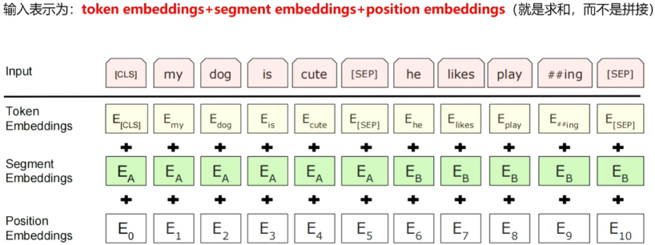

# 面试准备【LLM】

> 原文作者：幻影星全能的木豆  
> 原文链接：https://www.cnblogs.com/mudou/p/18303823  
> 发布时间：2024-07-15 19:15

---

### 其他注意力

### 过拟合的表现有哪些？

### BN 训练和测试的区别在哪里？

BN（Batch Normalization，批量归一化）是一种用于加速深度神经网络训练并提高其稳定性和性能的技术。它在训练和测试阶段有一些关键的区别。

**训练阶段**

在训练过程中，BN会对每个小批量（batch）的数据计算均值和方差。

使用计算得到的均值和方差对小批量的数据进行归一化。

归一化后的数据再经过可学习的缩放（gamma）和平移（beta）参数的变换。

为了在测试时使用，BN还会维护一个全局的均值和方差，这些值是通过对训练过程中计算的均值和方差进行移动平均计算得到的。

$$\mu_{\text {batch }}=\frac{1}{m} \sum_{i=1}^{m} x_{i}$$

$$\sigma_{\text {batch }}^{2}=\frac{1}{m} \sum_{i=1}^{m}\left(x_{i}-\mu_{\text {batch }}\right)^{2}$$

$$\hat{x}_{i}=\frac{x_{i}-\mu_{\text {batch }}}{\sqrt{\sigma_{\text {batch }}^{2}+\epsilon}}$$

$y_{i}=\gamma \hat{x}_{i}+\beta$​

> 为了在测试阶段能够使用一个稳定的均值和方差，我们需要计算训练过程中这些小批量均值和方差的移动平均值。
> 
> 移动平均是一种平滑数据的方法，使得我们可以从一个变化的值中得到一个相对稳定的估计值。
> 
> 第一个批次的均值和方差：$\mu_{1}=2, \sigma_{1}^{2}=1$
> 
> 第二个批次的均值和方差：$\mu_{2}=4, \sigma_{2}^{2}=2$
> 
> 第三个批次的均值和方差：$\mu_{3}=3, \sigma_{3}^{2}=1.5$​
> 
> 我们将使用一个学习率 α=0.1来计算移动平均。
> 
> 首先，我们初始化全局均值和方差为零：
> 
> $$\begin{array}{l}
\mu_{\text {global }}=0 \\
\sigma_{\text {global }}^{2}=0
\end{array}$$
> 
> 批次1 更新公式：
> 
> $$\begin{array}{l}
\mu_{\text {global }}=(1-\alpha) \mu_{\text {global }}+\alpha \mu_{\text {batch }} \\
\sigma_{\text {global }}^{2}=(1-\alpha) \sigma_{\text {global }}^{2}+\alpha \sigma_{\text {batch }}^{2}
\end{array}$$
> 
> 应用第一个批次的数据：
> 
> $$\begin{array}{l}
\mu_{\text {global }}=(1-0.1) \cdot 0+0.1 \cdot 2=0.2 \\
\sigma_{\text {global }}^{2}=(1-0.1) \cdot 0+0.1 \cdot 1=0.1
\end{array}$$
> 
> 批次2 应用第二个批次的数据：
> 
> $$\begin{array}{l}
\mu_{\text {global }}=(1-0.1) \cdot 0.2+0.1 \cdot 4=0.18+0.4=0.58 \\
\sigma_{\text {global }}^{2}=(1-0.1) \cdot 0.1+0.1 \cdot 2=0.09+0.2=0.29
\end{array}$$

**测试阶段**

在测试阶段，BN不再计算当前批量数据的均值和方差，而是使用在训练阶段通过移动平均计算得到的全局均值和方差。

使用全局均值和方差对测试数据进行归一化。

同样使用训练过程中学到的缩放（gamma）和平移（beta）参数。

$$\hat{x}_{i}=\frac{x_{i}-\mu_{\text {global }}}{\sqrt{\sigma_{\text {global }}^{2}+\epsilon}}$$

$$y_{i}=\gamma \hat{x}_{i}+\beta$$

通过这些机制，BN在训练阶段可以加速训练收敛，并在测试阶段提供稳定的性能表现。

### 梯度下降的公式？

梯度下降是一种优化算法，用于通过**最小化损失函数** 来训练机器学习模型。它的基本思想是不断调整模型的参数，以使损失函数值逐渐减小。

假设我们有一个损失函数 $L(\theta)$，其中 $\theta$​ 是模型的参数向量。梯度下降算法的核心步骤是**按照损失函数的负梯度方向更新参数** 。基本的梯度下降更新公式如下：

$$\theta:=\theta-\eta \nabla_{\theta} L(\theta)$$

$$\nabla_{\theta} L(\theta) \text { 是损失函数 } L(\theta) \text { 关于参数 } \theta \text { 的梯度（也称为导数） }$$

> 假设我们有一个简单的线性回归模型，其损失函数是均方误差（MSE），形式如下：
> 
> $$L(\theta)=\frac{1}{2 m} \sum_{i=1}^{m}\left(h_{\theta}\left(x^{(i)}\right)-y^{(i)}\right)^{2}$$
> 
> $$h_{\theta}\left(x^{(i)}\right)=\theta_{0}+\theta_{1} x^{(i)}$$
> 
> 计算对 $\theta_{0}$ 的梯度
> 
> $$\frac{\partial L(\theta)}{\partial \theta_{0}}=\frac{1}{m} \sum_{i=1}^{m}\left(h_{\theta}\left(x^{(i)}\right)-y^{(i)}\right)$$
> 
> 计算对 $\theta_{1}$​ 的梯度
> 
> $$\frac{\partial L(\theta)}{\partial \theta_{1}}=\frac{1}{m} \sum_{i=1}^{m}\left(h_{\theta}\left(x^{(i)}\right)-y^{(i)}\right) x^{(i)}$$
> 
> 得到了$\theta_{0}$ 和 $\theta_{1}$​ 的梯度之后，我们可以使用梯度下降算法更新模型参数：
> 
> $$\begin{array}{l}
\theta_{0}:=\theta_{0}-\eta \frac{\partial L(\theta)}{\partial \theta_{0}} \\
\theta_{1}:=\theta_{1}-\eta \frac{\partial L(\theta)}{\partial \theta_{1}}
\end{array}$$

**梯度下降算法的变种**

  1. 批量梯度下降（Batch Gradient Descent）：每次迭代使用全部训练数据来计算梯度。
  2. 随机梯度下降（Stochastic Gradient Descent, SGD）：每次迭代只使用一个训练样本来计算梯度。
  3. 小批量梯度下降（Mini-batch Gradient Descent）：每次迭代使用一个小批量的训练数据来计算梯度。

> 批量梯度下降：可以快速接近最优解，但是其时间消耗相对其他两种是最大的，因为每一次更新都需要遍历完所有数据。
> 
> 随机梯度下降：参数更新是最快的，因为每遍历一个数据都会做参数更新，但是由于没有遍历完所有数据，所以其路线不一定是最佳路线，甚至可能会反方向巡迹，不过其整体趋势是往最优解方向行进的，随机梯度下降还有一个好处是有一定概率跳出局部最优解(每次的J(θ)是不固定的)，而BGD会直接陷入局部最优解。
> 
> 小批量梯度下降：权衡了参数更新速度和训练稳定性之后，通过同时处理一小批量数据来减少梯度估计的方差，在梯度估计的稳定性和收敛路径的平滑性上都有所提高。

在使用梯度下降的时候，一般需要进行一些调优策略：

  1. 学习率过大可能会跳过最优解；学习率过小导致迭代速度过慢；
  2. 算法初始参数值的选择：初始值不同，最终获得的最小值也可能不同，因为梯度下降求解的是局部最优解，一般情况下，选择多个不同的初始值运行算法，最终返回损失函数最小情况下的结果值。

### 反向传播

**工作原理**

  1. 反向传播的第一步是前向传播，它是神经网络从输入到输出的正向计算过程。得到最终的预测输出，与实际标签进行比较，从而计算出预测误差。
  2. 在前向传播过程中，通过损失函数（也称为目标函数）来度量模型的预测与实际标签之间的误差。损失函数的选择取决于问题的类型，例如均方误差（Mean Squared Error）用于回归问题，交叉熵（Cross-Entropy）用于分类问题。
  3. 反向传播误差：反向传播的核心思想是将损失从输出层传播回网络的每一层，计算每一层的权重梯度以便后续的权重更新。
  4. 梯度更新：一旦计算出每一层的梯度，就可以使用梯度下降或其变种算法（如Adam、RMSprop等）来更新神经网络的权重。

### 优化器 & Adam

### 均方误差损失

### 交叉熵损失

### 梯度消失问题

梯度消失问题发生在深度神经网络中，特别是在使用某些激活函数（如Sigmoid或Tanh）时。在反向传播过程中，梯度会随着网络的深度逐渐减小，最终变得非常接近零。这意味着深层网络的底层权重几乎不会得到有效的更新，导致网络无法学习到底层特征和模式。

**处理梯度消失问题的方法**

  1. 使用激活函数：选择具有更大梯度的激活函数，如ReLU（Rectified Linear Unit），它在正数范围内梯度恒为1，有助于减轻梯度消失问题。
  2. 权重初始化：使用合适的权重初始化方法，如He初始化，以确保网络在训练初始阶段具有较大的梯度。
  3. Batch Normalization：批归一化（Batch Normalization）层有助于减少梯度消失问题，通过在每个小批量上标准化输入数据。

### 梯度爆炸问题

梯度爆炸问题是指在反向传播中，梯度变得非常大，导致权重更新过大，网络无法稳定训练。这通常发生在网络架构复杂、梯度流通路径较长或学习率较大时。

**处理梯度爆炸问题的方法**

  1. 梯度裁剪：通过设置一个阈值，当梯度的范数超过阈值时，将梯度进行缩放，以防止梯度爆炸。
  2. 减小学习率：减小学习率可以减缓梯度的上升速度，降低梯度爆炸的风险。
  3. 权重正则化：使用权重正则化技术，如L1正则化或L2正则化，可以降低权重的大小，减少梯度爆炸的可能性。
  4. Batch Normalization：批归一化不仅可以减轻梯度消失问题，还可以一定程度上缓解梯度爆炸问题。

### 权重正则化

权重正则化是一种常用的技术，用于控制机器学习模型的复杂度，并防止模型在训练过程中出现过拟合的问题。

它通过向损失函数添加一个正则化项，强制模型学习到的权重参数保持较小的值，从而降低模型的复杂度。

**L1正则化**

L1 正则化通过向损失函数添加权重向量的 L1 范数（权重的绝对值之和）来惩罚模型复杂度。

L1 正则化的损失函数形式如下：$\mathcal{L}_{\mathrm{L} 1}(\theta)=\mathcal{L}(\theta)+\lambda \sum_{j=1}^{d}\left|\theta_{j}\right|$

为了优化正则项，会减少参数的绝对值总和，所以L1正则化倾向于选择稀疏权重矩阵。L1正则化主要用于挑选出重要的特征，并舍弃不重要的特征。

**L2 正则化**

L2 正则化通过向损失函数添加权重向量的 L2 范数（权重的平方和）来惩罚模型复杂度。

L2 正则化的损失函数形式如下：$\mathcal{L}_{\mathrm{L} 2}(\theta)=\mathcal{L}(\theta)+\lambda \sum_{j=1}^{d} \theta_{j}^{2}$

为了优化正则项，会减少参数平方的总和，所以L2正则化倾向于选择值很小的权重参数（即权重衰减），主要用于防止模型过拟合。是最常用的正则化方法。一定程度上，L1也可以防止过拟合。

> 过拟合通常是因为模型在训练数据上表现过于复杂，过度依赖少量训练数据的噪声或特定模式。通过限制权重的大小，L2 正则化能够使模型更倾向于学习简单的模式，而不是过度拟合训练数据中的细节。
> 
> L2 正则化也被称为权重衰减，因为它倾向于使权重参数的值衰减或变小。这种衰减效应有助于防止特定权重过大，从而减少了对某些训练样本的过度拟合，提高了模型在新数据上的泛化能力。

> 假设我们有一个简单的线性回归模型，损失函数采用均方误差（MSE），同时进行 L2 正则化。模型的目标是最小化以下损失函数：
> 
> $$L(\theta)=\frac{1}{2 m} \sum_{i=1}^{m}\left(h_{\theta}\left(x^{(i)}\right)-y^{(i)}\right)^{2}+\frac{\lambda}{2} \sum_{j=1}^{d} \theta_{j}^{2}$$
> 
> 对 $\theta_{0}$ 的梯度
> 
> $$\frac{\partial L(\theta)}{\partial \theta_{0}}=\frac{1}{m} \sum_{i=1}^{m}\left(h_{\theta}\left(x^{(i)}\right)-y^{(i)}\right)$$
> 
> 对 $\theta_{1}$​ 的梯度
> 
> $$\frac{\partial L(\theta)}{\partial \theta_{1}}=\frac{1}{m} \sum_{i=1}^{m}\left(h_{\theta}\left(x^{(i)}\right)-y^{(i)}\right) x^{(i)}+\lambda \theta_{1}$$
> 
> 正则化项实际上在每次梯度下降步骤中，都会影响模型参数的更新方向和大小，从而限制了模型参数的增长，减少了过拟合的风险。
> 
> $$\begin{array}{l}
\theta_{0}:=\theta_{0}-\eta \frac{\partial L(\theta)}{\partial \theta_{0}} \\
\theta_{1}:=\theta_{1}-\eta \frac{\partial L(\theta)}{\partial \theta_{1}}
\end{array}$$

### 过拟合

当模型为了过度拟合训练集而变得很复杂时，就容易出现过拟合现象。这时模型对训练数据拟合得非常好，但是丧失一般性，趋向于记住而不是学习数据的特征，从而导致模型在新的数据上的表现很差，即泛化能力很差。

当过拟合现象发生，模型会将训练集中的随机出现的噪声也当作有效数据，并对其进行学习和拟合，这就是为什么模型在新数据上的表现会出现退化。

### 分词器

BPE、BBPE

### BERT

BERT是一个基于transformer的深度双向表征模型。本质上是利用transformer结构构造一个多层双向的Encoder网络，通过考虑未标记文本的左右上下文来预训练文本的深度双向表征。

只需要一个额外的输出层，就可以对预训练的BERT模型进行微调，从而为各种任务（如问题问答和语言推断）创建最先进的模型，而无需对特定于任务的体系结构进行实质性修改。

**BERT模型结构**

根据参数设置的不同，Google论文中提出了Base和Large两种BERT模型。

BERT base 和 GPT模型的参数数量差不多，可以做一个较为公平的比较。

BERT large主要用来刷榜。

> Base模型，12层，隐藏层维度768，Attention Head 12，参数量 0.1B。
> 
> Large模型，24层，隐藏层维度1024，Attention Head 16层，参数量 0.34B。

**分词器**

BERT 使用 WordPiece 分词器将单词分解成更小的子词。

**BERT模型的输入和输出**

BERT模型采用双向并行输入方式，即将句子整个输入到模型，而不是将单词一个接一个地输入。但是实际上在模型内部，输入的句子仍然是逐个词片段（subword tokens）进行处理的，而不是像传统的RNN或者CNN一样，直接将整个句子作为一个单元输入。

BERT的输入既可以是一个句子，也可以是一个句子对，而BERT只是transformer的编码器部分，因此为了使其能够处理两个句子的情况，需要将两个句子合并为一个序列。

每个句子的首个token总为一个特殊的分类token（[CLS]），该token的最后隐藏层状态/向量被用来表示整个序列的信息。即若为单句子分类，[CLS]表示输入句子的类别；若为句子对分类，[CLS]表示两个句子是相关的/不相关的，相似意思/相反意思的。

**双向建模示例**

> 假设我们有两个句子：
> 
> **句子 A** : "I went to the store to buy some groceries."
> 
> **句子 B** : "It was a sunny day outside."
> 
> 步骤：
> 
>   1. 分词和标记处理：`"[CLS]", "I", "went", "to", "the", "store", "to", "buy", "some", "groceries", ".", "[SEP]", "It", "was", "a", "sunny", "day", "outside", ".", "[SEP]"`
>   2. 每个词片段被映射为对应的词嵌入向量。
>   3. Transformer 编码器处理：在进行自注意力计算时，例如计算词片段 "store" 的表示时，BERT模型不仅会考虑到该词片段左侧的词片段（如 "the", "to"），还会同时考虑右侧的词片段（如 "buy", "some"）
> 

**BERT模型输入序列**

BERT额外引入了segment embedding，判断token是属于前一个句子还是后一个句子，使得token的位置更加精准。

BERT模型的预训练任务

BERT采用两个无监督任务进行参数预训练，分别为masked language model(MLM) 和 next sentence prediction (NSP)。

#### 掩码语言建模 (MLM)

对输入到BERT中的分词之后的词元序列，它有15%的概率会被随即替换成掩码(替换为统一标记符[MASK])，预测这些被掩盖的词来训练双向语言模型。其中[CLS]和[SEP]不会被替换。

这样做会产生两个缺点：

  1. 预训练和微调时的不一致，因为在微调时是没有掩码的
  2. 由于每个batch中只有15%的词会被预测，因此模型的收敛速度比起单向的语言模型会慢，训练花费的时间更长

对于第一个缺点的解决方法：**把80%需要被替换成[MASK]的词进行替换，10%随即替换为其他词，10%保留原词。由于transformer encoder并不知道哪个词需要被预测，哪个词是被随机替换的，这样就强迫每个词的表达需要参照上下文信息** 。

对于第二个缺点，目前没有有效的解决办法，但是从提升收益的角度看，付出的代价是值得的。

#### 下一个句子预测 Next Sentence Prediction(NSP)

为了训练一个**理解句子间关系** 的模型，引入一个下一个句子预测任务，这个任务的训练语料可以从语料库中抽取句子对包括两个句子A和B来进行生成，其中50%的概率B是A的下一个句子，50%的概率B是语料中的一个随机句子。

NSP任务是**预测B是否是A的下一个句子** 。

NSP的目的是**获取句子间的信息，这点是语言模型无法直接捕捉的** 。

在训练中，MLM与NSP的loss是同时计算的，属于多任务学习。

#### BERT微调

在已经预训练好的语言模型基础上，对参数进行调整，使其更好地适用于下游任务。

即使下游任务各不相同，使用BERT微调时只需要增加输出层。

  1. BERT用于句子的分类任务

预训练中的NSP任务使得BERT中的[CLS]位置的输出包含了整个句子对(句子)的信息，我们利用其在有标注的数据上微调模型，给出预测结果。

只需要在transformer的输出之上加一个分类层。

BERT直接取第一个[CLS]token的final hidden state C 与权重相乘之后做softmax，得到预测结果P。

$$P=\operatorname{softmax}\left(C W^{T}\right)$$

  2. BERT用于问答任务

预训练中的MLM任务使得每个token位置的输出都包含了丰富的上下文语境以及token本身的信息，我们对BERT的每个token的输出都做一次分类，在有标注的数据上微调模型给出预测。

图中表示一个问答任务，给出一个问题Question，并给出一个文章document，然后**从文章中标出答案的具体位置** 。

引入一个开始向量S，和一个结束向量E，对于文本的每个输出，都与两个向量做点乘。

文章的每个输出对Start向量做点乘，取最高的那个结果的位置作为答案的起点a。

文章的每个输出对End向量做点乘，取最高的那个结果的位置作为答案的终点b。

最后的答案就是document[ a : b ]

  3. BERT用于NER任务

给出一句话，对每个词进行标注，判断属于人名，地名，机构名，还是其他。

① BERT模型 + FC layer ( 全连接层 )：只需要在BERT的基础上增加一层全连接层，一般情况下，在NER任务中，经过线性层+softmax，然后给出每个词的NER标签。

② BERT + CRF模型：CRF（Conditional Random Field，条件随机场）是一种经典的概率图模型，通常用于序列标注任务。在BERT模型后连接CRF层的主要目的是利用CRF的能力来对输出序列进行全局一致性建模，从而提高序列标注任务的准确性。

#### BERT模型创新

  1. BERT使用双向Transformer编码器作为其基础架构。
  2. BERT模型采用了预训练和微调的两阶段策略。预训练阶段通过大规模无标注文本数据进行训练，利用双向语言模型和遮蔽语言建模任务来学习通用的语言表示。微调阶段则通过少量标注数据进行端到端的监督学习，针对特定任务（如文本分类、命名实体识别等）进行微调，从而使模型适应具体任务。
  3. BERT引入了MLM任务，这是一种新型的预训练目标。使模型在预训练阶段学习到更好的双向语言表示，而不是像传统的单向语言模型那样仅仅预测下一个词片段。
  4. BERT模型能够在单个训练实例中同时处理句子级别和词级别的任务。通过将输入序列中的两个句子同时输入模型（例如使用特殊标记区分），BERT能够学习到句子之间的关系，这对于理解和生成自然语言文本都是有益的。

#### BERT局限性

  1. BERT模型使用了掩码语言模型（MLM）作为预训练目标，但这种方式会使预训练和微调阶段的输入不一致，因为预训练时有部分词被掩盖，而微调时没有
  2. BERT模型对中文的处理是以字为单位的，忽略了词语和短语等更高层次的语义信息。
  3. 使用BERT模型时，最多只能输入512个词，在BERT的config中，max_position_embeddings:512
  4. BERT模型在做生成式任务时效果不够好。
  5. BERT模型的参数量很大，导致存储和训练都比较消耗资源

### BERT 变体

#### RoBERTa

作者发现BERT是严重训练不足的并提出了一些预训练BERT模型的方法。RoBERTa通过以下改变来改善BERT的预训练：

  1. 在MLM任务中使用动态掩码而不是静态掩码
  2. 移除NSP任务，仅使用MLM任务
  3. 通过更大的批大小训练，BERT的batch_size为256，RoBERTa的batch_size为8000，应该是8192 maybe。
  4. 使用BBPE作为分词器

**使用动态掩码而不是静态掩码**

我们知道在BERT的MLM任务中，我们随机对15%的标记进行掩码，然后让模型预测掩码的标记。

假设我们有一个句子:`We arrived at the airport in time`。现在，在预处理后我们有：

`tokens = [ [CLS], we, arrived, at, the, airport, in, time, [SEP] ]`

接着，我们随机对15%的标记进行掩码：

`tokens = [ [CLS], we, [MASK], at, the airport, in, [MASK], [SEP] ]`

现在，我们将这些掩码后的标记列表喂给BERT模型并训练它去预测被掩码的标记。注意掩码操作只在预处理阶段进行一次，然后我们训练模型在不同的epoch中去预测这些已经掩码的标记。这被称为**静态掩码** 。

RoBERTa使用动态掩码。我们举个例子来理解动态掩码。

首先，我们将句子复制10份，假设我们将给定的句子:`We arrived at the airport in time`复制了10份。接着，我们对所有的这10个同样的句子随机地对15%的标记进行掩码。所以，现在我们有10个被掩码的句子，其中每个句子被掩码的标记不同：

我们训练模型40个epoch。对于每个epoch，我们用不同标记被掩码的句子喂给模型。

比如epoch1，我们将句子1喂给模型；epoch2，我们将句子2喂给模型，如此循环重复：

这样我们的模型只会在4个epoch中看到具有同样掩码标记的句子。比如，句子1会被epoch1,epoch11,epoch21和epoch31看到。这样，我们使用动态掩码而不是静态掩码去训练RoBERTa模型。

简单来讲，每个句子，在不同的epoch使用不同的mask。

#### ALBERT

想解决的是BERT模型参数量过多的问题，相比BERT它是一个精简版的。

使用下面两种技术来减少参数量：

  1. **跨层参数共享** ：比如BERT-base包含12个编码器层，在训练时，需要学习所有编码器层的参数。而使用跨层参数共享的方法，我们只需要学习第一个编码器层的参数，然后让其他所有层共用这套参数。

> 
> 
> 在应用跨层参数共享时有几种不同的方式：
> 
>      1. All-shared: 共享第一个编码器层的所有子层参数到其他编码器层
>      2. Shared feedforward network：只共享第一个编码器层的前馈神经网络层参数到其他编码器层(的前馈神经网络)
>      3. Shared attention：只共享第一个编码器层的多头注意力层参数到其他编码器层(的多头注意力层)
> 
> ALBERT模型使用**All-shared** 模式。

  2. 嵌入层参数分解(Factorized embedding layer parameterization )

> 为了减少嵌入层的参数量。
> 
> WordPiece 嵌入：每个子词单元从词汇表中映射到一个独热编码向量，独热编码向量通过嵌入矩阵映射到一个固定大小的嵌入向量，WordPiece 嵌入在输入到 BERT 模型之前是固定的，无论上下文如何变化，同一个子词的嵌入向量始终相同。
> 
> 嵌入层参数分解方法将嵌入矩阵分解为更小的矩阵。
> 
> 我们首先将独热向量投影到低维嵌入空间 $V \times E$，然后再将该低维嵌入投影到隐藏空间 $E \times H$，而不是直接投影独热向量到隐藏空间 $V \times H$

**句子顺序预测**

ALBERT也使用MLM任务，但没有使用NSP任务，而是使用一个新任务，叫句子顺序预测(sentence order prediction,SOP)。

ALBERT的作者指出基于NSP任务进行预训练并不是真的有效，它与MLM任务相比并不是一个很难的任务。同时，NSP结合了主题预测和连贯性预测到一个任务中。为了解决这个问题，他们引入了SOP任务，SOP基于句子间的连贯性而不是主题预测。我们来看下SOP任务的细节。

类似NSP，SOP也是一个二分类任务。在NSP中，我们训练模型去预测某个句子对是属于`isNext`还是`notNext`类别，而在SOP任务中，我们训练模型去预测给定句子对中的句子顺序是否被交换过。

### MacBERT

为了解决BERTMLM预训练和微调时不一致

  * MacBERT提出，可以不使用 [MASK]标记，而是将[MASK]标记位置的词替换成[另外一个近义词]，然后让模型去进行[词语纠错]。
  * 和BERT类似，MacBERT对15%的输入单词进行遮蔽，其中80%将替换为相似的单词，10%将替换为随机的词，剩下的10%将保留原始单词 (BERT中将80设置为[MASK]， 其余一样)

### T5

### GPT-1

### GPT-2

### GPT-3

### InstructGPT

### LLama

### LLama-2

### LLama-3

### chatGLM

### chatGLM-2

### chatGLM-3

### Yi-34B

### BERT的预训练原理和相关改进工作？

### 最近大模型出来很多，你有了解过原理吗？

### chatGLM 和 GPT 模型结构⼀样吗

### Instruct 和 prompt 有什么区别？

### ⼤模型的幻觉怎么评测？

### ⼤模型训练⽅式?

### 写一下 softmax 函数