# 超长上下文扩展：LongLoRA & LongQLoRA

> 原文作者：幻影星全能的木豆  
> 原文链接：https://www.cnblogs.com/mudou/p/18309430  
> 发布时间：2024-07-18 14:19

---

学习链接 <https://blog.csdn.net/v_JULY_v/article/details/135375799>

# 从LongLoRA到LongQLoRA(含源码剖析)：超长上下文大模型的高效微调方法

## 第一部分 LongLora：超长上下文大模型的高效微调方法

### 1.1 从PI、LoRA到LongLora

#### 1.1.1 面对长文本：PI和LoRA在各自角度上的不足

为了更好的扩展模型的长下文长度，很多研究者或团队做了各种改进与探索

  * 比如Flash-Attention、Flash-Attention2
  * 再比如Position Interpolation通过修改RoPE，可将llama的上下文长度扩展到32K

> LongLora的作者谈到PI花费32张A100使llama上下文从2k扩展到8k，于PI论文中确实用了32张，但不代表必须要32张卡才行。
> 
> 一张A100让llama3-8B上下文从8k扩展到12k：<https://blog.csdn.net/v_JULY_v/article/details/137955982>

那如何降低资源开销呢？一种直接的方法是通过LoRA对预训练的LLM进行微调

然而，LoRA一方面没法扩展模型的上下文长度

二方面，单纯的低秩自适应会导致长上下文扩展的困惑度(_perplexityin，简称PPL_)很高，如下表所示，且即便将秩增加到一个更高的值，例如rank = 256，也并不能缓解这个问题，那咋办呢？

  1. 让embedding层和Norm层也添加LoRA训练之后，困惑度PPL可以显著降低

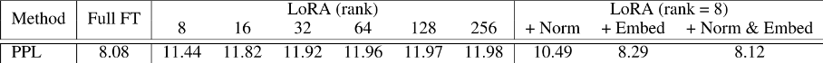

  2. 在效率方面，无论是否采用LoRA，计算成本都会随着上下文规模的扩大而急剧增加，这主要是由于标准的自注意机制所导致的。

如下图所示，即便使用LoRA，当上下文窗口扩展时，Llama2模型的训练时间也会大大增加

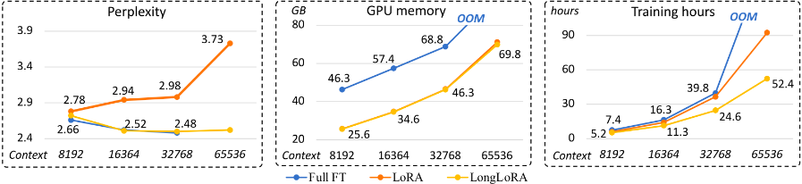

为此，提出shifted sparse attention(S2-Attn)以替代标准自注意力机制

#### 1.1.2 LongLora：训练时S2-attn、推理时再全局

LongLoRA：基于PI但突破了PI原本的局限，其显著特点有三

  1. 训练时，改造注意力：用S2-Attn

longlora的作者团队认为：尽管在推理过程中需要密集的全局注意力，但**通过稀疏的局部注意力(sparse local attention mechanism)也可以高效地完成模型的微调** ，比如他们提出的移位稀疏注意力(shifted sparse attention，简称S2-Attn)可有效地实现上下文扩展且显著节省计算资源(意味着训练时可以用S2-Attn，推理时又可再用全局注意力。

> 原始transformer的计算复杂度随序列长度的二次方成正比，如果序列的长度太长，那整个注意力的复杂度还是比较高的(_比如把长度从2048扩展到8192，复杂度得上升4x4 = 16倍_)
> 
> 所以，就**把整个输入token序列分成多个组，然后分别计算每个组中的注意力** ，好减轻计算压力(_毕竟，对于每个token而言，真正跟其有一定关联程度的绝大部分都在相近的一定区域内，从而只计算序列中每个元素与其周围一定范围内的元素之间的注意力即可_)
> 
> 且**为了增强相邻组之间的信息交互，它还计算相邻组之间的注意力**(_相当于虽然很多token不需要看太远的token，但为了避免闭门造车，相邻组之间的token还是要顾及的，故加上了移位_ )
> 
> 这样就方便拉长数据长度了

  2. 改造LoRA：给嵌入层、归一化层也都加上LoRA权重

他们发现，LoRA加到embedding matrix以及normalization的子网络上的时候，效果更好，可参照上表，效果接近全参数微调。

  3. 与Flash Attention、Zero3等技术兼容

LongLoRA在保留原始架构的同时扩展了模型的上下文，并且与大多数现有技术(_如Flash Attention2、DeepSpeed Zero2/Zero3_)兼容

此外，还进一步发布了**使用LongLoRA技术的长指令遵循数据集LongAlpaca** ，以进行监督微调。

最终使得on a single 8× A100 machine上，做到以下对应长度的扩展

Model Name | Context Length  
---|---  
Llama2 7B | 100k  
Llama2 13B | 65536  
Llama2 70B | 32768  
  
然后这些模型的位置编码使用PI进行重新缩放。

此外，以下是相关的训练细节

  1. 训练过程我们遵循位置插值PI中的大多数训练超参数(_只是批量大小较小，毕竟只使用了一台单个8×A100 GPU的机器_)

比如使用AdamW，其中 β1= 0.9和 β2= 0.95

在学习率设置上，7B和13B模型为 $2\times 10^{-5}$，70B模型为 $10^{-5}$

此外还使用a linear learning rate warmup，另其权重衰减为0

最后，将每个设备的批量大小设置为1，梯度累积步数设置为8，这意味着全局批量大小为64，且训练模型1000个step

  2. use **Flash Attention2** and **DeepSpeed in stage 3** during fine-tuing

> 在面对一个「 _从非常长的对话中(长度从3k、6k、10k、13k到16k不等)，检索目标主题_ 」的任务时
> 
>   1. 于在32k (32768) 上下文长度上，Llama2 7B和通过longlora微调过后的7B模型准确性如下图所示，通过longlora微调过后的模型在33000或34000之前没有检索准确性下降
> 
> 且通过简单扩展位置嵌入PI，它可以进一步增强对长序列建模的能力，而无需额外的微调
> 
> 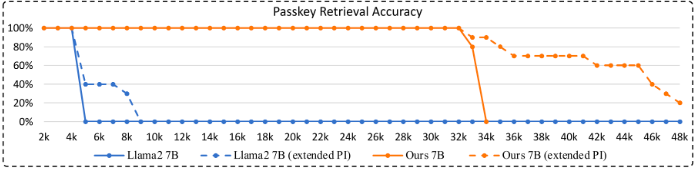
> 
>   2. 至于原生的Llama2 7B，即便通过位置插值扩展了，其在4k上下文长度之后也会出现明显的准确率下降
> 
> 无论是Llama2-7B还是使用了S2-attn的7B模型，在应用了PI之后，超过范围后的准确率下降得到了缓解，不应用PI，准确率会骤降
> 
> 

### 1.2 LongLora所用的Shifted Sparse Attention(S2-Attn)

#### 1.2.1 S2-Attn的原理解释

如下图所示

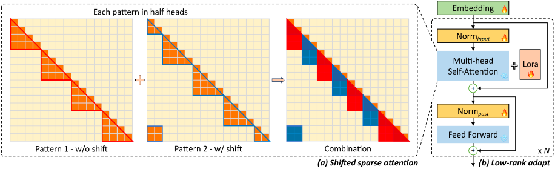

  1. 将上下文长度分成几个组，并在每个组中单独计算注意力。在半注意力头中，将token按半组大小进行移位，这保证了相邻组之间的信息流动
  2. 例如，使用组大小为2048的S2-Attn来近似总共8192个上下文长度训练

上面的描述还是不够形象具体，那到底怎么理解这个S2-Attn呢？如下图所示

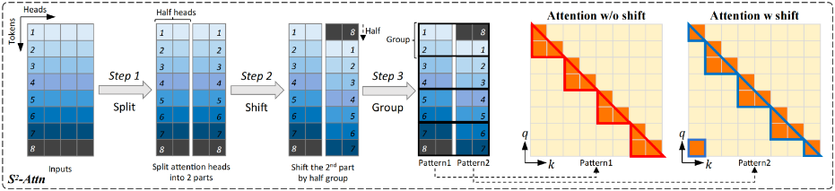

  1. 首先，它将沿头部维度的特征分成两大块 ( 比如8行4列，8行相当于8个token，4列可以认为是有4个头，然后竖着一切为二 )

  2. 其次，其中一个块中的标记被移动组大小的一半

**第2个part的第8个token的后一半表示(也即原始inputs第8个token的后两个heads)移动到第2个part的第1行**

**而第2个part中原来的「第1-7个token的后一半表示」整体往下移动一行**

  3. 第三，将token分组并重塑为批量维度，注意力只在每个组内计算，信息通过移位在不同组之间流动。虽然移位可能会引入潜在的信息泄漏，但这可以通过对注意力掩码进行微调来避免

> 为方便大家更快的理解，特再补充三点
> 
>   1. 为啥不把所有的头都转动一下，再计算attention？
> 
> 对于这个问题，我们先来对比下以下三种情况
> 
> **第一种情况** ，标准注意力，如下图左侧所示，不移动任何头的话，每个token与所有近处、远处的token都做注意力计算
> 
> **第二种情况** ，如下图中侧所示，如果移动所有的头，每个token基本都是与相邻的token在组内做注意力计算
> 
> **第三种情况** ，即s2 attn，如下图右侧所示，如果只移动一半的头，每个token除了相邻的token，还能够与稍远点的token也在组内做注意力计算
> 
> 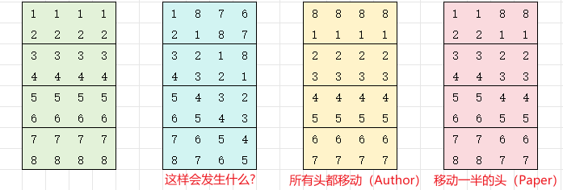
> 
> 故，s2 attn的本质是从以下两个极端情况取个平衡
> 
> 第一个极端，标准注意力，即第一种情况：对于每个token而言，其近处的token、远处的token都关注，所以计算量大，相当于每个token都在一个大范围内计算注意力
> 
> 第二个极端，即第二种情况：每个token只关注相邻的token，这个的弊病是有时稍远点的token也是有不小关联的
> 
> 那第三种情况呢，为形象起见，举个例子，假定这8个单词是i am learning Machine Learning by julyedu online，然后上述过程可用下表表示
> 
> 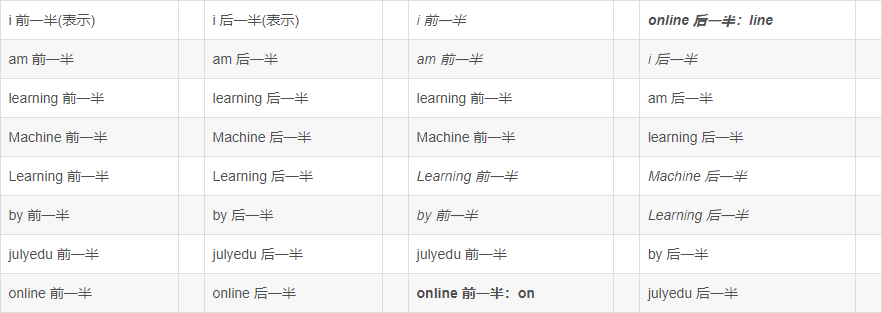
> 
>   2. 针对上面那个S2-Attn示意图
> 
> 该图的左边部分 上文已经解释的很清楚了，那右侧的两个图呢？
> 
> 乍一看，比较抽象，其实仔细琢磨之后，右侧的两个图描述的注意力范围，pattern2相对于pattern1的注意力窗口是“移位”了的
> 
> 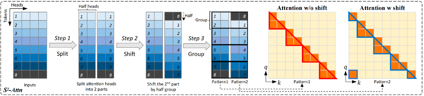
> 
> Pattern1是前一半头的注意力，Pattern2是后一半头的注意力，均已分组。
> 
> _对于q_1，pattern1中所在组q_1只能看到[q_1]，pattern2中所在组q_1只能看到[q_8]_
> 
> _对于q_2，pattern1中所在组q_2只能看到[q_1, q_2]，pattern2中所在组q_2只能看到[q_1, q_8]_
> 
> 这部分有待交流。
> 
> 

#### 1.2.2 S2-Attn的伪代码表示

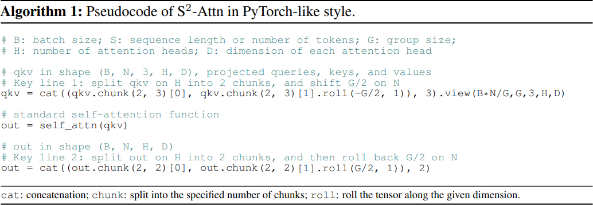

`qkv.chunk(2, 3)`沿着第3个维度，这里也就是head维度，拆分为2个chunk，将多头分为两组。

`qkv.chunk(2, 3).roll(-G/2, 1)`将第二个chunk，沿着第一个维度 `N` 进行滚动 $G/2$

新的`qkv`进行标准的注意力计算

结果再次进行滚动

#### 1.2.3 LongAlpaca-13B

在llama 13B上应用longlora技术，便是 LongAlpaca-13B。

应该是使用的长指令遵循数据集 LongAlpaca。

### 1.3 LongLora的源码剖析

待补充

```python
from llama_attn_replace import replace_llama_attn

def replace_llama_attn(use_flash_attn=True, use_full=False, inference=False):
    if use_flash_attn:
        cuda_major, cuda_minor = torch.cuda.get_device_capability()

        if inference:
            transformers.models.llama.modeling_llama.LlamaModel._prepare_decoder_attention_mask = _prepare_decoder_attention_mask_inference
            transformers.models.llama.modeling_llama.LlamaAttention.forward = forward_flashattn_inference
        else:
            transformers.models.llama.modeling_llama.LlamaModel._prepare_decoder_attention_mask = (
                _prepare_decoder_attention_mask
            )
            transformers.models.llama.modeling_llama.LlamaAttention.forward = forward_flashattn_full if use_full else forward_flashattn
    else:
        transformers.models.llama.modeling_llama.LlamaAttention.forward = forward_noflashattn
```

## 第二部分 LongQLora：QLoRA to Attention层且训练时S2推理时全局

### 2.1 大模型的上下文扩展史

#### 2.1.1 外推/内插PI/LongLLaMA/LongLoRA

众所周知，LLaMA2的上下文长度只有4096，为了增加LLaMA2的上下文长度，**最直接的方法是像MPT-7B-8K一样用更长的文本进一步预训练LLaMA2**(其并额外训练了500B个token，总共产生了1.5T个token规模的文本和代码，这需要大量的训练资源和数据)，然而，这种方法需要大量的GPU训练，收敛速度较慢

为了更好的扩展其上下文长度，各研究者尝试了各种方法:

  1. 首先是**直接外推** ，然LLaMA系列模型的位置编码为RoPE，其直接外推的效果较弱

且虽然Meta推出了**LLaMA 2 Long** ，但其模型一直没对外发布，只是发了论文, 关于RoPE和LLaMA 2 Long的详解，详见此文[一文通透位置编码：从标准位置编码、旋转位置编码RoPE到ALiBi、LLaMA 2 Long](<https://blog.csdn.net/v_JULY_v/article/details/134085503>)

  2. 再之后，Meta提出了**位置插值PI**

它使用32个A100 GPU将LLaMA的上下文长度从2048扩展到8192，它只对LLaMA进行了1000步的微调，并取得了良好的性能

  3. 另外，Focused Transformer(**FOT**)在128个TPU上训练了256k上下文长度的**LongLLaMA**(_其GitHub地址为：[long_llama](<https://github.com/CStanKonrad/long_llama>)_)

FOT是一种即插即用的扩展方法，该模型可以很容易地外推到更长的序列。例如，在8k上下文长度上训练的模型可以很容易地外推到256k

  4. 最后，LongLoRA提出了Shifted Sparse Attention(注意，在longqlora的论文中，作者把S2-attention表述为shift short attention，严格意义上来说不是最准确的)，将位置插值和LoRA相结合，实现了一种更高效的方法。它通过8个A100 gpu将LLaMA2 7B的上下文长度从4096扩展到了100k

#### 2.1.2 LongQLoRA因何而来：结合PI、S2-Attn和QLoRA

位置插值和FOT都需要大量的计算资源，分别需要32个A100 GPU和128个TPU。虽然LongLoRA可以节省大量的训练资源，但它仍然花费8个A100 GPU

能否在能扩展到对应长度的前提下，所耗费的GPU 少一些呢？从而降低普通科研人员在机器上面的负担

好在QLoRA是一个很好的选择(QLoRA将预训练的模型权重量化到4位，冻结预训练的模型，以减少模型的内存占用只对LoRA适配器进行微调)

> QLoRA可用于在单个48GB GPU上对LLaMA 65B进行微调 (当然也看数据本身的序列长度，如果是超长的paper-review数据集则也不一定够了)

**最终，使用单个32GB V100 GPU，LongQLoRA可以在1000次微调步骤内将LLaMA2 7B和13B的上下文长度从4k扩展到8k，甚至扩展到12K** 。

### 2.2 LongQLoRA与LongLoRA的异同

LongQLoRA结合了PI, QLoRA, LongLoRA的优点, 具体而言:

  1. 首先，使用位置插值 PI 将LLaMA2的上下文长度从4096扩展到目标大小
  2. 为了节省更多的GPU内存，使用QLoRA将基本模型的权重量化到4位
  3. 为了进一步节省GPU内存，还使用Shift Short Attention来微调，组大小为目标上下文长度的1/4

#### 2.2.1 可训练层(仅Attention层)和LoRA Rank的设置(64)

作者发现在**LongQLoRA中即使不放开Norm层和Embedding层** 来进行训练，也可以通过**设置更大的LoRA Rank** 来实现更好的微调效果

如下图所示，**当LoRA rank设置为64时** ，LongQLoRA的性能优于LongLoRA-LoRA、MPT-7B-8K，接近LongLoRA-Full

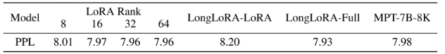

以下是训练时的一些具体设置:

  1. 在以下这些层添加LoRA adapters，包括q_proj、k_proj、v_proj、up_proj、down_proj、gate_proj和o_proj
  2. 使用分页优化器(page optimizer)
  3. 7B和13B模型的学习率分别设置为2e-4和1e-4
  4. 使用恒定学习率并进行warmup，warmup步长为20
  5. 将每个设备的批处理大小设置为1，梯度累积步骤设置为16，这意味着只有一个GPU的全局批处理大小为16
  6. 在微调期间使用Deepspeed Zero2策略
  7. 对LLaMA2-7B进行1000步微调，对Vicuna-13B进行1700步微调

#### 2.2.2 推理所用注意力机制的设置：标准全局注意力

> 作者发现，在LongQLoRA中，即使模型是在Shift Short Attention下训练的，但在推理时使用标准全局注意力(standard global attention)可以获得更好的推理性能(在相应测试数据集上困惑度更低)

由于现有的大部分推理优化策略均是基于标准全局注意力的(_例如Flash Attention、vLLM等_)，因此即使训练时用S2 attention，但推理时仍可以使用标准全局注意力，从而直接**兼容现有的大部分推理策略**

在PG19验证数据集上进行了perplexity评估后，可知与shift short attention相比，standard global attention在推理中取得了更好的性能:

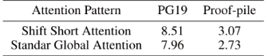

### 2.3 如何基于LongQLoRA微调开源模型

在单个 32GB V100 GPU 上，LongQLoRA 可以将 LLaMA2 7B 和 13B 的上下文长度从 4096 扩展到 8192，甚至扩展到 12k，那具体怎么基于LongQLoRA微调某个开源模型呢

待补充

## 第三部分 LongQLoRA的源码剖析

1.) 应用S2-Attn

2.) 应用PI

3.) 应用QLoRA量化预训练模型

4.) 对预训练模型插入LoRA Adapter

```python
# 加载模型,应用S2-Attn,QLoRA
model, tokenizer = load_model_and_tokenizer(args, training_args)
# 插入adapter
model = insert_adapter(args, model)

def load_model_and_tokenizer(args, training_args):
    # 1. 首先应用s2-attn
    replace_llama_attn(args.use_flash_attn)
    # 2. 修改RoPE的position最大长度
    orig_ctx_len = getattr(config, "max_position_embeddings", None)
    if orig_ctx_len and args.model_max_length > orig_ctx_len:
        scaling_factor = float(math.ceil(args.model_max_length / orig_ctx_len))
        config.rope_scaling = {"type": "linear", "factor": scaling_factor}
	# 3. 加载模型,QLoRA加载
    model = AutoModelForCausalLM.from_pretrained(
        args.model_name_or_path,
        ...
        quantization_config=BitsAndBytesConfig(
            load_in_4bit=True,
            ...
 	   ),
	)
    # 4. 加载tokenizer
    ...

def insert_adapter(args, model):
    # 默认没有提供需要插入的target_modules
    # 找出所有全连接层，为所有全连接添加adapter
    # cls == bnb.nn.Linear4bit 会被添加adapter
    target_modules = find_all_linear_names(model)
    # 在初始化LoRA配置时, 设置需要添加Adapter的modules
    config = LoraConfig(
        ...
        target_modules=target_modules,
        ...
    )
    model = get_peft_model(model, config)
    # 根据配置，决定word embedding和norm是否参与训练
    # 默认是不训练 word embedding 和 norm 的
```