# 完整的多模态LLM的训练流程

> 原文作者：幻影星全能的木豆  
> 原文链接：https://www.cnblogs.com/mudou/p/18310574  
> 发布时间：2024-07-18 23:04

---

原文 : <https://blog.csdn.net/weixin_44292902/article/details/136662323>

一个完整的多模态LLM的训练流程。包括模型结构选择、数据预处理、模型预训练、指令微调、对齐、融合多模态以及链接外部系统等环节。

对原文进行梳理 & 补充.

## 一、模型结构选择

目前**主要有三种模型架构** ，基于Transformer decoder，基于 General Language Model，以及混合专家模型MoE。

这一步可以直接选择开源的基座模型, 例如基于Transformer decoder 架构的LLaMA模型族，模型结构及一些重要参数如下图。

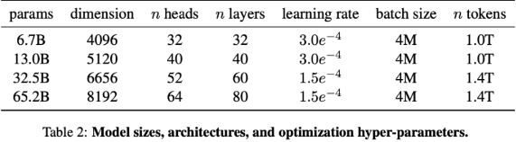

假设选择LLaMA-65B，Tokenizer选择LLaMA的基于BPE算法构造的tokenizer。

如果想要扩展词表，可以在目标语言上训练好词表后和LLaMA的词表merge在一起。

## 二、数据预处理

根据Chinchilla 的scaling law，要达到最优的计算利用率，65B模型对应的训练token数量应该达到1.4T。

当前用于训练LLM的数据来源很多，但其中的高质量数据有限，数据是提升模型性能的关键。

另外，有文章指出，代码数据有助于提升模型的推理能力。因此，需要混合多种数据来源的数据，并合理分配每种数据的占比。

如下图，可以参考LLaMA的数据源和比例，其中Disk size表示可用的数据总量，Sampling prop表示在总训练token中的占比，epochs表示采样的次数。

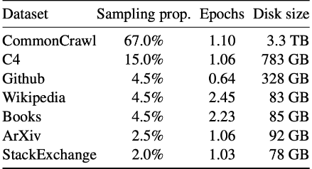

想要提升模型的性能，除了利用已有的开源数据集，例如The Pile，C4，OSCAR等，还可以自己构建数据集。

在论文RefinedWeb 中提到，从网页数据中创建的数据集也可以达到和精心收集的数据集同等的效果。

Wikipedia，Books，GitHub，ArXiv，以及StackExchange等高质量数据的处理方法可以参考论文The Pile。

下面介绍**从Common Crawl构建数据集的方法** ，CC是一个海量的、非结构化的、多语言的网页数据集，拥有超过8年的网络爬虫数据集，包括原始网页数据（WARC）、元数据（WAT）和文本提取（WET）。每个月都会发布包括一个 20~30 TB 未压缩纯文本的快照，包含了随机搜索和采样的 URL 所获得的网页，不同月份发布的数据之间只有非常少量的数据重合，8 年以来所有爬下来的数据总和是PB级别的。如下图，**数据处理流程包含文档准备，过滤以及去重三个步骤** ，做法参考RefinedWeb论文。

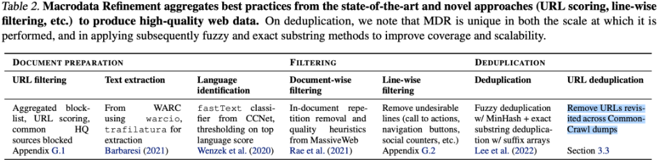

包括数据读取、过滤url、提取文本和语言识别；

  1. 数据读取 : 文本数据既可以从WET文件也可以从WARC文件中读取。直接使用WET文件可以省略从HTML文件中提取文本的工作，但是包含一些不相关信息。因此可以从WARC文件中读取文本。

  2. 过滤URL : 在正式处理文本数据之前，首先要对URL执行第一次过滤，过滤的目标是欺诈和成人网站(主要是色情、暴力、与赌博有关的网站等)。

**基于两个规则进行过滤** ：

(1) 一个包含460万个域名的屏蔽列表；

(2) URL评分，基于收集到的特定单词列表，并按严重程度进行权衡。

同时，可以按照需要过滤掉包含在高文本数据集中的数据来源，例如Wikipedia和arXiv等。

  3. 提取文本 : 提取HTML页面中的主要内容，忽略菜单、页眉、页脚和广告等。

可以采用trafilatura，jusText等库，结合正则表达式进行文本提取。

最终将新行限制为连续的两行，并删除所有URL链接。

  4. 语言识别 : 语言识别可以在去重之前也可以在去重之后进行。

但当文档数量比较少的时候，先识别会导致部分语言分类错误。

可以采用fastText语言分类器进行语言分类，该分类器是在Wikipedia、Tatoeba和SETimes上面训练的，使用n-grams来作为特征，并采用层级softmax，支持 176 种语言的分类，最后输出一个 0~1 的分数。

删除最高语言分数低于设定阈值的文档。通过改变阈值，可以调整保留的文档比例。

从网页提取的文档质量低下，过滤的目的是移除重复段落，无关内容，非自然语言等等，提高文本质量。包括文档级别和行级过滤；

包含重复的文档移除，可以在去重阶段进行，但在早期进行代价更低，也更容易。一般采用启发式方法，制定一系列规则删除任何具有过多行、段落或n-gram重复的文档，做法可以参考论文BLOOM 。

  1. 文档过滤

主要的目的是保留人类写给人类的自然语言文档，移除机器生成的垃圾邮件，主要由关键字列表、样板文本或特殊字符序列组成。这样的文档不适合语言建模。

采用质量过滤启发式算法，做法可以参考论文BLOOM。重点是根据文档长度、符号与单词的比率和其他标准方面去除异常值，以确保文档是由真正的自然语言构成。

  2. 行级过滤

通过trafilatura库提取的文本避免了大部分无关的内容，但仍然有遗漏。通过一个**线性校正过滤器继续过滤和正文无关的内容**(例如点赞数，导航按钮等)。

过滤之后，数据质量得到了提高，但很多文档是重复的。**可以通过模糊文档匹配和精确序列删除对文档进行去重** 。

  1. 模糊去重

可以采用SimHash，MinHash算法删除相似的文档：对于每个文档，计算其与其他文档的近似相似性，并删除高重叠的文档对。

通过更改哈希算法的参数，可以调整去重的比例。

  2. 精确去重

一般采用精确子字符串去重，是序列级去重。通过使用后缀数组查找字符串之间的精确匹配，删除重复超过给定阈值的连续token的段落。

URL去重, 进一步删除跨CC转储重复访问的URL。

## 三、模型预训练

基于Transformer解码器架构的LM的预训练的方法是让模型做 Next Token Prediction 任务。

基于GLM的LM的预训练方法是让模型做自回归空白填充任务。

LLM由于规模大，权重维度高，参数量以及数据量多，因此会带来训练不稳定，难以收敛，耗时长，计算资源庞大等问题。

下面**从模型结构和训练技巧方面** 介绍一些**提升模型的训练速度以及提高训练稳定性** 的方法。

  1. **采用Pre-normalization**

例如RMSNorm，在残差连接前对参数归一化，有一部分参数直接与后面的参数相加，可以防止梯度爆炸或消失。

  2. **SwiGLU激活函数**

用 SwiGLU 激活替代 ReLU，提高模型性能。

  3. **采用相对位置编码**

相较于常规的绝对位置编码，相对位置编码在长序列上性能更好，例如RoPE和ALiBi编码方法。

  4. **注意力机制**

常规的自注意力查询需要大量的计算和存储资源，通过采用 Multi Query Attention 和 Flash Attention 可以减少计算，提升训练速度。

  5. **混合精度减少计算量**

即模型权重以及梯度使用float16表示，优化器使用float32表示参数；同时进行通信和计算，提高训练效率。

如下图，当LLM由于规模庞大，无法在单张GPU上运行或者单卡的利用率低时，需要采取并行策略加速训练。

首选张量并行，其次是进一步结合流水线并行。

在计算资源丰富的情况下，进一步结合ZeRO数据并行实现3D并行，多张GPU并行训练，参考论文Megatron-Turing 和BLOOM。

在单卡显存不足时，还可以结合一些小技巧 :

例如CPU offload 技术，将计算的中间激活结果暂时放到内存（CPU）中，需要的时候再放回显存（GPU）中，用额外的通讯开销换取显存；

或者采用checkpointing (recompute)，在前向传播时，删除一些暂时用不到的中间激活结果以降低存储空间，在反向传播时，再根据需要临时进行前向计算或者从checkpoint中加载。

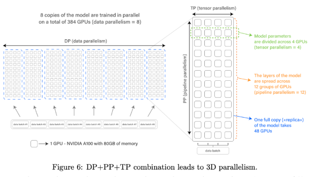

## 四、模型评估

预训练之后，需要评价模型的性能。

LM的常用评价指标PPL主要用于评价LM生成的句子是否流畅和通顺。

除此之外，更重要的是评测LLM的知识蕴含能力，包括常识推理，问答，代码处理，数学推理，阅读理解等多种能力。

和以往专家模型的“预训练+微调”范式不同，当前LLM主要采用“预训练+上下文学习”的范式

因此需要对每个下游任务选择合适的prompt模板，帮助模型回忆起自己预训练学到的知识，做到下游任务和预训练任务的统一。

模板结构是一个文本字符串，有两个槽：一个输入槽 [X]，用于输入问题，一个输出槽 [Z]，用于中间生成的答案文本Z。

在实际操作中，为了让模型理解任务，用问题和答案填充模板得到几个学习样例。然后用实际输入填充模板并和学习样例组合起来，得到完整的prompt一起输入模型。

在情感分析任务中，模板的形式可以采用"[X], it is [Z].”。假设x=“I like this dish”，则完整的prompt则是“I like this dish, it is [Z].”。

填充的答案在文本中间称为完形填空提示（cloze prompt,），在文本末尾称为前缀提示（prefix prompt）。然后将生成的答案转换成任务需要的输出。

参考论文LLaMa，主要从以下几个方面评价模型的性能：

常识推理（BoolQ、PIQA、SIQA、HellaSwag、WinoGrande 、ARC easy 和 challenge 以及 OpenBookQA ）

闭卷问答（Natural Questions 和 TriviaQA ）

阅读理解（RACE阅读理解基准）

数学推理（MATH 和 GSM8k）

代码生成（HumanEval 和 MBPP）

大规模多任务语言理解基准 MMLU ，该基准集由多项选择题组成，涵盖了人文科学、STEM 和社会科学等各个知识领域

以及 C-Eval（一个中文知识能力测试数据集，涵盖1.4万道选择题，共 52 个学科。在该数据集用于评测模型的中文能力）

经过预训练之后的LLM具有广泛的知识储备，拥有强大的自然语言推理和代码处理能力。但在某些任务上的Zero-Shot能力很差。为了进一步提高LLM在未见任务上的指令泛化能力，即Zero-Shot能力，需要在自然语言众包指令数据上微调预训练模型，参考论文FLAN 。

微调数据集来自于通用的NLP基准集，通过指令模板改造输入输出的格式得到CoT和非CoT任务的指令数据集，见下图。

微调后可以显著提高在各种模型类(PaLM、T5、U-PaLM)、各种学习样例设置(Zero-Shot、Few-Shot、CoT)和各种未见评估基准(MMLU、BBH、TyDiQA、MGSM、开放式生成、RealToxicityPrompts)上的性能。

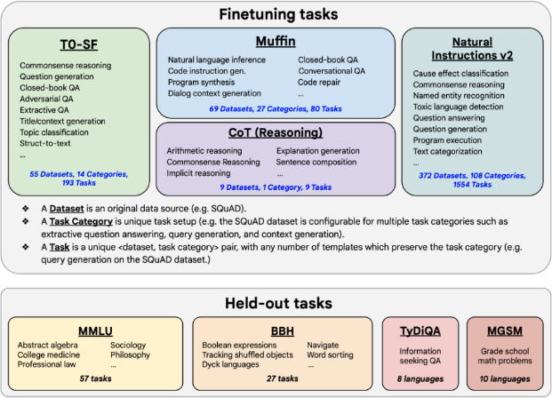

从自然语言总包收集的一共1836个数据集，分为Muffin、T0-SF、NIV2和CoT推理四个任务集。

然后将每条数据使用任务创建者给出的模板改造成指令prompt形式，举例来说，针对同一个翻译任务，普通prompt："我带女朋友去桂林旅游" 的英文翻译是___；指令prompt：翻译这句话：输入：我带女朋友去桂林旅游，输出：___。下面给出CoT推理指令prompt：

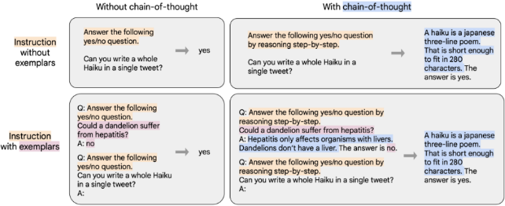

将多个样例组合在一起得到单个序列，直到满足最大序列长度，做Next token prediction训练。

目的是评测指令微调后的模型在未见任务上的泛化能力。

评测集包括：

(1) MMLU，来自数学、历史、法律和医学等57个领域的试题。

(2) BBH，来自BIG-Bench的23个具有挑战性的任务；

(3) TyDiQA，一个跨8种不同语言的问答基准集；

(4) MGSM，数学单词问题的多语言基准集。

## 五、使模型和人类对齐

通过使用用户的真实反馈对模型训练（SFT / RLHF），使LLM的输出更符合人类偏好，并与用户意图保持一致。这既包括明确的意图，如遵循指示，也包括隐含的意图，如保持诚实，不偏见，或其他有害的价值观。

最关键的是步骤是收集真实多样的指令以及回复，得到指令跟随数据集（问答形式）。同时，可以混合一些对话形式的指令跟随数据（把之前发生的所有对话都写进下一个问题的提示中），让LLM能够以对话形式和用户交流。

首先收集大量的<指令，回复>数据对，得到一个指令跟随数据集。然后用指令数据集通过有监督的方式对前面训练得到的LLM进行指令调优，得到SFT模型。

到这一步得到的SFT模型已经能实现和人类很好的对齐。

InstructGPT 的做法是搜集大量用户提交到API接口的查询，并耗费巨资聘请专业团队给用户查询生成回复，得到指令跟随数据集。但这种做法基本很难复现。除了用一些开源的指令数据集，例如Alpaca和BELLE，也可以参照self instruct 的方法让ChatGPT 等高质量LLM构建想要的指令跟随数据集。具体的方法是先人工构造一些训练数据样例让 ChatGPT 看，利用 ChatGPT 的续写功能，让其不断地举一反三产生新的训练数据样例。最后，过滤掉一些低质量的数据样例，得到指令跟随数据集。

进一步，可以参考论文Evol-Instruct ，如下图，从一系列人工创建的指令开始，引导ChatGPT/GPT-4逐步生成更复杂的指令。然后，采用 ChatGPT/GPT-4 对进化得到的指令生成回复。进一步，混合所有生成的指令数据来微调语言模型。

下图展示了一个Evol-Instruct的例子。从一个简单的初始指令“1+1=?”开始，使用pprompt提示LLM随机选择深度进化(蓝色指示线)或广度进化(红色指示线)，从简单的指令开始逐步增加难度。广度进化包括添加约束、深化、具体化、增加推理步骤和使输入复杂化。广度进化旨在增强主题覆盖、技能覆盖和整体数据集的多样性，使生成的指令是全新的，更加long-tailed。由于进化的指令是由LLMs生成的，有时进化会失败，因此需要过滤掉失败的指令。重复这个进化过程几轮，以获得足够的包含各种复杂性的指令数据。

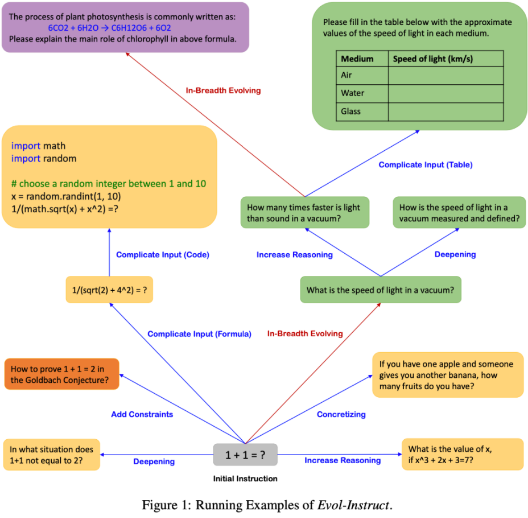

> 简单的初始指令"1+1=?"
> 
> **增加深度** : 什么情况下1+1不等于2?
> 
> **增加推理** : x的值是什么, 如果$x^3+2x+3 = 7$
> 
> **具体化** : 如果你有一个苹果, 有人给了你一个香蕉, 现在你有多少个水果?
> 
> **深度进化** 真空中的光速是多少?

标准指令微调：将训练集中的所有提示和答案连接起来，使用一个特殊的 token 来分隔提示和答案片段，利用自回归目标，不计算来自用户提示的token部分的损失，只对回复的token进行反向传播。

评测的主要目的确保在对齐指令上微调后，SFT模型在预训练阶段获得的通用能力以及上下文学习能力没有大幅下降。

注意不能在一堆 benchmark 上看平均分数，因为平均值差异不大，并且很多任务没有代表性；

只在核心的有区分度的 benchmark 评测，包括：知识蕴含能力（MMLU），推理能力（GSM8k / BBH ），代码能力（Human Eval / MBPP） 以及数学能力（MATH ）。

另一方面，需要评测模型生成的回复是否和人类对齐。对齐能力可以通过人工评测，评价的内容包括真实性，有用性，无害性（helpfulness，harmlessness，honesty）等等，也可以通过一个足够大的，已经训练好了的RM进行评测。

为了实现更好的对齐，可以继续用强化学习训练SFT模型。收集一组真实的指令集合，用SFT模型对每条指令生成回复，基于标注人员对回复按照多个指标进行人类偏好排序。用排序结果训练一个符合人类偏好的打分模型（Reward Model, RM）。最后，使用PPO算法用RM的打分优化SFT模型。

一种方法是参考论文InstructGPT ，将SFT模型作为初始模型，移除最后的非嵌入层，训练打分模型接收指令和回复，输出标量的奖励分数。

训练数据是输入指令相同，但回复不同的比较数据（接受或拒绝）。

使用二元排序损失，将不同的回复作为标签，奖励分数的差异代表了人类标记者更喜欢一种回复的对数几率。

首先收集一些真实的用户指令，让SFT模型生成回复，利用专家根据相关性、信息性和有害信息等标准对回复进行排序。然后用排序结果训练一个打分模型。训练的方式是对于一组训练数据，假设人工排序中回复1排在回复2前面，那么训练的目标是鼓励RM模型对<指令,回复1>的打分要比<指令,回复2>的打分更高，这样训练出来的打分模型和标注人员的偏好一致。

打分模型的规模应该尽量大，例如用175B的RM去PPO 7B的SFT模型。

另一种做法参考论文Anthropic LLM ，通过三个阶段的训练，包括语言模型预训练，偏好模型预训练，以及偏好模型微调。

首先在大规模语料上进行语言模型的预训练，这一步直接采用指令微调后得到的LLM。

然后从StackExchange/Reddit/Wikipedia等获取混合对比数据集，进行偏好模型的预训练。

最后在人类反馈对比数据上进行微调，训练符合人类偏好的打分模型。

在第二、三阶段的训练时，在样本的末尾附加一个特殊的“上下文结束”标记，作为预测的得分。

> ???

以SFT为初始策略，基于RM对策略打分，使用强化学习优化策略，得到强化版本的模型PPO。

训练的目标是使得PPO生成的答案能够获得高回报。

训练的方法是根据RM的打分来更新PPO的参数。为了防止模型被RM过度优化，需要在奖励中增加了一个KL惩罚，保持学到的模型PPO与初始策略SFT模型相差不至太远。

同时，可以在优化目标的梯度中混入一些预训练梯度，进一步保证学习到的模型保留SFT的通用能力。具体的方法可以参考论文instructGPT。

> **混合预训练梯度** ：在优化目标的梯度中混入一些预训练梯度，目的是进一步确保优化后的模型仍保留SFT模型的通用生成能力。这可以防止模型在追求高回报的过程中过度拟合特定的奖励模型。

随着SFT被优化，得到的PPO模型生成的回复越来越符合人类偏好，最开始训练得到的奖励模型在这种高质量回复上不够鲁棒。为了缓解这个问题，参考论文Anthropic LLM，可以进一步采用在线迭代训练：使用每一轮强化学习得到的最好的PPO模型生成比较数据进行人工标注。将新的比较数据与已有的数据混合，重新训练一个新的奖励模型，最后用新的奖励模型进行新一轮的PPO训练。

参考SFT环节的评测。

## 六、LLM融合多模态

为了进一步让LLM获得图像理解能力，需要在LLM中融合多模态。

### 6.0 多模态LLM架构

一种做法是利用预训练的大型语言模型以及视觉编码器来构建多模态的统一模型。

参考论文LLaVA ，MiniGPT-4 ，BLIP2 和mPLUG-Owl ，模型结构如下图所示，由一个视觉编码器，一个投影层，一个语言模型（前文训练好的LLM）构成。

视觉编码器的作用是提取图像特征，一般采用ViT-L/14。

**投影层** 的作用是实现视觉特征空间和文本特征空间的对齐，**可以选择简单的线性层，也可以选择更加复杂的结构，例如BLIP2中的Query Transformer（Q-Former）** ，该结构的作用是使用一组可学习的查询向量从冻结的视觉编码器中提取视觉特征，以充当视觉编码器和文本编码器之间的瓶颈。

也可以参考论文mPLUG-Owl，使用一个视觉抽象模块替换投影层，将视觉基础模型提取到的稠密的视觉特征汇总到几个可学习的令牌中，从而获得更高的语义视觉表示并减少计算。

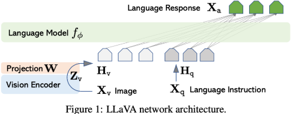

训练数据是来自多个数据集的图像标题对数据，包括LAION-400M、COYO-700M、Conceptual Captions和MSCOCO等。

### 6.1 一阶段预训练

第一阶段的预训练是为了使视觉模型能够有效地捕获低级和高级语义视觉信息，并将其与预训练的语言模型对齐，而不影响语言模型的性能。

在训练时，冻结视觉编码器和LLM的参数，只改变投影层的参数，训练的目标是使得视觉编码器提取到的视觉特征和LLM嵌入层得到的文本嵌入对齐。

> 损失函数???

  1. 比较简单的训练方式是将图像输入视觉编码器，将经过投影层提取到的文本视觉信息输入LLM，让LLM做Next token prediction，生成图像标题。
  2. 另一种方式是预先**构造一些让LLM简单描述图像信息的指令，在训练时，从其中采样指令和视觉特征一起构造成指令prompt输入LLM，让LLM生成图像标题** 。

在完成前一阶段后，模型能够获取图像的文本知识并对人类的查询产生响应，但在产生连贯的语言回复方面仍然存在挑战。

### 6.2 二阶段微调

需要在图像-文本指令跟随数据上进一步微调，以促进模型与人类指令和意图之间的更好对齐。

#### 6.2.1 构造图像-指令遵循数据集

可以直接利用开源的数据集，例如LLaVA。也可以通过self instruct的方式，引导GPT-4/ChatGPT等高质量的多模态模型生成图像-文本指令跟随数据，用来训练多模态语言模型，将ChatGPT的知识蒸馏到自己的模型上。

参考论文LLaVA。首先从预训练数据中采样一些图像-文本对作为原始数据。然后，人工**构造多种形式的指令** 并**标注一些图像-指令跟随数据作为学习样例** 。

对于每个原始数据，采样一些指令和标注数据，让GPT-4/ChatGPT根据图片信息（包括Captions和Bounding boxes）生成对应的回复，构造图像-文本指令跟随数据集。

构造的数据形式包括三种：对话，详细的描述以及复杂的推理。下面给出一个引导GPT-4/ChatGPT生成对话数据的实例。

> 数据源 : 预训练数据
> 
> 人工构造多种形式的指令, 并标注一些图像-指令遵循数据作为学习样例, 作为few shot样例.
> 
> 更多的预训练数据采用上述学习样例作为提示, 采样指令, 利用GPT4生成对应的回复

首先人工构造一些学习样例，如下图：

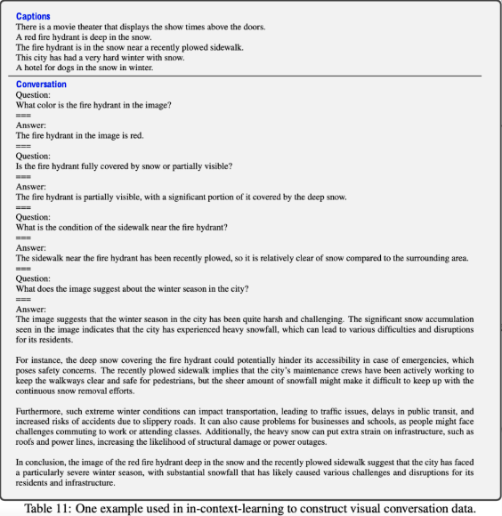

然后，将采样的学习样例和指令、以及图片信息一起按照指令prompt的格式组合在一起输入GPT-4，让其生成对应的回复，如下图：

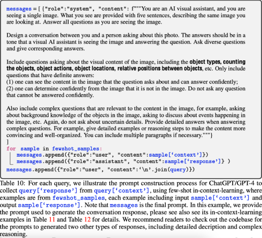

#### 6.2.2 训练方式

保持视觉编码器的权值不变，更新投影层和LLM的权值。训练的方法是让模型做Next token prediction。

针对普通问答数据和对话数据有两种不同的训练方式。

  1. 问答数据的方法参考论文MiniGPT-4，输入如下格式的指令prompt，让模型生成回复，其中ImageFeature代表经过投影层变换的图像特征。

  2. 对话数据首先要将收集到的指令跟随数据改造成以下格式，该对话有两轮，每轮都包括一个指令和回复。在训练时，让模型预测图中绿色的部分。

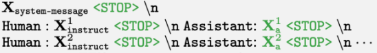

#### 6.2.3 质量评估

可以利用GPT-4来衡量目标模型生成的回复的质量。让目标模型以及GPT-4根据问题、ground-truth边界框和标题分别生成回复。然后将问题、视觉信息(以标题和边界框的格式)以及两个回复一起输入GPT-4，让GPT-4根据回答的有用性、相关性、准确性和细节等方面从1到10分进行打分。并且要求GPT-4提供一个全面的解释，以便更好地了解目标模型。

### 6.3 链接外部工具

经过前面几个步骤训练出来的多模态LLM已经具有非常强大的理解和推理能力，但仍然存在一些不足，例如无法获取最新的知识，容易产生虚假的输出，难以理解低资源的语言，缺乏数学知识等等，可以通过在模型中链接外部工具弥补其只能利用静态知识的限制。

主要有两种方法 :

一种是通过提示将外部工具集成到LLM中，这种方法容易受到输入长度的限制。

另一种方法是通过**在 <指令，API>数据集上有监督的微调LLM，实现其在广泛APIs集合上的准确调用**。

#### 6.3.1 构造<指令, API>数据

参考论文Gorilla ，通过self instruct的方式让GPT-4**生成大量的 <指令，API>数据**对LLM进行有监督的微调，实现其在广泛APIs集合上的准确调用，如下图。**在推理时，LLM输出的是某个要调用的API，不涉及具体的执行过程** 。

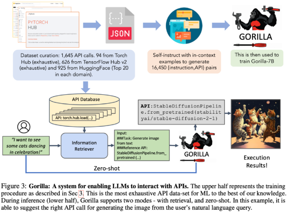

**数据集构造**

  1. API数据收集：通过对HuggingFace, Torch Hub, 以及TensorFlow Hub中的模型调用进行过滤，收集多个API。然后，将每个API的模型卡转换为具有以下字段的json对象：{domain, framework, functionality, api_name, api_call, api_arguments, environment_requirements, example_code, performance, and description.}。

  2. 指令数据构造：通过上下文学习的方法给出一些学习样例以及一个**需要调用的API参考文档** ，提示GPT-4**生成调用该API的真实指令** 。然后**将 <指令, API>改造成用户代理聊天式对话**，如下图：

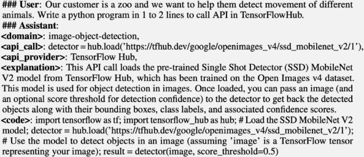

**微调**

执行标准的指令微调。

#### 6.3.2 评估API调用

**评测**

对同一个指令，存在多个正确的API调用，并且很难通过单元测试来判断正在使用的API是否在功能上等同于参考API。

一种方法是比较其与收集的数据集之间的功能等效性。为了追踪LLM调用的是数据集中哪个API，采用AST树匹配策略，通过检查候选API调用的AST是否是参考API调用的子树可以确定使用的是哪个API，如下图：

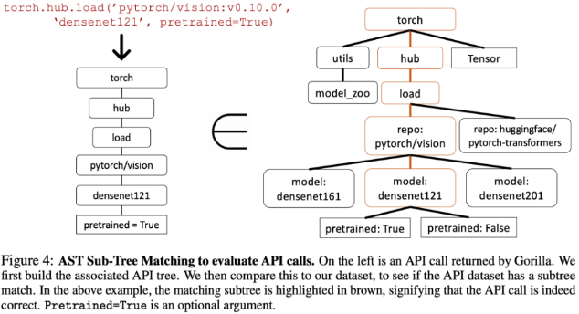

#### 6.3.3 LLM自主调用API

参考论文Toolformer ，不针对特定任务，让LLM自主决定调用哪些API（包括计算器，问答系统，搜索引擎，翻译系统和日历）、何时调用它们、传递哪些参数以及如何最好地将结果合并到未来的token预测中。

具体的方法是首先**将纯文本数据集转换成一个扩充了API调用的数据集** 。这分几步完成，如下图所示：首先，利用GPT-4等的上下文学习能力对大量潜在的API调用进行采样。然后执行这些API调用，最后对产生的API调用进行过滤，产生增强数据集对LLM进行微调，过滤的原则是API调用以及回复是否有助于预测未来的token。

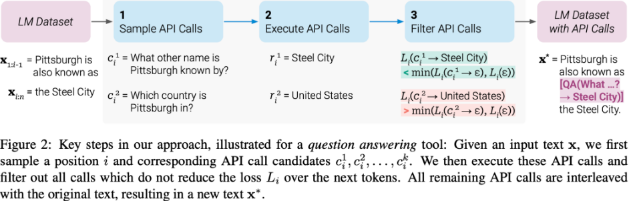

#### 6.3.4 构造自主调用API数据集

数据集构造

首先定义了特殊字符“”, “” and “→”，如下图，通过上下文学习的方式，让模型生成包含API调用的句子。具体的做法是，对于输入文本的每个位置进行采样，如果输出的概率大于阈值，则作为候选位置。从候选位置中选出top-k个位置，执行调用，得到回复。最后，如果在输入文本的对应位置插入API调用及回复后对原始输入的后续tokens有积极作用，则保留。

> 您的任务是在一段文本中添加对问答 API 的调用。这些问题应该有助于您获取完成文本所需的信息。您可以通过编写“[QA(问题)]”来调用 API，其中“问题”是您想要询问的问题。以下是一些 API 调用的示例：
> 
> 输入：乔·拜登出生于宾夕法尼亚州的斯克兰顿。
> 
> 输出：乔·拜登出生于 [QA("乔·拜登出生在哪里？")]斯克兰顿，[QA("斯克兰顿在哪个州？")]宾夕法尼亚州。
> 
> 输入：可口可乐，或简称可乐，是由可口可乐公司生产的碳酸软饮料。
> 
> 输出：可口可乐，或 [QA("可口可乐还有什么其他名称？")]可乐，是由 [QA("谁生产可口可乐？")]可口可乐公司生产的碳酸软饮料。
> 
> 输入：x
> 
> 输出：

微调

执行标准的指令微调。

#### 6.3.5 LLM自主调用API解码策略

推理

推理时，当LLM解码生成调用API的符号时，停止解码，启动API调用生成回复，当插入回复以及 token后，继续解码。为了避免模型的生成陷入循环，每个句子只调用一次API。

在具体的下游任务上评测。

#### 6.3.6 LLM调用专家模型-HuggingGPT

参考论文HuggingGPT ，通过制定规则和提示模板，将专家信息用自然语言描述，使得LLMs能够调用专家模型解决任务。具体来说，通过将LLM链接到Hugging Face等公开ML社区，然后提取模型描述合并到提示中，LLM作为管理AI模型(如计划、调度和合作)的大脑，调用这些外部模型来解决具体的任务。如下图所示，整个过程分为四步，包括任务规划，模型选择，任务执行以及回复生成。

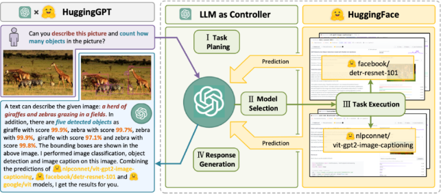

基于专用模板（由规范的指令和演示解析组成）提示LLM分析用户请求，将其分解为结构化任务的集合，包括任务的依赖关系和执行顺序，以构建它们的连接。

在解析了任务之后，LLM根据模型描述选择托管在huggFace上的专家模型来执行任务。由于上下文长度限制，具体的做法是筛选出top-K个最相关的候选模型，将其模型描述写入prompt中，让LLM选择最合适的专家模型。

在选定模型之后，调用并执行每个选定的模型，并将结果返回给LLM。由于先决条件任务的输出是动态生成的，因此还需要在启动任务之前动态地指定任务的依赖资源。

最后，利用LLM整合所有模型的预测并为用户生成回复。如表1所示，LLM将前三个阶段(任务规划、模型选择和任务执行)的所有信息集成为这一阶段的简明总结作为生成的回复。

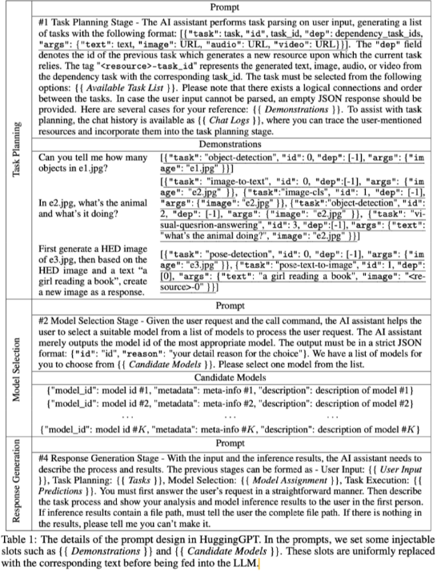

> **任务规划:**
> 
> 任务规划阶段 - AI助手对用户输入进行任务解析，生成以下格式的任务列表：[{"task": 任务, "id": 任务ID, "dep": 依赖任务ID列表。"args": {"text": 文本, "image": URL, "audio": URL, "video": URL}]。"dep"字段表示生成新资源的前一个任务的ID，这些新资源是当前任务所依赖的。标签"-task_id"代表依赖任务中生成的文本、图像、音频或视频，对应的任务ID。任务必须从以下选项中选择：[可用任务列表]。请注意，任务之间存在逻辑连接和顺序。如果用户输入无法解析，则应提供空的JSON响应。以下是一些参考案例：{{演示}。为了协助任务规划，聊天记录可作为[{聊天记录}使用]，你可以追溯用户提到的资源并将它们纳入任务规划阶段。
> 
> **模型选择:**
> 
> 模型选择阶段 - 根据用户请求和调用命令，AI助手帮助用户从模型列表中选择一个合适的模型来处理用户请求。AI助手仅输出最合适模型的模型ID。输出必须严格遵守JSON格式："id":"id","reason":"你选择的理由"。我们有一个模型列表供你选择（候选模型）。请从列表中选择一个模型。
> 
> **生成响应:**
> 
> 响应生成阶段 - 有了输入和推理结果，AI助手需要描述过程和结果。前几个阶段可以形成如下 - 用户输入: ((用户输入],任务规划:[{任务],模型选择:{{模型分配],任务执行: {预测结果}。你必须首先直接回答用户的请求。然后以第一人称描述任务过程，并向用户展示你的分析和模型推理结果。如果推理结果包含文件路径，必须告诉用户完整的文件路径。如果结果中什么都没有，请告诉我你做不到。}