# 万字长文多模态LLM进展

> 原文作者：幻影星全能的木豆  
> 原文链接：https://www.cnblogs.com/mudou/p/18310643  
> 发布时间：2024-07-19 00:28

---

# 万字长文总结多模态大模型最新进展

MLLM 的惊人新能力，如基于图像撰写故事和无 OCR 的数学推理，在传统方法中很少见，这表明了通向通用人工智能的潜在路径。

## 😊Flamingo

Flamingo: a Visual Language Model for Few-Shot Learning

**动机** ：开发能够使用少量标注示例（即少样本学习）迅速适应新任务的多模态LLM。

**架构创新** ：提出了一种新的模型架构桥接预训练LLM和视觉编码器，处理任意交错的视觉和文本数据序列，无缝接受图像或视频作为输入。

**潜在不足点** ：

1.）Flamingo模型依赖于预训练的视觉和语言模型，可能继承了这些模型的一些弱点，例如在处理超出训练数据分布的样本时可能会泛化不足。

2.）尽管Flamingo在少样本学习方面表现出色，但在分类任务上，它的性能可能不如专门针对这些任务优化的对比模型。

3.）Flamingo模型基于Transformer架构，它可能在处理长序列时遇到挑战

可能的后续工作方向

1.）改进分类性能：探索新的训练目标或架构调整，以提高Flamingo在分类任务上的性能。

2.）

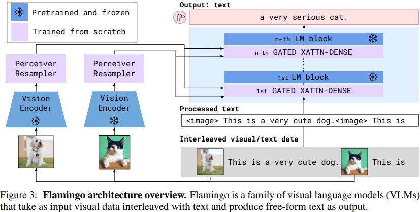

> **1\. Vision Encoder（视觉编码器）**
> 
> 将输入的图像或视频转换成特征表示, 通常是一个深度卷积网络，它能够提取视觉数据的重要信息。
> 
> **2\. Perceiver Resampler（感知器重采样器）**
> 
> 接收来自视觉编码器的时空特征，并输出固定数量的视觉标记（tokens）。它通过学习一组潜在的查询向量，并将这些查询与视觉特征进行交叉注意（cross-attention），从而将变化大小的特征图转换为固定数量的输出。
> 
> **3\. 1st GATED XATTN-DENSE / n-th GATED XATTN-DENSE（第一门控交叉注意密集层 / 第n门控交叉注意密集层）**
> 
> 它们被训练为从头开始学习。这些层是交错在预训练的语言模型层之间的，负责将视觉信息整合到语言模型中。它们使用门控机制（gating mechanism）来控制信息流，从而在初始化时保持语言模型的完整性，并提高训练稳定性和最终性能。
> 
> **4\. Interleaved visual/text data（交错的视觉/文本数据）**
> 
> 一段文本中可以包含多个图像标签（`<image>`），这些图像与文本交错排列。
> 
> `<image>`标签用于表示文本中的一个特定位置，该位置与一个图像相关联。这种标签是一种占位符，它指示模型在处理文本时，应该考虑与之相关联的图像内容。

首先，Perceiver Resampler 接收来自视觉编码器的时空特征（从图像或视频获取），并输出固定数量的视觉标记。其次，这些视觉标记用于通过新初始化的交叉注意力层对冻结的语言模型进行条件化，这些层被插入到预训练的语言模型层之间。这些新层为语言模型提供了一种表达方式，以便将视觉信息纳入到下一个标记预测任务中

### 1\. Visual processing and the Perceiver Resampler

视觉编码器：是一个预训练并冻结的 Normalizer-Free ResNet（NFNet），使用 Radford 等人提出的 two-term contrastive loss，在图像和文本对数据集上对视觉编码器进行对比目标的预训练。使用最终阶段的输出，即一个二维空间网格的特征，将其压平为一个一维序列。

> **two-term contrastive loss** 是一种用于训练视觉编码器（Vision Encoder）的损失函数，它基于对比学习（contrastive learning）的原则
> 
> $$L=-\frac{1}{N} \sum_{i-1}^{N}\left(\log \frac{e^{\operatorname{sim}\left(f\left(x_{i}\right), f\left(x_{i}^{+}\right)\right)}}{\sum_{j-1}^{N} e^{\operatorname{sim}\left(f\left(x_{i}\right), f\left(x_{j}\right)\right)}}\right)$$
> 
> $x_i$ 是第$i$个样本，$x_i^+$ 是与 $x_i$ 正相关的样本（例如同一图像的不同描述），$x_j$是与$x_i$ 负相关的样本，可能包括与不同图像对应的描述，或者是随机配对的图像和文本。

对于视频输入，帧以 1 FPS 进行采样并独立编码，以获得一个三维时空特征网格，然后将学习到的时间嵌入添加到其中。特征然后被压平为一维，然后输入到 Perceiver Resampler 中。

> **1\. 帧采样 Frame Sampling**
> 
> 视频由一系列连续的帧组成。为了处理视频，首先需要对这些帧进行采样。这里提到的“以1 FPS（每秒帧数）进行采样”意味着模型每秒只考虑一帧图像，这通常用于降低计算复杂度并提取关键帧。
> 
> **2\. 独立编码**
> 
> 每个采样得到的帧都被独立地送入视觉编码器进行处理。这意味着每一帧都被当作一个独立的图像来编码，而不是考虑帧之间的时间连续性。
> 
> **3\. 三维时空特征网格**
> 
> 尽管每一帧被独立编码，但最终得到的是一个三维特征网格，这可能意味着特征网格在空间维度（如高度和宽度）之外，还增加了一个时间维度来表示帧的顺序。
> 
> **4\. 学习时间嵌入**
> 
> 为了捕捉帧之间的时间关系，模型会学习时间嵌入。这些嵌入是可学习的参数，用于表示不同帧之间的时间间隔或顺序。
> 
> **5\. 特征压平**
> 
> 将三维特征网格压平为一维序列，这样每个帧的特征都被转换成一个长向量

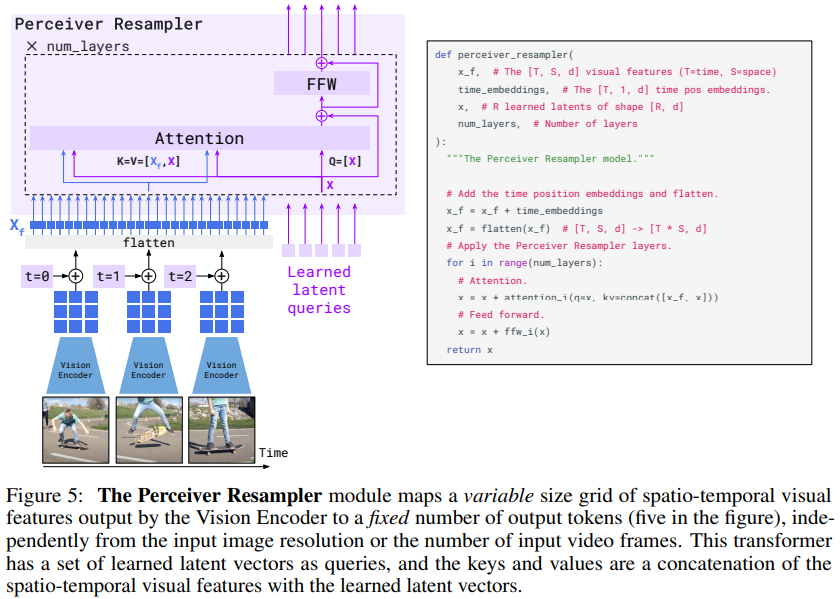

Perceiver Resampler 模块将由 Vision Encoder 输出的可变大小的时空视觉特征网格映射到固定数量的输出标记（图中为五个），与输入图像分辨率或输入视频帧数无关。这个 transformer 具有一组学习到的潜在向量作为查询，而键和值则是由时空视觉特征与学习到的潜在向量的连接组成。

**Perceiver Resampler** ：从不同大小的大型特征图到少量视觉标记。这个模块将视觉编码器连接到冻结的语言模型，如上图所示。它以视觉编码器中的图像或视频特征的可变数量作为输入，并产生固定数量的视觉输出（64 个），从而降低了视觉-文本交叉注意力的计算复杂度。

类似于 Perceiver 和 DETR，本文学习了预定义数量的潜在输入查询，这些查询被输入到一个 Transformer 中，并对视觉特征进行交叉关注。消融研究中展示了使用这样一个视觉-语言重采样模块优于一个普通的 Transformer 和一个 MLP。

### 2\. GATED XATTN-DENSE details

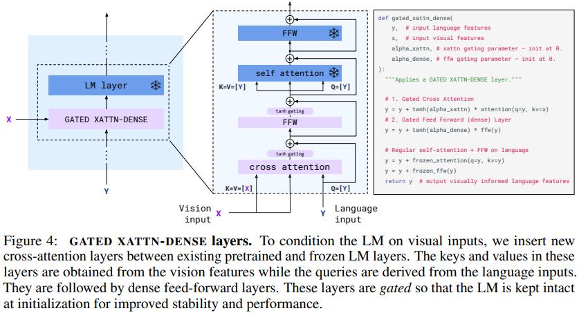

上图提供了一个 GATED XATTN-DENSE 块的示意图，以及它与一个冻结的 LM 块的连接方式，同时附上了伪代码。

> **1\. Gated Cross Attention (门控交叉注意力)**
> 
> 使用门控机制来控制语言特征（y）和视觉特征（X）之间的交互。门控参数 `alpha_xattn` 初始化为0，并通过tanh函数激活，以控制从视觉输入到语言模型的注意力流。
> 
> $$y = y + tanh(alpha\_xattn)\ *\ attention(1=y, kv=x)$$
> 
> **2\. Gated Feed Forward (dense) Layer (门控前馈密集层)**
> 
> 一个门控的前馈网络层, 对经过交叉注意力处理的语言特征进行进一步的非线性变换。
> 
> 门控参数 `alpha_dense` 同样初始化为0，并通过tanh激活
> 
> $y = y+ tanh(alpha_dense)\ *\ ffw(y) $​
> 
> **3\. 冻结的LM**
> 
> 将融合了视觉特征的语言特征 $y$ 作为 $q, k, v$ 输入冻结的语言模型层计算。
> 
> $$y = y+frozen\_attention(q=y, kv=y)$$
> 
> **4\. 冻结的FFW**
> 
> 输入冻结的前馈网络进行计算
> 
> $$y = y + frozen\_ffw(y)$$

下图绘制了 Flamingo-3B 模型的 24 个 LM 层在训练过程中（从 0％ 到 100％）不同层中 tanh 门控值的绝对值的演变。

冻结的 LM 堆栈的所有层似乎都利用了视觉信息，因为 tanh 门控的绝对值从其 0 初始化中迅速增长。  
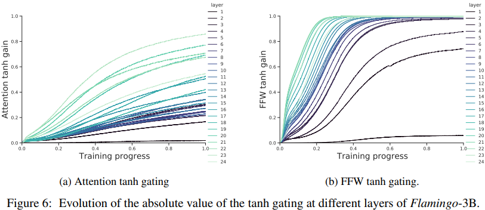

我们还注意到，绝对值似乎随着深度增加而增加。然而，从这个观察中很难得出强有力的结论：门控之前的激活的规模也可能随着深度变化。未来的工作需要更好地理解这些添加层对优化动态和模型本身的影响。

### 3\. Multi-visual input support

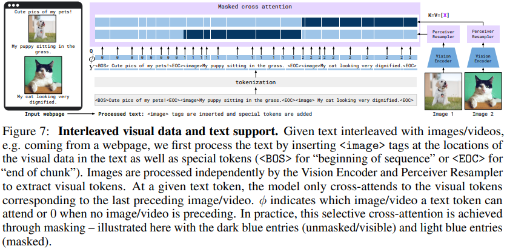

首先通过在文本中的视觉数据位置插入 image 标签以及特殊标记 BOS 表示“序列开始”或 EOC 表示“块结束”）来处理文本。

> 一个输入序列，只在开头添加BOS，后续每个文本序列结束都添加EOC

图像由 Vision Encoder 和 Perceiver Resampler 独立处理，以提取视觉标记。

在给定的文本标记处，模型仅与最后一个前导图像/视频对应的视觉标记进行交叉关注。

𝜑 指示文本标记可以关注的图像/视频，或者在没有前导图像/视频时为 0

上图说明了本文使用的 mask 方法，以限制某个文本标记看到的视觉标记数量。

我们还对图像/视频和文本的交错序列的符号化进行了规范化。交错的视觉数据和文本序列。

我们考虑交错的图像/视频和文本示例：每个示例包含一系列文本 𝑦，一系列图像/视频 𝑥，以及图像在文本中的位置序列。

基于视觉数据的位置，我们定义一个函数 $\varphi:[1, L] \mapsto \rightarrow[0, N]$，它为每个文本位置分配最后一个出现在该位置之前的图像/视频的索引（或者如果该位置之前没有视觉数据，则为 0）。函数 𝜑 定义了我们考虑用于预测的标记的可用视觉输入：前面的标记

### 4\. 训练细节

  1. **训练数据集** 由不同格式的训练数据集混合而成。去除交错的图像文本数据集 M3W 导致性能下降超过 17%，而去除传统的配对图像文本对也会导致性能下降（下降 9.8%），这表明需要不同类型的数据集。

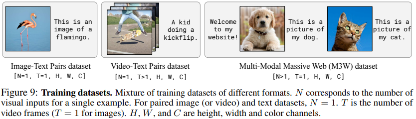

  2. **冻结 LM 组件可以防止灾难性遗忘** 。如果从头开始训练，我们观察到性能大幅下降了-12.9%。

有趣的是，微调我们预训练的 LM 也导致了性能下降了-8.0％。

  3. **数据集加权** 。M3W、ALIGN、LTIP 和 VTP，其权重分别为 1.0、0.2、0.2 和 0.03。这些权重是在小模型规模下经验性地获得的，并且在之后保持不变。

## 😃BLIP-2

BLIP-2: Bootstrapping Language-Image Pre-training with Frozen Image Encoders and Large Language Models

BLIP-2通过一个轻量级的查询变换器（Querying Transformer，简称Q-Former）来桥接模态差距，该变换器在两个阶段进行预训练。第一阶段从冻结的图像编码器中引导视觉-语言表示学习，第二阶段从冻结的语言模型中引导视觉到语言的生成学习。

### 1\. BLIP-2 架构

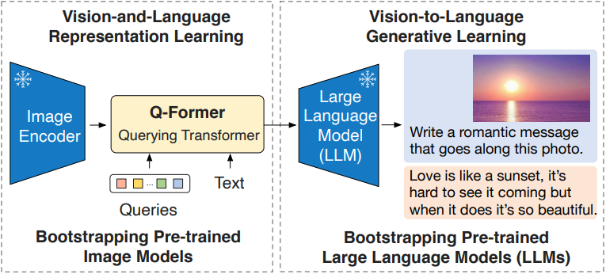

通过一个两阶段策略预训练轻量级的查询 Transformer，以弥合模态差距。

1.) 第一阶段从冻结的图像编码器中引导视觉-语言表示学习。

2.) 第二阶段从冻结的 LLM 中引导视觉到语言的生成学习，这使得零样本指导的图像到文本生成成为可能。

作者提出Q-Former，是为了把各个模态的信息，统一到 LLM 能理解的特征空间，这是第一步要解决的问题。

Q-Former是BLIP-2中的关键组件，是一个轻量级的Transformer模型。它使用一组可学习的查询向量（Queries）从冻结的图像编码器中提取视觉特征，并将其传递给语言模型。

### 2\. 阶段一：视觉和语言表示学习

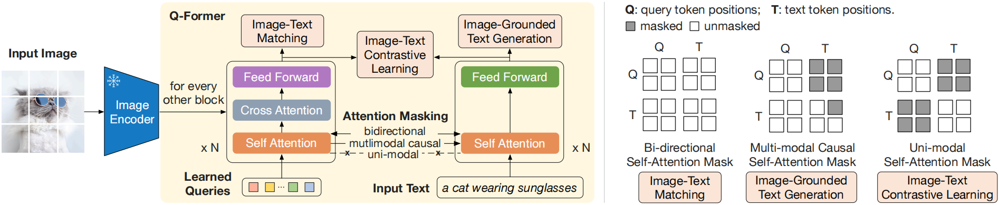

左侧：Q-Former 和 BLIP-2 的第一阶段视觉-语言表示学习目标的模型架构。

我们共同优化三个目标，这些目标强制**一组可学习的查询嵌入** 提取与文本最相关的视觉表示。

右侧：每个目标的自注意力 mask 策略，以控制 query-text 的交互。

> Q-Former 它由两个子模块组成：图像变换器（Image Transformer）和文本变换器（Text Transformer）。
> 
> 1.) 图像变换器负责与冻结的图像编码器交互，提取视觉特征。
> 
> 2.) 文本变换器既可以作为文本编码器也可以作为文本解码器，负责处理文本信息。
> 
> 在表示学习阶段，我们将Q-Former连接到一个冻结的图像编码器，并使用图像-文本对进行预训练。目标是训练Q-Former，使查询能够学习提取对文本最有信息量的视觉表示。受到BLIP（Li等人，2022年）的启发，我们联合优化了三个预训练目标，这些目标共享相同的输入格式和模型参数。每个目标采用不同的注意力掩码策略来控制查询和文本之间的交互。

针对 Q-Former 的三个训练任务分别是 Image-Text Contrastive Learning（ITC），Image-grounded Text Generation（ITG），Image-Text Matching（ITM）。

#### Image-Text Matching (ITM)

图像-文本匹配（ITM）旨在学习图像和文本表示之间的细粒度对齐。它是一个二元分类任务，模型被要求预测一个图像-文本对是正样本（匹配）还是负样本（不匹配）。

  1. 我们使用双向自注意力掩码 (bi-directional self-attention mask )，其中 all queries and texts 可以相互关注。

因此，输出查询嵌入Z捕捉到多模态信息。

  2. 我们将每个输出查询嵌入输入到一个二元线性分类器中以获得一个 logit，并跨所有查询平均这些 logit 作为输出匹配分数。

我们采用Li等人（2021年；2022年）的硬负样本挖掘策略来创建有信息量的负样本对。

#### Image-Text Contrastive Learning (ITC)

  1. 图像-文本对比学习（ITC）学习对齐图像表示和文本表示，使得它们的交互信息最大化。它通过将正样本对的图像-文本相似度与负样本对的相似度进行对比来实现这一点。

  2. 对齐 image transformer的输出查询表示 `Z` 与 text transformer的文本表示 `t`，t 是[CLS]标记的输出嵌入。

Z包含多个输出嵌入（one from each query ~~每个嵌入对应一个查询向量~~ ）~~对于每个查询向量，图像变换器都会生成一个对应的输出嵌入。~~

首先计算每个查询输出与t之间的成对相似度，然后选择最高的一个作为图像-文本相似度。为了避免信息泄露，我们采用 `unimodal self-attention mask`，不允许查询和文本相互看到对方。

  3. 使用批内负样本而不是BLIP中的momentum queue。

#### Image-grounded Text Generation (ITG)

图像引导的文本生成（ITG）损失训练Q-Former在给定输入图像作为条件的情况下生成文本。

  1. 由于Q-Former的架构不允许冻结的图像编码器和文本标记之间直接交互，生成文本所需的信息必须首先由查询提取，然后通过自注意力层传递给文本标记。

因此，查询被迫提取‘捕捉文本所有信息’的视觉特征。

  2. 我们采用多模态因果自注意力掩码( multimodal causal self-attention mask )来控制 query-text 交互，类似于在UniLM（Dong等人，2019年）中使用的那种。

  3. 查询可以相互关注，但不能关注 text tokens。

每个text token可以关注所有查询和其先前的 text tokens。

我们还将[CLS]标记替换为新的[DEC]标记，作为第一个文本标记，以指示解码任务。

* * *

Learned Query 的引入在这里至关重要。可以看到这些 Query 通过 Cross-Attention 与图像的特征交互，通过 Self-Attention 与文本的特征交互。这样做的好处有两个：

1.) 这些 Query 是基于两种模态信息得到的

2.) 无论多大的视觉 Backbone，最后都是 Query 长度的特征输出，大大降低了计算量

比如在实际实验中，ViT-L/14 的模型的输出的特征是 257x1024 的大小，最后也是 32x768 的 Query 特征。

第一阶段，对于模型的训练，就是由以上三个任务组成，通过这几个任务，实现了对于特征的提取与融合。但现在模型还没见过 LLM。我们现在用传感器完成了数据的提取与融合，下一步，我们得把数据转换成处理器能识别的格式。

### 3\. 阶段二：视觉到语言生成预训练

在生成式预训练阶段，我们将Q-Former（附带冻结的图像编码器）连接到一个冻结的大型语言模型（LLM），以利用LLM的生成语言能力。如图3所示：

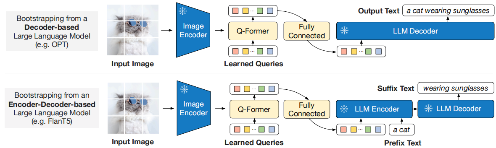

  1. 我们使用一个全连接（FC）层将输出查询嵌入Z线性投影到与LLM文本嵌入相同的维度。
  2. 然后，投影的查询嵌入被添加到输入文本嵌入的前面。它们作为软视觉提示，条件化LLM对Q-Former提取的视觉表示。
  3. 由于Q-Former已经被预训练为‘提取语言信息丰富的视觉表示’，它有效地充当了一个信息瓶颈，将最有用的信息传递给LLM，同时去除不相关的视觉信息。这减轻了LLM学习视觉-语言对齐的负担，从而缓解了灾难性遗忘问题。

通过第一阶段的训练，Query 已经浓缩了图片的精华，现在要做的，就是把 Query 变成 LLM 认识的样子。

作者试验了两种类型的大型语言模型（LLMs）：基于解码器的LLMs和基于编码器-解码器的LLMs。

  1. 对于基于解码器的LLMs，我们使用语言建模损失进行预训练， Query 做输入，文本做目标。
  2. 对于基于编码器-解码器的LLMs，我们使用前缀语言建模损失进行预训练，**将文本分成两部分，前缀文本与视觉表示连接作为输入到LLM的编码器。后缀文本用作LLM的解码器的生成目标** 。

### 4\. 训练细节

#### Pre-training data

  1. 与BLIP使用相同的预训练数据集，129M images in total, including COCO, Visual Genome, CC3M, CC12M, SBU, and 115M images from the LAION400M dataset

  2. 采用CapFilt方法（Li et al.，2022）来为网络图像创建合成标题。生成10个标题使用 BLIPlarge captioning model, 并根据CLIP ViT-L/14模型产生的图像-文本相似性，对合成标题和原始web标题进行排序。

我们保留每张图像的前两个标题作为训练数据，并在每个训练前步骤中随机抽取一个。

#### Pre-trained image encoder and LLM

  * 对于冻结的图像编码器，我们探索了两种最先进的预训练视觉 transformer 模型：（1）来自CLIP的ViT-L/14（Radford等人，2021年）和（2）来自EVA-CLIP的ViT-g/14（Fang等人，2022年）。我们移除了ViT的最后一层，并使用倒数第二层的输出特征，这带来了稍微更好的性能。

  * 对于冻结的语言模型，我们为基于解码器的LLM探索了无监督训练的OPT模型系列（Zhang等人，2022年），以及为基于编码器-解码器的LLM探索了经过指令训练的FlanT5模型系列（Chung等人，2022年）。

#### Pre-training settings

pre-train

250k steps in the first stage

80k steps in the second stage

batch size of 2320/1680 for ViT-L/ViT-g in the first stage

batch size of 1920/1520 for OPT/FlanT5 in the second stage

During pre-training, we convert the frozen ViTs' and LLMs' parameters into FP16, except for FlanT5 where we use BFloat16.

与使用32位模型相比，我们没有发现性能下降。

由于使用了冻结模型，我们的预训练比现有的 large-scale VLP方法更易于计算。

> large-scale VLP方法 ??

## 😁InstructBLIP

InstructBLIP: Towards General-purpose Vision-Language Models with Instruction Tuning

使用指令微调迈向通用视觉语言模型

InstructBLIP旨在解决视觉语言指令微调中的挑战 ( 提高指令微调效果技术细节 )，并提供对模型对未见数据和任务的泛化能力提高的系统研究。

### 1\. InstructBLIP 模型架构

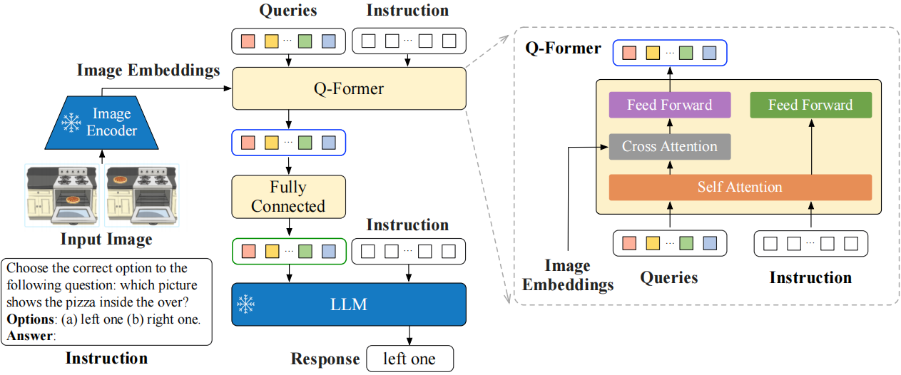

Q-Former从冻结图像编码器的输出嵌入中提取指令感知的视觉特征，并将视觉特征作为软提示输入给冻结的LLM。我们用语言建模损失来指导调整模型，以生成响应。

  1. 视觉编码器提取输入图片的特征，并喂入 Q-Former 中。此外，Q-Former 的输入还包括可学习的 Queries（BLIP-2 的做法）和 Instruction。

  2. Q-Former 的内部结构黄色部分所示，其中可学习的 Queries 通过 Self-Attention 和 Instruction 交互，可学习的 Queries 通过 Cross-Attention 和输入图片的特征交互，鼓励提取与任务相关的图像特征。

### 2\. Vision-Language 指令微调

#### 2.1 任务 & 数据集

我们收集了一套全面的公开可用的视觉语言数据集，并将其转换为指令微调格式。最终收集涵盖了11个任务类别和26个数据集。

**对于每个任务，我们精心制作了10到15个不同的自然语言指令模板** 。

对于天生倾向于短响应的公共数据集，我们在一些相应的指令模板中使用“简短”和“简要”等术语，以减少模型总是生成短输出的过拟合风险。

对于LLaVA-Instruct-150K数据集，我们没有加入额外的指令模板，因为它自然地以指令格式结构化。完整的指令模板列表可以在附录D中找到。

任务 | 指令模板  
---|---  
图像描述 | 简短的图像标题：  
| 简短的图像描述：  
| 一张照片：  
| 显示的图像：  
| 为图像写一个简短的描述。  
  
#### 2.2 训练和评估方案

为了确保训练和零样本评估的数据和任务足够，我们将26个数据集分为13个 held-in 内部保留数据集和13个 held-out 外部保留数据集。

对于held-out评估，我们的目标是了解指令微调如何提高模型在未见数据上的zero-shot性能。我们定义了两种类型的held-out数据：

1.）在训练期间未向模型暴露的数据集，但其任务在 held-in 中存在；

2.）在训练期间完全未见过的数据集及其相关任务。

解决第一种类型的 held-out 评估并非易事，因为held-in和held-out数据集之间的数据分布发生了变化。

对于第二种类型，我们完全保留了几个任务，包括视觉推理、视频问题回答、视觉对话问答和图像分类。

模型使用标准的语言建模损失进行训练，以直接生成给定指令的响应。

对于涉及场景文本的数据集，我们将OCR标记作为补充信息添加到指令中。

#### 2.3 Instruct-aware视觉特征提取

  1. 现存的 zero-shot image-to-text 生成方法，如BLIP2，在提取视觉特征时采用的指令无关的方法。这导致一组静态的视觉表示被输入到大型语言模型（LLM）中，而不考虑任务。

  2. 相比之下，指令感知视觉模型可以适应任务指令，产生最有利于手头任务的视觉表征。

如果同一输入图像的任务指令变化很大，这显然是有利的。

  3. 与BLIP-2一样，Q-Former在进行微调之前，使用image-caption data进行两个阶段的预训练

第一阶段使用冻结的图像编码器预训练Q-Former，进行视觉-语言表示学习。

第二阶段将Q-Former的输出调整为软视觉提示，用于与冻结的LLM一起生成文本。

预训练后，我们使用指令微调对Q-Former进行微调，其中LLM接收来自Q-Former的视觉编码和任务指令作为输入。

扩展了BLIP-2方法，InstructBLIP提出了一个指令感知的Q-Former模块，它将 instruction text tokens 作为额外的输入。指令通过Q-Former的自注意力层与查询嵌入进行交互，并鼓励提取与任务相关的形象特征。

#### 2.4 平衡训练数据集

每个数据集的大小存在显著差异，均匀混合它们可能会导致模型对较小的数据集过拟合，对较大的数据集欠拟合。

为了缓解这个问题，建议按大小（或训练样本数量）的平方根成比例地对数据集进行采样。

一般来说，给定 D 个数据集，大小分别为[ S_1, S_2, ..., S_D ]，在训练期间从数据集 d 中选择一个数据样本的概率为：

$$P_d = \frac{\sqrt{S_d}}{\sum_{i=1}^{D} \sqrt{S_i}}$$

**在这个公式的基础上，对某些数据集的权重进行了手动调整以改善优化。这是由于数据集和任务之间固有的差异，尽管大小相似，但需要不同程度的训练强度。**

具体来说，我们降低了包含多项选择题的A-OKVQA的权重，并增加了需要开放式文本生成的OKVQA的权重。

#### 2.5 推理方法

在推理时，我们对不同数据集的评估采用了两种略有不同的生成方法。

  1. 对于大多数数据集，如图像描述和开放式视觉问答（VQA），指令微调模型直接被提示生成响应，然后将这些响应与真实情况比较以计算指标。

  2. 另一方面，对于分类和多项选择VQA任务，我们采用了 vocabulary ranking 词汇排名方法。

具体来说，我们仍然提示模型生成答案，但将其词汇限制在候选词列表中。然后，我们计算每个候选词的对数似然，并选择最高值作为最终预测。

这种排名方法应用于ScienceQA、IconQA、A-OKVQA（多项选择）、HatefulMemes、视觉对话、MSVD和MSRVTT数据集。

此外，对于二元分类，我们将正面和负面标签扩展到更广泛的一组表述中，以利用自然文本中的单词频率（例如，正面类别用“是”和“真”；负面类别用“否”和“假”）。

对于视频问答任务，我们**每个视频使用四个均匀采样的帧** 。每个帧分别由图像编码器和Q-Former处理，**提取的视觉特征在输入到大型语言模型（LLM）之前被连接起来** 。

#### 2.6 实施细节

**架构**

在我们的实验中，采用了四种变体的BLIP-2，它们使用相同的图像编码器（ViT-g/14），但具有不同的冻结LLMs，包括FlanT5-XL（3B）、FlanT5-XXL（11B）、Vicuna-7B和Vicuna-13B。

  1. FlanT5是基于编码器-解码器 Transformer T5 的指令微调模型。
  2. 另一方面，Vicuna 是最近发布的仅解码器Transformer，从LLaMA 进行指令调整。

在视觉语言指令微调期间，我们从预训练的BLIP-2检查点初始化模型，并仅微调Q-Former的参数，同时保持图像编码器和LLM冻结。由于原始的BLIP-2模型不包括Vicuna的检查点，我们使用与BLIP-2相同的程序对Vicuna进行预训练。

**训练和超参数**

我们使用LAVIS库进行实现、训练和评估。

所有模型都进行指令微调，最多进行60K步，并且每3K步验证一次模型的性能。对于每个模型，选择一个单一的最优检查点，并用于所有数据集的评估。

我们分别为3B、7B和11/13B模型使用192、128和64的批量大小。这里模型越大对应的batch_size越小。

使用AdamW 优化器，其中β1 = 0.9，β2 = 0.999，并具有0.05的权重衰减。

在最初的1,000步中应用学习率的线性预热，从$10^-8$增加到$10^-5$，随后是余弦衰减，最小学习率为0。

所有模型都使用16个Nvidia A100（40G）GPU进行训练，并在1.5天内完成。

### 3\. 指令微调 vs 多任务学习

直接类比于指令调整的是多任务学习，涉及同时训练多个数据集，目标是提高每个单独数据集的性能。

为了探究在指令微调中观察到的零样本泛化能力的提高主要是来自指令的格式化还是仅仅来自多任务学习，我们在相同的训练设置下对这两种方法进行了比较分析。

作者考虑了两种多任务训练方法：

  1. 在第一种方法中，模型使用训练数据集的原始输入输出格式进行训练，没有指令。在评估期间，仍然向模型提供指令，指示要执行的具体任务。

一种情况例外：对于图像描述任务，在评估期间不会添加指令，因为模型仅在接收到图像作为输入时才能获得更好的分数

  2. 对于第二种方法，我们通过在训练期间将 [Task:Dataset] 标识符添加到文本输入中，向指令微调迈出了一步。

例如，我们为VQAv2数据集添加了[视觉问题回答：VQAv2]。在评估期间，我们探索指令和这个标识符带来的影响。

特别是，对于 held-out 数据集的标识符，我们只使用任务名称，因为模型从未看到数据集名称。

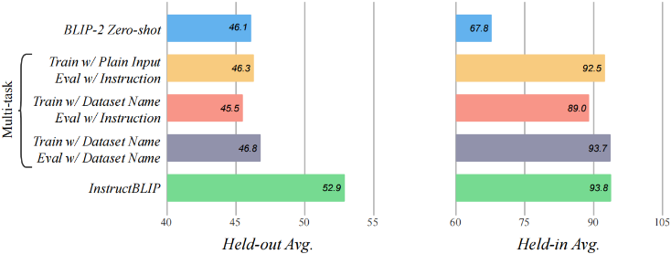

结果如图

  1. 首先，指令调整和多任务学习在 held-in 数据集上表现出类似的性能。这表明，只要模型已经用这样的数据进行过训练，它就可以同样好地适应这两种不同的输入模式。

  2. 另一方面，指令微调在未见过的 held-out 数据集上比多任务学习有显著的提高，而多任务学习仍然与原始的BLIP-2表现相当。

这表明指令微调是增强模型零样本泛化能力的关键。

## 😉LLaVA

Visual Instruction Tuning 视觉指令微调

创新点：使用ChatGPT/GPT-4将图像-文本对转换为适当的指令遵循格式，从而生成多模态语言-图像指令遵循数据。

### 1\. LLaVA模型结构

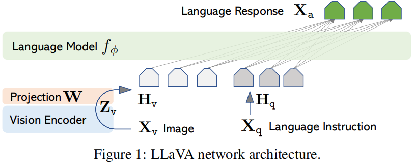

主要目标：有效利用预训练LLM和视觉模型的能力。

LLM：使用 Vicuna

pre-trained CLIP 视觉编码器：ViT-L/14

在实验中考虑了 Transformer 最后一层前后的网格特征 grid features。

LLaVA使用了简单的 linear layer 将视觉特征投影到词嵌入空间，这种简单的线性层的投影机制是轻量化的，能够快速迭代以数据为中心的实验。

一些复杂的机制如 Flamingo中的 gated cross-attention 和 BLIP-2中的Q-former。

### 2\. GPT辅助生成视觉指令遵循数据

#### 简单扩展版本

对于图像 $X_v$ 及其相关的标题 $ X_c$，很自然地会创建一组问题 $X_q$​，instruct assistant 描述图像内容。

我们提示GPT-4策划这样一个问题列表（见附录详情），分为简洁描述以及详细描述：

> **brief image description**
> 
> 

```json
• "Describe the image concisely."
• "Provide a brief description of the given image."
• "Offer a succinct explanation of the picture presented."
• "Summarize the visual content of the image."
...
```

> 
> **detailed image description**
> 
> 

```json
• "Describe the following image in detail"
• "Provide a detailed description of the given image"
• "Give an elaborate explanation of the image you see"
• "Share a comprehensive rundown of the presented image"
...
```

因此，将图像-文本对扩展到其指令遵循版本的简单方法是：Human：$X_q$ $X_v$ <STOP> Assistant：$X_c $<STOP>。

构建成本低，但这种简单扩展版本缺乏指令和响应中的多样性和深入推理。

#### 优化扩展版本

为了缓解这个问题，利用仅接受文本输入的 language-only GPT-4或ChatGPT作为强大的教师，创建涉及视觉内容的指令遵循数据。

具体来说，为了将图像编码为其视觉特征以提示仅文本的GPT，我们使用两种类型的符号表示：（i）标题：通常从不同角度描述视觉场景；（ii）边界框：通常定位场景中的对象，每个框编码对象概念及其空间位置。

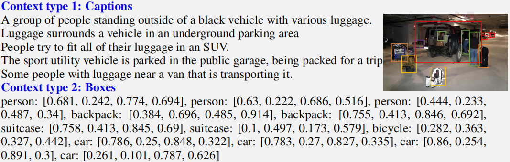

这种符号表示允许我们将图像编码为LLM可识别的序列。

我们使用COCO图像并生成三种类型的指令遵循数据，示例如下：

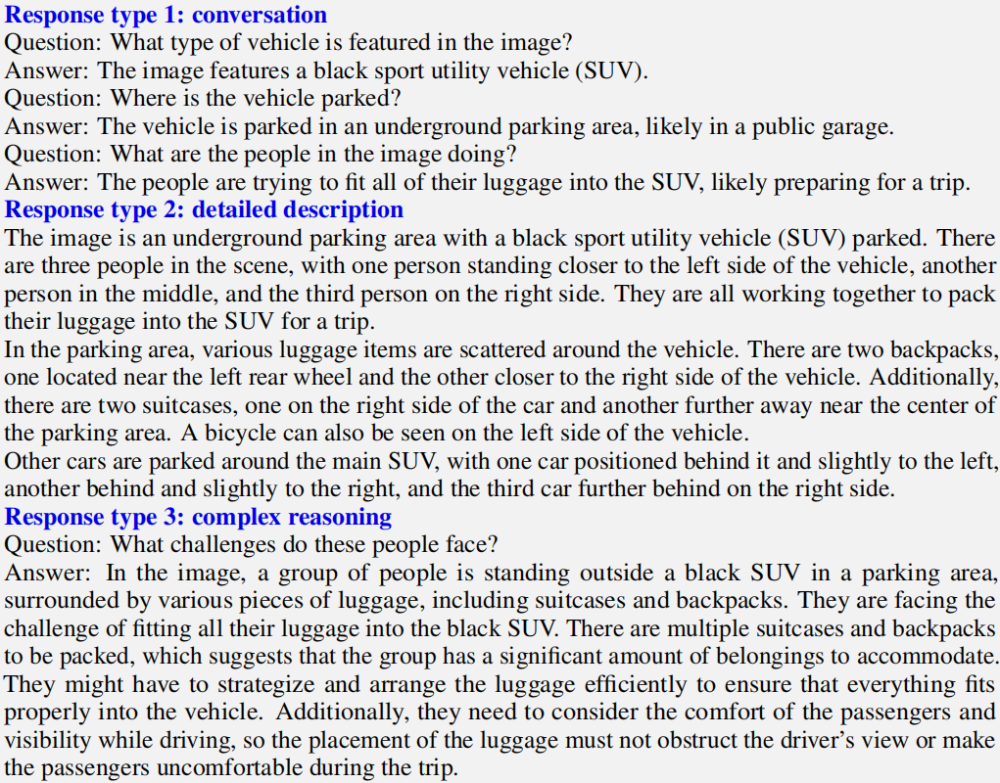

对于每种类型，先手动设计一些示例。这是在数据收集期间拥有的唯一人类注释，并用作上下文学习中提示GPT-4的种子示例。

总共收集了158K个语言图像指令遵循样本，包括对话58K，详细描述23K，复杂推理77k。

在早期实验中，取消了ChatGPT和GPT-4的使用，并发现GPT-4始终提供更高质量的指令指令数据，如空间推理。

### 3\. 训练

#### 数据组织格式

对于每个图像 $X_v$，生成$T$轮多轮对话数据 $X_q^1, X_a^1, ..., X_q^T, X_a^T$，所有answers作为助手的响应。

第$t$轮的指令组织如下 ( 多模式指令遵循序列的统一格式 )

$$\mathbf{X}_{\text {instruct }}^{t}=\left\{\begin{array}{lr}
\text { Randomly choose }\left[\mathbf{X}_{\mathbf{q}}^{1}, \mathbf{X}_{\mathrm{v}}\right] \text { or }\left[\mathbf{X}_{\mathbf{v}}, \mathbf{X}_{\mathbf{q}}^{1}\right], & \text { the first turn } t=1 \\
X_q^t\ \ \ \ \ \ \ \ \ \ \text { the remaining turns } t>1
\end{array}\right.$$

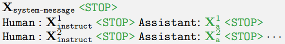

实际实现中，遵循 Vicuna-v0 设置 system message $X_{system-message}$，set <STOP> = ###

模型被训练预测 assistant answer 以及何时停止，因此只有图中绿色的部分被用于计算损失。

我们使用原始的自回归训练目标，对LLM进行指令微调。

$$p\left(\mathbf{X}_{\mathrm{a}} \mid \mathbf{X}_{\mathrm{V}}, \mathbf{X}_{\text {instruct }}\right)=\prod_{i=1}^{L} p_{\boldsymbol{\theta}}\left(x_{i} \mid \mathbf{X}_{\mathrm{v}}, \mathbf{X}_{\text {instruct },<i}, \mathbf{X}_{\mathrm{a},<i}\right)$$

#### 一阶段：特征对齐预训练

filter CC3M to 595K image-text pairs

使用简单扩展版本转换为指令遵循数据，每个样本可以被视为单论对话。

这个阶段可以被理解为为冻结的LLM训练一个兼容的视觉分词器。

#### 二阶段：端到端微调

始终保持视觉编码器权重不变，并继续更新LLaVA中投影层和LLM的预训练权重；

可训练参数为 $\theta = {W, \Phi} $

我们考虑两个具体的用例场景：

  * **多模态聊天机器人** ：通过优化扩展版本的158K语言-图像指令遵循数据上进行微调，开发了一个聊天机器人。

在三种类型的响应中，对话是多轮的，而其他两种是单轮的。它们在训练中被均匀采样。

  * **科学问答（Science QA）** ：在ScienceQA benchmark上研究我们的方法，这是第一个大规模的多模态科学问题数据集。每个问题都以自然语言或图像的形式提供上下文。助手以自然语言提供推理过程，并在多个选项中选择答案。

组织数据为单轮对话

### 4\. 实验结果

指令遵循能力对比，前三个在 LLaVA-Bench 上评估，最后一个通过查询GPT-4辅助评估。

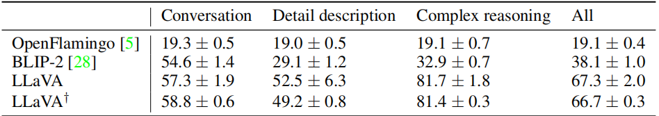

消融实验

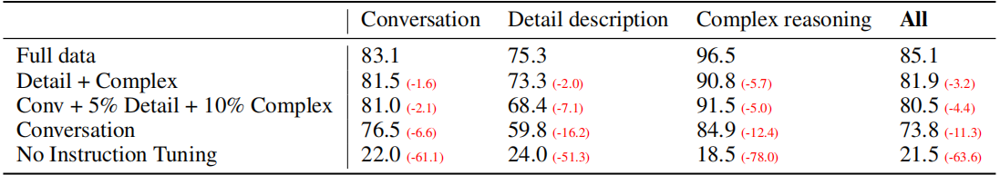

  * 第二行可以看到，即便没有使用多轮会话数据，仅用详细的图文描述和复杂推理数据进行微调，在多轮会话的评测结果没有太大的降低。

但没有使用多轮对话数据，对图文描述和复杂推理也产生了不小的影响。

## 😋LLaVA-v1.5

Improved Baselines with Visual Instruction Tuning

研究在LLaVA 框架下LMM的设计选择

fully-connected vision-language connector in LLaVA is surprisingly power ful and data-efficient.

基于LLaVA的简单修改：使用带有MLP投影的CLIP-ViT-L-336px，并添加带有响应格式化提示的面向学术任务的VQA数据

establish stronger baselines that achieve state-of-the-art across 11 benchmarks.

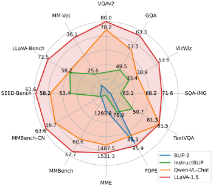

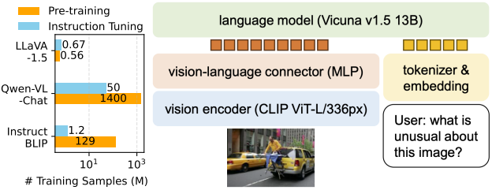

### 1\. 响应格式化提示

作者发现，像InstructBLIP这样的方法在处理短答案和长答案的VQA之间的平衡方面存在困难，主要是由于以下原因。

  1. 首先，响应格式的提示不明确。例如，Q：[问题] A：[答案]。这样的提示没有清楚地指明所需的输出格式，并且可能会使大型语言模型（LLM）在自然视觉对话行为上过度拟合短答案。
  2. 其次，没有对LLM进行微调。第一个问题由于InstructBLIP只对Qformer进行指令调整的微调而加剧。它需要Qformer的视觉输出令牌来控制LLM输出的长度，使其是长形式或短形式，如 prefix tuning ，但Qformer可能由于其与像LLaMA这样的LLM相比能力有限，而无法适当地做到这一点。

因此，为了使LLaVA能够更好地处理短答案并解决InstructBLIP的问题，我们建议使用一个单一的响应格式化提示，清楚地指示输出格式。

当需要简短答案时，它会附加在VQA问题的末尾：Answer the question using a single word or phrase.

我们发现，当LLM用这样的提示进行微调时，LLaVA能够根据用户的指令适当地调整输出格式 ( 如下图 )，并且不需要使用ChatGPT对VQA答案进行额外处理，这进一步使得扩展到各种数据源成为可能。

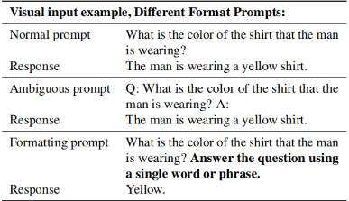

如表2所示，仅通过在训练中包含VQAv2数据，使用响应格式化提示，LLaVA在MME上的表现显著提高（1323.8 vs 809.6），并且比InstructBLIP高出111分。

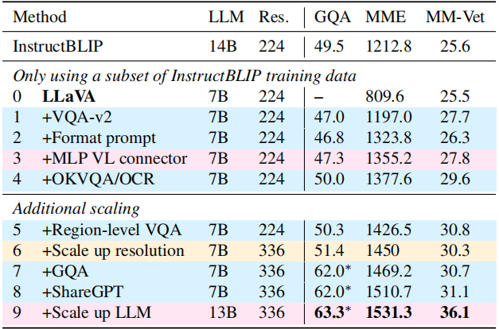

包含所有修改的最终模型称为LLaVA-1.5（上图的最后两行）

### 2\. 数据和模型的扩展

#### MLP视觉语言连接器

受到通过从线性投影改为MLP在自监督学习中改进性能的启发，我们发现通过使用两层MLP提高视觉-语言连接器的表示能力可以提高LLaVA的多模态能力，与原始的线性投影相比有所提升。

#### 面向学术任务的数据

进一步包括了额外的面向学术任务的VQA数据集，用于VQA、OCR和区域级感知 region-level perception，以多种方式增强模型的能力。

如表2所示。我们首先包括了InstructBLIP使用的四个额外数据集：开放知识VQA（**OKVQA** ，A-OKVQA ）和**OCR** （OCRVQA ，TextCaps ）。

A-OKVQA数据集被转换为多项选择题，并使用特定的响应格式化提示：直接用给定选项的字母回答。

**仅使用InstructBLIP使用的数据集的一个子集，LLaVA在表2中的所有三个任务上已经超过了它，表明了LLaVA的有效设计** 。

此外，我们发现进一步添加区域级VQA数据集（Visual Genome ，RefCOCO）提高了模型定位细粒度视觉细节的能力。

#### 额外的扩展

  1. 进一步将输入图像分辨率扩展到 $336^2$，以使大型语言模型（LLM）能够清晰地“看到”图像的细节，通过将视觉编码器更换为CLIP的ViT-L-336px（CLIP提供的最高分辨率）。

  2. 此外，我们增加了GQA数据集作为额外的视觉知识来源。我们还将ShareGPT 数据纳入其中，并将LLM扩展到13B，将LLM扩展到13B时，改进最为显著，这表明基础LLM的能力对于视觉对话的重要性。

### 3\. 扩展到更高的分辨率

我们观察到提高输入图像分辨率可以提升模型的能力。然而，现有的开源CLIP视觉编码器的图像分辨率限制在$336^2$​，这阻止了我们通过简单地更换视觉编码器来支持更高分辨率图像。

在本节中，我们提出了一个早期探索，即在保持LLaVA-1.5的数据效率的同时，将大型多模态模型（LMM）扩展到更高分辨率。

  1. 当使用ViT作为视觉编码器时，为了提高分辨率，以前的方法大多选择执行位置嵌入插值，并在微调期间将ViT backbone 适应到新分辨率。然而，这通常需要在大规模图像-文本配对数据集上对模型进行微调，并限制了LMM在推理期间可以接受的图像分辨率为固定大小。

  2. 相反，如图，我们通过将图像划分为视觉编码器最初训练的分辨率的较小图像块，并独立编码它们。

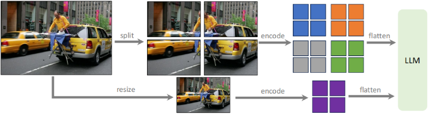

在获得各个块的特征map之后，我们将它们组合成一个目标分辨率的单一大特征map，并将其输入到大型语言模型（LLM）。

为了提供全局上下文并减少 split-encode-merge 操作的人为因素，我们还将下采样图像的特征附加到合并的特征map上。

这使我们能够将输入扩展到任何任意分辨率，并保持LLaVA-1.5的数据效率。我们将这种结果模型称为LLaVA-1.5-HD。