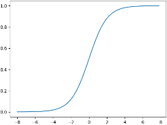
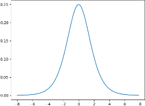
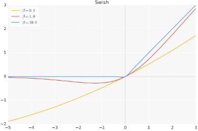
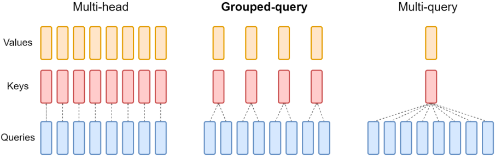
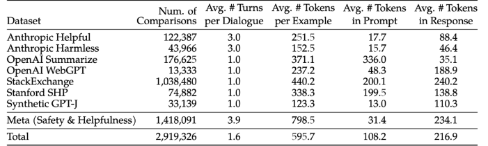
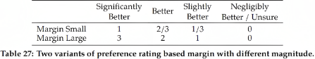
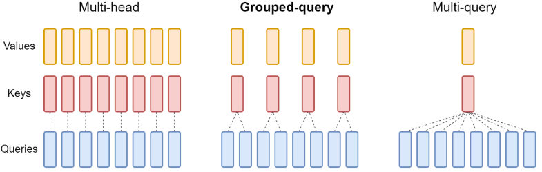
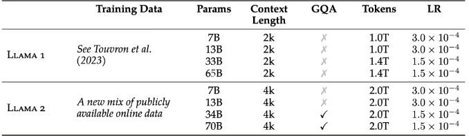

# Llama系模型总结

> 原文作者：幻影星全能的木豆  
> 原文链接：https://www.cnblogs.com/mudou/p/18312471  
> 发布时间：2024-07-19 22:04

---

Llama3 学习链接 <https://blog.csdn.net/v_JULY_v/article/details/137955982>

就不易理解的内容进一步剖析

对Llama系模型进行汇总

## 一、LLama1

### 1\. LLama 1 简介

23年2.24日, Meta发布了LLaMA, 有多个参数规模的版本(7B 13B 33B 65B)

**LLaMA只使用公开的数据**(总计1.4T即1,400GB的token，其中CommonCrawl的数据占比67%，C4数据占比15%，Github、Wikipedia、Books这三项数据均都各自占比4.5%，ArXiv占比2.5%，StackExchange占比2%)

证明小模型在足够多的的数据上训练后，也能达到甚至超过大模型的效果

> 比如13B参数的版本在多项基准上测试的效果好于2020年的参数规模达175B的GPT-3
> 
> 而对于65B参数的LLaMA，则可与DeepMind的Chinchilla(70B参数)和谷歌的PaLM(540B参数)旗鼓相当

### 2\. 模型架构

#### 2.1 RMSNorm

为了提高训练的稳定性，对每个transformer子层的输入进行归一化，而不是对输出进行归一化，且使用由Zhang和Sennrich(2019)提出的RMSNorm

RMS Norm是一般LayerNorm的一种变体，可以在梯度下降时令损失更加平滑

与layerNorm相比，RMS Norm的主要区别在于去掉了减去均值的部分(re-centering)，只保留方差部分(re-scaling)

为一目了然，我们看下它们各自的归一化的表达式

**LayerNorm**

在给定一个输入特征向量 $a_i$后，先计算 $a$ 的均值 μ 和标准差 σ

$$\begin{array}{c}
\mu=\frac{1}{n} \sum_{i=1}^{n} a_{i} \\
\sigma=\sqrt{\frac{1}{n} \sum_{i=1}^{n}\left(a_{i}-\mu\right)^{2}}
\end{array}$$

然后进行归一化操作: $\bar{a}_{i}=\frac{a_{i}-\mu}{\sigma} g_{i}+b_{i}$

其中的 $g_i$ 是可学习的缩放参数，来调整每个特征在归一化后的尺度或权重，最终作用是恢复归一化操作可能损失的信息，如数据的比例和分布等

而 $b_i$ 是偏移因子，可以对归一化并放缩后的数据进行偏移，使模型可以学习到一个最优的数值范围，比如在ReLU激活函数中，我们可能希望值在0以上

**RMS Norm**

首先，计算输入特征向量 a 的平方根均值 $R M S(a)=\sqrt{\frac{1}{n} \sum_{i=1}^{n} a_{i}{ }^{2}}$

然后，对输入特征向量 a 进行归一化 $\bar{a}_{i}=\frac{a_{i}}{R M S(a)} g_{i}$

此外，可选地，RMSNorm 还可以引入可学习的偏移参数 $\bar{a}_{i}=\frac{a_{i}}{R M S(a)} g_{i}+b_{i}$

```python
class RMSNorm(torch.nn.Module):
    def __init__(self, dim: int, eps: float = 1e-6):
        super().__init__()
        # eps防止取倒数之后分母为0
        self.eps = eps
        self.weight = nn.Parameter(torch.ones(dim))
 
	def _norm(self, x):
		return x * torch.rsqrt(x.pow(2).mean(-1, keepdim=True) + self.eps)
 
    def forward(self, x):
        output = self._norm(x.float()).type_as(x)
        # weight是末尾乘的可训练参数，即gi
        return output * self.weight
```

#### 2.2 SwiGLU替代ReLU

为了更好的理解SwiGLU，首先你得先了解什么是ReLU和GLU

  1. ReLU的函数表达式为 $f(x)=\max (0, x)$，这意味着对于所有负的输入值，ReLU函数的输出都是0，对于所有正的输入值，ReLU函数的输出等于输入值本身。

  2. GLU 的基本思想是引入一种称为“门”机制，该机制可以动态地控制信息的流动

$$G L U(x)=x \otimes \sigma(g(x))$$

这个公式意味着，对于每个输入 $x$，都会有一个相应的门值，这个门值由 $\sigma(g(x))$​​ 产生，其范围在 0 到 1 之间(在正数区域接近于1，负数区域接近于0)，这个门值用于调节相应的输入值

如果 $\sigma(g(x))$​ 接近 1，那么“门”就几乎完全开启，输入 x 的信息能够自由流动，于是 GLU 的输出接近于 x

如果 $\sigma(g(x))$ 接近 0，意味着“门”几乎完全关闭，即输入 x 的大部分或全部信息被阻止通过，于是 GLU 的输出接近 0

> sigmoid函数 $\sigma(x)=\frac{1}{1+e^{-x}}$
> 
> 
> 
> sigmoid导函数图像
> 
> 

而LLaMA采用Shazeer(2020)提出的SwiGLU替换了原有的ReLU，SwiGLU的作用机制是根据输入数据的特性，通过学习到的参数自动调整信息流动的路径，具体是采用SwiGLU的Feedforward Neural Network (简称FNN，这是一种使用可学习的门控机制的前馈神经网络)

其在论文中以如下公式进行表述：

$$F F N_{swiGLU}\left(x, W, V, W_{2}\right)=\left(\operatorname{Swish}_{\beta}(x W) \otimes x V\right) W_{2}$$

>   1. 先是通过Swish非线性激活函数处理 “输入x和权重矩阵W的乘积”
> 
> Swish激活函数 $f(x)=x * \operatorname{sigmoid}(\beta x)$，输入被缩放了 $\beta$ 倍，$\beta$ 是一个可以学习的参数，比如下图， $\beta$ 不同，Swish激活函数的形状则各异
> 
> 
> 
> $\beta$​ 趋近于 0 时，Swish 函数趋近于线性函数 y = x
> 
> $\beta$ 趋近于无穷大时，Swish 函数趋近于 ReLU 函数
> 
>   2. 步骤1得到的结果和 “输入x与权重矩阵V的乘积” 进行逐元素的乘法
> 
> 这个操作相当于在 Swish 激活的输出和第二个线性变换的输出(指的是后面的$W_2$)之间引入了一个类似于GLU的“门”，这个门的值是由原始输入 x通过线性变换 V计算得到的，因此，它可以动态地控制 Swish 激活的输出
> 
>   3. 最后乘以权重矩阵$W_2$
> 
> 

#### 2.3 位置编码：RoPE

LLaMA实现的旋转位置编码

```python
# 预计算频率和复数的函数
def precompute_freqs_cis(dim: int, end: int, theta: float = 10000.0):
    freqs = 1.0 / (theta ** (torch.arange(0, dim, 2)[: (dim // 2)].float() / dim))    # 计算频率
    t = torch.arange(end, device=freqs.device)    # 根据结束位置生成序列
    freqs = torch.outer(t, freqs).float()    # 计算外积得到新的频率
    freqs_cis = torch.polar(torch.ones_like(freqs), freqs)    # 计算复数
    return freqs_cis    # 返回复数
```

```python
# 重塑的函数
def reshape_for_broadcast(freqs_cis: torch.Tensor, x: torch.Tensor):
    ndim = x.ndim    # 获取输入张量的维度
    assert 0 <= 1 < ndim    # 检查维度的合理性
    assert freqs_cis.shape == (x.shape[1], x.shape[-1])    # 检查复数的形状
    shape = [d if i == 1 or i == ndim - 1 else 1 for i, d in enumerate(x.shape)]    # 计算新的形状
    return freqs_cis.view(*shape)    # 重塑复数的形状并返回
```

```python
# 应用旋转嵌入的函数
def apply_rotary_emb(
    xq: torch.Tensor,
    xk: torch.Tensor,
    freqs_cis: torch.Tensor,
) -> Tuple[torch.Tensor, torch.Tensor]:
    xq_ = torch.view_as_complex(xq.float().reshape(*xq.shape[:-1], -1, 2))    # 将xq视为复数
    xk_ = torch.view_as_complex(xk.float().reshape(*xk.shape[:-1], -1, 2))    # 将xk视为复数
    freqs_cis = reshape_for_broadcast(freqs_cis, xq_)    # 重塑复数的形状
    xq_out = torch.view_as_real(xq_ * freqs_cis).flatten(3)    # 计算xq的输出
    xk_out = torch.view_as_real(xk_ * freqs_cis).flatten(3)    # 计算xk的输出
    return xq_out.type_as(xq), xk_out.type_as(xk)    # 返回xq和xk的输出
```

```python
# 对Query和Key应用旋转嵌入
xq, xk = apply_rotary_emb(xq, xk, freqs_cis=freqs_cis)
```

#### 2.4 Transform架构的实现：Attention计算、SA、FFN

##### SA

Attention计算的总体过程

1.) 输入$x$，分别经过三个Linear得到$x_q, x_k, x_v$

2.) 在$x_q, x_k$中加入旋转位置编码

3.) 缓存 $x_q, x_k$

4.) 计算$softmax(\frac{QK^T}{\sqrt{d_k}})V$

```python
class Attention(nn.Module):
    def __init__(self, args: ModelArgs):
        super().__init__()

        # 设置本地注意力头的数量
        self.n_local_heads = args.n_heads // fs_init.get_model_parallel_world_size()
        # 每个注意力头的维度
        self.head_dim = args.dim // args.n_heads

        # Query投影层
        self.wq = ColumnParallelLinear(
            args.dim,
            args.n_heads * self.head_dim,
            bias=False,
            gather_output=False,
            init_method=lambda x: x,
        )
        # Key投影层
        self.wk = ColumnParallelLinear(
            args.dim,
            args.n_heads * self.head_dim,
            bias=False,
            gather_output=False,
            init_method=lambda x: x,
        )
        # Value投影层
        self.wv = ColumnParallelLinear(
            args.dim,
            args.n_heads * self.head_dim,
            bias=False,
            gather_output=False,
            init_method=lambda x: x,
        )
        # 输出投影层
        self.wo = RowParallelLinear(
            args.n_heads * self.head_dim,
            args.dim,
            bias=False,
            input_is_parallel=True,
            init_method=lambda x: x,
        )

        # 使用零初始化键缓存
        self.cache_k = torch.zeros(
            (args.max_batch_size, args.max_seq_len, self.n_local_heads, self.head_dim)
        ).cuda()
        # 使用零初始化值缓存
        self.cache_v = torch.zeros(
            (args.max_batch_size, args.max_seq_len, self.n_local_heads, self.head_dim)
        ).cuda()
 
	def forward(self, x: torch.Tensor, start_pos: int, freqs_cis: torch.Tensor, mask: Optional[torch.Tensor]):
        bsz, seqlen, _ = x.shape
        # 进行Query投影
        xq, xk, xv = self.wq(x), self.wk(x), self.wv(x)

        # 将形状调整为[bsz, seqlen, n_local_heads, head_dim]
        xq = xq.view(bsz, seqlen, self.n_local_heads, self.head_dim)
        xk = xk.view(bsz, seqlen, self.n_local_heads, self.head_dim)
        xv = xv.view(bsz, seqlen, self.n_local_heads, self.head_dim)

        # 对Query和Key应用旋转嵌入
        xq, xk = apply_rotary_emb(xq, xk, freqs_cis=freqs_cis)

        # 将缓存键和值转换为xq的设备类型
        self.cache_k = self.cache_k.to(xq)
        self.cache_v = self.cache_v.to(xq)

        # 更新缓存键和值
        self.cache_k[:bsz, start_pos : start_pos + seqlen] = xk
        self.cache_v[:bsz, start_pos : start_pos + seqlen] = xv

        # 获取键和值
        keys = self.cache_k[:bsz, : start_pos + seqlen]
        values = self.cache_v[:bsz, : start_pos + seqlen]

        # 转置xq、键和值的维度
        xq = xq.transpose(1, 2)
        keys = keys.transpose(1, 2)
        values = values.transpose(1, 2)

        # 计算注意力分数
        scores = torch.matmul(xq, keys.transpose(2, 3)) / math.sqrt(self.head_dim)
        if mask is not None:
        scores = scores + mask  # (bs, n_local_heads, slen, cache_len + slen)
        scores = F.softmax(scores.float(), dim=-1).type_as(xq)

        # 使用注意力分数加权求和得到输出
        output = torch.matmul(scores, values)  # (bs, n_local_heads, slen, head_dim)
        output = output.transpose(
        1, 2
        ).contiguous().view(bsz, seqlen, -1)

        # 应用输出投影
        return self.wo(output)
```

##### FFN

前馈网络FFN部分，需要注意的点就是采用的激活函数，以及激活函数的位置

```python
import torch.nn as nn
import torch.nn.functional as F
 
class FeedForward(nn.Module):
    def __init__(
        self,
        dim: int,
        hidden_dim: int,
        multiple_of: int,
    ):
        super().__init__()
 
        # 初始化隐藏层的维度为输入维度的2/3
        hidden_dim = int(2 * hidden_dim / 3)
        # 调整隐藏层维度为multiple_of的倍数
        hidden_dim = multiple_of * ((hidden_dim + multiple_of - 1) // multiple_of)

        # 第一个线性层
        self.w1 = ColumnParallelLinear(
            dim, hidden_dim, bias=False, gather_output=False, init_method=lambda x: x
        )

        # 第二个线性层
        self.w2 = RowParallelLinear(
            hidden_dim, dim, bias=False, input_is_parallel=True, init_method=lambda x: x
        )

        # 第三个线性层
        self.w3 = ColumnParallelLinear(
            dim, hidden_dim, bias=False, gather_output=False, init_method=lambda x: x
        )

    def forward(self, x):
        # 前向传播函数
        return self.w2(F.silu(self.w1(x)) * self.w3(x))
```

与常见模型中的FFN做一下简单的对比

  * BART中的FFN，用的是fc->act->fc，用了两层全连接

  * GPT中的FFN，用的是conv1D->act->conv1D，也是只用了两层

  * 而LLaMA中的FFN采用了三个全连接层以实现FFNSwiGLU

即 $F F N_{\text {swiGLU }}\left(x, W, V, W_{2}\right)=\left(\operatorname{Swish}_{1}(x W) \otimes x V\right) W_{2}$

##### Transformer Block

将SA和FFN这两部分拼在一起就是一个transformer block

```python
import torch
import torch.nn as nn
from typing import Optional
 
class TransformerBlock(nn.Module):
    def __init__(self, layer_id: int, args: ModelArgs):
        super().__init__()
        # 初始化参数
        self.n_heads = args.n_heads  # 注意力头的数量
        self.dim = args.dim  # 模型维度
        self.head_dim = args.dim // args.n_heads  # 每个注意力头的维度
        self.attention = Attention(args)  # 注意力机制模块
        self.feed_forward = FeedForward(
            dim=args.dim, hidden_dim=4 * args.dim, multiple_of=args.multiple_of
        )  # 前馈神经网络模块
        self.layer_id = layer_id  # 当前层的ID
        self.attention_norm = RMSNorm(args.dim, eps=args.norm_eps)  # 注意力模块的归一化
        self.ffn_norm = RMSNorm(args.dim, eps=args.norm_eps)  # 前馈神经网络模块的归一化
        
    def forward(self, x: torch.Tensor, start_pos: int, freqs_cis: torch.Tensor, mask: Optional[torch.Tensor]):
        # 输入x经过self-attention之后，做Add&Norm
        h = x + self.attention.forward(self.attention_norm(x), start_pos, freqs_cis, mask)
        # 上一步的输出h作为输入，经过前馈神经网络Feed forward之后，做Add&Norm
        out = h + self.feed_forward.forward(self.ffn_norm(h))
        return out
```

注意这里有一个SA的RMSNorm，有一个FFN的RMSNorm

先对x做RMSNorm再进入Self-Attention

先对h做RMSNorm再进入FFN

##### Transformer Decoder

最后利用torch的 `ModuleList` 将transformer block进行堆叠，拼上最前头的embedding部分，就是一个完整的transformer decoder结构了

```python
import torch
import torch.nn as nn
from typing import Optional
 
class Transformer(nn.Module):
    def __init__(self, params: ModelArgs):
        super().__init__()
    # 初始化参数
    self.params = params
    self.vocab_size = params.vocab_size  # 词汇表大小
    self.n_layers = params.n_layers  # Transformer模型的层数
    # 词嵌入层
    self.tok_embeddings = ParallelEmbedding(
        params.vocab_size, params.dim, init_method=lambda x: x
    )
    # Transformer的各个层
    self.layers = torch.nn.ModuleList()
    for layer_id in range(params.n_layers):
        self.layers.append(TransformerBlock(layer_id, params))
        
    # 归一化层
    self.norm = RMSNorm(params.dim, eps=params.norm_eps)
    
    # 输出层
    self.output = ColumnParallelLinear(
        params.dim, params.vocab_size, bias=False, init_method=lambda x: x
    )
    # 预计算的频率矩阵
    self.freqs_cis = precompute_freqs_cis(
        self.params.dim // self.params.n_heads, self.params.max_seq_len * 2
    )
    
	@torch.inference_mode()
	def forward(self, tokens: torch.Tensor, start_pos: int):
        _bsz, seqlen = tokens.shape
        # Token嵌入和位置编码
        h = self.tok_embeddings(tokens)
        self.freqs_cis = self.freqs_cis.to(h.device)
        freqs_cis = self.freqs_cis[start_pos : start_pos + seqlen]

        # 生成上三角的mask矩阵（为decoder模型防止标签泄漏）
        '''
        [0., -∞, -∞, -∞, -∞, -∞, -∞, -∞, -∞, -∞],
        [0., 0., -∞, -∞, -∞, -∞, -∞, -∞, -∞, -∞],
        [0., 0., 0., -∞, -∞, -∞, -∞, -∞, -∞, -∞],
        [0., 0., 0., 0., -∞, -∞, -∞, -∞, -∞, -∞],
        [0., 0., 0., 0., 0., -∞, -∞, -∞, -∞, -∞],
        [0., 0., 0., 0., 0., 0., -∞, -∞, -∞, -∞],
        [0., 0., 0., 0., 0., 0., 0., -∞, -∞, -∞],
        [0., 0., 0., 0., 0., 0., 0., 0., -∞, -∞],
        [0., 0., 0., 0., 0., 0., 0., 0., 0., -∞],
        [0., 0., 0., 0., 0., 0., 0., 0., 0., 0.]
        '''
        mask = None
        if seqlen > 1:
            mask = torch.full((1, 1, seqlen, seqlen), float("-inf"), device=tokens.device)
            mask = torch.triu(mask, diagonal=start_pos + 1).type_as(h)

        # 逐层计算Transformer
        for layer in self.layers:
            h = layer(h, start_pos, freqs_cis, mask)
        h = self.norm(h)
        output = self.output(h[:, -1, :])  # 只计算最后一个位置的logits
        return output.float()
```

##### 生成过程

  1. 对prompts进行tokenize，得到token ids；
  2. 计算当前batch的最大长度total_len，用来创建输入的token tensor，最大长度不能超过前文所述缓存的大小；
  3. 从当前batch中，把最短的一个prompt的位置，作为生成的开始位置，开始生成
  4. 输入的token tensor传入transformer模型，计算logits，得到形状为(batch_size, hidden_size)的logits（transformer最后一层的输出）；
  5. softmax+top_p采样，得到当前预测的token，并更新当前位置，准备预测下一个token；
  6. 解码得到生成的文本

```python
class LLaMA:
    def __init__(self, model: Transformer, tokenizer: Tokenizer):
        self.model = model
        self.tokenizer = tokenizer

    def generate(
        self,
        prompts: List[str],
        max_gen_len: int,
        temperature: float = 0.8,
        top_p: float = 0.95,
    ) -> List[str]:
        # 获取批处理大小
        bsz = len(prompts)
        # 获取模型参数
        params = self.model.params
        # 检查批处理大小是否在允许的最大批处理大小范围内
        assert bsz <= params.max_batch_size, (bsz, params.max_batch_size)

        # 使用分词器对提示进行编码为标记
        prompt_tokens = [self.tokenizer.encode(x, bos=True, eos=False) for x in prompts]

        # 查找提示标记的最小和最大大小
        min_prompt_size = min([len(t) for t in prompt_tokens])
        max_prompt_size = max([len(t) for t in prompt_tokens])

        # 计算要生成的标记的总长度
        total_len = min(params.max_seq_len, max_gen_len + max_prompt_size)

        # 创建一个张量来存储生成的标记，填充为填充标记
        tokens = torch.full((bsz, total_len), self.tokenizer.pad_id).cuda().long()
        # 将提示标记复制到标记张量中
        for k, t in enumerate(prompt_tokens):
            tokens[k, : len(t)] = torch.tensor(t).long()
        # 创建一个掩码以识别输入文本
        input_text_mask = tokens != self.tokenizer.pad_id
        # 设置生成的起始位置
        start_pos = min_prompt_size
        prev_pos = 0
        # 逐个生成标记
        for cur_pos in range(start_pos, total_len):
            # 通过模型进行前向传递以获取logits
            logits = self.model.forward(tokens[:, prev_pos:cur_pos], prev_pos)
            if temperature > 0:
                # 对logits应用温度并计算概率
                probs = torch.softmax(logits / temperature, dim=-1)
                # 使用top-p采样抽样下一个标记
                next_token = sample_top_p(probs, top_p)
            else:
                # 选择概率最高的标记
                next_token = torch.argmax(logits, dim=-1)
            next_token = next_token.reshape(-1)
            # 只有在已经生成了提示的情况下才替换标记
            next_token = torch.where(
                input_text_mask[:, cur_pos], tokens[:, cur_pos], next_token
            )
            tokens[:, cur_pos] = next_token
            prev_pos = cur_pos

        # 将生成的标记解码为文本
        decoded = []
        for i, t in enumerate(tokens.tolist()):
            # 将标记截断到最大生成长度
            t = t[: len(prompt_tokens[i]) + max_gen_len]
            # 将标记截断到如果存在结束标记
            try:
                t = t[: t.index(self.tokenizer.eos_id)]
            except ValueError:
                pass
            # 将标记解码为文本
            decoded.append(self.tokenizer.decode(t))
        return decoded

def sample_top_p(probs, p):
    # 按降序对概率进行排序
    probs_sort, probs_idx = torch.sort(probs, dim=-1, descending=True)
    # 计算概率的累积和
    probs_sum = torch.cumsum(probs_sort, dim=-1)
    # 创建一个掩码以过滤累积概率超过p的标记
    mask = probs_sum - probs_sort > p
    # 将被过滤的标记的概率设置为0
    probs_sort[mask] = 0.0
    # 归一化概率
    probs_sort.div_(probs_sort.sum(dim=-1, keepdim=True))
    # 使用修改后的概率进行抽样下一个标记
    next_token = torch.multinomial(probs_sort, num_samples=1)
    # 收集抽样标记的原始索引
    next_token = torch.gather(probs_idx, -1, next_token)
    return next_token
```

#### 2.5 LLaMA的Optimizer设计、模型加速优化与微型版本

**在Optimizer设计上**

Llama使用AdamW优化器(Loshchilov和Hutter，2017)进行训练，超参数设置为β1=0.9，β2=0.95  
此外，使用余弦学习率方式，使最终学习率等于最大学习率的10%，以及使用0.1的权重衰减和1.0的梯度剪裁，和2000个warm up策略，使得可以根据模型的大小改变学习率和批次大小

**在模型的加速优化方面**

  1. ~~首先，使用一个高效的因果多头注意力方式的实现，灵感来自Rabe和Staats(2021)以及Dao等人(2022)，这个实现可在xformers库中找到，可以有效减少内存的使用和计算~~

~~具体原理为通过不存储注意力权重和不计算由于语言建模任务的因果性质而被掩盖的键/查询分数来实现的~~

  2. ~~其次，为了进一步提高训练效率，减少了在check point的后向传递中重新计算的激活量，在实现上，通过手动实现trasnformer层的后向函数来进行操作~~

~~为了充分受益于这种优化，还通过如Korthikanti等人(2022)中采用的方法，进行使用模型和序列并行来减少模型的内存使用~~

  3. ~~最后，该工作还尽可能地重叠激活的计算和GPU之间在网络上的通信~~  
~~最终的优化性能效果为：当训练一个65B参数的模型时，代码在2048A100的GPU上处理大约380个token/秒/GPU，并耗费80GB的内存，这意味着对包含1.4Ttoken的数据集进行训练大约花费了21天~~

LLaMA发布不久后，一些研究者基于它做了不少工作

  * 一开始最小参数7B的模型也需要近30GB的GPU才能运行，但通过`bitsandbytes`进行浮点优化，能够让模型在单个NVIDIA RTX 3060(显存一般12G)上运行

  * 之后，GitHub 上的一名研究人员甚至能够在Ryzen 7900X CPU上运行LLM的7B 版本，每秒能推断出几个单词

  * 再之后，有研究者推出了llama.cpp，无需 GPU，就能运行 LLaMA

llama.cpp 项目实现了在MacBook上运行 LLaMA，还有开发者成功的在 4GB RAM 的树莓派上运行了 LLaMA 7B

## 二、LLama2

### 1\. 简介

23年7月份，Meta发布LLAMA 2

LLAMA 2 的系列模型有 7B、13B、34B、70B

### 2\. 模型架构

  1. 采用了 Llama 1 的大部分预训练设置和模型架构，比如使用标准Transformer 架构，使用 **RMSNorm** 应用Pre-Norm、使用 **SwiGLU** 激活函数和旋转位置嵌入**RoPE**
  2. 继续沿用Llama1 所用的通过SentencePiece实现的BPE，且整个词表的大小依然为 **32K**
  3. 训练数据规模是2T个token(即2万亿个token)，相比1代的1.4T多出了40%
  4. 上下文长度达到了4096，相比1代的2048直接翻了一倍
  5. 34B以及70B的Llama2应用了分组查询注意力GQA

#### 2.1 LLaMA 2-Chat：三个版本——7B 13B 70B

  1. 先是监督微调LLaMA2得到SFT版本 (_接受了成千上万个人类标注数据的训练，本质是问题-答案对_ )

  2. 然后使用人类反馈强化学习(RLHF)进行迭代优化

先训练一个奖励模型

然后在奖励模型/优势函数的指引下，通过拒绝抽样(rejection sampling)和近端策略优化(PPO)的方法迭代模型的生成策略

> 拒绝抽样是一种从目标分布中生成样本的方法
> 
> **定义目标分布和提议分布** ：
> 
> 1.) 目标分布 p(x)：我们希望从中抽样的复杂分布。
> 
> 2.) 提议分布 q(x)：一个易于从中抽样的分布，通常比目标分布更简单。
> 
> **抽样和权重计算** ：
> 
> 1.) 从提议分布 q(x)中生成一个样本 x。
> 
> 2.) 计算样本的权重 $w(x)=\frac{p(x)}{M q(x)}$，其中 M 是一个大于等于 $\frac{p(x)}{q(x)}$ 的常数
> 
> **接受或拒绝样本** ：
> 
> 1.）生成一个均匀分布的随机数 u 在 [0,1] 之间。
> 
> 2.）如果 u≤w(x)，则接受样本 x；否则，拒绝样本并重复上述过程。

拒绝抽样在LLaMA 2-Chat中的应用

**拒绝抽样** ：在模型生成答案的过程中，通过奖励模型评估生成的答案质量。如果答案质量不符合预期，则拒绝该答案并尝试生成新的答案。这类似于从提议分布（初始生成的答案）中抽样，并根据目标分布（高质量答案的分布）进行筛选。

LLAMA 2 的性能表现更加接近 GPT-3.5

#### 2.2 分组查询注意力——Grouped-Query Attention

自回归解码的标准做法是缓存序列中先前标记的键 (K) 和值 (V) 对，从而加快注意力计算速度  
然而，随着上下文窗口或批量大小的增加，多头注意力 (MHA)模型中与 KV 缓存大小相关的内存成本显着增长

对于较大的模型，KV 缓存大小成为瓶颈，键和值投影可以在多个头之间共享，而不会大幅降低性能，可以使用



经实验论证，GQA 变体在大多数评估任务上的表现与 MHA 基线相当，并且平均优于 MQA 变体

### 3\. Llama 2-Chat中的RLHF

#### 3.1 监督微调(SFT)

  1. 首先重点收集了几千个高质量 SFT 数据示例，验证发现效果胜过百万低质量的数据
  2. 之后发现几万次的SFT标注就足以获得高质量的结果，最终总共收集了27540条用于SFT的标注数据

对模型进行了 2 次微调

> ???

微调过程中的参数设置

use a cosine learning rate schedule with an initiallearning rate of 2 ×10−5

a weight decay of 0.1,

a batch size of 64,

a sequence length of 4096 token

#### 3.2 训练两个奖励模型：一个偏实用 一个偏安全

Meta 长期以来收集到的奖励建模数据的统计结果

基于人类应用指定准则的二元比较的大型数据集，也就是奖励建模数据，近三百万。



关于奖励数据：

1.) 与现有的开源数据集相比，Llama2 的偏好数据具有更多的对话回合，平均长度也更长

2.) 奖励模型将模型响应及其相应的提示(包括前一轮的上下文)作为输入，并输出一个标量分数来表示模型生成的质量(例如有用性和安全性)

为了兼顾和平衡模型的实用性和安全性，LLaMA 2团队训练了两个独立的奖励模型

1.) 一个针对实用性(称为实用性RM)进行了优化，在内部所有偏实用的奖励数据集上进行训练，并结合从内部偏安全的奖励数据集和开源安全性数据集中统一采样的同等部分剩余数据

2.) 另一个针对安全性(安全性RM)进行了优化，在内部所有偏安全的奖励数据和人类无害数据上进行训练，并以90/10的比例混合内部偏实用的奖励数据和开源实用性数据

用于下一个token预测的分类头被替换为用于输出标量奖励的回归头

为了使模型行为与人类偏好相一致，Meta 收集了代表了人类偏好经验采样的数据，通过针对同一个prompt模型给出的两个不同的response，人类标注者选择他们更喜欢的模型输出。这种人类偏好被用于训练奖励模型

$$\mathcal{L}_{\text {ranking }}=-\log \left(\sigma\left(r_{\theta}\left(x, y_{c}\right)-r_{\theta}\left(x, y_{r}\right)\right)\right)$$

为了让模型可以更好的体会到不同response质量之间的差异，作者团队将偏好评级被分为4层评级，且考虑到根据这些评级信息使得奖励模型对有更多差异的生成，有着不同分数且这些分数上彼此之间的差距尽可能拉开是有用的，为此，在损失中进一步添加一个边际成分$m(r)$

$$\mathcal{L}_{\text {ranking }}=-\log \left(\sigma\left(r_{\theta}\left(x, y_{c}\right)-r_{\theta}\left(x, y_{r}\right)-m(r)\right)\right)$$

**边际 $m(r)$ 是偏好评级的离散函数**



这4个等级是需要有一定的间隔的，彼此之间不能模棱两可，这个间隔大小是个超参数，可以人为设定，比如小点的间隔1/3或大点的间隔1

#### 2.6 具体的策略迭代：PPO与拒绝采样

使用两种主要算法对 RLHF 进行了微调：

  1. 近端策略优化(PPO)

  2. 拒绝采样(Rejection Sampling)

模型生成多个回复后，选择最佳的回复作为模型的输出，过程中，如果生成的回复不符合预期，就会被拒绝，直到找到最佳回复从而帮助提高模型的生成质量，使其更符合人类的期望

## 三、LLama3

### 1\. Llama 3 简介

Llama 3有两个版本：8B 和 70B

为了更好的评估llama3的性能，Meta开发了一套新的高质量人类评估集。该评估集包含 1,800 个prompt，涵盖 12 类任务

### 2\. 模型架构

和Llama 2一样，Llama 3 继续采用相对标准的decoder-only transformer架构，但做了如下几个关键的改进

#### 2.1 扩充词表

**Llama 3 使用具有 128K tokens的tokenizer**

一方面，分词器由 SentencePiece 换为了 Tiktoken，与 GPT4 保持一致，可以更有效地对语言进行编码

另一方面，Token词表从LLAMA 2的32K拓展到了128K

基准测试显示，Tiktoken提高了token效率，与 Llama 2 相比，生成的token最多减少了 15% (正由于llama3具有更大的词表，比llama2的tokenizer具有更大的文本压缩率)

#### 2.2 采用分组查询注意力 GQA

为了提高推理效率，**Llama 3在 8B 和 70B 都采用了分组查询注意力(GQA**)，根据相关实验可以观察到，尽管与 Llama 2 7B 相比，模型的参数多了 1B，但改进的分词器效率和 GQA 有助于保持与 Llama 2 7B 相同的推理效率



> 多头注意力 Multi-head: 每个query对应一个key, 对应一个value
> 
> 分组查询注意力 Grouped-query: **对query进行分组, 每组对应一个key, 对应一个value**
> 
> 多查询注意力 Multi-query: 所有的query共用一个key, 共用一个value

值得指出的是，上一个版本 llama 2 的34B和70B才用到了GQA



#### 2.3 上下文扩展至8K

在 8192 个token的序列上训练模型，且通过掩码操作以确保自注意力不会跨越文档边界

相比llama 2是一个进步，毕竟llama 2的上下文长度还只有4K

> 所以如果在平均长度超过4K的任务中使用llama2进行微调, 不得已必须用上longlora/longqlora这类扩展长度的技术.

### 3\. 训练数据

  1. Llama 3 经过超过 15T token 的预训练 ( 比 Llama 2 使用的数据集大七倍，并且包含四倍多的代码，要知道，llama 2的训练数据才2T个token，即2万亿个token)，这些数据全部从公开来源收集

  2. Llama 3 预训练数据集的中，其中有超过5%的部分由涵盖 30 多种语言的高质量非英语数据组成。当然，大概率上，这些语言的性能水平不会与英语相同 ( 原因在于其只占5% )

  3. 为了确保 Llama 3 接受最高质量数据的训练，他们还开发了一系列数据过滤pipeline。这些pipeline包括使用**启发式过滤器** 、**NSFW 过滤器** 、**语义重复数据删除方法** 和**文本分类器** 来预测数据质量

且**使用 Llama 2 作为文本质量分类器** 为 Llama 3 生成训练数据

  4. 还进行了广泛的实验，以评估在最终预训练数据集中混合不同来源的数据的最佳方法。这些实验使能够选择一个数据组合，确保 Llama 3 在各种用例(包括琐事问题、STEM、编码、历史知识等)中表现良好

### 4\. 提高预训练效率

为了有效利用 Llama 3 模型中的预训练数据，投入了大量精力来扩大预训练规模。具体来说

  1. 为下游基准评估制定了一系列详细的缩放法则。这些缩放法则使我们能够选择最佳的数据组合，且使我们能够**在实际训练模型之前预测最大模型在关键任务上的性能**

> 比如在 Llama 3 的开发过程中，对缩放行为进行了一些新的观察。
> 
> 例如，虽然 8B 参数模型的 Chinchilla 最佳训练计算量对应于约 200B 个token，但发现即使在模型建立之后，模型性能仍在继续提高接受了两个数量级以上的数据训练
> 
> 在对多达 15T token进行训练后，8B 和 70B 参数模型都继续以对数线性方式改进。较大的模型可以用较少的训练来匹配这些较小模型的性能，但较小的模型通常是首选，因为它们在推理过程中效率更高

  2. 为了训练Llama 3的400B的版本，Meta结合了三种类型的并行化：数据并行化、模型并行化和管道并行化

当同时在 16K GPU 上进行训练时，可实现每个 GPU 超过 400 TFLOPS 的计算利用率，当然，最终在两个定制的24K GPU 集群上进行了训练

> 16K GPU??

且:

1.) 为了最大限度地延长 GPU 的正常运行时间，开发了一种先进的新训练堆栈，可以自动执行错误检测、处理和维护。还极大地改进了硬件可靠性和静默数据损坏检测机制

> 静默数据损坏??

2.) 并且开发了新的可扩展存储系统，以减少检查点和回滚的开销。这些改进使总体有效训练时间超过 95%

> 检查点的开销??
> 
> 回滚的开销??

**综合起来，这些改进使 Llama 3 的训练效率比 Llama 2 提高了约三倍**

### 5\. 后训练策略

对指令调整方法进行了创新, 后训练方法是：**监督微调SFT** 、**拒绝采样** 、**近端策略优化PPO** 和**直接策略优化DPO** 的组合

  1. SFT 中使用的prompt质量，以及 PPO 和 DPO 中使用的偏好排名对对齐模型的性能有着巨大的影响

最终，在模型质量方面的一些最大改进来自于仔细整理这些数据并对人类标注者提供的标注或注释进行多轮质量保证

  2. 通过 PPO 和 DPO 从偏好排名中学习也极大地提高了 Llama 3 在推理和编码任务上的性能。

如果你向模型提出一个它难以回答的推理问题，该模型有时会产生正确的推理轨迹：模型知道如何产生正确的答案，但不知道如何选择它，但对“偏好排名的训练”使模型能够学习如何选择它

### 6\. Llama 3 的下一步

llama 3中最大的模型有超过 400B 个参数，不过这个模型仍在训练中

## 四、扩展Llama3至100万上下文

### 1\. Llama-3-8B 的上下文长度扩展到16K

LLaMA 3 8B (base, not instruct)

使用数据集 LongAlpaca <https://huggingface.co/datasets/Yukang/LongAlpaca-16k-length>

rope_theta ( base ) was set to 1000000.0 ( 一百万 )

**方法: 针对位置编码的base参数(rope_theta)扩大**

实现步骤:

  1. 首先微调得到一个加长版的模型

llama3的rope_theta设置为50万, 这里扩大到了100万

> rope_theta参数其实是RoPE中的base, 也就是之前大多模型设置为1万的参数, 并不是旋转角度 $\theta$
> 
> RoPE的构造基础是Sinusoidal位置编码, 可以改写为下面的公式
> 
> $$\left[\cos \left(\frac{n}{\beta^{0}}\right), \sin \left(\frac{n}{\beta^{0}}\right), \cos \left(\frac{n}{\beta^{1}}\right), \sin \left(\frac{n}{\beta^{1}}\right), \cdots, \cos \left(\frac{n}{\beta^{d / 2-1}}\right), \sin \left(\frac{n}{\beta^{d / 2-1}}\right)\right]$$
> 
> 其中 $\beta = 10000^{\frac{2}{d}}$, 这个$10000$即为base
> 
> 对base做放大就是ntk-aware插值的操作
> 
> 这里将llama3的rope_theta从50万放大到100万, 就是 $\alpha = 2$ 的ntk-aware插值.

  2. 有了扩展好上下文的微调模型之后，使用开源工具Mergekit比较微调模型和基础模型，提取参数的差异成为LoRA

  3. 同样使用Mergekit，把提取好的LoRA合并到其他同架构模型中

### 2\. LLama3长度扩展到100万

仍采用NTK-aware插值方法,将rope_theta (base) 继续放大, 可以使其长度达到100万

具体方法是:

  1. llama3初始的base值为50万, 上下文长度为8k

base值扩大2倍, 上下文长度为16k

上下文长度要从8k扩展到100万, base值需要扩大125倍, 即 ($50万 \times 125 = 6250万$)

长度扩展多少倍则对应的这个rope_theta扩大多少倍

  2. 渐进式训练: 使用UC伯克利Pieter Abbeel团队提出的Blockwise RingAttention方法扩展模型的上下文长度

且团队通过自定义网络拓扑在Ring Attention之上分层并行化，更好地利用大型GPU集群来应对设备之间传递许多KV blocks带来的网络瓶颈，最终使模型的训练速度提高了33倍