# 强化学习入门

> 原文作者：幻影星全能的木豆  
> 原文链接：https://www.cnblogs.com/mudou/p/18313271  
> 发布时间：2024-07-20 16:08

---

原文：<https://blog.csdn.net/v_JULY_v/article/details/128965854>

# 强化学习极简入门：通俗理解MDP、DP MC TC和Q学习、策略梯度、PPO

## 第一部分 RL基础：什么是RL与MRP、MDP

### 1.1 入门强化学习所需掌握的基本概念

#### 1.1.1 什么是强化学习：依据策略执行动作-感知状态-得到奖励

强化学习(Reinforcement Learning，简称RL)，是指基于智能体在复杂、不确定的环境中最大化它能获得的奖励，从而达到自主决策的目的。

经典的强化学习模型可以总结为下图的形式（可以理解为任何强化学习都包含这几个基本部分：智能体、行为、环境、状态、奖励）：

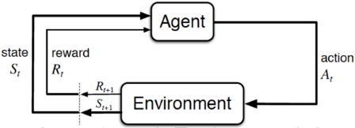

  * Agent，一般译为智能体，就是我们要训练的模型，类似玩超级玛丽的时候操纵马里奥做出相应的动作，而这个马里奥就是Agent
  * action(简记为(a))，玩超级玛丽的时候你会控制马里奥做三个动作，即向左走、向右走和向上跳，而马里奥做的这三个动作就是action
  * Environment，即环境，它是提供reward的某个对象，它可以是AlphaGo中的人类棋手，也可以是自动驾驶中的人类驾驶员，甚至可以是某些游戏AI里的游戏规则
  * reward(简记为(r))，这个奖赏可以类比为在明确目标的情况下，接近目标意味着做得好则奖，远离目标意味着做的不好则惩，最终达到收益/奖励最大化，且这个奖励是强化学习的核心
  * State(简介为(s))，可以理解成环境的状态，简称状态

总的而言，Agent依据策略决策执行动作action，通过感知环境获取环境的状态state，进而得到奖励reward(以便下次再到相同状态时能采取更优的动作)，然后再继续按此流程“依据策略执行动作-感知状态--得到奖励”循环进行。

#### 1.1.2 RL与监督学习的区别和RL方法的分类

RL和监督学习（supervised learning）的区别：

  * 监督学习有标签告诉算法什么样的输入对应着什么样的输出（譬如分类、回归等问题）

所以对于监督学习，目标是找到一个最优的模型函数，使其在训练数据集上最小化一个给定的损失函数，相当于最小化预测误差

$$\text { 最优模型 }=\underset{E}{\arg \min }\{\mathcal{L}(y, f(x))\}$$

> $y$ 标签，$x$ 特征, $f$ 模型, $\mathcal{L}$ 损失函数

  * RL没有标签告诉它在某种情况下应该做出什么样的行为，只有一个‘做出一系列行为后’最终反馈回来的reward，然后判断当前选择的行为是好是坏

相当于RL的目标是最大化智能体策略在和动态环境交互过程中的价值，而策略的价值可以等价转换成奖励函数的期望，即最大化累计下来的奖励期望

$$\text { 最优策略 }=\underset{\pi}{\arg \max }\left\{\mathbb{E}_{\pi}\left[\sum_{t-0}^{\infty} \gamma^{t} r\left(s_{t}, a_{t}\right)\right]\right\}$$

> $\pi$ 表示策略，即智能体在给定状态下选择动作的策略
> 
> $\mathbb{E}_\pi$ 表示在策略 $\pi$​ 下的期望值
> 
> $\gamma$ 是折扣因子，用于调整未来奖励的当前价值。
> 
> $r\left(s_{t}, a_{t}\right)$ 是在时间 $t$ 时，状态 $s_t$ 和动作 $a_t$​ 对应的即时奖励。
> 
> $\sum_{t-0}^{\infty} \gamma^{t} r\left(s_{t}, a_{t}\right)$ 表示从时间 $t=0$ 开始到无穷大的累积奖励的总和。

  * 监督学习如果做了比较坏的选择则会立刻反馈给算法

RL的结果反馈有延时，有时候可能需要走了很多步以后才知道之前某步的选择是好还是坏

  * 监督学习中输入是独立分布的，即各项数据之间没有关联

RL面对的输入总是在变化，每当算法做出一个行为，它就影响了下一次决策的输入

进一步，RL为得到最优策略从而获取最大化奖励，有

  * **基于值函数的方法** ，通过求解一个状态或者状态下某个动作的估值为手段，从而寻找最佳的价值函数，找到价值函数后，再提取最佳策略

比如Q-learning、DQN等，适合离散的环境下，比如围棋和某些游戏领域

  * **基于策略的方法** ，一般先进行策略评估，即对当前已经搜索到的策略函数进行估值，得到估值后，进行策略改进，不断重复这两步直至策略收敛

① 比如策略梯度法(policy gradient，简称PG)，适合连续动作的场景，比如机器人控制领域

② 以及Actor-Criti(一般被翻译为演员-评论家算法)，Actor学习参数化的策略即策略函数，Criti学习值函数用来评估状态-动作对，不过，Actor-Criti本质上是属于基于策略的算法，毕竟算法的目标是优化一个带参数的策略，只是会额外学习价值函数，从而帮助策略函数更好的学习

③ 此外，还有对策略梯度算法的改进，比如TRPO算法、PPO算法，当然PPO算法也可称之为是一种Actor-Critic架构，下文会重点阐述

* * *

RL其实是一个马尔可夫决策过程(Markov decision process，MDP)，而为说清楚MDP，得先从随机过程、马尔可夫过程(Markov process，简称MP)开始讲起，

### 1.2 什么是马尔科夫决策过程

#### 1.2.1 MDP的前置知识：随机过程、马尔可夫过程、马尔可夫奖励

如隐马尔可夫模型HMM学习最佳范例中所说：

  * 有一类现象是确定性的现象，比如红绿灯系统，红灯之后一定是红黄、接着绿灯、黄灯，最后又红灯，每一个状态之间的变化是确定的

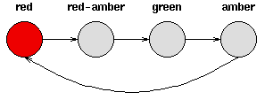
  * 但还有一类现象则不是确定的，比如今天是晴天，谁也没法百分百确定明天一定是晴天还是雨天、阴天(即便有天气预报)


对于这种假设具有(M)个状态的模型

    1. 共有$M^2$个状态转移，因为任何一个状态都有可能是所有状态的下一个转移状态
    2. 每一个状态转移都有一个概率值，称为状态转移概率，相当于从一个状态转移到另一个状态的概率
    3. 所有的$M^2$​个概率可以用一个**状态转移矩阵** 表示

下面的状态转移矩阵显示的是天气例子中可能的状态转移概率：

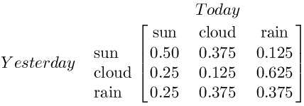

也就是说，如果昨天是晴天，那么今天是晴天的概率为0.5，是多云的概率为0.375、是雨天的概率为0.125，且这三种天气状态的概率之和必为1

接下来，我们来抽象建模下。正如概率论的研究对象是静态的随机现象，而随机过程的研究对象是随时间演变的随机现象(比如天气随时间的变化)：

  * 随机现象在某时刻t的取值是一个向量随机变量，用 $S_t$ 表示

比如上述**天气转移矩阵** 便如下图所示

$\begin{bmatrix}
  s_1 \rightarrow s_1 & s_1 \rightarrow s_2 & s_1 \rightarrow s_3 \\
  s_2 \rightarrow s_1 & s_2 \rightarrow s_2 & s_2 \rightarrow s_3 \\
  s_3 \rightarrow s_1 & s_3 \rightarrow s_2 & s_3 \rightarrow s_3
  \end{bmatrix}$当然，这里是将数学表示替换为 LaTeX 格式的文本：

在某时刻 $t$ 的状态 $S_t$ 通常取决于 $t$ 时刻之前的状态，我们将已知历史信息 $\left(S_{1}, \ldots, S_{t}\right)$ 的下一个时刻的状态 $S_{t+1}$ 的概率表示成 $P\left(S_{t+1} \mid S_{1}, \ldots, S_{t}\right)$ 。

如此，便可以定义一个所有状态对之间的转移概率矩阵。

$$P = \begin{bmatrix}
  P(s_1|s_1) & P(s_2|s_1) & P(s_3|s_1) & \cdots & P(s_n|s_1) \\
  P(s_1|s_2) & P(s_2|s_2) & P(s_3|s_2) & \cdots & P(s_n|s_2) \\
  \vdots & \vdots & \vdots & \ddots & \vdots \\
  P(s_1|s_n) & P(s_2|s_n) & P(s_3|s_n) & \cdots & P(s_n|s_n)
  \end{bmatrix}$$

  * 当且仅当某时刻的状态只取决于上一时刻的状态时，一个随机过程被称为具有**马尔可夫性质** ，即 $P(S_{t+1} \mid S_t) = P(S_{t+1} \mid S_1, \cdots, S_t)$

当然了，虽说当前状态只看上一个状态，但上一个状态其实包含了更上一个状态的信息，所以不能说当下与历史是无关的

  * 而具有马尔可夫性质的随机过程便是**马尔可夫过程**

在马尔可夫过程的基础上加入奖励函数 $R$ 和折扣因子 $\gamma$​ ，就可以得到**马尔可夫奖励过程**(Markov reward process，MRP)。其中

  * **奖励函数** ，某个状态 $s$ 的奖励 $R(s)$，是指转移到该状态 $s$ 时可以获得奖励的期望，有 $R(s) = \mathbb{E}[R_{t+1} \mid S_t = s]$​

注意，有的书上奖励函数和下面回报公式中的 $R_{t+1}$ 的下标 $t+1$ 写为 $t$，其实严格来说，先有 $t$ 时刻的状态动作之后才有 $t+1$ 时刻的奖励，但应用中两种下标法又都存在，读者注意辨别

  * 此外，实际中，因为一个状态可以得到的奖励是持久的，所有奖励的衰减之和称为回报，可用 $G$ **表示当下即时奖励和所有持久奖励等一切奖励的加权和** ，考虑到一般越往后某个状态给的回报率越低，也即奖励因子或折扣因子越小，用 $\gamma$ 表示，从而有

$$\begin{aligned}
  G_t &= R_{t+1} + \gamma \cdot R_{t+2} + \gamma^2 \cdot R_{t+3} + \gamma^3 \cdot R_{t+4} + \cdots \\
  &= R_{t+1} + \gamma (R_{t+2} + \gamma \cdot R_{t+3} + \gamma^2 \cdot R_{t+4} + \cdots) \\
  &= R_{t+1} + \gamma G_{t+1}
  \end{aligned}$$

举个例子，一个少年在面对“上大学、去打工、在家啃老”这三种状态，哪一种更能实现人生的价值呢？

相信很多人为长远发展都会选择上大学，因为身边有太多人因为上了大学，而好事连连，比如读研读博留学深造、进入大厂、娶个漂亮老婆、生个聪明孩子

当然了，上大学好处肯定多多，但上大学这个状态对上面4件好事所给予的贡献必然是逐级降低，毕竟越往后，越会有更多或更重要的因素成就更后面的好事，总不能所有好事都百分百归功于最开头选择了“上大学”这个状态/决策嘛

而一个状态的期望回报就称之为这个状态的价值，所有状态的价值则组成了所谓的价值函数，用公式表达为$V(s) = \mathbb{E}[G_t \mid S_t = s]$

展开为

$$\begin{aligned}
V(s) &= E[G_t \mid S_t = s] \\
&= E[R_{t+1} + \gamma G_{t+1} \mid S_t = s] \\
&= E[R_{t+1} \mid S_t = s] + \gamma E[G_{t+1} \mid S_t = s] \\
&= E[R_{t+1} \mid S_t = s] + \gamma E[V(S_{t+1}) \mid S_t = s]
\end{aligned}$$

在上式最后一个等式中

  * 前半部分表示**当前状态得到的即时奖励** $E[R_{t+1} \mid S_t = s] = R(s)$
  * 后半部分表示**当前状态得到的所有持久奖励** $\gamma E[V(S_{t+1}) \mid S_t = s]$，可以根据从状态 $s$ 出发的转移概率得到

至于上述推导的最后一步，在于 $E[G_{t+1} \mid S_t = s]$ 等于 $E[V(S_{t+1}) \mid S_t = s]$

> 推导过程
> 
> $$\begin{aligned}
E[G_{t+1} \mid S_t = s] &= \sum G_{t+1} P\{ G_{t+1} \mid S_t = s \} \\
&= \sum G_{t+1} \sum_{s'} P\{ G_{t+1} \mid S_{t+1} = s', S_t = s \} P\{ S_{t+1} = s' \mid S_t = s \} \\
&= \sum_{s'} \sum G_{t+1} P\{ G_{t+1} \mid S_{t+1} = s', S_t = s \} P\{ S_{t+1} = s' \mid S_t = s \} \\
&= \sum_{s'} E[G_{t+1} \mid S_{t+1} = s', S_t = s] P\{ S_{t+1} = s' \mid S_t = s \} \\
&= \sum_{s'} V(S_{t+1}) P\{ S_{t+1} = s' \mid S_t = s \} \\
&= E[V(S_{t+1}) \mid S_t = s]
\end{aligned}$$
> 
> 对于上述第二个等式，只需推导出
> 
> $$P\{ G_{t+1} \mid S_t = s \} = \sum_{s'} P\{ G_{t+1} \mid S_{t+1} = s', S_t = s \} P\{ S_{t+1} = s' \mid S_t = s \}$$
> 
> 推导过程如下
> 
> $$\begin{aligned}
P\{ G_{t+1} \mid S_t = s \} &= \frac{P\{ G_{t+1}, S_t = s \}}{P(S_t = s)} \\
&= \frac{\sum_{s'} P\{ G_{t+1}, S_{t+1} = s', S_t = s \}}{P(S_t = s)} \\
&= \frac{\sum_{s'} P\{ G_{t+1} \mid S_{t+1} = s', S_t = s \} P(S_{t+1} = s', S_t = s)}{P(S_t = s)} \\
&= \frac{\sum_{s'} P\{ G_{t+1} \mid S_{t+1} = s', S_t = s \} P(S_{t+1} = s' \mid S_t = s) P(S_t = s)}{P(S_t = s)} \\
&= \sum_{s'} P\{ G_{t+1} \mid S_{t+1} = s', S_t = s \} P(S_{t+1} = s' \mid S_t = s)
\end{aligned}$$

从而，综合前后两个部分可得 $V(s) = R(s) + \gamma \sum_{s' \in S} P(s' \mid s) V(s')$

而这就是所谓的**贝尔曼方程**(bellman equation)。该公式精准而简洁，其背后浓缩了很多信息，为形象起见，举个例子

> 比如状态 $S_1$ 得到的即时奖励为 $R(S_1)$，然后接下来，有P_12的概率引发状态 $S_2$，此时状态$S_2$得到的即时奖励为$R(S_2)$，对于$S_2$，接下来有$P_{24}$的概率引发状态$S_4$，$S_4$得到的即时奖励为$R(S_4)$​...
> 
> ...
> 
> 其中折扣因此为$\gamma$，那么因状态$S_1$​而得到的一切奖励为
> 
> $$R_{s1} + \gamma (P_{12}R_{s2} + P_{13}R_{s3}) + \gamma^2(P_{24} R_{s4} + P_{25} R_{s5}) + \gamma^2(P_{36} R_{s6} + P_{37}R_{s7}) \\
= R_{s1} + \gamma (P_{12}R_{s2} + P_{13}R_{s3}) + \gamma^2(P_{24} R_{s4} + P_{25} R_{s5} + P_{36} R_{s6} + P_{37}R_{s7})$$

> 为更加形象起见，再举一个生活中最常见的“吃饭-抽烟/剔牙”例子
> 
> 比如你吃完饭后你自己的心情愉悦值即奖励$+5$，然后下一个状态，有
> 
> $0.6$的概率是抽烟(抽烟带来的心情愉悦值即奖励$+7$
> 
> $0.4$的概率是剔牙(剔牙带来的奖励值$+3$)
> 
> 假设折扣因子$\gamma$ 为$0.5$，且假定
> 
> 吃饭的状态定义为$s_1$，则$R_{s1} = 5$
> 
> 抽烟的状态定义为$s_2$，则$R_{s2} = 7$，且由于抽烟之后无后续状态，所以$G_{s2}$也是7
> 
> 剔牙的状态定义为$s_3$，则$R_{s3} = 3$，且由于剔牙之后无后续状态，所以$G_{s3}$也是3
> 
> 从而有：
> 
> 当从$s_1 \rightarrow s_2$时，$G_{s1} = R_{s1} + \gamma R_{s2} = 5 + 0.5 \times 7 = 8.5$
> 
> 当从$s_1 \rightarrow s_3$时，$G'_{s1} = R_{s1} + \gamma R_{s3} = 5 + 0.5\times 3 = 6.5$
> 
> 由于状态$s_2$和状态$s_3$没有后续状态，
> 
> 所以$s_2$和$s_3$对应的状态价值函数分别为 $V_{s2} = R_{s2} = 7$， $V_{s3} = R_{s3} = 3$
> 
> 再根据贝尔曼方程$V(s) = R(s) + \gamma \sum_{s'\in S}^{}P(s'|s)V(s')$
> 
> 可得状态$s_1$的状态价值函数为
> 
> $$\begin{aligned} 
V(s_1) &= R_{s1} + \gamma (P_{12}R_{s2} + P_{13}R_{s3}) \\
&= 5 + 0.5 \times (0.6 \times 7 + 0.4 \times 3) \\
&= 7.7
\end{aligned}$$
> 
> 当然，你也可以如此计算（可以很明显的看出，计算量不如上述过程简洁，所以一般优先按上述方式计算）
> 
> $$\begin{aligned}  
V(s_1) &= E[G_t \mid S_t = s] \\ 
&= p_{12} \times G^{s2}_{s1} + p_{13} \times G^{s3}_{s1} \\
&= P_{12} (R_{s1} + \gamma R_{s2}) + P_{13} (R_{s1} + \gamma R_{s3}) \\
&= 0.6(5 + 0.5 \times 7) + 0.4(5 + 0.5 \times 3) \\
&= 7.7  
\end{aligned}$$

上述例子的状态比较少所以计算量不大，但当状态一多，则贝尔曼方程的计算量还是比较大的，而求解较大规模的马尔可夫奖励过程中的价值函数时，可以用的方法包括：动态规划、蒙特卡洛方法、时序差分(temporal difference，简称TD)方法

* * *

> 概念梳理
> 
>   1. 奖励函数 $R(s)$ 转移到状态$s$可以获得的奖励的期望 $R(s) = \mathbb{E}[R_{t+1}|S_{t}=s]$
> 
>   2. 一个状态可以得到的奖励是持久的，所有衰减奖励之和成为**回报 $G$**
> 
> 

> 
> $G$ 表示当下即时奖励和所有持久奖励的加权和
> 
> $$G_t &= R_{t+1} + \gamma R_{t+2} + \gamma^2 R_{t+3} + \gamma^3 R_{t+4}... \\ &= R_{t+1} + \gamma(R_{t+1} + \gamma R_{t+3} + \gamma^2 R_{t+4} + ...) \\ &=R_{t+1} + \gamma G_{t+1}$$
> 
>   3. 一个状态的期望回报($G$)称为这个状态的价值
> 

> 
> 所有状态的价值 = 价值函数 $V(s) = \mathbb{E}[G_t | S_t = s]$，**从状态 $s$ 开始的期望回报** ，也成为状态价值函数
> 
> 严格来说，t时刻的状态动作之后，产生t+1时刻的奖励
> 
> 推导$V(s)$
> 
> $$\begin{aligned} V(s) &= \mathbb{E}[G_t | S_t = s] \\ &= \mathbb{E}[R_{t+1} + \gamma G_{t+1} | S_t = s] \\ &= \mathbb{E}[R_{t+1} | S_t = s] + \gamma \mathbb{E}[G_{t+1} | S_t = s] \\ &= \mathbb{E}[R_{t+1} | S_t = s] + \gamma <\sum G_{t+1} P\{G_{t+1} | S_t = s\}> \\ &= \mathbb{E}[R_{t+1}| S_t = s] + \gamma <\sum G_{t+1} \sum_{s'} P\{G_{t+1} | S_{t+1} = s', S_t = s\} P\{S_{t+1} = s' | S_t = s\}> \\ &= \mathbb{E}[R_{t+1}|S_t = s] + \gamma <\sum_{s'} \sum G_{t+1}  P\{G_{t+1} | S_{t+1} = s', S_t = s\} P\{S_{t+1} = s' | S_t = s\} > \\ &= \mathbb{E}[R_{t+1} | S_t = s] + \gamma <\sum_{s'}\mathbb{E}[G_{t+1}| S_{t+1} = s', S_t = s] P\{S_{t+1} = s' | S_t = s\} > \\ &= \mathbb{E}[R_{t+1} | S_t = s] + \gamma <\sum_{s'}V(S_{t+1})P\{S_{t+1} = s' | S_t = s\}> \\ &= \mathbb{E}[R_{t+1}|S_t=s] + \gamma \mathbb{E}[V(S_{t+1} )| S_t = s] \end{aligned}$$

#### 1.2.2 马尔可夫决策过程(MDP)：马尔可夫奖励(MRP) + 智能体动作因素

根据上文我们已经得知，在随机过程的基础上

  * 增加马尔可夫性质，即可得马尔可夫过程
  * 再增加奖励，则得到了马尔可夫奖励过程(MRP)
  * 如果我们再次增加一个来自外界的刺激比如智能体的动作，就得到了**马尔可夫决策过程**(MDP)

通俗讲，MRP与MDP的区别就类似随波逐流与水手划船的区别

> 在马尔可夫决策过程中，$S_t$ 和 $R_t$ 的每个可能的值出现的概率只取决于前一个状态 $S_{t-1}$ 和 $A_{t-1}$，与更早之前的状态和动作完全无关。

换言之，当给定当前状态 $S_t$ 以及当前采取的动作 $A_{t}$，那么下一个状态 $S_{t+1}$ 出现的概率，可由状态转移概率矩阵表示如下：

$$\begin{aligned}
P_{ss'}^{a} &= P(S_{t+1} = s' | S_t = s, A_t = a) \\
&= P(s' | s, a)
\end{aligned}$$

假定在**当前状态** 和**当前动作** 确定后，其对应的奖励则设为 $R_{t+1}$，故sutton的RL书中，给出的状态转移概率矩阵类似为

$$p(s',r|s,a) = P\left \{ S_{t+1} = s',R_{t+1} = r |S_t = s,A_t = a \right \}$$

从而可得奖励函数即为

$$\begin{aligned}R(s,a) &= E[R_{t+1} | S_t = s,A_t = a] \\&=\sum_{s'\in S}^{}p(s',r|s,a) \sum_{r\in R}^{}r \end{aligned}$$

> **推导**
> 
>   1. 首先，计算在状态s下采取动作a后，转移到下一个状态(s')并获得奖励(r)的概率，表示为(p(s',r|s,a))
>   2. 然后，我们对所有可能的下一个状态(s')求和
>   3. 并对所有可能的奖励(r)求和(不少情况下，即使状态转移和动作是已知的，奖励(r)仍然可能是随机的，比如买股票，股票价格随机波动，导致购买之后的盈亏也具有随机性)
> 

> 
> 整个过程相当于将不同状态转移概率与对应的奖励(r)相乘并相加，以得到条件期望
> 
> * * *
> 
> 当然，如果奖励是确定性的，则可以简化公式，去掉对(r)的求和，即：
> 
> $$R(s,a) = \sum p(s',r|s,a) * r$$
> 
> 相当于此时只需要计算在状态s下采取动作a后，转移到下一个状态(s')的概率乘以确定的奖励(r)，然后对所有可能的下一个状态(s')求和以得到条件期望

至于过程中采取什么样的动作就涉及到策略policy，**策略函数** 可以表述为 $\pi$ 函数

  * 从而可得动作 $a = \pi(s)$
  * 此外，还会有这样的表述 $a = \pi_{\theta}(s)$，输入状态$s$确定的情况下，输出的动作只和策略函数$\pi$的参数$\theta$有关
  * 再比如 $\pi(a|s) = P(A_t = a | S_t = s)$，输入状态$s$下，智能体采取某个动作$a$的概率

通过上文，我们已经知道不同状态出现的概率不一样，同一状态下执行不同动作的概率也不一样

而有了动作这个因素后，重新梳理下价值函数

  1. 首先，通过**状态价值函数** 对当前状态进行评估

$$\begin{aligned} V_{\pi}(s) &= E_\pi [G_t|S_t = s] \\& = E_\pi [R_{t+1} + \gamma G_{t+1} | S_t = s] \\& = E_\pi [R_{t+1} + \gamma V_\pi (S_{t+1}) | S_t = s] \end{aligned}$$

_相当于从状态$s$出发遵循策略$\pi$能获得的期望回报_

  2. 其次，通过**动作价值函数** 对动作的评估

$$\begin{aligned} Q_\pi (s,a) &= E_\pi [G_t | S_t=s,A_t = a] \\& = E_\pi [R_{t+1} + \gamma G_{t+1}| S_t=s,A_t = a] \\& = E_\pi [R_{t+1} + \gamma Q_\pi (S_{t+1},A_{t+1})| S_t=s,A_t = a] \end{aligned}$$

相当于对当前状态$s$依据策略$\pi$执行动作$a$得到的期望回报，这就$Q$函数

得到$Q$函数后，进入某个状态要采取的最优动作便可以通过$Q$函数得到

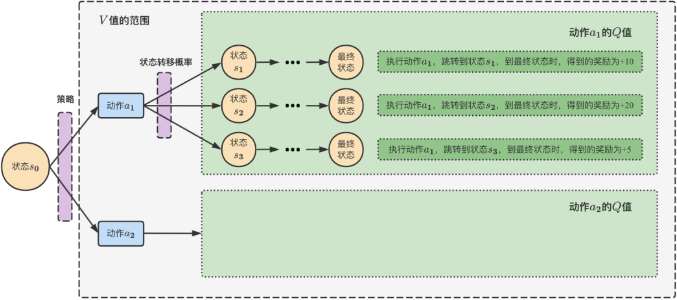

当有了策略、价值函数和模型3个组成部分后，就形成了一个马尔可夫决策过程（Markov decision process）。

如下图所示，这个决策过程可视化了状态之间的转移以及采取的动作。

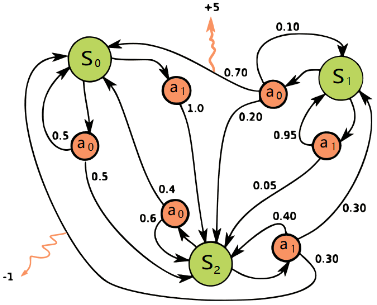

且通过状态转移概率分布，我们可以揭示状态价值函数和动作价值函数之间的联系

  * 在使用策略$\pi$时，状态$s$​的价值等于在该状态下基于策略$\pi$采取所有动作的概率与相应的价值相乘再求和的结果

$$V_{\pi}(s) = \sum_{a \in A}^{}\pi (a|s)Q_\pi (s,a)$$

> 状态$s$的价值 = 该状态下基于策略$\pi$可能采取的所有动作的概率与对应动作的价值相乘再求和
> 
> 推导
> 
> $$\begin{aligned} V_{\pi}(s) &= E_\pi [G_t|S_t = s] \\& = \sum_{a \in A}^{}\pi (a|s)E_\pi [G_t|S_t = s,A_t = a]\\& = \sum_{a \in A}^{}\pi (a|s)Q_\pi (s,a) \end{aligned}$$

  * 使用策略$\pi$时，在状态$s$下采取动作$a$的价值等于当前奖励$R(s, a)$，加上经过衰减的所有可能的下一个状态转移概率与相应价值的相乘

$$Q_\pi (s,a) = R(s,a) + \gamma \sum_{s' \in S}^{}P(s'|s,a)V_\pi (s')$$

> 使用策略$\pi$，状态$s$下采取动作$a$的价值 = 当前状态下采取动作$a$的即时奖励 + 所有可能的下一个状态转移概率与对应价值的乘积再经过衰减
> 
> 推导
> 
> $$\begin{aligned} Q_\pi (s,a) &= E[G_t|S_t = s,A_t = a] \\&= E[R_{t+1} + \gamma G_{t+1} | S_t =s,A_t = a] \\&= E[R_{t+1}|S_t = s,A_t = a] + \gamma E[ G_{t+1} | S_t =s,A_t = a] \\&= R(s,a) + \gamma \sum_{s'}^{} V_\pi (S_{t+1}) P[S_{t+1} = s' |S_t =s,A_t = a ] \\&= R(s,a) + \gamma \sum_{s'}^{} P_{ss'}^{a}V_\pi (s') \end{aligned}$$
> 
> 第三个等式到第四个等式依据的是 $E[ G_{t+1} | S_t =s,A_t = a] = \sum_{s'}^{} V_\pi (S_{t+1}) P[S_{t+1} = s' |S_t =s,A_t = a ]$
> 
> 第四个等式到第五个等式依据的是状态转移概率矩阵的定义 $P_{ss'}^{a} = P(S_{t+1}=s'|S_t =s,A_t = a)$

接下来，把上面$V_\pi (s)$和$Q_\pi (s,a)$的计算结果互相代入，可得**马尔可夫决策的贝尔曼方程**

$$V_{\pi}(s) = \sum_{a \in A}^{}\pi (a|s)\left [ R(s,a) + \gamma \sum_{s' \in S}^{}P(s'|s,a)V_\pi (s'))\right ]$$

$$Q_\pi (s,a) = R(s,a) + \gamma \sum_{s' \in S}^{}P(s'|s,a)\left [ \sum_{a' \in A}^{}\pi (a'|s')Q_\pi (s',a') \right ]$$

> **互推关系**
> 
> $$v_{\pi}(s)=\sum_{a} \pi(a \mid s) q_{\pi}(s, a)$$
> 
> $$q_{\pi}(s, a)=R_{s}^{a}+\gamma \sum_{s^{\prime}} p_{s s^{a}}^{a} v_{\pi}\left(s^{\prime}\right)$$
> 
> **递推关系**
> 
> $$v_{\pi}(s)=\sum_{a} \pi(a \mid s)\left[R_{s}^{a}+\gamma \sum_{s^{\prime}} p_{s s^{\prime}}^{a} v_{\pi}\left(s^{\prime}\right)\right]$$
> 
> $$q_{\pi}(s, a)=R_{s}^{a}+\gamma \sum_{s^{\prime}} p_{s s^{\prime}}^{a} \sum_{a^{\prime}} \pi\left(a^{\prime} \mid s^{\prime}\right) q_{\pi}\left(s^{\prime}, a^{\prime}\right)$$

## 第二部分 RL进阶之三大表格求解法：DP、MC、TD

### 2.1 动态规划法

#### 2.1.1 什么是动态规划

核心思想在于复杂问题的最优解划分为多个小问题的最优解的求解问题，就像递归一样，且子问题的最优解会被储存起来重复利用

具体而言，动态规划一般也只能应用于有最优子结构的问题。最优子结构的意思是局部最优解能决定全局最优解(对有些问题这个要求并不能完全满足，故有时需要引入一定的近似)。

简单地说，问题能够分解成子问题来解决。

动态规划算法一般分为以下4个步骤：

1.) 描述最优解的结构

2.) 递归定义最优解的值

3.) 按自底向上的方式计算最优解的值

4.) 由计算出的结果构造一个最优解

换言之，动态规划方法的最优化问题的两个要素：最优子结构性质，和子问题重叠性质

  * 最优子结构

如果问题的最优解所包含的子问题的解也是最优的，我们就称该问题具有最优子结构性质（即满足最优化原理）。意思就是，总问题包含很多个子问题，而这些子问题的解也是最优的。

  * 重叠子问题

子问题重叠性质是指在用递归算法自顶向下对问题进行求解时，每次产生的子问题并不总是新问题，有些子问题会被重复计算多次。动态规划算法正是利用了这种子问题的重叠性质，对每一个子问题只计算一次，然后将其计算结果保存在一个表格中，当再次需要计算已经计算过的子问题时，只是在表格中简单地查看一下结果，从而获得较高的效率

#### 2.1.2 通过动态规划法求解最优策略

> 如果你之前没接触过RL，你确实可能会认为DP只存在于数据结构与算法里，实际上
> 
>   * 最早在1961年，有人首次提出了DP与RL之间的关系
>   * 1977年，又有人提出了启发式动态规划，强调连续状态问题的梯度下降法
>   * 再到1989年，Watkins明确的将RL与DP联系起来，并将这一类强化学习方法表征为增量动态规划
> 

下面，我们考虑如何求解最优策略$v_*(s)$

  1. 首先，最优策略可以通过最大化$q_\pi (s,a)$​找到

$$Q_\pi (s,a) = R(s,a) + \gamma \sum_{s' \in S}^{}P(s'|s,a)V_\pi (s')$$

  2. 当 $a= argmax \left \{ Q_*(s,a) \right \}$ 时，$\pi _*(a|s) = 1$

综合上述两点，可得

$$v_{*}(s) = max \left \{ R(s,a) + \gamma \sum_{s' \in S}^{}P(s'|s,a)V_\pi (s')) \right \}$$

另，考虑到

$$\begin{aligned}R(s,a) &= E[R_{t+1} | S_t = s,A_t = a] \\&=\sum_{s'\in S}^{}p(s',r|s,a) \sum_{r\in R}^{}r \end{aligned}$$

故也可以如sutton的RL一书上，这样写满足贝尔曼最优方程的价值函数 $V_*(s)$

$$\begin{aligned} v_*(s) &= max E[R_{t+1} + \gamma v_*(S_{t+1}) | S_t =s,A_t =a] \\&= max \sum_{s',r}^{}p(s',r|s,a) [r + \gamma v_*(s')] \end{aligned}$$

相当于当知道奖励函数和状态转换函数时，便可以根据下一个状态的价值来更新当前状态的价值，意味着可以把计算下一个可能状态的价值当成一个子问题，而把计算当前状态的价值看做当前问题，这不刚好就可以用DP来求解了

于是，sutton的RL一书上给出了**DP求解最优策略的算法流程**

>   1. **初始化**
> 
> 对于$s\in S$，任意设定状态$s$的价值函数$V(s) \in \mathbb{R}$，表示在状态$s$下，从当前策略$\pi$开始，期望获得的总回报的最大值，初始时，可以任意设定一个值。以及$\pi (s) \in A(s)$，表示在策略$\pi$在当前状态$s$下选择哪个动作，初始时，也可以任意设定一个动作。
> 
>   2. **策略评估** ：评估当前策略$\pi$下，每个状态的价值$V(s)$，通过迭代不断更新$V(s)$，直到变化很小，达到一定的精度$\theta$。
> 
> 循环开始：
> 
> ​ $\Delta \leftarrow 0$ 初始化一个变量$\Delta = 0$，用于记录每次迭代中$V(s)$的最大变化值
> 
> ​ 对每一个状态$s\in S$循环：
> 
> ​ $v \leftarrow V(s)$ 保存当前的$V(s)$到一个临时变量$v$
> 
> ​ $V(s) \leftarrow \sum_{s',r}^{} p(s',r|s,\pi (s)) [r + \gamma V(s')]$ 更新$V(s)$的值 (满足贝尔曼最优方程的价值函数)
> 
> ​ $\Delta \leftarrow max(\Delta ,|v - V(s)|)$ 更新$\Delta$，记录每次迭代中$V(s)$的最大变化
> 
> 直到$\Delta <\theta$ (一个决定估计精度的小正数)
> 
>   3. **策略改进** ：改进策略$\pi$，使其更接近最优策略
> 
> policy-stable $\leftarrow$ true 设置一个标志变量，表示策略是否稳定
> 
> 对每一个$s\in S:$
> 
> ​ old-actiton $\leftarrow$ $\pi (s)$ 保存当前策略到临时变量
> 
> ​ $\pi (s) \leftarrow argmax_{(a)} \left \{ \sum_{s',r}^{}p(s',r|s,a) [r + \gamma V(s')] \right \}$ 选择使$V(s)$最大化的动作作为新的策略
> 
> ​ 如果old-action $\neq \pi (s)$，那么policy-stable $\leftarrow$ false 如果策略发生了变化，使标志为false
> 
> 如果policy-stable为true，那么停止并返回 $V \approx v_*$以及$\pi \approx \pi _*$；否则跳转到2 如果策略没有变化，停止并返回当前的$V, \pi$作为近似的最优价值函数和策略
> 
> 

### 2.2 蒙特卡洛法

蒙特卡洛(monte carlo，简称MC)方法，也称为统计模拟方法，就是通过大量的随机样本来估算或近似真实值，比如近似估算圆的面积、近似定积分、近似期望、近似随机梯度

比如先看估算圆的面积，如下图

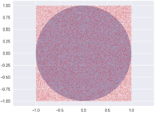

_近似计算：圆的面积/ 正方形的面积 = 圆中点的个数/正方形中点的个数_

类似的，我们也可以用蒙特卡洛方法来估计一个策略在一个马尔可夫决策过程中的状态价值。

考虑到**一个状态的价值是它的期望回报** ，那么如果我们用策略在MDP上采样很多条序列，然后计算从这个状态出发的回报再求其期望是否就可以了？好像可行！公式如下：

$$V_\pi (s) = E_\pi [G_t|S_t = s] = \frac{1}{N} \sum_{i=1}^{N}G_{t}^{(i)}$$

再看下如何估算定积分的值，积分可以理解为由无数个无穷小的面积组成的面积S

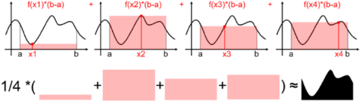

如上图，我们可以通过随机取4个点，然后类似求矩形面积那样(底x高)，从而用4个面积$f(x)(b-a)$的期望来估算定积分$\int_{a}^{b}f(x)dx$的值，为让对面积的估算更准确，我们可以取更多的点，比如$N$，当$N \rightarrow \propto$时  
$\int_{a}^{b}f(x)dx = \lim_{N\rightarrow \propto } \frac{1}{N}(b-a)\sum_{i-1}^{N}f(x_i)$

接下来

  1. 假设令$q(x) = \begin{cases} \frac{1}{a-b} & \text{ , } x\in [a,b] \\ 0 & \text{ } \end{cases}$，且$f^*(x) = \begin{cases} \frac{f(x)}{q(x)} & \text{ if } q(x) \neq 0 \\ 0 & \text{ if } q(x) = 0 \end{cases}$​
  2. 且考虑到对于连续随机变量$X$，其概率密度函数为$p(x)$，期望为$E[X] = \int_{-\propto }^{\propto }xp(x)dx$

则有 $\int_{a}^{b}f(x)dx = \int_{a}^{b}f^*(x)q(x)dx = E_{x\sim f_{X}(x)}[f^*(x)]]$​

跟蒙特卡洛方法关联的还有一个重要性采样，下文很快会讲到

### 2.3 时序差分法及与DP、MC的区别

当面对状态价值函数的求解时

$$\begin{aligned} V_{\pi}(s) &= E_\pi [G_t|S_t = s] \\& = E_\pi [R_{t+1} + \gamma G_{t+1} | S_t = s] \\& = E_\pi [R_{t+1} + \gamma V_\pi (S_{t+1}) | S_t = s] \end{aligned}$$

上述公式总共三个等式

  * 动态规划(DP)会把上述第三个等式的估计值作为目标，不是因为DP要求需要环境模型本身提供期望值，而是因为真实的 $V_\pi (S_{t+1})$ 是未知的，所以只能使用当前的估计值 $V_\pi (S_{t+1})$​ 来替代

$$V(S_t) \leftarrow E_\pi [R_{t+1} + \gamma V(S_{t+1})]$$

且DP求解状态$S_t$的状态值函数时，需要利用所有后续状态$S_{t+1}$

$$V_{\pi}(s) = \sum_{a \in A}^{}\pi (a|s)\left [ r(s,a) + \gamma \sum_{s' \in S}^{}P(s'|s,a)V_\pi (s'))\right ]$$

  * 蒙特卡洛方法(MC)会上述把第一个等式的估计值作为目标，毕竟第一个等式中的期望值是未知的，所以我们用样本回报来代替实际的期望回报

但MC求解状态$S_t$的状态值函数时，需要等一个完整序列结束，因为只有到此时，$G_t$才是已知的

$V(S_t) \leftarrow V(S_t) + \alpha [G_t - V(S_t)]$​

新的估计等于原来的估计加上实际回报和估计回报之间的误差乘以一个学习率

时序差分(TD) 它既要采样得到上述第一个等式的期望值，而且还要通过使用上述第三个等式中当前的估计值$V$来替代真实值$v_\pi$

且TD每过一个time step就利用奖励$R_{t+1}$和值函数$V(S_{t+1})$ 更新一次（当然，这里所说的one-step TD 方法，也可以两步一更新，三步一更新….）

考虑到$G_t = R_{t+1} + \gamma V(S_{t+1})$，可得 $V(S_t) \leftarrow V(S_t) + \alpha \left [ R_{t+1} + \gamma V{S_{t+1}} - V(S_t) \right ]$

此更新法也叫TD(0)法，或者一步时序差分法，$R_{t+1} + \gamma V{S_{t+1}}$ 被称为TD目标，$\delta = R_{t+1} + \gamma V_\pi (S_{t+1}) - V(S_t)$ 被称为TD误差

> TD方法利用时刻 $𝑡+1$的奖励 $R_{t+1}$ 和状态 $S_{t+1}$ 的值估计$V(S_{t+1})$来更新状态$S_t$的值估计。

  * TD与DP一致的是，时序差分方法也无需等待交互的最终结果，而可以基于下一个时刻的收益$R_{t+1}$估计值$V(S_{t+1})$就可以更新当前状态的价值函数

不需像MC等到N步以后即等一个完整序列结束后才能更新$V(S_t)$

就像不同学生做题，有的学生则是TD派：做完一题就问老师该题做的对不对 然后下一题即更新做题策略，有的学生是MC派：做完全部题才问老师所有题做的对不对 然后下一套试卷更新做题策略

  * TD与DP不一致的是，TD俗称无模型的RL算法，不需要像DP事先知道环境的奖励函数和状态转移函数(和MC一样，可以直接从与环境互动的经验中学习策略，事实上，很多现实环境中，其MDP的状态转移概率无从得知)

总之，TD结合了DP和MC，**与DP一致的点时与MC不一致，与DP不一致的点时恰又与MC一致** ，某种意义上来说，结合了前两大方法各自的优点，从而使得在实际使用中更灵活，具体而言如下图所示

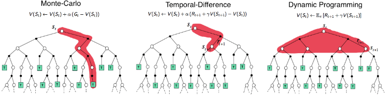

顺带再举一个例子，好比行军打仗时，为了得到更好的行军路线，将军派一人前去探路

  * MC的做法相当于一条道走到黑 没走个10公里不回头
  * DP相当于所有道比如10条道 每条道都走个1公里 不错过任何一条可能成为最好道的可能，最后10条道都走完1公里后才返回汇报/反馈
  * TD则相当于先选一条道走个1公里即返回汇报/反馈，之后再走下一条道的1公里

### 2.4 RL的分类：基于模型(Value-base/Policy-based)与不基于模型

根据问题求解思路、方法的不同，我们可以将强化学习分为

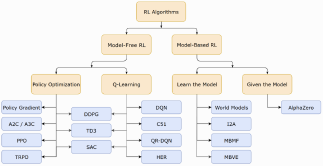

  * 基于模型的强化学习(Model-based RL)，可以简单的使用动态规划求解，任务可定义为预测和控制，预测的目的是评估当前策略的好坏，即求解状态价值函数$V_\pi (S)$，控制的目的则是寻找最优策略$\pi ^*$和$V_*(s)$

在这里“模型”的含义是对环境进行建模，具体而言，是否已知其$P$和$R$，即$p(s'|s,a)$和$R(s,a)$的取值

    * 如果有对环境的建模，那么智能体便可以在执行动作前得知状态转移的情况即$p(s'|s,a)$和奖励$R(s,a)$，也就不需要实际执行动作收集这些数据；
    * 否则便需要进行采样，通过与环境的交互得到下一步的状态和奖励，然后仅依靠采样得到的数据更新策略
  * 无模型的强化学习(Model-free RL)，又分为

    * 基于价值的强化学习(Value-based RL)，其会学习并贪婪的选择值最大的动作，即$a = \underset{a}{\arg \max}\ Q(s,a)$，最经典的便是off-policy模式的Q-learning和on-policy模式的SARSA，一般得到的是确定性策略，下文第三部分重点介绍
    * **基于策略** 的强化学习(Policy-based RL)，其对策略进行进行建模$\pi (s,a)$并优化，一般得到的是随机性策略，下文第四部分会重点介绍

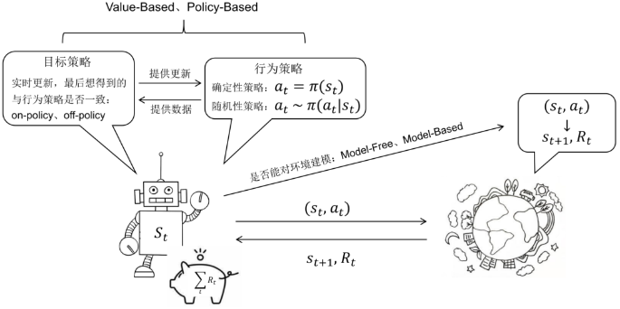

## 第三部分 价值学习：从n步Sarsa算法到Q-learning、DQN

### 3.1 TD(0)控制/Sarsa(0)算法与TD(n)控制/n步Sarsa算法

既然上文可以用时序差分来估计状态价值函数，那是否可以用类似策略迭代的方法来评估动作价值函数呢？毕竟在无模型的RL问题中，动作价值函数比状态价值函数更容易被评估

> **Sarsa(0)算法** 是一种基于时序差分（TD）的方法，但它不是更新状态值函数 $𝑉$，而是更新动作价值函数 $𝑄$。动作价值函数 $𝑄$ 表示在状态 $𝑆$ 下采取动作 $𝐴$ 并遵循策略 $𝜋$ 期望获得的总回报。

如果用类似TD(0)控制的思路寻找最优的动作价值函数并提取出最优策略，便被称作Sarsa(0)算法，所以，Sarsa所做出的改变很简单，它将原本时序差分方法更新$V$的过程，变成了更新$Q$，即可以如下表达

$Q(S_t,A_t) \leftarrow Q(S_t,A_t) + \alpha [R_{t+1} + \gamma Q(S_{t+1},A_{t+1}) - Q(S_t,A_t)]$ 在每个时间步，根据实际获得的奖励和下一状态的动作价值估计来更新当前状态和动作的价值估计

此外，上文说过，“TD每过一个time step就利用奖励$R_{t+1}$和值函数$V(S_{t+1})$ 更新一次，当然，这里所说的one-step TD 方法，也可以两步一更新，三步一更新”，这个所谓的多步一更新我们便称之为N步时序差分法

回顾下回报公式的定义，即为(根据前几项可以看出：$\gamma$的上标加$t+1$即为$R$的下标，反过来，当最后一项$R$的下标$T$确定后，自然便可以得出$\gamma$的上标为$T -t -1$)

$G_t = R_{t+1} + \gamma R_{t+2} + \gamma ^2 R_{t+3}+\cdots + \gamma ^{T-t-1}R_T$ 时刻 $𝑡$ 开始的回报

从而有：

  * 单步回报：$G_{t:t+1} = R_{t+1} + \gamma V_t(S_{t+1})$，即为TD(0)控制/Sarsa(0)算法 最基本的TD方法，只考虑下一个时间步的奖励和价值估计

  * 两步回报：$G_{t:t+2} = R_{t+1} + \gamma R_{t+2} + \gamma ^2V_{t+1}(S_{t+2})$ 考虑了两个时间步的奖励和第二个时间步的价值估计

  * n步回报：$G_{t:t+n} = R_{t+1} + \gamma R_{t+2} + \cdots + \gamma ^{n-1}R_{t+n} + \gamma ^nV_{t+n-1}(S_{t+n})$ 考虑了 $𝑛$ 个时间步的奖励和第 $𝑛$ 个时间步的价值估计

此时，类似于TD(0)预测 $V(S_t) \leftarrow V(S_t) + \alpha \left [ R_{t+1} + \gamma V{S_{t+1}} - V(S_t) \right ]$

有以下状态值更新规则 $V_{t+n}(S_t) = V_{t+n-1}(S_t) + \alpha \left [ G_{t:t+n} - V_{t+n-1}(S_t) \right ],0\leq t < T$ 每个时间步$t$，根据$n$步回报$G_{t:t+n}$来更新状态$S_t$的价值估计$V_{t+n}(S_t)$

而对于其他任意状态$s(s\neq S_t)$的价值估计保持不变：$V_{t+n}(S) = V_{t+n-1}(S)$ 只有参与 $𝑛$ 步回报计算的状态会被更新，其他状态的价值估计保持不变

类似的，当用n步时序差分的思路去更新$Q$函数则就是所谓的n步Sarsa算法，当我们重新根据动作价值的估计定义如下的b步方法的回报为

如此，便可以得到如下$Q$的更新方式

$Q_{t+n}(S_t) = Q_{t+n-1}(S_t,A_t) + \alpha \left [ G_{t:t+n} - Q_{t+n-1}(S_t,A_t) \right ],0\leq t < T$ 每个时间步 $𝑡$，我们根据 $𝑛$ 步回报 $𝐺_{𝑡:𝑡+𝑛}$ 来更新状态 $𝑆_𝑡$ 下采取动作 $𝐴_𝑡$ 的动作价值估计 $𝑄_{𝑡+𝑛}(𝑆_𝑡)$

### 3.2 Q-learning

#### 3.2.1 重要性采样：让同策略完成到异策略的转变

先阐明一个问题，即所谓的同策略学习与异策略学习。

  * **行动遵循的行动策略** 与**被评估的目标策略** 是同一个策略(如果要学习的智能体和与环境交互的智能体是相同的)，则称之为同策略，比如上文介绍的Sarsa
  * **行动遵循的行动策略** 和**被评估的目标策略** 是不同的策略(或如果要学习的智能体和与环境交互的智能体不是相同的)，则称之为异策略，比如即将介绍的Q-learning

而异策略就是基于**重要性采样** 的原理实现的，即通过使用另外一种分布，来逼近所求分布的一种方法。

(但反过来， _不是说只要采用了重要性采用，就一定是异策略_ ，比如下文将讲的PPO算法)

但具体怎么操作呢？为说明怎么变换的问题，再举一个例子。

> 假设有一个函数$f(x)$，$x$需要从分布$p$中采样，应该如何怎么计算$𝑓(𝑥)$的期望值呢？
> 
> 如果分布$p$不能做积分，那么只能从分布$p$尽可能多采样更多的$x^{i}$，然后全都代入到$f(x)$，按照蒙特卡洛方法的原则取它的平均值就可以得到近似$𝑓(𝑥)$的期望值：
> 
> $$\mathbb{E}_{x \sim p}[f(x)] \approx \frac{1}{N} \sum_{i=1}^N f(x^i)$$
> 
> 当不能在分布$p$中采样数据，而只能从另外一个分布$q$中去采样数据时($q$可以是任何分布），就需要做些变换，如下三步
> 
>   1. 首先，期望值 $\mathbb{E}_{x \sim p}[f(x)]$ 的另一种写法是 $\int f(x) p(x) \mathrm{d}x$，对其进行变换，如下式所示
> 
> $$\int f(x) p(x) \mathrm{d}x=\int f(x) \frac{p(x)}{q(x)} q(x) \mathrm{d}x=\mathbb{E}_{x \sim q}[f(x){\frac{p(x)}{q(x)}}]$$
> 
>   2. 整理下可得（左边是分布$p$，右边是分布$q$）
> 
> $$\mathbb{E}_{x \sim p}[f(x)]=\mathbb{E}_{x \sim q}\left[f(x) \frac{p(x)}{q(x)}\right]$$
> 
>   3. 如此，便就可以从$q$里面采样 $x$，再计算$f(x) \frac{p(x)}{q(x)}$，再取期望值
> 
> 

> 
> 所以就算我们不能从 $p$ 里面采样数据，但只要能从 $q$ 里面采样数据，就可以计算从 $p$ 采样 $x$，然后代入 $f$ 以后的期望值

#### 3.2.2 Sarsa算法与Q-learning更新规则的对比

> Q学习是一种无模型的强化学习算法，它通过学习一个动作价值函数 $𝑄(𝑠,𝑎)$ 来决定在每个状态 $𝑠$ 下采取哪个动作 $𝑎$。动作价值函数 $𝑄(𝑠,𝑎)$ 表示在状态 $𝑠$ 下采取动作 $𝑎$ 并遵循策略期望获得的总回报。

和Sarsa(0)算法的更新规则$Q(S_t,A_t) \leftarrow Q(S_t,A_t) + \alpha [R_{t+1} + \gamma Q(S_{t+1},A_{t+1}) - Q(S_t,A_t)]$有点像，Q-learning的动作价值函数更新规则如下

$Q\left(S_{t}, A_{t}\right) = Q\left(S_{t}, A_{t}\right)+\alpha\left[R_{t+1}+\gamma \max _{a'} Q\left(S_{t+1}, a'\right)-Q\left(S_{t}, A_{t}\right)\right]$ 在状态 $𝑆_{𝑡+1}$ 下，采取能使 $𝑄$ 值最大化的动作 $𝑎′$ 的期望回报

啥意思呢，一步步来看：

  1. Q学习有两种策略：目标策略和行为策略

目标策略是我们需要学习的策略，一般用 $\pi$表示，直接在Q表格上使用贪心策略，取它下一步能得到的所有状态，即

$$\pi\left(s_{t+1}\right) = \underset{a^{\prime}}{\arg \max}\sim Q\left(s_{t+1}, a^{\prime}\right)$$

行为策略 $\mu$ 可以是一个随机的策略，与环境交互(采集轨迹或数据)，但我们采取 $\varepsilon-$ 贪心策略，让行为策略不至于是完全随机的，它是基于Q表格逐渐改进的

  2. 我们可以构造 Q学习目标，Q学习的下一个动作都是通过arg max 操作选出来的(不管行为策略怎么探索、去哪探索，反正就是取奖励最大化下的策略)，于是我们可得

$$\begin{aligned} R_{t+1}+\gamma Q\left(S_{t+1}, A^{\prime}\right) &=R_{t+1}+\gamma Q\left(S_{t+1},\arg \max ~Q\left(S_{t+1}, a^{\prime}\right)\right) \\ &=R_{t+1}+\gamma \max _{a^{\prime}} Q\left(S_{t+1}, a^{\prime}\right) \end{aligned}$$

再次总结一下其与Sarsa的区别：

  * 在Sarsa算法中，新动作用于更新动作价值函数，并且用于下一时刻的执行工作，这意味着行动策略与目标策略属于同一个策略
  * 但在Q-learning算法中，使用确定性策略选出的新动作只用于动作价值函数，而不会被真正执行，当动作价值函数更新后，得到新状态，并基于新状态由 $\varepsilon-$ 贪心策略选择得到执行行动，这意味着行动策略与目标策略不属于同一个策略

### 3.3 DQN

// 待更

## 第四部分 策略学习：从策略梯度、Actor-Criti到TRPO、PPO算法

### 4.1 策略梯度与其突出问题：采样效率低下

#### 4.1.1 什么是策略梯度和梯度计算/更新的流程

**策略梯度的核心算法思想** 是：

  * 参数为 $\theta$ 的策略 $\pi_{\theta }$ 接受状态 $s$，输出动作概率分布，在动作概率分布中采样动作，执行动作(形成运动轨迹 $\tau$)，得到奖励 $r$，跳到下一个状态
  * 在这样的步骤下，可以使用策略 $\pi$ 收集一批样本，然后使用梯度下降算法学习这些样本，不过当策略 $\pi$ 的参数更新后，这些样本不能继续被使用，还要重新使用策略 $\pi$ 与环境互动收集数据

比如REINFORCE算法便是常见的策略梯度算法，类似下图所示(下图以及本节大部分配图/公式均来自easy RL教程)

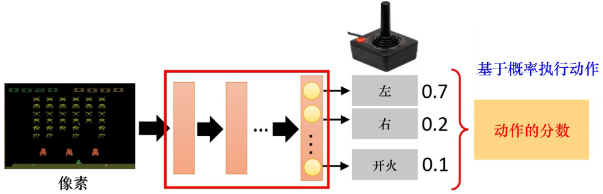

接下来，详细阐述。首先，我们已经知道了策略函数可以如此表示：$a = \pi _{\theta }(s)$

其中，$\pi _{\theta}$ 可以理解为一个我们所熟知的神经网络

  * 正向传播产生动作，然后动作在环境中产生奖励值，通过奖励值求和产生评价函数，此时可以针对评价函数做梯度上升（gradient ascent），毕竟能求极小值，便能求极大值，正如误差能最小化，奖励/得分就能最大化

如何评价策略的好坏呢？

假设机器人在策略 $\pi_{\theta }$ 的决策下，形成如下的运动轨迹(类似你玩三国争霸时，你控制角色在各种不同的游戏画面/场景/状态下作出一系列动作，而当完成了系统布置的某个任务时则会得到系统给的奖励，如此，运动轨迹用 $\tau$ 表示，从而 $\tau$ 表示为一个状态 $s$、动作 $a$、奖励值 $r$ 不断迁移的过程)

$$\tau = (s_{1},a_{1},r_{1},s_{2},a_{2},r_{2},...,s_{t},a_{t},r_{t})$$

> 奖励是延后的，$\tau = S_0,A_0,R_1,S_1,A_1,R_2,S_2,A_2,R_3,\cdots,S_t,A_t,R_{t+1}$ 表示整条轨迹，这样更规范

给定智能体或演员的策略参数 $\theta$，可以计算某一条轨迹 $\tau$ 发生的概率为『轨迹 $\tau$ 来源于在特定的环境状态下采取特定动作的序列，而特定的状态、特定的动作又分别采样自智能体的动作概率分布 $p_{\theta }(a_{t}|s_{t})$、状态的转换概率分布 $p(s_{t+1}|s_t,a_t)$』  
$\begin{aligned} p_{\theta}(\tau) &=p\left(s_{1}\right) p_{\theta}\left(a_{1} | s_{1}\right) p\left(s_{2} | s_{1}, a_{1}\right) p_{\theta}\left(a_{2} | s_{2}\right) p\left(s_{3} | s_{2}, a_{2}\right) \cdots \\ &=p\left(s_{1}\right) \prod_{t=1}^{T} p_{\theta}\left(a_{t} | s_{t}\right) p\left(s_{t+1} | s_{t}, a_{t}\right) \end{aligned}$

其中，有的资料也会把 $p_{\theta }(a_{t}|s_{t})$ 写成为 $\pi _{\theta }(a_{t}|s_{t})$，但由于毕竟是概率，所以更多资料还是写为$p_{\theta }(a_{t}|s_{t})$

如何评价策略呢？这个**策略评价函数** 为方便理解也可以称之为策略价值函数，就像上文的状态价值函数、动作价值函数，说白了，评估策略(包括状态、动作)的价值，就是看其因此得到的期望奖励

故考虑到期望的定义，由于每一个轨迹 $\tau$ 都有其对应的发生概率，**对所有 $\tau$ 出现的概率与对应的奖励进行加权最后求和** ，即可得期望值：

$$\bar{R}_{\theta}=\sum_{\tau} R(\tau) p_{\theta}(\tau)=\mathbb{E}_{\tau \sim p_{\theta}(\tau)}[R(\tau)]$$

上述整个过程如下图所示

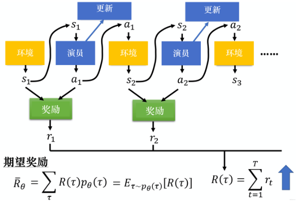

通过上文已经知道，想让奖励越大越好，可以使用梯度上升来最大化期望奖励。而要进行梯度上升，先要计算期望奖励 $\bar{R}_{\theta}$ 的梯度。

对 $\bar{R}_{\theta}$ 做梯度运算

$$\nabla \bar{R}_{\theta}=\sum_{\tau} R(\tau) \nabla p_{\theta}(\tau)$$

只有 $p_{\theta}(\tau)$ 与 $\theta$ 有关，另外$\nabla f(x)=f(x)\nabla \log f(x)$

可得 $\frac{\nabla p_{\theta}(\tau)}{p_{\theta}(\tau)}= \nabla \log p_{\theta}(\tau)$

从而进一步转化，可得 $\nabla\bar{R}_{\theta}=\mathbb{E}_{\tau \sim p_{\theta}(\tau)}\left[R(\tau) \nabla \log p_{\theta}(\tau)\right]$，表示期望的梯度等于对数概率梯度的期望乘以原始函数

> 推导
> 
> $$\begin{aligned} \nabla \bar{R}_{\theta}&=\sum_{\tau} R(\tau) \nabla p_{\theta}(\tau)\\&=\sum_{\tau} R(\tau) p_{\theta}(\tau) \frac{\nabla p_{\theta}(\tau)}{p_{\theta}(\tau)} \\&= \sum_{\tau} R(\tau) p_{\theta}(\tau) \nabla \log p_{\theta}(\tau) \\ &=\mathbb{E}_{\tau \sim p_{\theta}(\tau)}\left[R(\tau) \nabla \log p_{\theta}(\tau)\right] \end{aligned}$$

...

这就是所谓的**策略梯度定理** ，我们可以直观地理解该公式

$$\nabla \bar{R}_{\theta}=\frac{1}{N} \sum_{n=1}^{N} \sum_{t=1}^{T_{n}} R\left(\tau^{n}\right) \nabla \log p_{\theta}\left(a_{t}^{n} | s_{t}^{n}\right)$$

  1. 即在采样到的数据里面，采样到在某一个状态 $s_t$ 要执行某一个动作 $a_t$，$(s_t,a_t)$ 是在整个轨迹 $\tau$ 的里面的某一个状态和动作的对

  2. 为了最大化奖励，假设在 $s_t$ 执行 $a_t$，最后发现 $\tau$ 的奖励是正的，就要增加在 $s_t$ 执行 $a_t$ 的概率。反之，如果在 $s_t$ 执行 $a_t$ 会导致 $\tau$ 的奖励变成负的， 就要减少在 $s_t$ 执行 $a_t$ 的概率

  3. 最后，用梯度上升来更新参数，原来有一个参数 $\theta$，把 $\theta$ 加上梯度 $\nabla \bar{R}_{\theta}$，当然要有一个学习率 $\eta$（类似步长、距离的含义），学习率的调整可用 Adam、RMSProp等方法调整，即

$$\theta \leftarrow \theta+\eta \nabla \bar{R}_{\theta}$$

#### 4.1.2 避免采样的数据仅能用一次：重要性采样(为采样q解决p从而增加重要性权重)

然而策略梯度有个问题，在于$\mathbb{E}_{\tau \sim p_{\theta}(\tau)}$ 是对策略 $\pi_{\theta}$采样的轨迹 $\tau$求期望。一旦更新了参数，从 $\theta$ 变成 $\theta'$，在对应状态$s$下采取动作的概率 $p_\theta(\tau)$就不对了，之前采样的数据也不能用了。

换言之，策略梯度是一个会花很多时间来采样数据的算法，其大多数时间都在采样数据。智能体与环境交互以后，接下来就要更新参数，我们只能更新参数一次，然后就要重新采样数据， 才能再次更新参数。

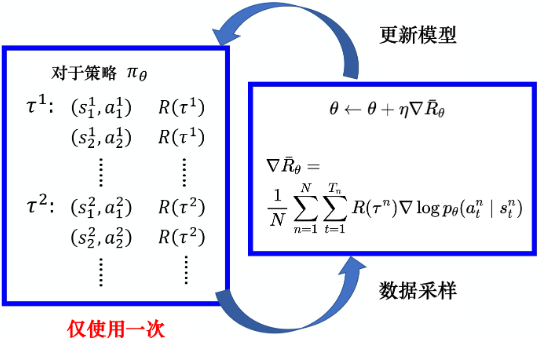

这显然是非常花时间的，怎么解决这个问题呢？为避免采样到的数据只能使用一次的问题：

  1. 可以用另外一个策略 $\pi_{\theta'}$ 与环境交互，用 $\theta'$ 采样到的数据去训练 $\theta$
  2. 假设我们可以用 $\theta'$ 采样到的数据去训练 $\theta$，我们可以多次使用 $\theta'$ 采样到的数据，可以多次执行梯度上升，可以多次更新参数 $\theta$， 都只需要用 $\theta'$ 采样到的同一批数据

故基于重要性采样的原则，我们可以用另外一个策略 $\pi _{\theta^{'}}$，与环境做互动采样数据来训练 $\theta$，从而间接计算$R(\tau) \nabla \log p_{\theta}(\tau)$，而当我们转用$\theta'$ 去采样数据训练$\theta$ 后：

  * 只需在 $R(\tau) \nabla \log p_{\theta}(\tau)$ 的基础上补上一个重要性权重 $\frac{p_{\theta}(\tau)}{p_{\theta^{\prime}}(\tau)}$，这个**重要性权重** 针对某一个轨迹 $\tau$ 用 $\theta$ 算出来的概率除以这个轨迹 $\tau$ 用 $\theta^{'}$​ 算出来的概率

最终加上重要性权重之后，可得

$$\nabla \bar{R}_{\theta}=\mathbb{E}_{\tau \sim p_{\theta^{\prime}(\tau)}}\left[\frac{p_{\theta}(\tau)}{p_{\theta^{\prime}}(\tau)} R(\tau) \nabla \log p_{\theta}(\tau)\right]$$

### 4.2 引入优势演员-评论家算法(Advantage Actor-Criti)：为避免奖励总为正增加基线

#### 4.2.1 什么是优势函数：不断鼓励并探索高于平均预期回报的动作从而指导策略更新

实际在做策略梯度的时候，并不是给整个轨迹 $\tau$ 都一样的分数，而是每一个状态-动作的对会分开来计算，但通过蒙特卡洛方法进行随机抽样的时候，可能会出问题，比如在采样一条轨迹时可能会出现

  * 问题1：所有动作均为正奖励
  * 问题2：出现**比较大的方差**(重要性采样时，采样的分布与当前分布之间也可能会出现比较大的方差，具体下一节详述)

对于第一个问题，举个例子，比如在某一一个状态，可以执行的动作有a、b、c，但我们可能只采样到动作b或者只采样到动作c，没有采样到动作a

  1. 但不管采样情况如何，现在所有动作的奖励都是正的，所以采取a、b、 c的概率都应该要提高
  2. 可实际最终b、c的概率按预期提高了，但因为a没有被采样到，所以a的概率反而下降了
  3. 然而问题是a不一定是一个不好的动作，它只是没有被采样到

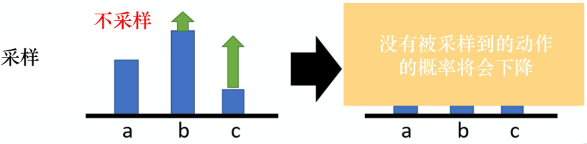

为了解决奖励总是正的的问题，也为避免方差过大，需要在之前梯度计算的公式基础上加一个基准线 $b$『此$b$指的baseline，非上面例子中的b，这个所谓的基准线$b$可以是任意函数，只要不依赖于动作$a$即可』

$$\nabla \bar{R}_{\theta} \approx \frac{1}{N} \sum_{n=1}^{N} \sum_{t=1}^{T_{n}}\left(R\left(\tau^{n}\right)-b\right) \nabla \log p_{\theta}\left(a_{t}^{n} \mid s_{t}^{n}\right)$$

上面说 $b$ 可以是任意函数，这个“任意”吧，对初学者而言可能跟没说一样，所以 $b$ 到底该如何取值呢

  * $b$ 有一种选择是使用轨迹上的奖励均值，即 $b=\frac{1}{T} \sum_{t=0}^{T} R_{t}(\tau)$，从而使得 $R(\tau)-b$​ 有正有负

如此，对于每条轨迹，平均而言，较好的50%的动作将得到奖励，避免所有奖励均为正或均为负，同时，也减少估计方差

  * $b$ 还可以是状态价值函数 $V_{\pi}(s_{t})$

### 4.4 近端策略优化PPO：解决TRPO的计算量大的问题

#### 4.4.1 什么是近端策略优化PPO与PPO-penalty

PPO算法是针对TRPO计算量的大的问题提出来的，正因为PPO基于TRPO的基础上改进，故PPO也解决了策略梯度不好确定学习率Learning rate (或步长Step size) 的问题。毕竟通过上文，我们已经得知

  1. 如果 step size 过大, 学出来的 Policy 会一直乱动，不会收敛；但如果 Step Size 太小，想完成训练，我们会等到地老天荒
  2. 而PPO 利用 New Policy 和 Old Policy 的比例，限制了 New Policy 的更新幅度，让策略梯度对稍微大点的 Step size 不那么敏感

具体做法是，PPO算法有两个主要的变种：近端策略优化惩罚（PPO-penalty）和近端策略优化裁剪（PPO-clip），其中PPO-penalty和TRPO一样也用上了KL散度约束。

**近端策略优化惩罚PPO-penalty的流程** 如下

  1. 首先，明确目标函数，通过上节的内容，可知咱们需要优化$J^{\theta^{\prime}}(\theta)$，让其最大化  
$J^{\theta^{\prime}}(\theta)=\mathbb{E}_{\left(s_{t}, a_{t}\right) \sim \pi_{\theta^{\prime}}}\left[\frac{p_{\theta}\left(a_{t} \mid s_{t}\right)}{p_{\theta^{\prime}}\left(a_{t} \mid s_{t}\right)} A^{\theta^{\prime}}\left(s_{t}, a_{t}\right)\right]$

  2. 接下来，先初始化一个策略的参数$\theta$，在每一个迭代里面，我们用前一个训练的迭代得到的actor的参数$\theta '$与环境交互，采样到大量状态-动作对， 根据$\theta '$交互的结果，估测$A^{\theta '}(s_t,a_t)$​

  3. 由于目标函数牵涉到重要性采样，而在做重要性采样的时候，$p_{\theta}\left(a_{t} | s_{t}\right)$不能与$p_{\theta'}\left(a_{t} | s_{t}\right)$相差太多，所以需要在训练的时候加个约束，这个约束就好像正则化的项一样，是 $\theta$与 $\theta'$ 输出动作的 KL散度，用于衡量 $\theta$ 与 $\theta'$ 的相似程度，我们希望在训练的过程中，学习出的 $\theta$ 与 $\theta'$​ 越相似越好  
所以需要最后使用 PPO 的优化公式

$J_{\mathrm{PPO}}^{\theta^{\prime}}(\theta)=J^{\theta^{\prime}}(\theta)-\beta \mathrm{KL}\left(\theta, \theta^{\prime}\right)$​

当然，也可以把上述那两个公式合二为一『如此可以更直观的看出，PPO-penalty把KL散度约束作为惩罚项放在了目标函数中(可用梯度上升的方法去最大化它)，此举相对TRPO减少了计算量』

$$J_{\mathrm{PPO}}^{\theta^{\prime}}(\theta)=\mathbb{E}_{\left(s_{t}, a_{t}\right) \sim \pi_{\theta^{\prime}}}\left[\frac{p_{\theta}\left(a_{t} \mid s_{t}\right)}{p_{\theta^{\prime}}\left(a_{t} \mid s_{t}\right)} A^{\theta^{\prime}}\left(s_{t}, a_{t}\right)\right]-\beta \mathrm{KL}\left(\theta, \theta^{\prime}\right)$$

上述流程有一个细节并没有讲到，即 $\beta$ 是怎么取值的呢，事实上，$\beta$ 是可以动态调整的，故称之为自适应KL惩罚(adaptive KL penalty)，具体而言

  * 先设一个可以接受的 KL 散度的最大值 $KL_{max}$

假设优化完 $J_{\mathrm{PPO}}^{\theta^{\prime}}(\theta)=J^{\theta^{\prime}}(\theta)-\beta \mathrm{KL}\left(\theta, \theta^{\prime}\right)$ 以后，KL 散度值太大导致 $\mathrm{KL}(\theta,\theta')>\mathrm{KL}_{\max}$，意味着$\theta$与$\theta'$差距过大(即学习率/步长过大)，也就代表后面惩罚的项$\beta \mathrm{KL}(\theta ,\theta ')$惩罚效果太弱而没有发挥作用，故增大惩罚把 $\beta$ 增大

  * 再设一个 KL 散度的最小值 $KL_{min}$

假设优化完 $J_{\mathrm{PPO}}^{\theta^{\prime}}(\theta)=J^{\theta^{\prime}}(\theta)-\beta \mathrm{KL}\left(\theta, \theta^{\prime}\right)$ 以后，KL 散度值比最小值还要小，导致 $\mathrm{KL}(\theta,\theta')<\mathrm{KL}_{\max}$，意味着$\theta$与$\theta'$差距过小(即学习率/步长过小)，也就代表后面惩罚的项$\beta \mathrm{KL}(\theta ,\theta ')$惩罚效果太强，我们怕它只优化后一项，使$\theta$与 $\theta'$ 一样，这不是我们想要的，所以减小惩罚即减小 $\beta$

总之，近端策略优化惩罚可表示为

$$\begin{aligned} &J_{\text{PPO}}^{\theta'}(\theta)=J^{\theta'}(\theta)-\beta \text{KL}\left(\theta, \theta'\right) \\ &J^{\theta'}(\theta) \approx \sum_{\left(s_{t}, a_{t}\right)} \frac{p_{\theta}\left(a_{t} \mid s_{t}\right)}{p_{\theta'}\left(a_{t} \mid s_{t}\right)} A^{\theta'}\left(s_{t}, a_{t}\right)\end{aligned}$$

#### 4.4.2 PPO算法的另一个变种：近端策略优化裁剪PPO-clip

如果觉得计算 KL散度很复杂，则还有一个 PPO2算法，即近端策略优化裁剪PPO-clip。近端策略优化裁剪的目标函数里面没有 KL 散度，其要最大化的目标函数为(easy RL上用$\theta ^k$代替$\theta '$，为上下文统一需要，本笔记的文字部分统一用$\theta '$)  
$\begin{aligned} J_{\mathrm{PPO2}}^{\theta'}(\theta) \approx \sum_{\left(s_{t}, a_{t}\right)} \min &\left(\frac{p_{\theta}\left(a_{t} | s_{t}\right)}{p_{\theta'}\left(a_{t} | s_{t}\right)} A^{\theta'}\left(s_{t}, a_{t}\right),{clip}\left(\frac{p_{\theta}\left(a_{t} | s_{t}\right)}{p_{\theta'}\left(a_{t} | s_{t}\right)}, 1-\varepsilon, 1+\varepsilon\right) A^{\theta'}\left(s_{t}, a_{t}\right)\right) \end{aligned}$

对重要性权重做裁剪

本质目标就是为了让$p_{\theta }(a_{t}|s_{t})$和$p_{\theta'}(a_{t}|s_{t})$可以尽可能接近，不致差距太大。

换言之，这个裁剪算法和KL散度约束所要做的事情本质上是一样的，都是为了让两个分布之间的差距不致过大，但裁剪算法相对好实现，别看看起来复杂，其实代码很好写

```python
# ratios即为重要性权重，exp代表求期望，括号里的environment_log_probs代表用于与环境交互的策略
ratios = torch.exp(log_probs - environment_log_probs)
 
# 分别用sur_1、sur_2来计算公式的两部分
# 第一部分是重要性权重乘以优势函数
sur_1 = ratios * advs
 
# 第二部分是具体的裁剪过程
sur_2 = torch.clamp(ratios, 1 - clip_eps, 1 + clip_eps) * advs
 
# 最终看谁更小则取谁
clip_loss = -torch.min(sur_1,sur_2).mean()
```