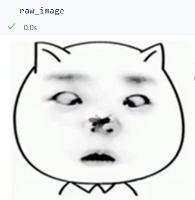

# LAVIS库学习及MiniGPT4-Qwen中的实现，代码部分待精简总结

> 原文作者：幻影星全能的木豆  
> 原文链接：https://www.cnblogs.com/mudou/p/18314953  
> 发布时间：2024-07-21 21:08

---

# LAVIS库

## 一、lavis库介绍

LAViS是一个用于语言和视觉研究及应用的Python深度学习库。它具有统一的设计，可以访问最先进的基础语言-视觉模型（ALBEF、BLIP、ALPRO、CLiP）、常见任务（检索、字幕、视觉问答、多模态分类等）和数据集（COCO、Flickr、Nocaps、概念性公共领域、SBU等）。

**LAVis六个关键模块** ：

  1. **lavis.runners** ：管理整体的训练和评估生命周期。它还负责按需延迟创建所需的组件，例如优化器、学习率调度器和数据加载器。目前，RunnerBase实现了基于周期的训练，RunnerIters实现了基于迭代的训练。

  2. **lavis.tasks** ：实现每个任务的具体训练和评估逻辑。任务可以是检索、字幕生成、预训练等。拥有任务抽象的原因是容纳特定任务的训练和评估。例如，评估检索模型与评估分类模型是不同的。

  3. **lavis.datasets** ：负责创建数据集，其中lavis.datasets.builders加载数据集配置，下载注释并返回数据集对象；lavis.datasets.datasets定义了支持的数据集，每个都是一个torch.utils.data.Dataset实例。我们还提供了自动数据集下载工具在datasets/download_scripts中，以帮助准备常见的公共数据集。

  4. **lavis.models** ：持有支持的模型和共享模型层的定义。

  5. **lavis.processors** ：处理在输入模型之前对文本和图像/视频的预处理。对于图像和视频，处理器可以被视为torchvision中的转换；对于文本输入，这可能包括小写化、截断等。

  6. **lavis.common** 模块包含多个其他模块使用的共享类和方法。例如：

     * **lavis.common.config** ：包含存储和操作LAVis使用的配置文件的类。特别是，我们使用分层配置设计，以允许高度可定制的训练和评估。
     * **lavis.common.registry** ：作为一个集中管理具有相同功能的模块的地方。它允许在运行时通过在配置文件中指定它们的名称为字符串来构建数据集、模型、任务和学习率调度器。
     * **lavis.common.optims** ：包含学习率调度器的定义。
     * **lavis.common.dist_utils** ：包含分布式训练和评估的实用工具。
     * **lavis.common.utils** ：包含杂项实用工具，主要是与输入/输出相关的辅助函数。

## 二、体验示例

如何使用LAVIS中的模型对示例数据执行推理。我们首先从本地加载示例图像。

```python
from PIL import Image

raw_image = Image.open("../data/11.png").convert("RGB")
raw_image
```



### Image Captioning

使用BLIP模型为图像生成标题。

为了使推理更加容易，将每个预训练模型与其预处理器（transforms）相关联，通过`load_model_and_preprocess()`访问。

```python
from lavis.models import load_model_and_preprocess

# 加载BLIP标题base模型，再MSCOCO标题数据集上微调得到
# 同时也会得到图片预处理器
model, vis_processors, _ = load_model_and_preprocess(name="blip_caption", model_type="base_coco", is_eval=True, device=device)

# 预处理图片
# vis_processors stores image transforms for "train" and "eval" (validation / testing / inference)
image = vis_processors["eval"](raw_image).unsqueeze(0).to(device)

# generate caption
# 注意参数的设置
model.generate({"image": image}, num_beams=1, top_p=0.9, max_length=20, min_length=5)

# output
['a cat with a tie and a nose']
```

### Visual question answering (VQA)

视觉QA

BLIP模型能够以自然语言回答有关图像的自由格式问题。

要访问VQA模型，只需替换传递给`load_model_and_preprocess()`的`name`和`model_type`。

```python
from lavis.models import load_model_and_preprocess

# 返回了视觉预处理器，文本预处理器
model, vis_processors, txt_processors = load_model_and_preprocess(name="blip_vqa", model_type="vqav2", is_eval=True, device=device)

# ask a random question.
# question = "Which city is this photo taken?"
question = "what is this photo taken?"
image = vis_processors["eval"](raw_image).unsqueeze(0).to(device)
question = txt_processors["eval"](question)
model.predict_answers(samples = {"image":image, "text_input":question}, inference_method="generate", num_beams=1)

# output
['in front of camera']
```

> 要传递参数 `num_beams = 1` 否则会报错，维度不匹配

### Unified Feature Extraction Interface

LAVIS提供了一个统一的接口来从每个架构中提取特征。

为了提取特征，我们加载每个模型的特征提取器变体。

multimodal feature 多模态特征可用于多模态分类。低维 unimodal features 单峰特征可用于计算跨模态相似度。

```python
from lavis.models import load_model_and_preprocess

device = torch.device("cuda" if torch.cuda.is_available() else "cpu")
model, vis_processors, txt_processors = load_model_and_preprocess(name="blip_feature_extractor", model_type="base", is_eval=True, device=device)

caption = "a large fountain spewing water into the air"
image = vis_processors["eval"](raw_image).unsqueeze(0).to(device)
text_input = txt_processors["eval"](caption)
sample = {"image": image, "text_input": [text_input]}

# 多模态特征 torch.Size([1, 12, 768])
# use features_multimodal[:,0,:] for multimodal classification tasks
features_multimodal = model.extract_features(sample)
print(features_multimodal.multimodal_embeds.shape)

# 提取视觉特征？ torch.Size([1, 197, 768])
features_image = model.extract_features(sample, mode="image")
print(features_image.image_embeds.shape)

# 提取文本特征？ torch.Size([1, 12, 768])
features_text = model.extract_features(sample, mode="text")
print(features_text.text_embeds.shape)

# low-dimensional projected features
print(features_image.image_embeds_proj.shape)
# torch.Size([1, 197, 256])

print(features_text.text_embeds_proj.shape)
# torch.Size([1, 12, 256])

similarity = features_image.image_embeds_proj[:,0,:] @ features_text.text_embeds_proj[:,0,:].t()
print(similarity)
# tensor([[0.1090]], device='cuda:0')
```

### 加载数据集

```python
# 查看数据集
from lavis.datasets.builders import dataset_zoo

dataset_names = dataset_zoo.get_names()
print(dataset_names)
'''
['aok_vqa', 'avsd_dialogue', 'coco_caption', 'coco_retrieval', 'coco_vqa', 'conceptual_caption_12m', 'conceptual_caption_3m', 'didemo_retrieval', 'flickr30k', 'gqa', 'imagenet', 'laion2B_multi', 'msrvtt_caption', 'msrvtt_qa', 'msrvtt_retrieval', 'msvd_caption', 'msvd_qa', 'nlvr', 'nocaps', 'ok_vqa', 'sbu_caption', 'snli_ve', 'vatex_caption', 'vg_caption', 'vg_vqa']
'''
```

```python
from lavis.datasets.builders import load_dataset
# 加载数据集
coco_dataset = load_dataset("coco_caption")
print(coco_dataset.keys())  # dict_keys(['train', 'val', 'test'])
print(len(coco_dataset["train"]))   # 566747
print(coco_dataset["train"].annotation[0])
''' 
{
    'caption': 'A woman wearing a net on her head cutting a cake. ', 
    'image': 'val2014/COCO_val2014_000000522418.jpg', 
    'image_id': 'coco_522418', 
    'instance_id': '0'
}
'''
```

### 在任务数据集上评估预训练模型

LAVIS提供了在预训练和微调模型上使用任务数据集的现成评估。

现在让我们看一个使用MSCOCO数据集在标题任务上评估BLIP模型的示例。

  1. 准备数据

LAVIS提供自动下载脚本来帮助准备大部分公共数据集，下载MSCOCO数据集，只需运行

`cd lavis/datasets/download_scripts && python download_coco.py`

下载的数据集放在LAVIS使用的默认缓存位置`cache`中

自定义缓存位置，通过更新`cache_root`来指定`lavis/configs/default.yaml`

如果已经拥有数据集的一个本地副本，建议在缓存位置创建一个指向这个本地副本的符号链接。

`ln -s /path/local/coco cache/coco`

  2. 评估预训练模型

评估预训练模型：`bash run_scripts/blip/eval/eval_coco_cap.sh`

评估large model：`bash run_scripts/blip/eval/eval_coco_cap_large.sh`

> `python -m torch.distributed.run --nproc_per_node=8 evaluate.py --cfg-path lavis/projects/blip/eval/caption_coco_eval.yaml`

### 微调 BLIP在COCO-Captioning数据集

`bash run_scripts/blip/train/train_caption_coco_large.sh`

这将把预训练的BLIP大模型微调为可用于图片标题的新模型

#### 深度剖析

`python -m torch.distributed.run --nproc_per_node=8 train.py --cfg-path lavis/projects/blip/train/caption_coco_large_ft.yaml`

##### 模型配置

```json
model:
    arch: blip_caption
    model_type: large_coco
    load_finetuned: False
```

  * `arch` 指定使用的模型架构

通过`model_zoo`可以查看可用的模型架构

the runner will look for the model class registered with the name

In this case `BlipCaption` is the model registered with the name `blip_caption`

registry 包含了从 name string 到模型类的映射，能够让runner动态地基于配置文件中的name string 找到模型类

```python
# lavis/models/blip_models/blip_caption.py
# shows how BlipCaption is registered with the name string blip_caption

@registry.register_model("blip_caption")
class BlipCaption(BlipBase):
    """
    BLIP captioning model.
    Supported model types:
        - base_coco: fine-tuned BLIP base model on COCO caption dataset (Karparthy split).
        - large_coco: fine-tuned BLIP large model on COCO caption dataset (Karparthy split).
    Usage:
        >>> from lavis.models import load_model
        >>> model = load_model("blip_caption", "base_coco")
        >>> model = load_model("blip_caption", "large_coco")
    """
    PRETRAINED_MODEL_CONFIG_DICT = {
        "base_coco": "configs/models/blip_caption_base_coco.yaml",
        "large_coco": "configs/models/blip_caption_large_coco.yaml",
    }
```

  * `model_type` 指定微调的模型类型

比如，BlipCaption有预训练的base模型和large模型

设置`load_finetuned = False`，从预训练的权重开始微调，否则设置为True会加载已经在 coco captioning 微调过的权重

图片中的内容翻译为中文如下：

给定模型架构和类型，库会查找 `laviz/models/blip_models/blip_caption.py` 中的 `large_coco` 的默认模型配置。如上述代码片段所示，相应的配置路径存储在 `Bliipcaption.PRETRAINED_MODEL_CONFIG_DICT` 中。然后，库将加载 `laviz/configs/models/blip_caption_large_coco.yaml` 作为构建模型的配置。

配置优先级：请注意，run config 的优先级高于默认模型配置。这意味着运行配置中的参数将覆盖默认模型配置。例如，在默认模型配置中，默认将 `load_finetuned` 设置为 True，而在 run config 中，我们将其设置为 False，仅从预训练权重进行微调。

##### 数据集配置

```json
datasets:
  coco_caption: # name of the dataset builder
    vis_processor:
        train:
          name: "blip_image_train"
        eval:
          name: "blip_image_eval"
    text_processor:
        train:
          name: "blip_caption"
          prompt: "a picture of "
        eval:
          name: "blip_caption"
```

每个数据集对应 vis_processor 和 text_processor，分别负责处理视觉和文本输入

use the registry mechanism 动态加载预处理器类

blip_image_train 是 BlipImageTrainProcessor 类的name string，registered in `lavis/processors/blip_processors.py`

dataset name string is also registered in the registry，指向 dataset builder COCOCapBuilder类

默认 builder 加载默认的数据集配置文件 in `DATASET_CONFIG_DICT`

```json
datasets:
  coco_caption: # name of the dataset builder
    dataset_card: dataset_card/coco_caption.md
    # data_dir: ${env.data_dir}/datasets
    data_type: images # [images|videos|features]

    build_info:
      # Be careful not to append minus sign (-) before split to avoid itemizing
      annotations:
        train:
          url: https://storage.googleapis.com/sfr-vision-language-research/datasets/coco_karpathy_train.json
          md5: aa31ac474cf6250ebb81d18348a07ed8
          storage: coco/annotations/coco_karpathy_train.json
        val:
          url: https://storage.googleapis.com/sfr-vision-language-research/datasets/coco_karpathy_val.json
          md5: b273847456ef5580e33713b1f7de52a0
          storage:  coco/annotations/coco_karpathy_val.json
        test:
          url: https://storage.googleapis.com/sfr-vision-language-research/datasets/coco_karpathy_test.json
          md5: 3ff34b0ef2db02d01c37399f6a2a6cd1
          storage: coco/annotations/coco_karpathy_test.json
      images:
        # 指定图片根路径，相对于cache的路径
        storage: coco/images/
```

build信息划分配注释 and 图片

LAVIS支持使用多个数据集进行训练。请参阅 `lavis/projects/blip/train/pretrain_14m.yaml`

## 三、lavis自定义模块

### 3.1 自定义数据集 Datasets

使用 `lavis.datasets`模块创建新的数据集

LAVIS库包含一个标准的数据集模块，允许自定义添加新的数据集。

包含创建数据集配置，定义和联系新的数据集类

我们将复制为基于视频的对话任务的视听场景感知对话（AVSD）基准添加数据集类的步骤。

#### 数据集配置

首先为数据集定义一个基础的配置文件，包含一个新的数据集类 `avsd_dialogue`, dataset card 和数据类型

在`lavis.configs.datasets`中定义新的数据集配置

如下 `avsd/default_dial.yaml`

```json
datasets:
	avsd_dialogue:
		dataset_card: dataset_card/avsd_dialogue.md # path to the dataset card
		data_type: features # [images|videos|features] we use features in this case 用于提取视频特征
		
		build_info:
			annotations:
				train:
					url: /export/home/data/avsd/train_set4DSTC7-AVSD.json
					storage: avsd/annotations/train.json
				eval:
					url: /export/home/data/avsd/valid_set4DSTC7-AVSD.json
					storage: avsd/annotations/val.json
				test:
					url: /export/home/data/avsd/test_set4DSTC7-AVSD.json
					storage: avsd/annotations/test.json
			features:
				storage: /export/home/data/avsd/features/
```

  1. 数据集 card

设置数据集配置的一个可选的步骤是定义一个数据集卡片，其中包含有关数据集的更多详细信息，例如描述、任务和指标。例如，我们可以为AVsD基准测试在 `dataset_card/avsd_dialogue.md` 中定义一个数据集卡片。根据数据集的不同，我们可能会在其对应的数据集卡片中包含自动下载数据的命令（使用在 `laviz.datasets.download_scripts` 中定义的Python代码），这将自动加载数据并将其存储在特定文件夹中。否则，您应该在数据集卡片中描述从原始数据源下载数据的外部说明，以正确加载数据集。

AVSD benchmark 数据集卡片示例：

```json
(Samples from the AVSD dataset. Image credit: "https://arxiv.org/pdf/1901.09107.pdf")

# Audio-Visual Scene-Aware Dialogues (AVSD)
## Description
[Audio-Visual Scene-Aware Dialogues (AVSD)](https://github.com/hudaAlamri/DSTC7-Audio-Visual-Scene-Aware-Dialog-AVSD-Challenge) contains more than 10,000 dialogues, each of which is grounded on a unique video. In the test split, for each test sample, 6 reference dialogue responses are provided.
## Task
在一个视频基础对话任务中，系统必须根据给定对话的上下文生成对用户输入的响应。
这个上下文包括对话历史（用户和系统之前的发言）以及构成场景的视频和音频信息。
使用客观措施评估系统自动生成句子的质量，以确定生成的响应是否自然且富有信息。
## Metrics
模型通常根据 [BLEU]、[CIDER]、[METEOR] 和 [ROUGE-L] 指标进行评估。
## Leaderboard
....
## Auto-Downloading
Please refer to [benchmark webite](https://github.com/hudaAlamri/DSTC7-Audio-Visual-Scene-Aware-Dialog-AVSD-Challenge) for instructions to download the dataset.
## References
```

  2. 视觉数据类型

我们目前将视觉数据类型限制为三种选项之一：`images`, `videos`, and `features`.

Images and videos 指的是原始视觉数据，适合在原始形式下处理视觉数据的模型（例如ViT模型）。

Features 是从预训练模型（例如CNN模型）中提取的视觉表示。

这里AVSD基准测试由从3D-CNN模型中提取的视频特征组成。

  3. Build Info

Build info指的是数据存储和缓存的具体位置。

对于文本注释（例如标题或对话），默认情况下，我们包括三个数据分割，即 train，val，test，这些通常在所有机器学习项目中使用。

对于每个分割，我们指定2个参数：url 和 storage。

url 可以是 online URL，数据可以从中自动加载（例如从googleapis），或者是数据已经事先下载的本地目录。

storage 是随着时间的推移缓存数据的目录，避免了重复下载数据。

对于视觉数据注释，确保字段名称与之前定义的数据类型匹配 `images`, `videos`, and `features`。

由于视觉特征通常很大，应该事先下载，我们只维护一个存储参数，用于缓存视觉数据。

  4. Base Dataset `lavis.datasets.datasets.base_dataset`

继承 `lavis.datasets.datasets.base_dataset` 定义新的数据集

base dataset 类已经定义了一些标准方法，例如从pytorch中使用默认的 collator

```python
import json
from typing import Iterable

from torch.utils.data import Dataset, ConcatDataset
from torch.utils.data.dataloader import default_collate

# 默认BaseDataset的实现
class BaseDataset(Dataset):
    def __init__(self, vis_processor = None, text_processor = None, vis_root = None, ann_paths = []):
        ''' 
        vis_root: 图片根目录
        ann_root：存储注释文件的目录
        '''
        self.vis_root = vis_root
        self.annotation = []
        for ann_path in ann_paths:
            self.annotation.extend(json.load(open(ann_path, "r")))
        self.vis_processor = vis_processor
        self.text_processor = text_processor
        self._and_instance_ids()
    def __len__(self):
        return len(self.annotation)
    def collater(self, samples):
        return default_collate(samples)
    def set_processors(self, vis_processor, text_processor):
        self.vis_processor = vis_processor
        self.text_processor = text_processor
    def _and_instance_ids(self, key="instance_id"):
        for idx, ann in enumerate(self.annotation):
            ann[key] = str(idx)
```

任何数据集子类都将继承这些方法，并且可以根据数据集的规格选择性地定义和重写这些方法。

我们鼓励用户不要修改基础数据集类，因为任何修改都会对继承这个基础数据集的其他数据集类产生连锁影响。

相反，用户应该独立创建新的数据集类来满足他们的特定需求。

#### 创建新的对话数据集

对于AVSD数据集，定义一个新的数据集子类 `DialogueDataset`用于对话任务

定义在`lavis.datasets.datasets.dialogue_datasets`

```python
import os
from collections import OrderedDict

from lavis.datasets.datasets.base_dataset import BaseDataset
import json
import copy

class DialogueDataset(BaseDataset):
    def __init__(self, vis_processor, text_processor, vis_root, ann_paths):
        self.vis_root = vis_root
        self.annotation = []
        for ann_path in ann_paths:
            dialogs = json.load(open(ann_path, "r"))['dialogs']
            for dialog in dialogs:
                all_turns = dialog['dialog']
                dialog_context = []
                for turn in all_turns:
                    dialog_instance = copy.deepcopy(dialog)
                    question = turn['question']
                    answer = turn['answer']
                    dialog_instance['dialog'] = copy.deepcopy(dialog_context)
                    dialog_instance['question'] = question
                    dialog_instance['answer'] = answer
                    self.annotation.append(dialog_instance)
                    dialog_context.append(turn)
        self.vis_processor = vis_processor
        self.text_processor = text_processor
        self._add_instance_ids()

        self.image_ids = []
        n = 0
        for ann in self.annotation:
            img_id = ann["image_id"]
            if img_id not in self.image_ids.keys():
                self.image_ids[img_id] = n 
                n += 1
```

如果我们想仅用于测试的对话数据集，可以定义另一个我们可以定义另一个数据集类 `DialogueEvalDataset`，其定义方式与上面类似，但注释的处理方式不同。

通常，在对话任务中，在测试时，每个对话只构建一个单独的测试样本（而不是在训练时将所有对话轮次分解为样本）。然后可以这样定义数据集类：

```python
class DialogueEvalDataset(BaseDataset):
    def __init__(self, vis_processor, text_processor, vis_root, ann_paths):
        ...
        # 与上述不同之处在于对话注释
        self.annotation = []
        for ann_path in ann_paths:
            dialogs = json.load(open(ann_path, "r"))['dialogs']
            for dialog in dialogs:
                all_turns = dialog['dialog']
                dialog_context = all_turns[:-1]
                last_turn = all_turns[-1]
                question = last_turn['question']
                answer = last_turn['answer']
                dialog['dialog'] = dialog_context
                dialog['question'] = question
                dialog['answer'] = answer
                self.annotation.append(dialog)
```

使用类继承定义数据集允许开发更多细粒度的类实现，每一个都被特别指定用于基准测试。

例如，在基于对话的任务中，我们可以进一步定义另一个数据集子类，用于AVSD数据集。

定义新的类 `AVSDDiaDataset`进一步指定如何加载样本以及根据具体要求整理它们 collate

```python
import os
from lavis.datasets.datasets.base_dataset import BaseDataset
from lavis.datasets.datasets.dialogue_datasets import DialogueDataset, DialogueEvalDataset
import torch

class AVSDDiaDataset(DialogueDataset):
    def __init__(self, vis_processor, text_processor, vis_root, ann_paths):
        super().__init__(vis_processor, text_processor, vis_root, ann_paths)
    def __getitem__(self, index):
        ann = self.annotation[index]
        vname = ann['image_id']
        video = self.vis_processor(self.vis_root, vname)
        dialogue = self.text_processor(ann)
        return {
            "video_fts": video['video_fts'],
            "video_token_type_ids": video['token_type_ids'],
            "input_ids": dialogue['input_ids'],
            "token_type_ids": dialogue['token_type_ids'],
            "labels": dialogue['labels'],
            "image_id": ann["image_id"],
            "instance_id": ann["instance_id"]
        }
        
    def collater(self, samples):
        input_ids, token_type_ids, labels, video_fts, video_token_type_ids = [], [], [], [], []
        for i in samples:
            input_ids.append(i['input_ids'])
            token_type_ids.append(i['token_type_ids'])
            labels.append(i['labels'])
            video_fts.append(i['video_fts'])
            video_token_type_ids.append(i['video_token_type_ids'])

        input_ids = self.text_processor.padding(input_ids)
        labels = self.text_processor.padding(labels, -1)
        video_fts = self.vis_processor.padding(video_fts)
        
        token_type_ids = self.text_processor.padding(token_type_ids)
        video_token_type_ids = self.text_processor.padding(video_token_type_ids)
        token_type_ids = torch.cat([video_token_type_ids, token_type_ids], dim=1)

        attn_mask = self.text_processor.get_attention_mask(input_ids)
        video_mask = self.vis_processor.get_attention_mask(video_fts)
        attn_mask = torch.cat([video_mask, attn_mask], dim=1)

        video_labels = torch.ones((video_fts.size(0), video_fts.size(1))).long() * -1 # ignore token indice -1 by default

        labels = torch.cat([video_labels, labels], dim=1)

        samples = {}
        samples['input_ids'] = input_ids
        samples['token_type_ids'] = token_type_ids
        samples['labels'] = labels
        samples['video_fts'] = video_fts
        samples['attn_mask'] = attn_mask

        return samples
```

by default, we always use the collater from the `BaseDataset` class to collate data samples.

#### 数据集构建器 Dataset Builder

Dataset Builder 数据处理模块，控制数据集类和将数据集类和特定的数据集配置联系起来。

`lavis.datasets.builders.base_dataset_builder`

**Base Dataset Builder**

新的数据构建器继承`BaseDatasetBuilder`

```python
class BaseDatasetBuilder:
    train_dataset_cls, eval_dataset_cls = None, None
    def __init__(self, cfg=None):
        super().__init__()

        if cfg is None:
            # help to create datasets from default config.
            self.config = load_dataset_config(self.default_config_path())
        elif isinstance(cfg, str):
            self.config = load_dataset_config(cfg)
        else:
            # when called from task.build_dataset()
            self.config = cfg

        self.data_type = self.config.data_type

        self.vis_processors = {"train": BaseProcessor(), "eval": BaseProcessor()}
        self.text_processors = {"train": BaseProcessor(), "eval": BaseProcessor()}

        # additional processors, each specified by a name in string.
        self.kw_processors = {}
```

仔细查看基本构建器类中定义的标准方法，包括`_download_data`和`build_dataset`等方法，这些方法将加载下载数据并创建数据集类的实例：

```python
class BaseDatasetBuilder:
    ...
    def build_datasets(self):
        # download, split, etc...
        # only called on 1 GPU/TPU in distributed
        # 主进程下载数据
        if is_main_process():
        	self._download_data()
        if is_dist_avail_and_initialized():
        	dist.barrier()

        # at this point, all the annotations and image/videos should be all downloaded to the specified locations.
        logging.info("Building datasets...")
        datasets = self.build()  # dataset['train'/'val'/'test']
        return datasets

    def _download_data(self):
    self._download_ann()
    self._download_vis()
```

**对话数据集构建器**

`lavis.datasets.builders.dialogue_builder`

```python
from lavis.datasets.builders.base_dataset_builder import BaseDatasetBuilder
from lavis.datasets.datasets.avsd_dialogue_datasets import(
    AVSDDialDataset,
    AVSDDialEvalDataset
)
from lavis.common.registry import registry

@registry.register_builder("avsd_dialogue")
class AVSDDialBuilder(BaseDatasetBuilder):
    train_dataset_cls = AVSDDialDataset
    eval_dataset_cls = AVSDDialEvalDataset

    DATASET_CONFIG_DICT = {
        "default": "configs/datasets/avsd/defaults_dial.yaml"
    }
```

请注意，我们选择分别定义 `train_dataset_cls` 和 `eval_dataset_cls` 参数，以考虑训练和测试时数据处理不同的情况。

例如，在标题生成任务中，测试时每个数据样本通常包括多个 ground-truth 标题，而不是训练时的单一 ground-truth 标题。

如果训练和测试时的数据处理相同，这两个参数可以链接到同一个数据集类。

最后，定义 `DATASET_CONFIG_DICT` 将数据集配置与分配的数据集类关联起来。

**Registering Builder**

首先需要在 `__init__.py` 文件中包含（import）新定义的类。`__init__.py` 文件是一个特殊的文件，用于将模块标记为Python包，并可以包含包的初始化代码。

```python
from lavis.datasets.builders.dialogue_builder import (
    AVSDDialBuilder
)

__all__ = [
    ...,
    "AVSDDialBuilder"
]
```

通过在 `__init__.py` 文件中设置 `__all__` 列表，可以指定哪些类或函数将被导出。这意味着当其他模块导入这个包时，这些被列出的类或函数可以直接通过包名访问。

**Assigning Builder**

在数据加载和处理期间，被分配的生成器必须具有正确的注册表才能正确加载它

例如，应在配置文件中指定以下内容 `dialogue_avsd_ft.yaml` ，例如：

```json
datasets:
  avsd_dialogue: # name of the dataset builder
    ...
    # processor configuration
    ...
```

随后，任何进程（例如训练）都应加载此配置文件以分配正确的构建器，然后该构建器将关联正确的数据集类以构建数据样本。

```python
python train.py --cfg-path dialogue_avsd_ft.yaml
```

> 总结，自顶向下回顾，添加新的对话任务数据集进行微调
> 
> 1.）首先训练时需要加载一个配置文件，配置文件中需要正确配置对话数据构建器
> 
> 2.）创建对话数据构建器，继承自 BaseDatasetBuilder，其中需要添加数据集默认配置文件的映射关系，以及训练数据集类和评估数据集类
> 
> 3.）自定义任务数据集类，继承BaseDataset，自定义实现细节

### 3.1 示例-miniGPT4_Qwen自定义数据集

数据集配置，其中配置了数据集构建器的 name string，每个dataset builder下配置视觉处理器和文本处理器的配置信息

```json
datasets:
  minigpt4_instruction: # name of the dataset builder
    vis_processor:
        train:
          name: "blip2_image_train"
          image_size: 224
    text_processor:
        train:
          name: "base_instruction"
          max_words: 100
  llava_instruction: # name of the dataset builder
    vis_processor:
        train:
          name: "blip2_image_train"
          image_size: 224
    text_processor:
        train:
          name: "base_instruction"
          max_words: 100
```

创建数据集构建器

`lavis/datasets/builders/minigpt4qwen_builder.py` 文件中构建了 `minigpt4_instruction，llava_instruction` 的对应的数据集构建器。

数据集构建器中维护了当前数据集对应的类，以及当前数据集默认的配置信息。

训练数据集对应的数据集类都是`InstructionDataset`，说明两个数据集在训练中的构建方法是一样的。

```python
from lavis.datasets.datasets.minigpt4_instructions import InstructionDataset
from lavis.datasets.builders.base_dataset_builder import BaseDatasetBuilder

@registry.register_builder("minigpt4_instruction")
class Minigpt4InstructionBuilder(BaseDatasetBuilder):
    # 训练数据集类 = InstructionDataset
    train_dataset_cls = InstructionDataset
    DATASET_CONFIG_DICT = {
        'default': 'configs/datasets/minigpt4_instruction/defaults_instruction.yaml'
    }

@registry.register_builder("llava_instruction")
class LlavaInstructionBuilder(BaseDatasetBuilder):
    # 训练数据集类 = InstructionDataset
    train_dataset_cls = InstructionDataset
    DATASET_CONFIG_DICT = {
        'default': 'configs/datasets/llava_instruction/defaults_instruction.yaml'
    }
```

自定义的数据集

```python
# 自定义指令数据集，继承自 Minigpt4QwenDataset
class InstructionDataset(Minigpt4QwenDataset, __DisplMixin):
    def __init__(self, vis_processor, text_processor, vis_root, ann_paths):
        self.vis_root = vis_root

        self.annotation = []
        for ann_path in ann_paths:
            self.annotation.extend(json.load(open(ann_path, "r")))

        self.vis_processor = vis_processor
        self.text_processor = text_processor
        # 调用父类的_add_instance_ids方法
        self._add_instance_ids()

    def __getitem__(self, index):
        ann = self.annotation[index]
        # 图片路径
        image_path = os.path.join(self.vis_root,ann['image'])
        # 获取图片
        image = Image.open(image_path).convert("RGB")
        # 视觉处理器
        image = self.vis_processor(image)
        # 
        if isinstance(ann['instruction'],list):
            instructions = ann['instruction']
            outputs = ann['output']
            conversations = []
            for turn_i, instruction in enumerate(instructions):
                instruction = self.text_processor(instruction)
                output = outputs[turn_i]
                conversations.extend(
                    [
                        {"from": "user", "value":instruction},
                        {"from": "assistant", "value": output},
                    ]
                )
        else:
            instruction = self.text_processor(ann['instruction'])
            output = ann['output']
            conversations = [
                {"from": "user", "value":instruction},
                {"from": "assistant", "value": output},
            ]
        # 返回图像及会话   
        return {
            "image": image,
            "conversations": conversations,
        }
# 自定义数据集，继承自BaseDataset
class Minigpt4QwenDataset(BaseDataset):
    def __init__(self, vis_processor, text_processor, vis_root, ann_paths):
        super().__init__(vis_processor, text_processor, vis_root, ann_paths)

    def collater(self, samples):
        image_list, conversation_list = [], []
        num_answers = []
        # 返回图片和会话列表
        for sample in samples:
            if isinstance(sample['image'],list):
                image_list.extend(sample['image'])
            else:
                image_list.append(sample["image"])
            conversation_list.append(sample["conversations"])

        return {
            "image": torch.stack(image_list, dim=0),
            "conversations": conversation_list,
        }
```

默认的数据集配置信息

```json
# configs/datasets/minigpt4_instruction/defaults_instruction.yaml
datasets:
  minigpt4_instruction:	# 数据集的 name string
    # data_dir: ${env.data_dir}/datasets
    data_type: images # [images|videos|features]

    build_info:
      # Be careful not to append minus sign (-) before split to avoid itemizing
      annotations:
        train:
          url: /root/autodl-tmp/cache/dataset/minigpt4/minigpt4_minigpt4qwen_format.json
          storage: /root/autodl-tmp/cache/dataset/minigpt4/minigpt4_minigpt4qwen_format.json
      images:
          storage: /root/autodl-tmp/cache/dataset/minigpt4/image

# configs/datasets/llava_instruction/defaults_instruction.yaml
datasets:
  llava_instruction:
    # data_dir: ${env.data_dir}/datasets
    data_type: images # [images|videos|features]

    build_info:
      # Be careful not to append minus sign (-) before split to avoid itemizing
      annotations:
        train:
          url: /root/autodl-tmp/cache/dataset/llava/llava_minigpt4qwen_format.json
          storage: /root/autodl-tmp/cache/dataset/llava/llava_minigpt4qwen_format.json
      images:
          storage: /root/autodl-tmp/cache/dataset/llava/image
```

### 3.2 自定义处理器 Processors

使用 `lavis.processors`模块自定义新的处理器。

LAVis 库包括一个标准处理器模块，用于预处理数据，例如图像转换和序列连接。

在本教程中，演示添加针对视频基础对话任务的视觉和文本处理器。

此外，我们也希望处理器具有处理特征，使数据样本与 GPT 风格的模型兼容。

#### 基础处理器 Base Processor

`lavis.processors.base_processors`

新处理器的定义应该继承基础处理器 `BaseProcessor`

```python
# OmegaConf 是一个用于处理配置文件的库
from omegaconf import OmegaConf

class BaseProcessor:
    def __init__(self):
        # 初始化为一个 lambda 函数，该函数接收一个参数 x 并返回它本身。
        #  这意味着默认情况下，处理器不会对数据进行任何转换
        self.transform = lambda x: x
        return

    def __call__(self, item):
        # 当实例被调用时，它会应用 self.transform 函数
        # self.transform不会对item做任何操作，直接返回
        return self.transform(item)

    @classmethod
    def from_config(cls, cfg=None):
        # 根据配置文件创建实例
        return cls()

    def build(self, **kwargs):
        # 将关键字参数转换为一个配置对象
        cfg = OmegaConf.create(kwargs)
        # 根据配置对象创建实例
        return self.from_config(cfg)
```

#### GPT风格处理器 GPT-style Processors

`lavis.processors.gpt_processors`

定义新的处理器类

例如在 `lavis.processors.gpt_processors` 下，为专门为基于视频对话设计的GPT模型。

我们假设视频特征已经事先提取好了，这个处理器只是简单地从 `npy` 文件中加载特征。

其他特别定义的方法包括`padding`（由数据集实例用于填充多个视频样本）和 `get_attention_mask`（为GPT模型中的Transformer注意力创建注意力掩码）。

通过定义`GPTVideoFeatureProcessor` 类来处理视频特征

```python
# 定义了一些特殊令牌，这些令牌将被添加到 GPT 模型的分词器中
SPECIAL_TOKENS_DICT = {'bos_token': "<bos>", 'eos_token': "<eos>", 'additional_special_tokens': ["<speaker1>", "<speaker2>", "<video>", "<cap>"], 'pad_token': "<pad>"}
...

# 注册了一个新的处理器类, name string 为 gpt_video_ft
@registry.register_processor("gpt_video_ft")
class GPTVideoFeatureProcessor(BaseProcessor):
    def __init__(self, visual_ft, audio_ft):
        # 接收视觉和音频特征
        self.visual_ft = visual_ft
        self.audio_ft = audio_ft
        # 初始化一个 GPT2Tokenizer 实例，并添加特殊令牌。
        self.tokenizer = GPT2Tokenizer.from_pretrained('gpt2')
        self.tokenizer.add_special_tokens(SPECIAL_TOKENS_DICT)

    def padding(self, seq):
        padded_seq = torch.nn.utils.rnn.pad_sequence(seq, batch_first=True, padding_value=1.0)
        return padded_seq

    def get_attention_mask(self, seq):
        # 填充的值为1.0，
        return torch.sum(seq != 1, dim=2) != 0

    def __call__(self, ft_root, vname):
        all_ft = []
        # 读取视觉特征
        for ft_name in self.visual_ft:
            ft_path = os.path.join(ft_root, ft_name, vname)
            all_ft.append(np.load(ft_path + '.npy'))
        # 读取音频特征
        for ft_name in self.audio_ft:
            ft_path = os.path.join(ft_root, ft_name, vname)
            all_ft.append(np.load(ft_path + '.npy'))
        # 计算所有特征数组的最短长度
        min_len = min([len(ft) for ft in all_ft])
        # 截断每个特征数组到最短长度
        sampled_ft = [ft[:min_len] for ft in all_ft]
        # 将截断后的特征数组沿着第二维合并成一个大的特征数组
        sampled_ft = np.concatenate(sampled_ft, axis=1)
        
        item = {}
        # 视觉特征
        item['video_fts'] = torch.Tensor(sampled_ft)
        # 视觉类型
        video_type_token = self.tokenizer.convert_tokens_to_ids('<video>')
        item['token_type_ids'] = torch.Tensor([video_type_token] * len(sampled_ft)).long()
        
        return item

    @classmethod
    def from_config(cls, cfg=None):
        # 从配置文件创建处理器实例
        if cfg is None:
            cfg = OmegaConf.create()

        visual_ft = cfg.get("visual_ft", ["i3d_rgb"])
        audio_ft = cfg.get("audio_ft", ["vggish"])

        return cls(
            visual_ft=visual_ft,
            audio_ft=audio_ft
        )
```

另一个有用的处理器类可用于处理对话数据

定义一个 `GPTDialogueProcessor` 类。这个处理器类接收原始注释，并构造输入作为输入序列（questions, dialogue contexts, and responses）的串联，以便于在 GPT 模型中应用。

其他特别定义的方法包括 `padding` 和 `get_attention_mask`。

```python
SPECIAL_TOKENS = [
    "<bos>",
    "<eos>",
    "<speaker1>",
    "<speaker2>",
    "<cap>",
    "<video>",
    "<pad>",
]

# 
SPECIAL_TOKENS_DICT = {'bos_token': "<bos>", 'eos_token': "<eos>", 'additional_special_tokens': ["<speaker1>", "<speaker2>", "<video>", "<cap>"], 'pad_token': "<pad>"}
...

# 注册新的处理器类, name string 为 gpt_dialogue
@registry.register_processor("gpt_dialogue")
class GPTDialogueProcessor(BaseProcessor):
    def __init__(self, max_turns=3, use_caption=True):
        # 对话历史中使用的最大轮数
        self.max_turns = max_turns
        # 是否使用标题信息
        self.use_caption = use_caption
        # 分词器初始化，并添加特殊令牌
        self.tokenizer = GPT2Tokenizer.from_pretrained('gpt2')
        self.tokenizer.add_special_tokens(SPECIAL_TOKENS_DICT)

    def sample_sequence(self, caption, history, answer):
        # 构造输入序列
        bos, eos, speaker1, speaker2, cap = self.tokenizer.convert_tokens_to_ids(SPECIAL_TOKENS[:-2])
        instance = {}
        sequence = [caption] + history + [answer]
        # 每个部分的末尾添加结束令牌（EOS）
        sequence = [s + [eos] for s in sequence]

        instance["input_ids"] = list(chain(*sequence))
        instance["token_type_ids"] = [cap] * len(sequence[0]) + [speaker2 if i % 2 else speaker1 for i, s in enumerate(sequence[1:]) for _ in s]
        instance["labels"] = ([-1]*sum(len(s) for s in sequence[:-1])) + sequence[-1]

        assert len(instance["input_ids"])==len(instance["token_type_ids"])
        assert len(instance["token_type_ids"])==len(instance["labels"])

        for k,v in instance.items():
            instance[k] = torch.Tensor(v).long()
        return instance

    def padding(self, seq, pad_token=-1):
        if pad_token==-1: pad_token = self.tokenizer.pad_token_id
        padded_seq = torch.nn.utils.rnn.pad_sequence(seq, batch_first=True, padding_value=pad_token)
        return padded_seq

    def get_attention_mask(self, seq, pad_token=-1):
        if pad_token==-1: pad_token = self.tokenizer.pad_token_id
        return seq != pad_token

    def __call__(self, ann):
        # 如果使用标题，将标题和总结合并编码
        if self.use_caption:
            caption = ' '.join([ann['caption'], ann['summary']])
            caption = self.tokenizer.encode(caption)
        else:
            caption = []
        # 构建对话历史	
        dial_history = []
        # 获取最后max_turns轮对话的问题和答案
        for turn in ann['dialog'][-self.max_turns:]:
            dial_history.append(turn['question'])
            dial_history.append(turn['answer'])
        # 当前问题
        dial_history.append(ann['question'])
        dial_history = [self.tokenizer.encode(t) for t in dial_history]
        # 对当前答案进行编码
        answer = self.tokenizer.encode(ann['answer'])
        # 使用标题，对话历史，当前问题答案，构建Tensor字典
        item = self.sample_sequence(caption, dial_history, answer)

        return item

    @classmethod
    def from_config(cls, cfg=None):
        # 从配置文件创建处理器实例
        if cfg is None:
            cfg = OmegaConf.create()
        use_caption = cfg.get("use_caption", True)
        max_turns = cfg.get("max_turns", 3)
        return cls(max_turns=max_turns, use_caption=use_caption)
```

#### 注册新处理器 Registering New Processors

`lavis.processors.__init__`

最后，任何新的处理器都必须正式注册为 `laviz.processors` 模块的一部分。

例如，要为基于 GPT 的对话模型添加处理器类，包括一个用于对话数据的 `GPTDialogueProcessor` 和一个用于视频特征的 `GPTVideoFeatureProcessor`，我们可以按以下方式修改 `__init__.py` 文件：

```python
from lavis.processors.gpt_processors import (
    GPTVideoFeatureProcessor,
    GPTDialogueProcessor,
)

__all__ = [
    ...
    # GPT
    "GPTVideoFeatureProcessor",
    "GPTDialogueProcessor"
]
```

#### 分配处理器 Assigning Processors

上述处理器类的示例中，请注意我们为每个类定义了一个 `from_config` 方法。这个方法将处理一个配置文件，并传递特定参数（例如 `max_turns`、`visual_ft`），以正确初始化处理器类。

为了做到这一点，我们可以在配置文件中分配/关联正确的处理器类注册表。

例如，在配置文件中应该指定如下内容，例如 `dialogue_avsd_ft.yaml`：

在 name 出配置处理器类的 name string

```json
datasets:
  avsd_dialogue: # name of the dataset builder
    vis_processor:
        train:
          name: "gpt_video_ft" # name of the visual processor for training data
          visual_ft: ["i3d_flow", "i3d_rgb"]
          audio_ft: ["vggish"]
        eval:
          name: "gpt_video_ft" # name of the visual processor for evaluation data
          visual_ft: ["i3d_flow", "i3d_rgb"]
          audio_ft: ["vggish"]
    text_processor:
        train:
          name: "gpt_dialogue" # name of the textual processor for training data
          max_turns:  3
          use_caption: True
        eval:
          name: "gpt_dialogue" # name of the textual processor for evaluation data
          max_turns:  3
          use_caption: True
```

### 3.2 示例-MiniGPT4_Qwen定义处理器

  1. 观察MiniGPT4_Qwen Instruction Finetune的配置文件

可以看到其中 `vis_processor `视觉处理器的 name string 为 `blip2_image_train`

这里应该是LAVIS库中已经实现好的

```json
datasets:
  minigpt4_instruction: # name of the dataset builder
    vis_processor:
        train:
          name: "blip2_image_train"
          image_size: 224
    text_processor:
        train:
          name: "base_instruction"
          max_words: 100
  llava_instruction: # name of the dataset builder
    vis_processor:
        train:
          name: "blip2_image_train"
          image_size: 224
    text_processor:
        train:
          name: "base_instruction"
          max_words: 100
```

  2. 有了处理器的name string，我们可以到`laviz.processors`下查看对应的处理器

```python
# 注册新的处理器类
@registry.register_processor("blip2_image_train")
class Blip2ImageTrainProcessor(BlipImageBaseProcessor):
    def __init__(
        self, image_size=364, mean=None, std=None, min_scale=0.5, max_scale=1.0
    ):
        '''
        image_size:  随机裁剪图像的目标大小
        mean: 图像均值，用于标准化
        std: 图像标准差，用于标准化
        min_scale: 随机裁剪的最小比例
        max_scale: 随机裁剪的最大比例
        '''
        # 父类的构造函数，传入均值和方差
        super().__init__(mean=mean, std=std)
        
        self.transform = transforms.Compose( 	# 定义一个图像转换操作序列
            [
                transforms.RandomResizedCrop(	# 随机调整图像大小并裁剪到指定的 image_size
                    image_size,
                    scale=(min_scale, max_scale),
                    interpolation=InterpolationMode.BICUBIC,
                ),
                transforms.RandomHorizontalFlip(),	# 随机水平翻转图像
                transforms.ToTensor(),			# 转换为Tensor
                self.normalize,					# 应用之前通过父类初始化的标准化
            ]
        )

    def __call__(self, item):
        # 调用处理器，即应用transform方法
        return self.transform(item)

    @classmethod
    def from_config(cls, cfg=None):
        if cfg is None:
            cfg = OmegaConf.create()
        image_size = cfg.get("image_size", 364)
        mean = cfg.get("mean", None)
        std = cfg.get("std", None)
        min_scale = cfg.get("min_scale", 0.5)
        max_scale = cfg.get("max_scale", 1.0)
        return cls(
            image_size=image_size,
            mean=mean,
            std=std,
            min_scale=min_scale,
            max_scale=max_scale,
        )
```

```python
class BlipImageBaseProcessor(BaseProcessor):
    def __init__(self, mean=None, std=None):
        if mean is None:
            mean = (0.48145466, 0.4578275, 0.40821073)
        if std is None:
            std = (0.26862954, 0.26130258, 0.27577711)
        # 使用给定的均值标准差，创建一个标准化转换对象
        self.normalize = transforms.Normalize(mean, std)
```

### 3.3 添加新模型

使用`lavis.models`模块添加新模型

LAVis 库包括一个标准模型模块，为许多主要的语言-视觉模型（如 ALBEF、BLIP、ALPRO 和 CLIP）构建了基础

以下演示为视频基础对话任务添加一个 GPT 风格的模型

#### 基础模型 Base Model

`lavis.models.base_model`

任何新的模型定义应该继承基础模型类 `BaseModel`

```python
from omegaconf import OmegaConf

import numpy as np

import torch
import torch.nn as nn

from lavis.common.utils import get_abs_path

# BaseModel 继承自 nn.Module
class BaseModel(nn.Module):
    """Base class for models."""
    def __init__(self):
        super().__init__()
    # 前向特征方法
    def forward_features(self, *args, **kwargs):
        """Similar to *forward* but only return features."""
        # 类似于forward，但是只返回模型的特征输出
        raise NotImplementedError
    # 从预训练模型加载权重
    def load_from_pretrained(self, url_or_filename):
        raise NotImplementedError

    @classmethod
    def _from_config(cls, cfg=None, model_type="base"):
        if not cfg:
            # useful when building model without a provided configuration file
            cfg = OmegaConf.load(cls.default_config_path(model_type)).model
        return cls.from_config(cfg)

    @classmethod
    def from_pretrained(cls, model_type="base"):
        """
        Build a pretrained model from the default configuration file, specified by model_type.
        """
        # 根据配置文件和特定的模型类型，构建预训练模型
        return cls._from_config(cfg=None, model_type=model_type)

    @property
    def device(self):
        # 返回模型参数所在的设备
        return list(self.parameters())[0].device

    @classmethod
    def default_config_path(cls, model_type="base"):
        assert (
            model_type in cls.PRETRAINED_MODEL_CONFIG_DICT
        ), "Unknown model type {}".format(model_type)
        return get_abs_path(cls.PRETRAINED_MODEL_CONFIG_DICT[model_type])
    # 评估前的准备步骤
    def before_evaluation(self, **kwargs):
        pass
    # 显示模型的参数量
    def show_n_params(self, return_str=True):
        tot = 0
        for p in self.parameters():
            w = 1
            for x in p.shape:
                w *= x
            tot += w
        if return_str:
            if tot >= 1e6:
                return "{:.1f}M".format(tot / 1e6)
            else:
                return "{:.1f}K".format(tot / 1e3)
        else:
            return tot
```

#### GPT-style 基于视频的对话模型

`lavis.models.gpt_models.gpt_dialogue`

定义一个新的模型类，在 `laviz.models.gpt_models.gpt_dialogue` 下，基于GPT的对话模型专门用于基于视频的对话任务。

需要注意的是，我们假设模型类继承自来自 transformers 库的标准模型超类 `GPT2LMHeadModel`。

我们还通过继承来自 LAVis 库的 `BaseModel` 作为次要超类，强制模型集成到 LAVis 框架中。

```python
import torch
from lavis.common.registry import registry
from lavis.models.base_model import BaseModel

from transformers import GPT2Model, GPT2LMHeadModel
from transformers.modeling_outputs import CausalLMOutputWithCrossAttentions
import math
import torch
import torch.nn as nn
from torch.nn import CrossEntropyLoss, MSELoss

@registry.register_model("gpt_dialogue")
class GPTDialogue(GPT2LMHeadModel, BaseModel):
    ...
```

下一步在模型初始化时调整架构以适配基于视频对话的任务，

我们希望为线性网络添加额外的模型参数，以转换视频特征重新表示为模型维度。

```python
class GPTDialogue(GPT2LMHeadModel, BaseModel):
    def __init__(self, config, len_video_ft=4224):
        super().__init__(config)
        
        self.video_ff = nn.Linear(len_video_ft, config.n_embd)
        
        # Model parallel
        self.model_parallel = False
        self.device_map = None

        # Initialize weights and apply final processing
        self.post_init()
```

对于每个新的模型类，建议重新定义从 `BaseModel` 类继承的 `from_config` 方法。

由于每个模型通常具有其自己的独特配置，重新定义该方法将确保正确创建模型实例。

例如，`GPTDialogue` 需要一个额外的视频特征长度参数（`num_video_ft`），这应该是模型初始化过程的一部分。另一个额外的参数是令牌/单词的数量（因为我们在对话任务的词汇表中包括了额外的特殊令牌）。

```python
class GPTDialogue(GPT2LMHeadModel, BaseModel):
    ...
    @classmethod
    def from_config(cls, cfg):
        # 该方法根据配置文件创建模型实例
        model = cls.from_pretrained('gpt2', len_video_ft=cfg['len_video_ft'])
        model.resize_token_embeddings(cfg['len_tokenizer'])
        return model
```

在新的模型类中还应明确定义前向传播`forward`函数。

例如，在针对基于视频对话任务的 GPT 模型中，我们希望forward 操作还包括将表示传递给 Transformer 层之前对视频特征进行转换和整合。

```python
class GPTDialogue(GPT2LMHeadModel, BaseModel):
    ...

    def forward(self, samples,
                past_key_values=None,
                position_ids=None,
                head_mask=None,
                encoder_hidden_states=None,
                encoder_attention_mask=None,
                use_cache=None,
                output_attentions=None,
                output_hidden_states=None,
                return_dict=None):
                # 输入嵌入：使用GPT-2模型的分词器(wte，即词嵌入矩阵)将输入 ID 转换为嵌入向量
                input_embs = self.transformer.wte(samples['input_ids'])
                # 视频特征嵌入：将视频特征转换为嵌入向量
                video_embs = self.video_ff(samples['video_fts'])
                # 将视频特征嵌入和文本输入嵌入沿第二维（通常是特征维度）拼接起来
                input_embs = torch.cat([video_embs, input_embs], dim=1)
                # 调用GPT-2模型的Transformer部分
                transformer_outputs = self.transformer(
                    attention_mask=samples['attn_mask'],
                    token_type_ids=samples['token_type_ids'],
                    inputs_embeds=input_embs,
                    position_ids=position_ids,
                    head_mask=head_mask,
                    encoder_hidden_states=encoder_hidden_states,
                    encoder_attention_mask=encoder_attention_mask,
                    use_cache=use_cache,
                    output_attentions=output_attentions,
                    output_hidden_states=output_hidden_states,
                    return_dict=return_dict,
                )
                # 获取隐藏状态，用于生成语言模型的预测
                hidden_states = transformer_outputs[0]
                # lm_head 是 GPT-2模型的语言模型头，用于生成最终的预测（例如，下一个词的概率分布）
                lm_logits = self.lm_head(hidden_states)
                ...
```

完整代码-GPTDialogue

```python
from torch.nn import CrossEntropyLoss, MSELoss
from transformers import GPT2LMHeadModel
from transformers.modeling_outputs import CausalLMOutputWithCrossAttentions

# 注册模型类 name string 为 gpt_dialogue
@registry.register_model("gpt_dialogue")
class GPTDialogue(BaseModel, GPT2LMHeadModel):
    # 指定预训练模型的配置文件路径
    PRETRAINED_MODEL_CONFIG_DICT = {"base": "configs/models/gpt_dialogue_base.yaml"}

    def __init__(self, config, len_video_ft=4224):
        super().__init__(config)
        # 视频特征处理层：两个线性层
        # 将视频特征转换为与文本嵌入相同维度的向量
        # 们转换回视频特征的原始维度。
        self.video_ff = nn.Linear(len_video_ft, config.n_embd)
        self.video_ff_out = nn.Linear(config.n_embd, len_video_ft)

        # 模型并行设置
        self.model_parallel = False
        self.device_map = None

        # 初始化权重和应用最终处理
        self.post_init()

    def forward(
        self,
        samples,
        past_key_values=None,
        position_ids=None,
        head_mask=None,
        encoder_hidden_states=None,
        encoder_attention_mask=None,
        use_cache=None,
        output_attentions=None,
        output_hidden_states=None,
        return_dict=None,
    ):
        # 使用GPT-2模型的分词器将输入ID转换为嵌入向量（wte 即词嵌入矩阵）
        input_embs = self.transformer.wte(samples["input_ids"])
        # 使用定义的视频特征处理层将视频特征转换为嵌入向量
        video_embs = self.video_ff(samples["video_fts"])
        # 将视频特征嵌入和文本输入嵌入沿第二维拼接起来
        input_embs = torch.cat([video_embs, input_embs], dim=1)

        transformer_outputs = self.transformer(
            attention_mask=samples["attn_mask"],
            token_type_ids=samples["token_type_ids"],
            inputs_embeds=input_embs,
            position_ids=position_ids,
            head_mask=head_mask,
            encoder_hidden_states=encoder_hidden_states,
            encoder_attention_mask=encoder_attention_mask,
            use_cache=use_cache,
            output_attentions=output_attentions,
            output_hidden_states=output_hidden_states,
            return_dict=return_dict,
        )
        # 获取隐藏状态
        hidden_states = transformer_outputs[0]
        # 使用GPT-2模型的语言模型头生成最终的预测
        lm_logits = self.lm_head(hidden_states)

        loss = None
        # 如果提供了label则计算损失
        if samples["labels"] is not None:
            # Shift so that tokens < n predict n
            # 将模型输出的logits向左移动一位，使得每个词的logits用于预测其后的词。
            shift_logits = lm_logits[..., :-1, :].contiguous()
            shift_labels = samples["labels"][..., 1:].contiguous()
            # Flatten the tokens
            # 使用交叉熵损失计算loss
            loss_fct = CrossEntropyLoss(ignore_index=-1)
            loss = loss_fct(
                shift_logits.view(-1, shift_logits.size(-1)), shift_labels.view(-1)
            )
        # 计算视频特征的损失，并将其与语言模型损失合并
        if samples["video_fts"] is not None:
            len_video_fts = samples["video_fts"].shape[1]
            # 将视觉特征转换回原始维度
            video_logits = self.video_ff_out(hidden_states[:, :len_video_fts, :])
            # Shift so that tokens < n predict n
            # 转换回的logits与原来的视频特征移位
            shift_logits = video_logits[..., :-1, :].contiguous()
            shift_labels = samples["video_fts"][..., 1:, :].contiguous()
            # Flatten the tokens
            # 使用均方误差损失计算loss
            loss_fct = MSELoss(reduction="mean")
            video_loss = loss_fct(shift_logits, shift_labels)
            
            if loss is not None:
                loss = loss + video_loss
            else:
                loss = video_loss
        # 现在有了loss, lm_logits, past_key_value, hidden_states, attentions, cross_attentions
        # 交叉注意力机制？
        return CausalLMOutputWithCrossAttentions(
            loss=loss,
            logits=lm_logits,
            past_key_values=transformer_outputs.past_key_values,
            hidden_states=transformer_outputs.hidden_states,
            attentions=transformer_outputs.attentions,
            cross_attentions=transformer_outputs.cross_attentions,
        )

    @classmethod
    def from_config(cls, cfg):
        model = cls.__bases__[1].from_pretrained("gpt2")
        model.resize_token_embeddings(cfg["len_tokenizer"])
        return model
```

补充代码-GPT2LMHeadModel, transformers代码

```python
# GPT2LMHeadModel代码
from transformers import GPT2LMHeadModel

@add_start_docstrings(
    """
    The GPT2 Model transformer with a language modeling head on top (linear layer with weights tied to the input
    embeddings).
    """,
    GPT2_START_DOCSTRING,
)
class GPT2LMHeadModel(GPT2PreTrainedModel):
    _tied_weights_keys = ["lm_head.weight"]
    def __init__(self, config):
        super().__init__(config)
        # GPT2模型
        self.transformer = GPT2Model(config)
        # 语言模型头 (n_embd, vocab_size)
        self.lm_head = nn.Linear(config.n_embd, config.vocab_size, bias=False)

        # Model parallel
        self.model_parallel = False
        self.device_map = None

        # Initialize weights and apply final processing
        # GPT2LMHeadModel模型并未实现该方法，其父类GPT2PreTrainedModel也没有实现该方法
        # 
        self.post_init()

        
# GPT2PreTrainedModel 的父类 PreTrainedModel实现了该方法
class PreTrainedModel(nn.Module, ModuleUtilsMixin, GenerationMixin, PushToHubMixin, PeftAdapterMixin):
    ...
    def post_init(self):
        """
        A method executed at the end of each Transformer model initialization, to execute code that needs the model's
        modules properly initialized (such as weight initialization).
        """
        # 初始化权重
        self.init_weights()
        self._backward_compatibility_gradient_checkpointing()
        
    def init_weights(self):
        # 用于执行权重的初始化和剪枝
        """
        If needed prunes and maybe initializes weights. If using a custom `PreTrainedModel`, you need to implement any
        initialization logic in `_init_weights`.
        """
        # Prune heads if needed
        # 剪枝头
        if self.config.pruned_heads:
            self.prune_heads(self.config.pruned_heads)

        if _init_weights:
            # 权重初始化
            # PreTrainedModel 基类并没有实现
            self.apply(self._initialize_weights)

            # Tie weights should be skipped when not initializing all weights
            # since from_pretrained(...) calls tie weights anyways
            # 对模型中的一些权重进行绑定
            # 用于确保模型中的某些参数（如语言模型的输入和输出嵌入矩阵）在训练过程中保持一致。这有助于模型学习更好的表示。
            self.tie_weights()
            
        # 实际的权重初始化逻辑并没有实现
        # 在这里，GPT2PreTrainedModel实现了具体的权重初始化
        def _init_weights(self, module):
            """
            Initialize the weights. This method should be overridden by derived class and is
            the only initialization method that will be called when loading a checkpoint
            using `from_pretrained`. Any attempt to initialize outside of this function
            will be useless as the torch.nn.init function are all replaced with skip.
            """
            pass

        def _initialize_weights(self, module):
            """
            Initialize the weights if they are not already initialized.
            """
            if getattr(module, "_is_hf_initialized", False):
                return
            self._init_weights(module)
            module._is_hf_initialized = True

class GPT2PreTrainedModel(PreTrainedModel):
    """
    An abstract class to handle weights initialization and a simple interface for downloading and loading pretrained
    models.
    """

    config_class = GPT2Config
    load_tf_weights = load_tf_weights_in_gpt2
    base_model_prefix = "transformer"
    is_parallelizable = True
    supports_gradient_checkpointing = True
    _no_split_modules = ["GPT2Block"]
    _skip_keys_device_placement = "past_key_values"

    def __init__(self, *inputs, **kwargs):
        super().__init__(*inputs, **kwargs)

    def _init_weights(self, module):
        """Initialize the weights."""
        # nn.Linear和Conv1D，使用正态分布初始化，均值为0.0，标准差为self.config.initializer_range，应该时0.02
        if isinstance(module, (nn.Linear, Conv1D)):
            # Slightly different from the TF version which uses truncated_normal for initialization
            # cf https://github.com/pytorch/pytorch/pull/5617
            module.weight.data.normal_(mean=0.0, std=self.config.initializer_range)
            if module.bias is not None:
                module.bias.data.zero_()
        # nn.Embedding，使用正态分布初始化，均值为0.0，标准差为0.02
        # 如果存在填充索引，则将填充索引对应的权重初始化为 0
        elif isinstance(module, nn.Embedding):
            module.weight.data.normal_(mean=0.0, std=self.config.initializer_range)
            if module.padding_idx is not None:
                module.weight.data[module.padding_idx].zero_()
        # nn.LayerNorm，偏置初始化为 0，权重初始化为 1.0
        elif isinstance(module, nn.LayerNorm):
            module.bias.data.zero_()
            module.weight.data.fill_(1.0)

        # Reinitialize selected weights subject to the OpenAI GPT-2 Paper Scheme:
        #   > A modified initialization which accounts for the accumulation on the residual path with model depth. Scale
        #   > the weights of residual layers at initialization by a factor of 1/√N where N is the # of residual layers.
        #   >   -- GPT-2 :: https://openai.com/blog/better-language-models/
        #
        # Reference (Megatron-LM): https://github.com/NVIDIA/Megatron-LM/blob/main/megatron/model/gpt_model.py
        # GPT-2特殊权重初始化
        # c_proj 应该是attn_output, ffn_output所应用的 nn.Linear
        for name, p in module.named_parameters():
            if name == "c_proj.weight":
                # Special Scaled Initialization --> There are 2 Layer Norms per Transformer Block
                p.data.normal_(mean=0.0, std=(self.config.initializer_range / math.sqrt(2 * self.config.n_layer)))
```

#### 注册新模型

`lavis.models.__init__`

任何新模型都必须正式注册为`lavis. model`模块的一部分。例如，要为基于GPT的对话模型添加模型类，我们可以如下修改`__init__.py`文件

```python
from lavis.models.gpt_models.gpt_dialogue import GPTDialogue

__all__ = [
    ...
    "GPTDialogue"
]
```

#### 分配模型

在配置文件`dialogue_avsd_ft.yaml`中定义模型的信息

  1. arch字段 配置模型的 name string

  2. `model_type` 是该模型族下对应的模型类型，例如，使用 gpt_dialogue 模型，有一个模型 `base` 有自己单独的配置文件 `gpt_dialogue_base.yaml`，在 MiniGPT4_Qwen中在进行说明该字段的用途。

加载这个配置，作为参数传递给上面的 from_config 方法来相应地初始化模型

```json
model:
  arch: gpt_dialogue # name of the model
  model_type: base
  ...
```

建议用户在模型类定义中维护一个包含模型配置默认路径的字典

默认情况下，LAVis 框架将从每个定义为 mode1 的模型类中搜索`model.PRETRAINED_MODEL_CONFIG_DICT`。

```python
class GPTDialogue(GPT2LMHeadModel, BaseModel):
    PRETRAINED_MODEL_CONFIG_DICT = {
            "base": "configs/models/gpt_dialogue_base.yaml"
        }
    ...
```

### 3.3 示例-MiniGPT4_Qwen创建新模型

  1. 首先我们可以在配置文件中看到对模型name string的配置以及诸多模型相关信息

```json
model:
  arch: minigpt4qwen
  model_type: qwen7b_chat
  load_finetuned: False
  load_pretrained: True

  pretrained: "ckpt/blip2/blip2_pretrained_flant5xxl.pth"
  finetuned: ""
  ...
```

  2. 转到 `lavis.models.__init__.py`文件中，可以看到对新模型的注册

```python
from lavis.models.minigpt4qwen_models.blip2 import Blip2Base
from lavis.models.minigpt4qwen_models.minigpt4qwen import Minigpt4Qwen
from lavis.processors.base_processor import BaseProcessor
__all__ = [
    "load_model",
    "BaseModel",
    "Blip2Base",
    "Minigpt4Qwen",
]
```

  3. 进入新模型定义的文件中，可以看到使用 "arch: minigpt4qwen" 注册的新模型类

以及配置文件中 model_type 对应的默认配置文件

```python
@registry.register_model("minigpt4qwen")
class Minigpt4Qwen(Blip2Base):
    PRETRAINED_MODEL_CONFIG_DICT = {
        "qwen7b_chat": "configs/models/minigpt4qwen/minigpt4qwen.yaml",
        "qwen14b_chat": "configs/models/minigpt4qwen/minigpt4qwen-14b.yaml",
    }
    ...
    
class Blip2Base(BaseModel):
    ...
```

#### 1\. 深度剖析 Blip2Base 模型

bert-base-uncased：bert-base模型不区分大小写，在英文数据集上使用MLM任务的预训练模型。

##### 1.1 初始化分词器

```python
from transformers import BertTokenizer

class Blip2Base(BaseModel):
    @classmethod
    def init_tokenizer(cls, truncation_side="right"):
        ckpt_path = os.path.join(registry.get_path('cache_root'),'ckpt/bert-base-uncased')
        # truncation_side="right" 截断右侧 
        tokenizer = BertTokenizer.from_pretrained(ckpt_path, truncation_side=truncation_side)
        tokenizer.add_special_tokens({"bos_token": "[DEC]"})
        print('Finishing Initializing Tokenizer...')
        return tokenizer
```

##### 1.2 是否启用自动混合精度

```python
class Blip2Base(BaseModel):
    def maybe_autocast(self, dtype=torch.float16):
        # 如果模型运行在CPU上，则不使用自动混合精度
        # 如果模型运行在GPU上，将使用自动混合精度。如果提供了dtype参数，则使用该参数指定的数据类型，否则使用默认的torch.float16
        enable_autocast = self.device != torch.device("cpu")

        if enable_autocast:
            # 返回一个上下文管理器，用于启用自动混合精度，dtype=dtype参数指定了混合精度操作中使用的数据类型
            return torch.cuda.amp.autocast(dtype=dtype)
        else:
            return contextlib.nullcontext()
```

##### 1.3 初始化Qformer

**Qformer 加载的是bert-base模型语言模型头的模型**

**query_tokens 的形状 (1, num_query_token, 768)，768是bert-base模型的 hidden_size**

```python
from lavis.models.minigpt4qwen_models.Qformer import BertConfig, BertLMHeadModel

class Blip2Base(BaseModel):
    
    @classmethod
    def init_Qformer(cls, num_query_token, vision_width, cross_attention_freq=2):
        # Qformer加载bert-base的配置文件
        ckpt_path = os.path.join(registry.get_path('cache_root'),'ckpt/bert-base-uncased')
        encoder_config = BertConfig.from_pretrained(ckpt_path)
        print('Finishing Loading Q-former Initializing Config...')
        # 设置编码器的宽度
        encoder_config.encoder_width = vision_width

        # 启用交叉注意力机制
        encoder_config.add_cross_attention = True
        # 设置交叉注意力的频率，即每隔多少个编码器块插入一个交叉注意力层
        encoder_config.cross_attention_freq = cross_attention_freq
        encoder_config.query_length = num_query_token
        # Qformer加载预训练的BERT-base语言模型头模型
        Qformer = BertLMHeadModel.from_pretrained(
            ckpt_path, config=encoder_config
        )
        print('Finishing Initializing Q-former...')
        # 查询token参数 (1, num_query_token, 768)
        query_tokens = nn.Parameter(
            torch.zeros(1, num_query_token, encoder_config.hidden_size)
        )
        # 正态分布初始化查询token的权重，均值为0，标准差0.02
        query_tokens.data.normal_(mean=0.0, std=encoder_config.initializer_range)
        return Qformer, query_tokens
```

**BertLMHeadModel**

```python
# lavis/models/minigpt4qwen_models/Qformer.py

class BertLMHeadModel(BertPreTrainedModel):
    def __init__(self, config):
        super().__init__(config)
        self.bert = BertModel(config, add_pooling_layer=False)
        self.cls = BertOnlyMLMHead(config)
        self.init_weights()
        
    def get_output_embeddings(self):
        return self.cls.predictions.decoder
    def set_output_embeddings(self, new_embeddings):
        self.cls.predictions.decoder = new_embeddings
    
```

**BertOnlyMLMHead**

```python
class BertOnlyMLMHead(nn.Module):
    def __init__(self, config):
        super().__init__()
        self.predictions = BertLMPredictionHead(config)

    def forward(self, sequence_output):
        prediction_scores = self.predictions(sequence_output)
        return prediction_scores
```

... 后续再单独补充

##### 1.4 初始化视觉编码器

```python
class Blip2Base(BaseModel):
    
    def init_vision_encoder(
        self, model_name, img_size, drop_path_rate, use_grad_checkpoint, precision
    ):
        '''
        model_name：视觉模型的名称。
        img_size：输入图像的尺寸。
        drop_path_rate：路径丢弃率，用于正则化。
        use_grad_checkpoint：是否使用梯度检查点技术来减少内存消耗。
        precision：计算精度，如 torch.float32 或 torch.float16。
        '''
        assert model_name in [
            "eva_clip_g",
            # "eva2_clip_L",
            # "clip_L",
        ], "vit model must be eva_clip_g" # , eva2_clip_L or clip_L"
        # 创建一个EVA-ViT-G 视觉编码器
        if model_name == "eva_clip_g":
            visual_encoder = create_eva_vit_g(
                img_size, drop_path_rate, use_grad_checkpoint, precision
            )
#         elif model_name == "eva2_clip_L":
#             visual_encoder = create_eva2_vit_L(
#                 img_size, drop_path_rate, use_grad_checkpoint, precision
#             )
        # elif model_name == "clip_L":
        #     visual_encoder = create_clip_vit_L(img_size, use_grad_checkpoint, precision)
        # 层归一化对象, 输入特征数等于视觉编码器的输出特征数
        ln_vision = LayerNorm(visual_encoder.num_features)
        print('Finishing Initializing Vision-Encoder...')
        self.vit_name = model_name
        return visual_encoder, ln_vision
```

##### 1.5 视觉编码器 EVA-ViT-G

```python
# lavis.models.eva_vit.py

def create_eva_vit_g(img_size=224,drop_path_rate=0.4,use_checkpoint=False,precision="fp16"):
    model = VisionTransformer(
        img_size=img_size,
        patch_size=14,
        use_mean_pooling=False,
        embed_dim=1408,
        depth=39,
        num_heads=1408//88,
        mlp_ratio=4.3637,
        qkv_bias=True,
        drop_path_rate=drop_path_rate,
        norm_layer=partial(nn.LayerNorm, eps=1e-6),
        use_checkpoint=use_checkpoint,
    )  
    url = "https://storage.googleapis.com/sfr-vision-language-research/LAVIS/models/BLIP2/eva_vit_g.pth"
    cached_file = download_cached_file(
        url, check_hash=False, progress=True
    )
    state_dict = torch.load(cached_file, map_location="cpu")    
    interpolate_pos_embed(model,state_dict)
    
    incompatible_keys = model.load_state_dict(state_dict, strict=False)
#     print(incompatible_keys)
    
    if precision == "fp16":
#         model.to("cuda") 
        convert_weights_to_fp16(model)
    return model
```

`VisionTransformer待补充`

##### 1.6 获取 blip2_pretrained_flant5xxl.pth模型权重

```python
class Blip2Base(BaseModel):
    # 从预训练模型的文件或URL加载模型权重
    def load_from_pretrained(self, url_or_filename):
        if is_url(url_or_filename):
            if 'blip2_pretrained_flant5xxl.pth' in url_or_filename:
                cached_file = os.join(registry.get_path('cache_root'),'ckpt/blip2/blip2_pretrained_flant5xxl.pth')
            else:
                cached_file = download_cached_file(
                    url_or_filename, check_hash=False, progress=True
                )
            checkpoint = torch.load(cached_file, map_location="cpu")
        elif os.path.isfile(url_or_filename):
            print(f"Loading the File Named: {url_or_filename}...")
            checkpoint = torch.load(url_or_filename, map_location="cpu")
        else:
            raise RuntimeError("checkpoint url or path is invalid")

        state_dict = checkpoint["model"]

        msg = self.load_state_dict(state_dict, strict=False)

        # logging.info("Missing keys {}".format(msg.missing_keys))
        logging.info("load checkpoint from %s" % url_or_filename)

        return msg
    def load_state_dict(self, state_dict,
                        strict: bool = True):
        ckpt_queries = state_dict.get("query_tokens",None)
        if isinstance(ckpt_queries,torch.Tensor):
            nq_ckpt = ckpt_queries.size(1)
            cur_queries = self.state_dict().get("query_tokens",None)
            assert isinstance(cur_queries,torch.Tensor), "query tokens can't be None!"
            nq = cur_queries.size(1)
            if nq != nq_ckpt:
                del state_dict['query_tokens']
                logging.info("num_queries in ckpt is not equal to the model, so drop queries tokens in the checkpoint file!")
        msg = super().load_state_dict(state_dict,strict)
        return msg
```

```python
class Blip2Base(BaseModel):
	# 获取优化器参数
    def get_optimizer_params(self, weight_decay, lr_scale=1):

        vit_num_layers = self.visual_encoder.get_num_layer()
        lr_scales = list(lr_scale ** (vit_num_layers + 1 - i) for i in range(vit_num_layers + 2))

        parameter_group_names = {}
        parameter_group_vars = {}

        for name, param in self.named_parameters():
            if not param.requires_grad:
                continue  # frozen weights
            if len(param.shape) == 1 or name.endswith(".bias"):
                group_name = "no_decay"
                this_weight_decay = 0.
            else:
                group_name = "decay"
                this_weight_decay = weight_decay
            if 'visual_encoder' in name:
                layer_id = self.visual_encoder.get_num_layer(name.replace('visual_encoder.',''))
                group_name = "vit_layer_%d_%s" % (layer_id, group_name)
            else:
                layer_id = None

            if group_name not in parameter_group_names:
                if layer_id is not None:
                    scale = lr_scales[layer_id]
                else:
                    scale = 1
                parameter_group_names[group_name] = {
                    "weight_decay": this_weight_decay,
                    "params": [],
                    "lr_scale": scale
                }
                parameter_group_vars[group_name] = {
                    "weight_decay": this_weight_decay,
                    "params": [],
                    "lr_scale": scale
                }
            parameter_group_vars[group_name]["params"].append(param)
            parameter_group_names[group_name]["params"].append(name)
        # import json
        # print("Param groups = %s" % json.dumps(parameter_group_names, indent=2))
        optim_params = list(parameter_group_vars.values())
        return optim_params

    def _lemmatize(self, answers):
        def apply(answer):
            doc = self.lemmatizer(answer)

            words = []
            for token in doc:
                if token.pos_ in ["NOUN", "VERB"]:
                    words.append(token.lemma_)
                else:
                    words.append(token.text)
            answer = " ".join(words)

            return answer

        return [apply(answer) for answer in answers]

    @property
    def lemmatizer(self):
        if self._lemmatizer is None:
            try:
                import spacy

                self._lemmatizer = spacy.load("en_core_web_sm")
            except ImportError:
                logging.error(
                    """
                    Please install spacy and en_core_web_sm model to apply lemmatization.
                    python -m spacy download en_core_web_sm
                    OR
                    import spacy.cli
                    spacy.cli.download("en_core_web_sm")
                    """
                )
                exit(1)

        return self._lemmatizer
```

#### 2\. 深度剖析 Minigpt4Qwen

##### 2.1 初始化Minigpt4Qwen

```python
@registry.register_model("minigpt4qwen")
class Minigpt4Qwen(Blip2Base):
    """
    BLIP2 + Projection + Qwen7B-chat = Minigpt4Qwen model.
    Supported model types:
        - qwen7b_chat
    Usage:
        >>> from lavis.models import load_model
        >>> model = load_model("minigpt4qwen", "qwen7b_chat")
    """
    PRETRAINED_MODEL_CONFIG_DICT = {
        "qwen7b_chat": "configs/models/minigpt4qwen/minigpt4qwen.yaml",
        "qwen14b_chat": "configs/models/minigpt4qwen/minigpt4qwen-14b.yaml",
    }
    def __init__(
        self,
        vit_model="eva_clip_g",
        img_size=224,
        drop_path_rate=0,
        use_grad_checkpoint=False,
        vit_precision="fp16",
        freeze_vit=True,	# 默认冻结视觉编码器
        num_query_token=32,
        llm_model="",
        max_txt_len=512,
        apply_lemmatizer=False,
        qformer_text_input=True,
        get_lora=False,
        lora_alpha=32,
        lora_r=8,
        lora_dropout=0.05,
        unfreeze_pos_embed=False,	# 默认冻结视觉编码器的位置嵌入
        freeze_qformer=False,
        freeze_queries=False,
        freeze_proj=False,
        enable_autocast=True,
        freeze_llm=True,
        llm_device_map="cpu"
    ):
        # 父类 Blip2Base
        super().__init__()
        transformers_version = version.parse(transformers.__version__)
        assert transformers_version >= version.parse("4.32"), "Minigpt4Qwen requires transformers>=4.32"
        from transformers import AutoTokenizer, AutoModelForCausalLM, AutoConfig
        
        # self.tokenizer = self.init_tokenizer(truncation_side="left")
        # 父类的init_vision_encoder方法，初始化视觉编码器
        self.visual_encoder, self.ln_vision = self.init_vision_encoder(
            vit_model, img_size, drop_path_rate, use_grad_checkpoint, vit_precision
        )
        
        if freeze_vit:
            # 冻结视觉编码器
            for name, param in self.visual_encoder.named_parameters():
                param.requires_grad = False
            self.visual_encoder = self.visual_encoder.eval()
            self.visual_encoder.train = disabled_train
            logging.info("freeze vision encoder")

            if unfreeze_pos_embed:
                self.visual_encoder.pos_embed.requires_grad_(True)

        self.num_query_token = num_query_token
        # 调用父类Blip2Base的初始化Qformer方法
        # Qformer 加载的是bert-base模型语言模型头的模型
        self.Qformer, self.query_tokens = self.init_Qformer(
            num_query_token, self.visual_encoder.num_features
        )
        # 如果 Q-former 不接受文本输入，则移除相关的嵌入层
        if not qformer_text_input:
            logging.info("no text input for q-former")
            # Qformer中bert的词嵌入，位置嵌入，output，intermediate均置为None
            self.Qformer.bert.embeddings.word_embeddings = None
            self.Qformer.bert.embeddings.position_embeddings = None
            for layer in self.Qformer.bert.encoder.layer:
                layer.output = None
                layer.intermediate = None
        else:
            # Qformer不接受文本输入
            raise NotImplementedError
        self.Qformer.cls = None
        # 冻结 Q-former
        if freeze_qformer:
            for name, param in self.ln_vision.named_parameters():
                param.requires_grad = False
            self.ln_vision = self.ln_vision.eval()
            self.ln_vision.train = disabled_train
            for _,param in self.Qformer.named_parameters():
                param.requires_grad = False
            self.Qformer = self.Qformer.eval()
            self.Qformer.train = disabled_train
            
        # 冻结query_tokens
        if freeze_queries:
            # nn.Parameter class
            self.query_tokens.requires_grad = False

        print(f'Loading LLM:{llm_model}...')
        # 加载LLM分词器
        self.llm_tokenizer = AutoTokenizer.from_pretrained(
            llm_model,
            cache_dir=registry.get_path("cache_root"),
            model_max_length=max_txt_len,
            padding_side="right",
            use_fast=False,
            trust_remote_code=True
        )
        # 加载LLM模型配置及模型
        llm_config = AutoConfig.from_pretrained(llm_model,cache_dir=registry.get_path("cache_root"),trust_remote_code=True)
        self.llm_model = AutoModelForCausalLM.from_pretrained(
            llm_model,
            config=llm_config,
            cache_dir=registry.get_path("cache_root"),
            trust_remote_code=True,
            device_map=llm_device_map,
        )
        # self.llm_model.transformer.gradient_checkpointing = True # 错误用法：打开llm的gradient checkpointing 
        self.llm_model.gradient_checkpointing_enable() # 正确用法：打开llm的gradient checkpointing 会定义_gradient_checkpointing_func的！！！
        # 设置分词器的填充填充token为结束token
        self.llm_tokenizer.pad_token_id = self.llm_tokenizer.eod_id
        # 设置替换图片token
        self.replace_image_token_id = self.llm_tokenizer("<|extra_0|>").input_ids[0]
        self.replace_image_string = '<|extra_0|>'
        # self.llm_model.resize_token_embeddings(len(self.llm_tokenizer))
        
        # 默认冻结大语言模型
        self.freeze_llm = freeze_llm
        if self.freeze_llm:
            print("Freeze LLM...")
            for name, param in self.llm_model.named_parameters():
                param.requires_grad = False
        else:
            print("Unfreeze LLM!!!")
            for name, param in self.llm_model.named_parameters():
                param.requires_grad = True
                
        # 创建一个线性层，用于将 Q-former 的输出投影到语言模型的维度
        self.llm_proj = nn.Linear(
            self.Qformer.config.hidden_size, self.llm_model.config.hidden_size
        )
        # 默认不会冻结该投影层
        if freeze_proj:
            for name,param in self.llm_proj.named_parameters():
                param.requires_grad = False
            self.llm_proj = self.llm_proj.eval()
            self.llm_proj.train = disabled_train

        self.max_txt_len = max_txt_len

        self._lemmatizer = None
        
        self.qformer_text_input = qformer_text_input

        # LoRA配置，默认为False
        self.get_lora = get_lora
        self.lora_alpha = lora_alpha
        self.lora_r = lora_r
        self.lora_dropout = lora_dropout

        if self.get_lora:
            peft_config = LoraConfig(
                target_modules=['q_proj','v_proj'],
                r=self.lora_r,
                lora_alpha=self.lora_alpha,
                lora_dropout=self.lora_dropout,
                bias="none",
                task_type="CAUSAL_LM",
            )
            self.llm_model = get_peft_model(self.llm_model,peft_config)
            self.llm_model.print_trainable_parameters()
        
        # 默认启用混合精度训练
        self.enable_autocast = enable_autocast
```

>   1. 调用父类Blip2Base的方法，初始化视觉编码器，层归一化，Qformer，query_tokens
> 
> 视觉编码器 eva_clip_g，使用eva_vit_g.pth模型权重进行初始化
> 
> 

```python
model = VisionTransformer(
    img_size=img_size,
    patch_size=14,
    use_mean_pooling=False,
    embed_dim=1408,
    depth=39,
    num_heads=1408//88,
    mlp_ratio=4.3637,
    qkv_bias=True,
    drop_path_rate=drop_path_rate,
    norm_layer=partial(nn.LayerNorm, eps=1e-6),
    use_checkpoint=use_checkpoint,
)  
```

> 
> Qformer 是一个 BertLMHeadModel模型，forward过程调用BertModel的forward方法获取output，将outputs[0]作为序列输出，调用BertOnlyMLMHead模型的forward方法获取预测分数，计算loss，根据loss, 预测分数, outputs 计算交叉注意力 `CausalLMOutputWithCrossAttentions`
> 
> 

```python
# Qformer首先是一个Bert语言模型头模型
Qformer = BertLMHeadModel.from_pretrained(
    ckpt_path, config=encoder_config
)
# Bert语言模型头模型又包含Bert模型和Bert仅遮蔽语言头
class BertLMHeadModel(BertPreTrainedModel):
    def __init__(self, config):
        self.bert = BertModel(config, add_pooling_layer=False)
        
        self.cls = BertOnlyMLMHead(config)
# 看一下Qformer的forward过程，也就是BertLMHeadModel的forward方法
class BertLMHeadModel(BertPreTrainedModel):
    def forward(
        self,
        input_ids=None,
        attention_mask=None,
        position_ids=None,
        head_mask=None,
        query_embeds=None,
        encoder_hidden_states=None,
        encoder_attention_mask=None,
        labels=None,
        past_key_values=None,
        use_cache=True,
        output_attentions=None,
        output_hidden_states=None,
        return_dict=None,
        return_logits=False,
        is_decoder=True,
        reduction="mean",
    ):
        return_dict = (
            return_dict if return_dict is not None else self.config.use_return_dict
        )
        # 推理时不用cache
        if labels is not None:
            use_cache = False
        if past_key_values is not None:
            query_embeds = None
        # 调用BertModel的forward方法获取output
        outputs = self.bert(
            input_ids,
            attention_mask=attention_mask,
            position_ids=position_ids,
            head_mask=head_mask,
            query_embeds=query_embeds,
            encoder_hidden_states=encoder_hidden_states,
            encoder_attention_mask=encoder_attention_mask,
            past_key_values=past_key_values,
            use_cache=use_cache,
            output_attentions=output_attentions,
            output_hidden_states=output_hidden_states,
            return_dict=return_dict,
            is_decoder=is_decoder,
        )
        # outputs[0]作为序列输出
        sequence_output = outputs[0]
        if query_embeds is not None:
            # 去除前面的query_embeds，只保留output
            sequence_output = outputs[0][:, query_embeds.shape[1] :, :]
        # 调用BertOnlyMLMHead模型的forward方法获取预测分数
        prediction_scores = self.cls(sequence_output)
        if return_logits:
            return prediction_scores[:, :-1, :].contiguous()

        lm_loss = None
        # 训练期间，下一个token预测，计算交叉熵损失
        if labels is not None:
            # we are doing next-token prediction; shift prediction scores and input ids by one
            shifted_prediction_scores = prediction_scores[:, :-1, :].contiguous()
            labels = labels[:, 1:].contiguous()
            loss_fct = CrossEntropyLoss(reduction=reduction, label_smoothing=0.1)
            lm_loss = loss_fct(
                shifted_prediction_scores.view(-1, self.config.vocab_size),
                labels.view(-1),
            )
            if reduction == "none":
                lm_loss = lm_loss.view(prediction_scores.size(0), -1).sum(1)

        if not return_dict:
            output = (prediction_scores,) + outputs[2:]
            return ((lm_loss,) + output) if lm_loss is not None else output
        # 交叉注意力
        return CausalLMOutputWithCrossAttentions(
            loss=lm_loss,
            logits=prediction_scores,
            past_key_values=outputs.past_key_values,
            hidden_states=outputs.hidden_states,
            attentions=outputs.attentions,
            cross_attentions=outputs.cross_attentions,
        )
```

> 
> query_tokens 形状 `(1, num_query_token=32, bert-base.hidden_size=768)`
> 
>   2. 初始化LLM
> 
>   3. 创建一个线性层，用于将Qformer的输出投影到语言模型的维度。
> 
> 

##### 2.2 编码图片

```python
@registry.register_model("minigpt4qwen")
class Minigpt4Qwen(Blip2Base):
    ...
    
    def encode_image(self, image):
        # 调用视觉编码器 & 归一化
        with (self.maybe_autocast() if self.enable_autocast else contextlib.nullcontext()):
            image_embeds = self.visual_encoder(image)
            image_embeds = self.ln_vision(image_embeds)
            
        # 创建一个与图像特征表示的批次大小和序列长度相同的注意力掩码，初始化为1（表示所有位置都应被注意）
        image_atts = torch.ones(image_embeds.size()[:-1], dtype=torch.long).to(image_embeds.device)

        bs = image.size(0)
        # 扩展查询令牌，使其与图像特征表示的批次大小匹配
        query_tokens = self.query_tokens.expand(image_embeds.shape[0], -1, -1)
        # 如果Q-former接受文本输入
        if self.qformer_text_input:
            raise NotImplementedError
        else:
            # 调用Q-former的BERT模型部分，传入查询嵌入和图像特征表示
            query_output = self.Qformer.bert(
                query_embeds=query_tokens,
                encoder_hidden_states=image_embeds,
                encoder_attention_mask=image_atts,
                return_dict=True,
            )

        inputs_llm = self.llm_proj(query_output.last_hidden_state[:,:query_tokens.size(1),:])

        return inputs_llm
```

###### BertModel.forward ？？？

Qformer.bert 是如何处理查询嵌入和图像特征的？

只传递了 `query_embeds, encoder_hidden_states, encoder_attention_mask, return_dict`参数

```python
class BertModel(BertPreTrainedModel):
    def __init__(self, config, add_pooling_layer=False):
        super().__init__(config)
        self.config = config
        self.embeddings = BertEmbeddings(config)
        self.encoder = BertEncoder(config)
        self.pooler = BertPooler(config) if add_pooling_layer else None
        self.init_weights()
        
    def forward(self, input_ids=None, attention_mask=None, position_ids=None, head_mask=None, query_embeds=None, encoder_hidden_states=None, encoder_attention_mask=None, past_key_values=None, use_cache=None, output_attentions=None, output_hidden_states=None, return_dict=None, is_decoder=False,):
            r"""
            Qformer.bert()调用时只传递了 query_embeds, encoder_hidden_states, encoder_attention_mask, return_dict
            """
            # 使用配置文件中的 output_attentions, output_hidden_states
            output_attentions = (
                output_attentions
                if output_attentions is not None
                else self.config.output_attentions
            )
            output_hidden_states = (
                output_hidden_states
                if output_hidden_states is not None
                else self.config.output_hidden_states
            )
            return_dict = (
                return_dict if return_dict is not None else self.config.use_return_dict
            )

            # use_cache = use_cache if use_cache is not None else self.config.use_cache
            
            # 这里input_ids应该是空吧，调用时没有传递 ？？？？
            if input_ids is None:
                assert (
                    query_embeds is not None
                ), "You have to specify query_embeds when input_ids is None"

            # past_key_values_length
            past_key_values_length = (
                past_key_values[0][0].shape[2] - self.config.query_length
                if past_key_values is not None
                else 0
            )

            query_length = query_embeds.shape[1] if query_embeds is not None else 0

            embedding_output = self.embeddings(
                input_ids=input_ids,
                position_ids=position_ids,
                query_embeds=query_embeds,
                past_key_values_length=past_key_values_length,
            )

            input_shape = embedding_output.size()[:-1]
            batch_size, seq_length = input_shape
            device = embedding_output.device

            if attention_mask is None:
                attention_mask = torch.ones(
                    ((batch_size, seq_length + past_key_values_length)), device=device
                )

            # We can provide a self-attention mask of dimensions [batch_size, from_seq_length, to_seq_length]
            # ourselves in which case we just need to make it broadcastable to all heads.
            if is_decoder:
                extended_attention_mask = self.get_extended_attention_mask(
                    attention_mask,
                    input_ids.shape,
                    device,
                    is_decoder,
                    has_query=(query_embeds is not None),
                )
            else:
                extended_attention_mask = self.get_extended_attention_mask(
                    attention_mask, input_shape, device, is_decoder
                )

            # If a 2D or 3D attention mask is provided for the cross-attention
            # we need to make broadcastable to [batch_size, num_heads, seq_length, seq_length]
            if encoder_hidden_states is not None:
                if type(encoder_hidden_states) == list:
                    encoder_batch_size, encoder_sequence_length, _ = encoder_hidden_states[
                        0
                    ].size()
                else:
                    (
                        encoder_batch_size,
                        encoder_sequence_length,
                        _,
                    ) = encoder_hidden_states.size()
                encoder_hidden_shape = (encoder_batch_size, encoder_sequence_length)

                if type(encoder_attention_mask) == list:
                    encoder_extended_attention_mask = [
                        self.invert_attention_mask(mask) for mask in encoder_attention_mask
                    ]
                elif encoder_attention_mask is None:
                    encoder_attention_mask = torch.ones(encoder_hidden_shape, device=device)
                    encoder_extended_attention_mask = self.invert_attention_mask(
                        encoder_attention_mask
                    )
                else:
                    encoder_extended_attention_mask = self.invert_attention_mask(
                        encoder_attention_mask
                    )
            else:
                encoder_extended_attention_mask = None

            # Prepare head mask if needed
            # 1.0 in head_mask indicate we keep the head
            # attention_probs has shape bsz x n_heads x N x N
            # input head_mask has shape [num_heads] or [num_hidden_layers x num_heads]
            # and head_mask is converted to shape [num_hidden_layers x batch x num_heads x seq_length x seq_length]
            head_mask = self.get_head_mask(head_mask, self.config.num_hidden_layers)

            encoder_outputs = self.encoder(
                embedding_output,
                attention_mask=extended_attention_mask,
                head_mask=head_mask,
                encoder_hidden_states=encoder_hidden_states,
                encoder_attention_mask=encoder_extended_attention_mask,
                past_key_values=past_key_values,
                use_cache=use_cache,
                output_attentions=output_attentions,
                output_hidden_states=output_hidden_states,
                return_dict=return_dict,
                query_length=query_length,
            )
            sequence_output = encoder_outputs[0]
            pooled_output = (
                self.pooler(sequence_output) if self.pooler is not None else None
            )

            if not return_dict:
                return (sequence_output, pooled_output) + encoder_outputs[1:]

            return BaseModelOutputWithPoolingAndCrossAttentions(
                last_hidden_state=sequence_output,
                pooler_output=pooled_output,
                past_key_values=encoder_outputs.past_key_values,
                hidden_states=encoder_outputs.hidden_states,
                attentions=encoder_outputs.attentions,
                cross_attentions=encoder_outputs.cross_attentions,
            )
```

##### 2.3 预处理 preprocess

```python
def preprocess(
        self,
        sources,
        tokenizer: transformers.PreTrainedTokenizer,
        max_len: int,
        image_len: int = 32,
        system_message: str = "You are a helpful assistant."
    ):
        # 忽略的token_id
        IGNORE_TOKEN_ID = -100
        # 角色标识前面添加特殊token<|im_start|>
        roles = {"user": "<|im_start|>user", "assistant": "<|im_start|>assistant"}
        
        # 获取分词器的开始和结束标记的ID
        im_start = tokenizer.im_start_id
        im_end = tokenizer.im_end_id
        # 获取换行符的token id, 并与system, user, assistant进行组合
        nl_tokens = tokenizer('\n').input_ids
        _system = tokenizer('system').input_ids + nl_tokens
        _user = tokenizer('user').input_ids + nl_tokens
        _assistant = tokenizer('assistant').input_ids + nl_tokens

        # Apply prompt templates
        input_ids, targets = [], []
        for i, source in enumerate(sources):
            # 图像访问计数
            img_visit_cnt = 0
            # 规定user开头
            if roles[source[0]["from"]] != roles["user"]:
                source = source[1:]

            input_id, target = [], []
            # im_start + \n + system + system_message + im_end + \n
            system = [im_start] + _system + tokenizer(system_message).input_ids + [im_end] + nl_tokens
            input_id += system
            # im_start + IGNORE_TOKEN_ID * (len(system)-3) + im_end + nl_tokens
            # -3 因为system里包含了 im_start im_end nl_tokens
            target += [im_start] + [IGNORE_TOKEN_ID] * (len(system)-3) + [im_end] + nl_tokens
            assert len(input_id) == len(target)
            for j, sentence in enumerate(source):
                role = roles[sentence["from"]]
                content = sentence["value"]
                # replace_image_string = '<|extra_0|>'
                # 将content中的'<|extra_0|>'替换为空
                if self.replace_image_string in content:
                    content.replace(self.replace_image_string,"")

                if "<ImageHere>" in content and role == '<|im_start|>user':
                    # img_visit_cnt += 1
                    # assert len(content.split("<ImageHere>")) == 2, 'Only support one image in one sentence'
                    # c_before, c_after = content.split("<ImageHere>")
                    # _input_id = tokenizer(role).input_ids + nl_tokens + \
                    #     tokenizer(c_before).input_ids + [self.replace_image_token_id] * image_len + tokenizer(c_after).input_ids + [im_end] + nl_tokens

                    # 支持多图/视频输入
                    img_visit_cnt += content.count("<ImageHere>")
                    content = content.replace("<ImageHere>", self.replace_image_string * image_len)
                    _input_id = tokenizer(role).input_ids + nl_tokens + \
                            tokenizer(content).input_ids + [im_end] + nl_tokens
                else:
                    _input_id = tokenizer(role).input_ids + nl_tokens + \
                        tokenizer(content).input_ids + [im_end] + nl_tokens
                input_id += _input_id
                if role == '<|im_start|>user':
                    _target = [im_start] + [IGNORE_TOKEN_ID] * (len(_input_id)-3) + [im_end] + nl_tokens
                elif role == '<|im_start|>assistant':
                    _target = [im_start] + [IGNORE_TOKEN_ID] * len(tokenizer(role).input_ids) + \
                        _input_id[len(tokenizer(role).input_ids)+1:-2] + [im_end] + nl_tokens
                else:
                    raise NotImplementedError
                target += _target
            # assert img_visit_cnt == 1, f'Only support one image in conversations and must be at the first sentence, but get {img_visit_cnt} visits'
            assert len(input_id) == len(target), "input_ids should have the same length as the target"
            input_id += [tokenizer.pad_token_id] * (max_len - len(input_id))
            target += [IGNORE_TOKEN_ID] * (max_len - len(target))
            input_ids.append(input_id[:max_len])
            targets.append(target[:max_len])
        input_ids = torch.tensor(input_ids, dtype=torch.long)
        targets = torch.tensor(targets, dtype=torch.long)

        return dict(
            input_ids=input_ids,
            labels=targets,
            # 关注不等于填充标记的
            attention_mask=input_ids.ne(tokenizer.pad_token_id),
        )
```

##### 2.4 forward

```python
def forward(self, samples):
    # print('-----------------')
    # print(samples["text_input"])
    # print(samples["text_output"])
    # print('-----------------')

    image = samples["image"]
    # 编码图像
    inputs_llm = self.encode_image(image)

    sources = samples["conversations"]
    # 包含于文本和代表图像占位的特殊标记等
    data_dict = self.preprocess(sources,self.llm_tokenizer,self.max_txt_len,image_len=self.num_query_token)
    device = self.llm_model.device
    # 
    llm_tokens = data_dict['input_ids'].to(device)
    targets = data_dict['labels'].to(device)
    attention_mask = data_dict['attention_mask'].to(device)
    # 需要替换为图片的标记索引
    replace_image_idxs = torch.where(llm_tokens == self.replace_image_token_id)
    # 将token转换为输入嵌入
    inputs_embeds = self.llm_model.get_input_embeddings()(llm_tokens) # B, L, C
    # 
    _,_,channels = inputs_embeds.shape
    # 将输入嵌入中需要替换为视频嵌入的位置进行替换
    # inputs_llm = self.encode_image(image)
    inputs_embeds[replace_image_idxs[0],replace_image_idxs[1]] = inputs_llm.view(-1,channels).to(inputs_embeds.dtype)
    # 送入LLM
    outputs = self.llm_model(
        inputs_embeds=inputs_embeds,
        attention_mask=attention_mask,
        return_dict=True,
        labels=targets,
    )
    loss = outputs.loss
    return {"loss": loss}
```

### 3.4 添加任务

使用`lavis.tasks`模块添加新的机器学习任务

LAVis 库包含一个标准任务模块，该模块集中了机器学习任务的模型训练和评估过程。

`lavis.tasks` 模块的设计使得可以添加并集成新任务，满足训练和测试程序中的任何定制需求。

#### Base Task

`lavis.tasks.base_task`

```python
class BaseTask:
    def __init__(self, **kwargs):
        super().__init__()
        self.inst_id_key = "instance_id"

    @classmethod
    def setup_task(cls, **kwargs):
        return cls()

    def build_model(self, cfg):
        # 创建模型实例并返回
        model_config = cfg.model_cfg
        model_cls = registry.get_model_class(model_config.arch)
        return model_cls.from_config(model_config)

    def build_datasets(self, cfg):
        """
        Build a dictionary of datasets, keyed by split 'train', 'valid', 'test'.
        Download dataset and annotations automatically if not exist.
        Returns:
            dict: Dictionary of torch.utils.data.Dataset objects by split.
        """
        datasets = dict()
        datasets_config = cfg.datasets_cfg
        assert len(datasets_config) > 0, "At least one dataset has to be specified."
        
        for name in datasets_config:
            dataset_config = datasets_config[name]
            builder = registry.get_builder_class(name)(dataset_config)
            dataset = builder.build_datasets()
            datasets[name] = dataset
        return datasets

    def train_step(self, model, samples):
        output = model(samples)
        loss_dict = {}
        for k,v in output.items():
            if "loss" in k:
                loss_dict[k] = v
        return output["loss"], loss_dict
```

#### 对话任务类

`lavis.tasks.dialogue.py`

```python
# 注册dialogue任务类
@registry.register_task("dialogue")
class DialogueTask(BaseTask):
    def __init__(self, num_beams, max_len, min_len, evaluate, report_metric=True):
        super().__init__()

        self.num_beams = num_beams
        self.max_len = max_len
        self.min_len = min_len
        self.evaluate = evaluate

        self.report_metric = report_metric

    @classmethod
    def setup_task(cls, cfg):
        # 根据配置信息返回DialogueTask实例对象
        
        run_cfg = cfg.run_cfg
        num_beams = run_cfg.num_beams
        max_len = run_cfg.max_len
        min_len = run_cfg.min_len
        evaluate = run_cfg.evaluate
        report_metric = run_cfg.get("report_metric", True)
        return cls(
            num_beams=num_beams,
            max_len=max_len,
            min_len=min_len,
            evaluate=evaluate,
            report_metric=report_metric,
        )

    def valid_step(self, model, samples):
        results = []
        loss = model(samples)["loss"].item()
        return [loss]
    ...
```

对于任何新任务，建议仔细审查 `BaseTask` 中实现的函数，并考虑应该修改哪些方法。

例如，基础任务类已经包含了在机器学习步骤中常见的模型训练步骤的标准实现。

我们想强调并应由每个任务自定义的一些主要方法是 `valid_step` 和评估。

由于许多机器学习任务中评估程序的差异，这些操作在基础任务类中没有完全实现。  
还应考虑的另一种方法是 `setup_task` 方法。该方法将接收配置，这些配置设置特定于任务的参数以初始化任何任务实例。

#### 注册 & 分配新任务

  1. 在`lavis.tasks__init__`中注册新任务类

```python
from lavis.tasks.dialogue import DialogueTask
...
__all__ = [
    ...
    "DialogueTask"
]
```

  2. 在配置文件中指定新的任务类的 name string

```json
run:
  task: dialogue # name of the task
  # optimizer
  ...
  max_len: 20
  min_len: 5
  num_beams: 3
  ...
```

### 3.4 MiniGPT4-Qwen 添加任务类

配置文件

```json
run:
  runner: deepspeed_runner
  task: deepspeed_image_text_pretrain
```

`DeepSpeedImageTextPretrainTask` 任务类，没有实现评估

```python
from lavis.common.registry import registry
from lavis.tasks.deepspeed_base_task import DeepSpeedBaseTask

@registry.register_task("deepspeed_image_text_pretrain")
class DeepSpeedImageTextPretrainTask(DeepSpeedBaseTask):
    def __init__(self):
        super().__init__()

    def evaluation(self, model, data_loader, cuda_enabled=True):
        pass
```

`DeepSpeedBaseTask` 任务类，

#### 自定义train_step

接受模型和一批样本，调用模型的forward方法，返回 loss

```python
import contextlib
import logging
import os
import torch
import torch.distributed as dist
from lavis.common.dist_utils import get_rank, get_world_size, is_main_process, is_dist_avail_and_initialized
from lavis.common.logger import MetricLogger, SmoothedValue
from lavis.common.registry import registry
from lavis.datasets.data_utils import prepare_sample_deepspeed
from torch.nn.utils import clip_grad_norm_
from lavis.tasks.base_task import BaseTask

class DeepSpeedBaseTask(BaseTask):
    def train_step(self, model, samples):
        output = model(samples)
        loss_dict = {}
        for k,v in output.items():
            if "loss" in k:
                loss_dict[k] = v.detach().clone() # not affect loss_dict values for logging
        '''
        loss, {"loss" : loss}
        '''
        return output["loss"], loss_dict

class BaseTask:
    def train_step(self, model, samples):
        loss = model(samples)["loss"]
        return loss
```

模型 `Minigpt4Qwen.forward()` 返回 ` {"loss": loss}`

#### 自定义train_epoch, 为 DeepSpeed 优化的循环

```python
class DeepSpeedBaseTask(BaseTask):
	def train_epoch(
        self,
        epoch,	
        model,
        data_loader,
        optimizer,
        lr_scheduler,
        log_freq=50,
        accum_grad_iters=1,
    ):
        return self._train_inner_loop(
            epoch=epoch,					    
            iters_per_epoch=len(data_loader),    
            model=model,						
            data_loader=data_loader,
            optimizer=optimizer,
            lr_scheduler=lr_scheduler,
            log_freq=log_freq,
            accum_grad_iters=accum_grad_iters,
        )
        
    def _train_inner_loop(
        self,
        epoch,
        iters_per_epoch,
        model,
        data_loader,
        optimizer,
        lr_scheduler,
        start_iters=None,
        log_freq=50,
        accum_grad_iters=1,
    ):
        """
        兼容基于epoch和iter的训练循环
        """
        # 确保data_loader是一个迭代器
        if not hasattr(data_loader, "__next__"):
            # convert to iterator if not already
            data_loader = iter(data_loader)
        # 创建一个MetricLogger实例来记录训练过程中的指标
        metric_logger = MetricLogger(delimiter="  ")
        metric_logger.add_meter("lr", SmoothedValue(window_size=1, fmt="{value:.6f}"))
        metric_logger.add_meter("loss", SmoothedValue(window_size=1, fmt="{value:.4f}"))

        # if iter-based runner, schedule lr based on inner epoch.
        logging.info(
            "Start training epoch {}, {} iters per inner epoch.".format(
                epoch, iters_per_epoch
            )
        )
        header = "Train: data epoch: [{}]".format(epoch)
        if start_iters is None:
            # epoch-based runner
            inner_epoch = epoch
        else:
            # In iter-based runner, we schedule the learning rate based on iterations.
            inner_epoch = start_iters // iters_per_epoch
            header = header + "; inner epoch [{}]".format(inner_epoch)
        # 
        for i in metric_logger.log_every(range(iters_per_epoch), log_freq, header):
            # if using iter-based runner, we stop after iters_per_epoch iterations.
            if i >= iters_per_epoch:
                break

            samples = next(data_loader)
            # 专门用于DeepSpeed的样本准备函数
            # 用于将samples移动到cuda
            samples = prepare_sample_deepspeed(samples)
            # 更新samples字典, 添加如下键值
            samples.update(
                {
                    "epoch": inner_epoch,
                    "num_iters_per_epoch": iters_per_epoch,
                    "iters": i,
                }
            )
            # 根据当前的inner_epoch和当前的迭代步骤 i 来调整学习率
            lr_scheduler.step(cur_epoch=inner_epoch, cur_step=i)
            # 获取模型参数的数据类型
            model_dtype = next(model.parameters()).dtype
            # 如果模型的参数类型不是float32则开启混合精度，否则使用空的上下文管理器
            with (torch.cuda.amp.autocast(dtype=model_dtype,cache_enabled=False) if model_dtype != torch.float32 else contextlib.nullcontext()):
                # 获取loss
                loss, loss_dict = self.train_step(model=model, samples=samples)
                
            # after_train_step()
            # 反向传播，更新梯度
            model.backward(loss)
            model.step()

            # update gradients every accum_grad_iters iterations
            # now don't need
            if (i + 1) % accum_grad_iters == 0:
                pass

            metric_logger.update(**loss_dict)
            metric_logger.update(lr=optimizer.param_groups[0]["lr"])

        # after train_epoch()
        # gather the stats from all processes
        # 同步 metric_logger 的统计信息，并记录平均的统计结果
        metric_logger.synchronize_between_processes()
        logging.info("Averaged stats: " + str(metric_logger.global_avg()))
        # 返回指标
        return {
            k: "{:.6f}".format(meter.global_avg)
            for k, meter in metric_logger.meters.items()
        }
```

#### 保存结果数据???何时调用

```python
class DeepSpeedBaseTask(BaseTask):
    ...
    @staticmethod
    def save_result(result, result_dir, filename, remove_duplicate=""):
        import json
        # 将当前进程的结果数据以 JSON 格式写入到进程特有的文件中
        result_file = os.path.join(
            result_dir, "%s_rank%d.json" % (filename, get_rank())
        )
        final_result_file = os.path.join(result_dir, "%s.json" % filename)

        json.dump(result, open(result_file, "w"))

        if is_dist_avail_and_initialized():
            dist.barrier()
            
        # 主进程，合并所有进程的结果
        if is_main_process():
            logging.warning("rank %d starts merging results." % get_rank())
            # combine results from all processes
            result = []
            for rank in range(get_world_size()):
                result_file = os.path.join(
                    result_dir, "%s_rank%d.json" % (filename, rank)
                )
                res = json.load(open(result_file, "r"))
                result += res

            if remove_duplicate:
                result_new = []
                id_list = []
                for res in result:
                    if res[remove_duplicate] not in id_list:
                        id_list.append(res[remove_duplicate])
                        result_new.append(res)
                result = result_new
            json.dump(result, open(final_result_file, "w"))
            print("result file saved to %s" % final_result_file)
        return final_result_file
```

#### deepspeed相关

训练过程中，取到样本后，准备用于deepspeed的样本，这里只是将sample移动到cuda上。

```python
samples = next(data_loader)
# 最终，该函数的作用是将sample移动到cuda，确保sample在cuda上。
samples = prepare_sample_deepspeed(samples)

def prepare_sample_deepspeed(samples):
    samples = move_to_cuda(samples)
    return samples

def move_to_cuda(sample):
    def _move_to_cuda(tensor):
        return tensor.cuda()
    return apply_to_sample(_move_to_cuda, sample)

def apply_to_sample(f, sample):
    if len(sample) == 0:
        return {}
    def _apply(x):
        # 如果sample是tensor类型，将其移动到cuda
        if torch.is_tensor(x):
            return f(x)
        # 如果是字典，将其值移动到cuda
        elif isinstance(x, dict):
            return {key: _apply(value) for key, value in x.items()}
        # 如果是列表，将元素移动到cuda
        elif isinstance(x, list):
            return [_apply(x) for x in x]
        else:
            return x
    return _apply(sample)
```