# 力扣-动态规划全解

> 原文作者：幻影星全能的木豆  
> 原文链接：https://www.cnblogs.com/mudou/p/18315769  
> 发布时间：2024-07-22 11:57

---

## 动态规划

  * 基础类题目：斐波那契数列、爬楼梯
  * 背包问题
  * 打家劫舍，最后一道树形 DP
  * 股票问题
  * 子序列问题，编辑距离

注意：dp 数组的定义和下标的含义 & 递推公式 & dp 数组如何初始化 & 遍历顺序 & 打印 dp 数组

### 斐波那契数列-EASY

> 分析：
> 
> 斐波那契数列 1 1 2 3 5 8
> 
>   1. 确定 dp 数组的含义：dp[i], 下标 i, 第 i 个斐波那契数的值为 dp[i]
>   2. 确定递推公式：dp[i] = dp[i-1] + dp[i-2]
>   3. dp 数组如何初始化：dp[0] = 1, dp[1] = 1
>   4. 确定遍历顺序：从前向后遍历
>   5. 打印 dp 数组
> 

代码

```python
class Solution:
    def fib(self, n: int) -> int:
        if n <=1:
            return n
        dp = [0 for _ in range(n+1)]
        dp[0], dp[1] = 0, 1
        for i in range(2, n+1, 1):
            dp[i] = dp[i-1] + dp[i-2]
        return dp[n]
```

问题：n=45时答案错误

  * 当`n`的值非常大时，使用列表来存储所有的斐波那契数可能会导致内存使用问题。
  * 如果只需要最后一个斐波那契数（即`dp[n]`），则不需要存储整个序列。

优化代码

```python
class Solution:
    def fib(self, n: int) -> int:
        if n <=1:
            return n
        a, b = 0, 1
        for _ in range(2, n+1):
            a, b = b, a+b
        return b
```

还是在 n=45 时出错

大整数溢出

可以使用取模运算来避免整数过大，如在计算斐波那契数时使用`% 1000000007`。

```python
class Solution:
    def fib(self, n: int) -> int:
        if n <=1:
            return n
        a, b = 0, 1
        for _ in range(2, n+1):
            a, b = b, (a+b) % 1000000007
        return b
```

时间复杂度logn的算法

### 爬楼梯-EASY

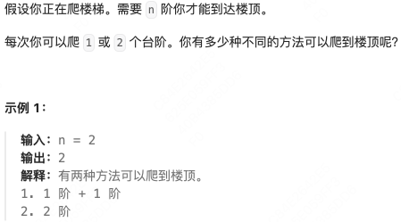

代码

```python
class Solution:
    def climbStairs(self, n: int) -> int:
        # 定义 dp 数组
        dp = [0 for _ in range(n+1)]
        # dp[i] 表示 到达第 i 阶有多少种不同的方法
        dp[0] = 1
        dp[1] = 1
        for i in range(2, n+1):
            dp[i]  =dp[i-1] + dp[i-2]
        return dp[n]
```

思考

为什么爬楼梯不需要防止大整数溢出?

斐波那契数列的一个关键性质是它的项数随着指数增长，但是其值却以非常快的速率增长，很快就会超过大多数编程语言能够表示的整数范围。然而，对于爬楼梯问题，到达第 `n` 阶楼梯的方法数实际上总是一个正整数，并且这个数总是小于或等于 $2^{n}$。这是因为在最坏的情况下，每一步都只走 1 阶，这样就有 $n$种 方法；而每一步都走 2 阶，则最多有 $\frac{n}{2} + \frac{n}{2}$种方法，这在数值上不会超过 $2^{n}$。

### 使用最小花费爬楼梯-EASY

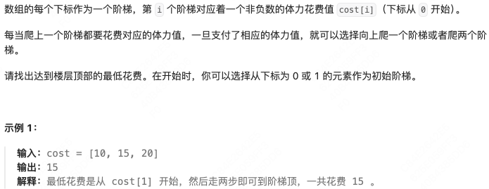

到达不花费，向上跳才花费。

代码

```python
class Solution:
    def minCostClimbingStairs(self, cost: List[int]) -> int:
        min_cost = math.inf
        # 阶梯的层数 
        n = len(cost)
        # dp数组 dp[i]表示到达第i层的最低花费
        dp = [math.inf for _ in range(n+2)]
        # 顶楼为 n+1
        dp[0], dp[1] = 0, 0
        for i in range(2, n+1):
            dp[i] = min(dp[i-1]+cost[i-1], dp[i-2]+cost[i-2])
        return dp[n]
```

### 不同路径-Middle

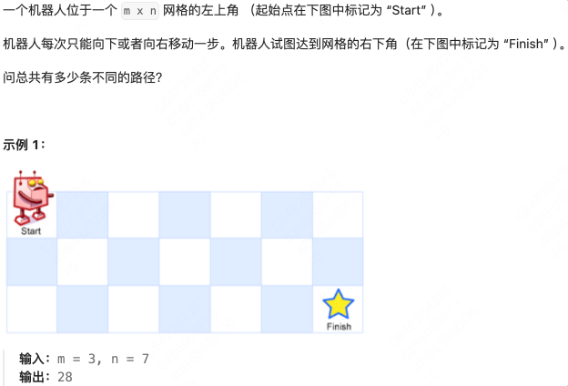

代码

```python
class Solution:
    def uniquePaths(self, m: int, n: int) -> int:
        # 每次向下或向右一步
        # 定义二维 dp 数组
        # di[i][j]表示到达(i, j)的不同路径数
        dp = [[0 for _ in range(n)] for _ in range(m)]

        # 如果 i<m-1, 可以向下走
        # 如果 j<n-1，可以向右走

        # dp 数组初始化
        # 第一行，全为 1
        # 第一列，全为 1
        for j in range(n):
            dp[0][j] = 1
        for i in range(m):
            dp[i][0] = 1
        # 遍历
        for i in range(1, m):
            for j in range(1, n):
                dp[i][j] = dp[i][j-1] + dp[i-1][j]
        return dp[m-1][n-1]
```

深搜代码 & 超时

```python
class Solution:
    def uniquePaths(self, m: int, n: int) -> int:
        def dfs(i, j):
            if i > m or j > n:  # 越界了
                return 0
            if i == m and j == n:  # 找到一种方法
                return 1
            return dfs(i + 1, j) + dfs(i, j + 1)
        
        return dfs(1, 1)
```

### 不同路径II-Middle

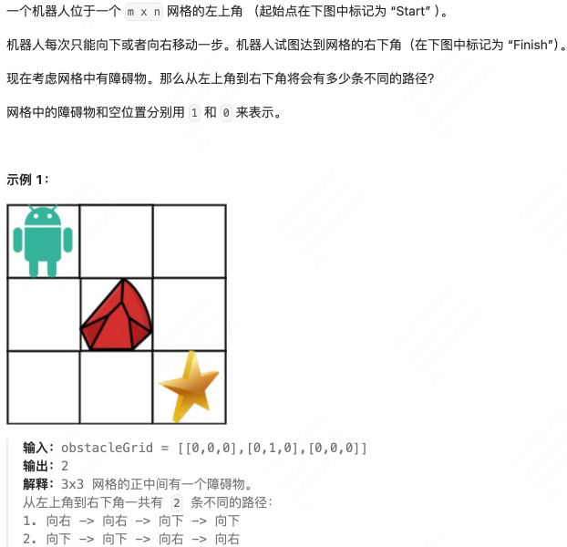

代码

```python
class Solution:
    def uniquePathsWithObstacles(self, obstacleGrid: List[List[int]]) -> int:
        # 每次向下或者向后，到右下角
        # 网格中有障碍物，障碍物网格
        # 定义 dp 数组，二维
        m, n = len(obstacleGrid), len(obstacleGrid[0])
        dp = [[0 for _ in range(n)] for _ in range(m)]
        # dp数组初始化
        # 障碍物处为 0
        # 第一行如果有障碍物，则右侧均为 0
        # 第一列如果有障碍物，则下方均为 0
        obs_flag = False
        for j in range(n):
            if obstacleGrid[0][j] == 0 and not obs_flag:
                dp[0][j] = 1
            if obstacleGrid[0][j] == 1:
                obs_flag = True
            if obs_flag:
                dp[0][j] = 0
        obs_flag = False
        for i in range(m):
            if obstacleGrid[i][0] == 0 and not obs_flag:
                dp[i][0] = 1
            if obstacleGrid[i][0] == 1:
                obs_flag = True
            if obs_flag:
                dp[i][0] = 0
        # 遍历
        # 如果当前位置上方有障碍，只能从左侧过来
        # 如果当前位置左侧有障碍，只能从右侧过来
        for i in range(1, m):
            for j in range(1, n):
                if obstacleGrid[i][j] != 1:
                    dp[i][j] = dp[i-1][j] + dp[i][j-1]
                else:
                    dp[i][j] = 0
        return dp[m-1][n-1]
```

### 不同路径 III-HARD

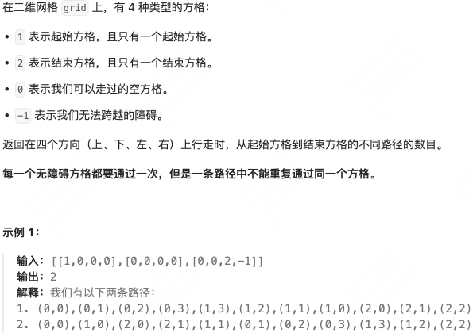

回溯代码 & 四个方向 & 路径数

```python
class Solution:
    def uniquePathsIII(self, grid:List[List[int]]) -> int:
        m, n = len(grid), len(grid[0])

        def dfs(x:int, y:int, left:int) -> int:
            if x<0 or x>=m or y<0 or y>=n or grid[x][y]<0:
                return 0 # 不合法
            # 到达终点时必须要访问所有的无障碍方格
            if grid[x][y] == 2:
                return left == 0
            # 标记为已访问过
            grid[x][y] = -1
            # 对当前位置的上下左右四个方向进行递归搜索，并计算路径数。
            ans = dfs(x-1, y, left-1) + dfs(x, y-1, left-1) + dfs(x+1, y, left-1) + dfs(x, y+1, left-1)
            # 恢复现场
            grid[x][y] = 0
            return ans
        
        cnt0 = sum(row.count(0) for row in grid)
        for i, row in enumerate(grid):
            for j, v in enumerate(row):
                if v == 1:
                    return dfs(i, j, cnt0+1)
```

### 整数拆分-MID*

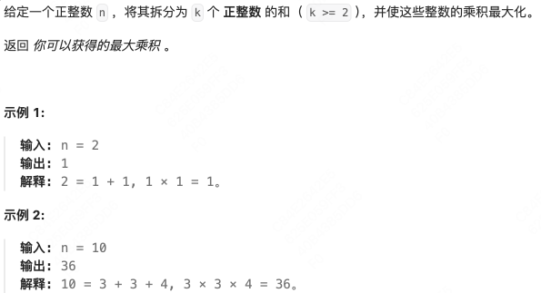

代码

```python
class Solution:
    def integerBreak(self, n: int) -> int:
        # 拆分为 k 个正整数的和，且乘积最大化
        # 返回最大乘积
        # 定义 dp 数组，dp 数组的含义
        # dp[i] 将 i 拆分为 k 个正整数且乘积最大化
        dp = [0]*(n+1)
        dp[0] = 0
        dp[1] = 0
        dp[2] = 1
        for i in range(3, n+1):
            for j in range(1, int(i/2)+1):
                dp[i] = max(dp[i], j * dp[i-j], j*(i-j))
        print(dp)
        return dp[n]
```

思考

  1. 对于所求 dp[i]，及要拆分的正整数 i
  2. 将 i 拆分为 j 和 i-j，此时有两种方案 
     1. i-j 不再拆分
     2. i-j 再次进行拆分，拆分之后的乘积依赖于dp[i-j]

### 不同的二叉搜索树-MID

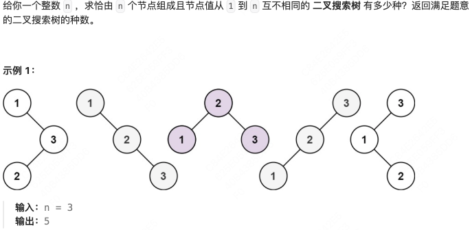

代码

```python
class Solution:
    def numTrees(self, n: int) -> int:
        # 整数 n
        # n 个节点，1-n
        # 互不相同的二叉搜索树
        # 类似整数拆分
        # 11 个节点，左边 5 个，右边 5 个；左边 4 个，右边 6 个；
        # n = 0, 0
        # n = 1, 1 种
        # n = 2, 2 种
        dp = [0] * (n+1)
        dp[0] = 1
        dp[1] = 1
        if n <=1:
            return n
        dp[2] = 2
        for i in range(3, n+1):
            for j in range(0, i):
                # i个节点，i-1 在子树，拆分为j和i-1-j
                dp[i] += dp[j] * dp[i-1-j]
        return dp[n]
```

思考

  1. 对 i 进行拆分，根节点占用一个值，实际拆分的是 i-1
  2. 拆分为 j 和 i-1-j，左侧 j 个依赖于dp[j]，右侧 i-1-j 个，依赖于 dp[i-1-j]
  3. 总的种数为左右两侧相乘
  4. dp 数组输出化时，dp[0] = 1，0 个节点组成的二叉树不存在，但左侧子树 0 个节点时，算作一种，且需要与右侧种数相乘，故为 1

## 背包问题-理论基础

01 背包：n 种物品每种物品只有一个。

完全背包：n 种物品每种物品无限个。

多重背包：n 种物品每种物品个数各不相同。

01 背包问题

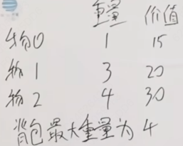

回溯算法暴力搜索

每个物品两种状态，取 & 不取。

二维 dp 数组解法

dp 数组的含义：[0, i]物品任取放入容量为 j 的背包

递推公式，对于 $dp[i, j]$ 及物品 i：存在两种状态

  1. 不放物品 i：依赖于$dp[i-1, j]$
  2. 放物品 i：依赖于 $dp[i-1, j-w[i]] + v[i]$

dp数组初始化：行为物品，列为容量

  * 第一行初始化，物品 0，如果容量大于物品 0 的容量，最大价值为物品 0 的价值，否则价值为 0.
  * 第一列初始化，容量 0，如果物品小于容量 0，则价值为物品的价值，否则价值为 0.

遍历顺序：在这里二维 dp 数组先遍历物品再遍历背包或者先遍历背包再遍历物品都可以。

二维 dp 数组降至一维 dp 数组 & 滚动数组

每一行依赖于上一行的结果，将上一层数据拷贝下来。

dp 数组定义：dp[j] 表示容量为 j 的背包所能装下的最大价值为 dp[j]

递推公式：还是根据物品 i 来考虑的

  1. 不放物品 i：就是 dp[j]
  2. 放物品 i：$dp[j-weight[i]] + value[i]$

dp 数组的初始化：

  * dp[0] = 0
  * 非 0 下标时，也要初始化为 0，因为递推公式要对两个价值取最大值，这里应该初始化为一个小的值。

遍历顺序：先遍历物品，再遍历背包，且背包倒序遍历，防止物品重复放入。

面试题目

  1. 01 背包问题，用二维dp数组实现，两个 for 循环能不能颠倒
  2. 再用 1 维 dp 数组实现，两个 for 循环可不可以颠倒顺序，容量 for 循环为什么从后向前遍历，二维 dp 数组中为什么不用从后向前遍历 
     1. 1 维 dp 数组是重复利用的

### 分割等和子集-EASY

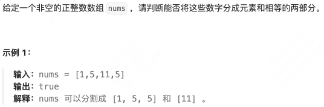

一维 dp 数组 代码

```python
class Solution:
    def canPartition(self, nums: List[int]) -> bool:
        # 等分为两部分
        if sum(nums) % 2 != 0:
            return False
        target = sum(nums) // 2
        # 定义一维 dp 数组
        # 含义：dp[i] 容量为 i 能够容纳的最大价值
        dp = [0] * (target+1)
        # 初始化，dp[0] = 0，非 0 时也为 0，后续有 max 操作
        
        # 主要这里对物品进行遍历
        for num in nums:
            # 对从0-target的所有容量进行遍历
            for j in range(target, num-1, -1):
                dp[j] = max(dp[j], dp[j-num] + num)
        return dp[target] == target
```

思路

  * 抽象为 01 背包问题
  * 背包容量是从 0 开始的

二维 dp 数组 代码

```python
class Solution:
    def canPartition(self, nums: List[int]) -> bool:
        if sum(nums) % 2 != 0:
            return False
        target = sum(nums) // 2
        dp = [[False for _ in range(target + 1)] for _ in range(len(nums)+1)]
        # 初始化第一列
        for i in range(len(nums)+1):
            dp[i][0] = True
        for i in range(1, len(nums)+1):
            for j in range(1, target+1):
                if j < nums[i-1]:
                    dp[i][j] = dp[i-1][j]
                else:
                    dp[i][j] = dp[i-1][j] or dp[i-1][j-nums[i-1]]

        return dp[len(nums)][target]
```

### 最后一块石头的重量 II-MID

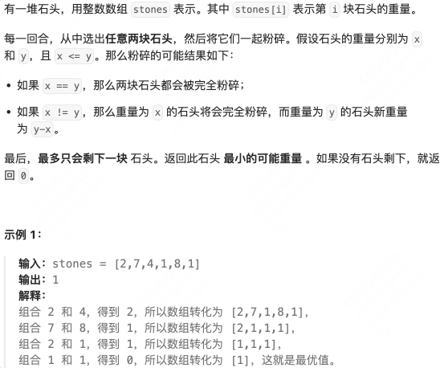

思考

  1. 回溯暴力应该可以做
  2. 背包问题 
     1. 两两石头块进行粉碎，求最终的最小值，也可以转化为分成两堆，其和尽量接近，这样相减得到的值最小。

一维 dp 数组代码

```python
class Solution:
    def lastStoneWeightII(self, stones: List[int]) -> int:
        # 同样分成两堆，要求尽可能接近，这样碰撞的差值最小
        target = sum(stones) // 2

        # 定义一维 dp 数组
        dp = [0] * (target+1)
        # 含义 容量为 0 的背包，能装的最大价值
        # 初始化

        # 遍历顺序
        for i in range(len(stones)):
            # 内层循环保证了容量 j 都比 stone[i]要大
            for j in range(target, stones[i]-1, -1):
                dp[j] = max(dp[j], stones[i] + dp[j - stones[i]])
        return sum(stones) - dp[target]*2
```

### 目标和-MID *

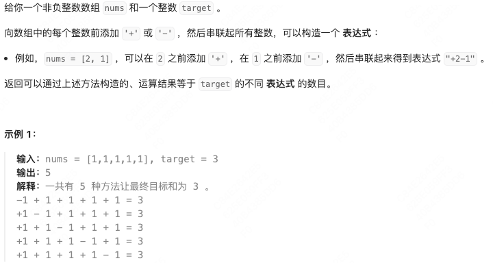

思路

  * 对于每一个元素，要么加要么减，类似于要么选，要么不选，所以回溯暴力算法应该可以解。
  * 加和减也可以看做两个集合，（分割等和子集是两个集合相等，最后一块石头的重量是两个集合尽可能接近），这道题要求 _两个集合的总和为指定的 target_ 。
  * 给定的 nums 为非负整数数组，可以拆分为两个集合，两个集合相减最终得到的值为 target。

> 如果一个集合，被减数为 A
> 
> $$A - (sum-A) = target, A-sum + A = target$$
> 
> $$A = \frac{sum + target}{2}$$

故 $sum + target$一定能够整除 2.

**dp 数组含义：dp[j] 表示容量为 j 的背包得到价值为 add 有 dp[j]种方法，总的方法为 dp[0] + dp[1] + … + dp[j]**  
**dp[i]的含义应该是容量为i的背包得到价值为i的方法种数吧**

问题就是在集合nums中找出和为 add 的组合。

确定递推公式

  * 要求 dp[j]，如果加入 nums[i]，则取决于dp[j - nums[i]]
  * 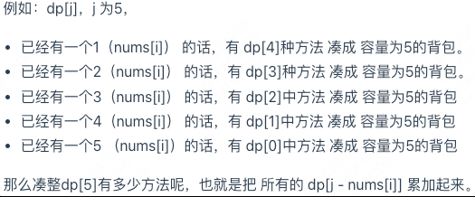
  * **类似的组合问题`dp[j] += dp[j - nums[i]]`**

一维 dp 数组代码

```python
class Solution:
    def findTargetSumWays(self, nums: List[int], target: int) -> int:
        # 题目拆解：运算结果等于 target == 背包容量为 target 时，容纳的最大价值为 target
        # 每个元素两种状态，加或减
        # 加集合，减集合
        # 要求加集合 - 减集合 = target
        # 问题抽象：加集合，背包问题，容量为加集合的背包所能容纳的物品价值恰好等于容量，且减去减集合后为 target
        # 加集合 = add
        if sum(nums) < abs(target):
            return 0
        add = (sum(nums) + target) // 2
        if (sum(nums) + target) % 2 != 0:
            return 0
        # 定义 dp 数组
        dp = [0] * (add + 1)
        # dp数组初始化
        # 背包容量为 0，装满背包有 1 中方法
        dp[0] = 1

        # 考虑物品 num
        for num in nums:
            for j in range(add, num-1, -1):
                dp[j] += dp[j-num]
        return dp[add]
```

二维 dp 数组代码

```python
class Solution:
    def findTargetSumWays(self, nums: List[int], target: int) -> int:
        total_sum = sum(nums)
        if total_sum < abs(target):
            return 0
        if (target + total_sum) % 2 != 0:
            return 0
        # 目标和
        target_sum = (target + total_sum) // 2
        #创建二维 dp 数组，行表示选取的元素数量，列表示累加和
        dp = [[ 0 for _ in range(target_sum + 1)] for _ in range(len(nums)+1)]
        # 初始化：0 个物品装满容量为 0的背包，方法有一种
        dp[0][0] = 1

        # 遍历
        for i in range(1, len(nums)+1):
            # 容量从 0-target_sum
            for j in range(target_sum+1):
                # 不选取当前物品
                dp[i][j] = dp[i-1][j]
                if j >= nums[i-1]:
                    # 选当前物品
                    dp[i][j] += dp[i-1][j - nums[i-1]]
        return dp[len(nums)][target_sum]
                    
```

  * 当前元素为 $nums[i]$，上一个元素为 $nums[i-1]$ 
    * 不选取当前物品时 ✅
    * 选取当前物品：如果当前容量为 j，要考虑当前容量是否大于上一个元素 $nums[i-1]$，如果大于则 $dp[i][j]$ 可以依赖于 $dp[i-1][j-nums[j-1]]$
    * +=

### 一和零-MID*

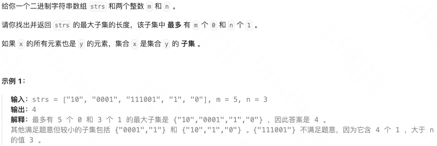

子集需要满足：最多 m 个 0 ，最多 n 个 1

求：这样的子集最多有多少个元素

**思路**

m个 0，n 个 1 的容器，装满这个容器，最多有多少个元素。

容器==背包，两个维度的背包，之前的背包只有一个容量的维度，现在相当于是一个容量装 0，一个容量装 1，两个维度。

装满这个背包最多有多少个物品。

零一背包，每个物品只能使用一次。

3 个变量，m，n，最多多少个物品。

每个物品的重量其实就是每个字符串包含 x 个 0 和 y 个 1.

定义二维 dp 数组

$dp[i][j]$ 定义为 m=i，n=j 的背包最多装多少个物品。

递推公式

当前物品的重量：x 个 0，y 个 1

选中当前物品之后，数量要+1

$$当前物品 重量(Num_0, Num_1) = (x, y)$$

$$dp[i-x][j-j] + 1$$

**二维 dp 数组代码**

```python
class Solution:
    def findMaxForm(self, strs: List[str], m: int, n: int) -> int:
        # 这里相当于是物品有两种属性
        # 物品包含0的个数，包含1的个数
        # 容量为(m, n)的背包最多容纳物品的数量
        nums = [(s.count('0'), s.count('1'))for s in strs]
        # dp数组定义
        # dp[i][j]表示容量为i个0，j个1的背包最大子集的长度
        dp = [[0 for _ in range(n+1)]for _ in range(m+1)]
        
        # 先遍历物品，再遍历容量
        for num in nums:
            for i in range(m, num[0]-1, -1):
                for j in range(n, num[1]-1, -1):
                    dp[i][j] = max(dp[i][j], dp[i-num[0]][j-num[1]]+1)

        return dp[-1][-1]
```

### 53-最大子数组和-中等

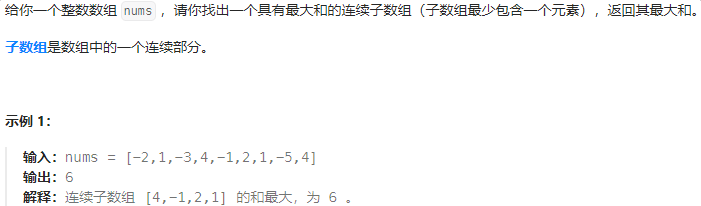

动态规划

```python
class Solution:
    def maxSubArray(self, nums: List[int]) -> int:
        '''
        最大和，连续子数组
        动态规划
        '''
        arr = nums.copy()

        for i in range(1, len(arr)):
            arr[i] = max(arr[i], arr[i-1]+arr[i])
        return max(arr)
```

### 918-环形子数组的最大和-中等

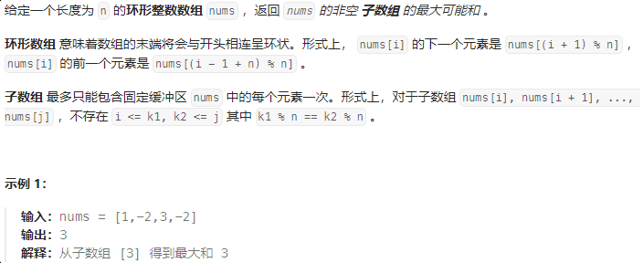

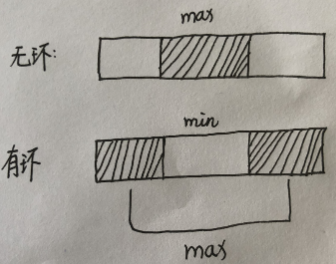

```python
class Solution:
    def maxSubarraySumCircular(self, nums: List[int]) -> int:
        # 环形数组
        # 如果最大值情况没有跨首尾，则跟正常求最大子数组和相同
        # 如果最大值情况跨首尾，那么中间剩下的就是最小值和
        # 同时维护最大值和最小值和

        # 无环情况，维护最大值
        dp = [-math.inf] * len(nums)
        # 到i截至的最大和
        dp[0] = nums[0]
        for i in range(1, len(nums)):
            dp[i] = max(nums[i], dp[i-1]+nums[i])
        max_sum = max(dp)

        # 如果最大子数组和小于0，说明数组全是负数，返回最大的负数即可
        if max_sum<0:
            return max_sum

        # 有环情况 求最小值
        dp_min = [math.inf] * len(nums)
        dp_min[0] = nums[0]
        for i in range(1, len(nums)):
            dp_min[i] = min(nums[i], dp_min[i-1]+nums[i])
        
        min_sum = min(dp_min)
        return max(max_sum, sum(nums)-min_sum)
```

## 一维动态规划

### 70-爬楼梯-简单

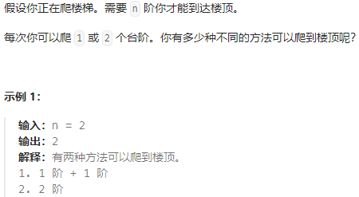

看示例，我们当前应该是处于第0阶

```python
class Solution:
    def climbStairs(self, n: int) -> int:
        dp = [1] * (n+1)
        for i in range(2, n+1):
            dp[i] = dp[i-1]+ dp[i-2]
        return dp[n]
```

### 198-打家劫舍-中等-记住

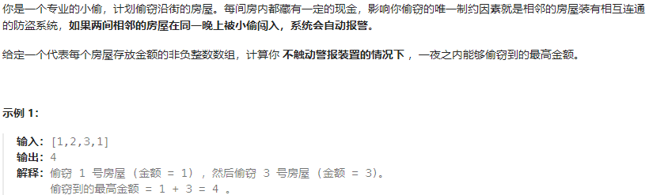

```python
class Solution:
    def rob(self, nums: List[int]) -> int:
        '''
        相邻的不能偷
        '''

        n = len(nums)
        dp = [0] * (n+1)
        # dp[i]表示偷窃前i个房子满足条件获得的最大值
        # dp[i]考虑当前nums[i-1]偷还是不偷
        dp[0] = 0
        dp[1] = nums[0]
        for i in range(2, n+1):
            dp[i] = max(dp[i-1], dp[i-2]+nums[i-1])
        return dp[n]
```

空间优化

```python
class Solution:
    def rob(self, nums: List[int]) -> int:
        '''
        很多时候我们并不需要始终持有全部的 DP 数组
        对于小偷问题，我们发现，最后一步计算 f(n) 的时候，实际上只用到了 f(n−1) 和 f(n−2) 的结果
        只用两个变量保存两个子问题的结果，就可以依次计算出所有的子问题
        '''
        prev = 0
        curr = 0
        for i in nums:
            # 循环开始时，curr表示dp[i-1]，prev表示dp[i-2]
            prev, curr = curr, max(curr, prev+i)
            # 循环结束时，curr表示dp[i]，prev表示dp[i-1]
        return curr 
```

### 139-单词拆分-中等

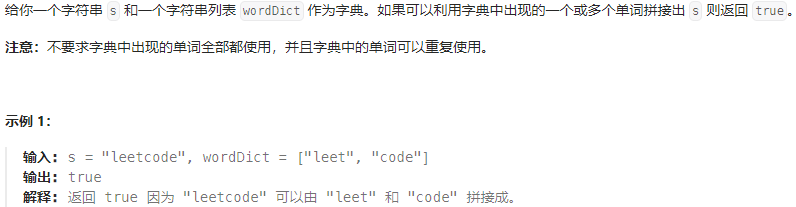

动态规划

```python
class Solution:
    def wordBreak(self, s: str, wordDict: List[str]) -> bool:
        '''
        回溯算法超时

        动态规划，表示字符串s的前i个字母是否能够被表示
        '''
        n = len(s)
        dp = [False] * (n+1)
        dp[0] = True
        for i in range(n): # 起点
            for j in range(i+1, n+1):
                if dp[i] and s[i:j] in wordDict:
                    dp[j] = True
        return dp[-1]
```

记忆化回溯

**对剩余字符串进行递归调用，将剩余字符串的调用结果进行缓存**

```python
class Solution:
    def wordBreak(self, s: str, wordDict: List[str]) -> bool:
        '''
        记忆化回溯
        使用装饰器，装饰器可以保存函数的执行结果，缓存
        '''
        import functools

        # 使用lru_cache装饰器来缓存back_track函数的结果，None参数表示缓存所有调用的结果，有助于避免重复计算
        @functools.lru_cache(None)
        def back_track(s: str):
            # s为剩余需要匹配的字符串
            if not s:
                return True
            res = False
            for i in range(1, len(s)+1):
                if s[:i] in wordDict:
                    res = back_track(s[i:]) or res
            return res
        return back_track(s)
```

### 322-零钱兑换-中等

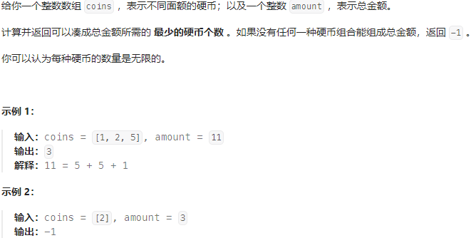

动态规划

```python
class Solution:
    def coinChange(self, coins: List[int], amount: int) -> int:
        ''' 
        不同面额的硬币
        总金额
        凑成总金额所需的最少金币数
        '''
        dp = [math.inf] * (amount+1)
        dp[0] = 0
        for i in coins:
            if i<=amount:
                dp[i] = 1
        for i in range(1, amount+1):
            if dp[i] != math.inf:
                continue
            for j in coins:
                if i-j >=1:
                    dp[i] = min(dp[i], dp[i-j]+1)
                else:
                    continue
        if dp[-1] == math.inf:
            return -1
        return dp[-1]
```

完全背包问题

```python
class Solution:
    def coinChange(self, coins: List[int], amount: int) -> int:
        
        n = amount
        dp = [math.inf] * (n+1)
        dp[0] = 0

        # 遍历物品
        for coin in coins:
            # 遍历背包
            for i in range(coin, n+1):
                dp[i] = min(dp[i], dp[i-coin]+1)

        if dp[-1] == math.inf:
            return -1
        return dp[-1]
```

### 300-最长递增子序列-中等

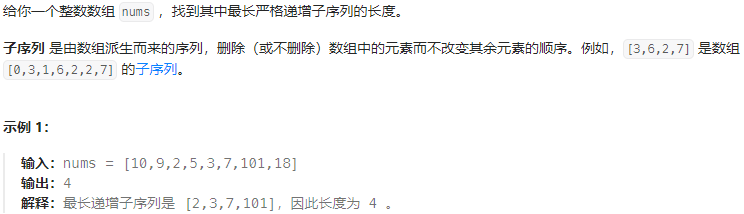

动态规划

```python
class Solution:
    def lengthOfLIS(self, nums: List[int]) -> int:
        '''
        最长增长子序列
        整数数组，严格递增 子序列 相对顺序不改变
        '''
        n = len(nums)
        dp = [1] * n 
        # dp[i] 表示到i为止最长的递增子序列
        for i in range(n):
            for j in range(i, -1, -1):
                if nums[i] > nums[j]:
                    dp[i] = max(dp[i], dp[j]+1)
        return max(dp)
```

## 多维动态规划

### 120-三角形最小路径和

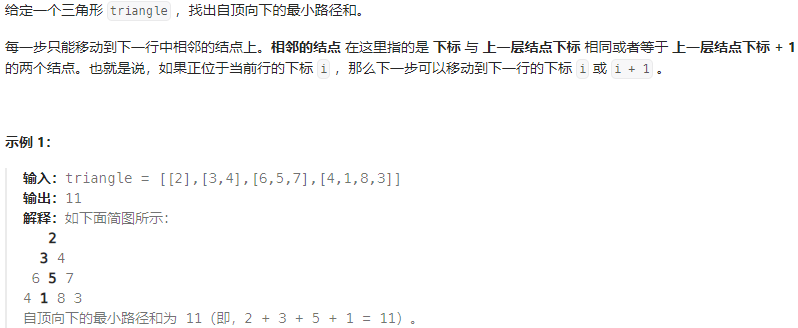

动态规划，填充主对角线左侧三角区域

```python
class Solution:
    def minimumTotal(self, triangle: List[List[int]]) -> int:
        '''
        只能移动到下一行的相邻结点
        二维dp数组
        '''
        n = len(triangle)
        dp = [[math.inf for _ in range(n)] for _ in range(n)]
        dp[0][0] = triangle[0][0]
        # 从第二行开始处理
        for i in range(1, n):
            for j in range(i+1):
                # 当前坐标 (i, j)
                if j-1>=0:
                    dp[i][j] = min(dp[i-1][j-1], dp[i-1][j]) + triangle[i][j]
                else:
                    dp[i][j] = dp[i-1][j] + triangle[i][j]
        return min(dp[-1])
```

### 64-最小路径和-中等

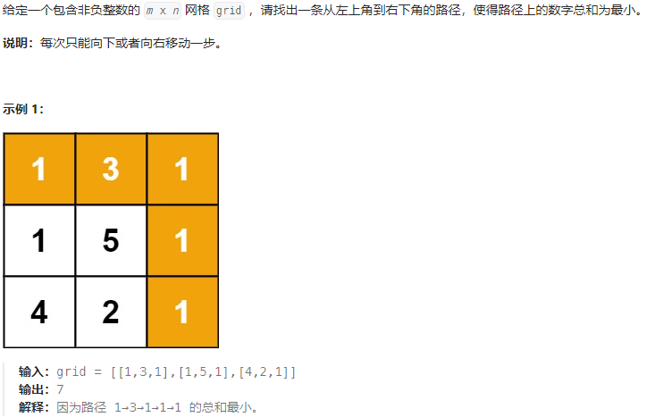

```python
class Solution:
    def minPathSum(self, grid: List[List[int]]) -> int:
        '''
        每次只能向右或向下
        '''
        m = len(grid)
        n = len(grid[0])
        dp = [[math.inf for _ in range(n)]for _ in range(m)]
        # 初始化第一行
        for i in range(n):
            dp[0][i] = grid[0][i]
            if i>0:
                dp[0][i] += dp[0][i-1]
        # 初始化第一列
        for i in range(m):
            dp[i][0] = grid[i][0]
            if i>0:
                dp[i][0] += dp[i-1][0]
        # 遍历
        for i in range(1, m):
            for j in range(1, n):
                dp[i][j] = min(dp[i-1][j], dp[i][j-1]) + grid[i][j]
        return dp[-1][-1]
```

### 63-不同路径Ⅱ-中等

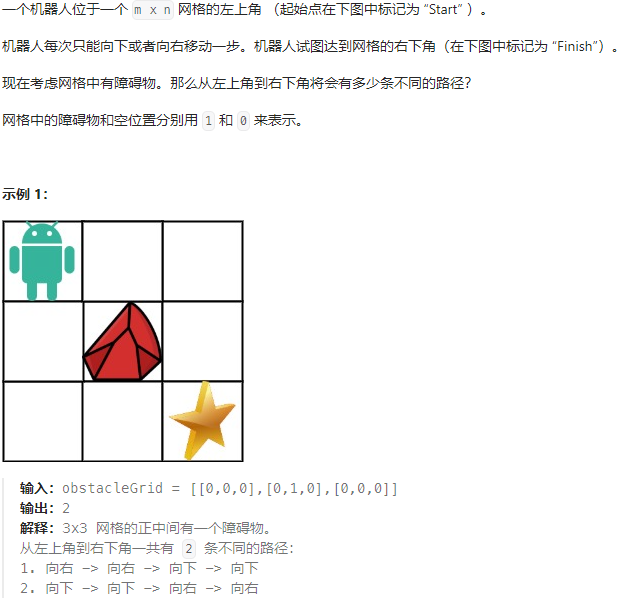

```python
class Solution:
    def uniquePathsWithObstacles(self, obstacleGrid: List[List[int]]) -> int:
        '''
        向下或向右
        二维dp数组记录到大当前位置有几种路径
        '''
        # 如果起始位置有石头，直接返回0
        if obstacleGrid[0][0] == 1:
            return 0

        m  = len(obstacleGrid)
        n = len(obstacleGrid[0])
        dp = [[0 for _ in range(n)]for _ in range(m)]
        dp[0][0] = 1
        # 初始化第一行
        i = 1
        while i<n:
            if obstacleGrid[0][i] == 1:
                break
            dp[0][i] = 1
            i += 1
        while i<n:
            dp[0][i] = 0
            i += 1
        # 初始化第一列
        i = 1
        while i<m:
            if obstacleGrid[i][0] == 1:
                break
            dp[i][0] = 1
            i += 1
        while i<m:
            dp[i][0] = 0
            i += 1
        # 遍历
        for i in range(1, m):
            for j in range(1, n):
                if obstacleGrid[i][j] == 1:
                    dp[i][j] = 0
                elif dp[i-1][j] != 0 and dp[i][j-1] != 0:
                    dp[i][j] = dp[i-1][j] + dp[i][j-1]
                else:
                    dp[i][j] = max(dp[i-1][j], dp[i][j-1])
        return dp[-1][-1]
```

### 5-最长回文子串-中等

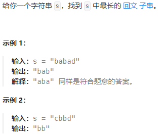

❌错误的中心扩散法

**这样选定中心点，同时向两边扩散，只能处理回文子串为奇数的情况，无法处理偶数的情况，如上述`bb`**

```python
class Solution:
    def longestPalindrome(self, s: str) -> str:
        '''
        中心扩散法
        '''
        max_len = 1
        res = s[0]
        n  =len(s)
        for i in range(n):
            left = i-1
            right = i+1
            while left >=0 and right <= n-1:
                if s[left] != s[right]:
                    break
                if right-left+1>max_len:
                    max_len = right-left+1
                    res = s[left:right+1]
                left -= 1
                right += 1

        return res
```

✔ 正确的中心扩散法

**考虑当前中心点时，应将左右指针分别移动到不等于中心点处，再向左右扩展**

```python
class Solution:
    def longestPalindrome(self, s: str) -> str:
        if not s:
            return ''
        n = len(s)
        cur_len = 1  # ! 初始化为1
        max_len = 1
        res = s[0]

        for i in range(n):
            left = i-1
            right = i+1
            # 向左扩展回文子串
            while left>=0 and s[left] == s[i]:
                cur_len += 1
                left -= 1
            # 向右扩展回文子串
            while right<=n-1 and s[right] == s[i]:
                cur_len += 1
                right += 1
            # 上面的代码解决当中心点左右两侧与中心点字符相同的情况
            # 将left和right移动到与中心点不同的位置
            # 左右向两侧扩展
            while left >=0 and right <=n-1 and s[left]==s[right]:
                cur_len += 2
                left -= 1
                right += 1
            if cur_len > max_len:
                max_len = cur_len
                res = s[left+1: right]
            cur_len = 1
        return res
```

动态规划

```python
class Solution:
    def longestPalindrome(self, s: str) -> str:
        
        '''
        dp[l][r] 表示字符从l到r是否为回文串
        如果要判断dp[l-1][r+1]是否为回文串，必须dp[l][r]是回文，且s[l-1]==s[r+1]
        '''
        max_len = 0
        n = len(s)
        if n<2:
            return s 
        res = s[0]
        dp = [[False for _ in range(n)]for _ in range(n)]
        # 初始化，对角线处为True
        for i in range(n):
            dp[i][i] = True 
        # 遍历
        # 先枚举子串的长度
        for L in range(2, n+1):
            # 左边界
            for l in range(n):
                # 右边界
                r = l+L-1
                if r>n-1:
                    break
                if s[l] != s[r]:
                    dp[l][r] = False
                else:
                    if r-l<3: # 🐖注意这里的处理!
                        dp[l][r] = True
                    else:
                        dp[l][r] = dp[l+1][r-1]
                if dp[l][r] and r-l+1 > max_len:
                    max_len = r-l+1
                    res = s[l:r+1]

        return res
```

### 97-交错字符串-中等

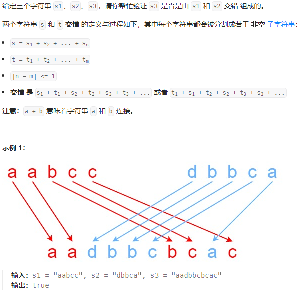

```python
class Solution:
    def isInterleave(self, s1: str, s2: str, s3: str) -> bool:
        '''
        d[i][j] 表示s1的前i个和s2的前j个字符能够构成s3的前i+j个
        '''
        m = len(s1)
        n = len(s2)
        if m+n != len(s3):
            return False
        
        dp = [[ False for _ in range(n+1)]for _ in range(m+1)]
        # 初始化
        dp[0][0] = True
        # 初始化第一行，s2的前i个能否构成s3的前i个
        for i in range(1, n+1):
            if s2[:i] == s3[:i]:
                dp[0][i] = True
        # 初始化第一列，s1的前i个能否构成s3的前i个
        for i in range(1, m+1):
            if s1[:i] == s3[:i]:
                dp[i][0] = True
        # 遍历
        for i in range(1, m+1):
            for j in range(1, n+1):
                # dp[i][j]
                # s1的前i个字符与s2的前j-1个字符可以构成s3的前i+j-1个字符
                # 当前s2的第j个字符也等于s3的第i+j个字符
                # 则s1的前i个字符与s2的前j个字符可以构成s3的前i+j个字符
                if dp[i][j-1] and s2[j-1] == s3[i+j-1]:
                    dp[i][j] = True
                if dp[i-1][j] and s1[i-1] == s3[i+j-1]:
                    dp[i][j] = True
        return dp[-1][-1]
```

### 72-编辑距离-中等

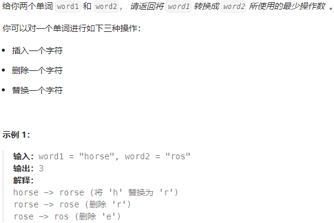

二维DP-错误代码❌

只考虑了修改和插入两个操作

```python
class Solution:
    def minDistance(self, word1: str, word2: str) -> int:
        '''
        编辑距离，word1转换为word2所需的最小操作数
        二维dp
        dp[i][j] 表示 word1的前i个字符转换为word2的前j个字符需要的最小操作数
        三种操作：插入，删除，替换
        '''
        m = len(word1)
        n = len(word2)
        dp = [[math.inf for _ in range(n+1)] for _ in range(m+1)]
        # 初始化
        dp[0][0] = 0
        # 第一行，word1为空，转换为word2需要的最小次数
        for i in range(1, n+1):
            dp[0][i] = i
        # 第一列
        for i in range(1, m+1):
            dp[i][0] = i 
        # 遍历
        for i in range(1, m+1):
            for j in range(1, n+1):
                # dp[i][j]
                if word1[i-1] == word2[j-1]:
                    dp[i][j] = dp[i-1][j-1]
                else:
                    if j>i:
                        dp[i][j] = dp[i][j-1]+1
                    elif j<i:
                        dp[i][j] = dp[i-1][j]+1
                    else:
                        dp[i][j] = dp[i-1][j-1]+1
        return dp[-1][-1]
```

二维DP-正确代码

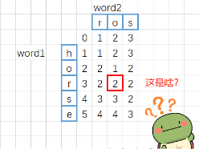

```python
class Solution:
    def minDistance(self, word1: str, word2: str) -> int:
        '''
        编辑距离，word1转换为word2所需的最小操作数
        dp[i][j] 表示 word1的前i个字符转换为word2的前j个字符需要的最小操作数
        三种操作：插入，删除，替换
        如果word1和word2其中一个为空时，即全增加或全删除的情况
        
        插入：dp[i][j] = dp[i][j-1]+1
        删除：dp[i][j] = dp[i - 1][j] + 1
        修改：dp[i][j] = dp[i - 1][j - 1] + 1
        '''
        m = len(word1)
        n = len(word2)
        dp = [[math.inf for _ in range(n+1)] for _ in range(m+1)]
        # 初始化
        dp[0][0] = 0
        # 第一行，word1为空，转换为word2需要的最小次数
        for i in range(1, n+1):
            dp[0][i] = i
        # 第一列
        for i in range(1, m+1):
            dp[i][0] = i 
        # 遍历
        for i in range(1, m+1):
            for j in range(1, n+1):
                if word1[i-1] == word2[j-1]:
                    dp[i][j] = dp[i-1][j-1]
                else:
                    # 取增删改的最小值  修改         删除         插入
                    dp[i][j] = min(dp[i-1][j-1], dp[i-1][j], dp[i][j-1])+1

        return dp[-1][-1]
```

### 123-买卖股票的最佳时机Ⅲ-困难

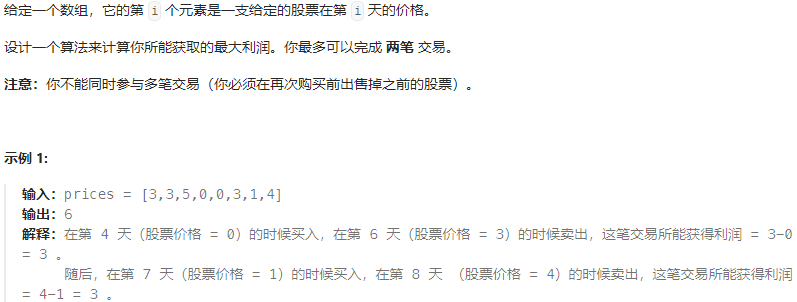

暴力-超时代码

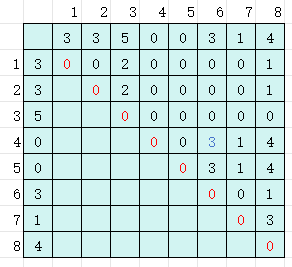

假设第i天买入，找到所有收益为正向的天数

从收益为正的天再次出发买入，找之后天卖出的最大收益

```python
class Solution:
    def maxProfit(self, prices: List[int]) -> int:
        '''
        买卖股票的最佳时机
        获取最大利润
        最多买卖两次
        二维DP，第i天买，第j天卖
        '''
        n = len(prices)
        dp = [[0 for _ in range(n)] for _ in range(n)]
        # 主对角线均为0，代表当天买当天卖为0
        
        for i in range(n):
            for j in range(i+1, n):
                # 第i天买第j天卖
                dp[i][j] = prices[j]-prices[i] if prices[j]-prices[i]>0 else 0
        
        # 需要从中找两个买卖的端点
        max_prof = 0
        for i in range(n):
            # 找利润大于0的索引
            idx_list = []
            for idx, val in enumerate(dp[i]):
                if val == 0:
                    continue
                idx_list.append(idx)
            for j in idx_list:
                cur_prof = 0
                # 第i天卖，第j天卖，第一次交易
                cur_prof += dp[i][j]
                # 第二次交易，在第j天之后寻找
                sec_prof = 0
                for k in range(j, n):
                    sec_prof = max(sec_prof, max(dp[k]))
                cur_prof += sec_prof
                if cur_prof > max_prof:
                    max_prof = cur_prof
        return max_prof
```

动态规划-正确代码

```python
class Solution:
    def maxProfit(self, prices: List[int]) -> int:
        '''
        最多两笔买卖

        任意一天结束后，会处于以下状态之一：
        1. 未进行任何操作
        2. 只进行过一次买
        3. 一次买，一次卖，完成一次交易
        4. 一次交易完成，再次买入
        5. 完成两次交易

        第一种状态利润为0
        剩下的四种状态，分别将最大利润记为 buy1, sell1, buy2, sell2
        如果知道了第i-1天结束后的这四种状态，如何通过状态转移方程得到第i天结束后的四种状态
        1. 对于buy1，第i天结束可以不进行任何操作保持不变，也可以以价格prices[i]买入
            buy1 = max(buy1, -prices[i])
        2. 对于sell1，第 i 天我们可以不进行任何操作，保持不变，也可以在只进行过一次买操作的前提下以 prices[i] 的价格卖出股票
            sell1 = max(sell1, buy1+prices[i])
        3. 对于buy2，
            buy2 = max(buy2, sell1-prices[i])
        4. sell2 = max(sell2', buy2+prices[i])

        边界条件：
        第 i=0 天时的四个状态：
        以 prices[0] 的价格买入股票 buy1=-prices[0]
        sell1即为在同一天买入并且卖出，因此 sell1=0
        buy2 同一天买入卖出再以prices[0]买入 buy2=-prices[0]
        sell2 买入再卖出 sell2=0

        将这四个状态作为边界条件，从 i=1 开始进行动态规划，即可得到答案。
        在动态规划结束后，由于我们可以进行不超过两笔交易，因此最终的答案在0, sell1, sell2中的最大值
        在最有情况下，恰好进行一笔交易，也可以归为同一天卖出再买入的情况，最后返回sell2
        '''
        n = len(prices)
        # 第i=0天时买入
        buy1 = -prices[0] 
        sell1 = 0
        buy2 = -prices[0]
        sell2 = 0

        # 理解这四个转移方程
        for i in range(1, n):
            buy1 = max(buy1, -prices[i])
            sell1 = max(sell1, buy1+prices[i])
            buy2 = max(buy2, sell1-prices[i])
            sell2 = max(sell2, buy2+prices[i])
        return sell2
```

## 股票问题通用解法

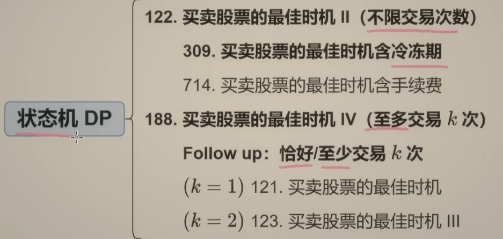

### 122-买卖股票的最佳时机Ⅱ-不限交易次数

给你一个整数数组 `prices` ，其中 `prices[i]` 表示某支股票第 `i` 天的价格。

在每一天，你可以决定是否购买和/或出售股票。你**在任何时候最多只能持有一股股票** 。你也可以先购买，然后在 **同一天** 出售。

返回 _你能获得的**最大** 利润_ 。

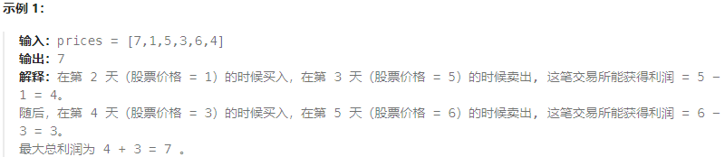

> 为了后面改为递归，从最后一天向前思考。
> 
> **启发思路** ：最后一天发生了什么？
> 
> 从第0天开始到第5天结束时的利润 = 从第0天开始到第4天结束时的利润 + 第5天的利润
> 
> 1.）如果第5天什么也不做，利润为0
> 
> 2.）如果第5天买入股票，利润就是-4
> 
> 3.）如果第5天卖出股票，利润就是+4

在第i-1天结束时，如果买入股票，那在第i天开始时的状态就是持有股票

在第i-1天结束时，如果卖出股票，那在第i天开始时的状态就是未持有股票

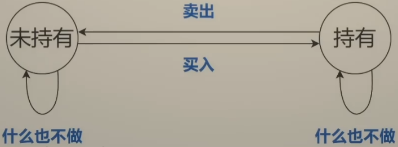

如果什么也不做，那么状态不变

这种表示状态之间转换关系的图叫状态机

从这张图中可以看出，状态转移有这4中情况

定义 `dfs(i, 0) `表示到**第i天结束时** ，未持有股票的最大利润

定义 `dfs(i, 1) `表示到**第i天结束时** ，持有股票的最大利润

由于第i-1天的结束就是第i天的开始

`dfs(i-1, •)`也表示到**第i天开始时** 的最大利润

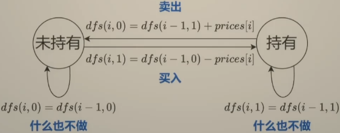

$$\begin{array}{l}
d f s(i, 0)=\max (d f s(i-1,0), d f s(i-1,1)+\operatorname{prices}[i]) \\
d f s(i, 1)=\max (d f s(i-1,1), d f s(i-1,0)-\operatorname{prices}[i])
\end{array}$$

> 第i天结束时未持有股票的利润 = max( 第i-1天结束时未持有股票的利润，第i-1天结束时持有股票的利润 + 当前卖出的获得的利润 )
> 
> 第i天结束时持有股票的利润 = max( 第i-1天结束时持有股票的利润， 第i-1天结束时未持有股票的利润 - 当前买入获得的利润)

递归边界，

`dfs(-1, 0) = 0` 第0天**开始** 未持有股票，利润为0

`dfs(-1, 1) = -∞` 第0天**开始** 时不可能持有股票

递归入口

`max( dfs(n-1, 0), dfs(n-1,1))`

如果在最后一天还持有股票就卖不出去了，所以 `dfs(n-1, 1)`是不会比`dfs(n-1, 0)`大的。

所以递归入口是 dfs(n-1, 0)

**不使用cache装饰器会超时，改为记忆化搜索**

```python
class Solution:
    def maxProfit(self, prices: List[int]) -> int:
        n = len(prices)
        
        # 需要改为记忆化搜索, cache装饰器
        @cache
        def dfs(i, hold):
            if i<0:
                return -inf if hold else 0
            if hold:
                # 第i天结束时持有
                return max(dfs(i-1, True), dfs(i-1, False)-prices[i])
            # 第i天结束时未持有
            return max(dfs(i-1, False), dfs(i-1, True)+prices[i])
        return dfs(n-1, 0)
```

如果将递归翻译未递推的形式

插入一个状态表示`i=-1`

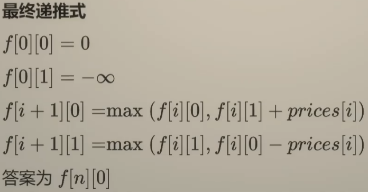

```python
# 击败5%
class Solution:
    def maxProfit(self, prices: List[int]) -> int:
        n = len(prices)

        f = [[0]*2 for _ in range(n+1)]
        f[0][0] = 0
        f[0][1] = -inf
        for i, p in enumerate(prices):
            f[i+1][0] = max(f[i][0], f[i][1] + p)
            f[i+1][1] = max(f[i][1], f[i][0] - p)
        return f[-1][0]
```

空间优化

```python
# 击败95%
class Solution:
    def maxProfit(self, prices: List[int]) -> int:
        n = len(prices)
        f0 = 0
        f1 = -inf
        for p in prices:
            new_f0 = max(f0, f1+p)
            f1 = max(f1, f0-p)
            f0 = new_f0
        return f0
```

### 309-买卖股票的最佳时机 - 含冷冻期

给定一个整数数组`prices`，其中第 `prices[i]` 表示第 `i` 天的股票价格 。

设计一个算法计算出最大利润。在满足以下约束条件下，你可以尽可能地完成更多的交易（多次买卖一支股票）:

**卖出股票后，你无法在第二天买入股票 (即冷冻期为 1 天)** 。

注意：你不能同时参与多笔交易（你必须在再次购买前出售掉之前的股票）。

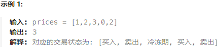

> 思考，除了是否持有股票的状态，现在新增了冷冻期的状态
> 
> 买入股票的时候，前一天不能有卖出的操作，那么从再前一天转移过来

```python
class Solution:
    def maxProfit(self, prices: List[int]) -> int:
        n = len(prices)
        @cache
        def dfs(i, hold):
            if i<0:
                return -inf if hold else 0
            if hold:
                # 第i天结束时持有股票
                # 第i-1天结束时就持有，当前什么也不做
                # 第i-1天结束时未持有，当前买入
                # 买入之前不能有卖出
                return max(dfs(i-1, True), dfs(i-2, False)-prices[i])
            # 第i天结束时，未持有
            return max(dfs(i-1, False), dfs(i-1, True)+prices[i])
        return dfs(n-1, False)
```

### 188-买卖股票的最佳时机Ⅳ - 至多交易k次

给你一个整数数组 `prices` 和一个整数 `k` ，其中 `prices[i]` 是某支给定的股票在第 `i` 天的价格。

设计一个算法来计算你所能获取的最大利润。你最多可以完成 `k` 笔交易。也就是说，你最多可以买 `k` 次，卖 `k` 次。

注意：你不能同时参与多笔交易（你必须在再次购买前出售掉之前的股票）。

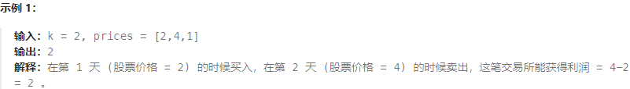

> 有次数限制，应当在递归的过程中记录次数

定义 `dfs(i, j, 0)`表示第i天**结束** 时完成**至多j笔交易** ，未持有股票的最大利润

定义 `dfs(i, j, 1)`表示第i天**结束** 时完成**至多j笔交易** ，持有股票的最大利润

$$\begin{array}{l}
\operatorname{dfs}(i, j, 0)=\max (d f s(i-1, j, 0), \operatorname{dfs}(i-1, j, 1)+\operatorname{prices}[i]) \\
\operatorname{dfs}(i, j, 1)=\max (d f s(i-1, j, 1), \operatorname{dfs}(i-1, j-1,0)-\operatorname{prices}[i])
\end{array}$$

> 第i天结束时最多完成j笔交易未持有，前一天结束时最多完成j笔交易未持有 什么也不做， 前一天结束时最多完成j笔交易持有 当前卖出
> 
> 第i天结束时最多完成j笔交易持有，前一天结束时最多完成j笔交易持有 什么也不做，前一天结束时最多完成**j-1** 笔交易 **当前买入**

买入一次就算一笔交易

递归边界

`dfs(·, -1, ·) = -∞` 任何情况下，j都不能未负

`dfs(-1, j, 0) = 0`

`dfs(-1, j, 1) = -∞`

```python
class Solution:
    def maxProfit(self, k: int, prices: List[int]) -> int:
        
        n = len(prices)
        
        @cache
        def dfs(i, j, hold):
            if j<0:
                return -inf
            if i<0:
                return -inf if hold else 0
            if hold:
                # 当前持有
                # 买入时记作一次交易开始
                return max(dfs(i-1, j, 1), dfs(i-1, j-1, 0) - prices[i])
            # 当前未持有
            return max(dfs(i-1, j, 0), dfs(i-1, j, 1) + prices[i])
        return dfs(n-1, k, False)
```

递推代码

```python
class Solution:
    def maxProfit(self, k: int, prices: List[int]) -> int:
        
        n = len(prices)
        # 递推
        # 创建三维数组, 为什么k+2
        f = [[[0]*2 for _ in range(k+1)] for _ in range(n+1)]
        # 初始化：无论允许交易多少次，第0天开始时持有股票都是不可能的，初始化为-∞
        for i in range(k+1):
            f[0][i][1] = -inf
        for i, p in enumerate(prices):
            for j in range(1, k+1):
                # 未持有：什么也不做 || 卖出
                f[i+1][j][0] = max(f[i][j][0], f[i][j][1] + p)
                # 持有：什么也不做 || 买入
                f[i+1][j][1] = max(f[i][j][1], f[i][j-1][0] - p)
        return f[-1][-1][0]
```

### 恰好/至少交易k次，如何初始化

**恰好完成k次初始化条件**

`f[0][1][0] = 0` 第0天，恰好完成一次交易，当天买入当天卖出，利润为0

其余均初始化为 -inf

```python
# 恰好
class Solution:
    def maxProfit(self, k: int, prices: List[int]) -> int:
        # 递推
        n = len(prices)
        f = [[[-inf] * 2 for _ in range(k + 2)] for _ in range(n + 1)]
        # 只有第0天，恰好交易1次，当天买当天卖，未持有 利润为0
        f[0][1][0] = 0  # 只需改这里
        for i, p in enumerate(prices):
            for j in range(1, k + 2):
                f[i + 1][j][0] = max(f[i][j][0], f[i][j][1] + p)
                f[i + 1][j][1] = max(f[i][j][1], f[i][j - 1][0] - p)
        return f[-1][-1][0]
    
class Solution:
    def maxProfit(self, k: int, prices: List[int]) -> int:
        # 递推
        n = len(prices)
        # 恰好完成k次交易
        f = [[[-inf]*2 for _ in range(k+1)]for _ in range(n+1)]
        # 初始化
        
```

**至少完成k次初始化条件**

第0天

[0-k-1]均初始化为-inf

第k次初始化为0

```python
# 至少
class Solution:
    def maxProfit(self, k: int, prices: List[int]) -> int:
        # 递推
        n = len(prices)
        f = [[[-inf] * 2 for _ in range(k + 1)] for _ in range(n + 1)]
        # 初始化
        # 第0天开始，恰好交易0次，利润为0
        f[0][0][0] = 0
        for i, p in enumerate(prices):
            # 第i天结束时，恰好交易0次，未持有
            f[i + 1][0][0] = max(f[i][0][0], f[i][0][1] + p)
            f[i + 1][0][1] = max(f[i][0][1], f[i][0][0] - p)  # 无限次
            for j in range(1, k + 1):
                f[i + 1][j][0] = max(f[i][j][0], f[i][j][1] + p)
                f[i + 1][j][1] = max(f[i][j][1], f[i][j - 1][0] - p)
        return f[-1][-1][0]
```

### 121-买卖股票的最佳时机 - 只能交易一次 - 简单

给定一个数组 `prices` ，它的第 `i` 个元素 `prices[i]` 表示一支给定股票第 `i` 天的价格。

你只能选择**某一天** 买入这只股票，并选择在 **未来的某一个不同的日子** 卖出该股票。设计一个算法来计算你所能获取的最大利润。

返回你可以从这笔交易中获取的最大利润。如果你不能获取任何利润，返回 `0` 。

```python
class Solution:
    def maxProfit(self, prices: List[int]) -> int:
        '''
        维护到当前为止的最小价格 & 最大利润
        '''
        min_price = prices[0]
        max_profit = 0

        for p in prices:
            if p<min_price:
                min_price = p
            if max_profit<p-min_price:
                max_profit = p-min_price
        return max_profit
```

**如何用状态机来做？？等同于恰好交易一次的情况**

注意初始化方式

```python
class Solution:
    def maxProfit(self, prices: List[int]) -> int:
        n = len(prices)
        f = [[[0]*2 for _ in range(1+1)]for _ in range(n+1)]
        for i in range(1+1):
            f[0][i][1] = -inf
        for i, p in enumerate(prices):
            for j in range(1, 1+1):
                f[i+1][j][0] = max(f[i][j][0], f[i][j][1]+p)
                f[i+1][j][1] = max(f[i][j][1], f[i][j-1][0]-p)

        return f[-1][-1][0]
```

### 122-买卖股票的最佳时机Ⅱ-不限制交易次数-中等

给你一个整数数组 `prices` ，其中 `prices[i]` 表示某支股票第 `i` 天的价格。

在每一天，你可以决定是否购买和/或出售股票。你在任何时候 **最多** 只能持有 **一股** 股票。你也可以先购买，然后在 **同一天** 出售。

返回 _你能获得的**最大** 利润_ 。

```python
class Solution:
    def maxProfit(self, prices: List[int]) -> int:
        '''
        不限制交易次数
        二维数组即可
        '''
        n = len(prices)
        f = [[0]*2 for _ in range(n+1)]
        # 初始化
        # 第0天开始时持有是不可能的
        f[0][1] = -inf
        for i, p in enumerate(prices):
            # 未持有
            f[i+1][0] = max(f[i][0], f[i][1]+p)
            # 持有
            f[i+1][1] = max(f[i][1], f[i][0]-p)
        return f[-1][0]
```

### 123-买卖股票的最佳时机Ⅲ-最多交易两次-困难

给定一个数组，它的第 `i` 个元素是一支给定的股票在第 `i` 天的价格。

设计一个算法来计算你所能获取的最大利润。你最多可以完成 **两笔** 交易。

**注意：** 你不能同时参与多笔交易（你必须在再次购买前出售掉之前的股票）。

```python
class Solution:
    def maxProfit(self, prices: List[int]) -> int:
        '''
        最多完成两笔交易
        '''
        n = len(prices)
        f = [[[0]*2 for _ in range(3)]for _ in range(n+1)]
        # 初始化
        # 第0天开始时持有是不可能的
        for i in range(3):
            f[0][i][1] = -inf
        # 递推
        for i, p in enumerate(prices):
            for j in range(1, 3):
                f[i+1][j][0] = max(f[i][j][0], f[i][j][1]+p)
                f[i+1][j][1] = max(f[i][j][1], f[i][j-1][0]-p)
        return f[-1][-1][0]
```

### 188-买卖股票的最佳时机Ⅳ-最多交易k次-困难

给你一个整数数组 `prices` 和一个整数 `k` ，其中 `prices[i]` 是某支给定的股票在第 `i` 天的价格。

设计一个算法来计算你所能获取的最大利润。你最多可以完成 `k` 笔交易。也就是说，你最多可以买 `k` 次，卖 `k` 次。

**注意：** 你不能同时参与多笔交易（你必须在再次购买前出售掉之前的股票）。

```python
class Solution:
    def maxProfit(self, k: int, prices: List[int]) -> int:
        '''
        最多交易k次
        三维表示
        '''
        n = len(prices)
        f = [[[0]*2 for _ in range(k+1)]for _ in range(n+1)]

        # 初始化
        # 第0天开始时持有是不可能的
        for i in range(k+1):
            f[0][i][1] = -inf
        # 递推
        for i, p in enumerate(prices):
            for j in range(1, k+1):
                # 未持有
                f[i+1][j][0] = max(f[i][j][0], f[i][j][1]+p)
                f[i+1][j][1] = max(f[i][j][1], f[i][j-1][0]-p)
        return f[-1][-1][0]
```

### 309-买卖股票的最佳时机-含冷冻期, 不限制交易次数-中等-再看看

给定一个整数数组`prices`，其中第 `prices[i]` 表示第 `i` 天的股票价格 。

设计一个算法计算出最大利润。在满足以下约束条件下，你可以尽可能地完成更多的交易（多次买卖一支股票）:

卖出股票后，你无法在第二天买入股票 (即冷冻期为 1 天)

**注意：** 你不能同时参与多笔交易（你必须在再次购买前出售掉之前的股票）

```python
class Solution:
    def maxProfit(self, prices: List[int]) -> int:
        '''
        不限制交易次数
        二维即可
        卖出股票后，无法接着买入，冷冻期为一天
        但是买入之后，没有卖出限制
        '''
        n = len(prices)
        if n < 2:
            return 0
        
        # 初始化
        f = [[0] * 2 for _ in range(n+2)]  # 需要额外两个空间用于状态转移
        f[0][1] = -float('inf')  # 第0天开始时持有是不可能的
        f[1][1] = -prices[0]  # 第1天持有股票的情况

        # 第二天到第n天的情况
        for i in range(2, n+1):
            # 未持有：什么也不做 || 卖出，卖出无限制
            f[i][0] = max(f[i-1][0], f[i-1][1] + prices[i-1])
            # 持有：只能从昨天未持有状态买入
            f[i][1] = max(f[i-1][1], f[i-2][0] - prices[i-1])

        return f[-2][0]
```

### 714-买卖股票的最佳时机-含手续费-中等

给定一个整数数组 `prices`，其中 `prices[i]`表示第 `i` 天的股票价格 ；整数 `fee` 代表了交易股票的手续费用。

你可以无限次地完成交易，但是你每笔交易都需要付手续费。如果你已经购买了一个股票，在卖出它之前你就不能再继续购买股票了。

返回获得利润的最大值。

**注意：** 这里的一笔交易指买入持有并卖出股票的整个过程，每笔交易你只需要为支付一次手续费。

```python
class Solution:
    def maxProfit(self, prices: List[int], fee: int) -> int:
        '''
        不限制交易次数
        '''
        n = len(prices)
        f = [[0]* 2 for _ in range(n+1)]
        # 初始化
        f[0][1] = -inf

        # 只在买入时计算手续费
        for i, p in enumerate(prices):
            f[i+1][0] = max(f[i][0], f[i][1] + p)
            f[i+1][1] = max(f[i][1], f[i][0] - p - fee)
        return f[-1][0]
```