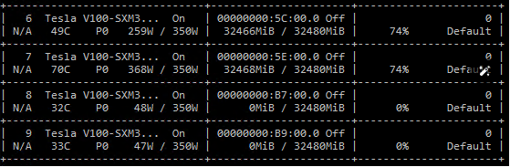
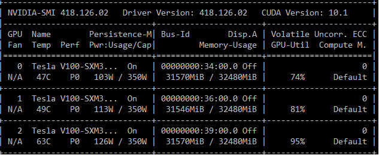

# DeepSpeed x MiniGPT4Qwen

> 原文作者：幻影星全能的木豆  
> 原文链接：https://www.cnblogs.com/mudou/p/18319883  
> 发布时间：2024-07-23 23:48

---

```python
# 关于DeepSpeed的尝试

知乎博客地址： https://zhuanlan.zhihu.com/p/673359684

## 参考

Repo：https://github.com/microsoft/DeepSpeedExamples

 https://github.com/microsoft/DeepSpeedExamples/blob/master/training/HelloDeepSpeed/train_bert_ds.py ，代码拷贝到了本项目的：https://github.com/Coobiw/MiniGPT4Qwen/blob/master/deepspeed_tutorials/train_bert_official.py

## EVA-ViT-G（1B）上的实验

| Setting（bf16，不开gradient-checkpointing） | max_allocated_memory/GB（若无说明则bs=32） | time per epoch/s（bs=32 8卡 共400条数据） |
| ------------------------------------------- | ------------------------------------------ | ----------------------------------------- |
| ZERO-0 (DDP)                                | bs=32 OOM bs=16 18.36                      | 11.57                                     |
| ZERO-1                                      | 21.46                                      | 9.68                                      |
| ZERO-1 (offload optimizer)                  | 20.40                                      | 13.45                                     |
| ZERO-2                                      | 22.26                                      | 8.51                                      |
| ZERO-2 (offload optimizer)                  | 20.80                                      | 13.34                                     |
| ZERO-3                                      | 22.37                                      | 7.94                                      |
| ZERO-3 (offload optimizer)                  | 20.39                                      | 12.67                                     |
| ZERO-3 (offload optimizer + params)         | 20.39                                      | 12.08                                     |
```

原文：<https://zhuanlan.zhihu.com/p/673359684>

# DeepSpeed x MiniGPT4Qwen

作者对MiniGPT4Qwen支持了更加简单易用，Plug-in的DeepSpeed，给出了ZERO-0(等价于DDP), ZERO-1, ZERO-2的配置。

> lavis框架的分布式使用的是最基本的pytorch的DDP，虽然简单易用，但如今还是算是有些out-of-date了。
> 
> FSDP、DeepSpeed、Megatron等各种分布式并行训练框架更加受到青睐。

* * *

## 一、官方教程

### 1\. 了解DeepSpeed

DeepSpeed API 是 PyTorch 的轻量级包装器。这意味着你可以使用你在 PyTorch 中喜欢的一切，而无需学习一个新平台。

**速度**

DeepSpeed 使用 1024 个 V100 GPU（64 台 DGX-2 机箱）在 44 分钟内训练 BERT-large 达到一致性，并在使用 256 个 GPU（16 台 DGX-2 机箱）时在 2.4 小时内完成。

DeepSpeed 训练 GPT2（15 亿参数）比最先进的 NVIDIA Megatron 在 Azure GPU 上快 3.75 倍。

**内存效率**

DeepSpeed提供内存高效的数据并行，并支持在没有模型并行性的情况下训练模型。

例如，DeepSpeed 可以在单个 GPU 上训练多达 130 亿参数的模型。

相比之下，现有框架（例如，PyTorch 的 Distributed Data Parallel）在 14 亿参数模型时内存不足。

DeepSpeed 通过一种称为零冗余优化器（ZeRO）的新颖解决方案减少了训练内存占用。与基本数据并行性不同，后者在数据并行进程中复制内存状态，ZeRO 将模型状态和梯度分区以节省大量内存。此外，它还减少了激活内存和碎片内存。当前实现（ZeRO-2）相对于最先进的技术减少了多达 8 倍的内存。你可以在我们的论文中阅读更多关于 ZeRO 的内容，以及在我们的博客文章与 中了解到ZeRO-1 和 ZeRO-2。

对于 GPU 资源有限的模型科学家，ZeRO-Offload 利用 CPU 和 GPU 内存进行大型模型训练。使用一台带有一个 GPU 的机器，我们的用户可以运行多达 130 亿参数的模型而不耗尽内存，比现有方法大 10 倍，同时获得有竞争力的吞吐量。这一功能使多亿参数模型训练民主化，并为许多深度学习从业者探索更大更好的模型打开了窗口。

**可扩展性**

DeepSpeed支持高效的数据并行、模型并行、流水线并行及其组合，我们称之为3D并行。

DeepSpeed的3D并行性为运行具有数万亿个参数的模型提供了系统支持，请在我们的新闻稿和教程中阅读更多信息。

DeepSpeed可以更高效地运行大型模型，对于跨越1.5B到千亿的各种大小的模型，速度最高可达10倍。更具体地说，由ZeRO提供支持的数据并行是互补的，可以与不同类型的模型并行性相结合。它允许DeepSpeed使用较低程度的模型并行性和更高的批量大小来拟合模型，与单独使用模型并行性相比，提供显着的性能提升。

**通信效率**

DeepSpeed 的流水线并行性在分布式训练期间减少了通信量，这使得用户能够在网络受限的集群上以 2-7 倍的速度训练多亿参数模型。  
1-bit Adam、0/1 Adam 和 1-bit LAMB 通过最多减少 26 倍的通信量，同时实现与 Adam 相似的收敛效率，从而允许扩展到不同类型的 GPU 集群和网络。  
[1-bit Adam blog post](<https://www.deepspeed.ai/2020/09/08/onebit-adam-blog-post.html>), [1-bit Adam tutorial](<https://www.deepspeed.ai/tutorials/onebit-adam/>), [0/1 Adam tutorial](<https://www.deepspeed.ai/tutorials/zero-one-adam/>), [1-bit LAMB tutorial](<https://www.deepspeed.ai/tutorials/onebit-lamb/>)

**数据效率**

DeepSpeed Data Efficiency Library 通过课程学习提供高效的数据采样，并通过随机分层令牌丢弃提供高效的数据路由。组合解决方案可在 GPT-3/BERT 预训练和 GPT/ViT 微调期间节省多达 2 倍的数据和 2 倍的时间，或在相同的数据/时间下进一步提高模型质量。在教程中查看更多信息。

**支持长序列**

DeepSpeed 提供了稀疏注意力核（sparse attention kernels），这是一种关键技术，用于支持模型输入的长序列，无论是文本、图像还是声音。与传统的密集型 Transformer 模型相比，它能够处理数量级更长的输入序列，并且执行速度可以快达 6 倍，同时保持相当的准确性。此外，与现有的最先进的稀疏实现相比，DeepSpeed 的稀疏核执行速度还快了 1.5 到 3 倍。更重要的是，DeepSpeed 的稀疏核支持灵活的稀疏格式的高效执行，并使用户能够在自定义的稀疏结构上进行创新。

**快速收敛的有效性**

DeepSpeed 支持高级超参数调整和大批量大小的优化器，例如 LAMB。

这些技术提高了模型训练的有效性，并减少了达到期望精度所需的样本数量。

**易用性**

只需几行代码更改即可使PyTorch模型能够使用DeepSpeed和ZeRO。

与当前的模型并行库相比，DeepSpeed不需要代码重新设计或模型重构。它也不会对模型维度（例如注意力头的数量、隐藏大小等）、批量大小或任何其他训练参数进行限制。对于多达130亿参数的模型，您可以方便地使用ZeRO驱动的数据并行，而无需模型并行，而相比之下，标准数据并行会对参数超过14亿的模型运行内存溢出。此外，DeepSpeed方便地支持ZeRO驱动的并行数据与自定义模型并行的灵活组合，例如NVIDIA的Megatron-LM的张量切片。

### 2\. DeepSpeed入门

#### 2.1 DeepSpeed引擎 & 分布式环境

  1. DeepSpeed模型训练是使用DeepSpeed引擎完成的。该引擎可以包装任何torch. nn.module类型的任意模型，并具有用于训练和检查点模型的最小API集。

  2. **初始化DeepSpeed engine**

```python
model_engine, optimizer, _, _ = deepspeed.initialize(args=cmd_args,
                                                     model=model,
                                                     model_parameters=params)
```

deepspeed.initialize 确保在幕后正确执行所需的分布式数据并行或混合精度训练设置。

DeepSpeed 还可以根据传递给 deepspeed.initialize 和 DeepSpeed 配置文件的参数构建和管理训练优化器、数据加载器和学习速率调度器。

请注意，DeepSpeed 会在每个 training step 自动执行学习速率调度。

  3. 如果您已经有分布式环境设置，则需要替换 `torch.distributed.init_process_group(...)` 为 `deepspeed.init_distributed()`

     * DeepSpeed的 `init_distributed` 函数来初始化分布式环境

     * PyTorch的 `init_process_group` 函数来初始化分布式环境

  4. 默认情况下使用 NCCL 后端

  5. 如果在 `deepspeed.initialize()` 之后才需要设置分布式环境，可以不使用`deepspeed.init_distributed()`函数，因为 DeepSpeed 将在其初始化期间自动初始化分布式环境。 不过，如果已经处于就绪状态，则需要删除 `torch.distributed.init_process_group`。

#### 2.2 API for Training

一旦DeepSpeed引擎初始化完成，就可以使用三个简单的API来训练模型，用于前向传播、反向传播和权重更新（step）.

```python
for step, batch in enumerate(data_loader):
    #forward() method
    loss = model_engine(batch)

    #runs backpropagation
    model_engine.backward(loss)

    #weight update
    model_engine.step()
```

在幕后，DeepSpeed 自动执行必要的操作，以混合精度进行分布式数据并行训练，并具有预定义的学习率调度器：

  * **梯度平均化** ：在分布式数据并行训练中，后向传播确保在训练一个 `train_batch_size` 后对梯度进行跨数据并行进程平均。

  * **损失缩放** ：在 FP16/混合精度训练中，DeepSpeed 引擎会自动处理损失的缩放，以避免梯度精度丢失。

  * **学习率调度器** ：当使用DeepSpeed的学习率调度器（在`ds_config.json`文件中指定），DeepSpeed在每个训练步骤（执行`model_engine.step()`时）调用调度器的`step()`方法。

当不使用DeepSpeed的学习率调度器时：

    1. 如果调度器在每个 training step 时执行，则用户可以在初始化 DeepSpeed 引擎时将调度程序传递给 `deepspeed.initialize`，让 DeepSpeed 管理它以进行更新或保存/恢复。
    2. 如果调度器在其他间隔执行调度（例如，training epochs ），则用户在初始化期间不应将调度程序传递给 DeepSpeed，并必须明确管理它。

#### 2.3 模型检查点

通过 DeepSpeed 中的 `save_checkpoint` 和 `load_checkpoint` API 处理训练状态的保存和加载，这两个 API 需要传入两个参数来唯一标识一个检查点: `ckpt_dir` 和 `ckpt_id`(在目录中唯一标识检查点的标识符。在下面的代码片段中，我们使用损失值作为检查点标识符。)

```python
#load checkpoint
_, client_sd = model_engine.load_checkpoint(args.load_dir, args.ckpt_id)
step = client_sd['step']

#advance data loader to ckpt step
dataloader_to_step(data_loader, step + 1)

for step, batch in enumerate(data_loader):
    #forward() method
    loss = model_engine(batch)
    #runs backpropagation
    model_engine.backward(loss)
    #weight update
    model_engine.step()

    #save checkpoint
    if step % args.save_interval:
        client_sd['step'] = step
        ckpt_id = loss.item()
        model_engine.save_checkpoint(args.save_dir, ckpt_id, client_sd = client_sd)
```

DeepSpeed 可以在对用户隐藏细节的情况下自动保存和恢复模型、优化器和学习率调度器状态。

然而，用户可能希望保存与给定模型训练相关的其他数据。为了支持这些项目，`save_checkpoint` 接受一个客户端状态字典 `client_sd` 进行保存。这些项目可以从 `load_checkpoint` 中作为返回参数进行检索。在上面的示例中，`step` 值被存储为 `client_sd` 的一部分。

> 重要提示：所有进程都必须调用此方法，而不仅仅是rank为0的进程。这是因为每个进程都需要保存其主权重和调度器+优化器状态。如果仅为rank为0的进程调用此方法，它将等待与其他进程进行同步。

#### 2.4 DeepSpeed配置

DeepSpeed功能可以启用，禁用或被指定为`args.deepspeed_config` 的JSON配置设置。

以下是一个简单的JSON配置

```json
{
  "train_batch_size": 8,
  "gradient_accumulation_steps": 1,
  "optimizer": {
    "type": "Adam",
    "params": {
      "lr": 0.00015
    }
  },
  "fp16": {
    "enabled": true
  },
  "zero_optimization": true
}
```

#### 2.5 启动 DeepSpeed 训练

##### 资源配置（多节点）

DeepSpeed 使用与 OpenMPI 和 Horovod 兼容的 hostfiles 配置多节点计算资源。

一个 hostfile 是主机名（或 SSH 别名）列表，这些主机可以通过无密码 SSH 访问，并且包含 slot counts，指定系统中可用的 GPU 数量。例如，

```json
worker-1 slots=4
worker-2 slots=4
```

...

另外，DeepSpeed 还允许你将模型的分布式训练限制在可用节点和 GPU 的子集上。通过两个命令行参数 --num_nodes 和 --num_gpus 启用此功能。例如，可以通过以下命令将分布式训练限制在只使用两个节点：

```python
deepspeed --num_nodes=2 \
	<client_entry.py> <client args> \
	--deepspeed --deepspeed_config ds_config.json
```

您可以使用--include和--exclude标志来包含或排除特定资源。例如，要使用除了节点worker-2上的GPU 0和worker-3上的GPU 0和1之外的所有可用资源：

```python
deepspeed --exclude="worker-2:0@worker-3:0,1" \
	<client_entry.py> <client args> \
	--deepspeed --deepspeed_config ds_config.json
```

同样，您可以仅在worker-2上使用GPU 0和1。

```python
deepspeed --include="worker-2:0,1" \
	<client_entry.py> <client args> \
	--deepspeed --deepspeed_config ds_config.json
```

##### 多节点环境变量

...

##### 资源配置（单节点）

如果我们只在单节点上运行（具有一个或多个GPU），那么 DeepSpeed 不需要像上面描述的主机文件。

如果未检测到或传递主机文件，则 DeepSpeed 将查询本地计算机上的 GPU 数量，以发现可用的插槽数。-- include 和 --exclude 参数的工作方式与往常相同，但用户应指定“localhost”作为主机名。

另外请注意，`CUDA_VISIBLE_DEVICES` 不能与 DeepSpeed 一起使用来控制应该使用哪些设备。例如，要仅使用当前节点的 gpu1，执行以下操作：

```python
deepspeed --include localhost:1 ...
```

### 3\. 自动张量并行

展示用于推理的新自动张量并行特性。

以前，用户需要向 DeepSpeed 提供一个注入策略以启用张量并行性。DeepSpeed现在默认支持HuggingFace模型的自动张量并行性，只要未启用内核注入并且未提供注入策略。这允许我们的用户在不提供注入策略的情况下提高当前未通过内核注入支持的模型的性能。下面是新方法的示例

```python
# ---------------------------------------
# New automatic tensor parallelism method
# ---------------------------------------
import os
import torch
import transformers
import deepspeed

local_rank = int(os.getenv("LOCAL_RANK", "0"))
world_size = int(os.getenv("WORLD_SIZE", "1"))

# 创建pipeline
pipe = transformers.pipeline(task = "text2text-generation", model="google/t5-v1_1-small", device = local_rank)

# 初始化DeepSpeed推理引擎
pipe.model = deepspeed.init_inference(
    pipe.model,
    mp_size = world_size,
    dtype = torch.float
)

output = pipe('Input String')
```

以前，要为不支持内核注入的模型运行仅具有张量并行性的推理，您可以传递一个注入策略，该策略显示 Transformer Encoder/Decoder 的两个特定线性层：1）attention output GeMM 和2）layer output GeMM。

我们需要该层的这些部分来添加GPU之间所需的 all-reduce communication，以合并模型并行 ranks 中的部分结果。下面，我们展示了前面方法的一个示例：

```python
# ----------------------------------
# Previous tensor parallelism method
# ----------------------------------
import os
import torch
import transformers
import deepspeed
from transformers.models.t5.modeling_t5 import T5Block
local_rank = int(os.getenv("LOCAL_RANK", "0"))
world_size = int(os.getenv("WORLD_SIZE", "1"))
# create the model pipeline
pipe = transformers.pipeline(task="text2text-generation", model="google/t5-v1_1-small", device=local_rank)
# Initialize the DeepSpeed-Inference engine
pipe.model = deepspeed.init_inference(
    pipe.model,
    mp_size=world_size,
    dtype=torch.float,
    injection_policy={T5Block: ('SelfAttention.o', 'EncDecAttention.o', 'DenseReluDense.wo')}
)
output = pipe('Input String')
```

使用自动张量并行性，我们不需要为支持的模型提供注入策略。注入策略将在运行时确定并自动应用。

##### 示例脚本

我们可以使用 `inference test suite` 观察到自动张量并行性的性能改进。

此脚本用于测试文本生成模型，包括每个token延迟、带宽、吞吐量和内存检查以进行比较。

需要提前下载该项目 `https://github.com/microsoft/DeepSpeedExamples.git`

  1. 使用以下命令在没有DeepSpeed和张量并行性的情况下运行。设置test_performance标志以收集性能数据：

```python
deepspeed --num_gpus 1 DeepSpeedExamples/inference/huggingface/text-generation/inference-test.py --model /root/autodl-tmp/cache/ckpt/Qwen7B-chat --batch_size 1 --test_performance
```

  2. 要启用张量并行性，您需要为兼容模型使用标志ds_inference

```python
deepspeed --num_gpus 1 DeepSpeedExamples/inference/huggingface/text-generation/inference-test.py --name /root/autodl-tmp/cache/ckpt/Qwen7B-chat --batch_size 1 --test_performance --ds_inference
```

### 4\. Megatron-LM GPT2

我们将向Megatron-LM GPT2模型添加DeepSpeed，这是一个大型、强大的transformer。

Megatron-LM支持模型并行和多节点训练。

首先，我们讨论数据和环境设置，以及如何使用 original Megatron-LM 训练GPT-2模型。接下来，我们逐步使该模型能够与DeepSpeed一起运行。最后，我们展示了使用DeepSpeed的性能提升和内存占用减少。

<https://www.deepspeed.ai/tutorials/megatron/>

### 5\. Zero Redundancy Optimizer

在本节，我们将把ZeRO优化器应用于 Megatron-LM GPT-2模型。

ZeRO是一套强大的内存优化技术，能够有效训练具有数万亿个参数的大型模型，例如GPT-2和Turing-NLG 17B。

与模型并行方法相比，ZeRO的一个关键吸引力在于不需要修改模型代码。

与模型并行方法相比，ZeRO的一个关键吸引力在于不需要修改模型，所需要的只是更改DeepSpeed配置JSON中的一些配置。

#### 5.1 ZeRO概述

ZeRO利用数据并行的聚合计算和内存资源来减少用于模型训练的每个设备（GPU）的内存和计算需求。

ZeRO通过在分布式训练硬件中的可用设备（GPU和CPU）之间划分各种模型训练状态（权重、梯度和优化器状态）来减少每个GPU的内存消耗。具体来说，ZeRO被实现为优化的增量阶段，早期阶段的优化在后期阶段可用。要深入了解ZeRO，请参阅论文。

  1. 优化器状态（例如，对于Adam优化器，32位权重以及第一和第二矩估计(动量估计? moment estimates )）在进程之间进行分区，以便每个进程仅更新其分区。
  2. 用于更新模型权重的32位梯度也被分区，以便每个进程仅保留与其优化器状态部分相对应的梯度。
  3. 16位模型参数在进程之间进行分区。ZeRO-3将在 forward and backward 过程中自动收集和分区它们。

此外，ZeRO-3包括 infinity offload engine 以形成 ZeRO-Infinity ，它可以卸载到CPU和NVMe内存以节省大量内存。

#### 5.2 训练环境

在本练习中使用DeepSpeed Megatron-LM GPT-2代码，on NVIDIA Tesla V100-SXM3 Tensor Core GPUs with 32GB RAM.

#### 5.3 开启ZeRO优化

要为DeepSpeed模型启用ZeRO优化，我们只需将zero_optimization键添加到DeepSpeed JSON配置中。

```json
  "zero_optimization": {
    "stage": [0|1|2|3],
    "allgather_partitions": [true|false],
    "allgather_bucket_size": 5e8,
    "overlap_comm": false,
    "reduce_scatter": [true|false],
    "reduce_bucket_size": 5e8,
    "contiguous_gradients" : [true|false],
    "offload_param": {
      ...
    },
    "offload_optimizer": {
      ...
    },
    "stage3_max_live_parameters" : 1e9,
    "stage3_max_reuse_distance" : 1e9,
    "stage3_prefetch_bucket_size" : 5e8,
    "stage3_param_persistence_threshold" : 1e6,
    "sub_group_size" : 1e12,
    "elastic_checkpoint" : [true|false],
    "stage3_gather_16bit_weights_on_model_save": [true|false],
    "ignore_unused_parameters": [true|false]
    "round_robin_gradients": [true|false]
    "zero_hpz_partition_size": 1
    "zero_quantized_weights": [true|false]
    "zero_quantized_gradients": [true|false]
    }
```

#### 5.4 训练1.5B参数的GPT-2模型

我们展示了ZeRO第1阶段的优势，展示了它可以在8个V100 GPU上对15亿参数GPT-2模型进行数据并行训练。

我们将训练配置为每个设备使用1个批处理大小，以确保内存消耗主要归因于模型参数和优化器状态。

```json
   --model-parallel-size 1 \
   --num-layers 48 \
   --hidden-size 1600 \
   --num-attention-heads 16 \
   --batch-size 1 \
   --deepspeed_config ds_zero_stage_1.config \
```

如果不使用ZeRO技术来训练这个模型，它将因为内存不足（OOM错误）而失败。

  1. 模型无法适配到GPU内存的一个关键原因是：模型使用的Adam优化器的状态占用了18GB内存；这占据了32GB总RAM的很大一部分。

  2. 通过使用ZeRO阶段1将优化器状态在八个数据并行的ranks中进行分区，每个设备上的内存消耗可以减少到2.25GB，从而使模型可以进行训练。

  3. 为了启用ZeRO阶段1，我们只需简单地更新DeepSpeed的JSON配置文件。

```json
{
    "zero_optimization": {
        "stage": 1,
        "reduce_bucket_size": 5e8	# 
    }
}
```



从上面的NVIDIA-smi截图中我们可以看到，只有编号为6和7的GPU被用于训练模型。这表明在进行深度学习模型训练时，只有部分显卡被利用。

使用ZeRO第一阶段，我们可以通过增加数据并行度来进一步减少每个设备上的内存消耗。这些节省下来的内存可以用来增加模型的大小和/或增加批量大小。这意味着通过减少内存消耗，可以有更多的资源来处理更大的模型或者更大的数据批量。

#### 5.5 训练10B参数的GPT-2模型

ZeRO第2阶段优化进一步增加了可以使用数据并行训练的模型的大小。

使用32个V100 GPU训练具有10B参数的模型来进行展示。

  1. 首先，我们需要配置一个具有10B参数的模型，并且启用激活检查点。

通过对GPT-2模型配置的修改以实现10B参数。

```json
   --model-parallel-size 1 \
   --num-layers 50 \
   --hidden-size 4096 \
   --num-attention-heads 32 \
   --batch-size 1 \
   --deepspeed_config ds_zero_stage_2.config \
   --checkpoint-activations
```

激活检查点：通过在训练过程中存储和重新计算某些中间激活值，而不是一直保存它们，可以显著减少内存使用。

  2. 更新DeepSpeed配置来启用ZeRO阶段2优化。

```json
{
    "zero_optimization": {
        "stage": 2,
        "contiguous_gradients": true,	# 减少反向传递期间的内存碎片
        "overlap_comm": true,	# 将梯度的减少与反向传播计算过程重叠进行
        "reduce_scatter": true,	# 梯度平均的过程中，使用了“reduce”或“reduce scatter”操作，而不是“allreduce”操作
        "reduce_bucket_size": 5e8,	# 控制reduce操作中处理的元素数量
        "allgather_bucket_size": 5e8	# 
    }
}
```



#### 5.6 使用ZeRO-Infinity训练万亿规模的模型

ZeRO-3是ZeRO的第三阶段，它对完整模型状态（即权重、梯度和优化器状态）进行分区，随着数据并行度的增加，内存节省的效果也会线性增加。

##### 使用ZeRO-Infinity卸载到CPU和NVMe

ZeRO-Infinity使用 DeepSpeed's infinity offload engine，专门用于将模型的状态（即模型的参数和中间数据）从GPU卸载到CPU或NVMe存储器。这意味着通过卸载模型状态，可以支持训练更大的模型，因为不需要在GPU上存储所有模型数据。

```json
{
    "zero_optimization": {
        "stage": 3,
        "contiguous_gradients": true,
        "stage3_max_live_parameters": 1e9,
        "stage3_max_reuse_distance": 1e9,
        "stage3_prefetch_bucket_size": 1e7,
        "stage3_param_persistence_threshold": 1e5,
        "reduce_bucket_size": 1e7,
        "sub_group_size": 1e9,
        "offload_optimizer": {
            "device": "cpu"
         },
        "offload_param": {
            "device": "cpu"
       }
   }
}
```

> ZeRO-Infinity vs ZeRO-Offload
> 
> DeepSpeed首先包括ZeRO-Offload的卸载功能，这是一个将优化器和梯度状态卸载到ZeRO-2中CPU内存的系统。
> 
> ZeRO-Infinity是ZeRO-3可访问的下一代卸载功能。ZeRO-Infinity能够卸载比ZeRO-Offload更多的数据，并且具有更有效的带宽利用和计算和通信的重叠。

##### 分配巨大的Megatron-LM模型

我们对模型初始化进行了两项进一步的更改，以支持超过本地系统内存但不超过总系统内存的模型。

  1. **以内存可扩展的方式分配模型** ：模型参数将被分配并立即在数据并行组中进行分区。如果remote_device是“cpu”或“nvme”，模型也将分配在CPU/NVMe内存中，而不是GPU内存中。

```python
with deepspeed.zero.Init(data_parallel_group=mpu.get_data_parallel_group(),	# 数据并行组，用于在多个设备上分配模型参数
                          remote_device=get_args().remote_device,     # 指定模型参数应分配到的设备类型（如CPU、NVMe或GPU）
                          enabled=get_args().zero_stage==3):	# 当zero_stage==3时，启用这种初始化方式
     model = GPT2Model(num_tokentypes=0, parallel_output=True)
```

  2. **收集嵌入权重以进行初始化** ：DeepSpeed将在其构造函数期间以及前向和后向传播期间自动收集模块的参数。但是，额外的访问必须与DeepSpeed协调，以确保收集参数数据并随后进行分区。如果张量被修改，还应使用modifier_rank参数来确保所有 ranks 对数据具有一致的视图。

```python
self.position_embeddings = torch.nn.Embedding(...)
# 上下文管理器，用于确保在初始化参数时，所有节点对参数有一致的视图
with deepspeed.zero.GatheredParameters(self.position_embeddings.weight,
                                    modifier_rank=0):
    # Initialize the position embeddings.
    self.init_method(self.position_embeddings.weight)
...

self.tokentype_embeddings = torch.nn.Embedding(...)
# 上下文管理器
with deepspeed.zero.GatheredParameters(self.tokentype_embeddings.weight,
                                 modifier_rank=0):
    # Initialize the token-type embeddings.
    self.init_method(self.tokentype_embeddings.weight)
```

##### 以内存为中心的平铺? tiling ???

  1. ZeRO-Infinity包含了对线性层的替代方案，这种方案能够进一步减少内存的使用。我们可以选择性的将每一个transformer层中的模型并行线性层进行 tile 操作 ???。模型并行和分割 (tiling) 可以通过在构建层时指定相应的基类来结合使用。`deepspeed.zero.TiledLinear` 模块利用了 data fetch and release pattern of ZeRO-3 来减少工作内存需求通过将一个大的操作分解为可以顺序执行的小的tiles。

> 模型并行是一种将模型的不同部分分配到不同的设备（如GPU）上进行训练的方法。
> 
> 分割（tiling）是一种技术，将一个大的模型操作（如线性层）分解成多个小的操作，这些小操作可以并行执行，从而减少内存的使用。

  2. 我们包括来自 Megatron-LM的ParallelMLP的一个示例的更改。transformer.py中还有三个模型并行层类似地进行。

  3. Megatron-LM的模型并行层有一种特殊的形式，其中层的加性偏置 `bias` 被延迟，而是从 forward 返回并与后来的运算符融合。DeepSpeed的`TiledLinear` 的 `deepspeed.zero.TiledLinearReturnBias`子类也简单地转发返回的偏置`bias`参数而不累积。

```python
@@ -1,6 +1,9 @@
-self.dense_h_to_4h = mpu.ColumnParallelLinear(
+self.dense_h_to_4h = deepspeed.zero.TiledLinearReturnBias(
     args.hidden_size,
     4 * args.hidden_size,
+    in_splits=args.tile_factor,
+    out_splits=4*args.tile_factor,
+    linear_cls=mpu.ColumnParallelLinear,
     gather_output=False,
     init_method=init_method,
     skip_bias_add=True)
```

请注意，我们按 input_size 和 output_size 成比例的缩放 in_splits 和 out_splits。

这会导致固定大小的 tiles `[hidden/tile_factor, hidden/tile_factor]`。

##### 注册外部参数

已弃用：DeepSpeed版本0.3.15引入了自动外部参数注册，不再需要此步骤。

#### 5.7 提取权重

如果您需要从DeepSpeed中取出预训练的权重，您可以通过以下方式获得fp16权重：

  * 在ZeRO-2中，`state_dict` 包含 fp16 的模型权重，可以使用 `torch.save` 正常保存。

  * 在ZeRO-3中，`state_dict` 只包含占位符，因为模型权重是跨多个GPU分区的。

如果想要获取权重，需要开启：

```json
"zero_optimization": {
    "stage3_gather_16bit_weights_on_model_save": true
},
```

然后通过如下代码进行保存：

```python
if self.deepspeed:
    self.deepspeed.save_16bit_model(output_dir, output_file)
```

因为它需要将权重合并到一个GPU上，所以它可能会很慢并且需要内存，因此仅在需要时使用此功能。

如果 `stage3_gather_16bit_weights_on_model_save = False` ，没有权重会被保存。也可以使用这种方法来节省ZeRO-2的权重。

如果您想获取fp32权重，我们提供了一个可以进行离线整合的特殊脚本。它不需要配置文件或GPU。这是它的用法示例：

```python
$ cd /path/to/checkpoint_dir
$ ./zero_to_fp32.py . pytorch_model.bin
Processing zero checkpoint at global_step1
Detected checkpoint of type zero stage 3, world_size: 2
Saving fp32 state dict to pytorch_model.bin (total_numel=60506624)
```

保存检查点时会自动创建 `zero_to_fp32.py` 脚本。

注意：目前此脚本使用最终检查点大小的2倍内存（通用RAM）。

或者，如果您有大量空闲CPU内存，并且您希望模型更新为其fp32权重而不是获取文件，您可以在训练结束时执行以下操作

```python
from deepspeed.utils.zero_to_fp32 import load_state_dict_from_zero_checkpoint
fp32_model = load_state_dict_from_zero_checkpoint(deepspeed.module, checkpoint_dir)
```

请注意，该模型将有利于保存，但不再适合继续训练，并且将需要重新使用 `deepspeed.initialize()`。

If you just want the `state_dict`, you can do:

```python
from deepspeed.utils.zero_to_fp32 import get_fp32_state_dict_from_zero_checkpoint
state_dict = get_fp32_state_dict_from_zero_checkpoint(checkpoint_dir)
```

### 6\. 自动微调？Autotuning

<https://www.deepspeed.ai/tutorials/autotuning/>

#### 参数解析

DeepSpeed使用argparse库为DeepSpeed运行时提供命令行配置。

使用 `deepspeed.add_config_arguments()` 将DeepSpeed的内置参数添加到应用程序的解析器中。

```python
import argparse
import deepspeed

parser = argparse.ArgumentParser(description="train")
parser.add_argument("--local_rank", type=int, default=-1, help="local rank passed from distributed launcher")

# 包含deepspeed配置参数
parser = deepspeed.add_config_arguments(parser)
cmd_args = parser.parse_args()
print(cmd_args)

'''
Namespace(deepscale=False, deepscale_config=None, deepspeed=False, deepspeed_config=None, local_rank=-1)
```

## 二、结合MiniGPT4Qwen

### 1\. 初始化分布式训练模式

  * DeepSpeed的 `init_distributed` 函数来初始化分布式环境
  * PyTorch的 `init_process_group` 函数来初始化分布式环境

```python
def init_deepspeed_distributed_mode(args):
    import deepspeed
    # 检查环境变量中是否存在RANK和WORLD_SIZE
    # 这些变量通常在分布式训练环境中设置，用于指示当前进程的全局索引和总进程数
    if "RANK" in os.environ and "WORLD_SIZE" in os.environ:
        args.rank = int(os.environ["RANK"])
        args.world_size = int(os.environ["WORLD_SIZE"])
        # 当前进程应使用的GPU索引
        args.gpu = int(os.environ["LOCAL_RANK"])
    # 检查是否存在SLURM_PROCID环境变量，通常在SLURM作业调度系统中使用
    elif "SLURM_PROCID" in os.environ:
        args.rank = int(os.environ["SLURM_PROCID"])
        args.gpu = args.rank % torch.cuda.device_count()
    else:
        print("Not using distributed mode")
        args.distributed = False
        return

    args.distributed = True
    # 当前进程的GPU设置为args.gpu指定的设备
    torch.cuda.set_device(args.gpu)
    # 分布式后端为NCCL, GPU通信库
    args.dist_backend = "nccl"
    print(
        "| distributed init (rank {}, world {}): {}".format(
            args.rank, args.world_size, args.dist_url
        ),
        flush=True,
    )
    # 初始化分布式环境
    deepspeed.init_distributed(
        dist_backend=args.dist_backend,
        init_method=args.dist_url,	# "env://"
        world_size=args.world_size,
        rank=args.rank,
        timeout=datetime.timedelta(
            days=365
        ),  # allow auto-downloading and de-compressing
    )
    # 在所有进程中同步，确保所有进程都到达此点后再继续执行。
    torch.distributed.barrier()
    # 仅在主进程（rank为0）上执行一些设置
    setup_for_distributed(args.rank == 0)
```

```python
def init_distributed_mode(args):
    if "RANK" in os.environ and "WORLD_SIZE" in os.environ:
        args.rank = int(os.environ["RANK"])
        args.world_size = int(os.environ["WORLD_SIZE"])
        args.gpu = int(os.environ["LOCAL_RANK"])
    elif "SLURM_PROCID" in os.environ:
        args.rank = int(os.environ["SLURM_PROCID"])
        args.gpu = args.rank % torch.cuda.device_count()
    else:
        print("Not using distributed mode")
        args.distributed = False
        return

    args.distributed = True
    torch.cuda.set_device(args.gpu)
    args.dist_backend = "nccl"
    print(
        "| distributed init (rank {}, world {}): {}".format(
            args.rank, args.world_size, args.dist_url
        ),
        flush=True,
    )
    # PyTorch的init_process_group函数来初始化分布式环境
    torch.distributed.init_process_group(
        backend=args.dist_backend,
        init_method=args.dist_url,
        world_size=args.world_size,
        rank=args.rank,
        timeout=datetime.timedelta(
            days=365
        ),  # allow auto-downloading and de-compressing
    )
    torch.distributed.barrier()
    setup_for_distributed(args.rank == 0)
```

### 2.

## 五、DeepSpeed参数配置