# FlashAttention全解

> 原文作者：幻影星全能的木豆  
> 原文链接：https://www.cnblogs.com/mudou/p/18321760  
> 发布时间：2024-07-24 21:23

---

# LLM大模型训练加速利器FlashAttention详解

  * Attention层是扩展到更长序列的主要瓶颈，因为它的运行时间和内存占用是序列长度的二次方。使用近似计算的Attention方法，可以通过减少FLOP计算次数、甚至于牺牲模型质量来降低计算复杂性，但通常无法实现大比例的加速。

  * FlashAttention没有进行近似计算，所以也没有精度损失。然而，FlashAttention的实际速度仍然和理论上的运算速度差距较大，仅达到理论最大 FLOPs/s 的 25-40%。效率低下的原因主要是不同线程块和warp之间的工作分区不理想，导致低占用率或不必要的共享内存读/写。

为此，2023年7月，论文作者进一步提出了FlashAttention-2，实现了Attention计算速度的大幅度提升。

## 一、FlashAttention

### 1.1 硬件基础

  * 我们常说的A100 80G，80G指的是GPU中的HBM存储，其上还有更为快速的SRAM，其大小约为20MGB。

  * 一次注意力计算分为多步计算过程，第一步 $QK^T$，第二步$softmax$，第三步$\cdot V$，每一步计算产生的中间结果都需要存储到HBM中，需要时在进行读取，其复杂度为$O(N^2)$。

  * SRAM是非常有限的，无法把所有的数都加载的SRAM里，序列长度N(Token的数量)通常是以k来计算，4k和8k是比较常见的，某些应用(code)甚至希望能到64k和128k。因此$N^2$会增长的非常快。

  * 每次计算产生的中间结果都需要$O(N^2)$的开销将中间结果移动到HBM中，通信代价 > 计算代价

如何降低通信代价？让更多的操作发生在SRAM上？计算的中间结果，如何才能不传输到HBM？全部在SRAM中进行？

### 1.2 FlashAttention 核心思想

如何改造计算流程，让中间结果存储到HBM的过程不要发生？

Flash Attention 将计算模块化，将QKV分为若干个模块进行计算，在计算过程中不存储$ N \times N $的矩阵

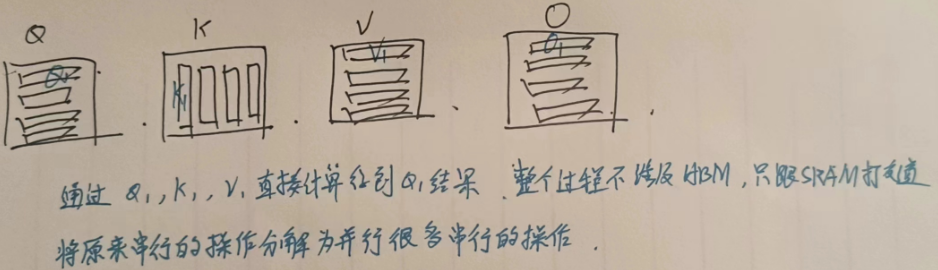

最终只有输出$O_1$涉及存储到HBM中。

### 1.3 计算前提

仅仅是将矩阵进行分块计算这样就可以了吗？No

  1. 数值稳定性：在计算注意力的过程中，涉及到$softmax$操作，$softmax$包含指数函数，所以为了避免数值溢出问题，可以将每个元素都减去最大值，对于一个向量来说，我们给每一个数减去相同的任一常量，其$softmax$​是不变的。

$$m(x):=\max _{i} \quad x_{i}, \quad f(x):=\left[\begin{array}{lll}
 e^{x_{1}-m(x)} & \ldots & e^{x_{B}-m(x)}
 \end{array}\right], \quad \ell(x):=\sum_{i} f(x)_{i}, \quad \operatorname{softmax}(x):=\frac{f(x)}{\ell(x)}$$

  2. 分块计算softmax：同时对于$softmax$操作是按行计算的，如果对齐进行分块，那么每行的最大值如果只考虑分块后的最大值就产生了偏差，需要维护每行的最大值用于分块以及上述数值的稳定性计算。

我们考虑将一行分为两部分的情况，即原本的一行数据 $x \in \mathbb{R}^{2 B}=\left[x^{(1)}, x^{(2)}\right]$

考虑整行正确的 $f(x^{(1)}) = e^{x^{(1)}-max(x)}$

有偏差的考虑分块的 $f'(x^{(1)}) = e^{x^{(1)}-max(x^{(1)})}$

如何进行纠正？$f(x^{(1)}) =f'(x^{(1)}) \times e^{max(f'(x^{(1)})) - max(x)}$

所以说，分块计算之后，要进行纠正，需要维护整行的$max$值。

### 1.4 FlashAttention 算法

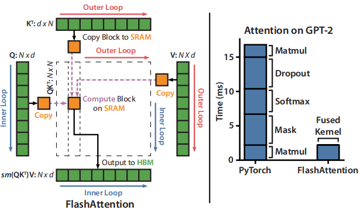

简要描述：外层循环遍历$K^T$，内层循环遍历$Q$

$Q$的第一块(按行拆分)和$K^T$的第一块(按列拆分)计算得到中间结果$S$中$(0, 0)$的结果

$Q$的第二块(按行拆分)和$K^T$的第一块(按列拆分)计算得到中间结果$S$中$(1, 0)$的结果

$Q$的第三块(按行拆分)和$K^T$的第一块(按列拆分)计算得到中间结果$S$中$(2, 0)$的结果

$Q$的第三块(按行拆分)和$K^T$的第一块(按列拆分)计算得到中间结果$S$中$(3, 0)$的结果

> 这里应该是可以并行计算的，因为这是中间结果的第一列，不涉及softmax操作，暂时还未涉及到分块计算softmax纠正偏差的问题。

当外层循环计算到$K^T$的第二块(按列拆分)时，就会开始填充中间结果$S$的第二列，这时有了第一列和第二列的结果，就需要进行$softmax$纠正偏差。

至此，后面计算到中间结果的每列时，每当有新的中间结果加入时，都需要对该中间结果所在的行进行纠正错误。

纠正方法：$\times e^{max(x_{sec}) - max(x)}$

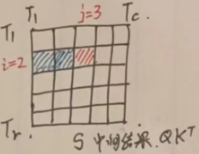

每次循环计算时，将$K_j, V_j$加载到SRAM，占据SRAM的50%的存储，将$Q_i,O_i$加载进SRAM，占据另一半的显存。$l_i, m_i$比较小，按作者的说法可以放进寄存器。

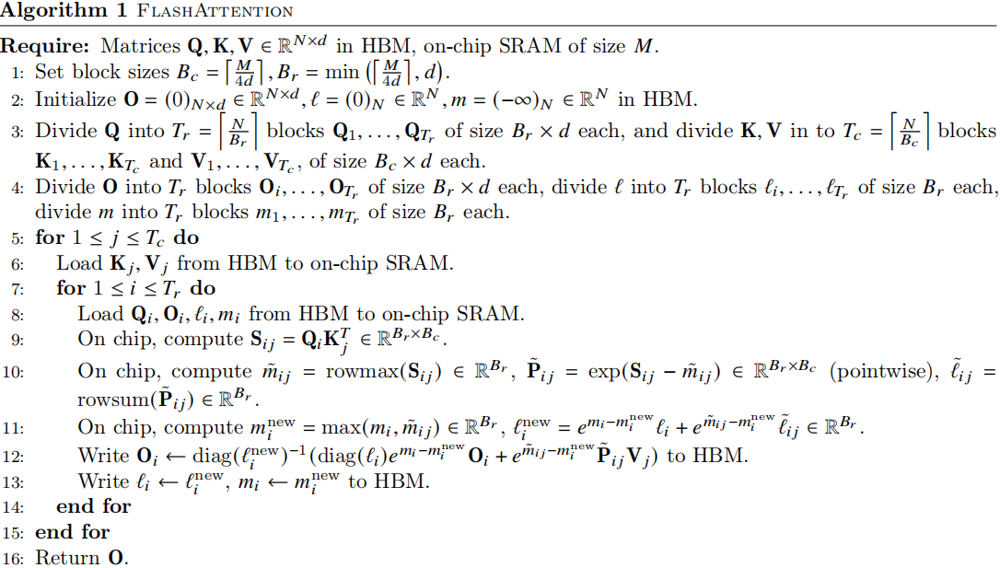

>   1. 初始化
> 
> 按列拆分，每个块的大小为 $B_c = \left\lceil\frac{M}{4 d}\right\rceil$，将$K, V$拆分为$T_{c}=\left\lceil\frac{N}{B_{c}}\right\rceil$个列块，形状 $B_c \times d$。
> 
> 按行拆分，每个块的大小为 $B_{r}=\min \left(\left\lceil\frac{M}{4 d}\right\rceil, d\right)$，将$Q$拆分为 $T_{r}=\left\lceil\frac{N}{B_{r}}\right\rceil$ 个行块，形状 $B_r \times d$。
> 
> 将$O$按行拆分为 $T_r$ 个块，形状 $B_r \times d$。
> 
> 将$l，m$均拆分为 $T_r$ 个块，大小为 $B_r$ 的一维向量。
> 
>   2. 将 $Q_i, O_i, l_i, m_i$ 从HBM移动到SRAM
> 
>   3. 计算 $S_{ij} = Q_iK_j^T$
> 
>   4. 修正每个行块的 $\tilde{m}_{i j}$，修正每个块的中间计算结果 $\tilde{\mathbf{P}}_{i j}=\exp \left(\mathbf{S}_{i j}-\tilde{m}_{i j}\right)$，修正每行的累积和 $\tilde{\ell}_{i j}$
> 
>   5. 更新每块
> 
> 

## 二、FlashAttention-2

  * 去年7月，FlashAttention-2发布，相比第一代实现了2倍的速度提升，比PyTorch上的标准注意力操作快5～9倍。
  * 在H100上仅实现了理论最大FLOPS 35%的利用率。
  * FlashAttention（以及FlashAttention-2）通过减少内存读写次数，开创了一种在GPU上加速注意力机制的方法，现在大多数库都使用它来加速Transformer的训练和推理。这使得大语言模型的上下文长度在过去两年中大幅增加，从2-4K（如GPT-3、OPT）扩展到128K（如GPT-4），甚至达到1M（如Llama 3、Gemini 1.5 Pro）。

### 2.1 硬件特性

GPU存在大量的线程(被称为kernel)用于执行一个操作。线程被组织为线程块，线程块被调度在 streaming multiprocessors (SMs) 上运行。

在每个线程块内部，线程被分组为 warps (包含32个线程的线程组)。

warp 内的线程可以通过 fast shuffle instructions 进行通信或协同执行矩阵乘法。

线程块内的warps 可以通过对共享内存读写进行通信。

每个线程 (kernel) 从HBM 中加载输入到寄存器和SRAM中计算，然后将输出写回 HBM。

### 2.2 标准的注意力实现

给定输入序列 $\mathbf{Q}, \mathbf{K}, \mathbf{V} \in \mathbb{R}^{N \times d}$，计算注意力输出 $\mathbf{O} \in \mathbb{R}^{N \times d}$.

中间计算过程 $\mathbf{S}=\mathbf{Q} \mathbf{K}^{\top} \in \mathbb{R}^{N \times N}, \quad \mathbf{P}=\operatorname{softmax}(\mathbf{S}) \in \mathbb{R}^{N \times N}, \quad \mathbf{O}=\mathbf{P V} \in \mathbb{R}^{N \times d}$

softmax是基于每行进行操作的。

对于多头注意（MHA），这个相同的计算是在多个头部上并行执行的，并在批处理维度（批处理中输入序列的数量）上并行执行的。

注意力的反向传播过程如下。设 $\mathrm{dO} \in \mathbb{R}^{N \times d}$​ 是O相对于某些损失函数的梯度。然后根据链式规则（即反向传播）：

$$\mathbf{d V}=\mathbf{P}^{\top} \mathbf{d} \mathbf{O} \in \mathbb{R}^{N \times d}$$

$$\mathbf{d} \mathbf{P}=\mathbf{d} \mathbf{O} \mathbf{V}^{\top} \in \mathbb{R}^{N \times N}$$

$$\mathbf{d S}=\operatorname{dsoftmax}(\mathbf{d} \mathbf{P}) \in \mathbb{R}^{N \times N}$$

$$\mathrm{dQ}=\mathrm{dSK} \in \mathbb{R}^{N \times d}$$

$$\mathbf{d K}=\mathbf{Q d} \mathbf{S}^{\top} \in \mathbb{R}^{N \times d}$$

dsoftmax是逐行应用的softmax的梯度。

对于向量$s, p$，如何从输出梯度 $d_p$计算输入梯度 $𝑑_𝑠$？

$$d s=\left(\operatorname{diag}(p)-p p^{\top}\right) d p$$

> $diag(p)$ 是一个对角矩阵，其对角线上的元素是 $𝑝$ 的元素。

标准的注意实现将矩阵$S$和$P$存储到HBM，这需要 $O(N^2)$内存。通常𝑁≫𝑑（通常𝑁在1k-8k左右，𝑑在64-128左右）。

标准注意实现：

(1)调用矩阵乘（GEMM）计算 $S=QK^T$，将结果写入HBM

然后(2)从HBM加载$S$并计算softmax，并将结果$P$写入HBM，

最后(3)调用GEMM计算 $O = PV$。

由于大多数操作受到内存带宽的限制，大量的内存访问转化为 slow wall-clock time。

此外，由于必须实现S和P，所需的内存是 $O(N^2)$。此外，我们必须保存 $P\in\mathbb{R}^{N\times N}$ 用于反向传播计算梯度。

### 2.3 Flash Attention-1

#### 2.3.1 前向传播

FlashAttention 应用传统的 tiling 来减少内存IO：

  1. 从HBM加载 blocks of inputs 到SRAM
  2. 计算对 block 的 attention
  3. 更新输出，而不需要将较大的中间矩阵S和P写入HBM

由于 softmax 耦合 entire row 或 blocks of row (整行或块内的行，指softmax操作特性)，online softmax 可以将注意力计算分割成块，并重新调整每个块的输出，最终得到正确的结果（无近似值）。

通过显著减少内存读取/写入量，FlashAttention 实现了优化基线注意实现的 2-4 倍的 wall-clock 加速。

online softmax如何在注意力中使用？

为了简单起见，仅考虑注意力矩阵$S$的一个 row block $[s^{(1)} \ s^{(2)}]$，其中 $s^{(1)}, s^{(2)} \in \mathbb{R}^{B_r \times B_c}$，我们想要计算这个row block的softmax以及与value$\left[\begin{array}{l}
\mathbf{V}^{(1)} \\
\mathbf{V}^{(2)}
\end{array}\right]$的乘积，$\mathbf{V}^{(1)}, \mathbf{V}^{(2)} \in \mathbb{R}^{B_c \times d}$，**标准的softmax计算如下** ：

  1. $m=\max \left(\operatorname{rowmax}\left(\mathbf{S}^{(1)}\right), \operatorname{rowmax}\left(\mathbf{S}^{(2)}\right)\right) \in \mathbb{R}^{B_{r}}$ $m$这里是整行的最大值
  2. $\ell=\operatorname{rowsum}\left(e^{\mathbf{S}^{(1)}-m}\right)+\operatorname{rowsum}\left(e^{\mathbf{S}^{(2)}-m}\right) \in \mathbb{R}^{B_{r}}$ $l$ 计算的是整行的指数和，减去最大值为了防止溢出
  3. $\mathbf{P}=\left[\begin{array}{ll}
 \mathbf{P}^{(1)} & \mathbf{P}^{(2)}
 \end{array}\right]=\operatorname{diag}(\ell)^{-1}\left[\begin{array}{ll}
 e^{\mathbf{S}^{(1)}-m} & e^{\mathbf{S}^{(2)}-m}
 \end{array}\right] \in \mathbb{R}^{B_{r} \times 2 B_{c}}$ 计算softmax，除指数和，通过乘以 $diag(l)^{-1}$ 实现除法
  4. $\mathbf{O}=\left[\begin{array}{ll}
 \mathbf{P}^{(1)} & \mathbf{P}^{(2)}
 \end{array}\right]\left[\begin{array}{l}
 \mathbf{V}^{(1)} \\
 \mathbf{V}^{(2)}
 \end{array}\right]=\operatorname{diag}(\ell)^{-1} e^{\mathbf{S}^{(1)}-m} \mathbf{V}^{(1)}+e^{\mathbf{S}^{(2)}-m} \mathbf{V}^{(2)} \in \mathbb{R}^{B_{r} \times d}$ 计算输出$O$

Online softmax 计算每个块的“local”softmax，然后重新缩放以得到正确的输出

  1. $m^{(1)}=\operatorname{rowmax}\left(\mathbf{S}^{(1)}\right) \in \mathbb{R}^{B_{r}}$ 第一个块的最大值 $m^{(1)}$
  2. $\ell^{(1)}=\operatorname{rowsum}\left(e^{\mathbf{S}^{(1)}-m^{(1)}}\right) \in \mathbb{R}^{B_{r}}$ 第一个块的指数和 $l^{(1)}$
  3. $\tilde{\mathbf{P}}^{(1)}=\operatorname{diag}\left(\ell^{(1)}\right)^{-1} e^{\mathbf{S}^{(1)}-m^{(1)}} \in \mathbb{R}^{B_{r} \times B_{c}}$ 第一个块的softmax值
  4. $\mathbf{O}^{(1)}=\tilde{\mathbf{P}}^{(1)} \mathbf{V}^{(1)}=\operatorname{diag}\left(\ell^{(1)}\right)^{-1} e^{\mathbf{S}^{(1)}-m^{(1)}} \mathbf{V}^{(1)} \in \mathbb{R}^{B_{r} \times d}$ 第一个块的输出 $O^{(1)}$
  5. $m^{(2)}=\max \left(m^{(1)}, \operatorname{rowmax}\left(\mathbf{S}^{(2)}\right)\right)=m$ 计算第二个块的最大值，将第一个块的最大值也要考虑进去
  6. $\ell^{(2)}=e^{m^{(1)}-m^{(2)}} \ell^{(1)}+\operatorname{rowsum}\left(e^{\mathbf{S}^{(2)}-m^{(2)}}\right)=\operatorname{rowsum}\left(e^{\mathbf{S}^{(1)}-m}\right)+\operatorname{rowsum}\left(e^{\mathbf{S}^{(2)}-m}\right)=\ell$ 更新指数和，$m^{(2)}$现在更新为了整行的最大值，最先前已经计算出的第一块的指数和进行纠正缩放，再加上第二块的指数和，最终得到整行的指数和
  7. $\tilde{\mathbf{P}}^{(2)}=\operatorname{diag}\left(\ell^{(2)}\right)^{-1} e^{\mathbf{S}^{(2)}-m^{(2)}}$ 第二块的softmax值
  8. $\mathbf{O}^{(2)}=\operatorname{diag}\left(\ell^{(1)} / \ell^{(2)}\right)^{-1} \mathbf{O}^{(1)}+\tilde{\mathbf{P}}^{(2)} \mathbf{V}^{(2)}=\operatorname{diag}\left(\ell^{(2)}\right)^{-1} e^{s^{(1)}-m} \mathbf{V}^{(1)}+\operatorname{diag}\left(\ell^{(2)}\right)^{-1} e^{s^{(2)}-m} \mathbf{V}^{(2)}=\mathbf{O}$ 计算整行的输出，对之前使用局部最大值计算出来的$O^{(1)}$进行纠正缩放，再加上第二块的输出$\tilde{\mathbf{P}}^{(2)} \mathbf{V}^{(2)}$

下图为 FlashAttention 使用 online softmax 开启 tiling 减少内存读写。

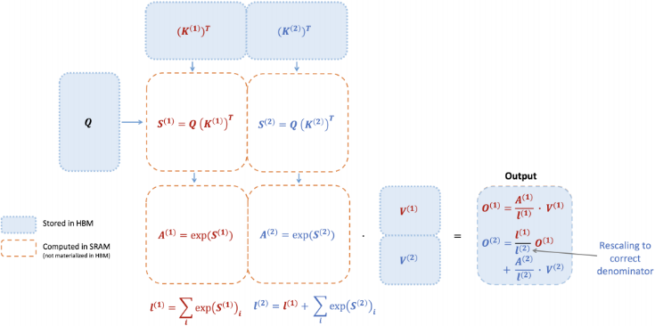

**图中，键K和值V分为了两个块。**

#### 2.3.2 反向传播

  1. 在反向传播中，一旦输入的Q、K、V已经加载到SRAM，通过重新计算注意力矩阵S和P的值，FlashAttention 避免了存储较大的中间值。

通过不保存大小为𝑁×𝑁的大矩阵S和P，FlashAttention 产生10-20倍内存节省，取决于序列长度（序列长度𝑁为线性内存，而不是二次内存）。由于减少内存读写，反向传播也实现了2-4倍的wall-clock加速。

  2. 反向传播也应用了tiling。虽然反向传播在概念上比前向传播更简单（没有softmax重缩放），但实现明显更复杂。

这是因为在SRAM中有更多的值需要保留，以便在反向传播中执行5个矩阵乘法，而在前向传播中只有2个矩阵乘法。

### 2.4 FlashAttention-2

我们描述了FlashAttention-2算法，它包括对 FlashAttention 的一些调整，以减少 non-matmul FLOPs。

然后，我们将描述了如何在不同的线程块上并行化计算，以充分利用GPU资源。

最后，我们描述了在一个线程块内的不同warp之间划分工作，以减少共享内存的访问量。

#### 2.4.1 算法调整

调整了FlashAttention的算法以减少 the number of non-matmul FLOPs.

这是因为现代 GPUs 有专门的计算单元（ 例如，Nvidia图形处理器上的 Tensor Cores ），可以使乘法更快。

例如，A100 GPU的FP16/BF16 matmul的最大理论吞吐量为 312TFLOPs/s，而非matmul FP32的理论吞吐量只有19.5 TFLOPs/s。

另一种角度思考，每个非矩阵 FLOP 比一个矩阵FLOP 昂贵16×。

为了保持高吞吐量（例如，超过最大理论TFLOPs/s的50%），我们希望花尽可能多的时间在matmul FLOPs上。

##### 2.4.1.1 前向传播

重新回到online softmax trick，做出了两个小的调整以减少非乘法FLOPs

  1. 在2.3.1 FlashAttention online softmax 中, 对于$O^{(2)}$的计算, 我们先对第二部分的中间计算结果$\tilde{\mathbf{P}}^{(2)}$进行了缩放 $\tilde{\mathbf{P}}^{(2)}=\operatorname{diag}\left(\ell^{(2)}\right)^{-1} e^{\mathbf{S}^{(2)}-m^{(2)}}$

然后在计算最终的输出 $O^{(2)}$ 时, 又对第一部分的输出结果 $O^{(1)}$ 进行了缩放调整 $\operatorname{diag}\left(\ell^{(1)} / \ell^{(2)}\right)^{-1} \mathbf{O}^{(1)}$

FlashAttention-2 对此进行改进, 避免对两项都进行缩放

方法是维护未缩放的 $O^{(2)}$ 并保持统计信息 $\ell^{(2)}$,具体计算如下:

$\tilde{\mathbf{O}}^{(2)}=\operatorname{diag}\left(\ell^{(1)}\right)^{-1} \mathbf{O}^{(1)}+e^{\mathbf{S}^{(2)}-m^{(2)}} \mathbf{V}^{(2)}$ 这里并没有计算完整的$O^{(2)}$, 没有缩放

只在循环的结束时, 通过 $diag(\ell^{(last)})^{-1}$ 缩放最终的 $\tilde{\mathbf{O}}^{\text {(last) }}$ 得到正确的output

  2. 在反向传播过程中, 不再需要保存最大值 $m^{(j)}$ 和指数和 $\ell^{(j)}$, 只需要存储 对数指数和 $L^{(j)}=m^{(j)}+\log \left(\ell^{(j)}\right)$​

同样是一个简单的两个块的示例, online softmax trick 现在变为:

     1. $m^{(1)}=\operatorname{rowmax}\left(\mathbf{S}^{(1)}\right) \in \mathbb{R}^{B_{r}}$ 计算第一部分的最大值
     2. $\ell^{(1)}=\operatorname{rowsum}\left(e^{\mathbf{S}^{(1)}-m^{(1)}}\right) \in \mathbb{R}^{B_{r}}$​ 计算第一部分的局部指数和
     3. $\mathbf{O}^{\tilde{(1)}}=e^{\mathbf{S}^{(1)}-m^{(1)}} \mathbf{V}^{(1)} \in \mathbb{R}^{B_{r} \times d}$ 计算未缩放的$\mathbf{O}^{\tilde{(1)}}$, 相当于这时还没有进行softmax
     4. $m^{(2)}=\max \left(m^{(1)}, \operatorname{rowmax}\left(\mathbf{S}^{(2)}\right)\right)=m$ 计算第二部分的最大值, 由于上述提到,中间不再维护最大值进行缩放纠正,当前仅两个分块, 所以这里是再最后时刻才会统计最大值 !
     5. $\ell^{(2)}=e^{m^{(1)}-m^{(2)}} \ell^{(1)}+\operatorname{rowsum}\left(e^{\mathbf{S}^{(2)}-m^{(2)}}\right)=\operatorname{rowsum}\left(e^{\mathbf{S}^{(1)}-m}\right)+\operatorname{rowsum}\left(e^{\mathbf{S}^{(2)}-m}\right)=\ell$ 有了最终的最大值, 对先前的指数和进行缩放调整, 并计算当前的指数和
     6. $\tilde{\mathbf{P}}^{(2)}=\operatorname{diag}\left(\ell^{(2)}\right)^{-1} e^{\mathbf{S}^{(2)}-m^{(2)}}$ 对最后一部分进行缩放, 应用softmax
     7. $\tilde{\mathbf{O}}^{(2)}=\operatorname{diag}\left(e^{m^{(1)}-m^{(2)}}\right)^{-1} \tilde{\mathbf{O}}^{(1)}+e^{\mathbf{S}^{(2)}-m^{(2)}} \mathbf{V}^{(2)}=e^{s^{(1)}-m} \mathbf{V}^{(1)}+e^{s^{(2)}-m} \mathbf{V}^{(2)}$ 对先前的$\tilde{\mathbf{O}}^{(1)}$进行缩放, 并加上当前块的输出
     8. $\mathbf{O}^{(2)}=\operatorname{diag}\left(\ell^{(2)}\right)^{-1} \tilde{\mathbf{O}}^{(2)}=\mathbf{O}$ 对$\tilde{\mathbf{O}}^{(2)}$进行缩放, 得到最终正确的$O^{(2)}$

  * 第6步 使用全局的指数和 对第二部分进行缩放, 这里的计算结果已经是正确的结果了, 后续没有用到 $\tilde{\mathbf{P}}^{(2)}$ 为什么还需要计算这一步

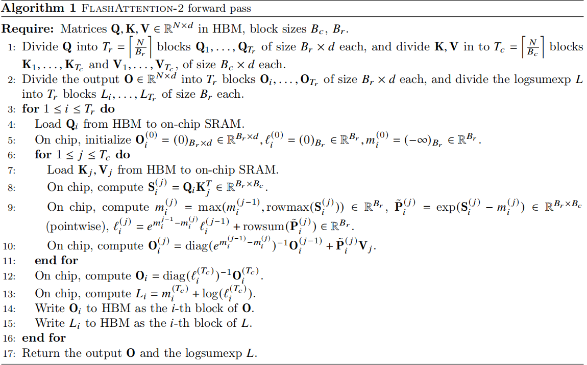

> 结合上述算法, 再次对核心的计算部分进行总结:
> 
> 对于每个块,
> 
>   1. 计算当前块为止的最大值 $m_i^{(j)}$
> 
>   2. 计算 $\tilde{\mathbf{P}}_{i}^{(j)}=\exp \left(\mathbf{S}_{i}^{(j)}-m_{i}^{(j)}\right)$, 称它为未缩放的指数部分
> 
>   3. 计算 $\ell_i^{(j)}$ 纠正之前的指数和 + 当前的指数和, 用的最大值是截止到当前块的最大值
> 
>   4. 计算 $O_i^{(j)}$ 纠正之前的 $O_i^{(j-1)}$ + 当前的指数部分×V
> 
>   5. 在每行的结束时, $\ell_i^{(T_c)}$ 是整行的纠正过的指数和, $O_i^{(T_c)}$ 是整行的纠正过的PV和
> 
> 然后对整行的纠正过的PV和进行统一缩放: $\mathbf{O}_{i}=\operatorname{diag}\left(\ell_{i}^{\left(T_{c}\right)}\right)^{-1} \mathbf{O}_{i}^{\left(T_{c}\right)}$
> 
> 

> 
> 需要缓存的内容:
> 
>   * 每行结束时, 将$O_i$ 写入HBM, 将$L_i$写入HBM, $L^{(j)}=m^{(j)}+\log \left(\ell^{(j)}\right)$
> 

**Causal masking**

一个常见用例是在自回归语言建模中，我们需要对注意矩阵S应用一个因果掩码 ($S_{i, j}$ when $j>i$ is set to $-∞$)

  1. 由于FlashAttention和FlashAttention-2已经通过块操作，对于任何所有列索引都超过行索引的块（对于长序列, 近似占到一般的块），我们可以跳过该块的计算。与没有因果掩码的注意力相比，这导致了大约1.7-1.8×的加速。

  2. 我们不需要对行索引保证严格小于列索引的块应用因果掩码。

This means that for each row, we only need apply causal mask to 1 block (assuming square block). ???

##### 2.4.1.2 反向传播

FlashAttention-2的反向传播过程与FlashAttention几乎相同, 做出了一个小的调整, 仅使用每行的对数指数和$L$代替每行的最大值和每行的指数和.

> 对下图算法总结:
> 
> 逐元素乘法计算 $D=\operatorname{rowsum}(\mathbf{d} \mathbf{O} \circ \mathbf{O}) \in \mathbb{R}^{d}$
> 
> 反向传播时, 外层遍历列, 内层遍历行
> 
>   1. 通过$Q_i, K_j^T$恢复中间结果 $\mathbf{S}_{i}^{(j)}=\mathbf{Q}_{i} \mathbf{K}_{j}^{T} \in \mathbb{R}^{B_{r} \times B_{c}}$
> 
>   2. 通过$S_{i, j}, L_i$ 恢复 $P_i^{(j)}$, $L^{(j)}=m^{(j)}+\log \left(\ell^{(j)}\right)$
> 
> $$\begin{align}
 \mathbf{P}_{i}^{(j)} & = \exp \left(\mathbf{S}_{i j}-L_{i}\right) \in \mathbb{R}^{B_{r} \times B_{c}} \\
 &= \exp(\mathbf{S}_{i, j} - (m^{(i)} + \log(\ell^{(i)}))) \\
 &= \exp(\mathbf{S}_{i, j} - m^{(i)} -  \log(\ell^{(i)}) ) \\
 &= \exp(\mathbf{S}_{i, j} - m^{(i)}) \times \exp(-\log (\ell^{(i)})) \\
 &= \exp(\mathbf{S}_{i, j} - m^{(i)}) \times \frac{1}{\ell^{(i)}}
 \end{align}$$
> 
> 由于存储的$L^{(i)}$中均为每行的最大值和指数和, 所以这里恢复出来的$P_i^{(j)}$即为正确的结果
> 
>   3. 计算梯度, $\mathbf{d} \mathbf{V}_{j} \leftarrow \mathbf{d} \mathbf{V}_{j}+\left(\mathbf{P}_{i}^{(j)}\right)^{\top} \mathbf{d} \mathbf{O}_{i} \in \mathbb{R}^{B_{c} \times d}$
> 
> $\mathbf{d} \mathbf{V}_{j}$ 初始为$0$矩阵, 所以这里没问题
> 
>   4. 计算梯度, $\mathbf{d} \mathbf{P}_{i}^{(j)}=\mathbf{d} \mathbf{O}_{i} \mathbf{V}_{j}^{\top} \in \mathbb{R}^{B_{r} \times B_{c}}$
> 
>   5. 计算梯度, $\mathrm{dS}_{i}^{(j)}=\mathbf{P}_{i}^{(j)} \circ\left(\mathbf{d P}_{i}^{(j)}-D_{i}\right) \in \mathbb{R}^{B_{r} \times B_{c}}$​ ???
> 
>   6. 计算梯度, $\mathrm{dQ}_{i} \leftarrow \mathrm{dQ}_{i}+\mathrm{dS}_{i}^{(j)} \mathbf{K}_{j} \in \mathbb{R}^{B_{r} \times d}$
> 
>   7. 计算梯度, $\mathrm{d} \mathbf{K}_{j} \leftarrow \mathrm{dK}_{j}+\mathrm{dS}_{i}^{(j)^{\top}} \mathbf{Q}_{i} \in \mathbb{R}^{B_{c} \times d}$
> 
> 

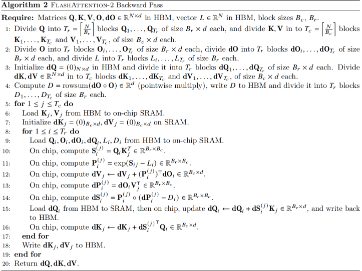

**多查询注意力MQA 和 分组查询注意力GQA**

多个查询头关注同一键和值的头，以减少推理过程中KV缓存的大小。

我们不必复制键和值头，而是隐式地操作头中的索引以执行相同的计算。

在反向传播期间, 需要对隐式重复的不同头部的梯度dK和dV进行求和。

> 多个查询头共享相同的键和值, 需要对这些共享键和值的梯度进行求和
> 
> 如果一个键或值被多个查询头使用，那么在反向传播时，需要将这些查询头对应的梯度 𝑑𝐾 和 𝑑𝑉 进行累加，以确保梯度的正确更新。

### 3\. 并行性

### 4\. Warps之间的工作划分

## 三、FlashAttention-3

  * 相比第二代又实现了1.5～2倍的速度提升。

  * FlashAttention-3 将H100的FLOP利用率再次拉到75%。

  * 这一版的FlashAttention专攻H100 GPU，只能在H100或H800上运行，不支持其他GPU型号。

  * 

## 四、动画演示

<https://www.youtube.com/playlist?list=PLBWdTDczuFNrxnetcH-5CVLRP1u4Ua87m>

### 1\. 标准注意力算法--短序列

  1. 初始时，S、P存储中间计算结果，O存储输出结果，以及Q、K、V均存储在HBM中

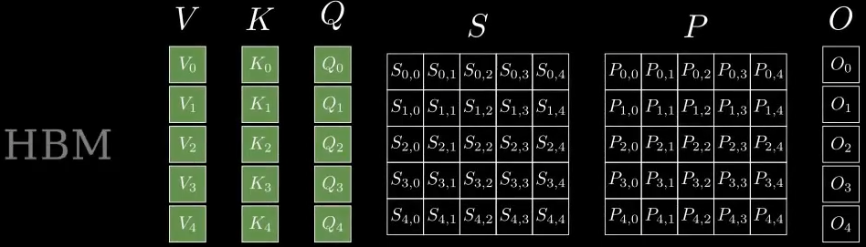

  2. 将Q、K移动到SRAM

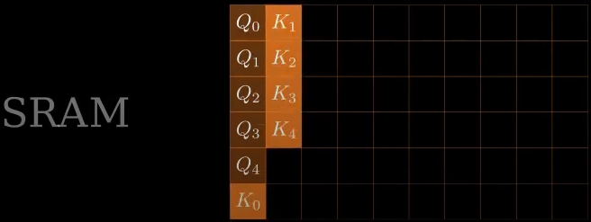

  3. 计算$QK^T$，依次计算$Q_0$和$K_0, K_1, K_2, K_3, K_4$的乘积，依次向后填充

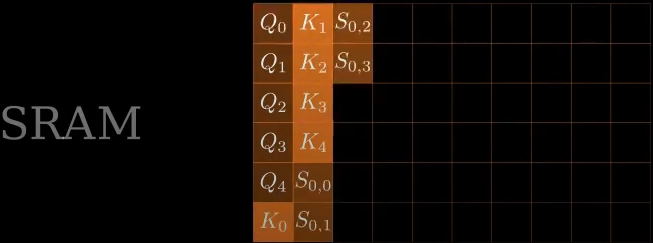

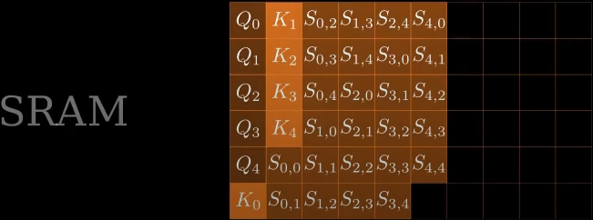

  4. 将计算好的中间结果$S_{0, 0}, S_{0, 1},S_{0, 2},... $，从SRAM移动到HBM。

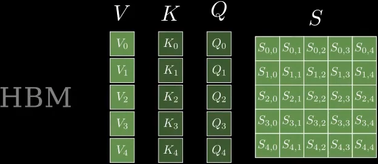

  5. 对SRAM中的中间结果计算$softmax$，每次计算一行 $S_{0, 0}, ... S_{0, 4}$

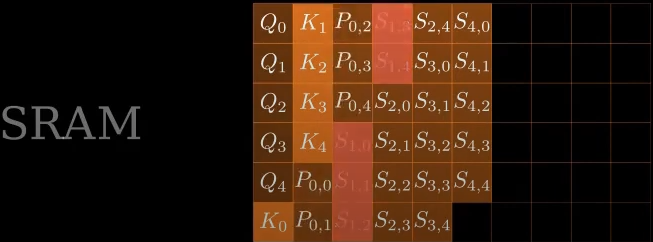

  6. $softmax$结果$P$计算完成后，从SRAM移动到HBM

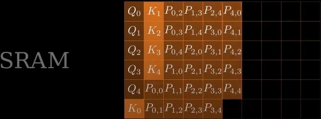

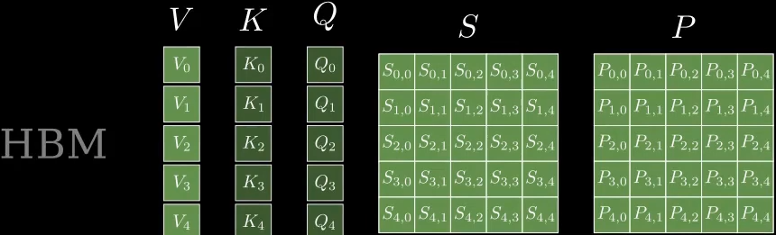

  7. 将SRAM中存储的$Q和K$清空，并将$V$从HBM移动到SRAM，进行后续计算

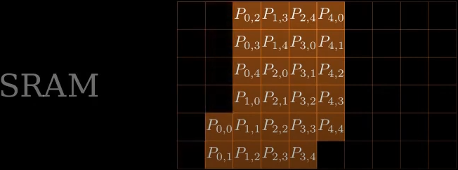

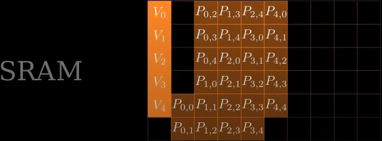

  8. 计算$O_i = P_iV$，并将结果从SRAM移动到HBM

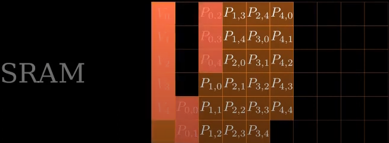

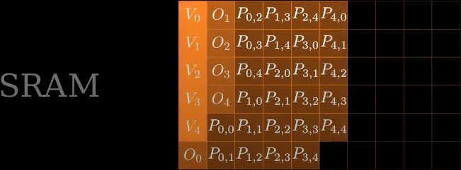

  9. 最终将SRAM置空

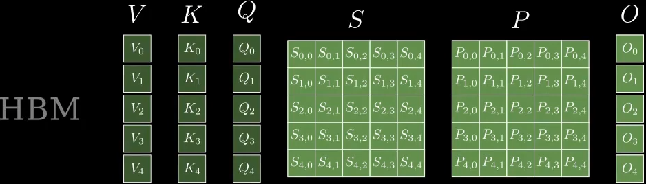

### 2\. 标准注意力算法--长序列

计算过程与短序列一致

### 3.标准注意力算法--中等长度序列

计算过程与短序列一致

### 4\. Flash Attention算法-长序列

  1. 初始

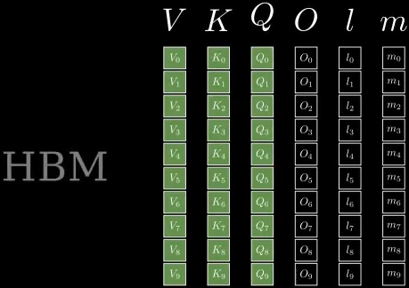

  2.