# 力扣-图

> 原文作者：幻影星全能的木豆  
> 原文链接：https://www.cnblogs.com/mudou/p/18321968  
> 发布时间：2024-07-24 22:55

---

## 图

图的存储方式一般是 邻接表和邻接矩阵

**深搜** ：沿着一个方向搜，搜不下去了，再换方向，换方向的过程就涉及到了回溯。

**广搜** ：先把本节点所连接的所有节点遍历一遍，走到下一个节点时，再把连接节点的所有节点遍历一遍。

DFS-代码框架

```python
void dfs(){
    处理节点
    dfs(图，选择的节点)	// 递归
    回溯，撤销处理结果
}
```

### 200-岛屿数量-中等

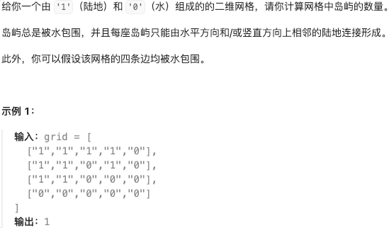

**深度优先搜索**

  * 标记数组
  * 方向数组

```python
class Solution:
    def numIslands(self, grid: List[List[str]]) -> int:
        """
        邻接矩阵存储
        寻找最大联通子图个数
        """
        m, n = len(grid), len(grid[0])	# 行, 列
        # 创建一个辅助标记数组，记录是否有被访问
        visited = [[False for _ in range(n)] for _ in range(m)]
        dirs = [(-1, 0), (0, 1), (1, 0), (0, -1)]   # 四个方向
        result = 0

        def dfs(x, y):  # 每执行一次，将与其联通的节点进行标记。
            if visited[x][y] or grid[x][y] == '0':
                return  # 已访问过 或 遇到海水
           	# 访问当前节点
            visited[x][y] = True
           	# 向四个方向进行探索
            for d in dirs:
                nextx = x + d[0]
                nexty = y + d[1]
                if nextx < 0 or nextx >=m or nexty < 0 or nexty >=n:    # 越界
                    continue
                dfs(nextx, nexty)

        for i in range(m):
            for j in range(n):
                if not visited[i][j] and grid[i][j] == '1':
                    result += 1
                    dfs(i, j)
        return result
```

**广度优先搜索**

细节：广搜中，只要加入队列就代表走过，就需要标记，而不是从队列中拿出来的时候再去标记。

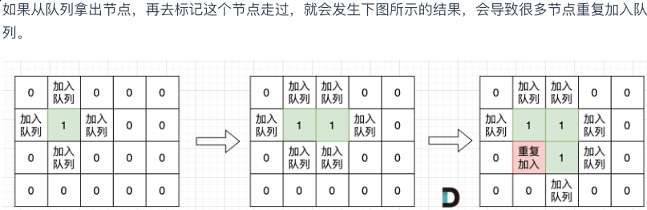

```python
class Solution:
    def numIslands(self, grid: List[List[str]]) -> int:
        """
        BFS-广度优先遍历
        邻接矩阵
        """
        from collections import deque
        dirs = [(-1, 0), (0, 1), (1, 0), (0, -1)]
        # 行, 列
        m, n = len(grid), len(grid[0])
        visited = [[False for _ in range(n)] for _ in range(m)]

        def bfs(x, y):
            q = deque()
            q.append((x, y))
            visited[x][y] = True

            while q:
                x, y = q.popleft()
                for d in dirs:
                    nextx = x + d[0]
                    nexty = y + d[1]
                    if nextx < 0 or nexty < 0 or nextx >= m or nexty >= n:
                        continue
                    if visited[nextx][nexty] or grid[nextx][nexty] == '0':
                        continue
                    q.append((nextx, nexty))
                    visited[nextx][nexty] = True

        result = 0
        for i in range(m):
            for j in range(n):
                if not visited[i][j] and grid[i][j] == '1':
                    result += 1
                    bfs(i, j)
        return result
```

### 130-被围绕的区域-中等

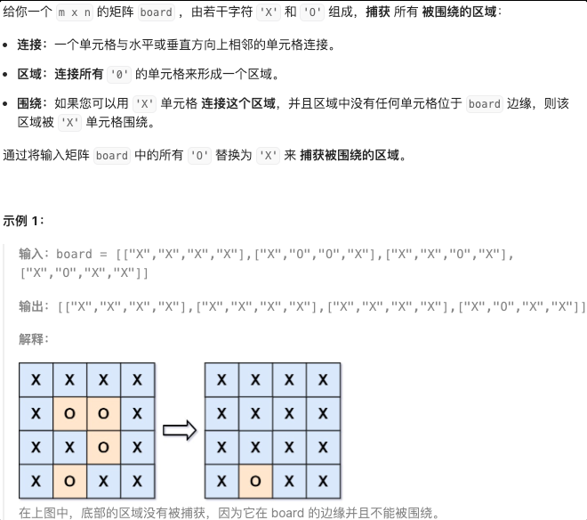

记住该思路，与边界联通的 O 不应被替换

```python
class Solution:

    def solve(self, board: List[List[str]]) -> None:
        """
        思路：
        1. 从边界出发，将边界上和 O 联通的全变成 B
        2. 遍历整个 board，将 O 变成 X
        3. 再将 B 变成 O        
        """
        dirs = [(-1, 0), (0, 1), (1, 0), (0, -1)]
        m, n = len(board), len(board[0])
        # 将边界上的与 O 相连通的变成 B 
        def dfs(x, y):
            # 将联通的 O 变成 B
            board[x][y] = 'B'
            for d in dirs:
                nextx = x + d[0]
                nexty = y + d[1]
                if nextx < 0 or nexty < 0 or nextx >= m or nexty >= n:
                    continue
                if board[nextx][nexty] == 'O':
                    dfs(nextx, nexty)

        # 将与边界联通的 O 变成 B
        for i in range(m):
            for j in range(n):
                if board[i][j] == 'O' and (i == 0 or i == m-1 or j == 0 or j == n-1):
                    dfs(i, j)
        # 将 O 变成 X 
        for i in range(m):
            for j in range(n):
                if board[i][j] == 'O':
                    board[i][j] = 'X'
                if board[i][j] == 'B':
                    board[i][j] = 'O'
        return 
```

### 133-克隆图-中等

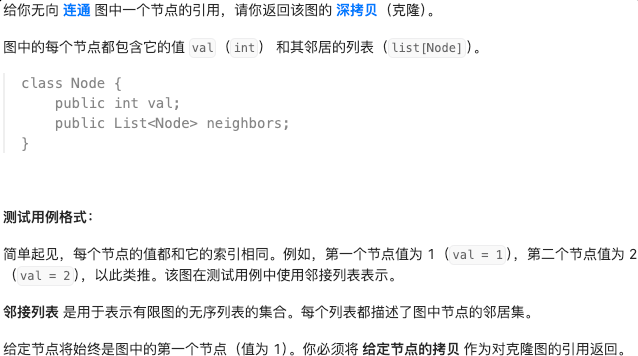

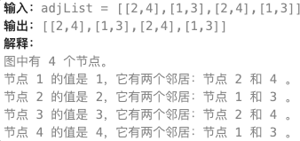

**DFS-深度优先搜索**

思路：dfs 复制节点，邻接节点也得是复制节点

```python
"""
# Definition for a Node.
class Node:
    def __init__(self, val = 0, neighbors = None):
        self.val = val
        self.neighbors = neighbors if neighbors is not None else []
"""

from typing import Optional
class Solution:
    def cloneGraph(self, node: Optional['Node']) -> Optional['Node']:
        """
        无向连通图，深拷贝
        
        遍历整个图，遍历时记录已访问点，用字典记录
        DFS
        """
        # 存储已经访问过的节点及其克隆后的节点，以避免重复克隆和循环引
        loopup = {}

        # 递归遍历节点的并创建副本，并将副本返回
        def dfs(node):
            if not node:
                return
            if node in loopup:  # 当前节点已经复制过
                return loopup[node]
            # 复制节点
            clone = Node(node.val, [])
            loopup[node] = clone

            for n in node.neighbors:
                # 加入邻接节点的副本
                clone.neighbors.append(dfs(n))
            # 返回复制的副本节点
            return clone

        # 返回 node 节点的副本(新节点)
        return dfs(node)
```

**BFS-广度优先搜索**

```python
from typing import Optional
class Solution:
    def cloneGraph(self, node: Optional['Node']) -> Optional['Node']:
        """
        BFS
        """
        from collections import deque
        lookup = {}

        # bfs 只调用了一次
        def bfs(node):
            if not node:
                return 
            clone = Node(node.val, [])
            lookup[node] = clone
            # 队列，每次 bfs 都创建一个队列
            queue = deque()
            queue.appendleft(node)

            while queue:	
                tmp = queue.pop()	
                for n in tmp.neighbors:
                    if n not in lookup:
                        lookup[n] = Node(n.val, [])
                        queue.appendleft(n)
                    # 已经创建了邻接节点的副本
                    lookup[tmp].neighbors.append(lookup[n])

            return clone
        return bfs(node) 
```

### 399-除法求值-中等-反复看

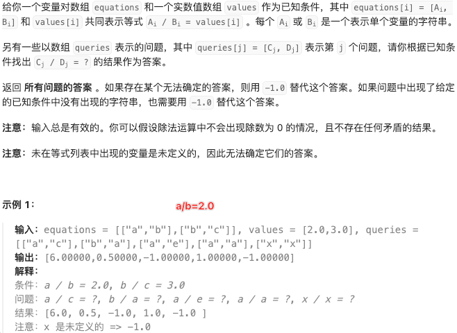

```python
class Solution:
    def calcEquation(self, equations: List[List[str]], values: List[float], queries: List[List[str]]) -> List[float]:
        """
        equations = [["a","b"],["b","c"]], 
        values = [2.0,3.0], 
        queries = [["a","c"],["b","a"],["a","e"],["a","a"],["x","x"]]

        有向图，使用字典来表示指向关系
        equations 图的点和线，values 代表边的值
        queries 查询两点之间是否存在路径及边
        """
        # 创建图，维护节点和边的关系
        graph = DefaultDict(list)
        for (a, b), val in zip(equations, values):
            graph[a].append((b, val))
            graph[b].append((a, 1/val))
        
        # 广度优先搜索
        def bfs(start, end):
            if start not in graph or end not in graph:
                return -1.0
            explored = {start}  # 集合
            q = deque([(start, 1.0)])   # 存储(当前边， 当前结果)，最终乘完会等于 end
            while q:
                node, v = q.popleft()
                if node == end:
                    return v
                # node 的邻接边，临边入队
                for nxt, edge in graph[node]:
                    # 未访问的临边，如果已经访问过会形成环
                    if nxt not in explored:
                        explored.add(nxt)
                        q.append((nxt, v * edge))
            return -1.0
        return [bfs(s, e) for s, e in queries]
```

```python
"""
    (a, c) start=a, end=c
    explored = {a, }
    q = [(a, 1)]
    popleft()
    # 临边入队 graph[a] = [(b, a/b)]
    q = [(b, 1 * a/b)]
    popleft()
    node = b, v = 1 * a/b
    # 临边入队 graph[b] = [(a, b/a), (c, b/c)], 已经访问过
    q = [(c, 1 * a/b * b/c)]
    popleft()
    c == end, return 1 * a/b * b/c
"""
```

### 207-课程表-中等

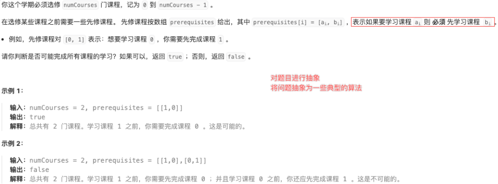

课程之间规定了前置条件，不能构成任何环路，否则课程前置条件将不成立 –> 本题可以简化为判断是否是有向无环图。

**拓扑排序-入度为 0 的课程才可以进行学习-BFS**

通过拓扑排序判断是否是有向无环图

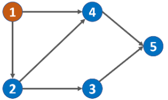

```python
class Solution:
    def canFinish(self, numCourses: int, prerequisites: List[List[int]]) -> bool:
        """
        拓扑排序：对于某点 v，只有当 v 的所有源点均出现了，v 才能出现。
        入度表-广度优先遍历
        1. 统计每个节点的入度，生成入度表
        2. 借助一个队列，将所有入度为 0 的节点入队
        3. 队列非空时，首节点出队，此节点所有邻接节点入度-1
           如果入度减为0后，说明该节点的所有前驱节点都已删除，可以将该节点入队
           每次出队，都代表该课程可以学习，因为队里的课程都是入度为0的课程。
        """
        # 1. 建立入度表
        indegrees = [0 for _ in range(numCourses)]
        graph = DefaultDict(list)
        queue = deque()

        for cur, pre in prerequisites:
            indegrees[cur] += 1
            graph[pre].append(cur)
        # 2. 入度为 0 的节点入队
        for i in range(len(indegrees)):
            if indegrees[i] == 0:
                queue.append(i)
        # 3. BFS
        while queue:
            cur = queue.popleft()
            numCourses -= 1     # 每次出栈(出栈元素为入度为 0 的课程)，表示可以学习该课程
            for adj in graph[cur]:
                indegrees[adj] -= 1
                if indegrees[adj] == 0:
                    queue.append(adj)
        return numCourses == 0
```

**DFS 判断是否有环**

```python
class Solution:
    def canFinish(self, numCourses: int, prerequisites: List[List[int]]) -> bool:
        """
        DFS 深度优先遍历，判断是否有环
        标记列表 visited 
            0 未被访问
            -1 被其他节点启动的 DFS 访问
            1  被当前节点启动的 DFS 访问
        """

        graph = DefaultDict(list)
        visited = [0] * numCourses
        for pres in prerequisites:
            graph[pres[1]].append(pres[0])

        def dfs(num):               # DFS 判断是否有环
            if visited[num] == -1:  # 终止条件：当前节点已在其他节点 DFS 中被访问过
                return True         
            if visited[num] == 1:   # 终止条件：当前节点在本轮 DFS 中被第 2 次访问，有环
                return False        
            visited[num] = 1
            for adj in graph[num]:
                if not dfs(adj):    # 判断是否有环
                    return False
            visited[num] = -1       # 本轮 DFS 结束，相对其他轮次 DFS，该节点是被其他节点 DFS 访问
            return True

        for i in range(numCourses):
            if not dfs(i):
                return False
        return True
```

### 210-课程表 II-中等

207 的基础上，将课程学习顺序记录下来。

```python
class Solution:
    def findOrder(self, numCourses: int, prerequisites: List[List[int]]) -> List[int]:
        """
        返回学习顺序
        拓扑序列
        """
        # 1. 入度表
        indegrees = [0] * numCourses
        graph = DefaultDict(list)
        for pre, cur in prerequisites:
            indegrees[pre] += 1
            graph[cur].append(pre)
        
        # 2. 入度为0的入队
        queue = deque()
        for i in range(len(indegrees)):
            if indegrees[i] == 0:
                queue.append(i)
        # 3. BFS
        res = []
        while queue:
            cur = queue.popleft()   # 当前节点，入度为 0
            res.append(cur)
            for adj in graph[cur]:
                indegrees[adj] -= 1
                if indegrees[adj] == 0:
                    queue.append(adj)
        if len(res) != numCourses:
            return []
        return res
```

### 909-蛇梯棋-中等-变态

```markdown
一个N*N的棋盘,起点是左下角,一次可以走 1-6步
从左下角开始棋盘编号从下往上蛇形递增
                7 8 9
                6 5 4
                1 2 3
如上图(其实不是图)所示:
起点是 1,终点是 9(N*N)  (1-9为棋盘编号)
每格棋盘单元格内容一般是-1
如果棋盘单元格内容不是-1,而是一个数字,
则如果跳到这里,就要传送到指定数字编号的棋盘单元格中
                -1 -1 -1
                -1 -1 -1
                -1 -1  8
如图:走到第三个格的位置,就会自动被传送到8的位置
```

背后隐含着 $1-n^2$ 的索引表。

两个转移规则（之前要么上下左右，要么相邻节点），在后面六步之中考虑传送转移。

通过 $idx \in (1, n^2)$ 来获取坐标。

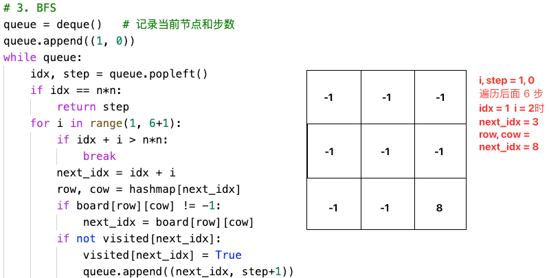

```python
class Solution:
    def snakesAndLadders(self, board: List[List[int]]) -> int:
        """
        从起点到终点的最短路径，用广度优先搜索更方便些
        两个转移规则（之前要么是上下左右，要么是相邻的转移）：
        1. 下 6 个编号
        2. board[r][c]!=-1,可以传送到指定编号board[r][c]编号的位置
        """
        # 1. 创建一个哈希表，记录值与其对应的坐标
        hashmap = {}
        n = len(board)
        start, end = 1, n*n
        r = n-1 # 左下角
        c = 0   # 左下角
        d = 1   # 方向
        while start <= end:
            hashmap[start] = (r, c)     # 值对应行列坐标
            start += 1
            c += d
            if c == n or c == -1:
                d *= -1     # 改变方向
                r -= 1      # 改变方向时，横坐标才会变化
                c += d
        # 2. 使用 visited 数组，记录是否有访问过，初始化为False，如果已经为True，表明当前并不是最短路径，已经到达过了
        visited = [False] * (n*n+1)
        
        # 3. BFS 
        queue = deque()   # 记录当前节点和步数
        queue.append((1, 0))
        while queue:
            idx, step = queue.popleft()				# 当前所在索引位置 idx     
            if idx == n*n:		
                return step		
            for i in range(1, 6+1):					# 探索后面6步
                if idx + i > n*n:					
                    break
                next_idx = idx + i					# 下一步探索索引
                row, cow = hashmap[next_idx]		# 获取下一步待探索位置对应的坐标
                if board[row][cow] != -1:			# 该位置对应的实际值
                    next_idx = board[row][cow]		# 传送-转移
                if not visited[next_idx]:
                    visited[next_idx] = True 
                    queue.append((next_idx, step+1))
        return -1
```

### 433-最小基因变化-中等-BT


**BFS-广度优先搜索**

```python
class Solution:
    def minMutation(self, startGene: str, endGene: str, bank: List[str]) -> int:
        # 每次变化都要有效，位于 bank 中
        # 变化的顺序不确定
        bank = set(bank)    # 转换为 set，in 判断只需O(1)复杂度
        if endGene not in bank:
            return -1
        queue = deque()
        queue.append((startGene, 0))    # 初始节点 & 当前步数
        change = {
            'A':'TCG',
            'T':'ACG',
            'C':'ATG',
            'G':'ATC'
        }
        while queue:
            node, step = queue.popleft()
            if node == endGene:     # 到达目标
                return step
            for idx, ch in enumerate(node):     # 当前序列的每一个基因
                for j in change[ch]:
                    new_Gen = node[:idx] + j + node[idx+1:]
                    if new_Gen in bank:
                        queue.append((new_Gen, step+1)) # 变化后的序列和步数入队，继续探索
                        bank.remove(new_Gen)    # 避免重复遍历
        return -1      #队列为空，不可到达
```

### 127-单词接龙-中等

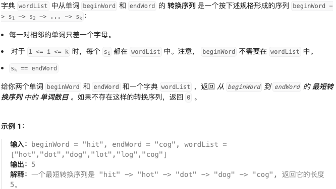

**BFS-广度广度优先遍历**

```python
class Solution:
    def ladderLength(self, beginWord: str, endWord: str, wordList: List[str]) -> int:
        """
        和基因变化类似，每次只变化一次，并且每次变化都必须在 wordList 中。
        """
        # 每个字符变化的范围其实都是endword中的字符
        wordList = set(wordList)
        if endWord not in wordList:
            return 0
        explore_alp = 'qwertyuiopasdfghjklzxcvbnm'
        
        queue = deque()
        queue.append((beginWord, 0))    # 起始序列 & 步数

        while queue:
            cur_word, step = queue.popleft()
            if cur_word == endWord:
                return step+1
            for idx, ch in enumerate(cur_word):
                for j in explore_alp:
                    new_word = cur_word[:idx] + j + cur_word[idx+1:]
                    if new_word in wordList:
                        queue.append((new_word, step+1))
                        wordList.remove(new_word)   # 避免重复遍历
        return 0
```

### 208-实现 Trie(前缀树)-中等

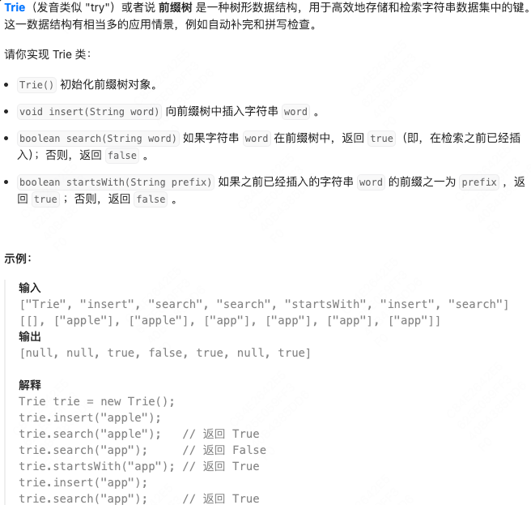

**前缀树-每个字符链接着下一个字符**

利用字典存储后续字符，实现前后缀的作用

```python
class Trie:
    """
    前缀树 & 数据结构应用 & 特殊的树形数据结构
    每个节点存储其子节点的链接，每个节点代表一个字符。根节点不包含字符，除根节点外每个节点都与一个字符相关联
    
    节点通常包含一个标志，表示该节点是否是某个字符串的结束    
    """
    def __init__(self):
        # 初始化根节点，不包含任何字符
        """
        self.children = {
            ch_1: Trie(),
            ch_2: Trie()
        }
        """
        self.children = {}
        self.is_end_of_word = False

    def insert(self, word: str) -> None:
        # 从根节点开始插入，每个字符作为一个节点，链接下一个字符
        cur = self
        for ch in word:
            # 如果当前字符不在子节点中，创建新的 Trie 实例作为节点
            if ch not in cur.children:
                cur.children[ch] = Trie()
            cur = cur.children[ch]

        # 设置单词结束标志
        cur.is_end_of_word = True

    def search(self, word: str) -> bool:
        cur = self
        for ch in word:
            if ch not in cur.children:
                return False
            cur = cur.children[ch]
        return cur.is_end_of_word

    def startsWith(self, prefix: str) -> bool:
        cur = self
        for ch in prefix:
            if ch not in cur.children:
                return False
            cur = cur.children[ch]
        return True 
```

### 212-单词搜索-困难


**前缀树 + DFS**

```python
class Trie:
    def __init__(self):
        self.children = {}
        self.is_end_of_word = False
    
class Solution:
    def findWords(self, board: List[List[str]], words: List[str]) -> List[str]:
        """
        前缀树 + DFS
        DFS 过程中，对搜索路径进行剪枝
        """
        m, n = len(board), len(board[0])
        visited = [[False for _ in range(n)]for _ in range(m)]
        dirs = [(-1, 0), (0, 1), (1, 0), (0, -1)]
        res = []

        # 构造前缀树
        root = Trie()
        for word in words:
            cur = root
            for ch in word:
                if ch not in cur.children:
                    cur.children[ch] = Trie()
                cur = cur.children[ch]
            cur.is_end_of_word = True
        # dfs
        def dfs(x, y, node, path):
            if x < 0 or y < 0 or x >= m or y >= n or board[x][y] == '#':
                return
            char = board[x][y]
            if char not in node.children:
                return
            # 获取当前字符对应的 Trie
            child = node.children[char]
            if child.is_end_of_word:
                res.append(path+char)
                # 剪枝条件：如果子Trid没有子节点，直接返回
                if not child.children:
                    return
            # 标记当前字符为已访问字符
            board[x][y] = '#'
            for d in dirs:
                dfs(x+d[0], y+d[1], child, path+char)
            # 恢复当前字符，以便其他路径搜索
            board[x][y] = char

        # 以每个位置作为起点进行 DFS
        for i in range(m):
            for j in range(n):
                dfs(i, j, root, "")
        
        return list(set(res))
```

### 211-添加与搜索单词-数据结构涉及-中等

请你设计一个数据结构，支持 添加新单词 和 查找字符串是否与任何先前添加的字符串匹配 。

实现词典类 `WordDictionary` ：

  * `WordDictionary()` 初始化词典对象
  * `void addWord(word)` 将 `word` 添加到数据结构中，之后可以对它进行匹配
  * `bool search(word)` 如果数据结构中存在字符串与 `word` 匹配，则返回 `true` ；否则，返回 `false` 。`word` 中可能包含一些 `'.'` ，每个 `.` 都可以表示任何一个字母。

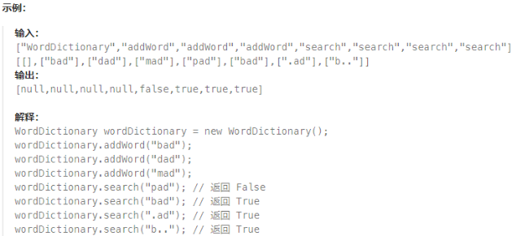

```python
class WordDictionary:
    """ 数据结构应用
    添加新单词 & 查找字符串是否与任何先前添加的字符串匹配
    根前缀树思路一样！
    self.children = {
        ch_1 : Trie(),
        ch_2 : Trie()
    }
    """
    def __init__(self):
        self.children = {}
        self.is_end_of_word = False

    def addWord(self, word: str) -> None:
        cur = self
        for ch in word:
            if ch not in cur.children:
                cur.children[ch] = WordDictionary()
            cur = cur.children[ch]
        cur.is_end_of_word = True   

    def search(self, word: str) -> bool:
        '''
        要匹配 . 结合 DFS 回溯
        遇到.时，枚举当前字符的所有非空子节点进行匹配，并跳转到这些非空子节点去匹配下一个字符
        '''
        def dfs(word, idx, node):
            if not node:
                return False
            if idx == len(word):
                return node.is_end_of_word
            if word[idx] == '.':
                res = False
                for ch in node.children:
                    res = res or dfs(word, idx+1, node.children[ch])
                return res
            elif word[idx] not in node.children:
                return False
            else:
                return dfs(word, idx+1, node.children[word[idx]])

        return dfs(word, 0, self)
```

### BFS

BFS可以用来求最短路径问题。

如何写最短路径的BFS代码？

```python
while queue:
    node = queue.pop()
    for node 的所有相邻结点 m:
        if m 未访问:
            queue.push(m)
```

又用到了这个队列BFS的trick

```python
depth = 0
while queue:
    depth += 1
    n = len(queue)
    while n:
        node = queue.pop()
        for node 所有邻接点 m:
            if m 未访问:
                queue.append(m)
```

### 994-腐烂的句子

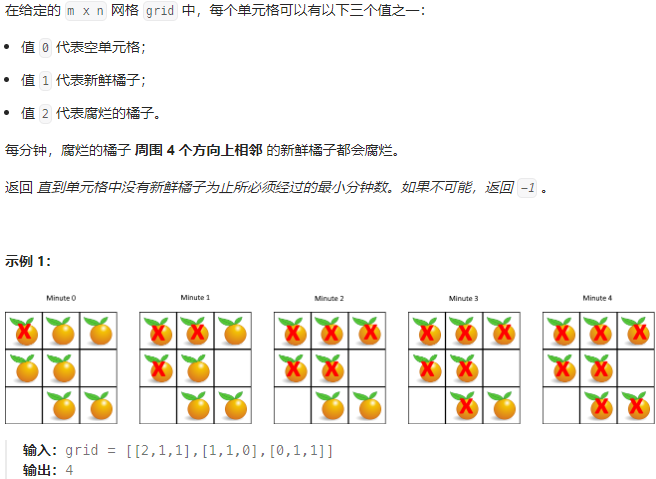

```python
class Solution:
    def orangesRotting(self, grid: List[List[int]]) -> int:
        '''
        m*n的网格grid

        '''
        m = len(grid)
        n = len(grid[0])
        
        dirs = [[0, -1], [1, 0], [0, 1], [-1, 0]]
        # bfs 借助队列
        queue = []
        # 先将腐烂的橘子加入队列
        # 同时统计新鲜句子的个数
        cnt = 0
        for i in range(m):
            for j in range(n):
                if grid[i][j] == 1:
                    cnt += 1
                elif grid[i][j] == 2:
                    queue.append((i, j))

        step = 0
        # 注意这里需要加上cnt，当且仅当 还有新鲜橘子时再遍历腐烂橘子才是有意义的，否则徒增步数
        while queue and cnt:
            step += 1
            size = len(queue)
            while size:
                x, y = queue.pop(0)
                for d in dirs:
                    next_x = x+d[0]
                    next_y = y+d[1]
                    if next_x<0 or next_y<0 or next_x>=m or next_y>=n:
                        continue
                    if grid[next_x][next_y] == 1:
                        cnt -= 1
                        grid[next_x][next_y] = 2
                        queue.append((next_x, next_y))   
                size -= 1
        
        return step if cnt == 0 else -1
```