# ┭┮﹏┭┮

> 原文作者：幻影星全能的木豆  
> 原文链接：https://www.cnblogs.com/mudou/p/18327484  
> 发布时间：2024-07-27 21:16

---

### 其他注意力

#### PagedAttention

**背景：**

  * LLM 的推理，最大的瓶颈在于显存。
  * KV cache 都很大，并且大小是动态变化的，难以预测。
  * 已有的系统中，由于显存碎片和过度预留，浪费了60%-80%的显存。

**实现：**

  * 受到操作系统中，虚拟内存和分页经典思想的启发
  * PagedAttention 允许在不连续的内存空间中存储连续的 keys 和 values。 
    * 具体来说，PagedAttention 会将每个序列的 KV cache 划分为块，每个块包含固定数量 tokens 的 keys 和 values。 在注意力计算过程中，PagedAttention 内核有效地识别并获取这些块。
  * 分块之后，这些 KV cache 不再需要连续的内存，从而可以像在操作系统的虚拟内存中一样，更灵活地对这些 KV cache 进行管理。
  * PagedAttention 对于显存的利用接近理论上的最优值（浪费比例低于4%）。通过对显存进行更好的管理，使得单次可以使用更大的 batch size，从而进一步利用 GPU 的并行计算能力。

##### memory sharing

  * memory sharing 是 PagedAttention 的另一个关键特性。
  * 当用单个 prompt 产出多个不同的序列时，可以共享计算量和显存。
  * 通过将不同序列的 logical blocks 映射到同一个 physical blocks，可以实现显存共享。
  * 为了保证共享的安全性，对于 physical blocks 的引用次数进行统计，并实现了 Copy-on-Write 机制。
  * 这种内存共享机制，可以大幅降低复杂采样算法对于显存的需求（最高可下降55%），从而可以提升2.2倍的吞吐量。

##### PagedAttention原理

在自回归解码过程中，query会不断和cachekv进行交互做注意力机制。而FasterTransformer里面为了避免重复的数据搬运（即把新kv和历史kv concat），预先会分配出 max_seq_len 长度的cachekv，后续只需要往里面写入即可，节省了昂贵的数据搬运操作。

而在实际场景中，推理往往以变长为主，不同query生成的长度不一，粗暴的将cachekv按 max_seq_len 长度分配很容易造成显存的浪费。

那么PageAttention正是为了改进这一点而生（当然其中一个原因也包括他的动态插入逻辑），一个query对应的CacheKV不一定需要连续的显存，**他将连续个token存储的CacheKV划分为一个block** ，并且有一个block_tables维护各个query对应CacheKV是哪几个block，进而索引。

#### S2-Attn

#### Multi-Head Attention

#### CrossAttention

  * Transformer架构中混合两种不同嵌入序列的注意力机制。
  * **两种序列必须具有相同的维度** 。
  * 两个序列可以是不同的模态形式（如：文本、声音、图像）
  * 一个序列作为输入的Q，定义了输出的序列长度，另一个序列提供输入的K和V。

##### Cross-Attention VS Self-Attention

输入不同：CrossAttention的输入来自不同的序列，Self-Attention的输入来自相同的序列。除此之外，基本一致。

具体而言，Self-Attention输入是单一的嵌入序列。

Cross-Attention将两个相同维度的嵌入序列不对称地组合在一起，其中一个序列用作查询，另一个序列用作键K和值V。

##### Cross-Attention算法

  * 拥有两个序列S1，S2

  * 计算S1的K、V

  * 计算S2的Q

  * 根据K和Q计算注意力矩阵

  * 将V应用于注意力矩阵

  * **输出的序列长度和提供查询Q的S2一致**

### 过拟合的表现有哪些？

### BN 训练和测试的区别在哪里？

BN（Batch Normalization，批量归一化）是一种用于加速深度神经网络训练并提高其稳定性和性能的技术。它在训练和测试阶段有一些关键的区别。

**训练阶段**

在训练过程中，BN会对每个小批量（batch）的数据计算均值和方差。

使用计算得到的均值和方差对小批量的数据进行归一化。

归一化后的数据再经过可学习的缩放（gamma）和平移（beta）参数的变换。

为了在测试时使用，BN还会维护一个全局的均值和方差，这些值是通过对训练过程中计算的均值和方差进行移动平均计算得到的。

$$\mu_{\text {batch }}=\frac{1}{m} \sum_{i=1}^{m} x_{i}$$

$$\sigma_{\text {batch }}^{2}=\frac{1}{m} \sum_{i=1}^{m}\left(x_{i}-\mu_{\text {batch }}\right)^{2}$$

$$\hat{x}_{i}=\frac{x_{i}-\mu_{\text {batch }}}{\sqrt{\sigma_{\text {batch }}^{2}+\epsilon}}$$

$y_{i}=\gamma \hat{x}_{i}+\beta$​

> 为了在测试阶段能够使用一个稳定的均值和方差，我们需要计算训练过程中这些小批量均值和方差的移动平均值。
> 
> 移动平均是一种平滑数据的方法，使得我们可以从一个变化的值中得到一个相对稳定的估计值。
> 
> 第一个批次的均值和方差：$\mu_{1}=2, \sigma_{1}^{2}=1$
> 
> 第二个批次的均值和方差：$\mu_{2}=4, \sigma_{2}^{2}=2$
> 
> 第三个批次的均值和方差：$\mu_{3}=3, \sigma_{3}^{2}=1.5$​
> 
> 我们将使用一个学习率 α=0.1来计算移动平均。
> 
> 首先，我们初始化全局均值和方差为零：
> 
> $$\begin{array}{l}
\mu_{\text {global }}=0 \\
\sigma_{\text {global }}^{2}=0
\end{array}$$
> 
> 批次1 更新公式：
> 
> $$\begin{array}{l}
\mu_{\text {global }}=(1-\alpha) \mu_{\text {global }}+\alpha \mu_{\text {batch }} \\
\sigma_{\text {global }}^{2}=(1-\alpha) \sigma_{\text {global }}^{2}+\alpha \sigma_{\text {batch }}^{2}
\end{array}$$
> 
> 应用第一个批次的数据：
> 
> $$\begin{array}{l}
\mu_{\text {global }}=(1-0.1) \cdot 0+0.1 \cdot 2=0.2 \\
\sigma_{\text {global }}^{2}=(1-0.1) \cdot 0+0.1 \cdot 1=0.1
\end{array}$$
> 
> 批次2 应用第二个批次的数据：
> 
> $$\begin{array}{l}
\mu_{\text {global }}=(1-0.1) \cdot 0.2+0.1 \cdot 4=0.18+0.4=0.58 \\
\sigma_{\text {global }}^{2}=(1-0.1) \cdot 0.1+0.1 \cdot 2=0.09+0.2=0.29
\end{array}$$

**测试阶段**

在测试阶段，BN不再计算当前批量数据的均值和方差，而是使用在训练阶段通过移动平均计算得到的全局均值和方差。

使用全局均值和方差对测试数据进行归一化。

同样使用训练过程中学到的缩放（gamma）和平移（beta）参数。

$$\hat{x}_{i}=\frac{x_{i}-\mu_{\text {global }}}{\sqrt{\sigma_{\text {global }}^{2}+\epsilon}}$$

$$y_{i}=\gamma \hat{x}_{i}+\beta$$

通过这些机制，BN在训练阶段可以加速训练收敛，并在测试阶段提供稳定的性能表现。

### 梯度下降的公式？

梯度下降是一种优化算法，用于通过**最小化损失函数** 来训练机器学习模型。它的基本思想是不断调整模型的参数，以使损失函数值逐渐减小。

假设我们有一个损失函数 $L(\theta)$，其中 $\theta$​ 是模型的参数向量。梯度下降算法的核心步骤是**按照损失函数的负梯度方向更新参数** 。基本的梯度下降更新公式如下：

$$\theta:=\theta-\eta \nabla_{\theta} L(\theta)$$

$$\nabla_{\theta} L(\theta) \text { 是损失函数 } L(\theta) \text { 关于参数 } \theta \text { 的梯度（也称为导数） }$$

> 假设我们有一个简单的线性回归模型，其损失函数是均方误差（MSE），形式如下：
> 
> $$L(\theta)=\frac{1}{2 m} \sum_{i=1}^{m}\left(h_{\theta}\left(x^{(i)}\right)-y^{(i)}\right)^{2}$$
> 
> $$h_{\theta}\left(x^{(i)}\right)=\theta_{0}+\theta_{1} x^{(i)}$$
> 
> 计算对 $\theta_{0}$ 的梯度
> 
> $$\frac{\partial L(\theta)}{\partial \theta_{0}}=\frac{1}{m} \sum_{i=1}^{m}\left(h_{\theta}\left(x^{(i)}\right)-y^{(i)}\right)$$
> 
> 计算对 $\theta_{1}$​ 的梯度
> 
> $$\frac{\partial L(\theta)}{\partial \theta_{1}}=\frac{1}{m} \sum_{i=1}^{m}\left(h_{\theta}\left(x^{(i)}\right)-y^{(i)}\right) x^{(i)}$$
> 
> 得到了$\theta_{0}$ 和 $\theta_{1}$​ 的梯度之后，我们可以使用梯度下降算法更新模型参数：
> 
> $$\begin{array}{l}
\theta_{0}:=\theta_{0}-\eta \frac{\partial L(\theta)}{\partial \theta_{0}} \\
\theta_{1}:=\theta_{1}-\eta \frac{\partial L(\theta)}{\partial \theta_{1}}
\end{array}$$

**梯度下降算法的变种**

  1. 批量梯度下降（Batch Gradient Descent）：每次迭代使用全部训练数据来计算梯度。
  2. 随机梯度下降（Stochastic Gradient Descent, SGD）：每次迭代只使用一个训练样本来计算梯度。
  3. 小批量梯度下降（Mini-batch Gradient Descent）：每次迭代使用一个小批量的训练数据来计算梯度。

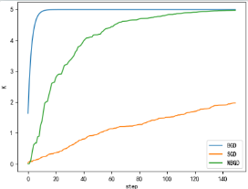

> 批量梯度下降：可以快速接近最优解，但是其时间消耗相对其他两种是最大的，因为每一次更新都需要遍历完所有数据。
> 
> 随机梯度下降：参数更新是最快的，因为每遍历一个数据都会做参数更新，但是由于没有遍历完所有数据，所以其路线不一定是最佳路线，甚至可能会反方向巡迹，不过其整体趋势是往最优解方向行进的，随机梯度下降还有一个好处是有一定概率跳出局部最优解(每次的J(θ)是不固定的)，而BGD会直接陷入局部最优解。
> 
> 小批量梯度下降：权衡了参数更新速度和训练稳定性之后，通过同时处理一小批量数据来减少梯度估计的方差，在梯度估计的稳定性和收敛路径的平滑性上都有所提高。

在使用梯度下降的时候，一般需要进行一些调优策略：

  1. 学习率过大可能会跳过最优解；学习率过小导致迭代速度过慢；
  2. 算法初始参数值的选择：初始值不同，最终获得的最小值也可能不同，因为梯度下降求解的是局部最优解，一般情况下，选择多个不同的初始值运行算法，最终返回损失函数最小情况下的结果值。

### 反向传播

**工作原理**

  1. 反向传播的第一步是前向传播，它是神经网络从输入到输出的正向计算过程。得到最终的预测输出，与实际标签进行比较，从而计算出预测误差。
  2. 在前向传播过程中，通过损失函数（也称为目标函数）来度量模型的预测与实际标签之间的误差。损失函数的选择取决于问题的类型，例如均方误差（Mean Squared Error）用于回归问题，交叉熵（Cross-Entropy）用于分类问题。
  3. 反向传播误差：反向传播的核心思想是将损失从输出层传播回网络的每一层，计算每一层的权重梯度以便后续的权重更新。
  4. 梯度更新：一旦计算出每一层的梯度，就可以使用梯度下降或其变种算法（如Adam、RMSprop等）来更新神经网络的权重。

### 学习率衰减

#### 余弦退火(CosineAnnealing）

**余弦退火（Cosine annealing）** 可以通过余弦函数来降低学习率。余弦函数中随着x的增加余弦值首先缓慢下降，然后加速下降，再次缓慢下降。

在论文[Stochastic Gradient Descent with Warm Restarts](<https://arxiv.org/abs/1608.03983>)中介绍主要介绍了带重启的随机梯度下降算法（SGDR），其中就引入了余弦退火的学习率下降方式。我们的目标优化函数可能是多峰的，除了全局最优解之外还有多个局部最优解，在训练时梯度下降算法可能陷入局部最小值，此时可以通过突然提高学习率，来“跳出”局部最小值并找到通向全局最小值的路径。这种方式称为**带重启的随机梯度下降方法** 。

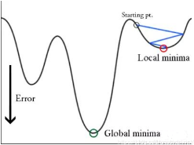

##### 余弦退火的原理

当执行完 $T_i$ 个epoch之后就会开始热重启（warm restart），而下标 $i$ 就是指的第几次restart，其中重启并不是重头开始，而是通过增加学习率来模拟，并且重启之后使用旧的 $x_t$ 作为初始解，这里的 $x_t$ 就是通过梯度下降求解loss函数的解，也就是神经网络中的权重，因为重启就是为了通过增大学习率来跳过局部最优，所以需要将 $x_t$ 置为旧值。

只考虑在每一次run（包含重启就是restart）中，学习率是如何减小的。余弦退火（ cosine annealing ）的原理如下：

$$\eta_{t}=\eta_{\min }^{i}+\frac{1}{2}\left(\eta_{\max }^{i}-\eta_{\min }^{i}\right)\left(1+\cos \left(\frac{T_{c u r}}{T_{i}} \pi\right)\right)$$

> $i$ 就是第几次run(索引值)
> 
> $\eta_{\max }^{i}, \eta_{\min }^{i}$ 分别表示学习率的最大值和最小值，定义了学习率的范围。论文中提到在每次restart之后，减少 $\eta_{\max }^{i}, \eta_{\min }^{i}$ 的值，但是为了简单，论文中也保持$\eta_{\max }^{i}, \eta_{\min }^{i}$ 在每次restart之后仍然保持不变。
> 
> $T_{cur}$ 则表示当前执行了多少个epoch，每个 batch运行之后 $T_{cur}$ 就会更新而此时一个epoch还没有执行完，所以 $T_{cur}$ 的值可以为小数。
> 
> $\mathrm{T}_{\mathrm{i}}$ 固定为我们训练模型的epoch数

**使用warm up和余弦退火的方式来规划学习率**

刚开始训练时，模型的权重(weights)是随机初始化的，此时若选择一个较大的学习率，可能带来模型的不稳定（振荡），选择Warmup预热学习率的方式，可以使得开始训练的几个epoch或者一些step内学习率较小，在预热的小学习率下，模型可以慢慢趋于稳定，等模型相对稳定后在选择预先设置的学习率进行训练，使得模型收敛速度变得更快，模型效果更佳。

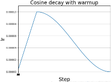

### 优化器

Adam

AdamW

### 均方误差损失

### 交叉熵损失

### 梯度消失问题

梯度消失问题发生在深度神经网络中，特别是在使用某些激活函数（如Sigmoid或Tanh）时。在反向传播过程中，梯度会随着网络的深度逐渐减小，最终变得非常接近零。这意味着深层网络的底层权重几乎不会得到有效的更新，导致网络无法学习到底层特征和模式。

**处理梯度消失问题的方法**

  1. 使用激活函数：选择具有更大梯度的激活函数，如ReLU（Rectified Linear Unit），它在正数范围内梯度恒为1，有助于减轻梯度消失问题。
  2. 权重初始化：使用合适的权重初始化方法，如He初始化，以确保网络在训练初始阶段具有较大的梯度。
  3. Batch Normalization：批归一化（Batch Normalization）层有助于减少梯度消失问题，通过在每个小批量上标准化输入数据。

### 梯度爆炸问题

梯度爆炸问题是指在反向传播中，梯度变得非常大，导致权重更新过大，网络无法稳定训练。这通常发生在网络架构复杂、梯度流通路径较长或学习率较大时。

**处理梯度爆炸问题的方法**

  1. 梯度裁剪：通过设置一个阈值，当梯度的范数超过阈值时，将梯度进行缩放，以防止梯度爆炸。
  2. 减小学习率：减小学习率可以减缓梯度的上升速度，降低梯度爆炸的风险。
  3. 权重正则化：使用权重正则化技术，如L1正则化或L2正则化，可以降低权重的大小，减少梯度爆炸的可能性。
  4. Batch Normalization：批归一化不仅可以减轻梯度消失问题，还可以一定程度上缓解梯度爆炸问题。

### 权重正则化

权重正则化是一种常用的技术，用于控制机器学习模型的复杂度，并防止模型在训练过程中出现过拟合的问题。

它通过向损失函数添加一个正则化项，强制模型学习到的权重参数保持较小的值，从而降低模型的复杂度。

**L1正则化**

L1 正则化通过向损失函数添加权重向量的 L1 范数（权重的绝对值之和）来惩罚模型复杂度。

L1 正则化的损失函数形式如下：$\mathcal{L}_{\mathrm{L} 1}(\theta)=\mathcal{L}(\theta)+\lambda \sum_{j=1}^{d}\left|\theta_{j}\right|$

为了优化正则项，会减少参数的绝对值总和，所以L1正则化倾向于选择稀疏权重矩阵。L1正则化主要用于挑选出重要的特征，并舍弃不重要的特征。

**L2 正则化**

L2 正则化通过向损失函数添加权重向量的 L2 范数（权重的平方和）来惩罚模型复杂度。

L2 正则化的损失函数形式如下：$\mathcal{L}_{\mathrm{L} 2}(\theta)=\mathcal{L}(\theta)+\lambda \sum_{j=1}^{d} \theta_{j}^{2}$

为了优化正则项，会减少参数平方的总和，所以L2正则化倾向于选择值很小的权重参数（即权重衰减），主要用于防止模型过拟合。是最常用的正则化方法。一定程度上，L1也可以防止过拟合。

> 过拟合通常是因为模型在训练数据上表现过于复杂，过度依赖少量训练数据的噪声或特定模式。通过限制权重的大小，L2 正则化能够使模型更倾向于学习简单的模式，而不是过度拟合训练数据中的细节。
> 
> L2 正则化也被称为权重衰减，因为它倾向于使权重参数的值衰减或变小。这种衰减效应有助于防止特定权重过大，从而减少了对某些训练样本的过度拟合，提高了模型在新数据上的泛化能力。

> 假设我们有一个简单的线性回归模型，损失函数采用均方误差（MSE），同时进行 L2 正则化。模型的目标是最小化以下损失函数：
> 
> $$L(\theta)=\frac{1}{2 m} \sum_{i=1}^{m}\left(h_{\theta}\left(x^{(i)}\right)-y^{(i)}\right)^{2}+\frac{\lambda}{2} \sum_{j=1}^{d} \theta_{j}^{2}$$
> 
> 对 $\theta_{0}$ 的梯度
> 
> $$\frac{\partial L(\theta)}{\partial \theta_{0}}=\frac{1}{m} \sum_{i=1}^{m}\left(h_{\theta}\left(x^{(i)}\right)-y^{(i)}\right)$$
> 
> 对 $\theta_{1}$​ 的梯度
> 
> $$\frac{\partial L(\theta)}{\partial \theta_{1}}=\frac{1}{m} \sum_{i=1}^{m}\left(h_{\theta}\left(x^{(i)}\right)-y^{(i)}\right) x^{(i)}+\lambda \theta_{1}$$
> 
> 正则化项实际上在每次梯度下降步骤中，都会影响模型参数的更新方向和大小，从而限制了模型参数的增长，减少了过拟合的风险。
> 
> $$\begin{array}{l}
\theta_{0}:=\theta_{0}-\eta \frac{\partial L(\theta)}{\partial \theta_{0}} \\
\theta_{1}:=\theta_{1}-\eta \frac{\partial L(\theta)}{\partial \theta_{1}}
\end{array}$$

### 过拟合

当模型为了过度拟合训练集而变得很复杂时，就容易出现过拟合现象。这时模型对训练数据拟合得非常好，但是丧失一般性，趋向于记住而不是学习数据的特征，从而导致模型在新的数据上的表现很差，即泛化能力很差。

当过拟合现象发生，模型会将训练集中的随机出现的噪声也当作有效数据，并对其进行学习和拟合，这就是为什么模型在新数据上的表现会出现退化。

### 分词器

BPE、BBPE

WordPiece

SentencePiece

Tiktoken

### 位置编码对比

  1. Transformer用到的三角函数式的绝对位置编码的缺点是无法判断两个token的顺序关系。
  2. 因此BERT再次基础上进行改进，仍然是绝对位置编码，但通过学习来得到的，而且引入segment embeddings，能够确定两个token之间的方向关系。BERT模型这种编码方式有一个缺点就是配置文件中已经卡死了，最多只能输入512个词，所以BERT模型最多也就处理长度为512的句子。
  3. T5采用相对位置编码，在attention矩阵的基础上加上一个可训练的偏置项，其实就是T5模型的相对位置编码，然后在进行softmax。

线性偏差注意力ALiBi

baichuan 7B无论第一代还是第二代，位置编码均用的RoPE，而baichuan 13B则无论是第一代还是第二代，均用的ALiBi

### 激活函数

SwiGLU、Swish、GLU

### 梯度检查点

梯度检查点是一种优化技术，用于减少内存使用，通过在正向传播中保存中间激活，然后在反向传播中重新计算它们。

### 指标

#### 困惑度PPL

### BERT

BERT是一个基于transformer的深度双向表征模型。本质上是利用transformer结构构造一个多层双向的Encoder网络，通过考虑未标记文本的左右上下文来预训练文本的深度双向表征。

只需要一个额外的输出层，就可以对预训练的BERT模型进行微调，从而为各种任务（如问题问答和语言推断）创建最先进的模型，而无需对特定于任务的体系结构进行实质性修改。

**BERT模型结构**

根据参数设置的不同，Google论文中提出了Base和Large两种BERT模型。

BERT base 和 GPT模型的参数数量差不多，可以做一个较为公平的比较。

BERT large主要用来刷榜。

> Base模型，12层，隐藏层维度768，Attention Head 12，参数量 0.1B。
> 
> Large模型，24层，隐藏层维度1024，Attention Head 16层，参数量 0.34B。

**分词器**

BERT 使用 WordPiece 分词器将单词分解成更小的子词。

**BERT模型的输入和输出**

BERT模型采用双向并行输入方式，即将句子整个输入到模型，而不是将单词一个接一个地输入。但是实际上在模型内部，输入的句子仍然是逐个词片段（subword tokens）进行处理的，而不是像传统的RNN或者CNN一样，直接将整个句子作为一个单元输入。

BERT的输入既可以是一个句子，也可以是一个句子对，而BERT只是transformer的编码器部分，因此为了使其能够处理两个句子的情况，需要将两个句子合并为一个序列。

每个句子的首个token总为一个特殊的分类token（[CLS]），该token的最后隐藏层状态/向量被用来表示整个序列的信息。即若为单句子分类，[CLS]表示输入句子的类别；若为句子对分类，[CLS]表示两个句子是相关的/不相关的，相似意思/相反意思的。

**双向建模示例**

> 假设我们有两个句子：
> 
> **句子 A** : "I went to the store to buy some groceries."
> 
> **句子 B** : "It was a sunny day outside."
> 
> 步骤：
> 
>   1. 分词和标记处理：`"[CLS]", "I", "went", "to", "the", "store", "to", "buy", "some", "groceries", ".", "[SEP]", "It", "was", "a", "sunny", "day", "outside", ".", "[SEP]"`
>   2. 每个词片段被映射为对应的词嵌入向量。
>   3. Transformer 编码器处理：在进行自注意力计算时，例如计算词片段 "store" 的表示时，BERT模型不仅会考虑到该词片段左侧的词片段（如 "the", "to"），还会同时考虑右侧的词片段（如 "buy", "some"）
> 

**BERT模型输入序列**

BERT额外引入了segment embedding，判断token是属于前一个句子还是后一个句子，使得token的位置更加精准。


BERT模型的预训练任务

BERT采用两个无监督任务进行参数预训练，分别为masked language model(MLM) 和 next sentence prediction (NSP)。

#### 掩码语言建模 (MLM)

对输入到BERT中的分词之后的词元序列，它有15%的概率会被随即替换成掩码(替换为统一标记符[MASK])，预测这些被掩盖的词来训练双向语言模型。其中[CLS]和[SEP]不会被替换。

这样做会产生两个缺点：

  1. 预训练和微调时的不一致，因为在微调时是没有掩码的
  2. 由于每个batch中只有15%的词会被预测，因此模型的收敛速度比起单向的语言模型会慢，训练花费的时间更长

对于第一个缺点的解决方法：**把80%需要被替换成[MASK]的词进行替换，10%随即替换为其他词，10%保留原词。由于transformer encoder并不知道哪个词需要被预测，哪个词是被随机替换的，这样就强迫每个词的表达需要参照上下文信息** 。

对于第二个缺点，目前没有有效的解决办法，但是从提升收益的角度看，付出的代价是值得的。


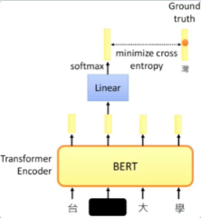

#### 下一个句子预测 Next Sentence Prediction(NSP)

为了训练一个**理解句子间关系** 的模型，引入一个下一个句子预测任务，这个任务的训练语料可以从语料库中抽取句子对包括两个句子A和B来进行生成，其中50%的概率B是A的下一个句子，50%的概率B是语料中的一个随机句子。

NSP任务是**预测B是否是A的下一个句子** 。

NSP的目的是**获取句子间的信息，这点是语言模型无法直接捕捉的** 。

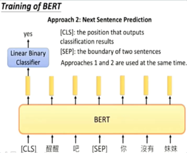

在训练中，MLM与NSP的loss是同时计算的，属于多任务学习。

#### BERT微调

在已经预训练好的语言模型基础上，对参数进行调整，使其更好地适用于下游任务。

即使下游任务各不相同，使用BERT微调时只需要增加输出层。

  1. BERT用于句子的分类任务

预训练中的NSP任务使得BERT中的[CLS]位置的输出包含了整个句子对(句子)的信息，我们利用其在有标注的数据上微调模型，给出预测结果。

只需要在transformer的输出之上加一个分类层。

BERT直接取第一个[CLS]token的final hidden state C 与权重相乘之后做softmax，得到预测结果P。

$$P=\operatorname{softmax}\left(C W^{T}\right)$$

  2. BERT用于问答任务

预训练中的MLM任务使得每个token位置的输出都包含了丰富的上下文语境以及token本身的信息，我们对BERT的每个token的输出都做一次分类，在有标注的数据上微调模型给出预测。

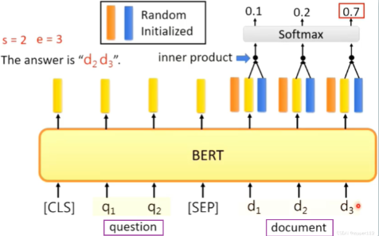

图中表示一个问答任务，给出一个问题Question，并给出一个文章document，然后**从文章中标出答案的具体位置** 。

引入一个开始向量S，和一个结束向量E，对于文本的每个输出，都与两个向量做点乘。

文章的每个输出对Start向量做点乘，取最高的那个结果的位置作为答案的起点a。

文章的每个输出对End向量做点乘，取最高的那个结果的位置作为答案的终点b。

最后的答案就是document[ a : b ]

  3. BERT用于NER任务

给出一句话，对每个词进行标注，判断属于人名，地名，机构名，还是其他。

① BERT模型 + FC layer ( 全连接层 )：只需要在BERT的基础上增加一层全连接层，一般情况下，在NER任务中，经过线性层+softmax，然后给出每个词的NER标签。

② BERT + CRF模型：CRF（Conditional Random Field，条件随机场）是一种经典的概率图模型，通常用于序列标注任务。在BERT模型后连接CRF层的主要目的是利用CRF的能力来对输出序列进行全局一致性建模，从而提高序列标注任务的准确性。

#### BERT模型创新

  1. BERT使用双向Transformer编码器作为其基础架构。
  2. BERT模型采用了预训练和微调的两阶段策略。预训练阶段通过大规模无标注文本数据进行训练，利用双向语言模型和遮蔽语言建模任务来学习通用的语言表示。微调阶段则通过少量标注数据进行端到端的监督学习，针对特定任务（如文本分类、命名实体识别等）进行微调，从而使模型适应具体任务。
  3. BERT引入了MLM任务，这是一种新型的预训练目标。使模型在预训练阶段学习到更好的双向语言表示，而不是像传统的单向语言模型那样仅仅预测下一个词片段。
  4. BERT模型能够在单个训练实例中同时处理句子级别和词级别的任务。通过将输入序列中的两个句子同时输入模型（例如使用特殊标记区分），BERT能够学习到句子之间的关系，这对于理解和生成自然语言文本都是有益的。

#### BERT局限性

  1. BERT模型使用了掩码语言模型（MLM）作为预训练目标，但这种方式会使预训练和微调阶段的输入不一致，因为预训练时有部分词被掩盖，而微调时没有
  2. BERT模型对中文的处理是以字为单位的，忽略了词语和短语等更高层次的语义信息。
  3. 使用BERT模型时，最多只能输入512个词，在BERT的config中，max_position_embeddings:512
  4. BERT模型在做生成式任务时效果不够好。
  5. BERT模型的参数量很大，导致存储和训练都比较消耗资源

### BERT 变体

#### RoBERTa

作者发现BERT是严重训练不足的并提出了一些预训练BERT模型的方法。RoBERTa通过以下改变来改善BERT的预训练：

  1. 在MLM任务中使用动态掩码而不是静态掩码
  2. 移除NSP任务，仅使用MLM任务
  3. 通过更大的批大小训练，BERT的batch_size为256，RoBERTa的batch_size为8000，应该是8192 maybe。
  4. 使用BBPE作为分词器

**使用动态掩码而不是静态掩码**

我们知道在BERT的MLM任务中，我们随机对15%的标记进行掩码，然后让模型预测掩码的标记。

假设我们有一个句子:`We arrived at the airport in time`。现在，在预处理后我们有：

`tokens = [ [CLS], we, arrived, at, the, airport, in, time, [SEP] ]`

接着，我们随机对15%的标记进行掩码：

`tokens = [ [CLS], we, [MASK], at, the airport, in, [MASK], [SEP] ]`

现在，我们将这些掩码后的标记列表喂给BERT模型并训练它去预测被掩码的标记。注意掩码操作只在预处理阶段进行一次，然后我们训练模型在不同的epoch中去预测这些已经掩码的标记。这被称为**静态掩码** 。

RoBERTa使用动态掩码。我们举个例子来理解动态掩码。

首先，我们将句子复制10份，假设我们将给定的句子:`We arrived at the airport in time`复制了10份。接着，我们对所有的这10个同样的句子随机地对15%的标记进行掩码。所以，现在我们有10个被掩码的句子，其中每个句子被掩码的标记不同：

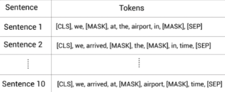

我们训练模型40个epoch。对于每个epoch，我们用不同标记被掩码的句子喂给模型。

比如epoch1，我们将句子1喂给模型；epoch2，我们将句子2喂给模型，如此循环重复：

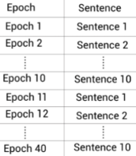

这样我们的模型只会在4个epoch中看到具有同样掩码标记的句子。比如，句子1会被epoch1,epoch11,epoch21和epoch31看到。这样，我们使用动态掩码而不是静态掩码去训练RoBERTa模型。

简单来讲，每个句子，在不同的epoch使用不同的mask。

#### ALBERT

想解决的是BERT模型参数量过多的问题，相比BERT它是一个精简版的。

使用下面两种技术来减少参数量：

  1. **跨层参数共享** ：比如BERT-base包含12个编码器层，在训练时，需要学习所有编码器层的参数。而使用跨层参数共享的方法，我们只需要学习第一个编码器层的参数，然后让其他所有层共用这套参数。

> 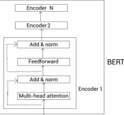
> 
> 在应用跨层参数共享时有几种不同的方式：
> 
>      1. All-shared: 共享第一个编码器层的所有子层参数到其他编码器层
>      2. Shared feedforward network：只共享第一个编码器层的前馈神经网络层参数到其他编码器层(的前馈神经网络)
>      3. Shared attention：只共享第一个编码器层的多头注意力层参数到其他编码器层(的多头注意力层)
> 
> ALBERT模型使用**All-shared** 模式。

  2. 嵌入层参数分解(Factorized embedding layer parameterization )

> 为了减少嵌入层的参数量。
> 
> WordPiece 嵌入：每个子词单元从词汇表中映射到一个独热编码向量，独热编码向量通过嵌入矩阵映射到一个固定大小的嵌入向量，WordPiece 嵌入在输入到 BERT 模型之前是固定的，无论上下文如何变化，同一个子词的嵌入向量始终相同。
> 
> 嵌入层参数分解方法将嵌入矩阵分解为更小的矩阵。
> 
> 我们首先将独热向量投影到低维嵌入空间 $V \times E$，然后再将该低维嵌入投影到隐藏空间 $E \times H$，而不是直接投影独热向量到隐藏空间 $V \times H$

**句子顺序预测**

ALBERT也使用MLM任务，但没有使用NSP任务，而是使用一个新任务，叫句子顺序预测(sentence order prediction,SOP)。

ALBERT的作者指出基于NSP任务进行预训练并不是真的有效，它与MLM任务相比并不是一个很难的任务。同时，NSP结合了主题预测和连贯性预测到一个任务中。为了解决这个问题，他们引入了SOP任务，SOP基于句子间的连贯性而不是主题预测。我们来看下SOP任务的细节。

类似NSP，SOP也是一个二分类任务。在NSP中，我们训练模型去预测某个句子对是属于`isNext`还是`notNext`类别，而在SOP任务中，我们训练模型去预测给定句子对中的句子顺序是否被交换过。

### MacBERT

为了解决BERTMLM预训练和微调时不一致

  * MacBERT提出，可以不使用 [MASK]标记，而是将[MASK]标记位置的词替换成[另外一个近义词]，然后让模型去进行[词语纠错]。
  * 和BERT类似，MacBERT对15%的输入单词进行遮蔽，其中80%将替换为相似的单词，10%将替换为随机的词，剩下的10%将保留原始单词 (BERT中将80设置为[MASK]， 其余一样)

### T5

#### T5模型介绍

T5这篇论文严格意义上讲并不是一篇创新型论文，而更像是一篇实验报告。

  * 在此之前的几乎所有预训练语言模型，在下游任务微调过程中都需要添加非线性层，将模型的输出转化为任务指定的输出格式。
  * T5不需要对模型做任何改动，只需要提供下游任务的微调数据。
  * 不需要添加任何非线性层。
  * 唯一要做的就是在输入数据前加上任务声明前缀。
  * T5模型：万事皆可text2text

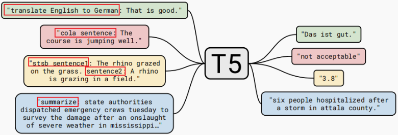

#### T5模型结构

T5模型本质上来说是一个基于transformer的encoder-decoder模型。

#### T5模型的输入表示

Google提出的SentencePiece分词方法，并不是所有语言都是以空格分词的，比如中文日文等。

SentencePiece不将空格视为分隔符，下划线被引入，代替了空格和句子开头的特殊符号。

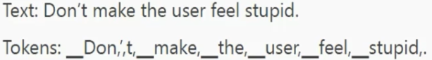

**位置编码**

T5模型采用了一种长距离不敏感的相对位置编码，这一设计考虑到远距离的单词依赖往往比较稀疏而不精细，需要对周围单词的位置做精确区分，远距离单词的位置变化相对缓慢。

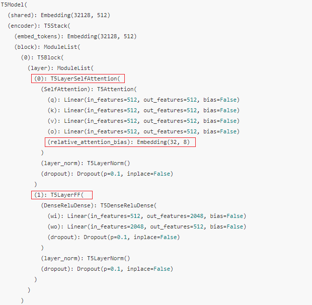

T5并没有在输入的input embedding之后加position embedding，而是在Encoder的第一层的Self-attention计算Q和K乘积之后加入了一个relative position embbedding，也就是在计算softmax之前。

只有在Encoder和Decoder的第一层处的Attention模块最后有一个relative_attention_bias的Embedding矩阵。

相对位置编码 $r_{i j}$ 则是一个标量数值，一共有32种类型，也就是说在T5中一共是32种相对位置。

然而，T5的输入长度是512 token，相对的位置类型远大于32种。所以，T5使用了一种分区的方式将任意多的相对位置信息映射到32种最终类型上。

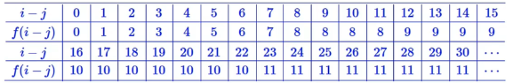

需要注意的是，相对位置信息只在Encoder和Decoder的第一层Self-attention计算中起作用，并且所有head之间不共享。

#### T5模型预训练方法

  1. 自监督的预训练方法：

①语言模型式：单向的从左到右依次预测，典型代表为GPT-2模型

②Bert-style：随机破坏掉一部分，然后进行还原

③顺序还原式：将文本打乱，然后进行还原

  2. 对文本一部分进行破坏

①Mask法：将破坏的token换成特殊的标记，如[mask]

②替换span：将一个span替换为特殊标记

③Deop法：没有替换操作，直接随机丢弃一些字符

  3. 对文本的百分之多少进行破坏

15%

  4. 对多长的文本段进行破坏

span长度为3

#### T5模型的多任务学习

本论文的多任务学习仅对应于将数据集混合在一起。相比之下，大多数将多任务学习应用于NLP的应用都会添加特定于任务的分类网络，或者为每个任务使用不同的损失函数。

将各种NLP任务都转化为Seq2Seq任务进行训练。

> 多任务一起训练时如何采样数据？
> 
> ① 根据各任务数据集大小计算概率 ②各任务数据采样概率相同 ...

多任务训练在大多数情况下都不如预训练+微调。

作者又提出**多任务训练+微调** ：先用多个任务进行预训练，再对具体任务进行微调。

#### T5模型贡献

  1. 把所有NLP任务都转化为text-to-text范式
  2. 原始的编码器-解码器架构在text-to-text框架中效果最好，T5在编码器和解码器中共享参数，总参数量与仅编码器或仅解码器相同，所以计算成本相似。
  3. 引入了C4数据集
  4. 训练策略上：微调时所有参数一起更新是最好的，但计算代价大。

### GPT-1

### GPT-2

### GPT-3

### InstructGPT

### LLama

### LLama-2

### LLama-3

### Qwen

#### 1\. 简介

  1. Qwen（基础预训练语言模型，即基座模型）和 Qwen-Chat（聊天模型，该模型采用人类对齐技术进行微调），官方还开发了编码专用模型 Code-Qwen 和 Code-Qwen-Chat，以及基于基座模型开发的数学专用模型 Math-Qwen-Chat，但是 Code-Qwen和Math-Qwen-Chat都没有开源。

  2. Qwen-Chat拥有先进的工具使用和规划能力，可用于创建agent应用程序。

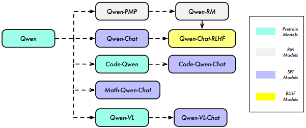

> QWEN：在包含数万亿token的大量数据集上预训练得到
> 
> QWEN-CHAT：使用SFT和RLHF将QWEN与人类的偏好对齐
> 
> 改进版本QWEN-CHAT-RLHF

#### 2\. 预训练

预训练使用3万亿token，数据集是多语种，其中很大一部分数据主要还是英文和中文，具体的中英文数据量的比例、以及是否做过平衡数据的技术处理，官方报告中并未详细阐述。

**数据预处理：**

  1. 文本数据抽取：对于公共网络数据，从 HTML 中提取文本数据

  2. 语言识别: 使用语言识别工具判断文本语言,提取英文和中文数据

  3. 去重: 使用明文去重和基于MinHash+LSH的模糊去重算法进行重复数据删除。

> **明文去重**
> 
> 明文去重是一种精确匹配方法，它通过直接比较数据集中的文本序列来识别重复项。
> 
> 通常首先对文本进行规范化处理，比如转换为小写、去除标点符号和特殊字符等，以减少由于格式差异导致的错误匹配。
> 
> 然后，可以使用哈希表或其他数据结构来存储已经出现过的文本的哈希值。
> 
> 当新的文本加入数据集时，会计算其哈希值并与哈希表中存储的值进行比较。如果存在相同的哈希值，则认为该文本是重复的，并且可以将其从数据集中删除。
> 
> **基于MinHash+LSH的模糊去重算法**
> 
> 模糊去重适用于识别那些不是完全相同，但内容非常相似的文本，这些文本可能由于一些微小的变化（如同义词替换、句子重构等）而未能通过明文去重被识别出来。
> 
> LSH（Locality-Sensitive Hashing）是一种哈希技术，它能够保证相似的数据项有更高的概率映射到同一个“桶”或哈希值。

  4. 质量控制: 结合规则和机器学习方法对文本质量进行评分,包括语言模型、文本质量评分模型从而识别和过滤低质量数据。同时还从各种来源手动抽查文本样本进行审查，以确保质量。

  5. 安全控制: 使用模型识别并过滤涉及暴力、偏见、色情等不安全内容。

  6. up-sample采样: 针对某些高质量源的数据进行上采样，以确保多样化的高质量内容。

  7. BPE分词: 使用BPE分词算法，针对中文扩充词表提升性能。

  8. 长序列建模:采用窗口Self-Attention等技术提高长序列建模能力。

#### 3\. 分词

QWEN的分词(Tokenization)采用的是基于BPE(Byte Pair Encoding)的方法,兼顾中文和英文等多语言场景的效率,主要步骤如下:

  1. 首先，基于开源分词器 tiktoken 的 cl100k 基础词表进行初始化。
  2. 然后，针对中文场景,向词表中增添常用的中文字和词,扩充词表规模。
  3. 同时，参考GPT-3.5和LLaMA的实现,将数字切分成单个数字,如将"123"分词为"1"、"2"、"3"。最终词表大小约为152K。

#### 4\. 模型设计

Qwen采用了改进版的 Transformer架构。具体来说，采用了最近开源的大型语言模型LLaMA的训练方法，并做了如下改进:

  1. **embedding和输出映射不进行权重共享** ,从而达到以内存成本为代价换取获得更好的性能。
  2. 使用**RoPE** 作为位置编码
  3. 在**大多数层中移除了Bias** ，**但在QKV层保留** 以提升模型的外推能力
  4. 使用了**预归一化(Pre-Norm)和RMSNorm** 进行规范化。Pre-Norm是使用最广泛的方法，与post-normalization相比，它已被证明能提高训练的稳定性。
  5. 使用了**SwiGLU作为激活函数** 。它是 Swish 和门控线性单元GLU的组合。初步实验表明，基于GLU的激活函数普遍优于其他基线选项，如 GeLU。
  6. 按照以往研究中的常见做法，**将前馈网络（FFN）的维度从隐藏大小的 4 倍降至隐藏大小的8/3** 。

#### 5\. 外推能力

Qwen利用了以下几种技术来实现inference阶段的上下文长度扩展:

  1. NTK感知插值(NTK-aware interpolation)， 这种无需训练的技术可以调整比例参数以防止在扩展长度时丢失高频信息。

  2. 动态NTK感知插值(dynamic NTK-aware interpolation)，是NTK感知插值的改进版本, 可以以块为单位动态改变比例参数,避免性能大幅下降。

以实际输入序列长度进行NTK-aware插值

  3. LogN-Scaling，根据上下文长度与训练长度的比值，对Q和V的点积进行重新缩放，确保注意力值的熵随着上下文长度的增长而保持稳定。

> QWEN additionally incorporates two attention mechanisms: **LogN-Scaling** (Chiang & Cholak, 2022; Su, 2023a) and **window attention** (Beltagy et al., 2020).

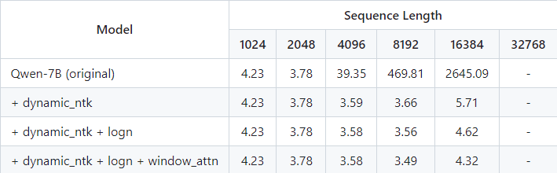

**在长上下文扩展中，感觉主要还是dynamic_ntk发挥的作用**

  4. 使用分层窗口Self-Attention，将注意力限制在一个上下文窗口内，防止模型关注到太远的内容。并在不同层采用不同的窗口大小，较低的层使用较短的窗口，而较高的层使用较长的窗口。这是因为官方观察到Qwen模型在处理长上下文时在不同层次上的建模能力存在差异，较低的层次相对于较高的层次更加敏感于上下文长度的扩展。为此，为每个层分配了不同的窗口大小，对较低的层使用较短的窗口，对较高的层使用较长的窗口。

#### 6\. 模型训练

  * 采用标准的自回归语言模型训练目标
  * 训练时上下文长度为2048 （2k）
  * 注意力模块采用Flash Attention技术，以提高计算效率并减少内存使用。
  * 采用AdamW优化器，设置β1=0.9,β2=0.95,ε=1e-8。
  * 使用余弦学习率计划，为每种模型设定一个峰值学习率。学习率会衰减到峰值学习率的 10% 的最小学习率。
  * 使用BFloat16混合精度加速训练。

##### SFT监督微调

1.）Qwen采用ChatML样式(OpenAI 2022年提出)的格式来进行模型训练。ChatML格式利用特殊符号表示不同类型信息,如系统设置、用户输入、助手输出等,这有助于模型有效区分信息。采用会话流式对话风格,而不是简单的问答形式,使模型学会真实的人机交互。

训练任务依然与预训练一样，预测下一个token。

对系统和用户的输入应用mask,只预测助手的输出。

使用AdamW优化器,超参数β1、β2和ϵ为别为0.9、0.95和1e−8。学习率先增后恒定。

序列长度限制在2048,训练batch size=128。

训练4000步,在前1430步中，学习率逐渐增加，达到2e−6的峰值。

为了防止过拟合，权重衰减的值设置为0.1，dropout设置为0.1，梯度裁剪的限制为1.0。

##### RM 模型

在奖励模型的构建上，先采用大量数据进行**偏好模型预训练** （preference model pretraining，PMP）。该 _数据集由样本对组成，每个样本对包含对单个查询的两个不同回复及其相应的偏好。再用这些高质量偏好数据精调奖励模型_ 。

在创建奖励模型时，使用同一个预训练语言模型Qwen进行PMP流程的初始化。随后，对 PMP 模型进行微调，以提高其性能。值得一提的是，在原始 Qwen 模型中加入了一个池化层，根据特定的结束token提取句子的奖励值。这一过程的学习率被设置为一个恒定值：3e-6，batch size为64。此外，序列长度设置为2048，训练过程持续1个epoch。

##### 强化学习

PPO阶段共包含四个模型：policy模型、value模型、reference模型、reward模型。在开始PPO流程之前，暂停policy模型的更新，先对value价值模型训练50步预热，从而确保value模型能够有效地适应不同的reward模型。

在PPO期间，同时为每个查询采样两个响应。将KL散度系数设置为0.04，并将奖励基于 running mean 进行归一化。策略和价值模型的学习率分别为1 × 10^-6和5 × 10^-6。为了增强训练稳定性，我们使用价值损失剪裁，剪裁值为0.15。在推理时，策略top-p设置为0.9。我们的发现表明，尽管熵略低于将top-p设置为1.0时，但奖励的增长更快，最终在类似条件下实现持续更高的评估奖励。

> **熵** ：熵是衡量随机变量不确定性的指标。
> 
> 将top-p设置为0.9，减少了生成的多样性（熵略低），但选择的内容更有可能是高质量和相关的。
> 
> 这种设置使得模型在推理过程中更快地获得较高的奖励，并最终在评估中表现得更好。

此外，我们实施了一个预训练梯度以减轻对齐税。实证发现表明，使用这种特定的奖励模型，KL惩罚足够强大，能够抵消那些不是严格代码或数学性质的基准测试中的对齐税，例如测试常识知识和阅读理解的测试。必须使用比PPO数据大得多的预训练数据量来确保预训练梯度的有效性。此外，我们的实证研究建议，这个系数的值过大可能会显著阻碍对奖励模型的对齐，最终损害最终对齐，而值过小只会对减少对齐税产生边际效应。

> 1.) 实验表明，使用这个特定的奖励模型，KL惩罚在某些基准测试中（例如常识知识和阅读理解测试）足够强大，可以有效地对抗对齐成本。
> 
> 2.) 预训练梯度的系数设置非常关键。如果系数值过大，会显著阻碍模型与奖励模型的对齐，最终削弱对齐效果。如果系数值过小，则对减轻对齐成本的影响很小。

##### 对齐结果(自动和人工评估)

#### 7\. 模型效果

  * 在3个数据集上(如在MMLU数据集),QWEN-14B版优于LLaMA2-70B模型。
  * Qwen-7B 的表现不错，超越 LLaMA2-13B，并比肩Baichuan2-13B。

### Qwen2

qwen没有bos_token，要设置一下，不然dpo train时会报错

### chatGLM

### chatGLM-2

### chatGLM-3

### Yi-34B

### BERT的预训练原理和相关改进工作？

### 最近大模型出来很多，你有了解过原理吗？

### chatGLM 和 GPT 模型结构⼀样吗

### Instruct 和 prompt 有什么区别？

### ⼤模型的幻觉怎么评测？

### ⼤模型训练⽅式?

### 写一下 softmax 函数

### PPO

**优势函数**

优势函数Function $A^{\theta}(s_t,a_t)$ 是对一个动作在平均意义上比其他动作好多少的度量

评估动作的价值就看其因此得到的期望奖励，$A_\pi (s,a) = Q_\pi (s,a) - V_\pi (s)$

通常我们只学习$V_\pi (s)$，然后通过$V_\pi (s)$与奖励的结合来估计$Q_\pi$，$Q_\pi = R+ \gamma V_{\pi }(s_{t+1})$

从而可得 $A_\pi (s,a) = Q_\pi (s,a) - V_\pi (s) = R + \gamma V_{\pi }(s_{t+1}) - V_\pi (s)$

总之$A^{\theta }(s_{t},a_{t})$要估测的是在状态$s_{t}$采取动作$a_{t}$是好的还是不好的：

1.）如果$A^{\theta }(s_{t},a_{t})$是正的(即大于0)，意味着在状态 $s_{t}$ 采取动作 $a_{t}$ 获得的回报比在状态 $s_{t}$ 下采取任何其他可能的动作获得的回报都要好，要增加概率

2.）如果$A^{\theta }(s_{t},a_{t})$是负的(即小于0)，意味着在状态 $s_{t}$ 采取动作 $a_{t}$ 得到的回报比其他动作的平均回报要差，要减少概率

**近端策略优化惩罚PPO-penalty的流程**

  1. 明确目标函数，需要优化$J^{\theta^{\prime}}(\theta)$​，让其最大化

$$J^{\theta^{\prime}}(\theta)=\mathbb{E}_{\left(s_{t}, a_{t}\right) \sim \pi_{\theta^{\prime}}}\left[\frac{p_{\theta}\left(a_{t} \mid s_{t}\right)}{p_{\theta^{\prime}}\left(a_{t} \mid s_{t}\right)} A^{\theta^{\prime}}\left(s_{t}, a_{t}\right)\right]$$

  2. 先初始化一个策略的参数$\theta$，前一个训练迭代得到的actor参数$\theta'$与环境交互，采样得到大量状态动作对，根据$\theta'$交互结果，估计$A^{\theta '}(s_t,a_t)$

  3. 训练时添加KL散度约束，是$\theta$与$\theta'$输出动作的KL散度，用于衡量$\theta$与$\theta'$的相似程度，我们希望学习出的$\theta$与$\theta'$越相似越好。

  4. PPO优化公式 $J_{\mathrm{PPO}}^{\theta^{\prime}}(\theta)=J^{\theta^{\prime}}(\theta)-\beta \mathrm{KL}\left(\theta, \theta^{\prime}\right)$

**近端策略优化裁剪PPO-clip**

这里应该是为了降低计算KL散度的复杂度，PPO-Clip目标函数里没有KL散度

$$J_{\mathrm{PPO} 2}^{\theta^{\prime}}(\theta) \approx \sum_{\left(s_{t}, a_{t}\right)} \min \left(\frac{p_{\theta}\left(a_{t} \mid s_{t}\right)}{p_{\theta^{\prime}}\left(a_{t} \mid s_{t}\right)} A^{\theta^{\prime}}\left(s_{t}, a_{t}\right), \operatorname{clip}\left(\frac{p_{\theta}\left(a_{t} \mid s_{t}\right)}{p_{\theta^{\prime}}\left(a_{t} \mid s_{t}\right)}, 1-\varepsilon, 1+\varepsilon\right) A^{\theta^{\prime}}\left(s_{t}, a_{t}\right)\right)$$

本质目标也是为了让$p_\theta(a_t|s_t)$与$p_{\theta '}(a_t|s_t)$尽可能接近。

### DPO

DPO是专门针对RLHF做的针对性优化，

  * DPO的主要思想是在强化学习的目标函数中建立决策函数与奖励函数之间的关系，以规避奖励建模的过程。
  * DPO 最大的贡献在于提出了一种方法，可以跳过训练 RM 的过程，直接利用人类偏好数据训练 LM，并在理论上通过 DPO 训练得到的 LM，和通过 RLHF 得到的 LM 是一致的。
  * DPO 是通过参数化 RLHF 中的奖励函数来直接根据偏好数据学习策略模型，这样就无需显式的奖励模型了。
  * DPO将基于强化学习的目标转换为可以通过简单的二元交叉熵损失直接优化的目标

> 原RLHF的优化目标：最大化奖励和最小化参考策略的KL散度
> 
> $$\max _{\pi_{\theta}} \mathbb{E}_{x \sim \mathcal{D}, y \sim \pi_{\theta}(y \mid x)}\left[r_{\phi}(x, y)\right]-\beta \mathbb{D}_{\mathrm{KL}}\left[\pi_{\theta}(y \mid x) \| \pi_{\mathrm{ref}}(y \mid x)\right]$$
> 
> 如果不考虑KL约束，只按照奖励最大化，可能会发生rewardhacking（在给定奖励机制下，个体通过非预期的方式最大化奖励的行为）
> 
> 基于RLHF目标函数推导DPO目标函数：
> 
>   1. 已经有很多的偏好数据后，如何将偏好变成一个Score
> 
> Bradley-Terry model
> 
> $$P\left(y_{w}>y_{l}\right)=\frac{e^{r^{*}\left(x, y_{w}\right)}}{e^{r^{*}\left(x, y_{w}\right)}+e^{r^{*}\left(x, y_{l}\right)}}$$
> 
> 希望最大化这个概率
>
>> Softmax可以转换为Sigmoid $\frac{e^{A}}{e^{A}+e^{B}}=\frac{1}{1+e^{B-A}}=\frac{1}{1+e^{-(A-B)}}=\sigma(A-B)$
> 
> $$P\left(y_{w}>y_{l}\right)=\frac{e^{r_{\phi}\left(x, y_{w}\right)}}{e^{r_{\phi}\left(x, y_{w}\right)}+e^{r_{\phi}\left(x, y_{l}\right)}}=\sigma\left(r_{\phi}\left(x, y_{w}\right)-r_{\phi}\left(x, y_{l}\right)\right)$$
> 
> 奖励模型的loss就是要最大化这个概率，也就是最小化这样一个负对数似然
> 
> $$L=-\mathbb{E}_{\left(x, y_{w}, y_{l}\right) \sim D}\left[\log \sigma\left(r_{\phi}\left(x, y_{w}\right)-r_{\phi}\left(x, w_{l}\right)\right)\right]$$
> 
> 抛开负号而言，它就是MLE的目标函数
> 
>   2. 推导
> 
> $$\max _{\pi} \mathbb{E}_{x \sim D, y \sim \pi}[r(x, y)]-\beta \mathbb{D}_{K L}\left[\pi(y \mid x) \| \pi_{\text {ref }}(y \mid x)\right]$$
> 
> KL散度展开 $\mathbb{D}_{K L}\left[\pi(y \mid x) \| \pi_{\text {ref }}(y \mid x)\right]=\mathbb{E}_{y \sim \pi}\left[\log \frac{\pi(y \mid x)}{\pi_{\text {ref }}(y \mid x)}\right]$
> 
> $\begin{array}{c}
 \max _{\pi} \mathbb{E}_{x \sim D, y \sim \pi}[r(x, y)]-\beta \mathbb{D}_{K L}\left[\pi(y \mid x) \| \pi_{\text {ref }}(y \mid x)\right] \\
 =\max _{\pi} \mathbb{E}_{x \sim D}\left[\mathbb{E}_{y \sim \pi}[r(x, y)]-\beta \mathbb{E}_{y \sim \pi}\left[\log \frac{\pi(y \mid x)}{\pi_{\mathrm{ref}}(y \mid x)}\right]\right] \\
 \end{array}$​
> 
> $=\max _{\pi} \mathbb{E}_{x \sim D} \mathbb{E}_{y \sim \pi(y \mid x)}\left[r(x, y)-\beta \log \frac{\pi(y \mid x)}{\pi_{\mathrm{ref}}(y \mid x)}\right], \quad \times \frac{1}{\beta}$ 将期望提出来，整体乘以 $\frac{1}{\beta}$
> 
> $=\min _{\pi} \mathbb{E}_{x \sim D} \mathbb{E}_{y \sim \pi(y \mid x)}\left[\log \frac{\pi(y \mid x)}{\pi_{r e f}(y \mid x)}-\frac{1}{\beta} r(x, y)\right]$ 提一个负号，变为最小化
> 
> $=\min _{\pi} \mathbb{E}_{x \sim D} \mathbb{E}_{y \sim \pi(y \mid x)}\left[\log \frac{\pi(y \mid x)}{\pi_{r e f}(y \mid x)}-\log e^{\left(\frac{1}{\beta} r(x, y)\right)}\right]$ 统一为$\log$的形式
> 
> $=\min _{\pi} \mathbb{E}_{x \sim D} \mathbb{E}_{y \sim \pi(y \mid x)}\left[\log \frac{\pi(y \mid x)}{\pi_{r e f}(y \mid x) \exp \left(\frac{1}{\beta} r(x, y)\right)}\right]$​
> 
> $=\min _{\pi} \mathbb{E}_{x \sim D} \mathbb{E}_{y \sim \pi(y \mid x)}\left[\log \frac{\pi(y \mid x)}{\frac{Z(x)}{Z(x)} \pi_{r e f}(y \mid x) \exp \left(\frac{1}{\beta} r(x, y)\right)}\right]$ 分母部分引入$Z(x)$
> 
> $=\min _{\pi} \mathbb{E}_{x \sim D} \mathbb{E}_{y \sim \pi(y \mid x)}\left[\log \frac{\pi(y \mid x)}{\frac{1}{Z(x)} \pi_{\text {ref }}(y \mid x) \exp \left(\frac{1}{\beta} r(x, y)\right)} \frac{1}{Z(x)}\right]$ 提出$\frac{1}{Z(x)}$
> 
> $$=\min _{\pi} \mathbb{E}_{x \sim D} \mathbb{E}_{y \sim \pi(y \mid x)}\left[\log \frac{\pi(y \mid x)}{\frac{1}{Z(x)} \pi_{r e f}(y \mid x) \exp \left(\frac{1}{\beta} r(x, y)\right)}-\log Z(x)\right]$$
> 
>   3. $Z(x)$Partition Function 配分函数，这里的$Z(x)$只与$x$和$\pi_{ref}$有关，而与$\pi$无关 （$Z(x)$可以任何函数）
> 
> 标准化概率分布，使其成为一个有效的概率分布
> 
> $$Z(x)=\sum_{y} \pi_{r e f}(y \mid x) \exp \left(\frac{1}{\beta} r(x, y)\right)$$
> 
>   4. 我们定义 $\pi^{*}=\frac{1}{Z(x)} \pi_{r e f}(y \mid x) \exp \left(\frac{1}{\beta} r(x, y)\right)$ , 它是一个有效的概率分布
> 
> $$\begin{array}{l}
 \pi^{*}(y \mid x) \geq 0 \\
 \sum_{y} \pi^{*}(y \mid x)=1
 \end{array}$$
> 
>   5. $\min _{\pi} \mathbb{E}_{x \sim D}\left[\mathbb{E}_{y \sim \pi(y \mid x)}\left[\log \frac{\pi(y \mid x)}{\pi^{*}(y \mid x)}\right]-\log Z(x)\right]=\min _{\pi} \mathbb{E}_{x \sim D}\left[\mathbb{D}_{K L}\left(\pi(y \mid x) \| \pi^{*}(y \mid x)\right)-\log Z(x)\right.$ 将分母部分替换为$\pi ^ *$，改写为KL散度的形式
> 
>   6. 吉布斯不等式告诉我们KL散度是大于等于0的，只有当p=q时为0
> 
> 我们要求最小化，即KL散度为0的时候，即p=q
> 
> 即 $\pi(y \mid x)=\pi^{*}(y \mid x)=\frac{1}{Z(x)} \pi_{\text {ref }}(y \mid x) \exp \left(\frac{1}{\beta} r(x, y)\right)$
> 
>   7. $$\pi_{r}(y \mid x)=\frac{1}{Z(x)} \pi_{\text {ref }}(y \mid x) \exp \left(\frac{1}{\beta} r(x, y)\right)$$
> 
>   8. 进一步推导 $r(x, y)$
> 
> $\pi^{*}(y \mid x)=\frac{1}{Z(x)} \pi_{\text {ref }}(y \mid x) \exp \left(\frac{1}{\beta} r(x, y)\right)$ 对两边取$\log$
> 
> $$\begin{aligned}
 \log \pi^{*}(y \mid x) & =\log \left[\frac{1}{Z(x)} \pi_{\text {ref }}(y \mid x) \exp \left(\frac{1}{\beta} r(x, y)\right)\right] \\
 & =\log \pi_{\text {ref }}(y \mid x)-\log Z(x)+\log \exp \left(\frac{1}{\beta} r(x, y)\right) \\
 & =\log \pi_{\text {ref }}(y \mid x)-\log Z(x)+\frac{1}{\beta} r(x, y)
 \end{aligned}$$
> 
> 因此：$r(x, y)=\beta \log \frac{\pi^{*}(y \mid x)}{\pi_{\text {ref }}(y \mid x)}+\beta \log Z(x)$
> 
> 这样就完成了对奖励模型的替换，完成了对奖励模型的建模，隐式的奖励模型。
> 
>   9. $Z(x)$是对$y$的积分，还是比较难求，如何将其消除
> 
> 再回顾 Bradley-Terry model：
> 
> $$\begin{aligned}
 p\left(y_{w}>y_{l}\right) & =\sigma\left(r\left(x, y_{w}\right)-r\left(x, y_{l}\right)\right) \\
 & =\sigma\left(\beta \log \frac{\pi^{*}\left(y_{w} \mid x\right)}{\pi_{\mathrm{ref}}\left(y_{w} \mid x\right)}+\beta \log Z(x)-\beta \log \frac{\pi^{*}\left(y_{l} \mid x\right)}{\pi_{\mathrm{ref}}\left(y_{l} \mid x\right)}-\beta \log Z(x)\right) \\
 & =\sigma\left(\beta \log \frac{\pi^{*}\left(y_{w} \mid x\right)}{\pi_{\mathrm{ref}}\left(y_{w} \mid x\right)}-\beta \log \frac{\pi^{*}\left(y_{l} \mid x\right)}{\pi_{\mathrm{ref}}\left(y_{l} \mid x\right)}\right)
 \end{aligned}$$
> 
> 这样就把$Z(x)$消除
> 
>   10. 最终
> 
> $$L_{D P O}\left(\pi_{\theta} ; \pi_{\text {ref }}\right)=-\mathbb{E}_{\left(x, y_{w}, y_{l}\right) \sim D}\left[\log \sigma\left(\beta \log \frac{\pi_{\theta}\left(y_{w} \mid x\right)}{\pi_{\text {ref }}\left(y_{w} \mid x\right)}-\beta \log \frac{\pi_{\theta}\left(y_{l} \mid x\right)}{\pi_{\text {ref }}\left(y_{l} \mid x\right)}\right)\right]$$
> 
> 

DPO的训练目标 $\mathcal{L}_{DPO}(\pi_{\theta }; \pi_{ref})  = -\mathbb{E}_{\left(x, y_{w}, y_{l}\right) \sim \mathcal{D}}\left[\log \sigma\left(\beta \log \frac{\pi_{\theta}\left(y_{w} \mid x\right)}{\pi_{\mathrm{ref}}\left(y_{w} \mid x\right)}-\beta \log \frac{\pi_{\theta}\left(y_{l} \mid x\right)}{\pi_{\mathrm{ref}}\left(y_{l} \mid x\right)}\right)\right]$​

$\beta$：超参数，一般在 0.1-0.5 之间

$\pi_\theta(y_w|x)$：输入给定 x，当前 Policy model 生成好的 response 的累积概率，每个 token 的概率求和

$\pi_{ref}(y_l | x)$：输入给定 x，原始 reference model 生成坏的 response 的累积概率

开始训练时，reference model 和 Policy model 都是同一个模型，只不过在训练过程中reference model 不会更新权重。

> DPO算法分析，尝试分析DPO的目标函数的导数来理解DPO算法如何对LLM的参数进行优化：
> 
> 先设 $u=\beta \log \left(\frac{\pi_{\theta}\left(y_{w} \mid x\right)}{\pi_{\text {ref }}\left(y_{w} \mid x\right)}\right)-\beta \log \left(\frac{\pi_{\theta}\left(y_{l} \mid x\right)}{\pi_{\text {ref }}\left(y_{l} \mid x\right)}\right)$，则上面DPO的目标函数式(6)的导数可以化简为：
> 
> $\nabla L(\theta)=-\nabla \mathbb{E}_{\left(x, y_{w}, y_{l}\right) \sim \mathcal{D}}[\sigma(u)]=-\mathbb{E}_{\left(x, y_{w}, y_{l}\right) \sim \mathcal{D}}\left[\frac{\nabla \sigma(u)}{\sigma(u)} \nabla u\right]$​
> 
> Sigmoid函数有性质 $\nabla \sigma(u)=\sigma(u)(1-\sigma(u))=\sigma(u) \sigma(-u)$
> 
> 设奖励的估计值为 $\hat{r}_{\theta}(x, y)=\beta \log \left(\frac{\pi_{\theta}(y \mid x)}{\pi_{\text {ref }}(y \mid x)}\right)$
> 
> 则 $\begin{align}
\nabla L(\theta) & = -\mathbb{E}_{\left(x, y_{w}, y_{l}\right) \sim \mathcal{D}}\left[\frac{\nabla \sigma(u)}{\sigma(u)} \nabla u\right] \\
&= -\mathbb{E}_{\left(x, y_{w}, y_{l}\right) \sim \mathcal{D}} [\frac{\sigma(u) \sigma(-u)}{\sigma(u)} \nabla u] \\
&= -\mathbb{E}_{\left(x, y_{w}, y_{l}\right) \sim \mathcal{D}} [\sigma(-u) \nabla u] \\
&= -\mathbb{E}_{\left(x, y_{w}, y_{l}\right) \sim \mathcal{D}} [\sigma(\beta \log \left(\frac{\pi_{\theta}\left(y_{l} \mid x\right)}{\pi_{\text {ref }}\left(y_{l} \mid x\right)}\right) - \beta \log \left(\frac{\pi_{\theta}\left(y_{w} \mid x\right)}{\pi_{\text {ref }}\left(y_{w} \mid x\right)}\right) \nabla (\beta \log \left(\frac{\pi_{\theta}\left(y_{l} \mid x\right)}{\pi_{\text {ref }}\left(y_{l} \mid x\right)}\right) - \beta \log \left(\frac{\pi_{\theta}\left(y_{w} \mid x\right)}{\pi_{\text {ref }}\left(y_{w} \mid x\right)}\right)))] \\
&= -\beta \mathbb{E}_{\left(x, y_{w}, y_{l}\right) \sim \mathcal{D}} [\sigma(\hat{r}_{\theta}(x, y_l) - \hat{r}_{\theta}(x, y_w)) (\nabla _\theta \log \pi(y_w | x) - \nabla_\theta\log \pi(y_l|x))] \\
\end{align}$
> 
> 所以DPO的损失函数的梯度会增加偏好内容 $y_w$ 的似然，降低非偏好内容 $y_l$ 的似然。
> 
> 前半部分 $\hat{r}_{\theta}(x, y_l) - \hat{r}_{\theta}(x, y_w)$ 和 $\beta$ 一起动态地控制梯度下降的步长；
> 
> 当策略模型更倾向于生成非偏好内容 $y_l$ 时，$\hat{r}_{\theta}(x, y_l)$ 和 $\hat{r}_{\theta}(x, y_w)$ 之间的差值变大，导致梯度下降的步长变大，从而进行更为激进的参数更新来避免生成 $y_l$​；
> 
> 而当策略模型倾向于生成符合人类偏好的内容 $y_w$ 时，说明策略模型当前具有较好的参数，此时梯度的系数变小，即 $\hat{r}_{\theta}(x, y_l) - \hat{r}_{\theta}(x, y_w)$ 的值变小，使得策略模型的参数的更新幅度降低，防止更新步长过大使得策略模型的性能出现震荡，增加训练的稳定性。

#### DPO 微调

通过DPO微调模型大概可以简单的分为两个步骤：

  1. 将数据处理成所需格式。
  2. 使用DPOTrainer进行训练

DPO多轮数据示例

```json
{
    "chosen":
    	[
            {"content":"How do I teach kids to meditate?","role":"user"},
            {"content":"Great question! That’s a really useful skill to cultivate, it can bring peace, calm, and happiness. I’m glad you want to teach your kids about it.","role":"assistant"},
            {"content":"All right, so how do we start?","role":"user"},
            {"content":"Well, we can get started with just being silent. You can tell the kids it’s okay if they just sit there quietly for a few minutes without thinking of anything.","role":"assistant"},
            {"content":"any other ideas? they are fidgeting","role":"user"},
            {"content":"Kids are great at fidgeting, so let’s make sure we give them permission to fidget.","role":"assistant"}
        ],
    "rejected":
    	[
            {"content":"How do I teach kids to meditate?","role":"user"},
            {"content":"Great question! That’s a really useful skill to cultivate, it can bring peace, calm, and happiness. I’m glad you want to teach your kids about it.","role":"assistant"},
            {"content":"All right, so how do we start?","role":"user"},
            {"content":"Well, we can get started with just being silent. You can tell the kids it’s okay if they just sit there quietly for a few minutes without thinking of anything.","role":"assistant"},
            {"content":"any other ideas? they are fidgeting","role":"user"},{"content":"Yeah, definitely. What works for you personally? What works for other people?","role":"assistant"}
        ],
    "prompt":"How do I teach kids to meditate?"
}
```

### IPO 身份偏好优化

_IPO论文定义了DPO的通用形式并调整其形式来解决过拟合问题。IPO相当于 在DPO的损失函数上添加了一个正则项，从而可以使得不使用early stopping技巧就可以使模型收敛。_

身份偏好优化（IPO）是一种基于用户身份的偏好优化算法。它通过分析用户的身份特征，如年龄、性别、职业等，来推断用户的偏好，并据此调整模型的输出。IPO算法的优点在于能够利用用户的身份特征进行个性化推荐，提高推荐的准确性。然而，它也存在一定的挑战，比如如何准确地获取和利用用户的身份特征，以及如何平衡不同身份特征之间的冲突。

与DPO类似，直接优化偏好的算法，但使用了离线对比损失。

损失函数定义如下：

$$\mathcal{L}_{I P O}(\pi)=-\mathbb{E}_{\left(x, y_{w}, y_{l}\right) \sim \mathcal{D}}\left(h_{\pi}\left(y_{w}, y_{l}, x\right)-\frac{\tau^{-1}}{2}\right)^{2}$$

$h_{\pi}\left(y, y^{\prime}, x\right)=\log \left(\frac{\pi(y \mid x) \pi_{\mathrm{ref}}\left(y^{\prime} \mid x\right)}{\pi\left(y^{\prime} \mid x\right) \pi_{\mathrm{ref}}(y \mid x)}\right)$ 衡量了在给定上下文$𝑥$下，策略$𝜋$和参考策略 $𝜋_ref$之间对两个动作$𝑦$和 $𝑦^′$​的偏好差异

$$\begin{align}
\mathcal{L}_{I P O}(\pi) & = -\mathbb{E}_{\left(x, y_{w}, y_{l}\right) \sim \mathcal{D}}\left(h_{\pi}\left(y_{w}, y_{l}, x\right)-\frac{\tau^{-1}}{2}\right)^{2} \\
&= -\mathbb{E}_{\left(x, y_{w}, y_{l}\right) \sim \mathcal{D}}\left(\log \left(\frac{\pi(y \mid x) \pi_{\mathrm{ref}}\left(y^{\prime} \mid x\right)}{\pi\left(y^{\prime} \mid x\right) \pi_{\mathrm{ref}}(y \mid x)}\right)-\frac{\tau^{-1}}{2}\right)^{2} \\
&= -\mathbb{E}_{\left(x, y_{w}, y_{l}\right) \sim \mathcal{D}}\left(\log \frac{\pi(y|x)}{\pi_{ref}(y|x)} - \log \frac{\pi(y^{\prime }|x)}{\pi_{ref}(y^{\prime} | x)} - \frac{\tau^{-1}}{2} \right)^{2}
\end{align}$$

> 分子$\pi(y \mid x) \pi_{\mathrm{ref}}\left(y^{\prime} \mid x\right)$表示在上下文$𝑥$下，策略$𝜋$选择动作$ 𝑦$而参考策略 $𝜋_ref$选择动作 $𝑦^′$的联合概率。
> 
> 分母$\pi\left(y^{\prime} \mid x\right) \pi_{\mathrm{ref}}(y \mid x)$表示策略$𝜋$选择动作$ 𝑦^′$而参考策略$ 𝜋_ref$选择动作$𝑦$的联合概率。
> 
> 如果$h_\pi>0$，说明分子的联合概率大于分母的联合概率，策略$\pi$更倾向于动作$y$。
> 
> 如果$h_\pi<0$，则策略$\pi$更倾向于动作$y’$

### Kahneman-Taversky优化（KTO）

2024年02月论文提出。

  * Kahneman-Taversky优化（KTO）是一种基于人类心理认知过程的偏好优化算法。它通过分析人类在决策过程中的心理认知过程，如注意力分配、记忆提取等，来优化模型的输出。KTO算法的优点在于能够模拟人类的决策过程，使机器更准确地把握人类的需求和偏好。然而，它也存在一定的难度，比如如何准确地模拟人类的心理认知过程，以及如何将这种模拟结果应用到实际场景中。
  * DPO等对齐方法训练时针对一个prompt需要一对偏好数据即 ${x, y_w, y_l}$，这个数据标注过程耗时且费力。
  * KTO定义的损失函数只需要将样本标注为"好(good)“或"坏(bad)”，从而使得获取标注样本的成本更低。

KTO损失函数：

$$\begin{array}{c}
L_{K T O}\left(\pi_{\theta}, \pi_{\text {ref }}\right)=\mathbb{E}_{x, y \sim D}\left[w(y)\left(1-v_{\mathrm{KTO}}(x, y ; \beta)\right)\right] \\
r_{K T O}(x, y)=\beta \log \frac{\pi_{\theta}(y \mid x)}{\pi_{\text {ref }}(y \mid x)} \\
z_{\text {ref }}=\mathbb{E}_{x^{\prime} \sim D}\left[\beta \mathrm{KL}\left(\pi_{\theta}\left(y^{\prime} \mid x^{\prime}\right)|| \pi_{\text {ref }}\left(y^{\prime} \mid x^{\prime}\right)\right)\right] \\
v_{\mathrm{KTO}}(x, y ; \beta)=\left\{\begin{array}{l}
\sigma\left(r_{\mathrm{KTO}}(x, y)-z_{\text {ref }}\right) \text { if } y \sim y_{\text {desirable }} \mid x \\
\sigma\left(z_{\text {ref }}-r_{\mathrm{KTO}}(x, y)\right) \text { if } y \sim y_{\text {undesirable }} \mid x
\end{array}\right. \\
w(y)=\left\{\begin{array}{l}
\lambda_{D} \text { if } y \sim y_{\text {desirable }} \mid x \\
\lambda_{U} \text { if } y \sim y_{\text {undesirable }} \mid x
\end{array}\right.
\end{array}$$

> $r_{K T O}(x, y)=\beta \log \frac{\pi_{\theta}(y \mid x)}{\pi_{\text {ref }}(y \mid x)}$ 衡量了当前模型输出 𝑦 相对于参考模型输出的概率比率的对数.
> 
> ???

论文中的损失函数过于复杂，这里从代码实现的角度拆解损失函数

  1. 计算偏好响应的KL散度

$chosen\_KL = \mathbb{KL}(\pi_{\theta}(y|x), \pi_{ref}(y|x))$​

  2. 计算非偏好响应的KL散度

$$rejected\_KL = \mathbb{KL}(\pi_{\theta}(y'|x), \pi_{ref}(y'|x))$$

  3. 计算偏好响应的对数概率比

$$chosen\_logratios = \log \pi_\theta(y|x) - \log \pi_{ref}(y|x)$$

  4. 计算非偏好响应的对数概率比

$rejected\_logratios = \log \pi_\theta(y'|x) - \log \pi_{ref}(y'|x)$​

  5. **偏好响应的损失 & 非偏好响应的损失**

$losses = [1-sigmoid(\beta(chosen\_logratios-rejected\_KL)), 1-sigmoid(\beta(chosen\_KL-chosen\_logratios))]$​

  6. **偏好奖励** $\beta \log \frac{\pi_\theta(y|x)}{\pi_{ref}(y|x)}$

  7. **非偏好奖励** $\beta \log \frac{\pi_\theta(y'|x)}{\pi_{ref}(y'|x)}$

### 评估 DPO、IPO、KTO

#### hfblog

DPO和IPO效果差不多，相比KTO效果略好一点

#### paper

<https://arxiv.org/pdf/2404.14723>

在三种场景：1. 保留SFT过程；2.略过SFT过程；3.略过SFT过程且使用指令微调模型；以及探索了不同训练集大小对它们的影响。结论是KTO在大多数基准上比其他几种方法效果好，但是这几种方法在对齐过程中都没有显著提升模型的推理和问答能力，但是提升了数学问题解决能力。并且研究表明对齐方法对于训练数据集的大小很敏感，在小数据集上表现更好。另外对于KTO和CPO方法可以略过SFT过程。

### DPO与RLHF的比较

DPO用起来方便但是泛化能力弱于RLHF，性能损失可接近一倍 <https://arxiv.org/abs/2312.10584>

PPO略好一点 [https://arxiv.org/abs/2404.10719?utm_source=substack&utm_medium=email](<https://arxiv.org/abs/2404.10719?utm_source=substack&utm_medium=email>)

### SimPO 简单偏好优化

DPO 是通过参数化 RLHF 中的奖励函数来直接根据偏好数据学习策略模型，这样就无需显式的奖励模型了，该方法简单稳定，已经被广泛用于实践。

使用 DPO 时，隐式奖励的方式是使用当前策略模型和SFT模型之间的响应似然的对数比构建的，$r(x, y)=\beta \log \frac{\pi^{*}(y \mid x)}{\pi_{\text {ref }}(y \mid x)}+\beta \log Z(x)$，但是这种构建奖励的方式并未与引导生成的指标直接对齐，训练和推理之间的这种差异可能导致性能不佳。

  * 该算法的核心是将偏好优化目标中的奖励函数与生成指标对齐。

  * SimPO 包含两个主要组件：

1.) 在长度上归一化的奖励，其计算方式是使用策略模型的奖励中所有 token 的平均对数概率；

$r_{\mathrm{SimPO}}(x, y)=\frac{\beta}{|y|} \log \pi_{\theta}(y \mid x)=\frac{\beta}{|y|} \sum_{i=1}^{|y|} \log \pi_{\theta}\left(y_{i} \mid x, y_{<i}\right)$​

从奖励公式中移除长度归一化项会导致模型倾向于生成更长但质量更低的序列。

2.) 目标奖励差额，用以确保获胜和失败响应之间的奖励差超过这个差额。

$p\left(y_{w} \succ y_{l} \mid x\right)=\sigma\left(r\left(x, y_{w}\right)-r\left(x, y_{l}\right)-\gamma\right)$​

引入了一个目标奖励差额项$\gamma>0$，以确保获胜响应的奖励$r(x, y_w)$超过失败响应的奖励$r(x, y_l)$至少 $\gamma$

随着目标差额增大，生成质量一开始会提升，但当这个差额变得过大时，生成质量就会下降。

SimPO 目标：将1式带入2式

$$\mathcal{L}_{\mathrm{SimPO}}\left(\pi_{\theta}\right)=-\mathbb{E}_{\left(x, y_{w}, y_{l}\right) \sim \mathcal{D}}\left[\log \sigma\left(\frac{\beta}{\left|y_{w}\right|} \log \pi_{\theta}\left(y_{w} \mid x\right)-\frac{\beta}{\left|y_{l}\right|} \log \pi_{\theta}\left(y_{l} \mid x\right)-\gamma\right)\right]$$

  * 优点：

SimPO 不需要参考模型，因此比 DPO 等其它依赖参考模型的方法更轻量更容易实现。

**尽管 SimPO 很简单，但其性能却明显优于 DPO** 。

**相比于 SFT 或 DPO 模型，SimPO 不会显著增加响应长度** 。

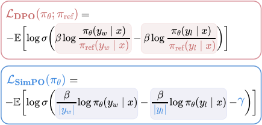

> DPO 是最常用的离线偏好优化方法之一。DPO 并不会学习一个显式的奖励模型，而是使用一个带最优策略的闭式表达式来对奖励函数 r 进行重新参数化：

### LoRA

### QLoRA

### LoftQ

一种新的量化框架，专门为需要量化和LoRA微调的预训练模型量身定制。

当在预训练模型上同时应用量化和LoRA微调时，**通常会观察到与全精度微调相比，在下游任务上存在性能差距。**

**LoftQ的目标是通过一种新颖的量化方法，同时对LLM进行量化，并 为LoRA微调找到一个合适的低秩初始化，以减少量化模型与全精度模型之间的差异，并提高模型在下游任务上的泛化能力**。

#### LoRA-Aware Quantization

使用 N-bit 量化权重$Q\in\mathbb{R}_N^{d_1\times d_2}$和低秩近似 $A \in \mathbb{R}^{d_1 \times r} $ 和 $ B \in \mathbb{R}^{d_2 \times r} $ 来近似原始高精度预训练权重 $ W \in \mathbb{R}^{d_1 \times d_2} $​ 作为LoRA微调的初始化。具体来说，在微调之前，我们通过最小化以下目标来初始化网络：

$$\min _{Q, A, B}\left\|W-Q-A B^{\top}\right\|_{F} \ \ \ \ \ \ \ (6)$$

其中 $\| \cdot \|_F$ 表示Frobenius范数，矩阵元素平方和再开方。

公式中的目标考虑了LoRA微调，通过联合优化量化主干 $Q$ 和低秩适配器 $A$、$B$ 的初始值。

相反，实践者通常会直接将预训练权重 $W$ 转换为量化权重 $Q$，忽略了随后的LoRA微调过程。这种疏忽会导致由于量化差异而在下游任务中出现显著的性能下降。

#### 交替优化

我们通过交替执行量化和奇异值分解（SVD）来解决公式（6）中的最小化问题。首先，我们将 $ A_0$ 和 $ B_0 $ 设置为0。

**量化** ：  
在第 ( t ) 步，我们量化原始预训练权重 $ W $ 与上一步得到的低秩近似 $A_{t-1} B_{t-1}^T$ 之间的差值，以获得量化权重 $Q_t$，具体如下：  
$Q_{t}=q_{N}\left(W-A_{t-1} B_{t-1}^{\top}\right)$  
其中 $q_n()$ **将高精度权重矩阵映射到量化矩阵** ，量化函数。

我们的算法与不同的量化函数 $ q_n(\cdot)$ 兼容。

对于固定的 $ A_{t-1} B_{t-1}^T $，$ Q_t $ 并不是公式（6）中最小化问题的确切解，但它是一个有效的近似解。

**奇异值分解（SVD）** ：  
在获得第$ t $ 步的量化权重 $ Q_t $ 后，我们对量化的残差 $ R_t = W - Q_t $ 应用奇异值分解，表示为：  
$R_{t}=\sum_{i=1}^{d} \sigma_{t, i} u_{t, i} v_{t, i}^{\top}$  
其中 $d = \min(d_1, d_2)$，$\sigma_{t, 1} \geq \sigma_{t, 2} \geq \ldots \geq \sigma_{t, d}$ 是奇异值，$u_{t, i}, v_{t, i}$​ 是对应的左右奇异向量

通过$A_tB_t^T$获得秩为r的$R_t$近似

$\begin{array}{l}
A_{t}=\left[\sqrt{\sigma_{t, 1}} u_{t, 1}, \ldots, \sqrt{\sigma_{t, r}} u_{t, r}\right], \\
B_{t}=\left[\sqrt{\sigma_{t, 1}} v_{t, 1}, \ldots, \sqrt{\sigma_{t, r}} v_{t, r}\right] .
\end{array}$​

$A_t$ 通过对奇异值开方乘上左奇异向量得到。

$B_t$ 通过对奇异值开方乘上右奇异向量得到。

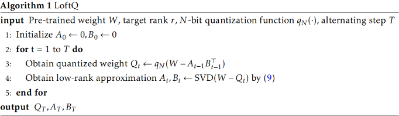

算法描述很清晰了

特殊情况，$T = 1$时，$Q_1$由QLoRA得到的精确量化权重，低秩近似$A_1, B_1$ 对量化残差$W-Q_1$进行奇异值分解得到。

$T = 1$ 足以减轻量化差异，交替优化有助于找到与预先训练的权重W更接近的初始化。

### Dora 权重分解低秩适应

DoRA在LoRA的基础上进一步发展，通过将预训练权重分解为“幅度”和“方向”两个部分进行微调。

这种权重分解方法允许DoRA更精细地控制模型的学习过程，分别针对权重的大小和方向进行优化。

在调整方向部分时，DoRA利用了LoRA的策略，通过低秩适应来有效地更新方向，而幅度部分则单独进行调整。

>   * FT（全微调）倾向于在幅度和方向上进行更多样化的更新，这可能反映了其更复杂的学习模式，能够适应各种下游任务。
>   * LoRA（低秩适应）则显示出在幅度和方向更新之间存在正相关性，即幅度和方向的变化往往是成比例的，这可能限制了LoRA在更精细调整模型权重方面的能力。
>   * DoRA（权重分解低秩适应）则展现出与FT相似的学习模式，能够在幅度和方向上进行更独立的调整，这表明DoRA能够更有效地模仿FT的学习能力，同时保持参数效率。
> 

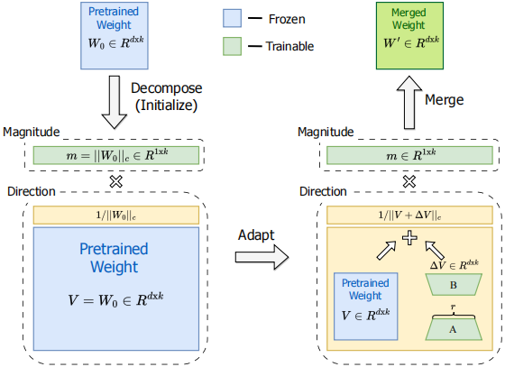

LoRA的更新方式 $W^{\prime}=W_{0}+\Delta W=W_{0}+\underline{B A}$

DoRA的更新方式$W^{\prime}=\underline{m} \frac{V+\Delta V}{\|V+\Delta V\|_{c}}=\underline{m} \frac{W_{0}+\underline{B A}}{\left\|W_{0}+\underline{B A}\right\|_{c}}$

> DoRA 最初将预训练权重分解为其幅度和方向分量，并对两者进行微调。
> 
> 由于方向分量在参数数量方面较大，我们进一步使用 LoRA 对其进行分解，以实现高效的微调。
> 
> m为可训练幅度向量

在微调过程中，DoRA选择只更新某些模块（如QKV注意力机制中的query、key、value模块）的幅度和方向，而对于剩余的线性层（如MLP层）仅更新其幅度，这样的粒度控制有助于提高性能并减少所需训练的参数数量。

```python
class DoRALayer(nn.Module):
    def __init__(self, d_in, d_out, rank=4, weight=None, bias=None):
    super().__init__()
        # 初始化权重和偏置
        if weight is not None:
        	self.weight = nn.Parameter(weight, requires_grad=False)
        else:
        	self.weight = nn.Parameter(torch.Tensor(d_out, d_in), requires_grad=False)
        if bias is not None:
	        self.bias = nn.Parameter(bias, requires_grad=False)
        else:
    	    self.bias = nn.Parameter(torch.Tensor(d_out), requires_grad=False)

        # 计算输出维度上的权重矩阵的列的幅度
        self.m = nn.Parameter(self.weight.norm(p=2, dim=0, keepdim=True))
        # 初始化 LoRA 的参数 A 和 B
        std_dev = 1 / torch.sqrt(torch.tensor(rank).float())
        self.lora_A = nn.Parameter(torch.randn(d_out, rank) * std_dev)
        self.lora_B = nn.Parameter(torch.zeros(rank, d_in))

    def forward(self, x):
        # 计算 LoRA 矩阵
        lora = torch.matmul(self.lora_A, self.lora_B)
        # 微调权重
        adapted = self.weight + lora
        # 对调整后的权重进行归一化
        column_norm = adapted.norm(p=2, dim=0, keepdim=True)
        norm_adapted = adapted / column_norm
        # 计算最终权重
        calc_weights = self.m * norm_adapted
        # 使用最终权重进行线性变换
        return F.linear(x, calc_weights, self.bias)
```

### GaLore

GaLore梯度低秩映射，允许全参数学习的训练策略，比LoRA更节省内存。

GaLore的核心思想是在训练过程中利用梯度的低秩特性，而不是直接对权重矩阵进行低秩近似。**降低优化器状态内存占用**

在LLMs的训练过程中，权重矩阵$W\in\mathbb{R}^{m\times n}$的梯度G通常具有低秩结构，意味着梯度矩阵可以通过较小的子空间来近似表示，从而减少内存占用。

GaLore通过计算两个投影矩阵$P\in\mathbb{R}^{m\times n}$和$Q\in\mathbb{R}^{n\times r}$，将梯度矩阵G投影到一个低秩形式$P^TGQ$，可以显**著降低优化器状态的内存成本，** 因为P和Q的低频率更新（例如每200次迭代）会产生最小的额外计算成本。

训练过程中GaLore可以动态的切换低秩子空间，意味着模型可以在不同的子空间中学习，而不是局限于单一的低秩空间。

动态切换通过定期更新投影矩阵P和Q来实现，以适应梯度的变化。

此外，GaLore在内存使用上进行了优化，例如，它只使用一个投影矩阵P或Q，而不是同时使用两个，这进一步减少了内存需求。

> 在训练大模型的过程中,我们通常需要存储三类数据:模型权重参数、优化器状态(如动量、梯度等)和中间激活值。

作为一种梯度投影方法，GaLore 独立于优化器的选择，只需两行代码就能轻松插入现有的优化器中.

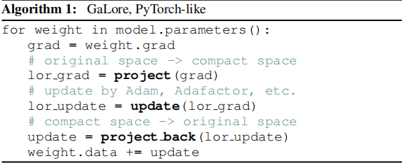

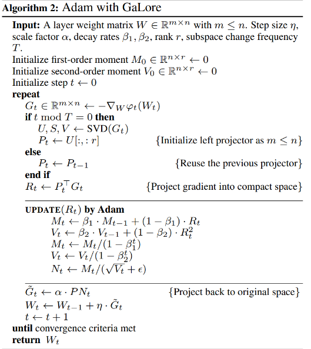

> 计算当前权重矩阵的梯度$G_t$
> 
> $t\ mod \ T$的目的是控制投影矩阵$P$的更新频率，每个训练周期的特定间隔$T$重新计算投影矩阵，切换低秩子空间。
> 
> 对梯度进行奇异值分解SVD，取左侧正交矩阵U的前 $r$ 列作为新的投影矩阵。
> 
> 梯度乘以投影矩阵$P_t^T$用于将梯度投影到低秩空间。
> 
> 使用映射到低维的梯度通过Adam优化器进行更新梯度。
> 
> 更新之后的梯度(被归一化梯度$N_t$)，左边乘以投影矩阵$P$恢复到原来的梯度空间。
> 
> 使用更新后梯度更新权重矩阵。

**传递给Adam优化器的梯度是映射到低维的梯度，进而减少了开销** 。

### LongLoRA

训练时S2-attn，推理时全局attn

### LongQLoRA

<https://blog.csdn.net/v_JULY_v/article/details/135375799>

## 模型量化

### 一、模型量化简介

大模型推理服务极其消耗显存和算力。

如果以 FP16 精度进行175B GPT-3的推理，至少需要350GB的显存存储。

此外，多级多卡的场景中，推理过程GPU间的通信量大，IO成为了瓶颈，使得大模型推理延迟难以接受。

#### 1.1 模型量化是做什么的？

  1. **模型量化是将浮点数值转化为定点数值，同时尽可能减少计算精度损失的方法。**

  2. 具体而言，模型量化是一种压缩网络参数的方式，它将神经网络的参数（weight）、特征图（activation）等原本用浮点表示的量值换用定点（整型）表示，在计算过程中，再将定点数据反量化回浮点数据，得到结果。

  3. **模型量化实现建立在深度网络对噪声具有一定的容忍性上** ，模型量化相当于对深度网络增加了一定的噪声（量化误差），如果量化位数合适，模型量化基本不会造成较大的精度损失。

#### 1.2 为什么要做量化？

**模型量化既能减少资源消耗，也能提高运行速度，使大规模推理服务的性能提升。**

模型量化的好处主要有：

  1. 可以减少内存和显存占用，给模型瘦身，降低大模型的使用门槛和资源消耗

如果将`16B`参数的 MOSS 模型做`int4`量化，加载模型所需显存就可以从 32GB 降低到`10GB`，使得 MOSS 能在普通的消费级显卡上跑推理。

  2. 能够提高运行速度，这可以从两方面理解：

     * 在适配低精度的硬件下，量化模型的运算能直接用 int8 GEMM kernel 计算
     * 量化减少了单位数据的bit数，可以减少计算过程中的通信量
  3. 由于以上两点，我们做模型推理时，可以增加更多的 batch size，同时也能加快计算速度

> vLLM 提出的 PagedAttention 能够减少显存碎片和实现显存共享，使得一次推理的 batch size 增大，也同时实现了高效的并行推理。

#### 1.3 对哪些数值做量化

大模型量化的对象主要有：权重、激活、KV Cache、梯度、优化器等。

> 梯度量化主要在训练场景使用，用于减少反向传播时的计算和通信开销。
> 
> 优化器量化（如：8-Bit Optimizers Via Block-Wise Quantization）也是用于训练场景；
> 
> 仅权重量化，如：W4A16、AWQ及GPTQ中的W4A16，W8A16（权重量化为INT8，激活仍为BF16或FP16）
> 
> 权重、激活量化，如：SmoothQuant中的W8A8
> 
> KV Cache INT8 量化，LLM 推理时，为了避免冗余计算，设计了 KV Cache 缓存机制，本质上是空间换时间，由于 KV Cache 的存在，对于支持越长的文本长度的 LLM， KV Cache 的显存占用越高。 因此，KV Cache 的量化也是有很必要的。

通常而言，模型的参数分布较为稳定，因此**对参数 weight 做量化较为容易** 。

然而，模型的激活值往往存在异常值，直接对其做量化，会降低有效的量化格点数，导致精度损失严重，因此，**激活值的量化需要更复杂的处理方法（如 SmoothQuant）** 。

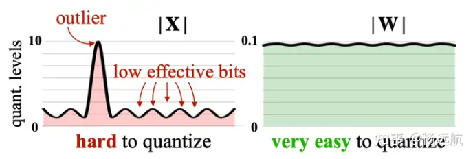

目前主要介绍 weight 量化的方法.

#### 1.4 常见的量化精度有哪些？

**通常可以将模型量化为 int4、int8 等整型数据格式。**

在大模型方向上，模型的计算一般采用 16-bit 精度（FP16、BF16 等），所以通常我们需要将 int4/int8 转化为 FP16/BF16，然后再进行计算。

如果我们自己实现了 int4/int8 的 cuda kernel，或者 GPU 有 int4/int8 的矩阵运算支持，也可以在低精度下直接运算。

> 除此之外，NVIDIA Hopper 框架支持了 FP8 的低精度运算，可以在硬件层面上实现模型的高效训练和推理。

#### 1.5 量化方法有哪些分类？

**根据量化方案的不同，可以分为量化感知训练（QAT）和后训练量化（PTQ）。**

  * QAT（Quant-Aware Training） 也可以称为**在线量化（On Quantization）** 。它需要利用额外的训练数据，在量化的同时结合反向传播对模型权重进行调整，意在确保量化模型的精度不掉点。

  * PTQ （Post Training Quantization）也可以称为**离线量化（Off Quantization）** 。它是在已训练的模型上，使用少量或不使用额外数据，对模型量化过程进行校准，可能伴有模型权重的缩放。其中：

1.）**训练后动态量化（PostDynamic Quantization）** 不使用校准数据集，直接对每一层 layer 通过量化公式进行转换。**`QLoRA 就是采用这种方法。`**

2.）**训练后校正量化（Post Calibration Quantization）** 需要输入**有代表性** 的数据集，根据模型每一层 layer 的输入输出调整量化权重。**`GPTQ 就是采用这种方法。`**

Pytorch 对上述三种量化方式，都提供了相应的 API。

**根据量化公式的不同，可以分为线性量化和非线性量化，也可以分为对称量化和非对称量化。**

根据量化公式是否为线性，量化可以分为线性量化和非线性量化。我们这里主要讨论线性量化。

**线性量化下** ，浮点数与定点数之间的转换公式如下：

$$\begin{array}{c}
Q=\frac{R}{S}+Z \\
R=(Q-Z) * S
\end{array}$$

> R 表示量化前的浮点数
> 
> S（Scale）表示缩放因子的数值
> 
> Z（Zero）表示零点的数值
> 
> Q 表示量化后的定点数

**对称量化** （如左图所示）中，量化前后的 0 点是对齐的，因此不需要记录零点。它适合对分布良好且均值为 0 的参数进行量化。因此 _对称量化常用于对 weight 量化_ 。

**非对称量化** （如右图所示）中，量化前后 0 点不对齐，需要额外记录一个 offset，也就是零点。非对称量化常用于对 activation 做量化。

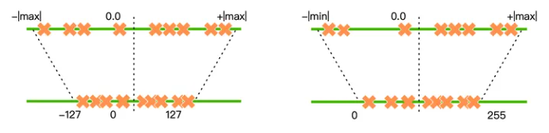

稍后要介绍的 QLoRA 和 GPTQ 都是对 weight 做量化，因此均采用对称量化的方法。

#### 1.6 模型量化具体是怎么实现的？

**对称量化中，零点 Z = 0，一般不记录，我们只需要关心如何求解 Scale** 。由于 weight 几乎不存在异常值，因此我们可以直接取 Scale 为一个 layer 或 block 内所有参数的**最大绝对值** ，于是所有的参数都在 [-1, 1] 的区间内。随后，这些参数将找到最近的量化格点，并转化成定点数。

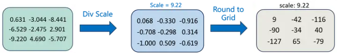

上图为int8量化，首先找到最大绝对值$scale = 9.22$，对每个参数进行归一化，最后根据量化的位数需要乘以$2^{N-1}-1$，再对结果做`round()`到最近的量化格点处。

这里需要引入 `Block-wise quantization` 的概念。通常情况，为了避免异常值（outlier）的影响，我们会将输入 tensor 分割成一个个 block，每个 block 单独做量化，有单独的 scale 和 zero，因此能使量化的精度损失减少（见下图橙色的误差部分）。

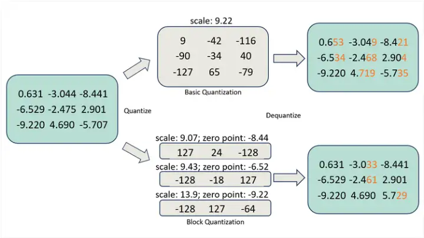

#### 1.7 需要关注哪些指标？

模型量化可以看成模型的压缩/解压过程，也可以理解成模型加密/解密的过程。

既然量化算法相当于一个压缩算法，自然我们需要关注：

  * `压缩比`，也就是说，一种量化方法能减少多少内存/显存占用？
  * `压缩/解压缩的速度`，这影响量化模型推理的速度，也是我们需要重点优化之处。

对于第一个关注点，当我们确定了量化精度（例如 int4），确定了量化方法，以及需要量化模型的哪些 layer，其内存和显存占用就基本确定下来了。

大部分情况下，我们都只去量化 nn.Linear 层，目前几乎所有量化策略都是这么做的，而且量化模型的显存占用较少，因此我们几乎不会去考虑怎么进一步减少量化模型的体积。

对于第二个关注点，我们着重于模型 forward、backward 计算过程的解压缩速度。由于这些计算基本都在 GPU 上进行，所以我们就需要去优化 GPU 的 op 了。

### 二、QLoRA

`QLoRA 同时结合了模型量化 Quant 和 LoRA 参数微调两种方法`，因此可以在单张`48GB`的 GPU 上对一个`65B` 的大模型做 finetune。

QLoRA 的量化方法（由 bitsandbytes 库提供 backend）也是 Transformers 官方的模型量化实现。

QLoRA 针对模型权重（weight）做量化，采用的是对称量化算法，量化过程基本同上面讲述的方法一致。我们主要来看它的量化创新点。

量化部分的**创新点** ：

  1. 采用新的 NF（NormalFloat） 数据类型，它是对于正态分布权重而言信息理论上最优的数据类型，同时，NF 类型有助于缓解异常值的影响；
  2. Double Quant，对于量化后的 scale 数据做进一步的量化；

#### 2.1 NF4 数据类型

新的数据类型，可以看成**新的格点分配策略** 。我们用一张图说明 int4 数据类型和 NF4 数据类型的区别。

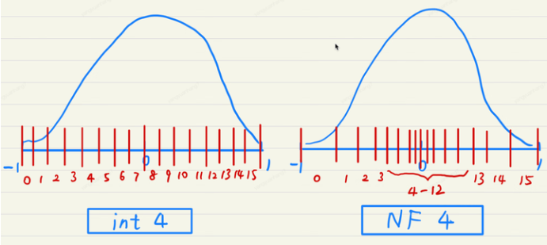

  * int4 的格点分布是**均匀的** ，然而模型的权重通常服从均值为 0 的正态分布，因此格点的分布和数据的分布不一致。这会导致格点“供需”的不匹配。 
    * 靠近 0 点的数据很多，但可用的格点数就相对较少，这样大量参数 round 的粒度较粗，会导致模型量化的精度受损；
    * 远离 0 点的数据较少，而可用的格点数相对多，这部分的少量数据不需要太高的量化精度，因此部分格点就被浪费了。
  * **NF4 的格点按照正态分布的分位数截取** ，格点分布两端稀疏，中间密集，格点分布与数据分布一致。这样格点分配的效率就大大增加了，同时精度受损也不会太大。

#### 2.2 Double Quant

QLoRA 将每 64 个参数为做一个 block，即 block_size = 64，每个 block 计算一个 Scale。由于量化后的 Scale 通常以 FP32 存储，在 block 数众多的情况下，Scale 占用的显存也不可忽视。因此，QLoRA 对 Scale 进一步量化成 FP8，取 Double Quant 的 block size = 256，因而进一步降低了显存消耗。

  * Double Quant 前，每个参数做量化会需要额外的 32/64 = **0.5 bits** 显存；
  * Double Quant 后，每个参数做量化只需要额外的 8/64 + 32 / (64*256) = **0.127 bits** 显存。

#### 2.3 实验效果

相比于其他数据格式，NF4 + DQ 训练后的模型 PPL 最低，且在精度（rouge-score、MMLU acc 等）上没有明显损失。

### 三、LLM.int8()

作者发现激活中存在一些离群值，它们的绝对值明显更大；并且这些离群值分布在少量的几个特征中，称为离群特征 (Emergent Features)。以激活$X \in \mathbb{R}^{[T \times h]}$和权重$W \in \mathbb{R}^{\left[h \times h_{0}\right]}$的矩阵相乘为例，特征维度就是指h这个维度。不论是 per-token（针对激活 x 而言：每行对应一个量化系数） 还是 per-channel （针对权重 w 而言：每列对应一个量化系数）量化，都会受到这些离群值的很大影响。既然只有少量的特征包含离群值，LLM.in8() 的思路是把这些特征拿出来单独计算，只对剩余特征做量化。

#### 技术原理

LLM.int8() 是一种采用混合精度分解的量化方法。该方案先做了一个矩阵分解，对绝大部分权重和激活用8bit量化（vector-wise）。 _对离群特征的几个维度保留16bit，对其做高精度的矩阵乘法_ 。

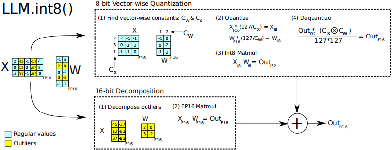

通过三个步骤完成矩阵乘法计算：

  1. 从输入的隐含状态$X$中，按列提取异常值 (离群特征，即大于某个阈值的值)。
  2. 对离群特征进行 FP16 矩阵运算，对非离群特征进行量化，做 INT8 矩阵运算；
  3. 反量化非离群值的矩阵乘结果，并与离群值矩阵乘结果相加，获得最终的 FP16 结果。

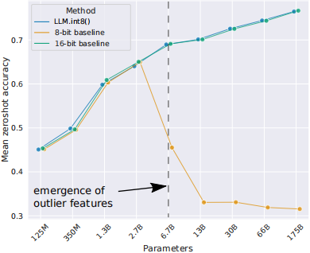

可以看到，对于int8量化，模型参数量在3B以内时，量化后性能损失很少，基本与FP16全部性能相当，但是超过3B以后，模型性能会骤降。

LLM.int8() 方法使用**vector-wise quantization** 和**混合精度分解** 来恢复全部性能。

虽然 LLM.in8() 带来的性能下降微乎其微，但是这种分离计算的方式**拖慢了推理速度** 。 _对于 BLOOM-176B，相比于 FP16，LLM.int8() 慢了大约 15% 到 23%；对于更小的模型（3B 和 11B），速度差距更为明显，LLM.int8() 慢了三倍以上_ 。

此外，论文中测量了异常值特征对于注意力和预测性能的影响。

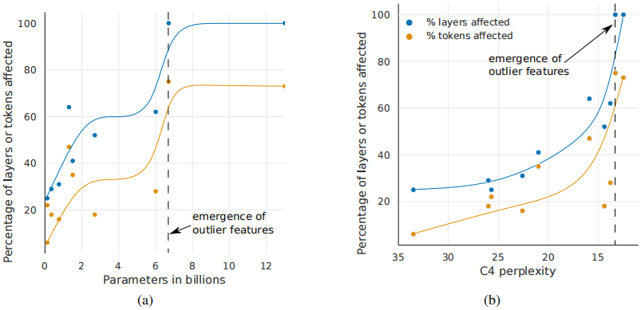

图(a)中，纵坐标为 受大幅度异常值特征影响的layers或tokens百分比，横轴为模型参数量大小。可以看到，当模型参数大小超过6B时，受离群值特征影响的占比急剧提升。

图(b)中，横轴为C4数据集上的PPL，随着C4数据集上的PPL降低，受离群值特征影响的layers和tokens急剧上升。

> 当通过困惑度（perplexity）进行测量时，Transformer 所有层中大量异常值特征的出现可以被视为**根据困惑度递减的指数函数** 平滑的出现。这表明异常值的出现并不是突然的，并且通过研究较小模型中的指数趋势，我们也许能够在相位移动发生之前检测到异常值出现的特征。这也表明，**异常值的出现不仅与模型大小有关，还与困惑度有关** ，而困惑度与多个其他因素有关，例如：使用的训练数据量和数据质量。

如图(a)所示，一旦异常值特征出现在Transformer的所有层中，中间的异常值特征量值就会迅速增加。大量异常值特征及其不对称分布破坏了 Int8 量化精度。 这是量化方法从 6.7B 开始失败的核心原因——量化分布的范围太大，导致大多数量化 bins 为空，小的量化值被量化为零，基本上消除了信息。我们推测，除了 Int8 推理之外，由于超出 6.7B 参数范围，常规 16 位浮点训练也会因异常值而变得不稳定。如果通过向量填充乘以 60 的值，很容易偶然超过最大 16 位值 65535。

#### 实现

目前，LLM.int8() 的实现主要在 `bitsandbytes` 库；同时，transformers 库已经集成并 **原生** 支持了 bitsandbytes 这个量化库。可以说 bitsandbytes 是量化任何模型的最简单方法之一，因为它不需要量化校准数据及校准过程 (即零样本量化)。任何模型只要含有 `torch.nn.Linear` 模块，就可以对其进行开箱即用的量化。每当在 `transformers` 库中添加新架构时，只要其可以用 `accelerate` 库的 `device_map="auto"` 加载，用户就可以直接受益于开箱即用的 bitsandbytes 量化，同时该方法对性能的影响也是最小的。

量化是在模型加载时执行的，无需运行任何后处理或准备步骤。与此同时，LLM.int8() 作者提出的另一种 QAT 量化方案 QLoRA 也是基于 bitsandbytes 进行实现。

在 Transformers 中使用 LLM.int8() 只需提前安装 bitsandbytes 即可，使用 LLM.int8() 方法量化transformer模型具体示例如下：

8bit量化

```python
from transformers import AutoModelForCausalLM

model = AutoModelForCausalLM.from_pretrained(
  'decapoda-research/llama-7b-hf',
  device_map='auto',
  load_in_8bit=True,
  max_memory={
    i: f'{int(torch.cuda.mem_get_info(i)[0]/1024**3)-2}GB'
    for i in range(torch.cuda.device_count())
  }
)
```

4bit量化

```python
from transformers import BitsAndBytesConfig

nf4_config = BitsAndBytesConfig(
   load_in_4bit=True,
   bnb_4bit_quant_type="nf4",
   bnb_4bit_use_double_quant=True,
   bnb_4bit_compute_dtype=torch.bfloat16
)
model_nf4 = AutoModelForCausalLM.from_pretrained(model_id, quantization_config=nf4_config)
```

### 三、GPTQ

简单来说，`GPTQ 对某个 block 内的所有参数逐个量化，每个参数量化后，需要适当调整这个 block 内其他未量化的参数，以弥补量化造成的精度损失。`GPTQ 量化需要准备校准数据集。

GPTQ 的思想最初来源于 Yann LeCun 在 1990 年提出的 OBD 算法，随后 OBS、OBC（OBQ） 等方法不断进行改进，而 GPTQ 是 OBQ 方法的加速版。GPTQ 的量化有严谨的数学理论推导，所有的算法步骤都有理论支撑。为了理解 GPTQ 的思想，我们需要先介绍 OBD -> OBS -> OBQ 的演进过程。

#### 3.1 OBD：Optimal Brain Damage

OBD 实际上是一种剪枝方法，用于降低模型复杂度，提高泛化能力。

如果要在模型中去除一些参数（即剪枝），直觉上想，我们希望去除对目标函数 𝐸 影响小的参数。于是我们可以对目标函数 𝐸 做泰勒展开：

$$\Delta E=\sum_{i} g_{i} \Delta w_{i}+\frac{1}{2} \sum_{i} h_{i i} \Delta w_{i}^{2}+\frac{1}{2} \sum_{i \neq j} h_{i j} \Delta w_{i} \Delta w_{j}+O\left(\Delta w^{3}\right)$$

其中$g_{i}=\frac{\partial E}{\partial w_{i}}$为参数的一阶偏导，$h_{i j}=\frac{\partial^{2} E}{\partial w_{i} \partial w_{j}}$​为海森矩阵的一个元素.

> $\Delta E$ 表示损失函数$E$随权重变化的增量。
> 
> $g_{i}=\frac{\partial E}{\partial w_{i}}$是参数$w_i$对损失函数$E$的直接影响。
> 
> $h_{i j}=\frac{\partial^{2} E}{\partial w_{i} \partial w_{j}}$表示权重$w_i$和$w_j$对损失函数$E$的共同影响。
> 
> $\Delta w_i, \Delta w_j$ 分别表示权重$w_i, w_j$的变化量。
> 
> 展开的第一项$\sum_{i} g_{i} \Delta w_{i}$表示权重变化对损失函数的直接影响。
> 
> 展开的第二项$\frac{1}{2} \sum_{i} h_{i i} \Delta w_{i}^{2}$表示权重$w_i$的变化对损失函数的二次影响，$h_{ii}$是海森矩阵的对角元素，表示权重$w_i$对自身的影响。
> 
> 展开的第三项$\frac{1}{2} \sum_{i \neq j} h_{i j} \Delta w_{i} \Delta w_{j}$表示不同权重之间的相互影响。
> 
> $O\left(\Delta w^{3}\right)$表示更高阶的影响，通常在剪枝中可以忽略。

OBD 做了一些假设，对上式进行简化：

  * 假设目标函数是二阶的，所以我们不考虑高阶项$O\left(\Delta w^{3}\right)$​
  * **假设模型训练已充分收敛，因此所有参数的一阶偏导均为 0** ：$g_{i}=0, \forall i$
  * 假设删除任意一个参数后，其他参数对目标函数的影响不变。也就是说，每个参数对目标函数的影响是独立的。于是我们也可以不考虑交叉项：$h_{i j}=0, \forall i, j, i \neq j$

于是，上式可以简化成：$\Delta E=\frac{1}{2} \sum_{i} h_{i i} \Delta w_{i}^{2}$

因此，删除一个参数 $w_i$，对目标函数的影响就是$\frac{1}{2}h_{ii}w_i^2$，所以我们只要计算海森矩阵 $h_{ii}$ 就可以知道每个参数对目标的影响。然后就可以按照影响从小到大给参数排个序，这样就确定了参数剪枝的次序。

#### 3.2 OBS：Optimal Brain Surgeon 最优脑外科

OBS 认为，参数之间的独立性不成立，我们还是要考虑交叉项，因此上式变成了

$$\Delta E=\frac{1}{2} \sum_{i} h_{i i} \Delta w_{i}^{2}+\frac{1}{2} \sum_{i \neq j} h_{i j} \Delta w_{i} \Delta w_{j}$$

用向量/矩阵形式表达会更加简明：$\Delta E=\frac{1}{2} \Delta \mathbf{w}^{\mathrm{T}} \mathbf{H} \Delta \mathbf{w}$

**删除一个权重 $w_q$，那么$\Delta w$的第q维固定为$-w_q$，但其他维度的值可变，可以用于减少删除该权重带来的目标偏离。**

$\Delta w$的第q维固定为$-w_q$，这是一个约束条件，我们可以表示为一个等式：

$e_q^T \cdot \Delta w + w_q = 0$ 指示权重变化量Δ𝑤中的第q个元素为$-w_q$

其中$e_q$是一个 one-hot 向量，第 q 个位置是 1 ，其余位置是 0。

我们希望找到最合适的权重 𝑤𝑞 ，使得删除它对目标的影响最小。这可以表示为一个最优化问题：

最小化对目标函数的影响：$\min _{\Delta \mathbf{w}, q} \frac{1}{2} \Delta \mathbf{w}^{\mathbf{T}} \mathbf{H} \boldsymbol{\Delta} \mathbf{w} \quad \text { s.t. } \mathbf{e}_{\mathbf{q}}^{\mathbf{T}} \cdot \boldsymbol{\Delta} \mathbf{w}+w_{q}=0$

用 Lagrange 乘数法求解：$L=\frac{1}{2} \boldsymbol{\Delta} \mathbf{w}^{\mathbf{T}} \mathbf{H} \boldsymbol{\Delta} \mathbf{w}+\lambda\left(\mathbf{e}_{\mathbf{q}}^{\mathbf{T}} \cdot \Delta \mathbf{w}+w_{q}\right)$

可以得到：$\boldsymbol{\Delta} \mathbf{w}=-\frac{w_{q}}{\left[\mathbf{H}^{-1}\right]_{q q}} \mathbf{H}^{-1} \cdot \mathbf{e}_{\mathbf{q}} \quad \text { and } \quad L=\frac{1}{2} \frac{w_{q}^{2}}{\left[\mathbf{H}^{-1}\right]_{q q}}$

**于是，我们也只需要求解海森矩阵的逆，就可以计算每个参数 $w_q$ 对目标的影响 $\frac{1}{2} \frac{w_{q}^{2}}{\left[\mathbf{H}^{-1}\right]_{q q}}$** 。

然后就可以按照影响从小到大给参数排个序，这样就确定了参数剪枝的次序。同时，每次剪枝一个参数，其他的参数也按照 𝛥𝑤 更新一次。

**这里的思想一直沿用到了 GPTQ 算法：也就是对某个 block 内的所有参数逐个量化，每个参数量化后，需要适当调整这个 block 内其他未量化的参数，以弥补量化造成的精度损失。**

> 海森矩阵Hessian matrix，也称黑塞矩阵，是多元函数的二阶偏导数组成的方阵。
> 
> 对于一个具有 𝑛 个变量的函数 $f\left(x_{1}, x_{2}, \ldots, x_{n}\right)$ ,其海森矩阵 𝐻 是一个 𝑛×𝑛 的矩阵，其中每个元素 $H_{ij}$ 是函数 𝑓 关于第 𝑖 个变量和第 𝑗 个变量的二阶偏导数，即：
> 
> $H_{i j}=\frac{\partial^{2} f}{\partial x_{i} \partial x_{j}}$​
> 
> 海森矩阵是理解函数局部行为的重要工具，尤其是在需要精确控制优化过程的场合。

#### 3.3 OBC：Optimal Brain Compression 最优脑压缩

OBD 和 OBS 都存在一个缺点，就是剪枝需要计算全参数的海森矩阵（或者它的逆矩阵）。但在动辄上亿参数的神经网络下求解海森矩阵显然不可能。于是，我们可以**假设参数矩阵的同一行参数互相之间是相关的，而不同行之间的参数互不相关，这样，海森矩阵就只需要在每一行内单独计算** 就行啦。

为了求解海森矩阵，我们需要确定目标函数的具体形式。

令参数矩阵的维度为 (𝑑𝑟𝑜𝑤,𝑑𝑐𝑜𝑙) ，OBC 论文的目标函数定义为：

$$E=\sum_{i=1}^{d_{\text {row }}}\left\|\mathbf{W}_{\mathbf{i},:} \mathbf{X}-\hat{\mathbf{W}}_{\mathrm{i},:} \mathbf{X}\right\|_{2}^{2}$$

**直观来看，就是参数量化前后，给同样的输入（具有代表性的校准数据），输出结果的差异要尽可能小** 。

由于每一行的参数独立，所以我们只需要对每一行的量化后参数 $\hat{\mathbf{W}}_{\mathrm{i}}$: 求海森矩阵：

$$\frac{\partial E}{\partial \hat{\mathbf{W}}_{\mathbf{i},:}^{2}}=\mathbf{H}_{\mathbf{i}}=2 \mathbf{X} \mathbf{X}^{\mathbf{T}}, \forall i=1,2, \cdots, d_{\text {row }}$$

如果我们对一行共 𝑑𝑐𝑜𝑙 个参数删除 k 个参数，那么 OBC 的算法流程如下：

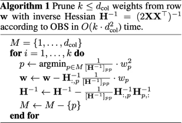

算法使用逆海森矩阵$H^{-1}$来确定哪些权重应该被删除

找到对目标函数影响最小的参数$p$，对参数p剪枝，并更新其他参数

...

#### 3.4 OBQ

OBQ （和OBC是同一篇文章）指出，剪枝是一种特殊的量化（即剪枝的参数等价于量化到 0 点），我们只需要修改一下 OBC 的约束条件即可转换为量化场景：

$$\mathbf{e}_{\mathbf{q}}^{\mathbf{T}} \cdot \Delta \mathbf{w}+w_{q}=q u a n t\left(w_{q}\right)$$

权重变化量$\Delta w$中的第q个元素为$$

#### 3.5 GPTQ 创新

> GPTQ采用 int4/fp16 (W4A16) 的混合量化方案，其中模型权重被量化为 int4 数值类型，而激活值则保留在 float16，是一种仅权重量化方法。
> 
> 在推理阶段，模型权重被动态地反量化回 float16 并在该数值类型下进行实际的运算；
> 
> int4 量化能够节省接近4倍的内存，这是因为反量化操作发生在算子的计算单元附近，而不是在 GPU 的全局内存中。
> 
> 由于用于权重的位宽较低，因此可以节省数据通信的时间，从而潜在地提升了推理速度。
> 
> 一般来说，GPTQ推荐使用8-bit量化及groupsize = 128。

OBQ 的算法复杂度还是太高了，GPTQ 对 OBQ 做了一些算法和性能上的优化，因而可以实现大模型的高效量化。

GPTQ 的创新点有：

  * OBS 采用贪心策略，先量化对目标影响最小的参数；但 **GPTQ 发现直接按顺序做参数量化，对精度影响也不大** 。

    * 这项改进使得**参数矩阵每一行的量化可以做并行的矩阵计算** ，同时将时间复杂度从$O\left(d_{\text {row }} \cdot d_{\text {col }}^{3}\right)$降低到$O\left(\max \left\{d_{\text {row }} \cdot d_{\text {col }}^{2}, d_{\text {col }}^{3}\right\}\right)$,**在大模型环境下，这项改进使得量化速度快了一个数量级** ；
  * **Lazy Batch-Updates 延迟批量更新** ，延迟一部分参数的更新，它能够缓解 bandwidth 的压力；

  * **Cholesky Reformulation** ，用 Cholesky 分解求海森矩阵的逆，在增强数值稳定性的同时，不再需要对海森矩阵做更新计算，进一步减少了计算量。

> 其中第三点的优化（即不再需要对海森矩阵做更新计算）是靠 Cholesky 分解的数学特性去实现的，如果感兴趣，可以进一步研读 GPTQ 的论文和代码。

我们主要关注第二个创新点，也就是 Lazy Batch-Updates 是如何缓解 bandwidth 的压力的。

`问题：`虽然 GPTQ 降低了时间复杂度，但这个算法的**计算/通信比太低** ，通信带宽成为了瓶颈。

例如在量化某个参数矩阵的情况下，每次量化一个参数，其他所有未量化的参数也都要按公式更新一遍：

$$\mathbf{w} \leftarrow \mathbf{w}-\mathbf{H}_{:, p}^{-1} \frac{1}{\left[\mathbf{H}^{-1}\right]_{p p}} \cdot\left(w_{p}-q\left(w_{p}\right)\right)$$

这个公式描述了如何更新参数向量 𝑤，更新公式的核心思想是：在量化第 𝑝 个参数后，通过调整其他所有参数来最小化量化误差。

> $w_p - q(w_p)$表示第𝑝个参数的原始值与量化值之间的差。
> 
> $\mathbf{H}_{;, p}^{-1}$逆海森矩阵的第p列，乘以逆海森矩阵的第p行第p列分之一，乘以量化误差。

如果每行的量化并行计算，那么每次更新过程就需要 read + write 一次参数矩阵。

~~如果参数矩阵的维度为$k \times k$，那么量化这个参数矩阵就需要读写 k 次参数，总共的 IO 量为$k^3$​个元素。~~

当 k 比较大时（>= 4096），需要读写的元素就非常多了，运行时间大都被 IO 占据。

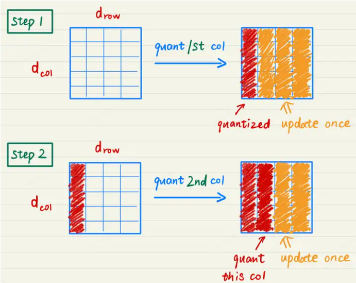

`思路：`由于参数量化是一列一列按次序进行的，第 i 列的参数的量化结果受到前 i-1 列量化的影响，**但第 i 列的量化结果不影响前面列的量化** 。因此我们不需要每次量化前面的列，就更新一遍第 i 列的参数，而是可以**先记录第 i 列的更新量，在量化到第 i 列时，再一次性更新参数** ，这样就可以减少 IO 的次数。

`具体实现：`将参数矩阵按每 128 列划分为一个个 group，**量化某一列时，group 内的参数立即更新，而 group 后面的列只记录更新量，延迟更新。当一个 group 的参数全部量化完成，再统一对后面的所有参数做一次更新** 。这就是 Lazy Batch-Updates。

**Lazy Batch-Updates 不减少实际的计算量，但它能有效解决吞吐的瓶颈问题** 。

#### 3.6 GPTQ代码实现

最关键的代码有待补充，如何确定scale和zero

```python
def _quantize(self, x, scale, zero, maxq):
    if maxq < 0:
        return (x > scale / 2).float() * scale + (x < zero / 2).float() * zero
    q = torch.clamp(torch.round(x / scale) + zero, 0, maxq)
    return scale * (q - zero)

'''
根据给定的缩放因子scale、零点zero 和 最大量化值maxq 对输入进行量化.

if maxq < 0:
	pass
else:
	将 x 除以 scale 进行初步量化
	round 到最近的量化格点
	将量化后的值加上 zero 以调整零点
	使用 torch.clamp 函数将结果限制在 [0, maxq] 的范围内
	return：量化后的值 q 减去 zero 以得到实际的量化值，然后乘以 scale 以恢复到原始的比例尺度。
'''
```

#### 3.6 GPTQ 使用示例

[AutoGPTQ](<https://link.zhihu.com/?target=https%3A//github.com/PanQiWei/AutoGPTQ>) 代码库集成到了 Transformers 中，让用户使用 GPTQ 算法在 8 bit、4 bit、3 bit，甚至是 2 bit 精度下量化和运行模型成为可能。当使用 int4 量化时，精度的下降可以忽略不计，同时在小批量推理上保持着与 `fp16` 基线相当的速度。需要注意的是，GPTQ 方法与 bitsandbytes 提出的训练后量化方法有所不同，GPTQ 需要在量化阶段提供一个校准数据集。

在 Transformers 中使用 GPTQ 只需提前安装AutoGPTQ和[Optimum](<https://link.zhihu.com/?target=https%3A//github.com/huggingface/optimum>)即可，使用 GPTQ 方法量化transformer模型具体示例如下：

```python
from transformers import AutoModelForCausalLM, AutoTokenizer, GPTQConfig

model_id = "facebook/opt-125m"
tokenizer = AutoTokenizer.from_pretrained(model_id)
# 使用c4数据集作为校准数据集
quantization_config = GPTQConfig(bits=4, dataset = "c4", tokenizer=tokenizer)

model = AutoModelForCausalLM.from_pretrained(model_id, device_map="auto", quantization_config=quantization_config)
```

#### 3.7 实验效果

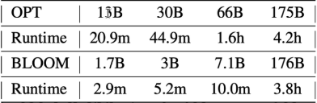

**7B模型量化仅需十分钟** ，13B模型量化需要21分钟，30B模型量化需要45分钟，175B模型量化需要四小时。

在大模型上，**GPTQ 相比于直接 Round 的量化精度要更好** 。

### 四、各大开源模型量化实现

目前以 LLaMA 为基底的模型，多数都有开源社区的 GPTQ 量化实现，可能是 GPTQ 的影响力和知名度更大吧，但它未必是模型量化的最优选择，毕竟 **GPTQ 仍然无法解决异常值问题和 Activation 量化** 。

### 五、SmoothQuant

#### 背景

LLM.int8() 发现当 LLMs 的模型参数量超过 6.7B 的时候，激活中会成片的出现大幅的离群点(outliers)，朴素且高效的量化方法（W8A8、ZeroQuant等）会导致量化误差增大，精度下降。

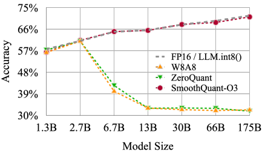

但好在新出现的离群特征（Emergent Features）的分布是有规律的。

通常，这些离群特征只分布在 Transformer 层的少数几个维度。针对这个问题，LLM.int8() 采用了混合精度分解计算的方式（离群点和其对应的权重使用 FP16 计算，其他量化成 INT8 后计算）。虽然能确保精度损失较小，但由于需要运行时进行异常值检测、scattering 和 gathering，导致它比 FP16 推理慢。

这些激活上的离群点会出现在几乎所有的 token 上但是局限于隐层维度上的固定的 channel 中；给定一个 token，不同 channels 间的方差会很大，但是对于不同的 token，相同 channel 内的方差很小。考虑到激活中的这些离群点通常是其他激活值的 100 倍，这使得激活量化变得困难。

以上是大模型量化困难的原因，总结下来就三点：

  1. _激活比权重更难量化_ （之前的工作LLM.int8()表明，使用 INT8 甚至 INT4 量化 LLM 的权重不会降低准确性。）
  2. _异常值让激活量化更困难（激活异常值比大多数激活值大约 100 倍。 如果我们使用 INT8 量化，大多数值将被清零。）_
  3. _异常值持续存在于固定的通道（channel）中_ （固定通道存在异常值，并且异常值通道值较大）

根据量化粒度的不同，量化方法可以分为逐层量化（per-tensor）、逐通道（per-token & per-channel 或者 vector-wise quantization ）量化和逐组量化（per-group、Group-wise）

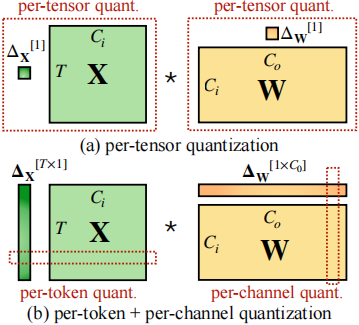

作者对比了 per-channel、per-token、per-tensor 激活量化方案。per-tensor量化是最高效的实现方式。但只有逐通道量化（per-channel）保留了精度，因它与 INT8 GEMM 内核不兼容。即per-channel量化不能很好地映射到硬件加速的GEMM内核（硬件不能高效执行，从而增加了计算时间）。

#### 技术原理

SmoothQuant是一种同时确保准确率且推理高效的训练后量化 (PTQ) 方法，可实现 8 比特权重、8 比特激活 (W8A8) 量化。

由于权重很容易量化，而激活则较难量化，因此， _SmoothQuant 引入平滑因子s来平滑激活异常值，通过数学上等效的变换将量化难度从激活转移到权重上_ 。

对激活值做量化，可以大幅减少训练/推理过程的显存需求（以及在模型并行等情况下，显著减少通讯量）

常规的矩阵乘公式为：$Y = XW$

由于激活值$X$难以量化，因此，smooth quant 的思想是找到一个合适的向量 scale(s)，对激活值$X$以及权重$W$做合理的缩放，**将激活值一部分量化难度转移到权重上，让激活值更加容易量化** 。

$$\mathbf{Y}=\left(\mathbf{X d i a g}(\mathbf{s})^{-1} * \operatorname{diag}(\mathrm{s}) \mathbf{W}\right)$$

具体量化过程：

$$\mathbf{s}_{j}=\max \left(\left|\mathbf{X}_{j}\right|\right)^{\alpha} / \max \left(\mid \mathbf{\mathbf { W } _ { j } | ) ^ { 1 - \alpha }}\right.$$

$\alpha$为超参数，控制将多少激活值的量化难度迁移到权重量化，一般取值为0.5。

下图为$\alpha=0.5$​的示例

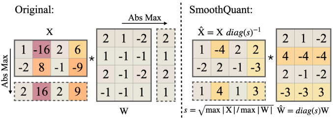

在实际模型部署过程中，激活值X通常来自前一个线性操作（linear layer或者layer norm），因此通常的做法是：离线将smooth quant scale fused到前一层的权重中，这样smooth quant在推理过程中不会带来额外的开销。

> 平滑因子 s 是在校准样本上获得的，整个转换是离线执行的。

#### 将SmoothQuant应用于Transformer Block

_在Transformer 块中，将所有计算密集型算子（如：线性层、batched matmul (BMMs) ）使用 INT8 运算，同时将其他轻量级算子（如：LayerNorm/Softmax）使用 FP16 运算 ，这样可以均衡精度和推理效率_ 。

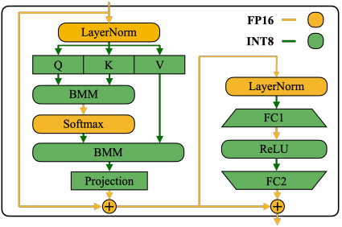

#### 推理性能及精度

SmoothQuant可以无损地量化所有超过100B参数的开源LLM。

根据量化方式不同，作者提出三种策略 O1、O2、O3，其计算延迟依次降低。SmoothQuant的O1和O2级成功地保持了浮点精度，而O3级（per-tensor static）使平均精度下降了0.8%，可能是因为静态收集的统计数据与真实评估样本的激活统计数据之间的差异。

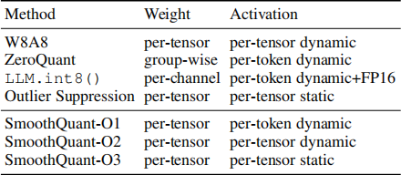

### 六、AWQ、AutoAWQ

大模型压缩技术降低模型部署的成本，并提升模型的推理性能。

模型压缩主要分为如下几类：

1.）剪枝 2.）知识蒸馏 3.）量化

#### 背景

  * 将 LLM 进行低比特权重量化可以节省内存，但却很难实现。**量化感知训练** （QAT）由于训练成本较高并不实用，而**训练后量化** （PTQ）在低比特场景下面临较大的精度下降。

  * 最接近的工作是GPTQ，它使用二阶信息来进行误差补偿，但它可能在重建过程中过拟合校准集，从而扭曲分布之外领域上的学习特征，这可能会出现问题，因为 LLM 是通才模型。

作者提出了一种"**激活感知权重量化** （Activation-aware Weight Quantization，AWQ）"方法，这是一种对硬件友好的低比特 LLM 仅权重量化方法。该方法源于“**权重对于LLM的性能并不同等重要** ”的观察，**存在约（0.1%-1%）显著权重对大模型性能影响太大，通过跳过这1%的显著权重（salient weight）不进行量化，可以大大减少量化误差** 。

尽管我们只做了权重量化，但**要找到显著的权重通道，我们应该根据激活分布而不是权重分布** 。与较大激活幅度(activation magnitudes)相对应的权重通道更加突出，因为它们处理了更重要的特征。

为了避免硬件效率低下的混合精度实现，我们分析了权重量化产生的误差，并推导出放大显著通道（salient channels）可以减少其相对量化误差。根据这一直觉，我们设计了一种**按通道缩放** 的方法，以**自动搜索最优缩放（scaling），使全部权重下的量化误差最小** 。AWQ 不依赖于任何反向传播或重构，因此可以很好地保持 LLM 在不同领域和模态上的泛化能力，而不会过拟合校准集。此外，我们还实现了一个高效的服务框架，将 AWQ 理论上节省的内存转换为实际的加速。我们的框架利用 kernel 融合的优势，最大限度地减少推理开销（例如，中间 DRAM 访问和 kernel 启动开销），以便我们可以更好地实现量化线性层的加速（AWQ 应用于包含大部分参数的线性层）。

#### AWQ 技术原理

通过保护更“重要”的权重不进行量化，从而在不进行训练的情况下提高准确率。

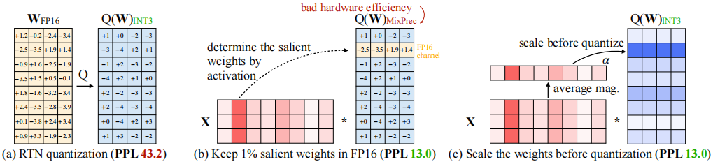

  1. 通过保留1%的显著权重来改进LLM量化

由于 LLM 的权重并非同等重要，与其他权重相比，有一小部分显著权重对 LLM 的性能更为重要。因此，作者认为跳过这些显著权重不进行量化，可以在不进行任何训练的情况下，弥补量化损失造成的性能下降。

实验：在FP16中保持一些权重通道比例的同时，测量了INT3量化模型的性能。

**一种广泛使用的确定权重重要性的方法是观察它的大小或L2-范数**

但我们发现，**跳过具有大范数的权值通道** （即FP16%（基于W））**并没有显著提高量化性能** ，导致了**与随机选择相似的边际改进** 。有趣的是，尽管在FP16中只保留了0.1%-1%的通道，但基于激活幅度选择权重可以显著提高性能。

我们假设，幅度较大的输入特征通常更重要。在FP16中保持相应的权重可以保留这些特征，这有助于更好的模型性能。

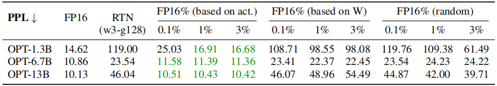

**使用的指标是PPL** ，左侧基于激活幅度进行权重选择，中间直接基于权重重要性选择，右侧随机选择进行保留。

限制：尽管在FP16中保留0.1%的权重可以提高量化性能，而不会显著增加模型大小（以总位测量），但这种混合精度的数据类型将使系统实现变得困难。我们需要提出一种方法来保护重要的重量，而不实际保留它们作为FP16。

  2. 通过激活感知缩放保护显著权重

作者提出通过 _per-channel scaling_ 来减少显著权重的量化误差的替代方法，该方法不受硬件效率低下的问题。

     * **对量化误差进行分析**

首先分析了仅权重量化的误差：

> 量化函数定义：$Q(\mathbf{w})=\Delta \cdot \operatorname{Round}\left(\frac{\mathbf{w}}{\Delta}\right), \quad \Delta=\frac{\max (|\mathbf{w}|)}{2^{N-1}}$
> 
> 考虑一个权重元素 $w\in W$，对 $w$ 缩放乘以 $s$，对输入 $x$ 反缩放乘以 $\frac{1}{s}$
> 
> $$Q(w \cdot s) \cdot \frac{x}{s}=\Delta^{\prime} \cdot \operatorname{Round}\left(\frac{w s}{\Delta^{\prime}}\right) \cdot x \cdot \frac{1}{s}$$
> 
> 根据经验发现：
> 
> (1)Round（·）（记为RoundErr（·））的期望误差没有变化：由于round函数将浮点数映射为整数，误差大致从[0,0.5]均匀分布，平均误差为0.25；即RoundErr（·）∼ 0.25。
> 
> (2)缩放单个元素w通常不会改变组w的最大值。因此，我们有∆‘≈∆；
> 
> (3)∆和x在FP16中表示，它们没有量化误差。
> 
> 因此，量化误差来自公式 $Q(w), \ Q(w \cdot s)\cdot \frac{x}{s}$
> 
> $$\begin{array}{c}
\operatorname{Err}(Q(w) x)=\Delta \cdot \operatorname{RoundErr}\left(\frac{w}{\Delta}\right) \cdot x \\
\operatorname{Err}\left(Q(w \cdot s)\left(\frac{x}{s}\right)\right)=\Delta^{\prime} \cdot \operatorname{RoundErr}\left(\frac{w s}{\Delta^{\prime}}\right) \cdot x \cdot \frac{1}{s}
\end{array}$$
> 
> 新的误差和原始误差的比值为$\frac{\Delta^{\prime}}{\Delta} \cdot \frac{1}{s}$，对于给定的$\Delta^{\prime} \approx \Delta$和$s>1$，显著权值w的相对于原始误差的相对误差较小。
> 
> 为了验证这个想法，作者将 OPT-6.7B 模型的 1% 显著通道乘以 s > 1，并测量下表中每组的 Δ 变化。发现缩放显著通道非常有效：
> 
> 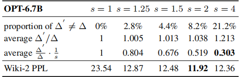
> 
> 困惑度从s = 1（即 RTN）的 23.54 提高到 s = 2 的 11.92。

在保护显著通道的同时还需要考虑非显著通道的误差。 这就需要自动获取缩放比的方法，使得减少显著权重量化损失的同时也不能增加其它权重的量化损失。

     * 搜索Scale

为了同时考虑显著权重和非显著权重，作者选择**自动搜索最佳（每个输入通道）缩放因子，使某一层量化后的输出误差最小** 。从形式上看，我们希望优化以下目标：

$$\mathbf{s}^{*}=\underset{\mathbf{s}}{\arg \min } \mathcal{L}(\mathbf{s})$$

$$\mathcal{L}(\mathbf{s})=\left\|Q(\mathbf{W} \cdot \operatorname{diag}(\mathbf{s}))\left(\operatorname{diag}(\mathbf{s})^{-\mathbf{1}} \cdot \mathbf{X}\right)-\mathbf{W} \mathbf{X}\right\|$$

X 是从小校准集中的输入特征（我们从预训练数据集中获取小校准集，以免过拟合特定任务）

**由于量化函数不可微，我们无法直接用梯度反向传播来优化问题** 。有一些技术依赖于近似的梯度（Bengio等人，2013年；Esser等人，2019年），我们发现它仍然存在不稳定的收敛问题。

为了使这一过程更加稳定，我们通过分析影响缩放因子选择的因素，为最佳缩放比例定义了一个搜索空间。如前所示权重通道的显著性实际上是由激活比例（scale）决定的（即 "激活感知"）。因此，我们只需使用一个非常简单的搜索空间：

$$\mathbf{s}=\mathbf{s}_{\mathbf{X}}{ }^{\alpha}, \quad \alpha^{*}=\underset{\alpha}{\arg \min } \mathcal{L}\left(\mathbf{s}_{\mathbf{X}}{ }^{\alpha}\right)$$

$s_{X}$ 是激活的平均大小（per-channel），使用超参数α来平衡显著通道和非显著通道之间的保护。

我们可以通过在[0,1]区间内的快速网格搜索找到最好的α（0表示我们不缩放；1对应于我们的搜索空间中最激进的缩放）。我们进一步应用clipping来最小化量化的MSE误差。我们在表5中提供了对INT3-g128量化下的OPT模型的消融研究；**AWQ始终优于round到最近的量化（RTN），并在更对硬件友好的同时实现了与混合精度（1% FP16）相当的性能**

该方法不依赖于任何回归或反向传播，而这是许多量化感知训练方法所必需的。 它对校准集的依赖最小，因为我们只测量每个通道的平均幅度（magnitude），从而防止过拟合。因此，该方法在量化过程中需要更少的数据，并且可以将LLM的知识保留在校准集分布之外。

#### AWQ 核心代码

> AWQ只关注权重分组量化。`group size = 128` `INT4/INT3量化`
> 
> grid size of 20 to search for the optimal _α_ 使得 $\mathbf{s}=\mathbf{s}_{\mathbf{X}}{ }^{\alpha}, \quad \alpha^{*}=\underset{\alpha}{\arg \min } \mathcal{L}\left(\mathbf{s}_{\mathbf{X}}{ }^{\alpha}\right)$，实际上是为了获取最优的scale。
> 
> 

```python
def get_act_scale(x):
    return x.abs().view(-1, x.shape[-1]).mean(0)
# 激活值的绝对值的平均值
x_max = get_act_scale(x)

# 未量化的权重矩阵乘以x
with torch.no_grad():
    org_out = block(x, **kwargs)
    if isinstance(org_out, tuple):
        org_out = org_out[0]

n_grid = 20

for ratio in range(n_grid):
    ratio = ratio * 1 / n_grid	# [0.0, 0.05, 0.1, 0.15, 0.2, 0.25, 0.3, 0.35, 0.4, 0.45, 0.5, 0.55, 0.6, 0.65, 0.7, 0.75, 0.8, 0.85, 0.9, 0.95]
    # 使用pow(ratio)来计算缩放因子，然后使用clamp(min=1e-4)确保缩放因子不会小于1e-4，最后使用view(-1)将张量展平为一维
    scales = x_max.pow(ratio).clamp(min=1e-4).view(-1)
    # 为了使量化后的权重分布更加均匀，这里将缩放因子除以其最大值和最小值乘积的平方根
    scales = scales / (scales.max() * scales.min()).sqrt()
    
    # 遍历需要量化的线性层
    for fc in linears2scale:
        fc.weight.mul_(scales.view(1, -1).to(fc.weight.device))
        fc.weight.data = w_quantize_func(fc.weight.data) / (scales.view(1, -1))
        
    # 量化后的权重矩阵乘以x
    out = block(x, **kwargs)
    if isinstance(out, tuple):
        out = out[0]
	# 计算损失
    loss = (
        (org_out - out).float().pow(2).mean().item()
    )  # float prevents overflow
	history.append(loss)
    # 记录最佳损失
    is_best = loss < best_error
    if is_best:
        best_error = loss
        best_ratio = ratio
        best_scales = scales
return best_scales.detach()
```

`block`这里计算输出的模块是 `module2inspect=module.self_attn`, `module2inspect=module.mlp`, `module2inspect=module`, 并不是固定的，有些模块甚至没有传递`module2inspect`参数默认未`None`。

#### AWQ 实验效果

AWQ 在不同模型家族（如：LLaMA、OPT 等）和模型大小的各种任务上优于现有工作。

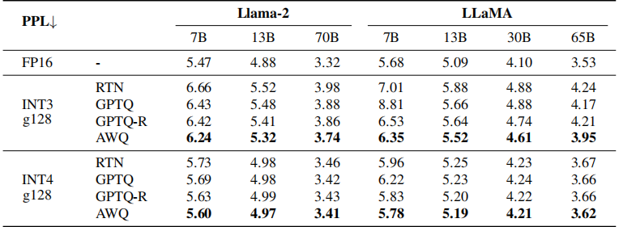

同时，由于具有更好的泛化能力，它还在指令精调的 LM（如：Vicuna）和多模态 LM（如：OpenFlamingo）上实现了良好的量化性能。

#### AutoAWQ

AutoAWQ 是一个易于使用的 4 比特量化模型包。

与 FP16 相比，AutoAWQ 将模型速度提高了 3 倍，并将对内存需求降低了 3 倍。

AutoAWQ 实现激活感知权重量化 (AWQ) 算法来量化 LLM。 AutoAWQ 是在 MIT 的 [LLM-AWQ](<https://link.zhihu.com/?target=https%3A//github.com/mit-han-lab/llm-awq>) 基础上创建和改进的。

**LLM 推理的 Compute-bound 与 Memory-bound** ：

> Roofline 模型：一个面向吞吐量的性能模型。
> 
> 如下图所示：计算密度为横坐标，FLOP/s为纵坐标，可得出roofline模型图像

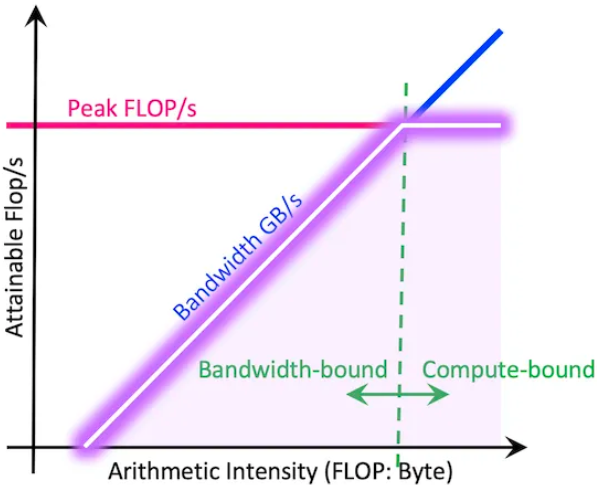

> 蓝色段中，性能受限于理论带宽（即斜率，Peak GB/s）即Memory-bound
> 
> 在粉色段中，性能受限于浮点计算峰值性能（Peak GFLOP/s），即Compute-bound。

对于小 batch sizes 的 7B 模型，我们会受到 Memory-bound。 这意味着我们受到 GPU 内存带宽限制（移动内存中权重到计算核心），这本质上限制了我们每秒可以生成的Token数量。 受Memory-bound使得量化模型更快，因为权重小了 3 倍，因此权重可以更快地在内存中移动。 这与Compute-bound不同，在Compute-bound中，生成期间花费的主要时间是进行矩阵乘法。

在Compute-bound的情况下（batch sizes 较大时发生），使用 W4A16 量化模型不会获得加速，因为反量化的开销会减慢整体生成速度。 发生这种情况是因为 AWQ 量化模型仅将权重存储在 INT4 中，但在推理过程中执行 FP16 操作，因此我们本质上是在推理过程中转换 INT4 -> FP16。

#### AutoAWQ使用

  1. 使用AutoAWQ量化模型

加载模型时使用`AutoAWQForCausalLM`类的`from_pretrained`函数加载模型，加载完模型后再通过 `model.quantize`函数进行AWQ量化。

在对模型进行AWQ量化时，需要定义量化配置。

```python
from awq import AutoAWQForCausalLM
from transformers import AutoTokenizer

model_path = "facebook/opt-125m"
quant_path = "opt-125m-awq"
quant_config = {"zero_point": True, "q_group_size": 128, "w_bit": 4, "version":"GEMM"}

# Load model
model = AutoAWQForCausalLM.from_pretrained(model_path)
tokenizer = AutoTokenizer.from_pretrained(model_path, trust_remote_code=True)

# Quantize
model.quantize(tokenizer, quant_config=quant_config)
```

  2. 为了使量化后的模型与Transformers兼容，我们需要修改配置文件。

```python
from transformers import AwqConfig, AutoConfig
from huggingface_hub import HfApi

# modify the config file so that it is compatible with transformers integration
quantization_config = AwqConfig(
    bits=quant_config["w_bit"],
    group_size=quant_config["q_group_size"],
    zero_point=quant_config["zero_point"],
    version=quant_config["version"].lower(),
).to_dict()

# the pretrained transformers model is stored in the model attribute + we need to pass a dict
model.model.config.quantization_config = quantization_config

# save model weights
model.save_quantized(quant_path)
tokenizer.save_pretrained(quant_path)
```

  3. 加载量化后的模型

量化后的模型通过`AutoModelForCausalLM.from_pretrained`函数进行加载。

```python
from transformers import AutoTokenizer, AutoModelForCausalLM

tokenizer = AutoTokenizer.from_pretrained("ybelkada/opt-125m-awq")
model = AutoModelForCausalLM.from_pretrained("ybelkada/opt-125m-awq").to(0)

text = "Hello my name is"
inputs = tokenizer(text, return_tensors="pt").to(0)

out = model.generate(**inputs, max_new_tokens=5)
print(tokenizer.decode(out[0], skip_special_tokens=True))
```

### 七、SpQR

#### 背景

LLM.int8() 作者提出的另一种量化方案SpQR。

现有的技术方案（如：GPTQ）将参数量化至 3-4 比特通常会导致显著的精度损失，特别是对于 1-10B 参数范围内的较小模型，而这些模型却非常适合边缘部署。

为了解决这个精度的问题，作者引入了稀疏量化表示（SpQR），这是一种新的压缩格式和量化技术，首次实现了**跨模型参数规模** 的**近乎无损** 的（near-lossless） LLM 压缩，同时达到与以前的方法类似的压缩水平。

#### SpQR简介

SpQR 是一种混合稀疏量化格式，其工作原理是**识别和隔离异常值权重** （这些权重会导致特别大的量化误差），**并以更高的精度存储它们，同时将所有其他权重压缩到3-4位，并实现小于1%的精度损失** 。

这使得在单张 24 GB 消费级 GPU 上运行 33B 参数的 LLM 成为可能，并且在提升 15% 的推理速度情况下不会出现任何精度下降。

另外，SpQR 提供了高效的算法，可以将权重编码为 SpQR 格式，并在运行时对其进行高效解码。并且为 SpQR 提供了一种高效的 GPU 推理算法，该算法以近似的精度产生比 16 比特基线更快的推理，同时实现 _超过 4 倍的内存压缩_ 增益。

为了将给定的预训练LLM转换为SpQR格式，作者采用了GPTQ的扩展版本。该方法通过未压缩模型传递校准数据；

为了压缩每一层，它针对未压缩模型的输出和量化权重的输出之间的 L2 误差应用逐层（layer-wise）求解器。本方法将这个过程分为两个步骤：

  * 异常值检测步骤，隔离直接量化对层输出行为产生巨大影响的权重
  * 实际压缩步骤，大多数（≥ 99%）权重被压缩到低位宽。

通过提取离群值，并通过进一步压缩量化元数据使整个表示更加有效。

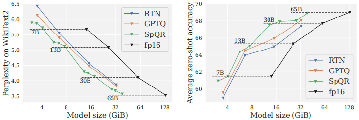

...

#### 之前的工作

早期的工作[LLM.int8()、Smoothquant]表明激活和权重都可以量化为 8 比特，而对精度的影响相对较低。

[LLM.int8()，Smoothquant]观察到在大语言模型的输入/输出中存在显著较高值的“离群特征”，这会导致更高的量化误差，并提出不同的缓解策略。

而本文的作者从权重量化的角度来分析这个现象。特别是，作者研究了权重矩阵中输入特征异常值之外的异常值结构。虽然发现**当前层的输入特征异常值与前一层的隐藏单元异常值权重相关，但并不存在严格的对应关系** 。这种部分结构化的异常值模式需要一种细粒度的混合压缩格式，该格式 _超越了利用先前工作中发现的异常值特征的列结构的算法_ 。

因此，作者提出：

  * 一种高效且准确的训练后压缩算法，该算法将异常值识别为导致高输出误差的权重。
  * 一种将异常值压缩到相对于常规权重更高位宽的格式。
  * 本文的格式将异常值存储在块中，从而可以高效地实现 GPU kernels。

#### LLM权重参数量化灵敏度分析

由于神经网络模型中并非所有参数都同等重要。如果权重的舍入误差较大，则权重可以被视为对量化敏感。

权重 $w_a$ 在与另一个权重 $w_b$ 强相关时，可能具有较大的舍入误差，这意味着可以通过向下舍入 $w_b$ 很好地补偿对 $w_a$ 进行舍入的误差。之前的量化算法（如：GPTQ、ZeroQuant）正利用了这一想法，带来了对普通舍入的重大改进，尤其是低位宽。正确捕捉这方面的敏感性需要更健全的定义。

为了计算易处理，作者使用一小组校准集，通过输入 X 来评估 per-layer 级别的灵敏度，这些校准输入 X 是通过将模型运行到特定层来收集的。 我们将层权重矩阵 W 中某个权重 $w_{ij}$ 的灵敏度 $s_{ij}$ 定义为 X 上的原始预测与该权重被量化的任何权重矩阵 $ w^′$​ 的预测之间的最小平方差。

$$s_{i j}=\min _{W^{\prime}}\left\|W X-W^{\prime} X\right\|_{2}^{2} \quad \text { s.t. } \quad w_{i j}^{\prime}=\operatorname{quant}\left(w_{i j}\right)$$

更重要的是，除了$w^{'}_{ij}$之外的$W^{'}$的所有权重都可以采用任意的，不一定是量化的值，以便补偿因舍入$w_{ij}$而产生的量化误差，从而捕获上面讨论的相关性。

此外，由于我们允许连续值，因此该问题认为是封闭式解决方案。这可以通过遵循广义的OBC(Optimal Brain Compression)来确定，其中，$\left(X X^{\top}\right)^{-1}$ 是对应于优化问题的逆Hessian矩阵：

$$s_{i j}=\frac{\left(w_{i j}-\operatorname{quant}\left(w_{i j}\right)\right)^{2}}{2\left(X X^{\top}\right)^{-1}}$$

...

<https://juejin.cn/post/7336466381800079423?searchId=20240731151624322D78C2D380DC5977B1>

### 八、ZeroQuant

<https://juejin.cn/post/7338284106797432873?searchId=20240731151624322D78C2D380DC5977B1>

## 上下文扩展

### 外推

#### 0\. 位置插值 Positional Interpolation

在RoPE中插入了位置编码，将上下文窗口从2K扩展到8K

关键思想是，我们不进行外推，而是直接将位置索引缩小，可能需要较少的训练。

只需要在Pile(_是个书籍语料库_)等数据集上进行1000步的微调即可获得良好的质量，这与预训练成本相比，微调的成本可以忽略不计。微调过程只需要数万到数十万个示例

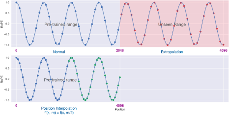

如果直接使用位置(2048,4096]进行推理，那么因为模型没有见过这一部分的位置，效果会出现灾难性的下降。那么，就把[0,4096]这个区间”压缩“到[0,2048]不就可以了嘛

**位置内插法** ，即把没见过的位置映射到见过的位置，相当于对于绝对位置m，把它缩放，变成$\frac{mL'}{L}$，其中L为原先支持的长度，L'为需要扩展的长度。

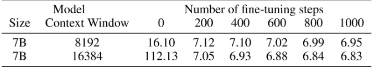

PI比直接微调的效果更好，应该是指比直接在长序列上进行微调效果要好。

**大概仅需要200步就可以稳定下来，获得比较显著的收益，再微调到1000步增益较小** 。

##### 位置插值PI存在的问题

三角函数 $sin(wx)$，它的周期是 $T = \frac{2\pi}{w}$，对应到RoPE里的每个维度 $\sin m\theta_j, \cos m\theta_j$，其中 $\theta_j = 10000^{-\frac{2(j-1)}{d}}, j\in[1, 2, ..., d/2]$，$m$指位置，$j$指维度

计算得到周期为 $\frac{2\pi}{m} 10000^{\frac{2(j-1)}{d}}$，同一个位置$m$，不同的维度编码$j$​，每个维度对应的三角函数周期是越来越大的，频率越来越低

前面的维度周期小，插值之后会变得很密集(本来一个周期包含10个值，但是内插之后能包含20个值)，这样就变的很拥挤。

#### 1\. ALiBi

Baichuan 7B无论第一代还是第二代，位置编码均用的RoPE，而Baichuan 13B则无论是第一代还是第二代，均用的ALiBi

ALiBi全称是Attention with Linear Biases，不像标准transformer那样，在embedding层添加位置编码，而是在$QK^T$的结果后添加一个静态的不可学习的偏置项。

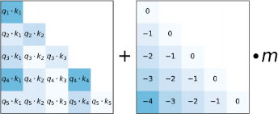

m具体取值与头的个数有关，当8个heads的时候，m的取值为$\frac{1}{2^{1}}, \frac{1}{2^{2}}, \ldots, \frac{1}{2^{8}}$，如果是16个heads，则m的取值为$\frac{1}{2^{0.5}}, \frac{1}{2^{1}}, \frac{1}{2^{1.5}}, \ldots, \frac{1}{2^{8}}$，扩展到一般情况就是：对于n个head的话，m的取值就是 $\frac{1}{2^{\frac{8}{n}}}$

最终整体的公式便是 $\operatorname{softmax}\left(\mathbf{q}_{i} \mathbf{K}^{\top}+m \cdot[-(i-1), \ldots,-2,-1,0]\right)$

#### 2\. xPos

#### 3\. NTK

##### NTK-aware

简单的线性插值RoPE的傅里叶空间是非常次优的，因为它阻止了网络区分非常接近的token的顺序和位置。

作者没有使用简单的线性插值方案，而是尝试使用NTK文献中的工具设计非线性插值方案。基本上，这种插值方案改变了 RoPE 的基数而不是刻度，这直观地改变了每个 RoPE 的维度向量与下一个维度向量相比的“旋转”速度。因为它不直接缩放傅里叶特征，所以所有位置都可以完全区分，即使走到极端。

以下是NTK-aware插值的实现，这么看来 ABF 就是NTK插值啊，修改base，但是最终起到效果等同位置插值，并不是性能效果上的等同，而是指实现了位置插值的等同。

```python
import transformers

old_init = transformers.models.llama.modeling_llama.LlamaRotaryEmbedding.__init__

def ntk_scaled_init(self, dim, max_position_embeddings=2048, base=10000, device=None):
    '''
    dim：每个head的维度，self.head_dim = self.hidden_size // self.num_heads
    llama配置文件中 hidden_size=4096, num_attention_heads=32
    这样计算 dim=128
    这样计算出来新的base近似为66W
    '''
    # 调整 max_position_embeddings 和 base
    max_position_embeddings = 16384
    a = 8 # Alpha value
    base = base * a ** (dim / (dim-2)) # 根据公式调整base的值
    old_init(self, dim, max_position_embeddings, base, device)
    
transformers.models.llama.modeling_llama.LlamaRotaryEmbedding.__init__ = ntk_scaled_init
```

NTK-aware插值，核心思想是：高频外推，低频内插

  1. NTK-aware通过引入 $\lambda$ 来调整频率，使得位置编码在不同频率下更加适应内插或外推的需求。
  2. 具体地，把$\left[\cos \left(\frac{n}{\beta^{0}}\right), \sin \left(\frac{n}{\beta^{0}}\right), \cos \left(\frac{n}{\beta^{1}}\right), \sin \left(\frac{n}{\beta^{1}}\right), \cdots, \cos \left(\frac{n}{\beta^{d / 2-1}}\right), \sin \left(\frac{n}{\beta^{d / 2-1}}\right)\right]$中的最低频项 $\frac{n}{\beta^{\mathrm{d} / 2-1}}$，引入参数 $\lambda$，从而变为 $\frac{n}{(\beta \lambda)^{d / 2-1}}$，让它跟内插一致 (内插就是将 $n$ 换成 $n/k$，其中 $k$ 是要扩大的倍数 )，即 $\frac{n}{(\beta \lambda)^{d / 2-1}}=\frac{n / k}{\beta^{d / 2-1}}$，从而解得 $\lambda=\mathrm{k}^{2 /(\mathrm{d}-2)}$​
  3. 最高频是 $\frac{n}{\beta}$ 项，引入 $\lambda$ 后变为 $\frac{n}{\beta \lambda}$，由于 $d$ 通常很大，$\lambda$很接近1，所以还是接近于 $\frac{n}{\beta}$​ ，即等价于外推。

##### NTK-by-parts插值

考虑了波长与上下文的关系：

波长：维度d上嵌入的RoPE，执行完整旋转(2π)所需的标记长度，

> RoPE中$\sin m\theta_j, \cos m\theta_j$，其中 $\theta_j = 10000^{-\frac{2(j-1)}{d}}, j\in[1, 2, ..., d/2]$，$m$指位置，$j$指维度。
> 
> 对于某一维$j$，$\theta_{j}$固定，求完整周期$m$的值，也就是说，多少个token能够完成一个周期。

  1. 当波长很长时，这些维度上的嵌入几乎不变，可以认为它们保持了绝对位置信息，即每个位置的嵌入不因相对位置变化而变化。

波长很长，导致当前序列长度不能完成一个周期的旋转，保持了绝对位置信息。

  2. 当波长较短时，嵌入会在较短的距离内完成多次旋转，这使得这些维度上的嵌入反映的是相对位置信息，即它们可以捕捉到标记之间的相对距离变化。

具体做法：波长 $\lambda$ 等于或大于上下文长度 $L$ 时插值，波长 $\lambda$ 比上下文长度 $L$ 小得多时不插值，

对于Llama系模型，当**波长大于上下文长度时插值** ， **波长小于上下文长度的32分之1时不插值** 。

##### Dynamic NTK

有两种方法可以应用使用比例因子s 的插值方法(包括PI、"NTK-aware" and "NTK-by-parts"):

  1. 方法1：在整个推理周期中，嵌入层是固定的，包括缩放因子 $s=L^{\prime} / L$，其中 $L'$​是固定数量的扩展上下文大小

问题在于模型在长度小于 L 时可能出现性能折扣，当序列长度大于 L′ 时可能出现突然退化

  2. 方法2：在每次前向传播中，位置嵌入更新缩放因子 $s=\max \left(1, l^{\prime} / L\right)$，其中 $l'$ 是当前序列的序列长度

即为动态缩放方法，当再与NTK-aware 插值相结合时，称之为 动态NTK 插值

一个值得注意的事实是，动态NTK插值在$L$上预训练的模型上工作得非常好，而不需要任何微调。

```python
# RoPE NTK动态插值
# 修改了base值和逆频率矩阵
class LlamaDynamicNTKScalingRotaryEmbedding(LlamaRotaryEmbedding):
    """LlamaRotaryEmbedding extended with Dynamic NTK scaling. Credits to the Reddit users /u/bloc97 and /u/emozilla"""

    def forward(self, x, position_ids):
        # difference to the original RoPE: inv_freq is recomputed when the sequence length > original length
        # 当序列长度 > 原始长度时，重新计算inv_freq
        seq_len = torch.max(position_ids) + 1
        if seq_len > self.max_position_embeddings:
            # base值根据原始base，缩放因子，序列长度重新计算
            base = self.base * (
                (self.scaling_factor * seq_len / self.max_position_embeddings) - (self.scaling_factor - 1)
            ) ** (self.dim / (self.dim - 2))
            # 逆频率矩阵
            inv_freq = 1.0 / (
                base ** (torch.arange(0, self.dim, 2, dtype=torch.int64).float().to(x.device) / self.dim)
            )
            self.register_buffer("inv_freq", inv_freq, persistent=False)  # TODO joao: this may break with compilation

        cos, sin = super().forward(x, position_ids)
        return cos, sin
```

#### 4\. ABF-Llama2 Long

`LLaMA 2 Long` 变化主要体现在以下两点：

  1. 采用400B token训练，原始LLaMA 2包含多个变体，但最多的版本也只有70B token。
  2. 对位置编码进行了一个非常小的必要修改，实现了32k token的上下文窗口支持

在LLaMA 2中，它的位置编码采用的是旋转编码RoPE方法，其通过旋转矩阵来实现位置编码的外推

  * 本质上来说，RoPE就是将 token embeddings 映射到3D图表上，给出它们相对于其他token的位置——即使在旋转时也如此

Meta的对7B规模的LLaMA 2进行实验，确定了LLaMA 2中的RoPE方法的一个**局限性** ，即，阻止注意力模块聚集远处token的信息

为此，Meta想出了一个非常简单的破解办法：**减少每个维度的旋转角度** ，**具体而言就是将超参数“基频(base frequency)b”从10000增加到500000**

Meta还通过可视化为螺旋图这一非常有趣的方式，将RoPE ABF与RoPE PI的差异进行了理论分析

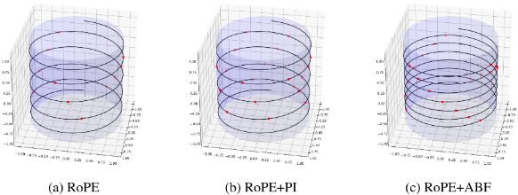

> RoPE的基本效果，红点代表位置嵌入向量在三维空间中的位置，位置向量沿着螺旋线分布，展示了随时间步递增的规律性
> 
> RoPE+PI位置插值：在RoPE基础上增加位置插值后的位置嵌入向量，较图a，连续点之间的距离大幅缩小，位置插值对映射向量相对位置的影响较大，使得嵌入向量更加密集
> 
> RoPE+ABF 增大基频：虽然螺旋频率增加导致点之间的最小距离缩小 (应该指的是直线距离)，但连续点之间的距离几乎与图a相同

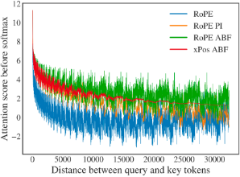

缩小了RoPE对远端token的衰减效应

#### Llama实现的RoPE及NTK插值

首先这是NTK-aware插值的实现，其根据`head_dim`调整了`base`的值，再调用了llama原始的RoPE初始化方法

```python
import transformers

old_init = transformers.models.llama.modeling_llama.LlamaRotaryEmbedding.__init__

def ntk_scaled_init(self, dim, max_position_embeddings=2048, base=10000, device=None):
    '''
    dim：每个head的维度，self.head_dim = self.hidden_size // self.num_heads
    llama配置文件中 hidden_size=4096, num_attention_heads=32
    这样计算 dim=128
    这样计算出来新的base近似为66W
    '''
    # 调整 max_position_embeddings 和 base
    max_position_embeddings = 16384
    a = 8 # Alpha value
    base = base * a ** (dim / (dim-2)) # 根据公式调整base的值
    old_init(self, dim, max_position_embeddings, base, device)
    
transformers.models.llama.modeling_llama.LlamaRotaryEmbedding.__init__ = ntk_scaled_init
```

Llama的RoPE插值逻辑：如果配置了`rope_scaling`这个参数，即代表对RoPE进行位置内插，`scaling_type`决定了内插的实现方式

```python
class LlamaAttention(nn.Module):
    def __init__(self, config: LlamaConfig, layer_idx: Optional[int] = None):
        self.max_position_embeddings = config.max_position_embeddings
        self.rope_theta = config.rope_theta
        self._init_rope()
	def _init_rope(self):
        # RoPE
        if self.config.rope_scaling is None:
            self.rotary_emb = LlamaRotaryEmbedding(
                self.head_dim,
                max_position_embeddings=self.max_position_embeddings,
                base=self.rope_theta,
            )
        else:
            scaling_type = self.config.rope_scaling["type"]
            # 缩放因子
            scaling_factor = self.config.rope_scaling["factor"]
            # 线性插值？
            if scaling_type == "linear":
                self.rotary_emb = LlamaLinearScalingRotaryEmbedding(
                    self.head_dim,
                    max_position_embeddings=self.max_position_embeddings,
                    scaling_factor=scaling_factor,
                    base=self.rope_theta,
                )
            elif scaling_type == "dynamic":
                self.rotary_emb = LlamaDynamicNTKScalingRotaryEmbedding(
                    self.head_dim,
                    max_position_embeddings=self.max_position_embeddings,
                    scaling_factor=scaling_factor,
                    base=self.rope_theta,
                )
            else:
                raise ValueError(f"Unknown RoPE scaling type {scaling_type}")
```

Llama实现的RoPE

```python
# LLama实现的RoPE
class LlamaRotaryEmbedding(nn.Module):
    def __init__(self, dim, max_position_embeddings=2048, base=10000, device=None, scaling_factor=1.0):
        '''
        dim：嵌入维度
        max_position_embeddings：最大位置嵌入数，默认为2048
        base：用于计算频率的基数，默认为10000
        scaling_factor：缩放因子，默认为1.0
        '''
        super().__init__()
        self.scaling_factor = scaling_factor
        self.dim = dim
        self.max_position_embeddings = max_position_embeddings
        self.base = base
        # 逆频率矩阵
        inv_freq = 1.0 / (self.base ** (torch.arange(0, self.dim, 2, dtype=torch.int64).float().to(device) / self.dim))
        self.register_buffer("inv_freq", inv_freq, persistent=False)
        # For BC we register cos and sin cached
        self.max_seq_len_cached = max_position_embeddings

    @torch.no_grad()
    def forward(self, x, position_ids):
        '''
        x：输入张量，形状为 [batch_size, num_attention_heads, seq_len, head_size]。
        position_ids：位置索引，形状为 [batch_size, seq_len]。
        '''
        # 动态NTK插值，根据实际的长度进行扩展
        inv_freq_expanded = self.inv_freq[None, :, None].float().expand(position_ids.shape[0], -1, 1)
        position_ids_expanded = position_ids[:, None, :].float()
        # Force float32 since bfloat16 loses precision on long contexts
        # See https://github.com/huggingface/transformers/pull/29285
        device_type = x.device.type
        device_type = device_type if isinstance(device_type, str) and device_type != "mps" else "cpu"
        # 上下文管理器，显式禁用自动类型转换
        with torch.autocast(device_type=device_type, enabled=False):
            # 逆频率矩阵 @ 位置ID张量
            # 频率嵌入矩阵
            freqs = (inv_freq_expanded.float() @ position_ids_expanded.float()).transpose(1, 2)
            emb = torch.cat((freqs, freqs), dim=-1)
            cos = emb.cos()
            sin = emb.sin()
        return cos.to(dtype=x.dtype), sin.to(dtype=x.dtype)
```

逆频率矩阵的计算：$inv\_freq = base^{-\frac{[0:dim:2]}{dim}}$

线性插值的实现方式

```python
# RoPE 线性插值
class LlamaLinearScalingRotaryEmbedding(LlamaRotaryEmbedding):
    """LlamaRotaryEmbedding extended with linear scaling. Credits to the Reddit user /u/kaiokendev"""

    def forward(self, x, position_ids):
        # difference to the original RoPE: a scaling factor is aplied to the position ids
        # 将位置 ID 除以 self.scaling_factor，实现线性缩放。
        position_ids = position_ids.float() / self.scaling_factor
        cos, sin = super().forward(x, position_ids)
        return cos, sin
```

### 插值

#### 1\. LongLoRA-提出S2-Attn

LoRA一方面没法扩展模型的上下文长度，二方面，单纯的低秩自适应会导致长上下文扩展的困惑度很高，即便将秩增加到一个更高的值，例如rank = 256，也并不能缓解这个问题，那咋办呢？

  * embedding层和Norm层也添加LoRA训练之后，困惑度PPL可以显著降低
  * 在效率方面，无论是否采用LoRA，计算成本都会随着上下文规模的扩大而急剧增加，这主要是由于标准的自注意机制所导致的。

为此，提出shifted sparse attention(S2-Attn)以替代标准自注意力机制

  1. 训练时，改造注意力，用S2-Attn，longlora的作者团队认为：尽管在推理过程中需要密集的全局注意力，但**通过稀疏的局部注意力(sparse local attention mechanism)也可以高效地完成模型的微调** ，比如他们提出的**移位稀疏注意力(shifted sparse attention，简称S2-Attn)可有效地实现上下文扩展** 且显著节省计算资源(意味着训练时可以用S2-Attn，推理时又可再用全局注意力。
  2. 改造LoRA：给嵌入层、归一化层也都加上LoRA权重

##### S2-Attn原理

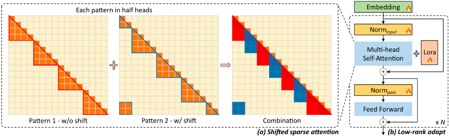

对上下文长度进行分组，每个组单独计算注意力，在每个头的维度上，取一半的维度按照分组的方向移位半个组的大小。

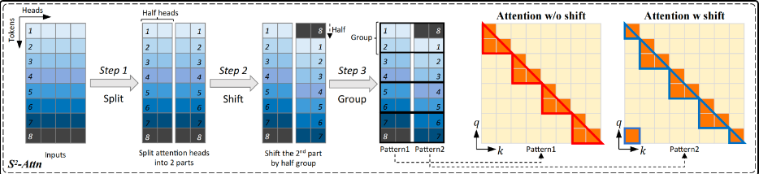

信息通过移位在不同组之间流动。虽然移位可能会引入潜在的信息泄漏，但这可以通过对注意力掩码进行微调来避免。

#### 2\. LongQLoRA

作者发现不放开Norm层和Embedding层来进行训练，也可以通过设置更大的LoRA Rank来实现更好的微调效果。

从源码上来看LongQLoRA的实现流程如下：

1.) 应用S2-Attn

2.) 应用PI，线性插值

3.) 应用QLoRA量化预训练模型

4.) 对预训练模型插入LoRA Adapter

##### LongQLoRA源码实现

```python
# 加载模型,应用S2-Attn,QLoRA
model, tokenizer = load_model_and_tokenizer(args, training_args)
# 插入adapter
model = insert_adapter(args, model)

def load_model_and_tokenizer(args, training_args):
    # 1. 首先应用s2-attn
    replace_llama_attn(args.use_flash_attn)
    # 2. 修改RoPE的position最大长度
    orig_ctx_len = getattr(config, "max_position_embeddings", None)
    if orig_ctx_len and args.model_max_length > orig_ctx_len:
        scaling_factor = float(math.ceil(args.model_max_length / orig_ctx_len))
        config.rope_scaling = {"type": "linear", "factor": scaling_factor}
	# 3. 加载模型,QLoRA加载
    model = AutoModelForCausalLM.from_pretrained(
        args.model_name_or_path,
        ...
        quantization_config=BitsAndBytesConfig(
            load_in_4bit=True,
            ...
 	   ),
	)
    # 4. 加载tokenizer
    ...

def insert_adapter(args, model):
    # 默认没有提供需要插入的target_modules
    # 找出所有全连接层，为所有全连接添加adapter
    # cls == bnb.nn.Linear4bit 会被添加adapter
    target_modules = find_all_linear_names(model)
    # 在初始化LoRA配置时, 设置需要添加Adapter的modules
    config = LoraConfig(
        ...
        target_modules=target_modules,
        ...
    )
    model = get_peft_model(model, config)
    # 根据配置，决定word embedding和norm是否参与训练
    # 默认是不训练 word embedding 和 norm 的
```

#### 3\. YaRN

YaRN（Yet another RoPE extensioN）是一种针对语言模型的位置编码方法，它旨在解决一个特定的问题：如何让一个训练好的模型能够理解和处理比它原本训练时见过的还要长的文本序列。

随着上下文窗口大小的增加，所有模型的困惑度都在下降，这表明考虑更多的上下文能够帮助模型做出更准确的预测。

YaRN原理

  * YaRN首先计算原始模型的波长，然后用这个波长来指导如何为更长的序列生成新的位置编码。
  * 这个过程保证了新的位置编码与原来的编码在数学特性上是一致的，就像是在原有的位置编码上“拉伸”出了新的空间来适应更长的文本。

**YaRN方法 = NTK-aware + NTK-by-parts + Dynamic NTK**

YaRN方法包含了“NTK-by-parts”插值和注意力机制的调整，但不是简单地将“NTK-aware”、"NTK-by-parts"和“Dynamic NTK”插值三者相加。

  1. **“NTK-aware”插值** 是YaRN方法发展过程中的一个步骤，它解决了RoPE插值过程中可能丢失的高频信息问题，通过不同程度地缩放RoPE的不同频率维度。
  2. **“NTK-by-parts”插值** 是YaRN方法中的核心组成部分，它进一步细化了插值策略，特别是在处理不同频率（或波长）的RoPE维度时，以避免丢失相对局部距离信息。
  3. **“Dynamic NTK”插值** 是一个与YaRN相关的概念，它通过在模型的不同推理步骤中动态调整插值策略，提供了一种在处理不同长度序列时动态适应的方法。

**YaRN方法** 是基于上述的理论和技术，结合了“NTK-by-parts”插值和对注意力机制的特定调整（通过温度参数）来优化模型对长序列的处理能力。

>   1. 高频信息丢失
> 
> 想象你在阅读一篇文章，其中有些单词或者细节特别微小，比如一些细微的情感变化或者语气差别。
> 
> 如果这些细节在阅读过程中丢失了，整个故事或论点的理解可能就会受影响。在语言模型中，高频信息指的就是这些细微的差别。
> 
>   2. NTK-aware 插值
> 
> 为了不丢失这些细节，我们需要给模型戴上一副“高清眼镜”，让它即使在阅读更长的文章时也能注意到这些细微的差别。
> 
> 它调整模型的内部设置，让它在处理长文本时，仍然能够捕捉到关键的细节信息。
> 
>   3. 相对局部距离的丢失
> 
> 现在，想象文章中的每个单词都是故事中的一个角色，它们之间的关系和距离很重要。
> 
> 如果我们在拉长文章时把所有单词间的距离都均匀拉开，角色间的关系就会变得模糊，我们可能会弄不清楚谁对谁说了什么。
> 
>   4. NTK-by-parts 插值
> 
> 这个方法就像是我们仔细考虑每个角色间的关系，确保在扩展故事时，这些关系不会被扭曲。
> 
> 精心调整模型处理单词位置信息的方式，确保即使在更长的文本中，单词间的相对位置和关系也能被正确理解。
> 
>   5. 动态缩放
> 
> 如果你在读一本书，但是你每次能记住的内容长度不一样，有时候你可能只需要记住一句话，有时候可能是一整页。你的大脑需要能够灵活调整记忆的长度，以适应不同的阅读需求。
> 
>   6. Dynamic NTK 插值
> 
> 让模型能够根据当前正在处理的文本长度动态调整其“记忆范围”。
> 
> 就像你的大脑在阅读不同长度的内容时自然做的调整一样，模型也能够在处理不同长度的文本时自然过渡，保持高效和准确。
> 
> 

YaRN可以有效地扩展使用旋转位置嵌入(RoPE)训练的模型的上下文窗口。

YaRN怎么来的：基于“NTK-by-parts”插值修改注意力。

将注意力权重的计算修改为 $\operatorname{softmax}\left(\frac{\mathbf{q}_{m}^{T} \mathbf{k}_{n}}{t \sqrt{|D|}}\right)$

#### 4\. PoSE