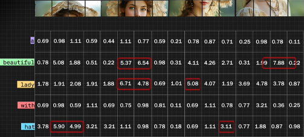
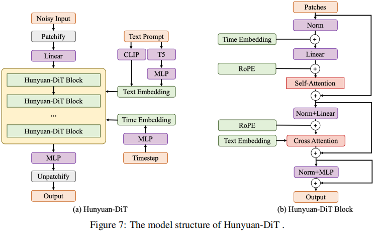
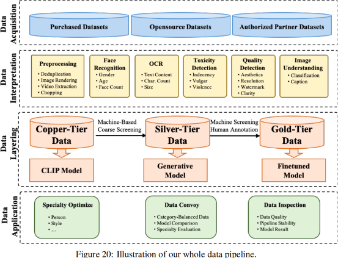
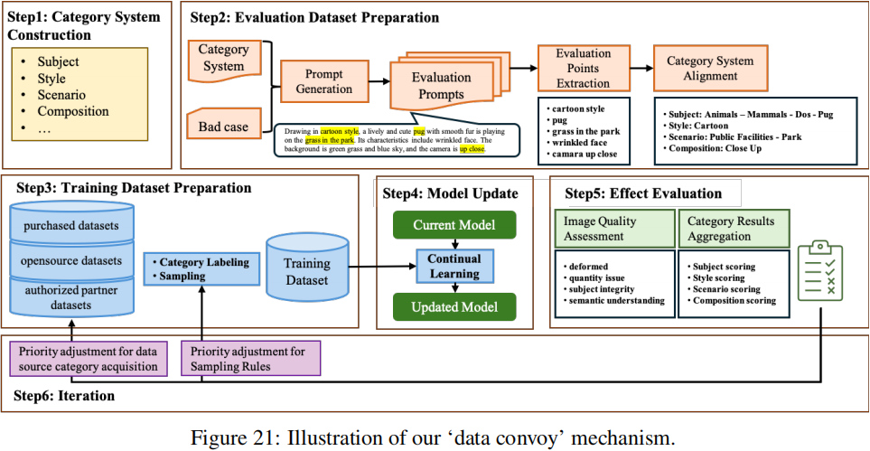
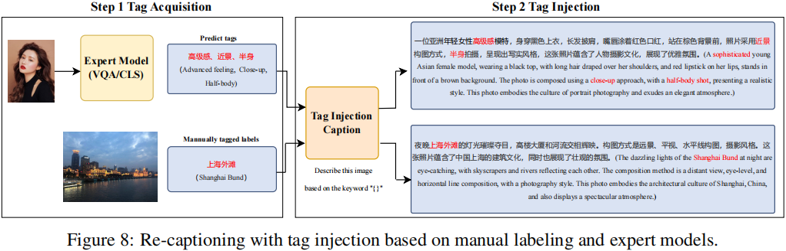
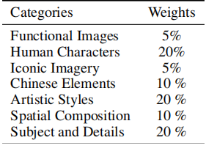
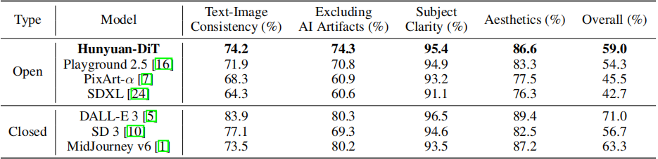
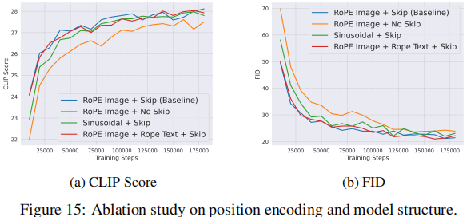
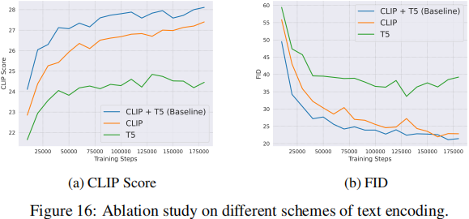

# DiT基础补充 & 混元DiT

> 原文作者：幻影星全能的木豆  
> 原文链接：https://www.cnblogs.com/mudou/p/18364082  
> 发布时间：2024-08-17 09:59

---

# 一、基础补充

## 1\. DIT：Diffusion Transformer

SoRA的架构正是DIT架构，Diffusion 在图像生成领域大杀四方，Transformers 在文本生成领域独领风骚，将二者结合，这就是DiT。

DiT相比于传统的stable diffusion，就是把diffusion里面的U-net换成了transformer架构。

简单来说，diffusion是可以把提示词转换为符合你的提示词的图片的一个工厂。

但是，U-net用的好好的，为什么要换它，在U-net中的卷积核，提取特征的过程中，图像的维度被不断压缩，导致了部分信息的确实。

这样的设计可以加快特征提取速度，但也同样成为U-net不可避免的硬伤。

transformer会把一张图片按照顺序排列成一个像自然语言中句子一样的东西，每一个被切开的像素小块，会被图像编码器编码为向量，transformer中的注意力机制会用数学的方法去计算当前的小块和其他每一个小块之间的关联，与被预测图块关联性最高的图块对最终的生成结果起到决定性作用。

每跑完一个step，模型预测当前应该减去的噪声，初始噪声图就可以减去当前预测应该减去的噪声，这样就会越来越清晰，直到得到我们想要的图像。

总的来说，DiT的架构还是使用了diffusion model一步一步迭代的方式逐步减去噪声，只不过里面预测噪声的模块换成了transformer而已。

为什么这两个改动可以让他有更好的语言理解能力？

  1. 首先增加CrossAttention可以让模型在训练过程中不仅仅只关注图像小块之间的关联度，还可以计算被切分的每个图像小块和被切分的语言块各自之间的关联度。



这种交叉计算一方面使得参数更加的多，虽然可能训练的成本会增加，但是也一定会带来语言理解能力的上升。

  2. 由于混元DIT在设计之初就是针对中文语境继续训练，所以它增加了MT5这个多语言的编码器，可以直接针对中文进行编码，并不需要将中文翻译为英文再对英文进行编码。

# 二、混元DiT技术报告

## 摘要

Hunyuan-DiT，细粒度的中英文语言理解文生图扩散模型。

为了构建 Hunyuan-DiT，我们精心设计了transformer结构、文本编码器和位置编码。

为了实现精细的语言理解，我们训练了一个多模态大型语言模型来提炼图像的标题。

最后，Hunyuan-DiT 能够与用户进行多轮多模态对话，根据上下文生成和优化图像。

## 引言

基于diffusion的文生图生成模型，例如DALL-E，Stable Diffusion，Pixart，已经显示出能够生成前所未有的高质量图像的能力。然而，它们缺乏直接理解中文提示的能力，这限制了它们在使用中文文本提示进行图像生成方面的潜力。为了提高对中文的理解，提出了 AltDiffusion 、PAI-Diffusion 和 Taiyi ，但它们的生成质量仍需改进。

Hunyuan-DiT 的实现得益于我们以下的努力：

  1. 基于 diffusion transformer 设计了新的网络架构。它结合了**两种文本编码器，一个双语的 CLIP 和一个多语种的 T5 编码器** ，以提高语言理解能力并增加上下文长度。

  2. 从头开始构建了一个数据处理 pipeline，用于添加数据、过滤数据、维护数据、更新数据，并应用数据来优化我们的文生图模型。

具体来说，设计了一种称为“data convoy”的迭代程序，用以检验新数据的有效性。

  3. **使用多模态大型语言模型（MLLM）来优化图像-文本数据对中的原始描述** 。

MLLM 经过微调，能够生成具有世界知识结构的描述。

  4. Hunyuan-DiT 能够通过与用户的多轮对话来交互式地修改其生成。
  5. 我们在推理阶段进行 post-training 优化，以降低 Hunyuan-DiT 的部署成本。

评估方案：考虑了文生图模型的不同维度，包括文本图像的一致性、AI artifacts、主题清晰度、美学等。

评估方案被纳入data convoy，以更新生成模型。

Hunyuan-DiT，在开源模型中实现了最先进的性能。在中文到图像的生成中，与包括Stable Diffusion 3在内的现有开源模型相比，Hunyuan-DiT在文本-图像一致性、AI artifacts、主题清晰度和美学方面都是最好的。在主题清晰度和美学方面，它的表现与顶级闭源模型，如DALL-E 3和MidJourney v6相似。从质量上看，对于中文元素的理解，包括古诗和中餐等类别，Hunyuan-DiT能够生成比其他比较算法具有更高图像质量和语义精度的结果。Hunyuan-DiT支持长达256个token的长文本理解。Hunyuan-DiT可以使用中文和英文文本提示生成图像。

在本报告中，除非另有通知，否则所有图像都是使用中文提示生成的。

## 方法

### 1\. 改进Diffusion Transformers



Hunyuan-DiT 是一个在潜在空间中的扩散模型，如图 7 所示。遵循潜在扩散模型，我们使用预训练的变分自编码器（VAE）将图像压缩到低维潜在空间，并训练一个扩散模型来通过扩散模型学习数据分布。我们的扩散模型采用 transformer 进行参数化。为了编码文本提示，我们利用了预训练的双语（英文和中文）CLIP 和多语种 T5 编码器的组合。

接下来介绍每个模块的详细信息。

#### 1.1 变分自编码器VAE

使用了 SDXL 中的 VAE，它是基于 SD 1.5 中的 VAE 微调于 512 × 512 像素图像的。

实验结果表明，在高分辨率 SDXL VAE 上训练的文本到图像模型在清晰度上有所提高，减轻了过饱和现象，并减少了与 SD 1.5 VAE 相比的失真。

由于 VAE 的潜在空间极大地影响了生成质量，我们将在未来探索更好的 VAE 训练范式。

> SDXL: Improving latent diffusion models for high-resolution image synthesis.

#### 1.2 Hunyuan-DiT 中的 Diffusion Transformer

我们的 diffusion transformer 与基线 DiT 相比有几项改进。

  * 我们发现在 class-conditional DiT 中使用的自适应层归一化（Adaptive Layer Norm）在执行精细的文本条件时表现不佳。因此, we modify the model structure to combine the text condition with the diffusion model using cross-attention as Stable Diffusion.

  * Hunyuan-DiT 采用 $x \in \mathbb{R}^{c \times h \times w}$ 作为变分自编码器VAE潜在空间的输入，然后将 $x$ 划分为$\frac{h}{p} \times \frac{w}{p}$个patches， _p_ is set to 2. 在一个线性投影层之后，为后续的 transformer blocks 得到了 $hw/4$ 个 tokens

  * Hunyuan-DiT 拥有两种类型的 transformer blocks，the encoder block and the decoder block.

Both of them contain three modules - self-attention, cross-attention, and feed-forward network (FFN).

The decoder block additionally contains a skip module, which adds the information from the encoder block in the decoding stage.

The skip module is similar to the long skip-connection in U-Nets, but there are no upsampling or downsampling modules in Hunyuan-DiT due to our transformer structure.

  * 最后，tokens被重新组织以恢复二维空间结构。

  * 在训练中，我们发现使用 v-prediction 可以获得更好的实证性能。

#### 1.3 文本编码器

一个高效的文本编码器在文本到图像的生成中至关重要，因为它们需要准确地理解并编码输入的文本提示以生成相应的图像。CLIP 和 T5 已经成为这些编码器的主流选择。

  * Matryoshka diffusion models、Imagen、MUSE 和 Pixart-α 仅使用 T5 来增强它们对输入文本提示的理解。
  * 相比之下，eDiff-I 和 Swinv2-Imagen 融合了 CLIP 和 T5 两种编码器，以进一步提高它们的文本理解能力。

Hunyuan-DiT 选择在文本编码中结合 T5 和 CLIP，以利用两种模型的优势，从而提高文本到图像生成过程的准确性和多样性。

#### 1.4 位置编码和多分辨率的生成

Visual transformers 中常见的做法是应用正弦位置编码，对 token 的绝对位置进行编码。

在 Hunyuan-DiT 中，我们使用旋转位置嵌入（RoPE）来同时编码绝对位置和相对位置依赖。我们使用二维RoPE，它将RoPE扩展到图像领域。

Hunyuan-DiT 支持多分辨率的训练和推理，这要求我们为不同的分辨率分配适当的位置编码。

对于$x \in \mathbb{R}^{c \times h \times w}$，尝试两种类型的位置编码用于多分辨率生成：

  1. 扩展位置编码

$$\operatorname{PE}\left(x_{i, j}\right)=(f(i), f(j)), \quad i \in\{1, \cdots, h\}, j \in\{1, \cdots, w\}$$

$f$ 位置编码函数，$\operatorname{PE}(x)$ 获得位置$(i, j)$的二维位置编码

$x$ 有不同的分辨率，$h$ 和 $w$ 表现出巨大的差异，位置编码差异显著

  2. 集中式插值位置编码：使用集中插值位置编码对x的位置编码与不同的h和w进行对齐。

假设$h\ge w$，集中插值位置编码计算如下：

$$\operatorname{PE}\left(x_{i, j}\right)=\left(f\left(\frac{S}{2}+\frac{S}{h}\left(i-\frac{h}{2}\right)\right), f\left(\frac{S}{2}+\frac{S}{h}\left(j-\frac{w}{2}\right)\right)\right)$$

其中$i\in\{1, \cdots, h\}, j\in \{1, \cdots w\}$

$S$是位置编码的一个预定义的边界，该策略确保了不同分辨率的图像在计算位置编码时具有相同的范围`[0，S]`，从而提高了学习效率。

虽然扩展位置编码更容易实现，但我们观察到它是多分辨率训练的次优选择。它不能对齐不同分辨率的图像，也不能覆盖$h$和$w$都很大的罕见情况。

相反，集中式插值位置编码允许不同分辨率的图像共享相似的位置编码空间。通过集中插值位置编码，模型收敛速度更快，并推广到新的分辨率。

#### 1.5 提升训练稳定性

  1. 所有的attention模块在计算QKV之前添加layer normalization，这种技术称为QK-Norm。
  2. 在decoder blocks的skip module之后添加layer normalization，避免在训练过程中发生损失爆炸。
  3. 我们发现某些操作，例如，layer normalization，FP16往往会溢出。我们特别将它们切换为FP32，以避免数值误差。

> 损失爆炸？
> 
> 梯度更新过大导致模型参数更新过多，从而使模型的预测偏离合理范围。

### 2\. Data Pipeline

#### 2.1 数据处理

准备训练数据pipeline由四部分组成：



  1. **数据采集** ：数据采集的主要渠道是外部采购、开放数据下载和授权的合作伙伴数据。

  2. **数据解释(标注)** ：在获得原始数据后，对数据进行标记，以确定数据的优缺点。

目前，支持超过十种标记功能，包括图像清晰度、美学、猥亵、暴力、性内容、水印的存在、图像分类和图像描述。

  3. **数据分层** ：为大量的图像构建了数据分层，以服务于模型训练的不同阶段。

例如，数十亿计的 image-text pairs 被用作 copper-tier data 来训练基础的CLIP模型

然后，从这个大型库中筛选出一个相对高质量的图像集作为 silver-tier data，以训练生成模型，以提高模型的质量和理解能力。

最后，通过机器筛选和人工标注，选择质量最高的数据作为 gold-tier data，对生成模型进行细化和优化。

  4. **数据应用** ：分层数据被应用于几个领域。专业数据被过滤出来进行专业优化，例如，个人或风格专门化。

新处理的数据不断添加到基础生成模型的迭代优化中。数据也经常被检查，以保持正在进行的数据处理的质量。

#### 2.2 数据类别系统

我们发现训练数据中数据类别的覆盖范围对于训练准确的 text-to-image 模型至关重要。这里我们讨论两个基本类别：

  1. **Subject** ：subject(主题) 的生成是 text-to-image 模型的基本能力。我们的训练数据涵盖了绝大多数类别，包括人类、景观、植物、动物、商品、交通、游戏等，有超过一万个子类别。
  2. **Style** ：风格的多样性对用户的偏好和粘性至关重要。目前，我们已经涵盖了超过100种风格，包括动画、3D、绘画、现实主义和传统风格。

#### 2.3 数据评估



为了评估引入专门数据或新处理数据对生成模型的影响，我们设计了一个“data convoy”机制，如图21所示，该机制包括：

  1. **根据数据类别系统对训练数据进行分类** ，包括主题、风格、场景、构图等。然后调整不同类别间的分布，以满足模型的需求，并利用类别平衡数据集对模型进行微调。

  2. **对微调后的模型和原始模型进行类别级比较** ，以评估数据的优缺点，据此我们确定数据更新的方向。

成功地运行该机制需要对 text-to-image 模型有一个完整的评估方案。我们的模型评估方案由两部分组成：

  1. **评估集构建** ：我们基于数据类别结合 bad cases 和业务需求来构建初始评估集。通过对测试用例的合理性、逻辑性和全面性的人工注释，保证了评价集的可用性。
  2. **Data Convoy评估** ：在每个 data convoy 中，我们从评估集中随机选择一个测试用例的子集，形成一个整体的评估子集，包括主题、风格、场景、组成。我们计算所有评估维度的总体得分，以协助数据的迭代。

### 3\. 细粒度的中文理解描述改进

通过爬取互联网获得的 image-text pairs 通常是低质量的，改进图像的相应描述对于训练文本到图像模型具有重要意义。

Hunyuan-Dit采用训练良好的多模态大语言模型（MLLM）对原始图像-文本对进行重新描述 re-captioning，以提高数据质量。

采用结构化的captions来全面描述图像。此外，我们还使用原始 captions 和包含世界知识的专家模型，以便在 re-captioning 中生成特殊概念。

#### 3.1 **Re-captioning with Structural Captions**

现有的MLLMs，例如，BLIP-2和Qwen-VL倾向于生成过于简化的标题，类似于 MS-COCO captions 或与图像无关的高度冗余的 captions。为了训练一个适合于改进原始图像-文本对的MLLM，我们构建了一个用于 structural captions 的大规模数据集，并对MLLM进行了微调。

我们使用一个AI辅助的 pipeline 来构建数据集。图像标注难度大，标注质量难以标准化。因此，use a three-stage pipeline，在AI辅助下提高标注效率。

  1. 阶段1：将人类标注与来自多个 basic image captioning models 生成的 captions 集成，获得初始的数据集。
  2. 阶段2：使用初始数据集对MLLM进行训练，然后使用训练后的模型为图像生成新的 captions
  3. 随着 re-captioning 精度的提高，人类标注的效率提高了约4倍。

我们的模型结构类似于LLAVA-1.6。它由用于视觉的ViT、a decoder-only LLM for language 和用于连接视觉和文本的 Adapter 组成。训练目标是与其他自回归模型一样的分类损失。

#### 3.2 Re-captioning with Information Injection

In human labeling of structural captions，世界知识总是缺失的，因为人类不可能识别出图像中的所有特殊概念。

我们利用两种方法将世界知识注入到标题中：

  1. **Re-captioning with Tag Injection**



为了简化标注过程，我们可以标注图像的 tags，并使用MLLMs根据标注的标签生成 tag-injected captions。

除了由人类专家进行标注外，我们还可以使用专家模型获取标签，包括但不限于通用对象检测器、地标分类模型和动作识别模型。

来自标签的附加信息可以显著增加生成的描述中的世界知识。

为此，我们设计了一个MLLM，以 images 和 tags 为输入，并输出 more comprehensive captions containing the information from the tags 。

我们发现，这个 MLLM 可以用非常稀疏的人工标注数据进行训练。

  2. **Re-captioning with Raw Captions** ：

Capsfusion 提出使用 ChatGPT 将原始描述与生成的描述性描述进行融合。然而，原始描述通常是有噪声的，仅靠大型语言模型（LLM）无法纠正原始描述中的错误信息。为了缓解这一问题，我们构建了一个MLLM，它可以从图像和原始描述中生成描述，通过考虑图像信息来纠正错误。

### 4\. 通过多轮对话进行提示增强

理解自然语言指令并与用户进行多轮交互对于 text-to-image system 非常重要。它有助于建立一个动态和迭代的创作过程，逐步将用户的想法变为现实。

在本节中，我们将详细介绍**如何使 Hunyuan-DiT 具备进行多轮对话和图像生成的能力** 。许多工作都致力于使用MLLMs为 text-to-image models 赋予多轮能力，例如 Next-GPT、SEED-LLaMA、RPG 和 DALLE-3。这些模型要么使用 MLLM 生成文本提示，要么为 text-to-image model 生成文本嵌入。我们选择第一种，因为生成文本提示更灵活。我们训练 MLLM 理解多轮用户对话，并输出用于图像生成的新文本提示。

#### 4.1 文本提示增强

用户给出的自然语言指令与训练 text-to-image generative 模型的refined captions 有很大的不同。因此，我们需要一个模型将这些指令转换为详细且语义连贯的文本提示，以成功生成高质量的图像。为了训练这个模型，我们使用 GPT-4 的上下文学习能力。我们收集了一小部分人工标注的（指令、文本提示）对作为上下文学习的示例，然后查询 GPT-4 以生成更多的数据对。这些 pairs 构建了一个 **single-turn instruction-to-prompt** 数据集，称为 $D_{p}$。

#### 4.2 多模态多轮对话

普通的 MLLMs 仅支持文本输出。为了与我们构建多轮文本到图像生成系统的目标保持一致，我们添加了一个特殊标记  ，以表明在当前对话轮次中应将文本提示发送给 Hunyuan-DiT 。如果模型成功预测到  标记，它将为 Hunyuan-DiT 生成详细的提示。

为了训练 MLLM ，我们设计了一个三轮多模态对话的数据集。为了确保涵盖广泛的对话场景，我们基于**四个主要类别探索了不同的输入和输出类型组合** ，即 text _→_ text, text _→_ image, text+image _→_ text, text+image _→_ image。通过在每轮对话中选择一种类型，我们预先定义了一组三轮对话组合。对于每个组合，我们使用 GPT-4 生成“dialogue prompts”，这些提示用于在对话之前定义 AI agent 的行为，从而产生独特的对话流程。我们遍历 13 个主题和 7 种图像编辑方法，在使用各种“ dialogue prompts ”查询 GPT-4 后，生成了约 15,000 个样本。在“dialogue prompts”中，我们还添加了$D_{p}$中的样本，以避免 generated text prompts 的分布偏移。我们将这个三轮文本到图像的对话数据集称为 $D_{tt}$。

#### 4.3 指令微调数据混合

为了保持多模态对话能力，我们还纳入了一系列开源的单/多模态对话数据集，记为$D_o$

我们随机打乱并连接来自 $D_p$ 和 $D_o$ 的单轮样本，以获得一个伪多轮数据集 $D_{pm}$。这个数据集具有多轮对话的特点，但不一定保持语义连贯，模拟了用户在对话中可能切换话题的场景。

为了适应话题的变化，我们训练模型来预测一个  标记。我们将 $D_o$、$D_p$ 、$D_{pm}$ 与 $D_{tt}$ 的集合混合在一起，作为最终的训练数据集 $D$。

更多细节，请参考 [15] 。

```
Minbin Huang, Yanxin Long, Xinchi Deng, Ruihang Chu, Jiangfeng Xiong, Xiaodan Liang, Hong Cheng, Qinglin
Lu, and Wei Liu. Dialoggen: Multi-modal interactive dialogue system for multi-turn text-to-image generation.
arXiv preprint arXiv:2403.08857, 2024.
```

#### 4.4 主题一致性保证

在多轮文本到图像的过程中，用户可能会多次要求 AI system **edit a certain subject** 。

我们的目标是确保在多个对话轮次中生成的主题尽可能保持一致。为了实现这一目标，我们在对话AI agent的“ dialogue prompts ”中添加了以下约束。

**对于建立在前一轮生成的图像基础上的图像生成，转换后的文本提示应该满足用户当前的需求，同时尽可能少地从之前图像中使用的文本提示中进行更改** 。

此外，**在给定对话的推理阶段，我们固定文本到图像模型的随机种子** 。这种方法显著提高了整个对话中主题的一致性。

### 5\. 系统效率优化

#### 5.1 训练阶段

ZeRO, flash-attention, multi-stream asynchronous execution, activation checkpointing, kernel fusion

#### 5.2 推理阶段

采用了多种工程优化策略：ONNX graph optimization, kernel optimization, operator fusion, precomputation, and GPU memory reuse.

#### 5.3 算法加速

最近，人们提出了各种方法来**减少基于diffusion的文本到图像模型的推理步骤** 。我们尝试应用这些方法来加速Hunyuan-DiT，但出现了以下问题：

  1. 训练稳定性：由于不稳定的训练机制导致对抗性的训练往往会失败
  2. 自适应性：我们发现有几种方法会导致模型不能重用预先训练过的plug-in模块或lora。
  3. 灵活性：在我们的实践中，**Latent Consistency Model** 只适用于 low-step generation。当推理步骤数增加到超过某个阈值时，其性能就会下降。这一限制阻止了我们灵活地调整生成性能和加速之间的平衡。
  4. 训练开销：对抗性训练引入了额外的模块来训练判别式模型，严重额外的GPU内存和训练时间需求。

考虑到这些问题，我们选择了**渐进式蒸馏Progressive Distillation** 。它训练稳定，能让我们在加速比和性能之间进行平稳的权衡，为我们提供了模型加速的最经济、最快捷的方法。

为了鼓励学生模型准确地模仿教师模型，我们**在训练过程中仔细调整了 优化器 optimizer、无分类器引导 classifier-free guidance 和正则化 regularization** 。

## 评估方案

为了全面评估 Hunyuan-DiT 的生成能力，我们构建了一个多维评估方案，它由评估指标、评估数据集构建、评估执行和评估方案演变组成。

### 1.评价指标

#### 1.1 评价维度

在确定评估维度时，我们参考了现有文献，并另外邀请了专业设计师和普通用户参与访谈，以确保评估指标既具有专业性又具有实用性。

具体而言，在评估我们的文本到图像模型的能力时，我们采用了以下四个维度： **text-image一致性、AI artifacts、主题清晰度和整体美学** 。

对于引起安全问题的结果（例如涉及色情、政治、暴力或血腥），我们直接将其标记为不可接受。

#### 1.2 多轮交互评估

在评估多轮对话交互的能力时，我们还评估了其他维度，如**指令遵循性、主题一致性以及多轮提示增强的图像生成的性能** 。

### 2\. 评估数据集建设

#### 2.1 数据集建设

**我们将 AI-generated 和 human-created 的 test prompts 相结合，构建了一个具有不同难度等级的分层评估数据集** 。

具体来说，我们根据以下因素将评估数据集分为三个难度等级：容易、中等、困难：

  1. 文本提示内容的丰富程度
  2. 描述性元素的数量（主体、主体修饰词、背景描述、风格等）
  3. 元素是否常见
  4. 是否包含抽象语义（例如诗歌、成语、谚语）等因素

此外，由于人工创建 test prompts 时存在同质化和生产周期长的问题，我们依靠大型语言模型来增加 test prompts 的多样性和难度，快速迭代提示生成，并减少人工劳动。

#### 2.2 评估数据集的类别和分布

在构建分层评估数据集的过程中，我们分析了用户在使用文本到图像生成模型时所使用的文本提示，并结合用户访谈和专家设计师的意见，使评估数据集中涵盖功能应用、人物角色、中国元素、多轮文本到图像生成、艺术风格、主题细节等主要类别。

不同的类别又进一步被划分为多个层级。例如，“主题细节”类别又被进一步划分为动物、植物、车辆和地标等子类别。对于每个子类别，我们保持的提示数量都超过 30 个。

### 3\. 评估执行

评估过程包括两个阶段：评估标准培训和多人校正。

  * 在评估标准培训阶段，我们为评估人员提供详细的培训，以确保他们清楚了解评估指标和工具。
  * 在多人校正阶段，我们让多个评估人员独立评估同一组图像，然后总结和分析评估结果，以减轻评估人员之间的主观偏差。

特别地，评估数据集以 3 级分层的方式构建，有 8 个一级类别和 70 多个二级类别。对于每个二级类别，我们在评估集中有 30 - 50 个提示。评估集总共拥有超过 3000 个提示。具体来说，我们的**评估分数** 通过以下步骤计算：

  1. 计算个别提示的结果：对于每个提示，我们邀请多位评估人员独立评估模型生成的图像。然后，我们汇总评估人员的评估结果，并计算认为**图像可接受** 的评估人员的百分比。例如，如果有 10 位评估人员参与，其中 7 位认为图像可接受，那么该提示的**通过率** 为 70%。

  2. 计算二级类别分数：同一二级类别中的每个提示具有相同的权重。对于同一二级类别下的所有提示，我们**计算它们通过率的平均值，以获得该二级类别的分数** 。例如，如果一个二级类别有 5 个提示，通过率分别为 60%、70%、80%、90%和 100%，那么该二级类别的分数为（60% + 70% + 80% + 90% + 100%）/ 5 = 80%。

  3. 计算一级类别分数：基于二级类别的分数，我们计算一级类别的分数。对于每个一级类别，我们取其下属二级类别的分数平均值，以获得一级类别的分数。例如，如果一个一级类别有 3 个二级类别，分数分别为 70%、80%和 90%，那么该一级类别的分数为（70% + 80% + 90%）/ 3 = 80%。

  4. **计算总的通过率** ：最后，我们**根据每个一级类别的权重来计算总体通过率** 。假设存在 3 个一级类别，分数分别为 70%、80%和 90%，权重分别为 0.3、0.5 和 0.2，那么总体通过率将是 0.3×70% + 0.5×80% + 0.2×90% = 79%。**一级类别的权重是通过与用户、设计师和专家的仔细讨论确定的** ，如表所示。



## 结果

### 1.评估结果



与其他开源模型相比，Hunyuan-DiT 在所有四个维度上都取得了最高分。与闭源模型相比，在主题清晰度和图像美学方面，Hunyuan-DiT 能够达到与 MidJourney v6 和 DALL-E 3 等最先进模型相似的性能。在总体通过率方面，Hunyuan-DiT 在所有模型中排名第三，优于现有的开源替代方案。Hunyuan-DiT 总共有 15 亿个参数。

### 2.消融实验

#### 2.1 Experiment Setting

按照先前研究中的设置，我们通过在 MS COCO 256×256 验证数据集上从提示生成 30,000 张图像，使用 zero-shot Frechet Inception 距离（FID）评估模型的不同变体。我们还报告了这些生成图像的平均 CLIP 分数，以检验文本提示和图像之间的对应关系。这些消融研究是在一个较小的 0.7B diffusion transformer上进行的。

#### 2.2 Effect of the Skip Module

利用 Long skip connections 实现了 U-Nets 中对称定位的编码层和解码层之间的特征融合。

我们观察到，去除 Long skip connections 会增加FID，并降低CLIP分数。



#### 2.3 RoPE

我们发现RoPE位置编码在训练阶段的大部分时间内都优于正弦位置编码。特别是，我们发现RoPE加速了模型的收敛性。我们假设这是由于**RoPE能够封装绝对和相对的位置信息** 。

我们还评估了在文本特征中包含的一维RoPE位置编码. 我们发现，在文本嵌入中添加RoPE位置编码并没有产生显著的收益。

#### 2.4 Text Encoder

我们评估了三种文本编码方案：（1）仅使用我们自己的双语（中英）CLIP，（2）仅使用多语言 T5，（3）同时使用双语 CLIP 和多语言 T5。

在图中，仅使用 CLIP 编码器的效果优于仅使用多语言 T5 编码器。此外，将双语 CLIP 编码器与多语言 T5 编码器相结合，利用了 CLIP 高效的语义捕捉能力和 T5 精细的语义理解优势，显著提高了 FID 和 CLIP 分数。



我们还在图 17 中探索了两种将 CLIP 和 T5 的特征连接起来的方式：**沿通道维度合并和沿长度维度合并** 。我们发现，**沿文本长度维度连接文本编码器的特征会产生更优越的性能** 。我们的假设是，通过沿文本长度维度连接，模型可以充分利用 Transformer 的全局注意力机制来关注每个文本位置。这有助于更好地理解和整合 T5 和 CLIP 提供的不同维度的语义信息。

# 三、混元DiT代码