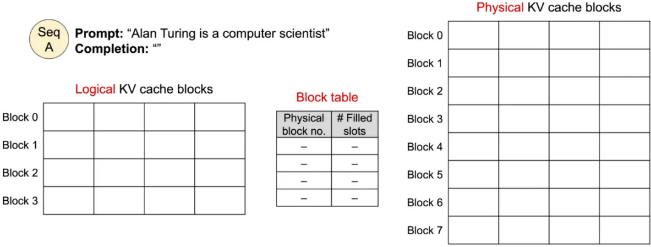
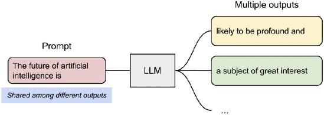
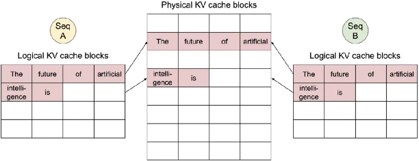
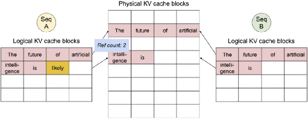
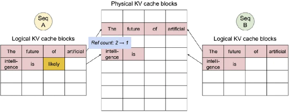
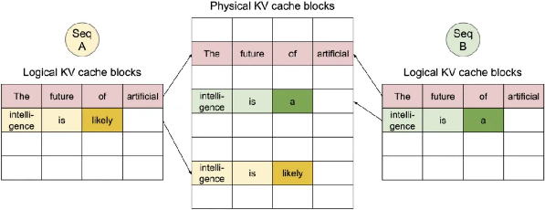
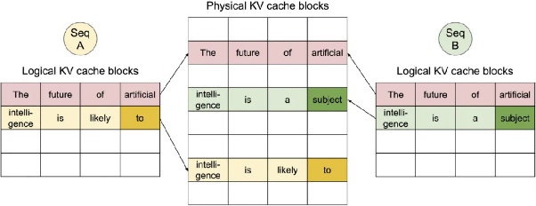
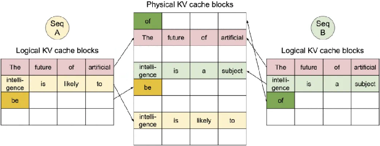
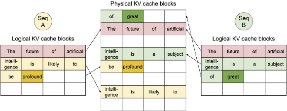

# LLM 推理 & 服务

> 原文作者：幻影星全能的木豆  
> 原文链接：https://www.cnblogs.com/mudou/p/18373214  
> 发布时间：2024-08-22 10:11

---

## vLLM

加州大学伯克利分校的研究者开源了一个项目 vLLM，该项目主要用于快速 LLM 推理和服务。

`vLLM 的核心是 PagedAttention，这是一种新颖的注意力算法`，它将在操作系统的虚拟内存中分页的经典思想引入到 LLM 服务中。

配备了 PagedAttention 的 vLLM 将 LLM 服务状态重新定义：它比 HuggingFace Transformers 提供高达 24 倍的吞吐量，而无需任何模型架构更改。

总结而言，vLLM 具有如下特点：

  * 最先进的服务吞吐量；

  * PagedAttention 可以有效的管理注意力的键和值；

  * 动态批处理请求；

  * 优化好的 CUDA 内核；

  * 与流行的 HuggingFace 模型无缝集成；

  * 高吞吐量服务与各种解码算法，包括并行采样、beam search 等等；

  * 张量并行以支持分布式推理；

  * 流输出；

  * 兼容 OpenAI 的 API 服务。

vLLM 还可以无缝支持许多 Huggingface 模型，包括以下架构：

  * GPT-2 (gpt2、gpt2-xl 等)；
  * GPTNeoX (EleutherAI/gpt-neox-20b、databricks/dolly-v2-12b、stabilityai/stablelm-tuned-alpha-7b 等)；
  * LLaMA (lmsys/vicuna-13b-v1.3、young-geng/koala、openlm-research/open_llama_13b 等)
  * OPT (facebook/opt-66b、facebook/opt-iml-max-30b 等)。

### PagedAttention：解决内存瓶颈

在自回归解码过程中，所有输入到 LLM 的 token 会产生注意力键和值的张量，这些张量保存在 GPU 内存中以生成下一个 token。这些缓存键和值的张量通常被称为 KV 缓存，其具有：

  * 内存占用大：在 LLaMA-13B 中，缓存单个序列最多需要 1.7GB 内存；
  * 动态且不可预测：KV 缓存的大小取决于序列长度，这是高度可变和不可预测的。因此，这对有效地管理 KV 缓存挑战较大。该研究发现，由于碎片化和过度保留，现有系统浪费了 60% - 80% 的内存。

为了解决这个问题，该研究引入了 PagedAttention，这是一种受操作系统中虚拟内存和分页经典思想启发的注意力算法。

与传统的注意力算法不同，PagedAttention 允许在非连续的内存空间中存储连续的键和值。

具体来说，`PagedAttention 将每个序列的 KV 缓存划分为块，每个块包含固定数量 token 的键和值`。

在注意力计算期间，PagedAttention 内核可以有效地识别和获取这些块。

因为块在内存中不需要连续，因而可以用一种更加灵活的方式管理键和值，序列的连续逻辑块通过块表映射到非连续物理块中。物理块在生成新 token 时按需分配。

`生成前：` 输入序列 "Alan Turing is a computer scientist"



在 PagedAttention 中，内存浪费只会发生在序列的最后一个块中。这使得在实践中可以实现接近最佳的内存使用，仅浪费不到 4 %。这种内存效率的提升被证明非常有用，允许系统将更多序列进行批处理，提高 GPU 使用率，显著提升吞吐量。

PagedAttention 还有另一个关键优势 —— `高效的内存共享`。例如在`并行采样`中，多个输出序列是由同一个提示（prompt）生成的。在这种情况下，提示的计算和内存可以在输出序列中共享。

`并行采样示例`



PagedAttention 自然地通过其块表来启动内存共享。

与进程共享物理页面的方式类似，**PagedAttention 中的不同序列可以通过将它们的逻辑块映射到同一个物理块的方式来共享块** 。

  1. `共享Prompt：将逻辑块映射到相同的物理块`



  2. `序列A生成第一个token，物理块的引用技术`



  3. `由于序列A生成了新的token，也需要同步更新存储到物理块中，这个时候会对物理块进行写入，但此时物理块的共享的，会发生写时复制，同时物理块的引用计数-1`



  4. `序列B生成新的token，这是物理块的引用计数为1，不需要再次复制，直接在原物理块写入新生成的token`



  5. `序列A和序列B生成第二个token，可以看到这时两个序列的第一个逻辑块还是共享的`



  6. `序列A和序列B生成第三个token，当物理块写满后，会寻找新的空闲的物理块写入`



  7. `序列A和序列B生成第四个token`



PageAttention 的内存共享大大减少了复杂采样算法的内存开销，例如并行采样和集束搜索的内存使用量降低了 55%。这可以转化为高达 2.2 倍的吞吐量提升。这种采样方法也在 LLM 服务中变得实用起来。

PageAttention 成为了 vLLM 背后的核心技术。vLLM 是 LLM 推理和服务引擎，为各种具有高性能和易用界面的模型提供支持。

### vLLM 的安装与使用

`pip install vllm`

vLLM 可以用于离线推理和在线服务。在使用 vLLM 进行离线推理任务时，你需要导入 vLLM 并在 Python 脚本中使用 LLM 类。

```python
from vllm import LLM

prompts = ["Hello, my name is", "The capital of France is"]  # Sample prompts.
llm = LLM (model="lmsys/vicuna-7b-v1.3")  # Create an LLM.
outputs = llm.generate (prompts)  # Generate texts from the prompts.
```

在使用 vLLM 进行在线服务时，你可以通过以下命令启动一个兼容 OpenAI API 的服务器。

`python -m vllm.entrypoints.openai.api_server --model lmsys/vicuna-7b-v1.3`

还可以利用与 OpenAI API 相同的格式来查询服务器

```bash
curl http://localhost:8000/v1/completions \
  -H "Content-Type: application/json" \
  -d '{
        "model": "lmsys/vicuna-7b-v1.3",
        "prompt": "San Francisco is a",
        "max_tokens": 7,
        "temperature": 0
      }'
```