# FlashAttention 小白详解（完整版）：从标准注意力到 FlashAttention 1/2/3

> 本文是对 July 博客《通透理解 FlashAttention（含其 2 代和第 3 代）：全面降低显存读写、加快计算速度》的重写与扩写，面向零基础的小白，目标是**让你一步一步、不卡壳地彻底搞懂 FlashAttention**。
>
> - 原文地址：https://blog.csdn.net/v_JULY_v/article/details/133619540
> - 所有数学公式均用 LaTeX 给出，并逐个解释符号含义；原文示意图已下载到本地 `assets/flashattention/` 目录，随文插入。
>
> **全文结构（建议按顺序读）：**
> - 第 0 章：把所有名词一次讲清楚（看不懂随时回来查）
> - 第一部分：Transformer 的时空复杂度与标准注意力的问题（FlashAttention 要解决什么）
> - 第二部分：FlashAttention 第 1 代（kernel 融合、分块计算、23 个公式、前向算法）
> - 第三部分：FlashAttention 2（更好的并行与工作划分）
> - 第四部分：FlashAttention 3（异步与低精度）
> - 结尾：性能对比、参考文献、自测题

---

# 第 0 章 名词速查表

小白看技术文章最痛苦的事，就是文章默认你什么都懂。我们先把后面会反复出现的名词全部讲清楚。

| 名词 | 通俗解释 |
| --- | --- |
| **token（词元）** | 模型处理文本的最小单位，可以简单理解成"一个词或一个字"。一句话被切成多少个 token，长度就是多少。 |
| **序列长度 $N$** | 一次喂给模型的 token 个数（sequence length）。比如输入一篇 2000 个 token 的文章，$N=2000$。 |
| **隐藏维度 $d$** | 每个 token 在模型内部用一个长度为 $d$ 的向量（一串数字）表示，$d$ 就是这串数字的长度，比如 768、4096。 |
| **批次大小 $b$** | batch size，一次同时处理多少条序列。 |
| **层数 $l$** | Transformer 由 $l$ 个结构相同的层堆叠而成，$l$ 就是层数，比如 12、32、96。 |
| **注意力头数 $a$（或 $h$）** | 一个注意力层里有多个"头"并行工作，每个头从不同角度看 token 之间的关系。 |
| **显存** | GPU 上的内存，用来放模型和数据。下文的 **HBM** 就是显存。 |
| **HBM** | High Bandwidth Memory，高带宽内存，即"显存"，容量大（40GB、80GB），但相对慢。 |
| **SRAM** | GPU 芯片内部的一小块超高速内存，速度极快但容量极小（A100 上总共约 20MB）。 |
| **FLOPs** | Floating Point Operations，浮点运算次数，用来衡量计算量。 |
| **wall-clock time** | 挂钟时间，程序实际跑了多久（秒表测的时间），和理论计算量不是一回事。 |
| **kernel（核函数）** | GPU 上实际执行的一段计算程序。CPU 把任务派发给 GPU，GPU 一次执行一个 kernel。 |
| **中间激活（activation）** | 前向计算过程中产生、为反向传播算梯度而必须保存的中间结果，训练时很占显存。 |
| **softmax** | 把一串任意数字变成一组"概率"的函数：每个值都落在 0~1 之间，且全部加起来等于 1。 |
| **IO 感知（IO-aware）** | 设计算法时不仅关心"算多少次"，还关心"数据在显存和高速内存之间搬了多少次"。 |
| **SM（流式多处理器）** | GPU 里真正干活的计算单元，一块 A100 有 108 个 SM。 |
| **warp（线程束）** | SM 里最基本的调度单位，一个 warp 通常包含 32 个一起执行的线程。 |

**贯穿全文的计数约定（务必记住）：**

> 两个矩阵相乘，若第一个是 $m\times k$、第二个是 $k\times n$，标准计算量记为 $2mkn$。
> 为什么有个 2？输出矩阵有 $m\times n$ 个元素，每个元素要做 $k$ 次乘法（共 $mkn$ 次）和 $k$ 次加法（共 $mkn$ 次），合起来 $2mkn$。也有些书只算乘法记成 $mkn$，本文乘加都算，用 $2mkn$。

---

# 第一部分 Transformer 的时空复杂度与标准注意力的问题

## 1.1 故事的起点：长上下文为什么这么难？

2023 年，原文作者带着团队做"论文审稿 GPT"项目：想让大模型像审稿人一样审阅学术论文。这就遇到一个绕不开的难题——**学术论文太长了**。一篇论文基本都在上万个 token，而当时主流大模型能处理的最大序列长度大多只有 2048 或 4096，连一篇完整论文都装不下。

当时各模型的上下文长度大致是：

| 模型 | 上下文长度 |
| --- | --- |
| GPT-3.5 | 4K~16K |
| GPT-4 | 8K~32K（后来升级到 128K） |
| LLaMA | 2048 |
| LLaMA 2 | 4096 |
| Baichuan（百川）-7B/13B | 4096 |
| ChatGLM-6B | 2048 |
| ChatGLM2-6B | 8K~32K |

你可能会问：**把上下文长度从 2K 调到 100K，不就是改个数字吗？**

难就难在：**Transformer 的计算量和显存占用，都会随序列长度 $N$ 平方级增长。** 长度翻一倍，注意力部分的计算量和显存涨到原来的四倍；翻十倍，就涨到一百倍。这就是 $O(N^2)$ 复杂度。

## 1.2 FlashAttention 是什么？

2022 年，斯坦福大学联合纽约州立大学的团队提出 **FlashAttention**：

- 作者：Tri Dao、Daniel Y. Fu、Stefano Ermon、Atri Rudra、Christopher Ré；
- 论文：*FlashAttention: Fast and Memory-Efficient Exact Attention with IO-Awareness*；
- 代码：https://github.com/Dao-AILab/flash-attn

它是一种**IO 感知、又快又省显存的注意力算法**。两个关键词：

1. **Exact（精确）**：算出来的结果和标准注意力**数学上完全等价**，不是近似，只是换了计算顺序和方式。
2. **IO-Awareness（IO 感知）**：精心安排数据在 GPU 各级内存间的搬运，把大量计算压缩在高速小内存里完成。

LLaMA、Falcon 等模型都使用了 FlashAttention 加速；PyTorch 2.0 已把它官方集成。

要理解它为什么厉害，得先算清两笔账：**计算量（时间复杂度）**和**显存占用（空间复杂度）**。

## 1.3 Transformer 的计算复杂度

### 1.3.1 先建立直觉：为什么是"平方"？

从最简单的矩阵乘法开始。设两个矩阵：

- $A$ 大小 $N\times d$；
- $B$ 大小 $d\times N$。

矩阵乘法规则：**拿 $A$ 的每一行，与 $B$ 的每一列做"点乘"（对应位置相乘再相加）。**

- $A$ 有 $N$ 行、$B$ 有 $N$ 列，共要做 $N^2$ 次点乘；
- 每次点乘要做 $d$ 次乘法、$d$ 次加法；
- 总计算量：

$$
2N^2d
$$

下图很直观地展示了这一过程：

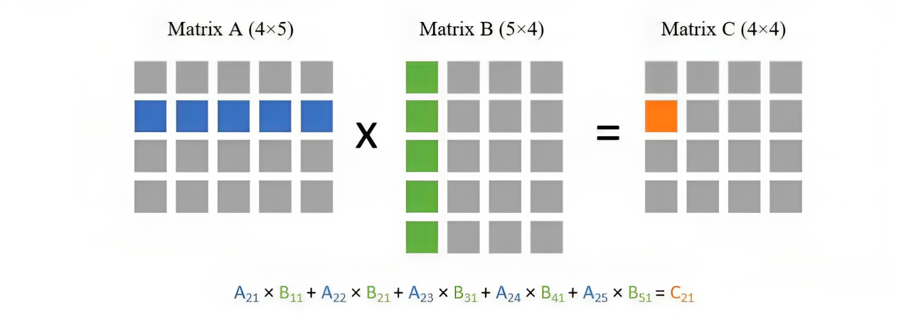

看到 $N^2$ 了吗？只要计算中出现"$N$ 个向量两两之间都要算一次"的结构，就会冒出 $N^2$。注意力里恰好有这一步：**$N$ 个 token，每个都要和所有 $N$ 个 token 算一次相关度分数**，分数矩阵就是 $N\times N$ 的。

### 1.3.2 一个 Transformer 层里有什么？

一个模型由 $l$ 个相同的层堆叠，每层有两大块：**Self-Attention（自注意力）块** 和 **MLP（前馈网络）块**。下面设批次大小 $b$、序列长度 $N$、隐藏维度 $d$。

### 1.3.3 Self-Attention 层的计算量

一个标准多头自注意力层内部要做 **4 次矩阵乘法**（softmax 等逐点运算开销较小，先忽略）。

**第 1 步：计算 $Q,K,V$**

输入 $x$ 分别乘三个权重矩阵：

$$
Q=xW_Q,\qquad K=xW_K,\qquad V=xW_V
$$

形状变化：

$$
[b,N,d]\times[d,d]\rightarrow[b,N,d]
$$

一个投影的计算量（$m=bN,k=d,n=d$）是 $2bNd^2$；三个投影共：

$$
3\times 2bNd^2=6bNd^2
$$

> **小白提示**：把批次想成 $b$ 个独立的 $N\times d$ 小矩阵，各自独立地和同一个 $d\times d$ 权重相乘。一个小矩阵算 $2Nd^2$，$b$ 个就是 $2bNd^2$。

**第 2 步：注意力分数 $S=QK^\top$**

$$
[b,N,d]\times[b,d,N]\rightarrow[b,N,N]
$$

计算量（$m=bN,k=d,n=N$）：

$$
2bN^2d
$$

**这里的 $N^2$ 就是注意力"平方复杂度"的罪魁祸首。**

**第 3 步：softmax 后乘 $V$**

$$
P=\operatorname{softmax}\left(\frac{S}{\sqrt{d}}\right),\qquad O_{\text{att}}=PV
$$

$$
[b,N,N]\times[b,N,d]\rightarrow[b,N,d]
$$

计算量：

$$
2bN^2d
$$

**第 4 步：输出线性映射 $W_O$**

$$
[b,N,d]\times[d,d]\rightarrow[b,N,d]
$$

计算量：

$$
2bNd^2
$$

**Attention 层合计**：

$$
\underbrace{6bNd^2}_{Q/K/V}+\underbrace{2bN^2d}_{QK^\top}+\underbrace{2bN^2d}_{PV}+\underbrace{2bNd^2}_{W_O}
=\boxed{8bNd^2+4bN^2d}
$$

### 1.3.4 MLP 层的计算量

MLP 块由两个线性层组成，通常先把维度放大 4 倍（$d\to4d$）再压回（$4d\to d$）：

$$
x_{\text{mlp}}=f_{\text{GELU}}\left(x_{\text{att}}W_1\right)W_2+x_{\text{att}}
$$

- 第一层 $[d,4d]$：$[b,N,d]\times[d,4d]\to[b,N,4d]$，计算量 $2\cdot bN\cdot d\cdot4d=8bNd^2$；
- 第二层 $[4d,d]$：$[b,N,4d]\times[4d,d]\to[b,N,d]$，计算量 $2\cdot bN\cdot4d\cdot d=8bNd^2$。

合计：

$$
\boxed{16bNd^2}
$$

### 1.3.5 每层总计算量

$$
(8bNd^2+4bN^2d)+16bNd^2=\boxed{24bNd^2+4bN^2d}
$$

### 1.3.6 最后的 logits（输出层）

设词表大小为 $V$。输出层把维度 $d$ 映射到 $V$：

$$
[b,N,d]\times[d,V]\rightarrow[b,N,V]
$$

计算量：

$$
\boxed{2bNdV}
$$

> 输出层权重通常与最开始的**词嵌入矩阵参数共享**：词嵌入是 $[V,d]$，输出层是 $[d,V]$，二者用同一套参数，可减少参数量。

### 1.3.7 整个模型一次迭代的计算量

$$
\boxed{l\left(24bNd^2+4bN^2d\right)+2bNdV}
$$

**盯着公式看 10 秒**：唯一和 $N^2$ 有关的项是 $4bN^2d$，它完全来自 Attention 块，MLP 只有 $N$ 的一次方。

## 1.4 Transformer 的空间复杂度

### 1.4.1 为什么要保存"中间激活"？

训练 = 前向算结果 + 反向算梯度。反向传播要用到前向的中间结果，所以它们必须保存在显存里。混合精度训练中，激活一般是 float16/bfloat16，**每个数占 2 字节**；例外是 dropout 的 mask（只记 0/1），每数 1 字节。下面单位都是字节。

### 1.4.2 Self-Attention 块的中间激活

回顾公式：

$$
Q=xW_Q,\ K=xW_K,\ V=xW_V,\qquad
x_{\text{out}}=\operatorname{softmax}\left(\frac{QK^\top}{\sqrt d}\right)VW_O+x
$$

沿计算顺序：

1. 算 $Q,K,V$ 前保存共同输入 $x$（$[b,N,d]$）：$2bNd$；
2. 算 $QK^\top$ 前保存 $Q,K$（两个 $[b,N,d]$）：$4bNd$；
3. 算 softmax 前保存输入 $QK^\top$（多头下形状 $[b,a,N,N]$，共 $bN^2a$ 个数）：$2bN^2a$；
4. softmax 后 dropout 的 mask（形状 $[b,a,N,N]$，每数 1 字节）：$bN^2a$；
5. 算"权重乘 $V$"保存权重（$2bN^2a$）和 $V$（$2bNd$）：$2bN^2a+2bNd$；
6. 输出映射 + dropout：保存输入（$2bNd$）+ mask（$bNd$）：$3bNd$。

> **为什么是 $N^2$？** 每个 token 对其他 $N$ 个 token 各有一个权重，一个 token 有 $N$ 个，$N$ 个 token 就是 $N^2$；每个注意力头都有一整张，再乘头数 $a$、批次 $b$ 和每元素 2 字节。

**Attention 块合计**：

$$
(2+4+2+3)bNd+(2+1+2)bN^2a=\boxed{11bNd+5bN^2a}
$$

### 1.4.3 MLP 块的中间激活

1. 第一层输入（维度 $d$）：$2bNd$；
2. 激活函数输入（维度 $4d$）：$8bNd$；
3. 第二层输入（维度 $4d$）：$8bNd$；
4. dropout mask：$bNd$。

合计：

$$
\boxed{19bNd}
$$

### 1.4.4 两个 LayerNorm

每个 LayerNorm 保存输入 $2bNd$，两个：

$$
\boxed{4bNd}
$$

### 1.4.5 每层、整个模型的中间激活

$$
(11bNd+5bN^2a)+19bNd+4bNd=\boxed{34bNd+5bN^2a}
$$

$l$ 层近似为：

$$
\boxed{l\left(34bNd+5bN^2a\right)}
$$

再一次看到：**显存里唯一的平方项 $5bN^2a$，也完全来自注意力。**

## 1.5 标准注意力的两大问题

### 1.5.1 回顾标准注意力

最经典的注意力公式：

$$
\operatorname{Attention}(Q,K,V)=\operatorname{softmax}\left(\frac{QK^\top}{\sqrt d}\right)V
$$

其中 $Q,K,V\in\mathbb{R}^{N\times d}$，输出 $O\in\mathbb{R}^{N\times d}$。拆成三步：

$$
S=QK^\top\in\mathbb{R}^{N\times N}
$$

$$
P=\operatorname{softmax}(S)\in\mathbb{R}^{N\times N}
$$

$$
O=PV\in\mathbb{R}^{N\times d}
$$

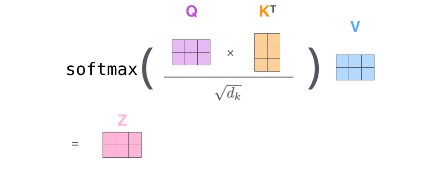

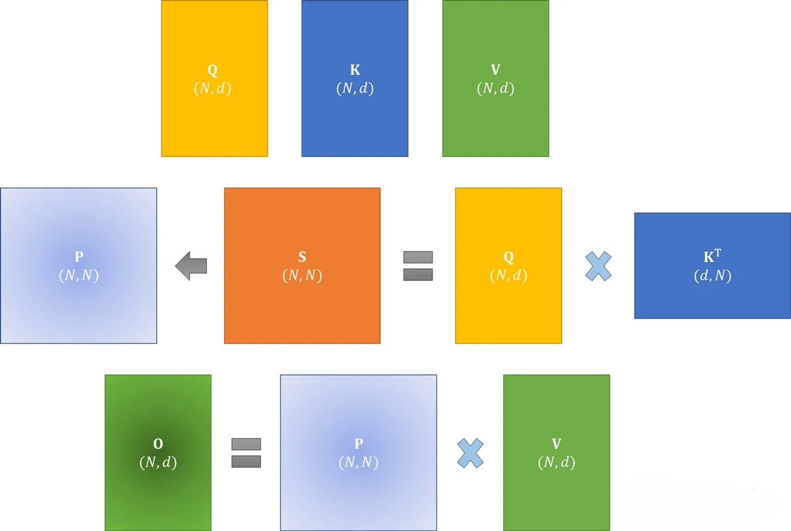

### 1.5.2 问题一：显存占用多

标准实现里，两个 $N\times N$ 大矩阵 $S$、$P$ 都会被**实打实地实例化**并写进显存：

- 存 $S,P$ 需 $O(N^2)$；
- 存 $Q,K,V,O$ 只需 $O(Nd)$。

通常 $N\gg d$（如 GPT-2 中 $N=1024$、单头维度 $d=64$），注意力矩阵的内存远大于 $Q,K,V,O$。

### 1.5.3 问题二：HBM 读写次数多

三步在 GPU 上是**三个独立 kernel** 依次执行，每个都要走"从 HBM 读 → 算 → 写回 HBM"：

- **第一行 $S=QK^\top$**：读 $Q$、读 $K$（2 次读），写 $S$（1 次），共 **3**；
- **第二行 $P=\operatorname{softmax}(S)$**：读 $S$，写 $P$，共 **2**；
- **第三行 $O=PV$**：读 $P$、读 $V$，写 $O$，共 **3**。

合计：

$$
3+2+3=\boxed{8\text{ 次 HBM 读写}}
$$

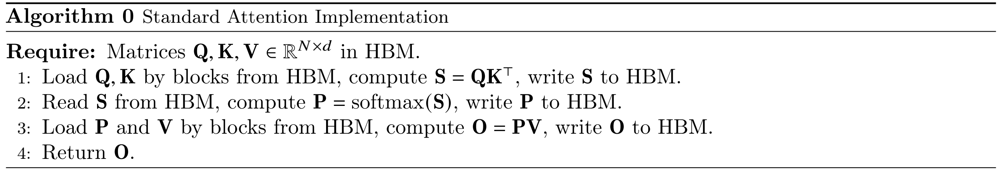

### 1.5.4 关键背景：GPU 内存分级

GPU 内存由"小而快"和"大而慢"的多级组成，**内存越小，速度越快**。以 A100-40GB 为例：

**① SRAM（片上高速内存）**

- 分布在 108 个 SM 上，每个 192KB，共约 $192\text{KB}\times108\approx20\text{MB}$；
- 速度约 **19 TB/s**；
- 特点：极快，但只有约 20MB。

**② HBM（显存）**

- 容量 **40GB**；
- 速度约 **1.5 TB/s**，不到 SRAM 十分之一；
- 特点：装得下整个模型，但读写慢。

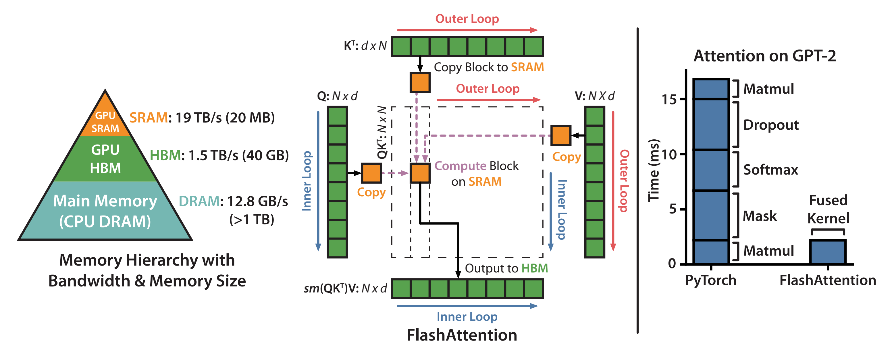

打个比方：**SRAM 像办公桌桌面**（手一伸就拿到，但面积小）；**HBM 像隔壁房间的大书柜**（能装所有书，但取书要走路）。

### 1.5.5 瓶颈往往不是"算"，而是"搬数据"

现代 GPU 中，**计算速度远超显存访问速度**。

- 两个大矩阵乘法（$QK^\top$、$PV$）计算量巨大，专用单元（张量核心）满负荷，叫**计算受限（compute-bound）**；
- softmax、mask、dropout 等**逐点运算**，时间主要花在数据读写上，叫**内存受限（memory-bound）**。

对内存受限的操作，**决定运行时间的不是 FLOPs，而是数据在 HBM 上搬了多少趟**。这也解释了为什么很多"近似注意力"（稀疏、低秩）把计算量降到线性却没流行——它们只减 FLOPs，**忽略了内存访问开销，挂钟时间没减少**。

### 1.5.6 两大问题总结

1. **显存占用多**：实例化完整的 $N\times N$ 矩阵 $S,P$，需 $O(N^2)$；
2. **HBM 读写次数多**：共 8 次大矩阵往返，搬运占用大部分时间。

接下来：**Memory-efficient Attention** 解决问题一（显存降到线性），**FlashAttention** 进一步解决问题二（减少 HBM 读写）。

## 1.6 Memory-efficient Attention：显存先降到线性

### 1.6.1 难点：softmax 把行内元素耦合在一起

想省显存，最自然的想法是：不存整个 $N\times N$ 矩阵，算一个、用一个、丢掉。但 softmax 要求先知道**整行**的分母：

$$
\operatorname{softmax}(S_{ij})=\frac{e^{S_{ij}}}{\sum_{k=1}^{N}e^{S_{ik}}}
$$

它把一行的元素耦合在一起。解决办法是：**把归一化因子（分母）单独先算出来**。

### 1.6.2 第一步：单独算归一化因子

暂时忽略"减去最大值"。记 $q_i,k_j,v_j$ 分别为 $Q,K,V$ 的第 $i,j$ 行（列向量）：

$$
S_{ij}=q_i^\top k_j\in\mathbb{R}
$$

定义第 $i$ 行的归一化因子：

$$
L_i=\sum_{j=1}^{N}e^{q_i^\top k_j}\in\mathbb{R}
$$

$L_i$ 只是一个数，扫一遍 $K$ 累加即可得到，不需要保存整个 $S$。

### 1.6.3 第二步：边算边累加输出

$$
o_i=\sum_{j=1}^{N}P_{ij}v_j=\sum_{j=1}^{N}\frac{e^{q_i^\top k_j}}{L_i}v_j
$$

有了 $L_i$，再扫一遍 $K,V$，对每个 $j$ 现算权重、乘 $v_j$、累加、丢掉中间权重。

### 1.6.4 效果与局限

- **显存**：不再保存完整的 $S,P$，复杂度从 $O(N^2)$ 降到 $\boxed{O(N)}$；
- **但 HBM 访问次数没减少**：仍是多个独立 kernel，仍要反复把 $K,V$ 读进来，访问次数仍是 $O(N^2)$，运行时间基本没变。

这种方法又叫 **"lazy softmax"**（论文 *Online normalizer calculation for softmax*、*Self-attention Does Not Need $O(n^2)$ Memory*）。它解决了显存，却没解决慢。要同时解决两个问题，必须让数据尽量**待在高速 SRAM 里、把多个操作融合进一个 kernel**——这就是 FlashAttention。

---

# 第二部分 FlashAttention：通过 kernel 融合降低 HBM 读写

## 2.1 核心思想：kernel 融合

前面说过：

1. 标准注意力性能主要受内存带宽限制，频繁从 HBM 读写 $N\times N$ 矩阵是主要瓶颈；
2. 近似注意力只减 FLOPs，减不了数据搬运时间；
3. FlashAttention 是 IO 感知的，目标是**避免频繁读写 HBM**。

对内存受限操作，最常用的加速方式就是 **kernel 融合**，典型三步：

1. 把输入数据从低速 HBM 加载到高速 SRAM；
2. 在 SRAM 里完成所有计算；
3. 最后把结果从 SRAM 写回 HBM。

这样就把多个操作融合成一个，**减少读写 HBM 的次数**。

原理用两句话就能说清：

1. 如果把数据从 SRAM 写回 HBM，只是为了马上又读回来算 softmax；
2. 那完全可以让它一直留在 SRAM 里，做完所有中间步骤，最后再把最终结果写回 HBM。

下图左侧是融合前（数据反复进出 HBM），右侧是融合后（数据一次性进 SRAM、做完再出去）：

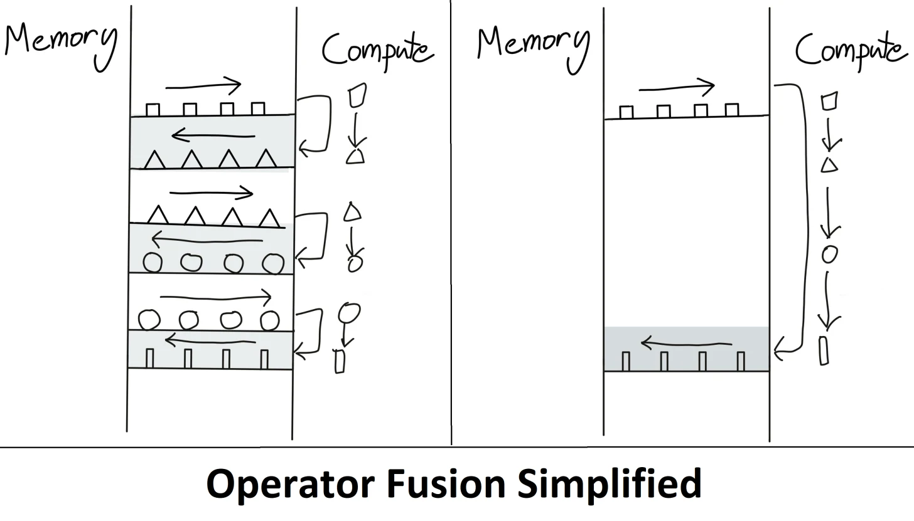

## 2.2 分块计算（tiling）：SRAM 太小，必须切块

### 2.2.1 为什么要分块

kernel 融合虽好，但 **SRAM 只有约 20MB，不可能一次装下整个注意力**。所以必须分块，使每块所需内存不超过 SRAM：

$$
\text{内存受限}\to\text{减少 HBM 读写}\to\text{kernel 融合}\to\text{满足 SRAM 大小}\to\text{分块计算}
$$

分块太大就会 OOM。分块（tiling）使我们能用**一个 CUDA kernel** 完成注意力的全部操作：从 HBM 加载数据，在 SRAM 里依次做矩阵乘法、mask、softmax、dropout、矩阵乘法，再写回 HBM。

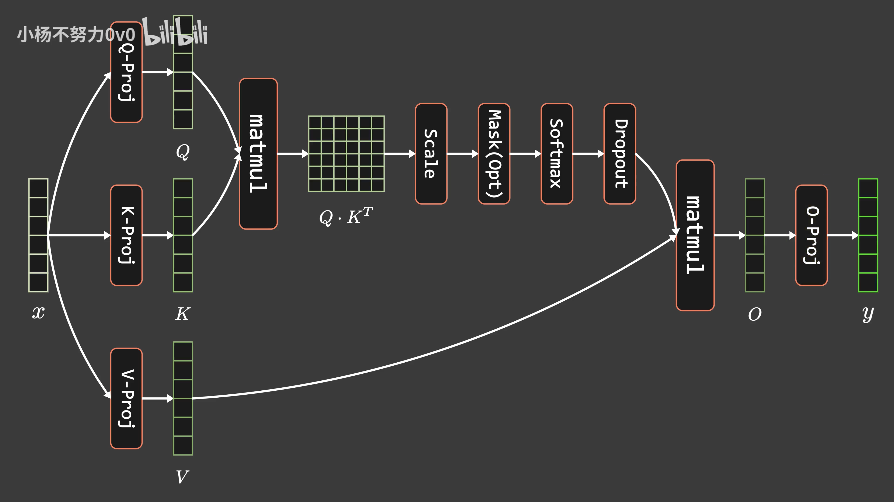

### 2.2.2 难点：softmax 的分块

注意力流程是"矩阵乘法 → scale → mask → softmax → dropout → 矩阵乘法"。矩阵乘法和逐点操作（scale、mask、dropout）都容易分块，**唯独 softmax 难**：计算归一化分母时，需要拿到完整的一行数据。

### 2.2.3 回顾 softmax 与 safe softmax

对向量 $x=[x_1,x_2,\dots,x_d]$，原生 softmax：

$$
\operatorname{softmax}(x_i)=\frac{e^{x_i}}{\sum_{j=1}^{d}e^{x_j}}
$$

硬件中浮点数表示范围有限：当 $x$ 较大（如 float32 下 $x\gtrsim89$）时，$e^x$ 会变成 $\inf$（上溢）。为保证数值稳定，通常先"减去最大值"，称为 **safe softmax**。定义最大值：

$$
m(x)=\max\left([x_1,x_2,\dots,x_d]\right)
$$

于是：

$$
\operatorname{softmax}(x_i)=\frac{e^{x_i-m(x)}}{\sum_{j=1}^{d}e^{x_j-m(x)}}
$$

减去 $m(x)$ 后，指数上的数都 $\le0$，$e$ 的幂不会超过 1，从而避免上溢。

训练语言模型常用交叉熵损失，它等价于先做 log_softmax 再算负对数似然，同样要减最大值：

$$
\log(\operatorname{softmax}(x_i))
=x_i-m-\log\left(\sum_{j=1}^{d}e^{x_j-m}\right)
$$

要算第 $i$ 个 token 对其他 token 的关注程度，需要在 SRAM 里随时拿到所有这些分数，但 SRAM 容量有限，$N$ 可以是几千、几十万，$N^2$ 会爆炸。

### 2.2.4 解法：引入两个统计量

FlashAttention 引入两个额外统计量来给 softmax 解耦：

- $m(x)$：当前的**最大分数**；
- $\ell(x)$：当前的 **EXP 分数总和**。

这样就能一块一块地增量计算。

**为什么只存这两个量，而不是整个 $S,P$？** 因为反向传播需要用到前向的中间结果。FlashAttention 干脆**不保存巨大的 $S,P$ 矩阵，只保存两个统计量**；反向传播时在高速 SRAM 里快速**重计算（recomputation）**出 $S,P$。相比从 HBM 读取巨大的中间矩阵，重算反而快得多。

最终 FlashAttention 既把显存从 $O(N^2)$ 降到 $O(N)$，又通过 kernel 融合 + 分块大幅减少 HBM 访问；虽因重算增加了少量 FLOPs，但挂钟时间显著缩短。

## 2.3 23 个公式彻底搞懂分块 softmax

下面我们用一个"把向量切成两半"的简化模型，一步步推导出"局部 softmax 如何更新成全局 softmax"。这是全篇最硬核的一节，**请放慢速度**。

### 2.3.1 三个总览公式

$$
\text{(1)}\quad S=QK^\top\in\mathbb{R}^{N\times N}
$$

$$
\text{(2)}\quad P=\operatorname{softmax}(S)\in\mathbb{R}^{N\times N}
$$

$$
\text{(3)}\quad O=PV\in\mathbb{R}^{N\times d}
$$

### 2.3.2 基础公式（对整个向量）

设有向量 $x=[x_1,x_2,\dots,x_d]$。

$$
\text{(4)}\quad \operatorname{softmax}(x_i)=\frac{e^{x_i}}{\sum_{j=1}^{d}e^{x_j}}
$$

其中分子 $e^{x_i}$ 对第 $i$ 个元素取指数；分母是所有元素指数之和，保证输出是概率分布（总和为 1）。

$$
\text{(5)}\quad m(x)=\max\left([x_1,x_2,\dots,x_d]\right)
$$

$$
\text{(6)}\quad f(x)=\left[\,e^{x_1-m(x)},\ \dots,\ e^{x_d-m(x)}\,\right]
$$

$f(x)$ 是一个新向量：每一项都在指数上减去了全局最大值 $m(x)$。

$$
\text{(7)}\quad \ell(x)=\sum_{i}f(x)_i
$$

$\ell(x)$ 是 softmax 分母里的求和项，我们称之为 **"EXP 求和项"**。

$$
\text{(8)}\quad \operatorname{softmax}(x)=\frac{f(x)}{\ell(x)}
$$

### 2.3.3 把向量切成两半

考虑一个长度为 $2d$ 的向量，切成两块：

$$
x=[x^{(1)},x^{(2)}],\qquad x^{(1)},x^{(2)}\in\mathbb{R}^{d}
$$

$x^{(1)}$ 是前半，$x^{(2)}$ 是后半。假设先处理 $x^{(1)}$，用公式 (5)~(8) 算它的**局部**结果：

$$
\text{(9)}\quad m(x^{(1)})=\max\left([x_1^{(1)},\dots,x_d^{(1)}]\right)
$$

$$
\text{(10)}\quad f(x^{(1)})=\left[\,e^{x_1^{(1)}-m(x^{(1)})},\dots,e^{x_d^{(1)}-m(x^{(1)})}\,\right]
$$

$$
\text{(11)}\quad \ell(x^{(1)})=\sum_{i}f(x^{(1)})_i
$$

$$
\text{(12)}\quad \operatorname{softmax}(x^{(1)})=\frac{f(x^{(1)})}{\ell(x^{(1)})}
$$

为什么说它是"局部"的？两个原因：

1. 公式 (10) 指数里减的应该是**整个向量**的最大值 $m(x)$，而不是子块的 $m(x^{(1)})$；
2. 公式 (12) 分母应该是**整个向量**的 EXP 求和，而不只是 $x^{(1)}$ 的求和。

处理完 $x^{(1)}$，我们保存两个标量 $m(x^{(1)})$、$\ell(x^{(1)})$（比保存整个子块省得多），并初始化两个全局标量：

$$
m_{\max}=m(x^{(1)}),\qquad \ell_{\text{all}}=\ell(x^{(1)})
$$

接着同样处理 $x^{(2)}$：

$$
\text{(13)}\quad m(x^{(2)})=\max\left([x_1^{(2)},\dots,x_d^{(2)}]\right)
$$

$$
\text{(14)}\quad f(x^{(2)})=\left[\,e^{x_1^{(2)}-m(x^{(2)})},\dots,e^{x_d^{(2)}-m(x^{(2)})}\,\right]
$$

$$
\text{(15)}\quad \ell(x^{(2)})=\sum_{i}f(x^{(2)})_i
$$

$$
\text{(16)}\quad \operatorname{softmax}(x^{(2)})=\frac{f(x^{(2)})}{\ell(x^{(2)})}
$$

这同样是局部的。

### 2.3.4 更新两个全局统计量

$$
\text{(17)}\quad m_{\max}^{\text{new}}=\max\left([m_{\max},\,m(x^{(2)})]\right)
$$

含义：新的全局最大值，就是"旧最大值"和"第二块最大值"中更大的那个。

$$
\text{(18)}\quad \ell_{\text{all}}^{\text{new}}
=e^{m_{\max}-m_{\max}^{\text{new}}}\ell_{\text{all}}
+e^{m(x^{(2)})-m_{\max}^{\text{new}}}\ell(x^{(2)})
$$

**这个公式怎么来的？** 直觉上你可能以为是 $\ell_{\text{all}}+\ell(x^{(2)})$，但两个局部求和项所减的最大值不一样，不能直接相加。先看怎么把一个局部求和项"修正"成全局的。

把 (15) 展开：

$$
\text{(19)}\quad \ell(x^{(2)})=\sum_{i}e^{x_i^{(2)}-m(x^{(2)})}
$$

它之所以是局部的，是因为减的是局部最大值 $m(x^{(2)})$。只要把它换成全局最大值即可：

$$
\text{(20)}\quad
\begin{aligned}
\ell^{\text{new}}(x^{(2)})
&=\ell(x^{(2)})\cdot e^{m(x^{(2)})-m_{\max}^{\text{new}}}\\
&=\sum_{i}e^{x_i^{(2)}-m(x^{(2)})}\cdot e^{m(x^{(2)})-m_{\max}^{\text{new}}}\\
&=\sum_{i}e^{x_i^{(2)}-m_{\max}^{\text{new}}}
\end{aligned}
$$

这给出了一个**关键结论**：

> 要把某个局部求和项更新为全局的，只需给它乘一个修正系数
> $\displaystyle e^{m-m_{\max}^{\text{new}}}$，其中 $m$ 是它当前对应的（局部）最大值，$m_{\max}^{\text{new}}$ 是当前全局最大值。

回到公式 (18)：它正是先用这个系数分别把 $\ell_{\text{all}}$（对应旧最大值 $m_{\max}$）和 $\ell(x^{(2)})$（对应 $m(x^{(2)})$）修正到同一基准，再相加。

### 2.3.5 更新 softmax 本身

由 (16) 有 $f(x^{(2)})=\operatorname{softmax}(x^{(2)})\cdot\ell(x^{(2)})$。分子分母都是局部的，都要修正。

先修正分子 $f(x^{(2)})$：

$$
\text{(21)}\quad
\begin{aligned}
f^{\text{new}}(x^{(2)})
&=f(x^{(2)})\cdot e^{m(x^{(2)})-m_{\max}^{\text{new}}}\\
&=\left[\,e^{x_1^{(2)}-m_{\max}^{\text{new}}},\dots,e^{x_d^{(2)}-m_{\max}^{\text{new}}}\,\right]
\end{aligned}
$$

再修正分母：把局部分母 $\ell(x^{(2)})$ 换成全局的 $\ell_{\text{all}}^{\text{new}}$：

$$
\text{(22)}\quad
\frac{\operatorname{softmax}(x^{(2)})\cdot\ell(x^{(2)})}{\ell_{\text{all}}^{\text{new}}}
$$

> **常见疑问 1：为什么 (22) 的分母是 $\ell_{\text{all}}^{\text{new}}$，而不是 $\ell^{\text{new}}(x^{(2)})$？**
> 因为 softmax 要为**整个数据流**的每个元素分配概率，使全部概率之和为 1，而不只是给 $x^{(2)}$ 这一块分配。分母必须包含 $x^{(1)}$、$x^{(2)}$ 两块的所有指数。
>
> **常见疑问 2：(20) 里的 $\ell^{\text{new}}(x^{(2)})$ 不是说"全局"吗？**
> 它只是把 $\ell(x^{(2)})$ 换了基准，仍然只包含 $x^{(2)}$ 这一块的数据，不含 $x^{(1)}$。
>
> **常见疑问 3：(19) 和 (20) 都只用 $x^{(2)}$，区别是什么？**
> (19) 减的是局部最大值 $m(x^{(2)})$；(20) 减的是两块的全局最大值 $m_{\max}^{\text{new}}$。参考基准不同，后者保证数值稳定、不会上溢。

最后，结合 (21)、(22)，第二块 softmax 的更新公式是：

$$
\text{(23)}\quad
\operatorname{softmax}^{\text{new}}(x^{(2)})
=\frac{\operatorname{softmax}(x^{(2)})\cdot\ell(x^{(2)})\cdot e^{m(x^{(2)})-m_{\max}^{\text{new}}}}
{\ell_{\text{all}}^{\text{new}}}
$$

更新时只用到了这些额外保存的量：

- 第二块的局部 softmax（来自公式 16）；
- 第二块的局部 EXP 求和 $\ell(x^{(2)})$（来自 15）；
- 第二块的局部最大值 $m(x^{(2)})$（来自 13）；
- 全局最大值 $m_{\max}^{\text{new}}$（来自 17）；
- 全局 EXP 求和 $\ell_{\text{all}}^{\text{new}}$（来自 18）。

把公式里的 $x^{(2)}$ 换成 $x^{(1)}$，就能同样更新第一块。**整个更新过程完全不需要重新读取 $x^{(1)}$、$x^{(2)}$ 的完整向量**，这就是 FlashAttention 动态更新 softmax 的本质。

### 2.3.6 这是一个增量过程

1. 先算一个块的局部 softmax，存起来；
2. 处理完下一块，根据新的全局最大值和全局 EXP 求和，更新旧块的 softmax；
3. 所有块处理完后，它们就都是"全局"的了。

### 2.3.7 分块合并的紧凑写法

对于 $x=[x^{(1)},x^{(2)}]$：

$$
m(x)=\max\left(m(x^{(1)}),m(x^{(2)})\right)
$$

$$
f(x)=\left[\,e^{m(x^{(1)})-m(x)}f(x^{(1)})\quad e^{m(x^{(2)})-m(x)}f(x^{(2)})\,\right]
$$

$$
\ell(x)=e^{m(x^{(1)})-m(x)}\ell(x^{(1)})
+e^{m(x^{(2)})-m(x)}\ell(x^{(2)})
$$

$$
\operatorname{softmax}(x)=\frac{f(x)}{\ell(x)}
$$

> 注意：实际 GPU 上多个块的 softmax 可以**并行**计算（多线程同时处理不同块），不必串行。

## 2.4 一个数字例子：对 [1,2,3,4] 分块算 softmax

光看公式还是抽象，我们对向量 $[1,2,3,4]$ 切成 $[1,2]$ 和 $[3,4]$ 两块，手算一遍。

**Block 1（$[1,2]$）：**

$$
m_1=\max([1,2])=2
$$

$$
f_1=[e^{1-2},e^{2-2}]=[e^{-1},e^{0}]
$$

$$
\ell_1=e^{-1}+e^{0}
$$

$$
o_1=\frac{[e^{-1},e^{0}]}{e^{-1}+e^{0}}
$$

**Block 2（$[3,4]$）：**

$$
m_2=\max([3,4])=4
$$

$$
f_2=[e^{3-4},e^{4-4}]=[e^{-1},e^{0}]
$$

$$
\ell_2=e^{-1}+e^{0}
$$

$$
o_2=\frac{[e^{-1},e^{0}]}{e^{-1}+e^{0}}
$$

**合并（全局）：**

$$
m=\max(m_1,m_2)=4
$$

$$
f=[e^{m_1-m}f_1,\ e^{m_2-m}f_2]
=[e^{-3},e^{-2},e^{-1},e^{0}]
$$

$$
\ell=e^{m_1-m}\ell_1+e^{m_2-m}\ell_2
=e^{-3}+e^{-2}+e^{-1}+e^{0}
$$

$$
o=\frac{[e^{-3},e^{-2},e^{-1},e^{0}]}{e^{-3}+e^{-2}+e^{-1}+e^{0}}
$$

代入数值（$e^{-3}\approx0.0498,\ e^{-2}\approx0.1353,\ e^{-1}\approx0.3679,\ e^{0}=1$，分母 $\approx1.553$），最终概率约为：

$$
o\approx[0.032,\ 0.087,\ 0.237,\ 0.644]
$$

四个数加起来等于 1，且越靠后的元素概率越大——这和直接对整个 $[1,2,3,4]$ 算 softmax 的结果完全一致。**分块做法得到了精确相同的答案。**

## 2.5 FlashAttention 前向算法逐行解读

### 2.5.1 算法伪代码

在忽略 mask 和 dropout 的情况下，FlashAttention 前向算法如下：

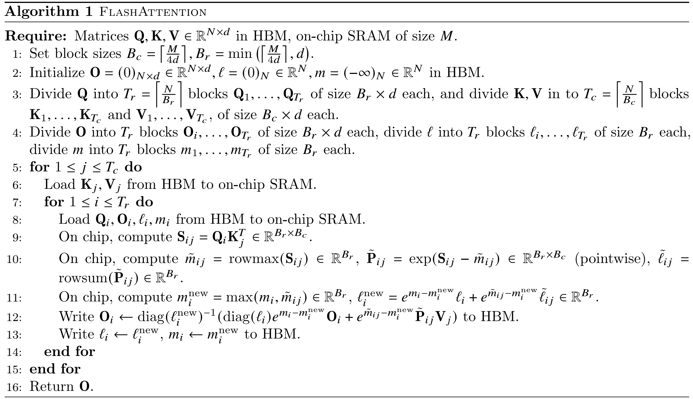

可以看到：算法在 **$K,V$ 维度上做外循环**，在 **$Q$ 维度上做内循环**。（Triton 实现里则反过来，在 $Q$ 上外循环、$K,V$ 上内循环。）

下面这张流程图把各步骤串了起来，可对照阅读：

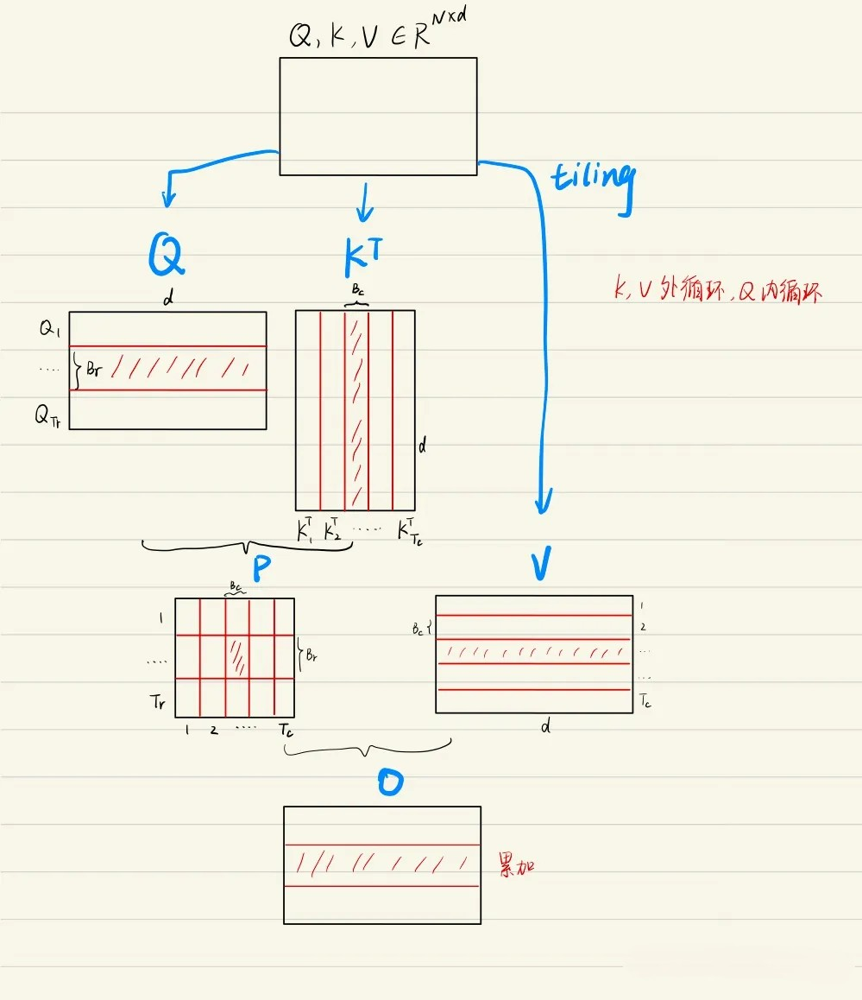

**基本条件：** 矩阵 $Q,K,V\in\mathbb{R}^{N\times d}$ 放在 HBM 中，片上 SRAM 大小为 $M$。

### 2.5.2 第 1 行：确定块大小

$$
B_c=\left\lceil\frac{M}{4d}\right\rceil,\qquad
B_r=\min\left(\left\lceil\frac{M}{4d}\right\rceil,d\right)
$$

为什么是 $\lceil M/(4d)\rceil$？因为要同时在 SRAM 里放 $Q,K,V$ 和输出 $O$ 四套 $d$ 维数据，这个大小基本能把 SRAM 容量用满。

**举例（GPT-2 + A100）**：A100 单 SM 的 SRAM 为 $M=192\text{KB}=196608$ 字节，GPT-2 中 $N=1024,d=64$，则：

$$
B_c=\lceil196608/4/64\rceil=768,\qquad B_r=\min(768,64)=64
$$

### 2.5.3 第 2 行：初始化输出与统计量

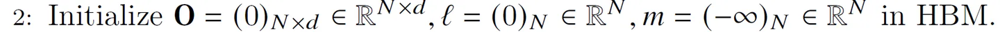

- 用全 0 初始化输出 $O$，作为累加器；
- $\ell$（对应前面的 $\ell(x)$）保存 softmax 的累积分母（EXP 总和）；
- $m$（对应 $m(x)$）逐行保存最大分数，初始化为 $-\infty$，这样第一块的最大值一定大于它。

### 2.5.4 第 3、4 行：切分所有矩阵

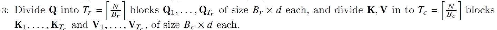

- $Q$ 沿行方向切成 $T_r$ 块，每块 $B_r\times d$；
- $K,V$ 沿行方向切成 $T_c$ 块，每块 $B_c\times d$。

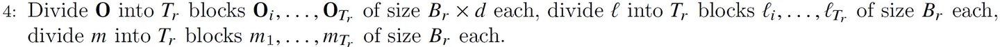

- $O$ 与 $Q$ 一样切成 $T_r$ 块（$B_r\times d$）；
- $\ell,m$ 各切成 $T_r$ 个子向量，每个长度 $B_r$。

对上例：$T_c=\lceil1024/768\rceil=2$，$T_r=\lceil1024/64\rceil=16$。

各分块的关系如下：

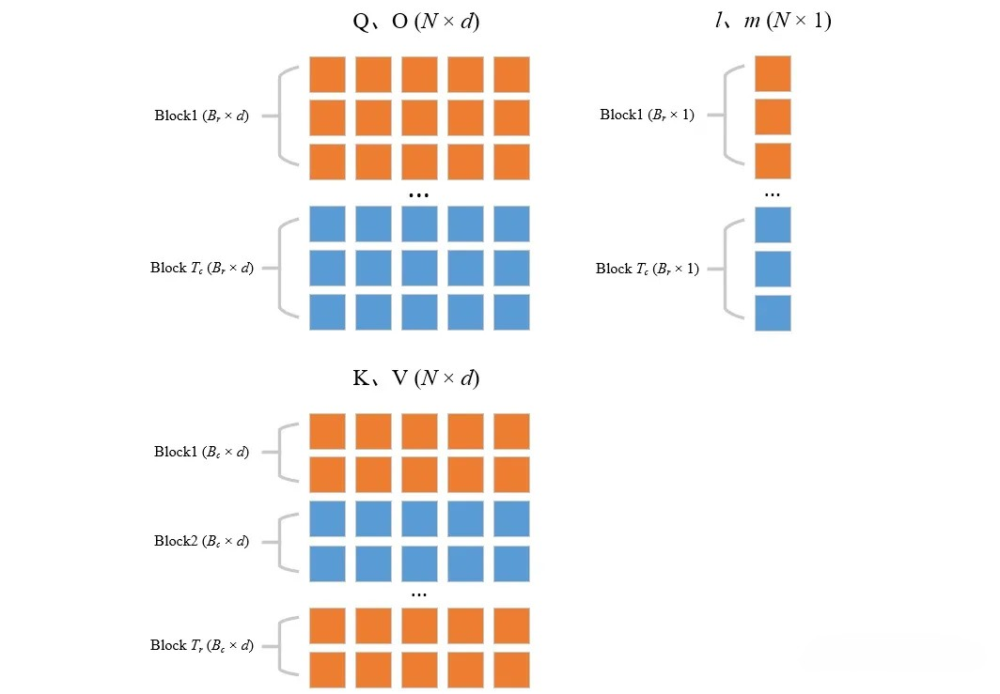

### 2.5.5 第 5 行：外循环（跨列，遍历 K,V）

$$
\text{for }1\le j\le T_c\ \textbf{do}
$$

外循环遍历 $K,V$ 的块，共循环 $T_c=2$ 次。下面这张图展示了外循环的含义：

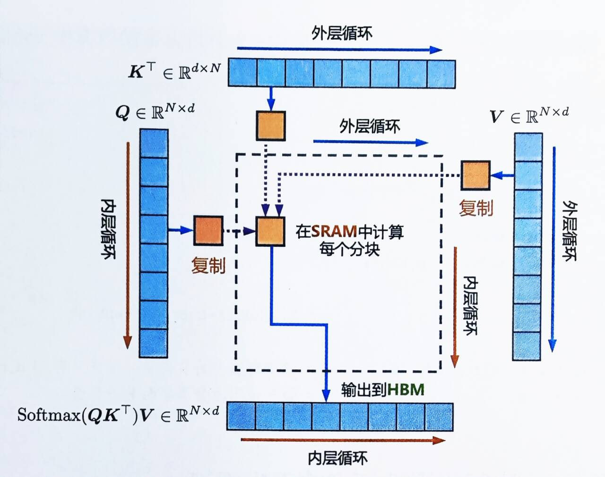

如果暂时忽略缩放和 softmax，整个计算可简化成下表（每个 $q_i$ 依次与 $k_1v_1,k_2v_2,\dots,k_8v_8$ 组合；下划线的 $q_4k_2v_2$ 对应图中虚线框）：

| | 列1 | 列2 | 列3 | 列4 | 列5 | 列6 | 列7 | 列8 |
|---|---|---|---|---|---|---|---|---|
| q1 | q1k1v1 | q1k2v2 | q1k3v3 | q1k4v4 | q1k5v5 | q1k6v6 | q1k7v7 | q1k8v8 |
| q2 | q2k1v1 | q2k2v2 | q2k3v3 | q2k4v4 | q2k5v5 | q2k6v6 | q2k7v7 | q2k8v8 |
| q3 | q3k1v1 | q3k2v2 | q3k3v3 | q3k4v4 | q3k5v5 | q3k6v6 | q3k7v7 | q3k8v8 |
| **q4** | q4k1v1 | **q4k2v2** | q4k3v3 | q4k4v4 | q4k5v5 | q4k6v6 | q4k7v7 | q4k8v8 |
| q5 | q5k1v1 | q5k2v2 | q5k3v3 | q5k4v4 | q5k5v5 | q5k6v6 | q5k7v7 | q5k8v8 |
| q6 | q6k1v1 | q6k2v2 | q6k3v3 | q6k4v4 | q6k5v5 | q6k6v6 | q6k7v7 | q6k8v8 |
| q7 | q7k1v1 | q7k2v2 | q7k3v3 | q7k4v4 | q7k5v5 | q7k6v6 | q7k7v7 | q7k8v8 |
| q8 | q8k1v1 | q8k2v2 | q8k3v3 | q8k4v4 | q8k5v5 | q8k6v6 | q8k7v7 | q8k8v8 |

### 2.5.6 第 6 行：把 Kj,Vj 加载进 SRAM

$$
\textbf{Load }K_j,V_j\text{ from HBM to SRAM}
$$

把 $K_j,V_j$（大小 $B_c\times d=768\times d$）加载到 SRAM，此时仍有约一半 SRAM 留给 $Q,O$。

### 2.5.7 第 7、8 行：内循环（跨行，遍历 Q）

$$
\text{for }1\le i\le T_r\ \textbf{do}
$$

$$
\textbf{Load }Q_i,O_i,\ell_i,m_i\text{ from HBM to SRAM}
$$

内循环遍历 $Q$ 的块，共 $T_r=16$ 次，把 $Q_i,O_i$（各 $B_r\times d=64\times d$）和 $\ell_i,m_i$（各 $B_r$）加载进 SRAM。

### 2.5.8 第 9 行：在片上算分块分数

$$
S_{ij}=Q_iK_j^{\top}\in\mathbb{R}^{B_r\times B_c}
$$

即 $C_{64\times768}=A_{64\times d}\times B_{d\times768}$。标准 Transformer 里完整分数是 $N\times N$，这里每次只算一个小块（下图取 $N=12,B_r=3,B_c=2$）。

当 $j=0$（第一列块）时遍历 $i$：

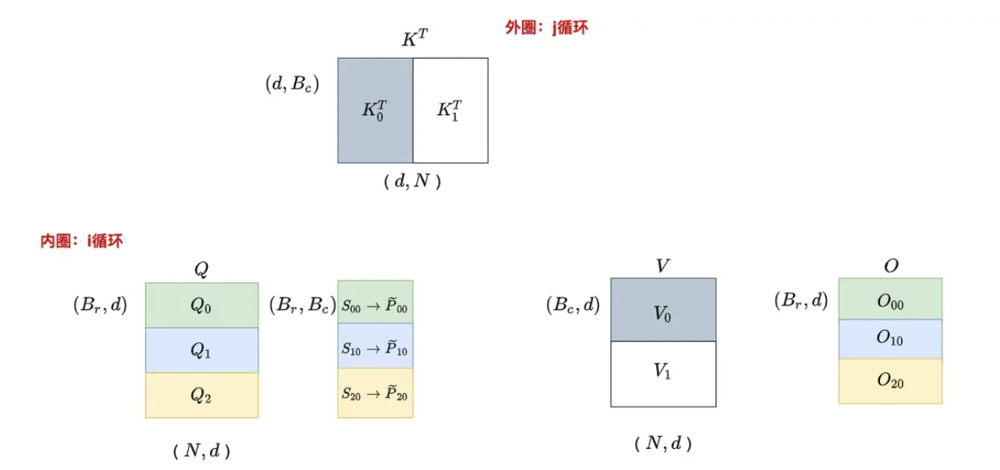

当 $j=1$（第二列块）时遍历 $i$：

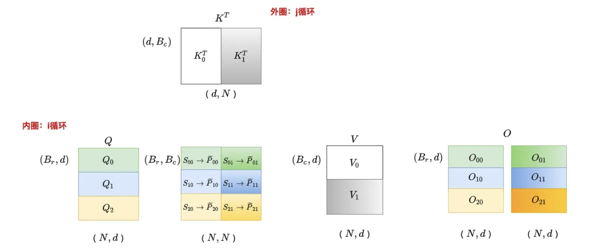

### 2.5.9 第 10 行：算局部分块的三个量

$$
\tilde m_{ij}=\operatorname{rowmax}(S_{ij})\in\mathbb{R}^{B_r}
$$

$$
\tilde P_{ij}=\exp(S_{ij}-\tilde m_{ij})\in\mathbb{R}^{B_r\times B_c}
$$

$$
\tilde \ell_{ij}=\operatorname{rowsum}(\tilde P_{ij})\in\mathbb{R}^{B_r}
$$

即：对分块分数逐行求最大值 → 减去最大值再取指数 → 逐行求和。

### 2.5.10 第 11 行：更新统计量

$$
m_i^{\text{new}}=\max(m_i,\tilde m_{ij})\in\mathbb{R}^{B_r}
$$

$$
\ell_i^{\text{new}}
=e^{m_i-m_i^{\text{new}}}\ell_i
+e^{\tilde m_{ij}-m_i^{\text{new}}}\tilde\ell_{ij}
$$

下图中 $m_i$ 包含之前所有块（j=1、2）的逐行最大值（绿色），$\tilde m_{ij}$ 是当前块的逐行最大值（黄色），二者取大即可，$\ell_i$ 同理。这就是前面公式 (17)(18) 的分块矩阵版。

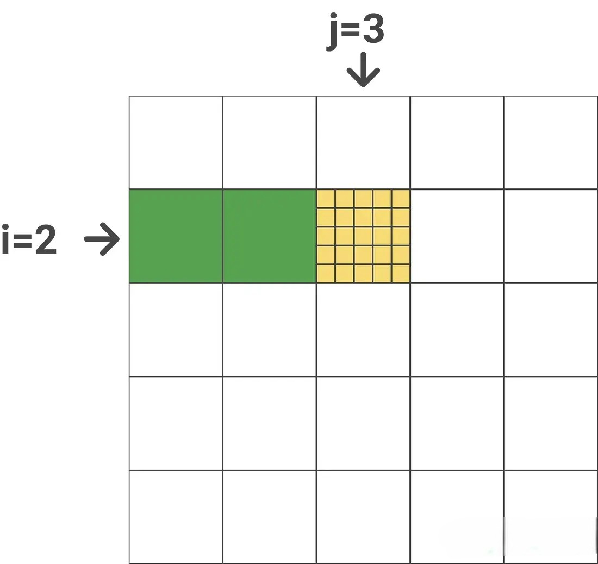

### 2.5.11 第 12 行：更新输出

$$
O_i\leftarrow
\operatorname{diag}(\ell_i^{\text{new}})^{-1}
\left(
\operatorname{diag}(\ell_i)\,e^{m_i-m_i^{\text{new}}}O_i
+e^{\tilde m_{ij}-m_i^{\text{new}}}\tilde P_{ij}V_j
\right)
$$

这里 $\operatorname{diag}(\cdot)$ 表示把一个向量放进对角矩阵，$\operatorname{diag}(\ell)^{-1}$ 就是"逐行除以 $\ell$"（即除以 softmax 分母）。

为了理解它，先说明：多行一起算只是为了 **Batch 批处理**，行与行之间没有数据交互；真正的分块意义在列方向（softmax 沿列进行）。可以想象 $B_r=1$，每次只处理一个 $1\times B_c$ 的小块。

下图用一维的方式展示了 softmax 的更新：

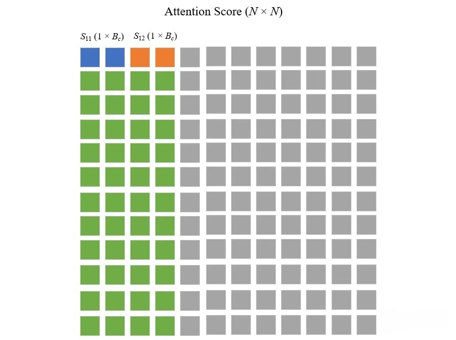

第一次处理 $S_{11}$，用公式 (5)~(8) 算局部 softmax，得到 $SM_1$，只有前两个位置有值：

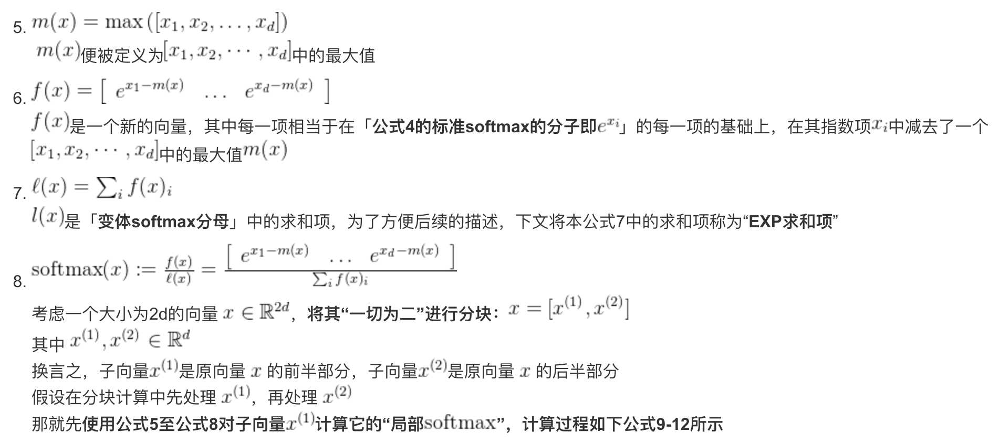

接着处理 $S_{12}$，用公式 (23) 更新 $SM_1$（这里 $\ell_i^{\text{new}}$ 就是 $\ell_{\text{all}}^{\text{new}}$）：

$$
\text{(24)}\quad
SM_1^{\text{new}}
=\frac{SM_1\cdot\ell_1\cdot e^{m_1-m_1^{\text{new}}}}{\ell_1^{\text{new}}}
+\frac{\tilde P_{12}\cdot e^{m_{12}-m_1^{\text{new}}}}{\ell_1^{\text{new}}}
$$

处理 $S_{13}$ 时继续套用：

$$
\text{(25)}\quad
SM_1^{\text{new}}
=\frac{SM_1\cdot\ell_1\cdot e^{m_1-m_1^{\text{new}}}}{\ell_1^{\text{new}}}
+\frac{\tilde P_{13}\cdot e^{m_{13}-m_1^{\text{new}}}}{\ell_1^{\text{new}}}
$$

再进一步，直接更新输出 $O_1$（在更新 softmax 后乘上对应 $V$）：

$$
\text{(26)}\quad
O_1^{\text{new}}
=\frac{O_1\cdot\ell_1\cdot e^{m_1-m_1^{\text{new}}}}{\ell_1^{\text{new}}}
+\frac{\tilde P_{12}\cdot e^{m_{12}-m_1^{\text{new}}}}{\ell_1^{\text{new}}}\cdot V_2
$$

其中 $V_2$ 对应 $S_{12}$ 所覆盖的列。伪代码第 12 行正是公式 (26) 的矩阵版本。**用公式 (26) 就能完成分块自注意力的全部计算。**

### 2.5.12 第 13 行：写回统计量

$$
\ell_i\leftarrow\ell_i^{\text{new}},\qquad m_i\leftarrow m_i^{\text{new}}
$$

两层循环结束后，**第 16 行返回 $O$**。整个过程只把最终输出 $O$ 和很小的统计量写回 HBM，中间的 $S,P$ 自始至终驻留在 SRAM，不被实例化。

## 2.6 补充：kernel 融合中的 mask 和 dropout

前面为简化忽略了 mask、dropout。完整的前向流程是：

$$
S=\tau QK^\top\in\mathbb{R}^{N\times N}
$$

$$
S^{\text{masked}}=\operatorname{MASK}(S)\in\mathbb{R}^{N\times N}
$$

$$
P=\operatorname{softmax}(S^{\text{masked}})\in\mathbb{R}^{N\times N}
$$

$$
P^{\text{dropped}}=\operatorname{dropout}(P,p_{\text{drop}})\in\mathbb{R}^{N\times N}
$$

$$
O=P^{\text{dropped}}V\in\mathbb{R}^{N\times d}
$$

- $\tau$ 是缩放因子，典型为 $\tau=\frac{1}{\sqrt{d_k}}$；
- **MASK** 把某些元素置为 $-\infty$，softmax 后它们变成 0，其余不变（causal-LM 和 prefix-LM 的主要差别就是 MASK 矩阵不同）；
- **dropout** 逐点作用：以概率 $p$ 把元素置 0，以概率 $1-p$ 把元素置为 $\frac{x}{1-p}$（缩放是为了保证期望不变）。

这些操作都是逐点运算，同样可以在 SRAM 内分块完成，无需额外读写 HBM。

---

# 第三部分 FlashAttention 2：比第 1 代快约 2 倍

## 3.1 第 1 代还有什么不足？

2023 年 7 月，Tri Dao 发表论文 *FlashAttention-2: Faster Attention with Better Parallelism and Work Partitioning*，在第 1 代基础上继续优化。

**为什么还需要优化？** 因为第 1 代 FlashAttention 仍不如矩阵乘法那样的基础操作高效：

- 第 1 代虽比标准注意力快 2~4 倍，但**前向只达到设备理论最大 FLOPs/s 的 30%~50%，反向只有 25%~35%**；
- 而优化过的矩阵乘法能达到理论吞吐量的 80%~90%。

原因在于：第 1 代在 GPU 上不同线程块、线程束之间的**工作划分不够优化**，导致占用率低、或产生不必要的共享内存读写。

FlashAttention 2 的优化围绕三个方向展开：

### 3.1.1 减少非矩阵乘法 FLOPs

GPU 有专门做矩阵乘法的**张量核心（Tensor Core）**，矩阵乘法吞吐量比非矩阵乘法高很多。以 A100 为例：

- FP16/BF16 矩阵乘法的理论吞吐量是 **312 TFLOPs/s**；
- 非矩阵乘法的 FP32 吞吐量只有 **19.5 TFLOPs/s**；
- 也就是说，**一个非矩阵乘法 FLOP 比一个矩阵乘法 FLOP "贵"约 16 倍**。

所以要**尽量减少非矩阵乘法 FLOPs、把时间尽可能花在矩阵乘法上**，同时保证输出不变。

### 3.1.2 在序列长度维度上并行

第 1 代只在批次和头数维度并行。长序列场景下批次通常很小，GPU 利用率低。FlashAttention 2 **在前向和反向都增加了序列长度维度的并行**，提高资源利用率。

### 3.1.3 块内也重新分工

即使在一个计算块内部，也把工作在不同线程束之间重新分配，减少通信和共享内存读写。

**最终效果**：FlashAttention 2 前向相对第 1 代加速约 2 倍，达到理论吞吐量的 73%；反向达到 63%；端到端训练 GPT 风格模型时，单块 A100 训练速度可达 225 TFLOPs/s。

> "快 2 倍"的现实意义：同样的算力成本，过去只能训练 8K 上下文的模型，现在可以训练 16K 上下文。

## 3.2 V2 在前向传播层面的改进

### 3.2.1 先回顾 V1 的前向思路

只看注意力矩阵 $S$ 的一个行块，把它切成两块：

$$
S=[S^{(1)}\ S^{(2)}],\qquad
S^{(1)},S^{(2)}\in\mathbb{R}^{B_r\times B_c}
$$

对应的值也切成两块：

$$
V=\begin{bmatrix}V^{(1)}\\V^{(2)}\end{bmatrix}
$$

**标准 softmax（一次性算）**：

$$
m=\max\left(\operatorname{rowmax}(S^{(1)}),\operatorname{rowmax}(S^{(2)})\right)\in\mathbb{R}^{B_r}
$$

$$
\ell=\operatorname{rowsum}(e^{S^{(1)}-m})+\operatorname{rowsum}(e^{S^{(2)}-m})\in\mathbb{R}^{B_r}
$$

$$
P=\operatorname{diag}(\ell)^{-1}[\,e^{S^{(1)}-m}\ \ e^{S^{(2)}-m}\,]
$$

$$
O=\operatorname{diag}(\ell)^{-1}\left(e^{S^{(1)}-m}V^{(1)}+e^{S^{(2)}-m}V^{(2)}\right)
$$

**在线 softmax（逐块算）**——第一块：

$$
m^{(1)}=\operatorname{rowmax}(S^{(1)})
$$

$$
\ell^{(1)}=\operatorname{rowsum}(e^{S^{(1)}-m^{(1)}})
$$

$$
\tilde P^{(1)}=\operatorname{diag}(\ell^{(1)})^{-1}e^{S^{(1)}-m^{(1)}}
$$

$$
O^{(1)}=\operatorname{diag}(\ell^{(1)})^{-1}e^{S^{(1)}-m^{(1)}}V^{(1)}
$$

第二块（更新）：

$$
m^{(2)}=\max(m^{(1)},\operatorname{rowmax}(S^{(2)}))=m
$$

$$
\ell^{(2)}=e^{m^{(1)}-m^{(2)}}\ell^{(1)}+\operatorname{rowsum}(e^{S^{(2)}-m^{(2)}})=\ell
$$

$$
O^{(2)}=\operatorname{diag}(\ell^{(1)}/\ell^{(2)})^{-1}O^{(1)}
+\operatorname{diag}(\ell^{(2)})^{-1}e^{S^{(2)}-m^{(2)}}V^{(2)}=O
$$

下图展示了 $K,V$ 各切成两块时，FlashAttention 前向如何逐块计算并重缩放：

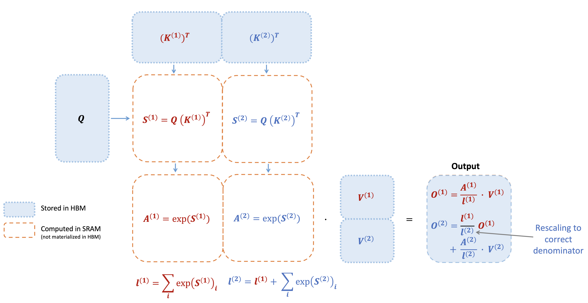

### 3.2.2 V2 的两个小调整

V2 在前向做了两处小改动，以减少非矩阵乘法 FLOPs：

**调整一：不必每次都重缩放输出的两项。**

V1 每次更新都要重缩放：

$$
O^{(2)}=\operatorname{diag}(\ell^{(1)}/\ell^{(2)})^{-1}O^{(1)}
+\operatorname{diag}(\ell^{(2)})^{-1}e^{S^{(2)}-m^{(2)}}V^{(2)}
$$

V2 改成：维护一个"**未归一化**"的版本 $\tilde O$，只在**整个循环的最后**才统一除以最终的 $\ell$：

$$
\tilde O^{(2)}=\operatorname{diag}(\ell^{(1)})^{-1}O^{(1)}
+e^{S^{(2)}-m^{(2)}}V^{(2)}
$$

最后再做一次缩放：

$$
O^{(\text{last})}=\operatorname{diag}(\ell^{(\text{last})})^{-1}\tilde O^{(\text{last})}
$$

这样循环内部省去了反复的缩放运算。

**调整二：不必同时保存最大值 $m$ 和指数和 $\ell$ 用于反向，只存一个 logsumexp。**

$$
L^{(j)}=m^{(j)}+\log(\ell^{(j)})
$$

$L$ 一个量就同时包含了最大值和指数和的信息（因为 $\ell=\sum e^{S-m}$，$\log\ell$ 加上 $m$ 就是完整的对数归一化项），反向需要时可由它恢复。

在两块的简单情况下，V2 的在线 softmax 变成：

$$
m^{(1)}=\operatorname{rowmax}(S^{(1)})
$$

$$
\ell^{(1)}=\operatorname{rowsum}(e^{S^{(1)}-m^{(1)}})
$$

$$
\tilde O^{(1)}=e^{S^{(1)}-m^{(1)}}V^{(1)}
$$

$$
m^{(2)}=\max(m^{(1)},\operatorname{rowmax}(S^{(2)}))=m
$$

$$
\ell^{(2)}=e^{m^{(1)}-m^{(2)}}\ell^{(1)}+\operatorname{rowsum}(e^{S^{(2)}-m^{(2)}})=\ell
$$

$$
\tilde O^{(2)}=\operatorname{diag}(e^{m^{(1)}-m^{(2)}})\tilde O^{(1)}
+e^{S^{(2)}-m^{(2)}}V^{(2)}
=e^{S^{(1)}-m}V^{(1)}+e^{S^{(2)}-m}V^{(2)}
$$

$$
O^{(2)}=\operatorname{diag}(\ell^{(2)})^{-1}\tilde O^{(2)}=O
$$

V2 完整的前向算法伪代码如下：

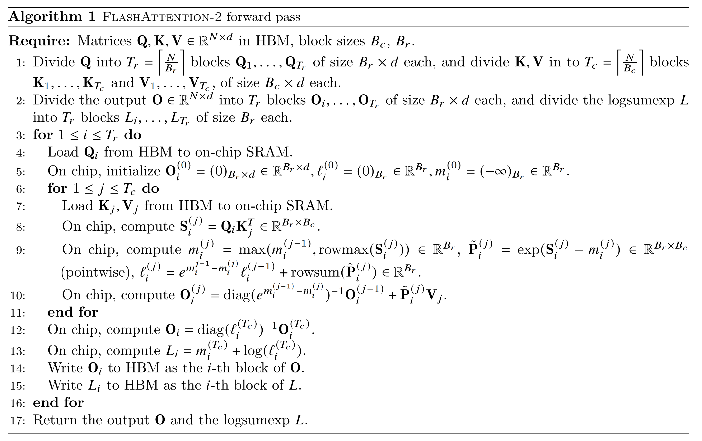

## 3.3 V2 在反向传播层面的改进

### 3.3.1 V1 的反向

反向时，当 $Q,K,V$ 块已加载到 SRAM，FlashAttention 通过**重计算**得到 $S,P$，而不必在显存里保存巨大的 $N\times N$ 中间矩阵，因此在序列长度维度上节省了 10~20 倍内存（显存与序列长度成线性而非二次关系）。

反向虽概念上更简单（没有 softmax 重缩放），实现却更复杂：反向需要在 SRAM 里保留更多的值，要执行 **5 个矩阵乘法**（前向只有 2 个）。

### 3.3.2 V2 的反向

V2 的反向与 V1 几乎相同，只是把"同时使用行最大值和指数和"换成使用**行方向的 logsumexp $L$**（与前向保持一致），从而简化了需要保存的统计量。

完整的反向流程如下（左为英文原版、右为中文翻译）：

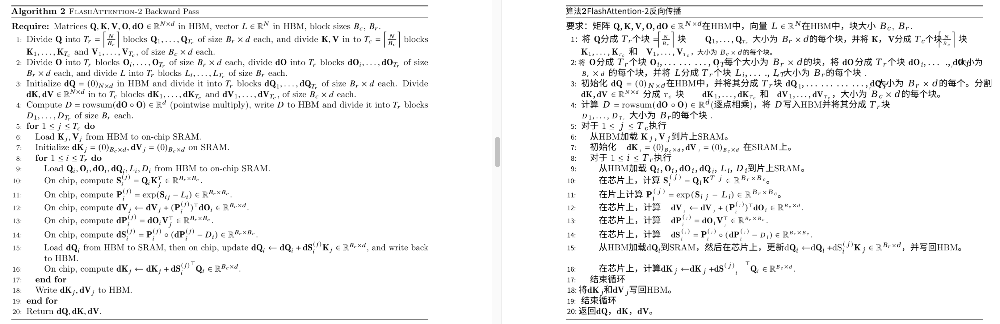

## 3.4 并行化：在序列长度维度也并行

### 3.4.1 V1 的并行方式

V1 只在**批次和头数**上并行：用一个线程块处理一个注意力头，共 $b\times a$ 个线程块，每个调度到一个 SM 上运行（A100 有 108 个 SM）。

当 $b\times a$ 较大（如 $\ge80$）时，这种调度很高效，能占满几乎所有计算资源。但**长序列通常意味着小批次、小头数**，此时大量 SM 空闲。

### 3.4.2 V2 在序列长度上并行

- **前向**：外循环（沿序列长度）天然可以并行，把不同行块安排到**互不通信**的线程块上；再加上批次和头数维度并行。长序列、小批次时能显著提高占用率。
  （交换循环顺序、在序列维度并行的想法，最早由 Phil Tillet 在 Triton 实现中提出。）
- **反向**：不同列块之间唯一的共享计算是更新 $\mathrm dQ$：

$$
\mathrm dQ_i\leftarrow\mathrm dQ_i+\mathrm dS_i^{(j)}K_j
$$

  需要把 $\mathrm dQ$ 从 HBM 读到 SRAM、更新、再写回。因此 V2 为反向的每个列块安排一个线程块，并用**原子加法（atomic add）**在线程块之间通信、累加 $\mathrm dQ$。

最终的并行结构：

- **前向（左）**：每个工作线程负责注意力矩阵的一个"**行块**"；
- **反向（右）**：每个工作线程负责一个"**列块**"。

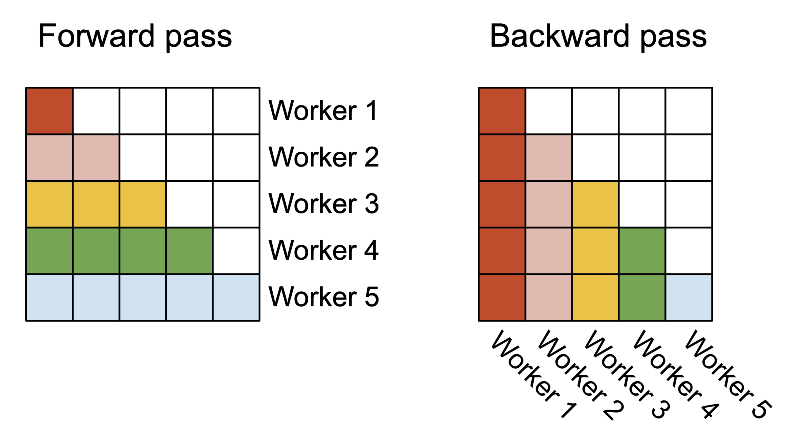

## 3.5 线程束之间的工作划分（Work Partitioning Between Warps）

即使在一个线程块内部，也要决定如何把工作分给不同 warp（通常每个线程块用 4 或 8 个 warp）：

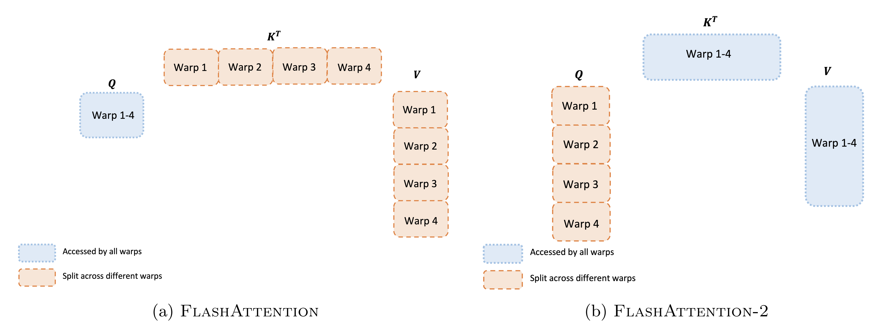

- **前向（V1 的问题）**：V1 把 $K,V$ 切成 4 份分给 4 个 warp，而让 $Q$ 对所有 warp 可见。每个 warp 算出 $QK^\top$ 的一个切片后，还要与 $V$ 的切片相乘、并彼此通信累加结果，这叫 **"split-K"** 方案。它很低效：所有 warp 都要把中间结果写进共享内存、同步、再累加，这些共享内存读写拖慢了前向。
- **前向（V2 的改进）**：V2 反过来把 **$Q$ 切成 4 份**，让 $K,V$ 对所有 warp 可见。每个 warp 算出 $QK^\top$ 切片后，直接与共享的 $V$ 相乘得到对应的输出切片，**warp 之间无需通信**，减少了共享内存读写。
- **反向**：同样选择避免 "split-K"。不过由于 $Q,K,V,O,\mathrm dO,\mathrm dQ,\mathrm dK,\mathrm dV$ 之间依赖复杂，仍需少量同步；但避免 split-K 依然能减少共享内存读写、提升速度。
- **块大小调整**：增大块通常能减少共享内存读写，但会增加寄存器和共享内存总用量；超过一定大小会发生寄存器溢出（明显变慢），或共享内存不足无法运行。通常在 $\{64,128\}\times\{64,128\}$ 中选块，具体取决于头维度和设备共享内存大小。

---

# 第四部分 FlashAttention 3：异步与低精度

## 4.1 背景：Hopper 新硬件还没被充分利用

FlashAttention 2 提出一年后，2024 年作者团队又发表了 *FlashAttention-3: Fast and Accurate Attention with Asynchrony and Low-precision*，专门面向 NVIDIA 新一代 **Hopper 架构（H100）**。

FlashAttention 靠"最小化内存读写"加速，但它还没有利用新硬件的新特性——**FlashAttention 2 在 H100 上的利用率仅约 35%**。

FlashAttention 3 用三大技术来压榨 Hopper：

## 4.2 技术一：warp 专用化（生产者-消费者异步）

Hopper 的张量核心与 TMA（Tensor Memory Accelerator，张量内存加速器）都支持异步。FlashAttention 3 设计了一种 **warp 专用化（warp-specialization）** 的软件流水线：

- 把负责"**搬运数据**"的 warp（生产者）和负责"**做计算**"的 warp（消费者）分开；
- 利用数据移动与张量核心计算的**异步并行**，让一部分 warp 搬数据的同时、另一部分 warp 在算；
- 从而隐藏内存延迟和指令发射延迟，让流水线不停下来。

## 4.3 技术二：交错排布矩阵乘法与 softmax

把 softmax 里吞吐量较低的**非 GEMM 操作**（浮点乘加、指数等）与 GEMM 的异步 **WGMMA** 指令（Warpgroup Matrix Multiply-Accumulate，Hopper 的异步矩阵乘指令）**重叠执行**。

为此，FlashAttention 3 重新设计了算法，**规避 softmax 与 GEMM 之间的某些顺序依赖**。例如在"两阶段"版本中：当 softmax 在分数矩阵的一个块上执行时，WGMMA 已经在异步地计算下一个块的 GEMM，两件事同时进行。

## 4.4 技术三：FP8 低精度与非相干处理

调整前向算法，让 GEMM 使用 **FP8 张量核心**，几乎让实测 TFLOPs/s 翻倍。难点在于：

- WGMMA 对 FP32 累加器和 FP8 操作数矩阵的**内存布局假设不同**，需要在不同布局要求之间"搭桥"；
- 用**块量化（block quantization）**和**非相干处理（incoherent processing）**等技术，来减轻降到 FP8 带来的精度损失，保证结果仍然准确。

## 4.5 最终效果

FlashAttention 3 在 H100 上相对 FlashAttention 2 实现了 **1.5~2.0 倍加速**：

- FP16 下最高达 **740 TFLOPs/s（约 75% 利用率）**；
- FP8 下接近 **1.2 PFLOPs/s**。

---

# 总结：三代 FlashAttention 到底改了什么

| 版本 | 年份 | 核心思想 | 关键指标 |
| --- | --- | --- | --- |
| 标准注意力 | — | 三个独立 kernel，实例化 $N\times N$ 矩阵 | 8 次 HBM 读写，显存 $O(N^2)$ |
| Memory-efficient | — | 单独算归一化分母，不存 $S,P$ | 显存 $O(N)$，但 HBM 访问仍 $O(N^2)$，没提速 |
| **FlashAttention 1** | 2022 | IO 感知 + kernel 融合 + 分块 + 在线 softmax | 比标准快 2~4 倍，显存 $O(N)$ |
| **FlashAttention 2** | 2023 | 减非矩阵乘法 FLOPs、序列维度并行、避免 split-K | 比 V1 快约 2 倍，前向达理论 73% |
| **FlashAttention 3** | 2024 | 生产者-消费者异步、GEMM 与 softmax 重叠、FP8 | H100 上比 V2 快 1.5~2 倍，FP8 近 1.2 PFLOPs/s |

**一句话串起整个故事：**

- 标准注意力的瓶颈不是"算不过来"，而是"数据在显存里来回搬、还要存巨大的 $N\times N$ 矩阵"；
- FlashAttention 用"分块 + 在线 softmax + kernel 融合"，让数据尽量待在高速 SRAM 里，既省显存又少搬运；
- 2 代靠更好的并行和工作划分榨干 A100；
- 3 代靠异步和 FP8 榨干 H100。

---

# 参考文献与推荐阅读

1. 原博客：July《通透理解 FlashAttention（含其 2 代和第 3 代）》：https://blog.csdn.net/v_JULY_v/article/details/133619540
2. FlashAttention 论文（v1）：*FlashAttention: Fast and Memory-Efficient Exact Attention with IO-Awareness*，https://arxiv.org/abs/2205.14135
3. FlashAttention 2 论文：https://arxiv.org/abs/2307.08691
4. FlashAttention 3 论文：https://arxiv.org/abs/2407.08608
5. FlashAttention 官方代码：https://github.com/Dao-AILab/flash-attn
6. July《Transformer 通俗笔记》：https://blog.csdn.net/v_JULY_v/article/details/127411638
7. 《分析 transformer 模型的参数量、计算量、中间激活、KV cache》：https://zhuanlan.zhihu.com/p/624740065
8. Triton fused attention 教程：https://github.com/openai/triton/blob/main/python/tutorials/06-fused-attention.py
9. 《大规模语言模型：从理论到实战》

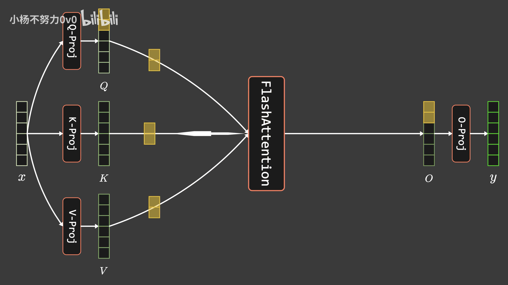

---

# 自测题（答案都在文中）

1. 为什么 Transformer 的复杂度是序列长度的"平方"？这个平方项出现在注意力的哪一步？
2. 一个 $N\times d$ 矩阵乘一个 $d\times N$ 矩阵，计算量（乘加都算）是多少？
3. 写出一个 Transformer 层 Attention 块、MLP 块各自的计算量，以及每层总计算量。
4. 写出一个 Transformer 层中间激活的显存公式，并指出哪个是平方项。
5. 标准注意力的三个 kernel 各有几次 HBM 读写？总共几次？
6. SRAM 和 HBM 的容量、速度特点各是什么？为什么逐点运算是内存受限的？
7. Memory-efficient Attention 为什么能把显存降到 $O(N)$？为什么没让程序变快？
8. FlashAttention 为什么引入 $m$（最大值）和 $\ell$（EXP 求和）两个统计量？把局部 softmax 变全局时，要乘的修正系数是什么？
9. 用分块方法对 $[1,2,3,4]$ 算 softmax 的流程是怎样的？
10. FlashAttention 2 的"两个小调整"是什么？什么是 "split-K"，V2 为什么要避免它？
11. FlashAttention 2 前向、反向分别按什么维度并行、各负责"行块"还是"列块"？
12. FlashAttention 3 用了哪三大技术？各自解决什么问题？
