# Transformer通俗笔记：从Word2Vec、Seq2Seq逐步理解到GPT、BERT

## 第一部分 理解基本概念：从NNLM到Word2Vec

我博客内之前写过一篇word2vec笔记，如今再看 写的并不通俗易懂，巧的是，写本文开头那篇图解transformer文章的作者，他也有写一篇 [图解word2vec](https://jalammar.github.io/illustrated-word2vec/) ，本部分中的核心阐述和大部分配图均来自此文。

为了让每一个初学者可以从头看到尾，不至于因行文过程中的任何一句话而卡壳看不下去，我在原英文的基础上，加了大量自己的学习心得、说明解释(得益于看过很多文学和哲学书，且学过算法，所以文笔尚可、逻辑尚可)。

###  **1.1 从向量表示到词嵌入** 

不知你可曾听说过华为对于求职人员的性格测试？ 这个测试会问你一系列的问题，然后在很多维度给你打分，内向/外向就是其中之一，然后用0到100的范围来表示你是多么内向/外向（其中0是最内向的，100是最外向的）

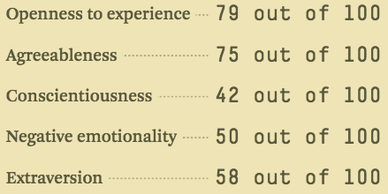

假设一个叫Jay的人，其内向/外向得分为38/100，则可以用下图表示这个得分：

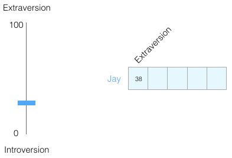

为了更好的表达数据，我们把范围收缩到-1到1『 *注意，下图表格中的-0.4 应为-0.24，下同* 』：

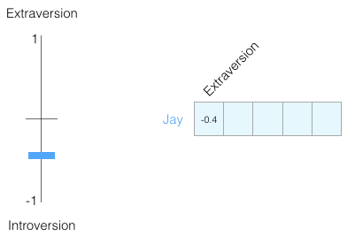

考虑到人性复杂，对于一个人的描述只有一条信息显然是不够的，为此，我们添加另一测试的得分作为一个新的第二维度，而这两个维度均可以表现为图上的一个点（或称为从原点到该点的向量)

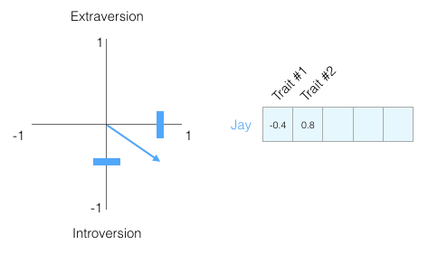

然后可以说这个向量部分地代表了Jay的人格。当你想要将另外两个人与Jay进行比较时，这种表示法就有用了。假设Jay是一家公司的CEO，某天被公共汽车给撞住院了，住院期间需要一个与Jay性格相似的人代行Jay的CEO之责。那在下图中，这两个人中哪一个更像Jay呢，更适合做代理CEO呢？

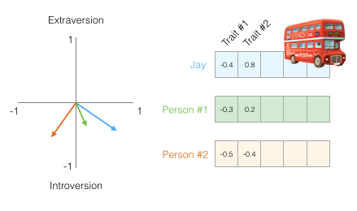

而 **计算两个向量之间相似度得分的常用方法是余弦相似度** ，可曾还记得夹角余弦的计算公式？

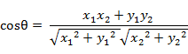

通过该计算公式可得

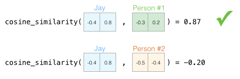

从而可知，person 1在性格上与Jay更相似。其实，从坐标系里也可以看出，person1的向量指向与Jay的向量指向更相近，即他俩具有更高的余弦相似度。

更进一步，两个维度还不足以捕获有关不同人群的足够信息。可曾听说国内有七重人格，而国外心理学也研究出了五个主要人格特征（以及大量的子特征）。

为从简起见，就不用七个维度了，而用五个维度再度比较Jay与person1 2的相似性：

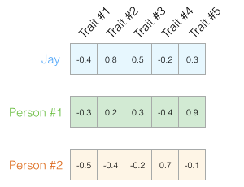

当使用五个维度时，我们没法在二维平面绘制向量小箭头了(毕竟你我都不曾见过五维坐标系)。而实际生活中，我们经常要在更高维度的空间中做研究(有的人把研究一词表达成思考，实际上，大部分人没法在高维度空间思考，但科学研究人员经常干这事，故表达成研究更准确)，好在余弦相似度仍然有效，它适用于任意维度：

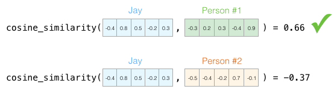

这些得分比上次的得分看起来更准确(对，目前为止，咱只能说看起来更准确，最近学哲学给我最大的感悟是，凡事客观，不要轻易绝对化)，毕竟它们是根据被比较事物的更高维度算出的。

小结一下，有两点

1.我们可以将人和事物表示为代数向量

2.我们可以很容易地计算出相似向量之间的相互关系。

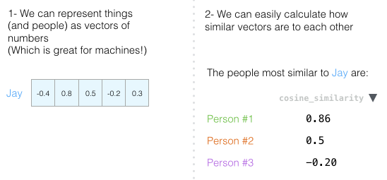

---

行文至此，可能有同学要问了，为何要把词向量化表示呢，其背后的深意在哪？

众所周知，咱们居住在各个国家的人们通过各自的语言进行交流，但机器无法直接理解人类的语言，所以需要先把人类的语言“计算机化”，那如何变成计算机可以理解的语言呢？

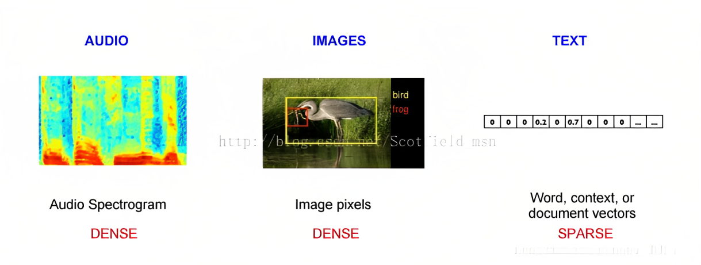

对于这个问题，我们考虑一个很简单的问题，比如对于计算机，它是如何判断一个词的词性，是动词还是名词的呢？

假定我们有一系列样本(x,y)，其中的 x 是词语，y 是它们的词性，我们要构建\(f(x) \to y\)的映射：

1. 首先，这个数学模型 f（比如神经网络、SVM）只接受数值型输入；

2. 而 NLP 里的词语是人类语言的抽象总结，是符号形式的（比如中文、英文、拉丁文等等）；

3. 如此一来，咱们便需要把NLP里的词语转换成数值形式，或者嵌入到一个数学空间里；

4. 进一步，可以把文本分散嵌入到另一个离散空间，称作分布式表示，又称为词嵌入（word embedding）或词向量

5. 在各种词向量中，有一个简单的词向量是one-hot encoder。所谓one-hot编码，本质上是用一个只含一个 1、其他都是 0 的向量来唯一表示词语
   当然，不是所有的编码都是01编码，且one-hot编码无法反应词与词之间的语义相似度

   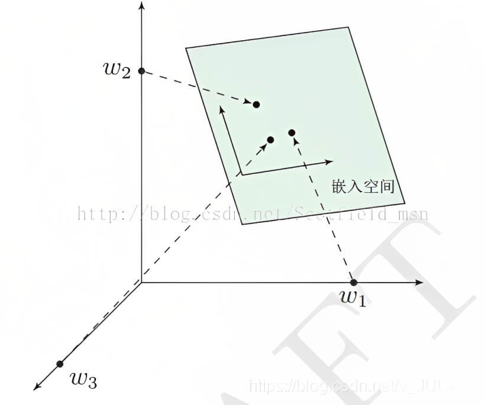

这就是所谓的词嵌入了，而 **一个单词表达成Word Embedding后，便很容易找出语义相近的其它词汇** 

再举一个例子，这是一个单词“king”的词嵌入（在维基百科上训练的GloVe向量）：

[ 0.50451 , 0.68607 , -0.59517 , -0.022801, 0.60046 , -0.13498 , -0.08813 , 0.47377 , -0.61798 , -0.31012 , -0.076666, 1.493 , -0.034189, -0.98173 , 0.68229 , 0.81722 , -0.51874 , -0.31503 , -0.55809 , 0.66421 , 0.1961 , -0.13495 , -0.11476 , -0.30344 , 0.41177 , -2.223 , -1.0756 , -1.0783 , -0.34354 , 0.33505 , 1.9927 , -0.04234 , -0.64319 , 0.71125 , 0.49159 , 0.16754 , 0.34344 , -0.25663 , -0.8523 , 0.1661 , 0.40102 , 1.1685 , -1.0137 , -0.21585 , -0.15155 , 0.78321 , -0.91241 , -1.6106 , -0.64426 , -0.51042 ]

这是一个包含50个数字的列表。通过观察数值我们看不出什么，但是让我们稍微给它可视化，以便比较其它词向量。故我们把所有这些数字放在一行：

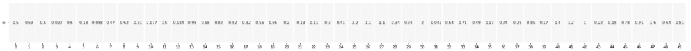

让我们根据它们的值对单元格进行颜色编码（如果它们接近2则为红色，接近0则为白色，接近-2则为蓝色）：

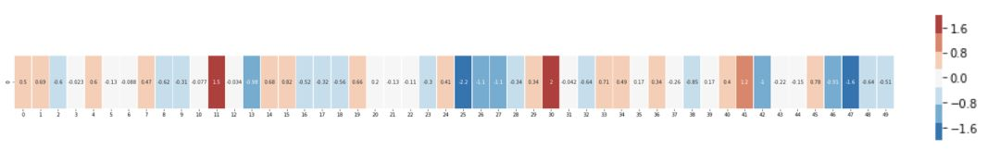

我们将忽略数字并仅查看颜色以指示单元格的值。现在让我们将“king”与其它单词进行比较（注意，世间有相似之人，也有相似之词）：

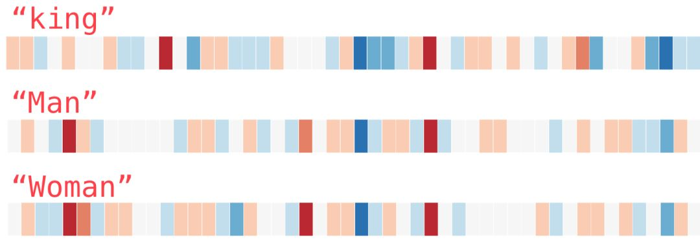

你会发现“Man”这个词和“Woman”相比，比与“King”相比更相似，而这些向量图示很好的展现了这些单词的含义与关联

这是另一个示例列表：

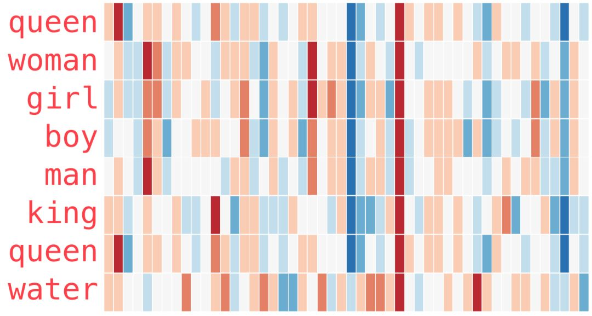

通过垂直扫描列来查找具有相似颜色的列，相信你可以看到以下这几点

1. “woman”和“girl”在很多地方是相似的，“man”和“boy”也是一样

2. 当然，“boy”和“girl”也有彼此相似的地方，但这些地方却与“woman”或“man”不同，为何呢，毕竟boy/girl特指青春年少，而woman/man更多指成人

3. 此外，“king”和“queen”彼此之间相似，毕竟都是所谓的王室成员

###  **1.2 从N-gram模型、** NNLM **到** Word2Vec

#### 1.2.1 什么是N-gram模型与神经网络语言模型NNLM

我们每天都会用手机或者电脑，比如我们经常会用到智能手机输入法中的下一单词预测功能，或者你在电脑上用Google搜索也会遇到类似的搜索智能提示（详见 [此文](https://blog.csdn.net/v_JULY_v/article/details/11288807) ）。

比如当你输入thou shalt时，系统会预测/提示你想输入的下一个单词是不是not？

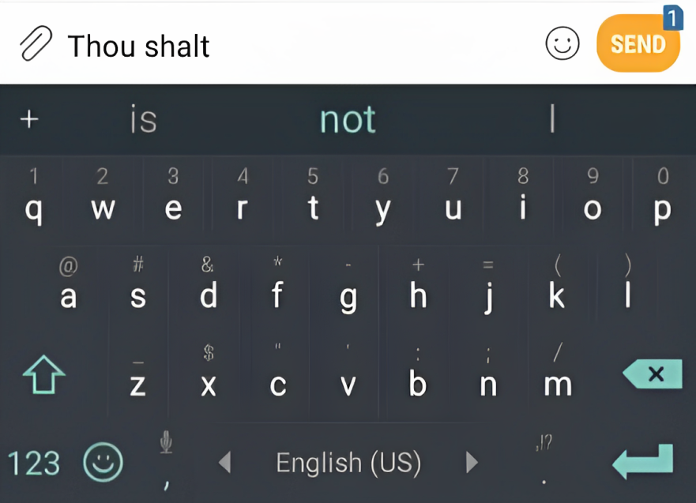

系统是根据什么来预测/提示下一个单词的呢？它的依据有两点

1. 在上面这个手机截屏中，该模型已经接收到了两个绿色单词(thou shalt)后

2. 为此推荐一组单词且要计算比如“not” 是其中最有可能被选用的一个
   说白了，就是要让预测的单词连成整个句子后最像一句人话，所以便得计算加上某个预测单词成为整个句子的概率而计算句子概率的概率模型很多，n-gram模型便是其中的一种，什么是n-gram呢

   假设一个长度为m的句子，包含这些词：\((w_1,w_2,w_3,..,w_m)\)，那么这个句子的概率（也就是这m个词共同出现的概率）是：\(P\left ( sen = (w_1,w_2,\cdots ,w_m) \right ) = P(w_1)P(w_2|w_1)P(w_3|w_2,w_1)\cdots P(w_m|w_{m-1}\cdots w_1)\)

   一般来说，语言模型都是为了使得条件概率\(P(w_t|w_1,w_2,..,w_{t-1})\)最大化，不过考虑到近因效应，当前词只与距离它比较近的\(n\)个词更加相关(一般\(n\)不超过5，所以局限性很大)

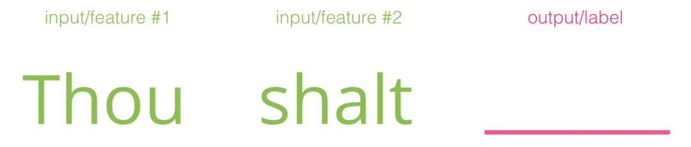

那神经网络语言模型(Neural Network Language Model，简称NNLM)的思路呢？

> NNLM的核心是一个多层感知机（Multi-Layer Perceptron，简称MLP），它将词向量序列映射到一个固定长度的向量表示，然后将这个向量输入到一个softmax层中，计算出下一个词的概率分布

举例来说，我们可以把这个模型想象为这个黑盒：

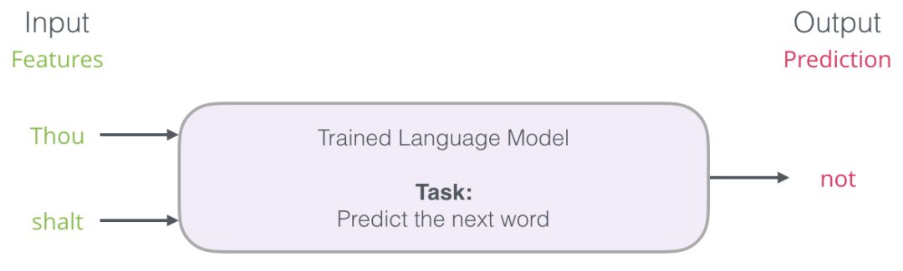

当然，该模型不会只推荐一个单词。实际上，它对所有它知道的单词(模型的词库，可能有几千到几百万个单词)均按可能性打分，最终输入法程序选出其中分数最高的推荐给用户，比如not

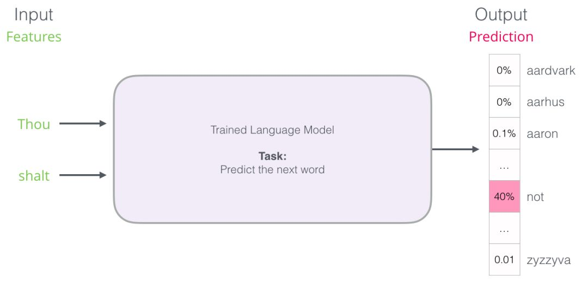

模型的输出就是模型所知单词的概率评分，比如40%或者0.4，最终在完成训练后按下图中所示的三个步骤完成预测(请参考Bengio 2003)：

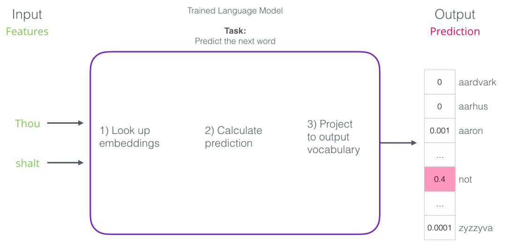

1. 第一步就是Look up Embedding，由于 **模型在经过另外一个训练** 之后可以生成一个映射单词表所有单词的矩阵，也称词嵌入矩阵，从而在进行预测的时候，我们的算法可以在这个映射矩阵(词嵌入矩阵)中查询输入的单词(即Look up embeddings)

2. 第二步则是计算出预测值

3. 第三步则输出结果

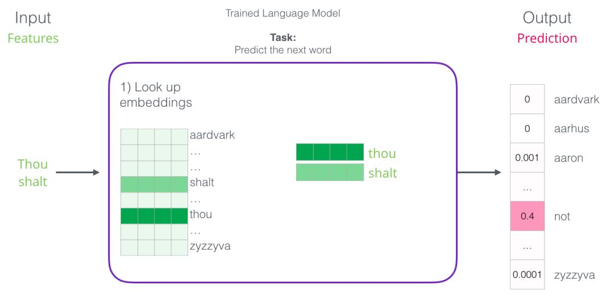

接下来，我们重点看下上面所说的「模型在经过另外一个训练」到底说的啥意思，即探讨如何构建这个映射矩阵(词嵌入矩阵)

####  **1.2.2 语言模型训练：** 如何构建映射矩阵(词嵌入矩阵)

我们通过找常出现在每个单词附近的词，就能获得它们的映射关系。机制如下：

1. 先是获取大量文本数据(例如所有维基百科内容)

2. 然后我们建立一个可以沿文本滑动的窗(例如一个窗里包含三个单词)

3. 利用这样的滑动窗就能为训练模型生成大量样本数据

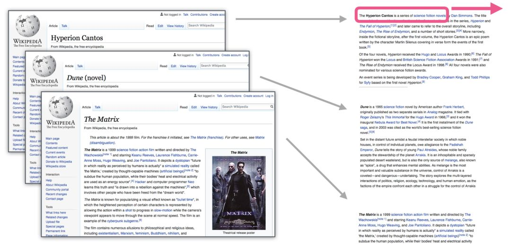

当这个窗口沿着文本滑动时，我们就能(真实地) **生成一套用于模型训练的数据集** 。

不用多久，我们就能得到一个较大的数据集，从数据集中我们能看到在不同的单词组后面会出现的单词：

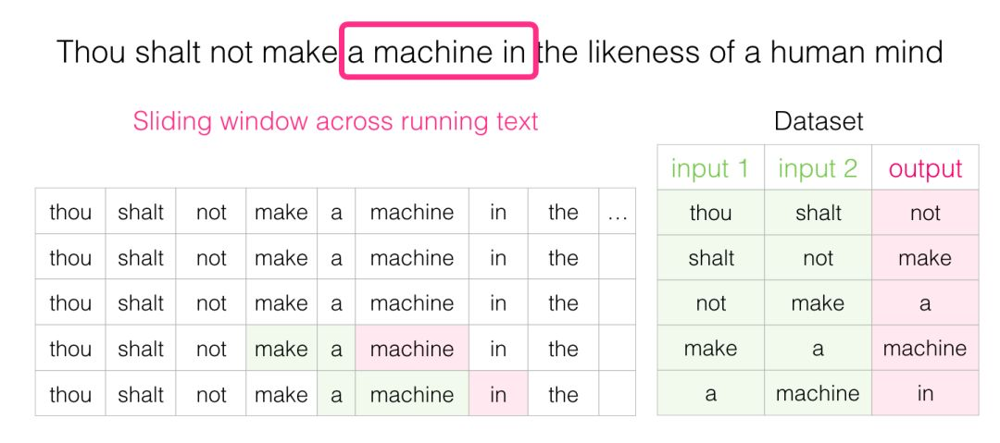

在实际应用中，模型往往在我们滑动窗口时就被训练的，而怎么训练模型呢？

举个例子，请你根据下面这句话前面的信息进行填空：

在空白前面，我提供的背景是五个单词(如果事先提及到‘bus’)，可以肯定，大多数人都会把bus填入空白中。但是如果我再给你一条信息——比如空白后的一个单词，那答案会有变吗？

这下空白处改填的内容完全变了。这时’red’这个词最有可能适合这个位置的词之一。

从上面那个例子可以看到，一个单词的前后词语其实都带着有价值的信息，而且要尽可能考虑两个方向的单词(目标单词的左侧单词与右侧单词)。

####  **1.2.3 Word2Vec的两种架构：从** CBOW到 **Skipgram模型** 

更进一步，为了更好的预测，其实不仅要考虑目标单词的前两个单词，还要考虑其后两个单词。

如果这么做，我们实际上构建并训练的模型就如下所示：

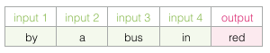

上述的 <u>这种『以上下文词汇预测当前词』架构被称为连续词袋(CBOW)</u> ，简单引用下 [此文](https://blog.csdn.net/v_JULY_v/article/details/102708459) 的内容做个简单概括（详见原文或参考文献16）：

> CBOW包括以下三层：
> 
> - 输入层：包含\(context(w)\)中 
> 
>   个词的词向量\(v\left(\operatorname{Context}\left(w_{1}\right)\right), v(\operatorname{Context}(w 2)), v(\operatorname{Context}(w 2 c)) \epsilon R^{m}\)，其中， 
> 
>   表示单词的向量化表示函数，相当于此函数把一个个单词转化成了对应的向量化表示(类似one-hot编码似的)， 
> 
>   表示上下文取的总词数， 
> 
>   表示向量的维度；
> 
> - 投影层：将输入层的 
> 
>   个向量做累加求和；
> 
> - 输出层：按理我们要通过确定的上下文决定一个我们想要的中心词 
> 
>   ，但怎么决定想要的中心词具体是 
> 
>   中的哪个呢？
>   <u>通过计算各个可能中心词的概率大小，取概率最大的词便是我们想要的中心词</u> ，相当于是针对一个N维数组进行多分类，但计算复杂度太大，所以输出层改造成了一棵Huffman树，以语料中出现过的词当叶子结点，然后各个词出现的频率大小做权重
> 
>   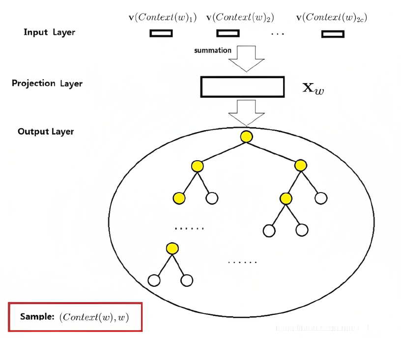
> 
> 

还有另一种架构，刚好反过来，根据当前词推测当前单词可能的前后单词，这种架构就是所谓的Skipgram架构

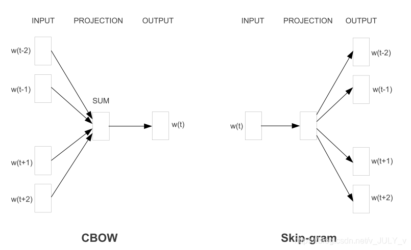

顺带提一句，关于什么是负采样，可以参见网上相关资料，比如参考文献1。

###  **1.3 Word2vec训练流程：不断缩小** error(target - sigmoid_scores)

在训练过程开始之前，我们预先处理我们正在训练模型的文本

具体做法是先创建两个矩阵：词嵌入Embedding矩阵( *注意：这个 Embedding矩阵其实就是网络Onehot层到Embedding层映射的网络参数矩阵，所以使用Word Embedding等价于把Onehot层到Embedding层的网络用预训练好的参数矩阵初始化了* )、上下文Context矩阵，这两个矩阵在我们的词汇表中嵌入了每个单词，且两个矩阵都有这两个维度

1. 第一个维度，词典大小即vocab_size，比如可能10000，代表一万个词

2. 第二个维度，每个词其嵌入的长度即embedding_size，比如300是一个常见值（当然，我们在前文也看过50的例子，比如上文1.1节中最后关于单词“king”的词嵌入长度）

   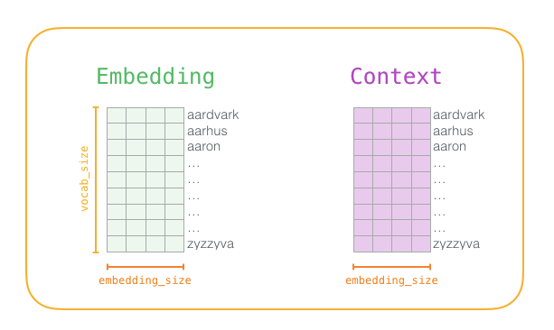

训练的过程还是这个标准套路/方法，比如

1. 第一步，先用随机值初始化这些矩阵。在每个训练步骤中，我们采取一个相邻的例子及其相关的非相邻例子
   具体而言，针对这个例子：“Thou shalt not make a machine in the likeness of a human mind”，我们来看看我们的第一组（对于not 的前后各两个邻居单词分别是：Thou shalt 、make a）：

   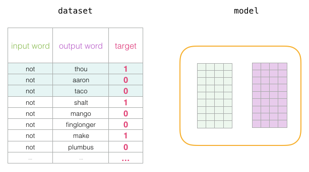

   现在有四个单词：输入单词not，和上下文单词： **thou（实际邻居词）** ，aaron和taco（负面例子）
   我们继续查找它们的嵌入
   对于输入词not，我们查看Embedding矩阵
   对于上下文单词，我们查看Context矩阵

   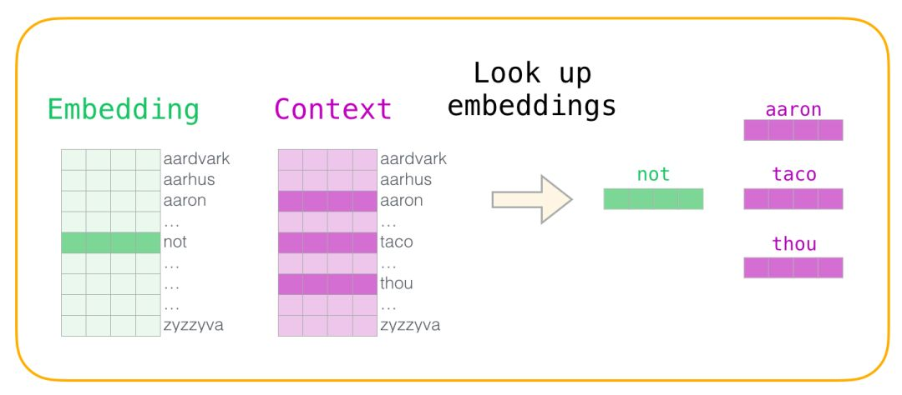

2. 第二步，计算输入嵌入与每个上下文嵌入的点积还记得点积的定义否
   两个向量a = [a1, a2,…, an]和b = [b1, b2,…, bn]的点积定义为：\(a\cdot b = a_{1}b_{1} + a_{2}b_{2} + \cdots + a_{n}b_{n}\)

   而这个 **点积的结果意味着** 『 **输入** 』 **和** 『 **上下文各个嵌入** 』 **的各自相似性程度，结果越大代表越相似** 。

   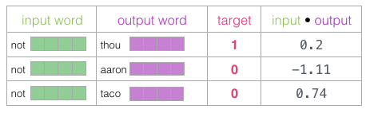

   为了将这些分数转化为看起来像概率的东西——比如正值且处于0到1之间，可以通过sigmoid这一逻辑函数转换下。

   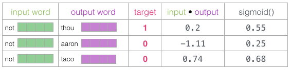

   可以看到taco得分最高，aaron最低，无论是sigmoid操作之前还是之后。

3. 第三步，既然未经训练的模型已做出预测，而且我们拥有真实目标标签来作对比，接下来便可以计算模型预测中的误差了，即让目标标签值减去sigmoid分数，得到所谓的损失函数

   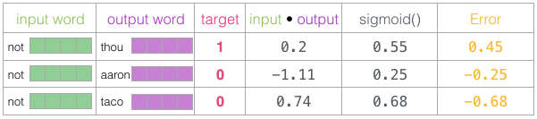

   **error = target - sigmoid_scores**

4. 第四步，我们可以利用这个错误分数来调整not、thou、aaron和taco的嵌入，使下一次做出这一计算时，结果会更接近目标分数

   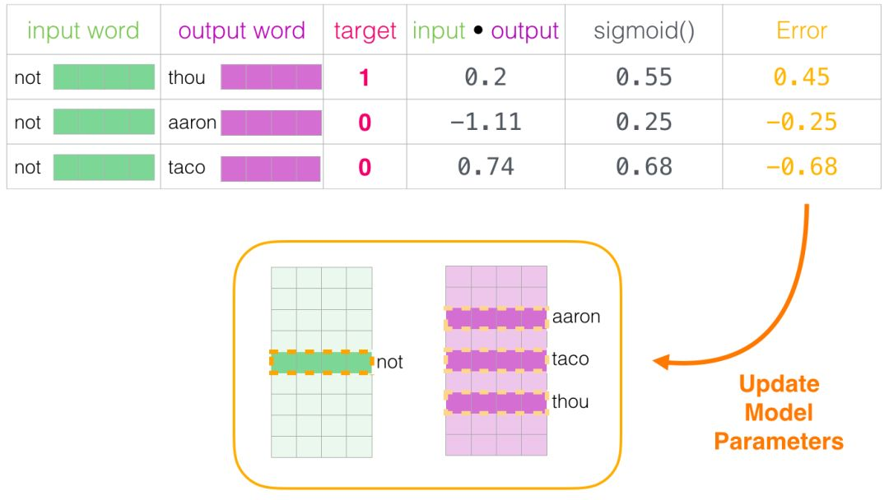

   训练步骤到此结束，我们从中得到了这一步所使用词语更好一些的嵌入（not，thou，aaron和taco）

5. 第五步，针对下一个相邻样本及其相关的非相邻样本再次执行相同的过程

   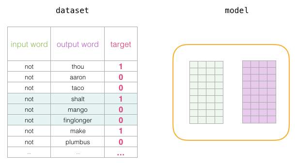

   当我们循环遍历整个数据集多次时，嵌入会继续得到改进。然后我们就可以停止训练过程，丢弃Context矩阵，并使用Embeddings矩阵作为下一项任务的已被训练好的嵌入

## 第二部分  从Seq2Seq到Seq2Seq with Attention

### 2.1 从Seq2Seq序列到Encoder-Decoder模型

#### 2.1.1 什么是Seq2Seq：输入一个序列 输出一个序列

Seq2Seq（Sequence-to-sequence）正如字面意思：输入一个序列，输出另一个序列，当然，其中输入序列和输出序列的长度是可变的。

比如我们翻译英国经验派哲学家弗兰西斯・培根的一句名言“知识就是力量”，如下图：

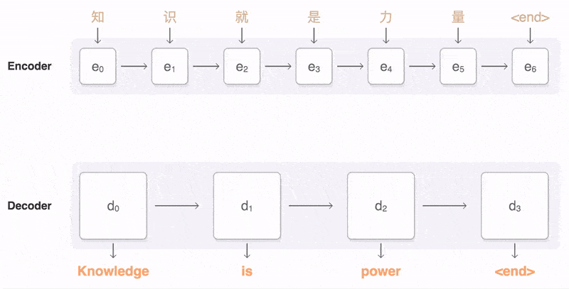

简言之，只要满足「输入序列、输出序列」的目的，都可以统称为 Seq2Seq序列。

#### 2.1.2 什么是Encoder-Decoder模型：RNN/LSTM与GRU

针对Seq2Seq序列问题，比如翻译一句话，可以通过Encoder-Decoder模型来解决。

从上文我们已经接触到编码的概念，有编码则自然有解码，而这种编码、解码的框架可以称之为Encoder-Decoder，中间一个向量C传递信息，且C的长度是固定的。

本节配图大半来源于参考文献2。

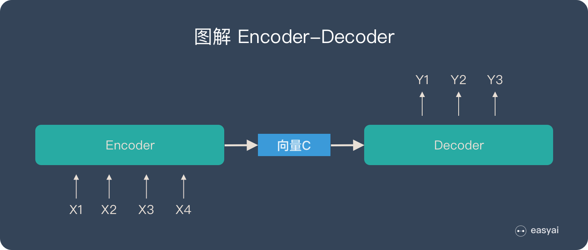

没太明白？可以这么理解，在上图中，我们可以根据不同的任务可以选择不同的编码器和解码器，具体化可以是一个RNN。

在参考文献3里《 [如何从RNN起步，一步一步通俗理解LSTM](https://blog.csdn.net/v_JULY_v/article/details/89894058) 》，我们已经详细了解了RNN和LSTM，如果忘了，一定要复习下（这是继续理解下文的重中之重）

> 为了建模序列问题，RNN引入了隐状态h（hidden state）的概念， **隐状态h可以对序列形的数据提取特征，接着再转换为输出** 。
> 
> 在学习RNN之前，首先要了解一下最基本的单层网络，它的结构如下图所示：
> 
> 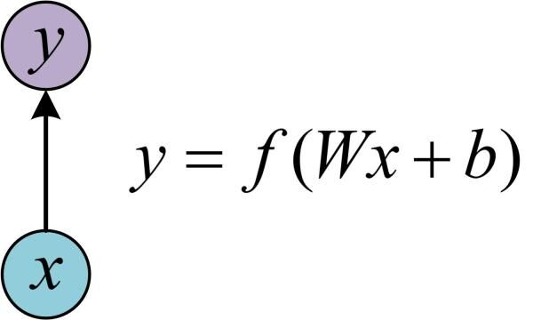
> 
> 输入是x，经过变换\(Wx+b\)和激活函数f，得到输出y。相信大家对这个已经非常熟悉了。
> 
> 在实际应用中，我们还会遇到很多序列形的数据：
> 
> 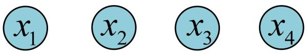
> 
> 如：
> 
> 1. 自然语言处理问题。x1可以看做是第一个单词，x2可以看做是第二个单词，依次类推
> 
> 2. 语音处理。此时，x1、x2、x3……是每帧的声音信号
> 
> 3. 时间序列问题。例如每天的股票价格等等
> 
> 而其中，序列形的数据就不太好用原始的神经网络处理了。
> 
> 为了建模序列问题，RNN引入了隐状态h（hidden state）的概念， **隐状态h可以对序列形的数据提取特征，接着再转换为输出** 。
> 
> 
> 
> 先从\(h_{1}\)计算开始看：
> 
> 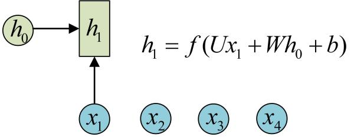
> 
> RNN可以被看做是上述同一神经网络的多次复制，每个神经网络模块会把消息传递给下一个：
> 
> 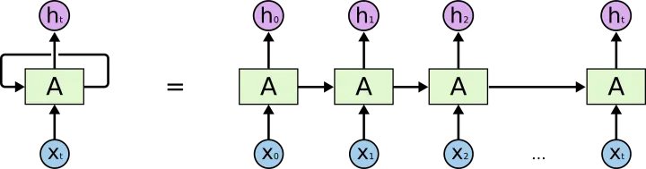
> 
> 当然，更多通常是其变种LSTM或者GRU
> 
> 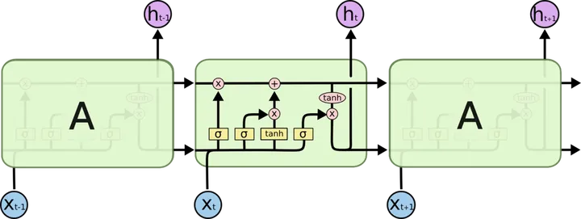
> 
> 

这样你就明白了吧，而只要是符合类似的框架，都可以统称为 Encoder-Decoder 模型。

### 2.2 从Seq2Seq到Seq2Seq with Attention

#### 2.2.1 Attention应运而生：解决信息过长时信息丢失的问题

上文提到：Encoder（编码器）和 Decoder（解码器）之间只有一个「向量C」来传递信息，且C的长度固定。

比如翻译一段语句，翻译的句子短还好，句子一长呢？当输入句子比较长时， **所有语义完全转换为一个中间语义向量C来表示** ，单词原始的信息已经消失，可想而知会丢失很多细节信息。

所以Encoder-Decoder是有缺陷的，其缺陷在于：当输入信息太长时，会丢失掉一些信息。

而为了解决「信息过长，信息丢失」的问题，Attention 机制就应运而生了。

Attention 模型的特点是 Eecoder 不再将整个输入序列编码为固定长度的「中间向量Ｃ」，而是编码成一个向量的序列(包含多个向量)。引入了Attention的Encoder-Decoder 模型如下图：

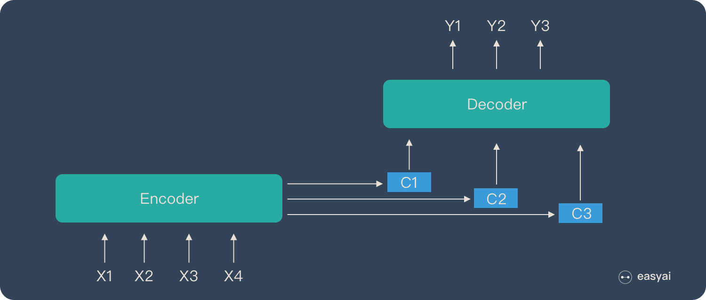

- <u>从输出的角度讲</u> 
  每个输出的词Y会受到每个输入\(X_{1}\)、\(X_{2}\)、\(X_{3}\)、\(X_{4}\)的整体影响，不是只受某一个词的影响，毕竟整个输入语句是整体而连贯的，但同时每个输入词对每个输出的影响又是不一样的，即每个输出Y受输入\(X_{1}\)、\(X_{2}\)、\(X_{3}\)、\(X_{4}\)的影响权重不一样，而这个权重便是由Attention计算，也就是所谓的注意力分配系数，计算每一项输入对输出权重的影响大小

- <u>从编码的角度讲</u> 
  在根据给到的信息进行编码时（或称特征提取），不同信息的重要程度是不一样的（可用权重表示），即有些信息是无关紧要的，比如一些语气助词之类的，所以这个时候在编码时，就可以有的放矢，根据不同的重要程度针对性汲取相关信息

#### 2.2.2 通过翻译Tom chase Jerry揭示Attention的算法流程

再举一个机器翻译的例子（本猫追老鼠例子的配图和核心阐述均来源于参考文献4），即用Google翻译这句话：Tom chase Jerry

1. 在翻译“杰瑞”的时候，带有注意力机制的模型会体现出英文单词对于翻译当前中文单词不同的影响程度，比如给出类似这样一个概率分布值：（Tom,0.3）(Chase,0.2) (Jerry,0.5)，每个英文单词的概率代表了翻译当前单词“杰瑞”时，注意力分配模型分配给不同英文单词的注意力大小（类似我司七月在线开董事会，虽然每个人都有发言权，但对不同议题进行决策时，很明显对具体议题更擅长的人拥有更大的发言权，而这个发言权就像权重一样，不同的人对最终决策结果的产生有着不同大小的影响）

2. 目标句子中的每个单词都应该学会其对应的源语句子中单词的注意力分配概率信息。这意味着在生成每个单词\(y_{i}\)的时候，原先都是相同的中间语义表示C会被替换成根据当前生成单词而不断变化的 $$
   C_{i}
   $$（注：这里就是Attention模型的关键，即由固定的中间语义表示C换成了根据当前输出单词来调整成加入注意力模型的变化的 $$
   C_{i}
   $$）。

   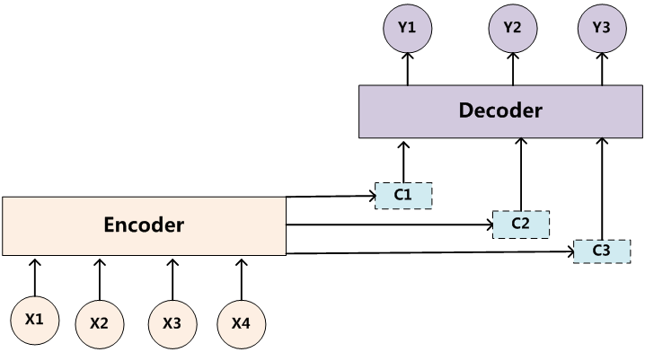

3. 生成目标句子单词的过程成了下面的形式：

   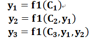

   而每个 $$
   C_{i}
   $$可能对应着不同的源语句子单词的注意力分配概率分布，比如对于上面的英汉翻译来说，其对应的信息可能如下：

   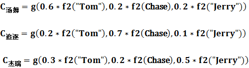

   其中， $$
   f_{2}
   $$函数代表Encoder对输入英文单词的某种变换函数，比如如果Encoder是用的RNN模型的话，这个 $$
   f_{2}
   $$函数的结果往往是某个时刻输入 $$
   x_{i}
   $$后隐层节点的状态值；g代表Encoder根据单词的中间表示合成整个句子中间语义表示的变换函数，一般的做法中，g函数就是对构成元素加权求和，即下列公式：

   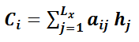

   其中， $$
   L_{x}
   $$代表输入句子Source的长度， $$
   a_{ij}
   $$代表在Target输出第i个单词时Source输入句子中第j个单词的注意力分配系数，而 $$
   h_{j}
   $$则是Source输入句子中第j个单词的语义编码。

4. 假设 $$
   C_{i}
   $$下标i就是上面例子所说的“ 汤姆” ，那么 $$
   L_{x}
   $$就是3，h1=f(“Tom”)、h2=f(“Chase”)、h3=f(“Jerry”)分别是输入句子每个单词的语义编码，对应的注意力模型权值则分别是0.6,0.2,0.2，所以g函数本质上就是个加权求和函数。如果形象表示的话，翻译中文单词“汤姆”的时候，数学公式对应的中间语义表示 $$
   C_{i}
   $$的形成过程类似下图。

   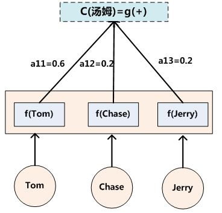

这里有一个问题：生成目标句子某个单词，比如“汤姆”的时候，如何知道Attention模型所需要的输入句子单词注意力分配概率分布值呢？就是说“汤姆”对应的输入句子Source中各个单词的概率分布：(Tom,0.6) (Chase,0.2) (Jerry,0.2) 是如何得到的呢？为做说明，特引用参考文献4对应的内容，如下

> 为了便于说明，我们假设对非Attention模型的Encoder-Decoder框架进行细化，Encoder采用RNN模型，Decoder也采用RNN模型，这是比较常见的一种模型配置
> 
> 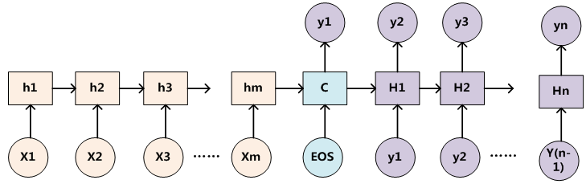
> 
> 那么用下图便可以较为便捷地说明注意力分配概率分布值的通用计算过程。
> 
> 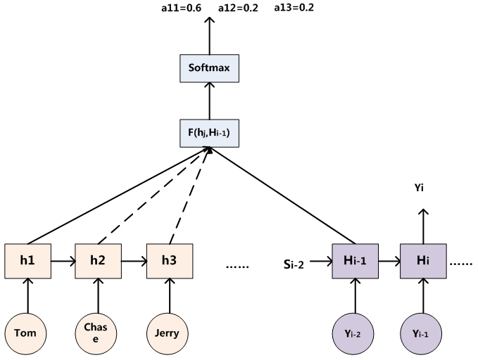
> 
> 对于采用RNN的Decoder来说
> 
> 1. 在时刻i，如果要生成\(y_{i}\)单词，我们是可以知道Target在生成\(y_{i}\)之前的时刻i-1时，隐层节点在i-1时刻的输出值 $$
>    H_{i-1}
>    $$的（这是RNN结构的特性，如果忘了RNN结构特性请回顾参考文献3）
> 
> 2. 而我们的目的是要计算生成\(y_{i}\)时输入句子中的单词“Tom”、“Chase”、“Jerry”对\(y_{i}\)来说的注意力分配概率分布，那么可以用Target输出句子i-1时刻的隐层节点状态 $$
>    H_{i-1}
>    $$去一一和输入句子Source中每个单词对应的RNN隐层节点状态 $$
>    h_{j}
>    $$进行对比，即通过函数 $$
>    F(h_{j},H_{i-1})
>    $$来获得目标单词\(y_{i}\)和每个输入单词对应的对齐可能性， **这个F函数在不同论文里可能会采取不同的方法** ，然后函数F的输出经过Softmax进行归一化就得到了符合概率分布取值区间的注意力分配概率分布数值
> 
> 

对上面这段，还是有必要再好好解释一下

- 如我司杜助教所言：“ 这里举的例子是由 Tom chase Jerrry 得到 汤姆追逐杰瑞，现在我们假设要预测杰瑞（已经预测出来汤姆追逐），那么这个时候，i 就表示的是杰瑞这个时刻， <u>i-1时刻的hidden就包含了 **汤姆追逐** 的信息</u> ，就是想计算i-1时刻的hidden和Tom、chase、Jerry的各自不同的Attention数值，进而更好地预测杰瑞这个词 ”

- 至于注意力分配概率的分布数值，有多种不同的计算方法，具体参见此文： [Attention? Attention!](https://lilianweng.github.io/posts/2018-06-24-attention/) ，或者参看参考文献14（33min至37min，以及50min都有讲）

  

考虑到后来有读者qqw0829反馈对于本节的这个翻译“Tom chase Jerry”的例子依然不是特别理解，如此的话，我用比较易懂的话 再解释下

1. 即当我们在翻译
   Tom chase Jerry
   为
   汤姆追逐杰瑞

2. 其实可以简单粗暴的认为计算“汤姆”与“Tom chase Jerry”中各个词的相似度
   从而得到了“汤姆”对应的输入句子Source中各个单词的概率分布：(Tom,0.6) (Chase,0.2) (Jerry,0.2)

3. 这个概率分布意味着“汤姆”与“Tom”更相似，从而给“Tom”更大的权重
   使得最终把“汤姆”对应到“Tom”，达到的效果就是“Tom”翻译为“汤姆”

#### 2.2.3 Attention的算法流程总结：通过计算相似性得出权重最后加权求和

再比如，图书馆（source）里有很多书（value），为了方便查找，我们给书做了编号（key）。当我们想要了解漫威（query）的时候，我们就可以看看那些动漫、电影、甚至二战（美国队长）相关的书籍。

为了提高效率，并不是所有的书都会仔细看，针对漫威来说，动漫，电影相关的会看的仔细一些（权重高），但是二战的就只需要简单扫一下即可（权重低）。

当我们全部看完后就对漫威有一个全面的了解了。

可以看到，将Source中的构成元素想象成是由一系列的<Key,Value>数据对构成，此时给定Target中的某个元素Query，通过计算Query和各个Key的相似性或者相关性，得到每个Key对应Value的权重系数，然后对Value进行加权求和，即得到了最终的Attention数值。

所以本质上Attention机制是对Source中元素的Value值进行加权求和，而Query和Key用来计算对应Value的权重系数。即可以将其本质思想改写为如下公式：

整个过程具体如下图所示：

归纳整理一下，则为

1. 第一步：代表漫威漫画的query 和 代表某本书的key 进行相似度计算（常见的方法包括：求两者的向量点积、求两者的向量Cosine相似性等），得到权值

2. 第二步：将权值进行归一化（将原始计算分值整理成所有元素权重之和为1的概率分布，或者说通过SoftMax的内在机制更加突出重要元素的权重），得到直接可用的权重
    

3. 第三步：将权重和 value 进行加权求和
    

值得一提的是，Attention 并不一定要在 Encoder-Decoder 框架下使用的，他是可以脱离 Encoder-Decoder 框架的。

了解了Attention的本质思想，理解所谓的Self-Attention就容易了，具体下文会详细阐述，这里先简单提一嘴：

> 在一般任务的Encoder-Decoder框架中，输入Source和输出Target内容是不一样的，比如对于英-中机器翻译来说，Source是英文句子，Target是对应的翻译出的中文句子，Attention机制发生在Target的元素Query和Source中的所有元素之间。
> 
> 而Self Attention顾名思义，指的不是Target和Source之间的Attention机制，而是Source内部元素之间或者Target内部元素之间发生的Attention机制，也可以理解为Target=Source这种特殊情况下的注意力计算机制。其具体计算过程是一样的，只是计算对象发生了变化而已。

##  **第三部分 通俗理解Transformer：通过自注意力机制开启大规模预训练时代** 

自从2017年此文《 [Attention is All You Need](https://arxiv.org/pdf/1706.03762.pdf) 》提出来Transformer后，便开启了大规模预训练的新时代，也在历史的长河中一举催生出了GPT、BERT这样的里程碑模型 (2018年3月份华盛顿大学提出ELMO、2018年6月份OpenAI提出GPT、2018年10月份Google提出BERT、2019年6月份CMU+google brain提出XLNet等等)

> 
> 
> 
> 
> 

不过，据目前我所看到的文章里面，介绍Transformer比较好懂的还是开头所提的这篇《The Illustrated Transformer》 **，** 本部分中的核心阐述和大部分配图均来自此文。

接下来，我在此文的基础上加以大量解释、说明，以让之成为全网最通俗易懂的Transformer导论。因为这些解释、说明是你在其他文章中看不到的，而正因为有了这些解释、说明，才足以真正让每一个初学者都能快速理解到底什么是Transformer。

### 3.1 Transformer之编码：自注意力/位置编码/求和与归一化

#### 3.1.1 从机器翻译模型开始谈起

还是考虑上文中已经出现过的机器翻译的模型( *值得一提的是，Transformer一开始的提出即是为了更好的解决机器翻译问题* )

当我们从外部现象来看的话，这个机器翻译技术就像是一个黑箱操作：输入一种语言，系统输出另一种语言：

当我们拆开这个黑箱后，我们可以看到它是由编码组件、解码组件和它们之间的连接组成。

其中

- 编码组件部分由一堆编码器/Encoder构成（具体个数可以调，论文中是6个）

- 解码组件部分也是由相同数量(与编码器对应)的解码器Decoder组成

进一步拆开这个编码器会发现，所有的编码器在结构上都是相同的，但是并不共享参数，且每个编码器都可以分解成两个子层：

从而，当我们把编码器和解码器联合起来看待的话，则整个流程就是（如下图从左至右所示）：

1. 首先，从编码器输入的句子会先经过一个自注意力层，它会帮助编码器在对每个单词编码时关注输入句子中的的其他单词

2. 接下来，自注意力层的输出会传递到前馈(feed-forward)神经网络中，每个位置的单词对应的前馈神经网络的结构都完全一样

3. 最后，流入解码器中，解码器中除了也有自注意力层、前馈层外，这两个层之间还有一个编码-解码注意力层，用来关注输入句子的相关部分（和seq2seq模型的注意力作用相似）

#### 3.1.2 将张量引入

我们已经了解了模型的主要部分，接下来我们看一下各种向量或张量( *注：张量概念是矢量概念的推广，可以简单理解矢量是一阶张量、矩阵是二阶张量* )是怎样在模型的不同部分中，将输入转化为输出的。

像大部分NLP应用一样，我们首先将每个输入单词通过词嵌入算法转换为词向量

具体而言，流程如下

1. 每个单词都被嵌入为512维的向量（512是Transformer论文中设定的一个维度，类似编码器/解码器的数量一样，都是可以设置的超参数。顺带提句，训练集中最长句子的长度论文中也设置的512。为方便后续一系列的图示，这里用4个格子代表512维，即虽然你只看到4维，但你要明白实际背后代表着512维）

2. 最底下的那个编码器接收的是嵌入向量，之后的编码器接收的是前一个编码器的输出

此时，我们可以看出Transformer的一个核心特性

1. 输入序列中每个位置的单词都各自单独的路径流入编码器，即各个单词同时流入编码器中，不是排队进入..

2. 在自注意力self-attention层中，这些路径两两之间是相互依赖的，而前馈层(feed-forward）则没有这些依赖性，所以这些路径在 <u>流经前馈层(feed-forward)时可以并行计算</u>

####  **3.1.3 什么是自注意力机制：从宏观视角看自注意力机制** 

下面，咱们再通过一个例子了解自注意力机制的工作原理，假定现在要翻译下列句子：
“The <u>animal</u> didn't cross the <u>street</u> because **it** was too tired”

上面这个“it”是指的什么呢？它指的是street 还是这个 animal 呢？对人来说很简单的问题( *必然是animal，因为animal才可能cross，才可能tired* )，但是对算法而言并不简单，算法不一定知道it指的是animal还是street

那self-attention机制咋做呢？一般的文章会这么解释：

> 当模型处理单词“it”时，self-attention允许将“it”和“animal”联系起来。当模型处理每个位置的词时，self-attention允许模型看到句子中其他位置有关联或相似的单词/信息作为辅助线索，以更好地编码当前单词。
> 
> 回想一下RNN对隐藏状态的处理：将之前的隐藏状态与当前位置的输入结合起来。在Transformer中，自注意力机制则将对其他单词的“理解”融入到当前处理的单词中。

说的直白点就是，你如果 <u>要更好的理解句中某个特定单词的含义，你要把它放到整个语境之中去理解，比如通过对上下文的把握</u> ( *包括即便遇到那种一词多义的情况，你也能 **通过其上下文推断其准确含义** ，这就是上下文的重要性，也是transformer计算每个单词与上下文各个词的相似度的意义所在* )

那上下文哪些词对理解该特定词更重要呢？这个重要程度便用所谓的权重表示(权重来自于该词/向量本身跟其他各个词/向量之间的相似度)，权重越大的单词代表与『该词』越相关(某种意义上可以认为是越相似)，从而对理解『该词』越重要，然后把该词编码为包括该词在内所有词的加权和

比如下图中，it的上下文中，很明显the anima和tired等单词对it 的编码更重要(或更相关更相似)，所以自注意力机制在编码it 时把更多的注意力/权重放在了the animal和tired等单词上

接下来的关键是如何计算自注意力，计算自注意力有两种方式：一种通过向量，一种通过矩阵。下面，先看向量的方式

#### 3.1.4 通过向量计算自注意力：先三个向量后计算得分且softmax最后加权求和

#####  **3.1.4之1/4 计算自注意力第一步：生成查询向量、键向量和值向量** 

通过向量方式计算自注意力的第一步，就是从每个编码器的输入向量(即每个单词的词向量)生成三个向量：查询向量query-vec、键向量key-vec、值向量value-vec

1. *查询向量、键向量、值向量这三个向量的维度在论文中设置的是 **64** ，在维度上比词嵌入向量更低，因为词嵌入和编码器的输入/输出向量的维度是512，但也不是必须比编码器输入输出的维数小，这样做主要是为了让后续多头注意力的计算更稳定*

2. *在下文你会看到，transformer通过多头注意力机制multi headed attention，对每个512维的输入向量都设置了8个头，不同的头关注每个输入向量不同的部分，而 **每个头的维度则是：512/8 = 64** ，且再多说一句，也可以设置为2个头，不一定非得设置为8个头*

至于这三个向量的生成方法是把输入的向量分别乘以三个不同的权重矩阵 $$
W^{Q}
$$、 $$
W^{K}
$$、 $$
W^{V}
$$，得到Q、K、V，而这些权重矩阵是在模型训练阶段中训练出来的

> 
> 
> 1. **<u>对于权重矩阵 $$
>    W^{Q}
>    $$/ $$
>    W^{K}
>    $$/ $$
>    W^{V}
>    $$如何训练出来的</u>** ，还是标准老套路： **先随机初始化，然后在损失函数中表示出来，最后通过反向传播不断优化学习得出，最终目标是最小化模型的预测误差** ，至于什么是反向传播，请参见 [参考文献17](https://www.julyedu.com/questions/interview-detail?kp_id=26&cate=%E6%B7%B1%E5%BA%A6%E5%AD%A6%E4%B9%A0&quesId=2921)
> 
> 2. 举个例子，在翻译任务中：
>    \(\rightarrow\)输入序列与对应的权重矩阵 $$
>    W^{Q}
>    $$、 $$
>    W^{K}
>    $$、 $$
>    W^{V}
>    $$各自相乘，得到 Q、K、V向量
>    \(\rightarrow\)自注意力输出传递给后续网络层，最终生成翻译结果
>    \(\rightarrow\)计算翻译结果与参考答案的交叉熵损失
>    \(\rightarrow\)反向传播更新所有参数，其中便包括 $$
>    W^{Q}
>    $$、 $$
>    W^{K}
>    $$、 $$
>    W^{V}
>    $$
> 
> 3. 当然， <u>值得注意的是，这些权重矩阵是模型参数的一部分</u> ，除了自注意力层，模型参数还包括： *嵌入层(词嵌入矩阵、位置编码)、层归一化参数(比如缩放参数)、MLP全连接层权重(包含升维 降维 偏置因子)、输出层(线性变换的投影矩阵)* 等一系列参数
>    而整个模型的损失函数会基于最终的输出(比如预测的下一个词的概率分布)与真实标签之间的差异来计算损失，然后通过反向传播算法将梯度传递回各个参数
>    *当然了，咱们也可以选择性的微调部分参数的，详见此文《 [从LongLoRA到LongQLoRA(含源码剖析)：超长上下文大模型的高效微调方法](https://blog.csdn.net/v_JULY_v/article/details/135375799) 》*
> 
> 

为形象起见，还是举例来说明，在我们有了权重矩阵后，对于单词\(X_{1}\)、\(X_{2}\)分别而言（假定X1是Thinking，X2是Machines）：

- \(X_{1}\)与 $$
  W^{Q}
  $$权重矩阵相乘得到与这个单词相关的查询向量 $$
  q_{1}
  $$、\(X_{1}\)与 $$
  W^{K}
  $$权重矩阵相乘得到与这个单词相关的键向量 **$$
  k_{1}
  $$** 、\(X_{1}\)与 $$
  W^{V}
  $$权重矩阵相乘得到与这个单词相关的值向量 $$
  v_1
  $$

- 对于单词\(X_{2}\)而言，依上类推：\(X_{2}\)分别与 $$
  W^{Q}
  $$、 $$
  W^{K}
  $$、 $$
  W^{V}
  $$相乘得到该单词的查询向量 **$$
  q_{2}
  $$** 、键向量 **$$
  k_{2}
  $$** 、值向量 $$
  v_2
  $$

最终使得 <u>输入序列的每个单词各自创建一个查询向量、一个键向量和一个值向量</u> 

可能有的读者有疑问了，设置这三个向量的用意何在或有何深意，实际上

- 查询向量Query是当前单词的表示形式，用于对所有其他单词(key)进行评分，我们只需要关注当前正在处理的token的query

- 键向量Key可以看做是序列中所有单词的标签，是在我们找相关单词时候的对照物

- 值向量Value是单词的实际表示，一旦我们对每个单词的相关度打分之后，我们就要对value进行相加表示当前正在处理单词的value

#####  **3.1.4之2/4 计算自注意力第二步：计算得分** 

接下来，我们需要针对这个例子中的第一个单词“Thinking”（pos#1）计算attention分值，即计算每个词对“Thinking”的打分，这个分决定着编码“Thinking”时(某个固定位置时)，应该对其他位置上的单词 **各自** 给予多少关注度

这个得分通过“Thinking”所对应的查询向量query和所有词的键向量key，依次乘积得出来。所以如果我们是处理位置最靠前的词的attention分值的话

- 第一个分数是q1和k1的点积(根据点积结果可以判断 **q1和k1这个向量的相似性** )

- 第二个分数是q1和k2的点积(根据点积结果可以判断q1 **和k2这个向量的相似性** )

  

#####  **3.1.4之3/4 计算自注意力第三、四步：分数除以8然后softmax下** 

第三步和第四步分别是：

- 将分数除以8（8是论文中使用的键向量的维数64的平方根，这会让梯度更稳定，也可以使用其它值）

- 然后通过softmax传递结果，softmax的作用是使所有单词的分数归一化，得到的分数都是正值且它们的和为1

这个softmax分数决定了在编码当下位置（“Thinking”）时，包括当下位置单词（“Thinking”）在内每个单词的所获得的关注度。显然，正在当下位置上的 **Thinking** 获得最高的softmax分数(毕竟自己跟自己最相似嘛，所以编码thinking时对Thinking、Machines的注意力分数分配是：0.88 0.12)。

#####  **3.1.4之4/4 计算自注意力第五、六步：值向量乘以softmax分数后对加权值向量求和** 

第五步是将softmax分值乘以每个值向量，这样操作的意义在于留下我们想要关注的单词的value，并把其他不相关的单词丢掉(例如，让它们乘以0.001这样的小数)

第六步是对加权值向量求和，产生“ **Thinking** ”的self-attention的输出结果

接下来，针对每个单词都进行上述六个步骤的自注意力得分计算，相当于

1. 先是“Thinking”对应的query(q1)与各个不同的key(k1、k2)计算相似度，然后除以8继而softmax，最后softmax值乘以值向量v1、v2并加权求和
   即： $$
   z_1 = softmax [(q_1k_1)/\sqrt{d_k}] \times v_1 + softmax [(q_1k_2)/\sqrt{d_k}] \times v_2
   $$，注：下图里的b1相当于上面的z1

   

2. 再是“Machines”对应的query(q2)与各个不同的key(k1、k2)计算相似度，然后也除以8继而softmax，最后softmax值乘以值向量v1、v2并加权求和
   即： $$
   z_2 = softmax [(q_2k_1)/\sqrt{d_k}] \times v_1 + softmax [(q_2k_2)/\sqrt{d_k}] \times v_2
   $$，注：下图里的b2相当于上面的z2

   

> 为更加一目了然，且如果不考虑缩放、softmax等因素，那么这一系列的计算过程可以简化为(注意，如果是GPT那种单向的结构，则只有其中带下划线的计算部分)
> 
> 1. <u>q1 **k1 v1**</u> 、q1k2 v2、q1k3 v3、q1k4 v4
> 
> 2. <u>q2 **k1 v1** 、q2 **k2 v2**</u> 、q2k3 v3、q2k4 v4
> 
> 3. <u>q3 **k1 v1** 、q3 **k2 v2** 、q3 **k3 v3**</u> 、q3k4 v4
> 
> 4. <u>q4 **k1 v1** 、q4 **k2 v2** 、q4 **k3 v3** 、q4 **k4 v4**</u>
> 
> 

最终每个词的输出向量 $$
z_i
$$都包含了其他词的信息，每个词都不再是孤立的了，而且词与词的相关程度可以通过softmax输出的权重进行分析

如此，所有单词的自注意力计算就完成了，得到的向量就可以传给前馈神经网络。然而实际中，这些计算是以矩阵形式完成的，以便算得更快。下面咱们再看看如何用矩阵实现的。

####  **3.1.5 通过矩阵运算实现自注意力机制** 

第一步是计算查询矩阵、键矩阵和值矩阵。为此，我们将输入词向量合并成输入矩阵 $$
X
$$（矩阵的每一行代表输入句子中的一个单词，所以整个矩阵就代表整个句子），将其乘以我们训练的权重矩阵： $$
W^{Q}
$$/ $$
W^{K}
$$/ $$
W^{V}
$$「 *再次提醒：词嵌入向量 (512，或图中的4个格子)，和q/k/v向量(64，或图中的3个格子)的大小差异* 」

最后，由于我们处理的是矩阵，我们可以将步骤2到步骤6合并为一个公式来计算自注意力层的输出，下图是自注意力的矩阵运算形式：

如果觉得不够形象的话，可以再看下台大李宏毅画的这几个图

> 
> 
> 1. 将输入向量 $$
>    a^1
>    $$、 $$
>    a^2
>    $$、 $$
>    a^3
>    $$、 $$
>    a^4
>    $$按列组合成一个矩阵 $$
>    I
>    $$，与 $$
>    W^q
>    $$相乘得到矩阵 $$
>    Q
>    $$，其中矩阵 $$
>    Q
>    $$包含了所有输入向量对应的query，同理可以得到key和value对应的矩阵 $$
>    K
>    $$和 $$
>    V
>    $$
> 
>    
> 
> 2. 将各个向量对应的key按行组合，与输入向量 $$
>    q^1
>    $$相乘，得到与输入向量 $$
>    a^1
>    $$之间的所有关联性分数 $$
>    a_{1,1}
>    $$、 $$
>    a_{1,2}
>    $$、 $$
>    a_{1,3}
>    $$、 $$
>    a_{1,4}
>    $$
>    
>    
>    ---
>    
>    顺带一提，上面这种把 $$
>    a_{1,1},a_{1,2},a_{1,3},a_{1,4}
>    $$竖着写，和上文横着写( *横着写的情况 即如下所示* ) *<u>q1 **k1 v1**</u> 、q1k2 v2、q1k3 v3、q1k4 v4* 
>    
>    *<u>q2 **k1 v1** 、q2 **k2 v2**</u> 、q2k3 v3、q2k4 v4* 
>    
>    *<u>q3 **k1 v1** 、q3 **k2 v2** 、q3 **k3 v3**</u> 、q3k4 v4* 
>    
>    *<u>q4 **k1 v1** 、q4 **k2 v2** 、q4 **k3 v3** 、q4 **k4 v4**</u>* 
>    
>    
>    
>    本质是一样的，不影响最终的计算结果---
>    
>    由此可知，将矩阵 $$
>    K
>    $$转置后，与矩阵 $$
>    Q
>    $$相乘得到矩阵 $$
>    A
>    $$，其中矩阵 $$
>    A
>    $$包含了所有输入向量之间的关联性分数
>    
>    
>    
>    然后再将矩阵 $$
>    A
>    $$给到Softmax激活函数，得到矩阵 $$
>    A^{'}
>    $$
>    
>    
>    
> 3. 最后将各个输入向量对应的value按列组合成一个矩阵 $$
>    V
>    $$，并与矩阵 $$
>    A^{'}
>    $$
>    相乘得到Self-attention的输出矩阵 $$
>    O
>    $$「 *其中的b1 b2 b3 b4相当于上文的z1 z2 z3 z4* 」
> 
>    
> 
> 

####  **3.1.6 多头注意力机制“multi-headed” attention** 

为进一步完善自注意力层，下面增加一种叫做“多头”注意力（“multi-headed” attention）的机制，并在两方面提高了注意力层的性能：

1. 它扩展了模型专注于不同位置的能力。编码“Thinking”的时候，虽然最后Z1或多或少包含了其他位置单词的信息，但是它实际编码中把过多的注意力放在“Thinking”单词本身( *当然了，这也无可厚非，毕竟自己与自己最相似嘛* )
   且如果我们翻译一个句子，比如“The animal didn’t cross the street because it was too tired”，我们会想知道“it”和哪几个词 **都** 最有关联，这时模型的“多头”注意机制会起到作用

2. 它给出了注意力层的多个“表示子空间”（representation subspaces）

> July注：第一次看到这里的朋友，可能会有疑问，正如知乎上有人问(https://www.zhihu.com/question/341222779?sort=created)： **为什么Transformer 需要进行Multi-head Attention，即多头注意力机制** ？
> 
> - 叫TniL的答道：可以类比CNN中同时使用多个滤波器的作用，直观上讲，多头的注意力有助于网络捕捉到更丰富的特征/信息
>   且论文中是这么说的： *Multi-head attention allows the model to jointly attend to information from different representation subspaces at different positions.* 
> 
>   关于different representation subspaces，举一个不一定妥帖的例子：
>   当你浏览网页的时候，你可能在颜色方面更加关注深色的文字， **而在字体方面会去注意大的、粗体的文字** 。这里的颜色和字体就是两个不同的表示子空间。同时关注颜色和字体，可以有效定位到网页中强调的内容
>   *使用多头注意力，也就是综合利用各方面的信息/特征（毕竟，不同的角度有着不同的关注点）*
> 
> - 叫LooperXX的则答道：在Transformer中使用的多头注意力出现前，基于各种层次的各种fancy的注意力计算方式，层出不穷。而Transformer的多头注意力借鉴了CNN中同一卷积层内使用多个卷积核的思想，原文中使用了 8 个 scaled dot-product attention ，在同一multi-head attention 层中，输入均为 KQV，同时进行注意力的计算，彼此之前参数不共享，最终将结果拼接起来， <u>这样可以允许模型在不同的表示子空间里学习到相关的信息</u> ，在此之前的 A Structured Self-attentive Sentence Embedding 也有着类似的思想
>   ————
>   *简而言之，就是希望每个注意力头，只关注最终输出序列中一个子空间，互相独立，其核心思想在于，抽取到更加丰富的特征信息*
> 
> 

OK，接下来，我们将看到对于“多头”注意机制，我们有多个查询/键/值权重矩阵集（ *Transformer使用8个注意力头，则对于每个编码器/解码器都有8个“ $$
W^{Q}
$$ $$
W^{K}
$$ $$
W^{V}
$$”的矩阵集合* ），每一组都是随机初始化，经过训练之后，输入向量可以被映射到不同的子表达空间中，具体而言

1. 在“多头”注意机制下，我们为 **每个头保持独立的查询/键/值权重矩阵——** 头与头之间是没有交互计算的 **，从而产生不同的查询/键/值矩阵** 
   和之前一样，我们拿 $$
   X
   $$乘以 $$
   W^{Q}
   $$/ $$
   W^{K}
   $$/ $$
   W^{V}
   $$矩阵来产生查询/键/值矩阵

   

2. 如果我们做与上述相同的自注意力计算，只需8次不同的权重矩阵运算，我们就会得到8个不同的Z矩阵

   

3. 这给我们带来了一点挑战。前馈层没法一下子接收8个矩阵，它需要一个单一的矩阵(最终这个单一 **矩阵类似输入矩阵** $$
   X
   $$ **那样，矩阵中每个的行向量对应一个单词，比如矩阵的第一行对应单词Thinking、矩阵的第二行对应单词Machines** )
   所以我们需要一种方法把这8个矩阵合并成一个矩阵。那该怎么做？其实可以直接把这些矩阵拼接在一起，然后乘以一个附加的权重矩阵 $$
   W^{O}
   $$

   

以上基本就是多头自注意力的全部了，接下来把所有矩阵集中展示下，如下图所示

> 现在我们已经看过什么是多头注意力了，让我们回顾一下之前的一个例子
> 
> 1. 对于上文提到过的这个序列：“The animal didn’t cross the street because it was too tired”，再看一下编码“it”的时候每个头的关注点都在哪里：
> 
>    
> 
>    编码it，用两个head的时候：其中一个更关注 **the animal** （注意看图中黄线的指向），另一个更关注 **tired** （注意看图中绿线的指向）
> 
> 2. <u>恍然大悟没有</u> ？！总有一个头会关注到咱们想关注的点，避免在编码it时只重点关注到了the animal，而没重点关注tired
> 
>    如果我们把所有的头的注意力都可视化一下，就是下图这样
> 
>    
> 
> 

#### 3.1.7 相比CNN/RNN的优势与位置编码

首先，CNN提取的是局部特征，但是对于文本数据，忽略了长距离的依赖，比如来自 [这里](https://www.zhihu.com/question/580810624/answer/2979260071) 的这个例子

> 假设有如下这句话： <u>小明在星期天要去露营，他准备叫上小红</u> 
> 
> 在屏幕前的你，你会很快看出来后半句中的「他」指的就是「小明」，因为你可以一眼扫过去 看到差不多整个句子，且一眼看出这些词之间的关联，但对于计算机来说，可没那么容易，毕竟“小明”和“他”之间之间相距8个字
> 具体而言，对于CNN会怎么处理呢？
> 
> 1. 一般会从最左侧开始，通过「同时扫描三个词的滑动窗口」从左到右扫描整个句子
> 
>    
> 
> 2. 且每次往右移动一格
> 
>    
> 
> 3. 重复这个过程，对整个文本进行处理，便得到一个「卷积核」计算出的所有特征，如下图所示，此时 <u>“小明”两个字只共同参与了特征A1的计算</u> ，而“他”字则参与了特征 <u>A9、A10、A11</u> 的计算，其中A9距离A1最近(因为A1中含有“小明”的信息，而A9中含有“他”的信息)
>    但在此时卷积操作本身并没有同时作用于“小明”和“他”这两个词，所以它无法建立它们之间的任何关系(因为模型的卷积操作都没有同时看到它们)
> 
>    
> 
> 4. 怎么办呢？好在不管怎么着，特征A1和特征A9之间的距离相较于“小明”和“他”的距离变近了。所以我们可以继续在特征A上再堆叠一层卷积B 然后计算，然后再堆叠卷积C 再计算，直到卷积操作比如E能直接获取到“小明”和“他”的信息
> 
>    
> 
> 

就这样，通过更多的卷积操作，把卷积网络堆叠的更深，以此来让它有机会捕捉“长距离依赖”。换言之，卷积网络主要依靠深度来捕捉长距离依赖。但这个过程太间接了，因为信息在网络中实际传播了太多层。究竟哪些信息被保留，哪些被丢弃了，弄不清楚。所以从实践经验来看，卷积网络捕捉长依赖的能力非常弱。这也是为什么在大多数需要长依赖关系建模的场景中，CNN用的并不多的原因

那RNN的问题又在哪呢？如下图所示，当计算隐向量 $$
h_4
$$时，用到了两个信息：一个输入 $$
X_4
$$，一个上一步算出来的隐向量 $$
h_3
$$(前面所有节点的信息现在都寄存在了 $$
h_3
$$中)

1. 意味着 $$
   h_4
   $$中包含最多的信息是当前的输入 $$
   X_4
   $$，越往前的输入，随着距离的增加， <u>信息衰减</u> 得越多。对于每一个输出隐向量 $$
   h
   $$都是如此，包含信息最多得是当前的输入，随着距离拉远，包含前面输入的信息越来越少
   但是Transformer这个结构就不存在这个问题，不管当前词和其他词的空间距离有多远，包含其他词的信息不取决于距离，而是取决于两者的相关性，这是Transformer的第一个优势

2. 第二个优势在于，对于Transformer来说，在对当前词进行计算的时候，不仅可以用到前面的词，也可以用到后面的词，而RNN只能用到前面的词(当然，这倒不是个有多严重的问题，因为这可以通过双向RNN来解决)

3. 第三点，RNN是一个顺序的结构，必须要一步一步地计算，只有计算出 $$
   h_1
   $$，才能计算 $$
   h_2
   $$，其次再计算 $$
   h_3
   $$，即隐向量 <u>无法同时并行计算</u> ，导致RNN的计算效率不高
   通过前文的介绍，可以看到Transformer不存在这个问题

不过有个细节值得注意下，不知有读者发现没有，即RNN的结构包含了序列的时序信息，而Transformer却完全把时序信息给丢掉了

毕竟 **“他欠我100万”，和“我欠他100万”，两者的意思千差万别，故为了解决时序的问题，Transformer的作者用了一个绝妙的办法：位置编码（Positional Encoding）** 。

即给每个位置编号，从而每个编号对应一个向量，最终通过 **结合位置向量和词向量，作为输入embedding** ，就给每个词都引入了一定的位置信息，这样Attention就可以分辨出不同位置的词了：

关于『使用位置编码表示序列的位置』的细节请参看此文的1.1节： [从零实现Transformer的简易版与强大版：从300多行到3000多行](https://blog.csdn.net/v_JULY_v/article/details/130090649) 

### 3.2 Transformer之解码：求和与归一化、线性层和softmax层

#### 3.2.1 求和与归一化

最后，在回顾整个Transformer架构之前，还需再提一下编码器中的一个细节：每个编码器中的每个子层都有一个残差连接，然后做了一个：层归一化(layer-normalization)

这个过程中的向量“求和层归一化”的示意图如下所示：

当然在解码器子层中也是这样的，从而当有着两个编码器和两个解码器的Transformer就是下图这样的：

现在我们已经介绍了编码器的大部分概念，由于encoder的decoder组件差不多，所以也就基本知道了解码器的组件是如何工作的。最后，我们直接看下二者是如何协同工作的 (可以很直观的看到，解码输出时 是一个一个输出的)：

#### 3.2.2 解码器中的两个注意力层

通过上文的介绍可知，解码器中的自注意力层和编码器中的不太一样，解码器中有两个注意力层，从底至上

- 一个带masked的Multi-Head Attention，本质是Self-Attention
  该 **自注意力层只允许关注已输出位置的信息** ，实现方法是在自注意力层的softmax之前进行mask，将未输出位置的权重设置为一个非常大的负数(进一步softmax之后基本变为0，相当于直接屏蔽了未输出位置的信息)

- 一个不带masked的Multi-Head Attention，本质是Encoder-Decoder Attention

对于第二个注意力层，即Encoder-Decoder Attention

- 与Encoder中的Q、K、V全部来自于上一层单元的输出不同，Decoder只有Q来自于上一个Decoder单元的输出，K与V都来自于Encoder最后一层的输出
  注意，这点很关键，也就是说，Decoder是要通过当前状态Q与Encoder的输出K算出权重后(计算query与各个key的相似度)，最后与Encoder的V加权得到下一层的状态

  

- 比如当我们要把“ <u>**Hello** World</u> ”翻译为“ <u>**你好** ，世界</u> ”时
  编码器是针对：Hello World
  解码器是针对：你好 世界

  Decoder会计算“你好”这个query分别与“Hello”、“World”这两个key的相似度
  很明显，“你好”与“Hello”更相似，从而给“Hello”更大的权重，最终把“你好”对应到“Hello”，达到的效果就是“Hello”翻译为“你好”

#### 3.2.3 最后的线性层和softmax层

Decoder输出的是一个浮点型向量，如何把它变成一个词？这就是最后一个线性层和softmax要做的事情。

线性层就是一个简单的全连接神经网络，它将解码器生成的向量映射到logits向量中。
假设我们的模型词汇表是10000个英语单词，它们是从训练数据集中学习的。那logits向量维数也是10000，每一维对应一个单词的分数。

然后，softmax层将这些分数转化为概率（全部为正值，加起来等于1.0），选择其中概率最大的位置的词汇作为当前时间步的输出

更多细节以及如何编码实现Transformer，则请继续参看此文《 [从零实现Transformer的简易版与强大版：从300多行到3000多行](https://blog.csdn.net/v_JULY_v/article/details/130090649) 》

## 第四部分 通俗理解BERT： 从Elmo/GPT到集大成者BERT

本部分内容主要参考自本文开头所说的张俊林老师的文章，或文末参考文献6：《 [说说NLP中的预训练技术发展史：从Word Embedding到Bert模型](https://www.julyedu.com/questions/interview-detail?kp_id=30&cate=NLP&quesId=3008) 》

### 4.1 从Word Embedding到ELMO

#### 4.1.1 Word Embedding的缺陷：无法处理多义词问题

在本文的第一部分中，我们介绍了word2vec，但实际生产应用中，word2vec的效果并没有特别好。所以，Word Embedding存在什么问题？

考虑下面两个句子：

- Sentence A：He got bit by Python.

- Sentence B：Python is my favorite programming language.

在句子A中，Python是蟒蛇的意思，而句子B中是一种编程语言。
如果我们得到上面两个句子中单词Python的嵌入向量，那么像word2vec这种嵌入模型就会为这两个句子中的 **Python** 赋予相同的嵌入，因为它是上下文无关的( *关于这点的更多解释详见本文评论区，即我24年1.23日于本文评论区回复的Che_Che_* )

所以word embedding无法区分多义词的不同语义，问题的产生总是无情的推动技术的发展，这不ELMO就来了

#### 4.1.2 **根据上下文动态调整的** ELMO：预训练( **双层双向LSTM** ) + 特征融合

ELMO是“Embedding from Language Models”的简称，提出ELMO的论文题目：“Deep contextualized word representation”更能体现其精髓，而精髓在哪里？在deep contextualized这个短语，一个是deep，一个是context，其中context更关键。

它与之前的Word2Vec有何本质区别？

- 在此之前的Word Embedding本质上是个静态的方式，所谓静态指的是训练好之后每个单词的表达就固定住了，以后使用的时候，不论新句子上下文单词是什么，这个单词的Word Embedding不会跟着上下文场景的变化而改变

- 而ELMO的本质思想是：我事先用语言模型学好一个单词的Word Embedding，然后在我实际使用Word Embedding的时候，单词已经具备了特定的上下文了，这个时候我 **可以根据上下文单词的语义去调整单词的Word Embedding表示** ，这样经过调整后的Word Embedding更能表达在这个上下文中的具体含义，自然也就解决了多义词的问题了

所以 **ELMO本身是个根据当前上下文对Word Embedding动态调整的思路** 

具体而言，ELMO采用了典型的两阶段过程：

1. 第一个阶段是通过语言模型LSTM进行预训练所以，你看到：
   上图左端的前向双层LSTM代表正方向编码器，输入的是从左到右顺序的上文Context-before；
   右端的逆向双层LSTM代表反方向编码器，输入的是从右到左的逆序的下文Context-after

2. 同时，每个编码器的深度都是两层LSTM叠加

3. 第二个阶段是在做下游任务时，从预训练网络中提取对应单词的网络各层的Word Embedding作为新特征补充到下游任务中

上图展示的是其预训练过程，它的网络结构采用了 **双层双向LSTM** ，双向LSTM可以干啥？可以根据单词的上下文去预测单词，毕竟这比只通过上文去预测单词更准确。

这时有同学有疑问了，ELMO采用双向结构不就能看到需要预测的单词了么，你都能看到参考答案了，那岂不影响最终模型训练的效率与准确性，因为哪有做题时看着参考答案做题的。不过，巧就巧在ELMO虽然采用的双向结构，但两个方向是彼此独立训练的，从而避免了这个问题！

> 好家伙，一般的文章可能面对这个问题就是一笔带过，但我July不行啊，咱得解释清楚啥叫“ELMO虽然采用的双向结构，但两个方向是彼此独立训练的”，啥叫既然是双向的，又何来什么独立，然后避免see itself的问题呢？
> 好问题！虽然ELMO用双向LSTM来做encoding，但是这 **两个方向的LSTM其实是分开训练的** （看到上图中那两个虚线框框没，分开看左边的双层LSTM和右边的双层LSTM，一个从左向右预测，一个从右向左预测，但在左边和右边的内部结构里，其本质不还是单向么，所以其实就是个伪双向，^_^）， **只是在最后在loss层做了个简单相加** 
> 
> 换言之，两个关键点
> 
> 1. 对于每个方向上的单词来说，因为两个方向彼此独立训练，故在一个方向被encoding的时候始终是看不到它另一侧的单词的，从而避免了see itself的问题
> 
> 2. 而再考虑到句子中有的单词的语义会同时依赖于它左右两侧的某些词，仅仅从单方向做encoding是不能描述清楚的，所以再来一个反向encoding，故称双向
> 
> 看似完美！“伪双向”既解决了see itself的问题，又充分用上了上下文的语义
> 
> ---
> 
> 然，BERT的作者指出这种 <u>两个方向彼此独立训练即伪双向的情况下，即便双层的双向编码</u> 也可能没有发挥最好的效果，而且我们可能不仅需要真正的双向编码，还应该要加深网络的层数，但暂且不管加不加深，真正的双向编码网络还是会不得不面对这个老问题：导致模型最终可以间接地“窥探”到需要预测的词，即还是那个see itself的问题。此点，下文细谈

ELMO这个网络结构其实在NLP中是很常用的。使用这个网络结构利用大量语料做语言模型任务就能预先训练好这个网络，如果 **训练好这个网络后，再输入一个新句子，句子中每个单词都能得到对应的三个Embedding：** 

1. 第一个Embedding，是单词的Word Embedding

2. 第二个Embedding，是双层双向LSTM中第一层LSTM对应单词位置的Embedding，这层编码单词的句法信息更多一些

3. 第三个Embedding，是双层双向LSTM中第二层LSTM对应单词位置的Embedding，这层编码单词的语义信息更多一些

也就是说，ELMO的预训练过程不仅仅学会单词的Word Embedding，还学会了一个双层双向的LSTM网络结构，而这两者后面都有用

预训练好网络结构后，如何给下游任务使用呢？下图展示了下游任务的使用过程，比如我们的下游任务仍然是QA问题，此时对于问句X

1. 可以先将句子X作为预训练好的ELMO网络的输入

2. 这样句子X中每个单词在ELMO网络中都能获得对应的三个Embedding

3. 之后给予这三个Embedding中的每一个Embedding一个权重a，这个权重可以学习得来

4. 根据各自权重累加求和，将三个Embedding整合成一个

5. 然后将整合后的这个Embedding作为X句在自己任务的那个网络结构中对应单词的输入，以此作为补充的新特征给下游任务使用

对于上图所示下游任务QA中的回答句子Y来说也是如此处理。因为ELMO给下游提供的是每个单词的特征形式，所以这一类预训练的方法被称为“ **Feature-based Pre-Training** ”。

---

技术迭代的长河永不停歇，那么站在现在这个时间节点看，ELMO有什么值得改进的缺点呢？

1. 首先，一个非常明显的缺点在特征抽取器选择方面，ELMO使用了LSTM而不是新贵Transformer，毕竟很多研究已经证明了Transformer提取特征的能力是要远强于LSTM

2. 另外一点，ELMO采取双向拼接这种融合特征的能力可能比BERT一体化的融合特征方式弱

此外，不得不说除了以ELMO为代表的这种“Feature-based Pre-Training + 特征融合(将预训练的参数与特定任务的参数进行融合)”的方法外，NLP里还有一种典型做法，称为“预训练 + 微调(Fine-tuning)的模式”，而GPT就是这一模式的典型开创者

#### 4.1.3 微调(Fine-tuning)：把在源数据集上训练的源模型的能力迁移到新数据新模型上

既然提到了Fine-tuning，则有必要详细解释一下什么是Fine-tuning。而要了解什么是Fine-tuning，就要先提到迁移学习概念

所谓迁移学习(Transfer learning)  ，就是把已训练好的模型（预训练模型）参数迁移到新的模型来帮助新模型训练。考虑到大部分数据或任务都是存在相关性的，所以通过迁移学习我们可以将已经学到的模型参数（也可理解为模型学到的知识），通过某种方式来分享给新模型从而加快并优化模型的学习效率，从而不用像大多数网络那样从零学习

其中，实现迁移学习有以下三种手段：

- Transfer Learning：冻结预训练模型的全部卷积层，只训练自己定制的全连接层

- Extract Feature Vector：先计算出预训练模型的卷积层对所有训练和测试数据的特征向量，然后抛开预训练模型，只训练自己定制的简配版全连接网络

- Fine-tuning：冻结预训练模型的部分卷积层（通常是靠近输入的多数卷积层，因为这些层保留了大量底层信息）甚至不冻结任何网络层，训练剩下的卷积层（通常是靠近输出的部分卷积层）和全连接层

为了更好的说明什么是Fine-tuning，再引用下动手学深度学习一书上的例子，最后归纳Fine-tuning的步骤/流程

假设我们想从图像中识别出不同种类的椅子，然后将购买链接推荐给用户。一种可能的方法是

1. 先找出100种常见的椅子，为每种椅子拍摄1,000张不同角度的图像，然后在收集到的10万张图像数据集上训练一个分类模型
   这个椅子数据集虽然可能比一般的小数据集要庞大，但样本数仍然不及ImageNet数据集中样本数的十分之一

2. 所以如果把适用于ImageNet数据集的复杂模型用在这个椅子数据集上便会过拟合。同时，因为椅子数据量有限，最终训练得到的模型的精度也可能达不到实用的要求

3. 比较经济的解决办法便是应用迁移学习，将从ImageNet数据集学到的知识迁移到椅子数据集上
   毕竟虽然ImageNet数据集的图像大多跟椅子无关，但在该数据集上训练的模型可以抽取较通用的图像特征，从而能够帮助识别边缘、纹理、形状和物体组成等，这些类似的特征对于识别椅子也同样有效

而这，就是所谓的迁移学习中一种常用技术：微调，如下图所示，微调由以下4步构成

1. 在源数据集（如ImageNet数据集）上预训练一个神经网络模型，即源模型

2. 创建一个新的神经网络模型，即目标模型，它复制了源模型上除了输出层外的所有模型设计及其参数
   我们假设这些模型参数包含了源数据集上学习到的知识，且这些知识同样适用于目标数据集
   我们还假设源模型的输出层与源数据集的标签紧密相关，因此在目标模型中不予采用

3. 为目标模型添加一个输出大小为目标数据集类别个数的输出层，并随机初始化该层的模型参数

4. 在目标数据集(如椅子数据集)上训练目标模型，我们将从头训练输出层，而其余层的参数都是基于源模型的参数微调得到的

> 最终，Fine-tuning意义在于以下三点
> 
> 1. 站在巨人的肩膀上：前人花很大精力训练出来的模型在大概率上会比你自己从零开始搭的模型要强悍，没有必要重复造轮子
> 
> 2. 训练成本可以很低：如果采用导出特征向量的方法进行迁移学习，后期的训练成本非常低，用CPU都完全无压力，没有深度学习机器也可以做
> 
> 3. 适用于小数据集：对于数据集本身很小（几千张图片）的情况，从头开始训练具有几千万参数的大型神经网络是不现实的，因为越大的模型对数据量的要求越大，过拟合无法避免。这时候如果还想用上大型神经网络的超强特征提取能力，只能靠迁移学习
> 
> 

### 4.2 从Word Embedding到GPT

#### 4.2.1 生成式的预训练之GPT：预训练(单向Transformer) + Fine-tuning

GPT是“Generative Pre-Training”的简称，从名字看其含义是指的生成式的预训练。
GPT也采用两阶段过程，第一个阶段是利用语言模型进行预训练，第二阶段通过Fine-tuning的模式解决下游任务

下图展示了GPT的预训练过程，其实和ELMO是类似的，主要不同在于两点：

1. 首先，特征抽取器不是用的LSTM，而是用的Transformer，毕竟它的特征抽取能力要强于LSTM，这个选择很明显是很明智的；

2. 其次，GPT的预训练虽然仍然是以语言模型作为目标任务，但是采用的是单向的语言模型

#### 4.2.2 生成式的预训练之GPT：为何采用单向Transformer

ELMO在做语言模型预训练的时候，预测单词可以同时使用上文和下文，用的双向LSTM结构，而GPT则只采用单词的上文来进行单词预测，而抛开了下文。说人话，就是让你根据提示造句，从左到右，是单向的

> 什么是单向Transformer？在Transformer的文章中，提到了Encoder与Decoder使用的Transformer Block是不同的。怎么个不同？通过本文第三部分对Transformer的介绍可得知：
> 
> 
> 
> - Encoder因为要编码整个句子，所以每个词都需要考虑上下文的关系。所以每个词在计算的过程中都是可以看到句子中所有的词的；
> 
> - 但是Decoder与Seq2Seq中的解码器类似，每个词都只能看到前面词的状态，所以是一个单向的Self-Attention结构
> 
> 换言之，在解码Decoder Block中，使用了Masked Self-Attention( *所谓Masked，即遮蔽的意思* )，即句子中的每个词，都只能对包括自己在内的前面所有词进行Attention，这就是单向Transformer
> 
> 总之，GPT 采用了 **去掉了 *‘编码器-解码器交叉注意力层’(Encoder-Decoder Attention)* 的Decoder-only架构** 。它通过在自注意力层中引入因果掩码Causal Mask——即上面提到的Masked Self-Attention，实现了单向的自回归语言建模
> 
> 
> 
> 

上面讲的是GPT如何进行第一阶段的预训练，那么假设预训练好了网络模型，后面下游任务怎么用？它有自己的个性，和ELMO的方式大有不同

上图展示了GPT在第二阶段如何使用：

- 首先，对于不同的下游任务来说，本来你可以任意设计自己的网络结构，现在不行了，你要向GPT的网络结构看齐，把任务的网络结构改造成和GPT的网络结构是一样的

- 然后，在做下游任务的时候，任务的网络结构的参数初始化为预训练好的GPT网络结构的参数，这样通过预训练学到的语言学知识就被引入到你手头的任务里来了

- 再次，你可以用手头的任务去训练这个网络，对网络参数进行Fine-tuning，使得这个网络更适合解决手头的问题

关于GPT的更多及其后续的迭代版本甚至火爆全球的ChatGPT，可再看下这篇 [ChatGPT通俗导论：从RL之PPO算法、RLHF到GPT-N、instructGPT](https://blog.csdn.net/v_JULY_v/article/details/128579457) 

### 4.3 集大成者之BERT：双向Transformer版的GPT

#### 4.3.1 BERT模型的架构：预训练(双向Transformer) + Fine-Tuning

我们经过跋山涉水，终于到了目的地BERT模型了。GPT是使用「单向的Transformer Decoder模块」构建的，而 BERT则是通过「双向的Transformer Encoder 模块」构建的

至此，我们可以梳理下BERT、ELMO、GPT之间的演进关系：

- 比如如果我们把GPT的单项语言模型换成双向语言模型，就得到了BERT

- 而如果我们把ELMO的特征抽取器换成Transformer，我们也会得到BERT

说白了， **BERT综合了ELMO的双向优势与GPT的Transformer特征提取优势** ，即关键就两点

- 第一点是特征抽取器采用Transformer

- 第二点是预训练的时候采用双向语言模型
   

进一步，BERT采用和GPT完全相同的两阶段模型

1. 首先是预训练(通过不同的预训练任务在未标记的数据上进行模型训练)，其次是使用Fine-Tuning模式解决下游任务

2. 和GPT的最主要不同在于在预训练阶段采用了类似ELMO的双向语言模型，当然另外一点是语言模型的数据规模要比GPT大

   

总之，预训练之后，针对下游每个不同的任务都会有一个任务模型，只是这些任务模型一开始全都初始化为预训练好的BERT模型，然后根据下游任务的特点针对性微调(The same pre-trained model parameters are used to initialize models for different down-stream tasks. During fine-tuning, all parameters are fine-tune)

值得注意的是，这里面有一系列CLS、SEP等标记，意味着什么呢，这涉及到BERT的输入输出了

#### 4.3.2 BERT对输入、输出部分的处理

为了适配多任务下的迁移学习，BERT设计了更通用的输入层和输出层。

具体而言，BERT的输入部分是个线性序列，两个句子之间通过分隔符「SEP」分割，最前面是起始标识「CLS」，每个单词有三个embedding：

1. 单词embedding，这个就是我们之前一直提到的单词embedding，值得一提的是，有的单词会拆分成一组有限的公共子词单元，例如下图示例中‘playing’被拆分成了‘play’和‘ing’；

2. 句子embedding，用于区分两个句子，例如B是否是A的下文（对话场景，问答场景等）；

3. 位置信息embedding，句子有前后顺序，组成句子的单词也有前后顺序，否则不通顺杂乱无章就是零散单词而非语句了，所以单词顺序是很重要的特征，要对位置信息进行编码

把单词对应的三个embedding叠加（没错，直接相加），就形成了BERT的输入。

至于BERT在预训练的输出部分如何组织，可以参考上图的注释

我们说过Bert效果特别好，那么到底是什么因素起作用呢？如上图所示，对比试验可以证明，跟GPT相比，双向语言模型起到了最主要的作用，对于那些需要看到下文的任务来说尤其如此。而预测下个句子来说对整体性能来说影响不算太大，跟具体任务关联度比较高。

更多关于BERT输入问题的细节，可以参看参看文献13或20。

#### 4.3.3 BERT的两个创新点：Masked语言模型与Next Sentence Prediction

通过之前内容的多处示例，我们早已得知，预测一个单词只通过上文预测不一定准确，只有结合该词的上下文预测该词才能更准确

那么新问题来了：对于Transformer来说，怎样才能在这个结构上做双向语言模型任务呢？

很简单，它借鉴了Word2Vec的CBOW方法：根据需要预测单词的上文Context-Before和下文Context-after去预测单词。

现在我们来总结、对比下ELMO、GPT、BERT预测中间词的不同：

- 如上文4.1.2节所说，ELMO采用双向LSTM结构，因为两个方向是彼此独立训练的，所以可以根据上下文预测中间词，尽管效果可能不是最佳

- 如上文4.2.2节所说，GPT由于采取了Transformer的单向结构，只能够看见当前以及之前的词，故只能根据上文预测下一个单词

- 而BERT没有像GPT一样完全放弃下文信息，而是采用了双向的Transformer。恩？！立马就有人要问了：用双向Transformer结构的话，不就导致上文4.2.2节说过的“看见”参考答案，也就是“see itself”的问题了么？

好问题啊！BERT原始论文里也提到了这点：“因为双向条件会让每个词间接地 ‘看到自己/see itself’，从而模型在多层上下文中可以十分容易地预测目标词”，而BERT用的双向Transformer结构，而非各个方向独立训练的双向LSTM结构，那咋办呢？

如果BERT只是一个大杂烩，没有任何创新，便只会注定BERT平凡的命运，也就不是我们目前所熟知的BERT了。但BERT强就强在除了集众所长之外，还做了 **两个创新：一个是论文中指出的Masked 语言模型，一个是Next Sentence Prediction** 。

> 首先来看第一个创新点，即什么是“Masked Language Model（MLM）呢？所谓MLM是指在训练的时候随机从输入预料上mask掉一些单词，然后通过的上下文预测该单词，该任务非常像训练一个中学生做完形填空的能力。

也就是说

| 1. **为了让BERT具备通过上下文做完形填空的能力，自然就得让BERT不知道中间待预测词的信息，所以就干脆不要告诉模型这个中间待预测词的信息好了** 2. **即在输入的句子中，挖掉一些需要预测的词，然后通过上下文来分析句子，最终使用其相应位置的输出来预测被挖掉的词** |
|:---:|

绝！但是，直接将大量的词替换为<MASK>标签可能会造成一些问题，模型可能会认为只需要预测<MASK>相应的输出就行，其他位置的输出就无所谓。同时Fine-Tuning阶段的输入数据中并没有<MASK>标签，也有数据分布不同的问题。

为了减轻这样训练带来的不利影响，BERT采用了如下的方式：输入数据中随机选择15%的词用于预测，这15%的词中

- 80%的词向量输入时被替换为<MASK>，比如my dog is hairy -> my dog is [mask]

- 10%的词的词向量在输入时被替换为其他词的词向量，比如my dog is hairy -> my dog is apple

- 另外10%保持不动，比如my dog is hairy -> my dog is hairy

这样一来就相当于告诉模型，我可能给你答案，也可能不给你答案，也可能给你错误的答案，有<MASK>的地方我会检查你的答案，没<MASK>的地方我也可能检查你的答案，所以<MASK>标签对你来说没有什么特殊意义，所以无论如何，你都要好好预测所有位置的输出。

至于BERT的 <u>第二个创新点：“Next Sentence Prediction”</u> ，其任务是判断句子B是否是句子A的下文，如果是的话输出’IsNext‘，否则输出’NotNext‘，这个关系保存在BERT输入表示图中的[CLS]符号中

至于训练数据的生成方式是从平行语料中随机抽取的两句话：

- 其中50%是选择语料库中真正顺序相连的两个句子，符合IsNext关系

- 另外50%是第二个句子从语料库中随机选择出一个拼到第一个句子后面，它们的关系是NotNext

相当于我们要求模型除了做上述的Masked语言模型任务外，附带再做个句子关系预测，判断第二个句子是不是真的是第一个句子的后续句子。

之所以这么做，是考虑到很多NLP任务是句子关系判断任务，单词预测粒度的训练到不了句子关系这个层级，增加这个任务有助于下游句子关系判断任务。所以可以看到，它的 **预训练是个多任务过程** ，即有上文提到的这两个训练目标：

1. 一个Token级别或称为词级别，Token级别简言之就是完形填空，一个句子中间挖个词，让模型预测那个空的是哪个词
   与传统语言模型相比，通过上下文来预测中间某个缺失的单词，是否比从左往右（或者从右往左）的单词预测来的更直观和容易呢
   与新一代ELMO相比，BERT作者Jacob的这种类似挖洞的做法，即每个单层内部都是双向的做法，是否比『ELMo从左往右的语言模型和从右往左的语言模型独立开来训练，共享embedding，然后把loss平均一下，最后用的时候再把两个方向的语言模型输出拼接在一起』，而更加符合你的直觉呢

2. 一个句子级别，即给两句句子，判断这两句是不是原文中的连在一起的互为上下文（句子级别的任务对于阅读理解，推理等任务提升较大）

这个多任务或多目标的训练过程也算是BERT额外的第三个创新了。

下图是微博公司张老师团队此前利用微博数据和开源的BERT做预训练时随机抽出的一个中文训练实例，从中可以体会下上面讲的masked语言模型和下句预测任务，训练数据就长这种样子

#### 4.3.4 BERT总结与评价：借鉴多个模型设计的集大成者

BERT的横空出世基本也是NLP模型不断发展、演变的结果，如参考文献7所总结的：

1. 早期的NLP模型基于规则解决问题，比如专家系统，这种方式扩展性差，因为无法通过人来书写所有规则。

2. 之后提出了基于统计学的自然语言处理，早期主要是基于浅层机器学习解决NLP问题。例如，通过马尔科夫模型获得语言模型，通过条件随机场CRF进行词性标注。如果你去看StandFord的NLP工具，里面处理问题的早期方法，都是这类方法。

3. 当深度学习在图像识别领域得到快速发展时，人们也开始将深度学习应用于NLP领域。首先是 **Word Embedding** 。它可以看成是对『单词特征』提取得到的产物，它也是深度学习的副产物。随后，人们又提出了 **Word2Vec** ，GloVe等类似预训练的词向量，作为对单词的特征抽象，输入深度学习模型。

   其次是 **RNN** 。RNN使得神经网络具有时序的特性，这种特性非常适合解决NLP这种词与词之间有顺序的问题。但是，深度学习存在梯度消失问题，这在RNN中尤其明显，于是人们提出了 **LSTM/GRU** 等技术，以解决这种梯度消失问题。在2018年以前，LSTM和GRU在NLP技术中占据了绝对统治地位。

   当时RNN有个致命的问题，就是训练慢，无法并行处理，这限制了其发展。于是人们想到了是否可以用CNN替代RNN，以解决这个问题。于是人们提出了用 **1D CNN** 来解决NLP问题。但是这种方式也有个明显问题，就是丢掉了RNN的时序优势。

   除了时序问题，我们还不得不提另外一个关键问题，即 **注意力Attention** 。Attention最早用于图像识别领域，然后再被用于NLP领域。

   有了Attention技术，我们急需新技术既可以保证并行处理，又可以解决时序问题。于是 **Transformer** 腾空出世。它也是BERT的基础之一。

   除此之外， **ELMO** 提出的预训练双向语言模型以及 **GPT** 提出的单向Tranformer也是最新双向Transformer发展的基础，在《Attention Is All You Need》一文，Transformer上升到另外一个高度。

   **BERT** 正是综合以上这些优势提出的方法（预训练 + Fine-Tuning + 双向Transformer，再加上其两个创新点：Masked语言模型、Next Sentence Prediction），可以解决NLP中大部分问题。

