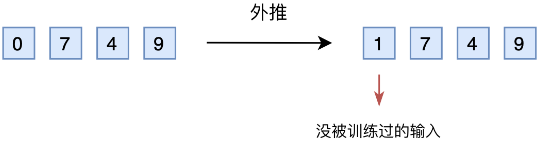
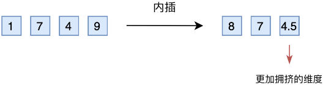
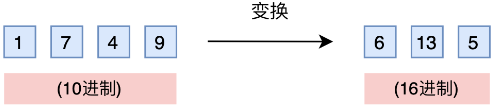
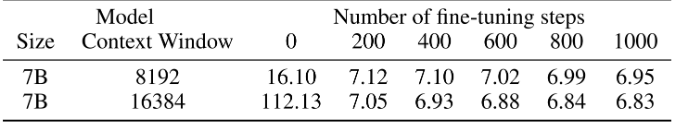

## 

- [第一部分 背景知识：从进制表示谈到直接外推、线性内插、进制转换](#第一部分-背景知识从进制表示谈到直接外推线性内插进制转换)
  - [1.1 从进制表示到直接外推](#11-从进制表示到直接外推)
  - [1.2 从线性内插到进制转换](#12-从线性内插到进制转换)
- [第二部分 从RoPE、直接外推到位置内插Position Interpolation](#第二部分-从rope直接外推到位置内插position-interpolation)
  - [2.1 旋转位置嵌入](#21-旋转位置嵌入)
  - [2.2 直接外推之ALiBi](#22-直接外推之alibi)
  - [2.3 位置内插：基于Positional Interpolation扩大模型的上下文窗口](#23-位置内插基于positional-interpolation扩大模型的上下文窗口)
- [第三部分 从NTK-aware、NTK-by-parts到Dynamic NTK插值](#第三部分-从ntk-awarentk-by-parts到dynamic-ntk插值)
  - [3.1 NTK-aware插值：高频外推，低频内插](#31-ntk-aware插值高频外推低频内插)
  - [3.2 相对局部距离的损失-NTK-by-parts插值](#32-相对局部距离的损失-ntk-by-parts插值)
  - [3.3 Dynamic NTK 插值](#33-dynamic-ntk-插值)
- [第四部分 YaRN全面解析](#第四部分-yarn全面解析)
- [第五部分 LongLora所用的Shifted Sparse Attention(S2-Attn)](#第五部分-longlora所用的shifted-sparse-attentions2-attn)

---

## 第一部分 背景知识：从进制表示谈到直接外推、线性内插、进制转换

### 1.1 从进制表示到直接外推

#### 1.1.1 进制表示

假设我们有一个 1000 以内（不包含 1000）的整数 $n$ 要作为条件输入到模型中，那么要以哪种方式比较好呢？

1. 最朴素的想法是直接作为一维浮点向量输入，然而 0～999 这涉及到近千的跨度，对基于梯度的优化器来说并不容易优化得动。那缩放到 0～1 之间呢？也不大好，因为此时相邻的差距从 1 变成了 0.001，模型和优化器都不容易分辨相邻的数字。

2. 进一步，对于一个整数，比如 759，这是一个 10 进制的三位数，每位数字是 0～9。既然我们自己都是用 10 进制来表示数字的，为什么不直接将 10 进制表示直接输入模型呢？也就是说，我们将整数 $n$ 以一个三维向量 $[a,b,c]$ 来输入，$a,b,c$ 分别是 $n$ 的百位、十位、个位。

至于如果想要进一步缩小数字的跨度，我们还可以进一步缩小进制的基数，如使用 8 进制、6 进制甚至 2 进制，代价是进一步增加输入的维度。

#### 1.1.2 直接外推

苏剑林说，假设我们还是用三维 10 进制表示训练了模型，模型效果还不错。然后突然来了个新需求，将 $n$ 上限增加到 2000 以内，那么该如何处理呢？

如果还是用 10 进制表示的向量输入到模型，那么此时的输入就是一个四维向量了。然而，原本的模型是针对三维向量设计和训练的，所以新增一个维度后，模型就无法处理了。可能有读者想说，为什么不能提前预留好足够多的维度呢？

没错，是可以提前预留多几维，训练阶段设为 0，推理阶段直接改为其他数字，这就是**外推（Extrapolation）**。



然而，训练阶段预留的维度一直是 0，如果推理阶段改为其他数字，效果不见得会好，因为模型对没被训练过的情况不一定具有适应能力。

也就是说，由于某些维度的训练数据不充分，所以**直接进行外推通常会导致模型的性能严重下降**。

### 1.2 从线性内插到进制转换

#### 1.2.1 线性内插

于是，有人想到了将外推改为**内插（Interpolation）**，简单来说就是将 2000 以内压缩到 1000 以内。



1. 比如通过除以 2，1749 就变成了 874.5，然后转为三维向量 $[8,7,4.5]$ 输入到原来的模型中。

   - 从绝对数值来看，新的 $[7,4,9]$ 实际上对应的是 1498，是原本对应的 2 倍，映射方式不一致；
   - 从相对数值来看，原本相邻数字的差距为 1，现在是 0.5，最后一个维度更加"拥挤"。

2. 所以，做了内插修改后，通常都需要微调训练，以便模型重新适应拥挤的映射关系。

当然，有读者会说外推方案也可以微调。是的，但内插方案微调所需要的步数要少得多。

- 因为很多场景（比如位置编码）下，相对大小（或许说序信息）更加重要，换句话说模型只需要知道 874.5 比 874 大就行了，不需要知道它实际代表多大的数字。而原本模型已经学会了 875 比 874 大，加之模型本身有一定的泛化能力，所以再多学一个 874.5 比 874 大不会太难。

- 不过，内插方案也不尽完美，当处理范围进一步增大时，相邻差异则更小，并且这个相邻差异变小集中在个位数，剩下的百位、十位，还是保留了相邻差异为 1。

换句话说，内插方法使得不同维度的分布情况不一样，每个维度变得不对等起来，模型进一步学习难度也更大。

#### 1.2.2 进制转换

有没有不用新增维度，又能保持相邻差距的方案呢？有，那就是**进制转换**。

- 三个数字的 10 进制编码可以表示 0～999；
- 如果是 16 进制呢？它最大可以表示

$$
16^3 - 1 = 4095 > 1999
$$

所以，只需要转到 16 进制，如 1749 变为 $[6, 13, 5]$，那么三维向量就可以覆盖目标范围，代价是每个维度的数字从 0～9 变为 0～15。



刚才说到，我们关心的场景主要利用序信息。

1. 原来训练好的模型已经学会了 $875 > 874$，而在 16 进制下同样有 $875 > 874$，比较规则是一模一样的。

2. 唯一担心的是每个维度超过 9 之后（10～15）模型还能不能正常比较，但事实上一般模型也有一定的泛化能力，所以每个维度稍微往外推一些是没问题的。所以，这个转换进制的思路，甚至**可能不微调原来模型也有效**。

另外，为了进一步**缩窄外推范围**，我们还可以换用更小的基数：

$$
\left\lceil \sqrt[3]{2000} \right\rceil = 13
$$

即 13 进制而不是 16 进制。

---

## 第二部分 从RoPE、直接外推到位置内插Position Interpolation

基于 transformer 的大型语言模型已经成为许多 NLP 任务的首选模型，其远程能力（如上下文学习（ICL））至关重要。在执行 NLP 任务时，其上下文窗口的最大长度一直是预训练 LLM 的主要限制之一。故，是否能够通过少量的微调（或不进行微调）来动态扩展上下文窗口已经变得越来越受关注。为此，transformer 的位置编码是经常讨论的核心焦点问题。

1. 最初的 Transformer 架构使用了绝对正弦位置编码，后来被改进为可学习的绝对位置编码，此后，相对位置编码方案进一步提升了 transformer 的性能。

   目前，最流行的相对位置编码是 T5 relative Bias、RoPE、XPos 和 ALiBi。

2. 位置编码的一个反复出现的限制是无法对「训练期间看到的上下文窗口之外的情况」进行泛化。

   虽然 ALiBi 等一些方法能够进行有限的泛化，但没有一种方法能够泛化到明显长于预训练长度的序列。

3. 好在已经有一些工作正在尝试克服这种限制。比如位置插值（Position Interpolation, PI），通过对 RoPE 进行轻微修改，并对少量数据进行微调，从而扩展上下文长度。

4. 作为一种替代方案，Reddit 网友 bloc97 通过[该帖子](https://www.reddit.com/r/LocalLLaMA/comments/14lz7j5/ntkaware_scaled_rope_allows_llama_models_to_have/)，提出了"**NTK-aware**"插值方法，该方法考虑到高频信号的损失。

   此后，对"NTK 感知"插值提出了两项改进：

   - 无需微调的预训练模型的"**动态 NTK**"插值方法；
   - 在对少量较长的上下文数据进行微调时表现最佳的"**NTK-by-parts**"插值方法。

   "NTK 感知"插值和"Dynamic NTK"插值已经在开源模型中出现，如 Code Llama 使用"NTK 感知"插值，Qwen 7B 使用"动态 NTK"。

### 2.1 旋转位置嵌入

#### 2.1.1 RoPE的快速回顾

1. 首先，我们在一个隐藏层上工作，隐藏神经元的集合用 $d$ 表示。给定向量序列 $x_1, \cdots, x_L \in \mathbb{R}^{|D|}$，遵循 RoPE 的表示法，注意力层首先将向量转换为查询向量和关键向量：

$$
q_m = f_q(x_m, m) \in \mathbb{R}^{|D|}, \qquad k_n = f_k(x_n, n) \in \mathbb{R}^{|D|}
$$

2. 接下来，注意力权重被计算为 $\text{softmax}\left(\dfrac{q_m^{\top} k_n}{\sqrt{|D|}}\right)$。在 RoPE 中，我们首先假设 $|D|$ 是偶数，并将嵌入空间和隐藏状态识别为 complex vector spaces（复向量空间）。

#### 2.1.2 位置n的旋转位置编码，本质上就是数字n的β进制编码

首先，如苏剑林所说，位置 $n$ 的旋转位置编码（RoPE），本质上就是数字 $n$ 的 $\beta$ 进制编码。

为了理解这一点，我们首先回忆一个 10 进制的数字 $n$，我们想要求它的 $\beta$ 进制表示的（从右往左数）第 $m$ 位数字，方法是根据下面的公式计算得到（**记为公式1**）：

$$
\left\lfloor \frac{n}{\beta^{m-1}} \right\rfloor \bmod \beta
$$

先除以 $\beta^{m-1}$ 次方，然后求模（余数）。

例如，让我们找到十进制数 12345 中从右边数的第三位的数字，相当于 $n=12345$，$\beta=10$，$m=3$。

按照公式，首先计算：

$$
\beta^{m-1} = 10^{3-1} = 10^2 = 100
$$

然后：

$$
\frac{n}{\beta^{m-1}} = \frac{12345}{100} = 123.45
$$

向下取整得 123，再对 $\beta$ 取模，得 3。

其次，苏剑林在其博客中再说道，RoPE 的构造基础是 Sinusoidal（正弦曲线）位置编码，可以改写为下面的公式（**记为公式2**）：

$$
[\cos(n\beta^0), \sin(n\beta^0), \cos(n\beta^1), \sin(n\beta^1), \cdots, \cos(n\beta^{d/2-1}), \sin(n\beta^{d/2-1})]
$$

其中：

$$
\beta = 10000^{\frac{2}{d}}
$$

transformer 原始论文中的 Sinusoidal 位置编码：

$$
PE_{(pos, 2i+1)} = \cos\left(\frac{pos}{10000^{\frac{2i}{d_{model}}}}\right), \qquad
PE_{(pos, 2i)} = \sin\left(\frac{pos}{10000^{\frac{2i}{d_{model}}}}\right)
$$

于是：

$$
\cos\left(\frac{n}{10000^{2i/d}}\right)
= \cos\left(\frac{n}{10000^{(2/d)\cdot i}}\right)
= \cos\left(\frac{n}{(10000^{2/d})^i}\right)
= \cos(n\beta^i)
$$

现在，对比公式1、公式2，是不是也有一模一样的 $\dfrac{n}{\beta^{m-1}}$？

至于模运算，它的最重要特性是周期性，而公式2的 $\cos$、$\sin$ 是不是刚好也是周期函数？所以，除掉取整函数这个无关紧要的差异外，RoPE（或者说 Sinusoidal 位置编码）其实就是数字 $n$ 的 $\beta$ 进制编码。

### 2.2 直接外推之ALiBi

简言之，ALiBi 是对 Transformers 进行长度外推，即在短上下文窗口上进行训练，并在较长的上下文窗口上进行推理。

- 好处是虽然一开始不用对模型结构做任何更改；
- 但坏处是直接把位置外推到没有见到的地方会导致模型灾难性的崩坏（例如体现在 PPL 陡增），为了弥补，需要再做一些微调。

### 2.3 位置内插：基于Positional Interpolation扩大模型的上下文窗口

#### 2.3.1 RoPE的问题：直接外推会出现比较大的Attention Score

再次回顾一下 RoPE。

给定位置索引 $m \in [0, c)$ 和嵌入向量 $x := [x_0, x_1, \ldots, x_{d-1}]^{\top}$，其中 $d$ 是注意力头的维度，RoPE 定义了一个向量值复杂函数 $f(x, m)$：

$$
f(x, m) = \left[(x_0 + i x_1)e^{im\theta_0}, (x_2 + i x_3)e^{im\theta_1}, \ldots, (x_{d-2} + i x_{d-1})e^{im\theta_{d/2-1}}\right]^{\top}
$$

使用 RoPE 之后，其自注意力得分为：

$$
\begin{aligned}
a(m,n) &= \operatorname{Re}\langle f(q,m), f(k,n)\rangle \\
&= \operatorname{Re}\left[\sum_{j=0}^{d/2-1} (q_{2j} + i q_{2j+1})(k_{2j} - i k_{2j+1}) e^{i(m-n)\theta_j}\right] \\
&= \sum_{j=0}^{d/2-1} \Big[(q_{2j}k_{2j} + q_{2j+1}k_{2j+1})\cos((m-n)\theta_j) \\
&\qquad\qquad + (q_{2j}k_{2j+1} - q_{2j+1}k_{2j})\sin((m-n)\theta_j)\Big] \\
&=: a(m-n)
\end{aligned}
$$

可知，这个自注意力得分 $a(m,n)$ 仅仅依赖于相对位置 $m-n$（通过三角函数）。

在每一层，RoPE 被应用于查询和键嵌入以计算注意力分数。

虽然 RoPE 的上界确实随着 $|m-n|$ 的减小而衰减，但上界仍然可能相当大（即上界可能严重依赖于 $v_j$ 的大小），因此是无效的。

#### 2.3.2 什么是位置内插Positional Interpolation

由于语言模型通常是用固定的上下文长度进行预训练的，自然会问如何通过在相对较少的数据量上进行微调来扩展上下文长度。

对于使用 RoPE 作为位置嵌入的语言模型，Chen 等人[9]和 kaiokendev[21]同时提出了位置插值（Position Interpolation, PI），将上下文长度扩展到预训练极限之外。对于后者 Super-HOT kaiokendev（2023）的工作，它在 RoPE 中插入了位置编码，将上下文窗口从 2K 扩展到 8K。

对于前者 Chen 等人的工作，按照该篇论文《Extending context window of large language models via positional interpolation》，可知：

1. 关键思想是，我们不是进行外推，而是直接将位置索引缩小（*不是插值位置嵌入，而是**插值位置索引***，这对于 RoPE 等位置编码更合适，并且可能需要较少的训练，因为没有添加可训练参数），使最大位置索引与预训练阶段的先前上下文窗口限制相匹配。至于理论依据就是可以在相邻的整数位置上插值位置编码，毕竟位置编码可以应用在非整数的位置上。

如下图所示，下图左上角为预训练阶段的位置向量范围 $[0, 2048]$，右上角为长度外推的部分 $(2048, 4096]$。


如果直接使用位置 $(2048, 4096]$ 进行推理，那么因为模型没有见过这一部分的位置，效果会出现灾难性的下降。那么，就把 $[0, 4096]$ 这个区间"压缩"到 $[0, 2048]$ 不就可以了嘛。

于是，原先的 1 就变成了 0.5，4096 就变成了 2048，这就是**位置内插法**，即把没见过的位置映射到见过的位置。

2. 相当于对于绝对位置 $m$，把它缩放一下，变成 $m\dfrac{L'}{L}$，其中 $L$ 为原先支持的长度，$L'$ 为需要扩展的长度。

在计算 query 和 key 的时候，就有：

$$
f_{W'}(x_m, m, \theta_d) = f_W\left(x_m, m\frac{L}{L'}, \theta_d\right)
$$

3. 最终，通过位置插值方法，将预训练的 7B、13B、33B 和 65B LLaMA 模型（Touvron 等人，2023）扩展到大小为 32768 的各种上下文窗口。

   只需要在 Pile（*是个书籍语料库*）等数据集上进行 1000 步的微调即可获得良好的质量，这与预训练成本相比，微调的成本可以忽略不计。

   且微调过程只需要数万到数十万个示例，微调的结果对示例的选择不敏感。原因在于模型在微调阶段仅适应新的上下文窗口，从良好的初始化开始，而不是获取新的知识。

总之，PI 除了重新缩放使用位置插值扩展的模型的位置索引外，没有以任何方式修改 LLaMA 模型架构（*包括其中的自注意力机制，从而减轻了上下文窗口扩展对注意力分数计算的影响*）。

那 PI 之后，是否一定要微调呢？也不一定，只是效果有所区别而已，具体而言：



**大概仅需要 200 步就可以稳定下来，再微调到 1000 步增益较小**。

1. PI 之后，在没有微调的情况下（在步骤 0），模型可以展示出一定的语言建模能力，如扩展到 8192 上下文窗口的困惑度 < 20 所示（相比之下，直接外推方法导致困惑度 > $10^3$）。

2. PI 之后，经过微调，困惑度迅速改善。在 200 步时，模型超过了 2048 上下文窗口大小的原始模型困惑度，表明模型能够有效地使用比预训练设置更长的序列进行语言建模。在 1000 步时，我们可以看到模型稳步改善，并取得了显著更好的困惑度。

PI 也比直接微调的效果更好。

以下是我司在通过 PI 微调 llama 3 时（*更多详见：一文速览 Llama 3 及其微调：如何通过 paper-review 数据集微调 Llama3 8B*）：

- 直接用的 longlora 的代码（*至于什么是 longlora，请参见此文：《从 LongLoRA 到 LongQLoRA（含源码剖析）：大模型上下文长度的超强扩展》*）；
- 因为 **longlora 的代码实现了 PI + S2-attn，故把 S2-attn 相关的部分注释掉后，即相当于通过 PI 微调 llama 3 了**。

#### 2.3.3 位置内插的问题

话说，位置插值法有什么问题呢？

1. 我们先看下三角函数 $\sin(wx)$，它的周期是：

$$
T = \frac{2\pi}{w}
$$

对应到 RoPE 里的每个维度 $\sin(m\theta_j), \cos(m\theta_j)$，其中：

$$
\theta_j = 10000^{-\frac{2(j-1)}{d}}, \qquad j \in [1, 2, \ldots, d/2]
$$

$m$ 指位置，$j$ 指维度。

2. 计算得到周期为：

$$
T_j = \frac{2\pi}{\theta_j} = 2\pi \cdot 10000^{\frac{2(j-1)}{d}}
$$

从周期计算的公式我们可以知道，针对不同的维度编码 $j$，每个维度对应的三角函数周期是越来越大的（即对应到低频、高频）。

如果插值是针对绝对位置 $m$，那么对每个维度 $j$ 都同等地生效；但是周期小（高频）维度，插值之后会变得很密集（本来一个周期包含 10 个值，但是内插之后能包含 20 个值），这样高频的维度就变得很拥挤。

---

## 第三部分 从NTK-aware、NTK-by-parts到Dynamic NTK插值

### 3.1 NTK-aware插值：高频外推，低频内插

为了解决 RoPE 嵌入插值时丢失高频信息的问题，Reddit 网友 bloc97 开发了 NTK-aware 插值，核心思想是：**高频外推，低频内插**。

**1.）** NTK-aware 通过引入 $\lambda$ 来调整频率，使得位置编码在不同频率下更加适应内插或外推的需求。

- **外推**：描述的是一种情境，指的是模型处理超出其训练范围的数据的情况，而不是一种具体的操作。
- **内插**：指在已知数据点之间进行预测。这意味着模型处理的数据位于其训练数据的范围之内。

高频外推和低频内插是描述位置编码在不同频率下如何处理位置信息的方式。**在模型的位置信息处理中，高频和低频项的处理方式是不同的**。

**高频外推**：

- 含义：高频外推指的是位置编码中的高频项在处理超出训练数据范围的位置时，仍能保持其快速变化的特性，从而捕捉到细粒度的位置信息。
- 原因：高频项变化迅速，能够捕捉到细微的位置变化。在超出训练范围（外推）时，高频项仍然需要提供细粒度的位置信息，以确保模型能够准确地理解和处理新的位置。

**低频内插**：

- 含义：低频内插指的是位置编码中的低频项在处理训练数据范围内的位置时，通过频率的调整，使其能够平滑过渡，从而捕捉到较大范围的位置变化。
- 原因：低频项变化较慢，负责捕捉长距离、大范围的位置关系；内插使其在训练范围内平滑过渡。

**2.）** 具体地，我们是要把公式2：

$$
[\cos(n\beta^0), \sin(n\beta^0), \cos(n\beta^1), \sin(n\beta^1), \cdots, \cos(n\beta^{d/2-1}), \sin(n\beta^{d/2-1})]
$$

中的最低频项 $n\beta^{d/2-1}$，引入参数 $\lambda$，从而变为 $n(\beta\lambda)^{d/2-1}$，让它跟内插一致（内插就是将 $n$ 换成 $n/k$，其中 $k$ 是要扩大的倍数），即：

$$
n(\beta\lambda)^{d/2-1} = \frac{n}{k}\beta^{d/2-1}
$$

从而解得：

$$
\lambda = k^{\frac{2}{d-2}}
$$

**3.）** 公式2 中的最高频是 $n\beta$ 项，引入 $\lambda$ 后变为 $n\beta\lambda$，由于 $d$ 通常很大，$\lambda$ 很接近 1，所以还是接近于 $n\beta$，即等价于外推。

由此，NTK-aware 便把外推和内插结合起来了。

**高频和低频在RoPE中的位置和作用？**

- **低频部分**：低频分量是指频率较低的项，也就是指数较大的项，最低频项 $n\beta^{d/2-1}$。频率低指这些项变化较慢，对应的位置变化也较慢。
- **高频部分**：高频分量是指频率较高的项，也就是指数较小的项，这些项变化较快，对应的位置变化也较快。

示例：假设基数 $\beta = 10000$，我们来看以下位置 $n$ 的变化：$10, 11, 12, 13, 14, 15$。

**高频项**：例如 $\cos(n\beta^0) = \cos(n)$，计算：

$$
\cos(10), \cos(11), \cos(12), \cos(13), \cos(14), \cos(15)
$$

这些值的变化会很快，因为频率高，角度变化较大：

$$
\begin{aligned}
\cos(10) &\approx -0.839, & \cos(11) &\approx 0.004, & \cos(12) &\approx 0.843, \\
\cos(13) &\approx 0.907, & \cos(14) &\approx 0.136, & \cos(15) &\approx -0.759
\end{aligned}
$$

这些值变化非常剧烈，说明高频项对位置变化非常敏感。

**低频项**：例如 $\cos(n\beta^5) = \cos\left(\dfrac{n}{10000^5}\right)$，这些值的变化会很慢，因为频率低，角度变化极小：

$$
\cos\left(\frac{10}{10000^5}\right) \approx 1.0,\quad \cos\left(\frac{11}{10000^5}\right) \approx 1.0,\quad \ldots,\quad \cos\left(\frac{15}{10000^5}\right) \approx 1.0
$$

这些值几乎没有变化，说明低频项对位置变化不敏感，变化较慢。

**高频维度位置内插变得很拥挤？**

在内插时，即便是很小的变化也会导致显著的编码变化，这就是所谓的"拥挤"。

即使位置只增加了 1，编码的值也有较大的变化，这使得在这些高频维度上进行位置内插时，变化非常拥挤且难以平滑过渡。

**RoPE嵌入插值时丢失高频信息？**

1. 高频位置信息的准确性丢失：插值方法无法准确捕捉高频项的剧烈变化，导致位置编码不能准确反映实际位置。
2. token 信息的丢失：由于高频位置信息的不准确，模型对 token 相对位置的理解受到影响，从而影响模型对整个序列的理解和处理。

**进一步理解高频低频项？**


与位置插值 PI 相比，该方法在扩展非微调模型的上下文大小方面表现得更好。

1. 然而，这种方法的一个**主要缺点**是，由于它不仅仅是一种插值方案，一些维度被轻微外推到"超出边界"的值，因此使用"NTK-aware"插值进行微调的结果不如 PI。

2. 此外，由于存在"越界"值，理论尺度因子 $s$ 并不能准确描述真实的上下文扩展尺度。在实践中，对于给定的上下文长度扩展，尺度值 $s$ 必须设置得高于预期尺度。

Code Llama 发布了，并通过手动将基数 $b$ 扩展到 1M（使用"NTK-aware"扩展）。

#### 3.1.1 NTK-aware代码实现

再次总结 & 精炼：

NTK-aware 插值的本质在于调整 RoPE（Rotary Position Embedding）的频率参数，使其能够更好地适应长上下文和外推情况。

具体而言，它通过调整频率参数的基数，使得嵌入向量在高频和低频部分的分布更加均匀，从而在插值时能够更好地保留高频信息。

Llama 的 NTK-aware 实现中，base 从 1W 改为了近似 66W。

```python
def ntk_scaled_init(self, dim, max_position_embeddings=2048, base=10000, device=None):
    '''
    dim：每个head的维度，self.head_dim = self.hidden_size // self.num_heads
    llama配置文件中 hidden_size=4096, num_attention_heads=32
    这样计算 dim=128
    这样计算出来新的base近似为66W
    '''
    # 调整 max_position_embeddings 和 base
    max_position_embeddings = 16384
    a = 8  # Alpha value
    base = base * a ** (dim / (dim - 2))  # 根据公式调整base的值
    old_init(self, dim, max_position_embeddings, base, device)
```

FROM: https://www.reddit.com/r/LocalLLaMA/comments/14lz7j5/ntkaware_scaled_rope_allows_llama_models_to_have/

1. 简单地"线性"插值 RoPE 的傅里叶空间是非常次优的，因为它阻止了网络区分非常接近的令牌的顺序和位置。过度缩小傅里叶特征最终甚至会阻止成功的微调（Meta 最近的论文证实了这一点，该论文建议上限为 ~600 倍）。

2. 作者设计了一种非线性插值方案，而不是简单的线性插值方案。

   这种插值方案改变了 RoPE 的 base 而不是 scale，这直观地改变了每个 RoPE 的维度向量与下一个维度向量相比的"旋转"速度。因为它不直接缩放傅里叶特征，所以所有位置都可以完全区分，即使走到极端（例如，拉伸 100 万次，这实际上是 20 亿的上下文大小）。

令我惊讶的是，这种方法效果非常好，以至于您甚至不需要针对 4096 上下文大小微调 LLaMA 7B 模型！困惑度的降低是最小的。我相信通过微调，这会变得更好。

```python
import transformers

# transformers 库中的 LlamaRotaryEmbedding 类的初始化方法，原始方法
old_init = transformers.models.llama.modeling_llama.LlamaRotaryEmbedding.__init__

# 定义NTK-aware初始化方式
def ntk_scaled_init(self, dim, max_position_embeddings=2048, base=10000, device=None):
    # 调整 max_position_embeddings 和 base
    max_position_embeddings = 16384
    a = 8  # Alpha value
    base = base * a ** (dim / (dim - 2))  # 根据公式调整base的值
    old_init(self, dim, max_position_embeddings, base, device)  # 应用NTK-aware初始化方式

transformers.models.llama.modeling_llama.LlamaRotaryEmbedding.__init__ = ntk_scaled_init

model_path = "TheBloke/OpenAssistant-SFT-7-Llama-30B-HF"
tokenizer = AutoTokenizer.from_pretrained(model_path)
model = AutoModelForCausalLM.from_pretrained(model_path, torch_dtype=torch.float16, device_map="auto")
```

```python
class LlamaAttention(nn.Module):
    def __init__(self, config: LlamaConfig, layer_idx: Optional[int] = None):
        self.max_position_embeddings = config.max_position_embeddings
        self.rope_theta = config.rope_theta
        self._init_rope()

    def _init_rope(self):
        # RoPE
        if self.config.rope_scaling is None:
            self.rotary_emb = LlamaRotaryEmbedding(
                self.head_dim,
                max_position_embeddings=self.max_position_embeddings,
                base=self.rope_theta,
            )
        else:
            scaling_type = self.config.rope_scaling["type"]
            scaling_factor = self.config.rope_scaling["factor"]
            # 线性插值？
            if scaling_type == "linear":
                self.rotary_emb = LlamaLinearScalingRotaryEmbedding(
                    self.head_dim,
                    max_position_embeddings=self.max_position_embeddings,
                    scaling_factor=scaling_factor,
                    base=self.rope_theta,
                )
            elif scaling_type == "dynamic":
                self.rotary_emb = LlamaDynamicNTKScalingRotaryEmbedding(
                    self.head_dim,
                    max_position_embeddings=self.max_position_embeddings,
                    scaling_factor=scaling_factor,
                    base=self.rope_theta,
                )
            else:
                raise ValueError(f"Unknown RoPE scaling type {scaling_type}")
```

在 RoPE 中，通过旋转的位置编码方式，将位置信息融入到输入嵌入中。

逆频率矩阵：需要计算一系列频率，用于生成位置嵌入的正弦和余弦函数：

$$
\text{invfreq} = \frac{1}{\text{base}^{\, [0:\text{dim}:2]\, /\, \text{dim}}}
$$

```python
# LLama实现的RoPE
class LlamaRotaryEmbedding(nn.Module):
    def __init__(self, dim, max_position_embeddings=2048, base=10000, device=None, scaling_factor=1.0):
        '''
        dim：嵌入维度
        max_position_embeddings：最大位置嵌入数，默认为2048
        base：用于计算频率的基数，默认为10000
        scaling_factor：缩放因子，默认为1.0
        '''
        super().__init__()
        self.scaling_factor = scaling_factor
        self.dim = dim
        self.max_position_embeddings = max_position_embeddings
        self.base = base
        # 逆频率矩阵
        inv_freq = 1.0 / (self.base ** (torch.arange(0, self.dim, 2, dtype=torch.int64).float().to(device) / self.dim))
        self.register_buffer("inv_freq", inv_freq, persistent=False)
        # For BC we register cos and sin cached
        self.max_seq_len_cached = max_position_embeddings

    @torch.no_grad()
    def forward(self, x, position_ids):
        '''
        x：输入张量，形状为 [batch_size, num_attention_heads, seq_len, head_size]。
        position_ids：位置索引，形状为 [batch_size, seq_len]。
        '''
        inv_freq_expanded = self.inv_freq[None, :, None].float().expand(position_ids.shape[0], -1, 1)
        position_ids_expanded = position_ids[:, None, :].float()
        # Force float32 since bfloat16 loses precision on long contexts
        # See https://github.com/huggingface/transformers/pull/29285
        device_type = x.device.type
        device_type = device_type if isinstance(device_type, str) and device_type != "mps" else "cpu"
        # 上下文管理器，显式禁用自动类型转换
        with torch.autocast(device_type=device_type, enabled=False):
            # 逆频率矩阵 @ 位置ID张量
            # 频率嵌入矩阵
            freqs = (inv_freq_expanded.float() @ position_ids_expanded.float()).transpose(1, 2)
            emb = torch.cat((freqs, freqs), dim=-1)
            cos = emb.cos()
            sin = emb.sin()
        return cos.to(dtype=x.dtype), sin.to(dtype=x.dtype)
```

```python
# RoPE 线性插值
class LlamaLinearScalingRotaryEmbedding(LlamaRotaryEmbedding):
    """LlamaRotaryEmbedding extended with linear scaling. Credits to the Reddit user /u/kaiokendev"""

    def forward(self, x, position_ids):
        # difference to the original RoPE: a scaling factor is aplied to the position ids
        # 将位置 ID 除以 self.scaling_factor，实现线性缩放。
        position_ids = position_ids.float() / self.scaling_factor
        cos, sin = super().forward(x, position_ids)
        return cos, sin
```

### 3.2 相对局部距离的损失-NTK-by-parts插值

**NTK-by-parts 插值考虑了波长与上下文的关系。**

先介绍一个概念，**波长**：维度 $d$ 上嵌入的 RoPE，执行完整旋转（$2\pi$）所需的标记长度。

一般而言，把 $\lambda_d$ 定义为 RoPE 嵌入在第 $d$ 维处的波长：

$$
\lambda_d = \frac{2\pi}{\theta_d} = 2\pi b^{\frac{2d}{|D|}}
$$

有一些插值方法（例如位置插值 PI）不关心波长的维数（维数不同，波长不同），我们将这些方法称为"盲"插值方法（blind interpolation）。比如像 PI 和"NTK-aware"插值这样的 blind interpolation 方法中，我们面对所有 RoPE 隐藏维度没有做任何针对性的处理（因为它们对网络有相同的影响），而其他方法（如 YaRN），我们将其归类为"有针对性的"插值方法。

进一步，关于 RoPE 嵌入的一个有趣的观察是：

1. 给定上下文大小 $L$，有一些维数 $d$ 的波长长于预训练期间看到的最大上下文长度（$\lambda_d > L$），这表明一些维数的嵌入可能在旋转域中不均匀分布。

   我们假设拥有所有唯一 position pairs 意味着绝对位置信息保持不变。

   当波长很长时，这些维度上的嵌入几乎不变，可以认为它们保持了绝对位置信息，即每个位置的嵌入不因相对位置变化而变化。

   相反，当波长较短时，只有相对位置信息可以被网络访问。

   当波长较短时，嵌入会在较短的距离内完成多次旋转，这使得这些维度上的嵌入反映的是相对位置信息，即它们可以捕捉到标记之间的相对距离变化。

2. 此外，当我们以 $s$ 的比例或使用 $b'$ 的基数将 RoPE 的所有维度进行拉伸时，所有 tokens 都变得更彼此接近，因为两个向量的点积在旋转较小的量时更大。

   拉伸 RoPE 嵌入后，同样的位移对应的旋转角度变化减小。由 $a \cdot b = \|a\|\|b\|\cos(\theta)$，内积变大，向量更加接近（当两个向量的内积变大时，意味着它们之间的夹角变小，向量指向更加相似的方向，从而可以说向量变得更加接近）。

   → 模型处理邻近标记位置时容易混淆，损害模型性能。

这种缩放严重损害了 LLM 理解其内部嵌入之间的小型和局部关系的能力。我们假设，这种压缩导致模型在邻近标记的位置顺序上被混淆，从而损害模型的能力。

为了解决上述问题，选择不插值更高频率的维度，而总是插值更低频率的维度：

- 如果波长 $\lambda$ 比上下文长度 $L$ 小得多，此时不插值；
- 如果波长 $\lambda$ 等于或大于上下文长度 $L$，此时只做插值，不做任何外推；
- 两者之间的维数可以兼备。

因此，在原始上下文大小 $L$ 和波长 $\lambda$ 之间引入比率 $r = \dfrac{L}{\lambda}$，且维数为 $d$ 时，比率 $r$ 以如下方式依赖于 $d$：

$$
r(d) = \frac{L}{\lambda_d} = \frac{L}{2\pi} b^{\frac{2d}{|D|}}
$$

为了确定上述不同插值策略的边界，引入两个额外参数 $\alpha, \beta$，且针对所有隐藏维度 $d$：

- 如果 $r(d) < \alpha$，比如 $\alpha = 1$，意味着**波长大于上下文长度**，则将**线性插入一个尺度** $s$（完全像 PI，避免任何外推）；
- 至于如果是 $r(d) > \beta$，则不插值。

接下来，定义斜坡函数 $\gamma$：

$$
\gamma(r) =
\begin{cases}
0, & r < \alpha \\
1, & r > \beta \\
\dfrac{r - \alpha}{\beta - \alpha}, & \text{otherwise}
\end{cases}
$$

借助该函数，NTK-by-parts 方法可以定义如下。

NTK-by-parts 插值是对 RoPE 的一种修改，基于以下函数：

$$
g(m) = m
$$

$$
h(\theta_d) = (1 - \gamma(r(d)))\frac{\theta_d}{s} + \gamma(r(d))\theta_d
$$

1. 公式 $g(m) = m$ 表示对位置索引 $m$ 不做任何变化，意味着输入的位置索引在插值过程中保持不变。
2. 公式 $h(\theta_d)$ 用于调整不同维度上的频率参数 $\theta_d$。

$\alpha, \beta$ 的值根据具体情况进行调整，通过实验发现，对于 llama 系模型，较好的取值为 $\alpha = 1, \beta = 32$。

也就是说对于 llama 系模型，当**波长大于上下文长度时插值**，**波长小于上下文长度的 32 分之 1 时不插值**。

#### 3.2.1 NTK-by-parts 插值步骤

1. 首先，初始化 RoPE 嵌入的频率参数 $\theta_d$。

2. 根据公式 $h(\theta_d)$，对每个维度的频率参数 $\theta_d$ 进行调整，这里涉及两个部分：
   - 缩放后的频率 $\dfrac{\theta_d}{s}$；
   - 保持原始频率 $\theta_d$。

   通过权重函数 $\gamma(r(d))$ 进行组合，平滑过渡。

3. 将调整后的频率参数应用到 RoPE 嵌入上，得到新的频率参数：

$$
\theta_d' = (1 - \gamma(r(d)))\frac{\theta_d}{s} + \gamma(r(d))\theta_d
$$

4. 使用新的频率参数 $\theta_d'$ 计算嵌入向量：

$$
\text{RoPE}(p) = [\cos(\theta_d' p), \sin(\theta_d' p)]
$$

### 3.3 Dynamic NTK 插值

有两种方法可以应用使用比例因子 $s$ 的插值方法（包括 PI、"NTK-aware" 和 "NTK-by-parts"）：

1. **方法1**：在整个推理周期中，嵌入层是固定的，包括缩放因子 $s = L'/L$，其中 $L'$ 是固定数量的扩展上下文大小。

   问题在于模型在长度小于 $L$ 时可能出现性能折扣，当序列长度大于 $L'$ 时可能出现突然退化。

2. **方法2**：在每次前向传递中，位置嵌入更新缩放因子：

$$
s = \max\left(1, \frac{l'}{L}\right)
$$

其中 $l'$ 是当前序列的序列长度。

即为动态缩放方法，当再与 NTK-aware 插值相结合时，称之为**动态 NTK 插值**。

一个值得注意的事实是，动态 NTK 插值在 $L$ 上预训练的模型上工作得非常好，而不需要任何微调。

```python
# RoPE NTK动态插值
# 修改了base值和逆频率矩阵
class LlamaDynamicNTKScalingRotaryEmbedding(LlamaRotaryEmbedding):
    """LlamaRotaryEmbedding extended with Dynamic NTK scaling.
    Credits to the Reddit users /u/bloc97 and /u/emozilla"""

    def forward(self, x, position_ids):
        # difference to the original RoPE: inv_freq is recomputed when the sequence length > original length
        # 当序列长度 > 原始长度时，重新计算inv_freq
        seq_len = torch.max(position_ids) + 1
        if seq_len > self.max_position_embeddings:
            # base值根据原始base，缩放因子，序列长度重新计算
            base = self.base * (
                (self.scaling_factor * seq_len / self.max_position_embeddings) - (self.scaling_factor - 1)
            ) ** (self.dim / (self.dim - 2))
            inv_freq = 1.0 / (
                base ** (torch.arange(0, self.dim, 2, dtype=torch.int64).float().to(x.device) / self.dim)
            )
            self.register_buffer("inv_freq", inv_freq, persistent=False)  # TODO joao: this may break with compilation

        cos, sin = super().forward(x, position_ids)
        return cos, sin
```

---

## 第四部分 YaRN全面解析

YaRN（另一种 RoPE 扩展方法），这是一种改进的方法，可以有效地扩展使用旋转位置嵌入（RoPE）训练的模型的上下文窗口，包括 LLaMA、GPT-NeoX 和 PaLM 家族的模型。

### 4.1 YaRN怎么来的：基于NTK-by-parts插值修改注意力

将注意力权重的计算修改为：

$$
\text{softmax}\left(\frac{q_m^{\top} k_n}{t\sqrt{|D|}}\right)
$$

使 $q_m$ 和 $k_n$ 都以常数因子 $\dfrac{1}{t}$ 进行缩放。

对于 LLaMA 和 LLaMA 2 模型，推荐：

$$
\frac{1}{t} = 0.1\ln(s) + 1
$$

1. YaRN 方法在微调和非微调场景中均超过以前所有方法，由于其占用空间较小，YaRN 与修改注意力机制库（如 Flash Attention 2）直接兼容。

2. 且在对不到 0.1% 的原始预训练数据进行微调后，YaRN 在上下文窗口扩展中达到了最先进的性能。

同时，如果 YaRN 与动态缩放的推理技术相结合而得到的 Dynamic-YaRN，其允许在超过 2 倍的上下文窗口扩展，而无需任何微调。

